入口大厅（Salone di Mariano Rossi）原是别墅迎客的门厅，四壁与壁龛陈列古罗马雕塑、地面铺古代马赛克，头顶是马里亚诺·罗西满铺拱顶的巨幅天顶画——一进门就用「古罗马凯旋」的气势为整座馆定下基调。

**必看与核心展品（⭐⭐⭐ 必看 + 核心）**

| 推荐     | 展品               | 作者              | 一句话看点                   |
| ------ | ---------------- | --------------- | ----------------------- |
| ⭐⭐⭐ 必看 | 《马尔库斯·库尔提乌斯投身裂隙》 | 古罗马艺术／归属彼得罗·贝尼尼 | 嵌墙的骑马跃渊像，全厅巴洛克动势的序曲     |
| ⭐⭐⭐ 必看 | 天顶《罗慕路斯受迎进入奥林匹斯》 | 马里亚诺·罗西         | 整面「画穿屋顶」的错视巨制，全馆最震撼的天花板 |

**展厅官网介绍页**：[Entrance Hall - Mariano Rossi Hall](https://galleriaborghese.cultura.gov.it/en/il-museo/la-villa/ingresso-salone-di-mariano-rossi/)

## 核心展品

### ⭐⭐⭐ 必看 古罗马艺术；归属彼得罗·贝尼尼《马尔库斯·库尔提乌斯投身裂隙》 / Roman art and attributed to Pietro Bernini, _Marcus Curtius Throws Himself into the Chasm_

- **作者 / Artist**：古罗马艺术（马）／归属彼得罗·贝尼尼（骑士，1562–1629） / Roman art / attributed to Pietro Bernini
- **作品 / Work**：《马尔库斯·库尔提乌斯投身裂隙》 / _Marcus Curtius Throws Himself into the Chasm_
- **时间**：古代马匹为公元 2 世纪；骑士由彼得罗·贝尼尼于 1617 年补刻
- **材质**：白色卡拉拉大理石；马为彭忒利科大理石
- **尺寸**：高 220 cm；马高 120 cm、宽 240 cm
- **位置**：入口大厅（马里亚诺·罗西大厅）
- **官网介绍页**：[马尔库斯·库尔提乌斯投身裂隙 / Marco Curzio si getta nella voragine｜Galleria Borghese 官方藏品库](https://www.collezionegalleriaborghese.it/opere/marco-curzio-si-getta-nella-voragine)｜馆藏编号 VIIL

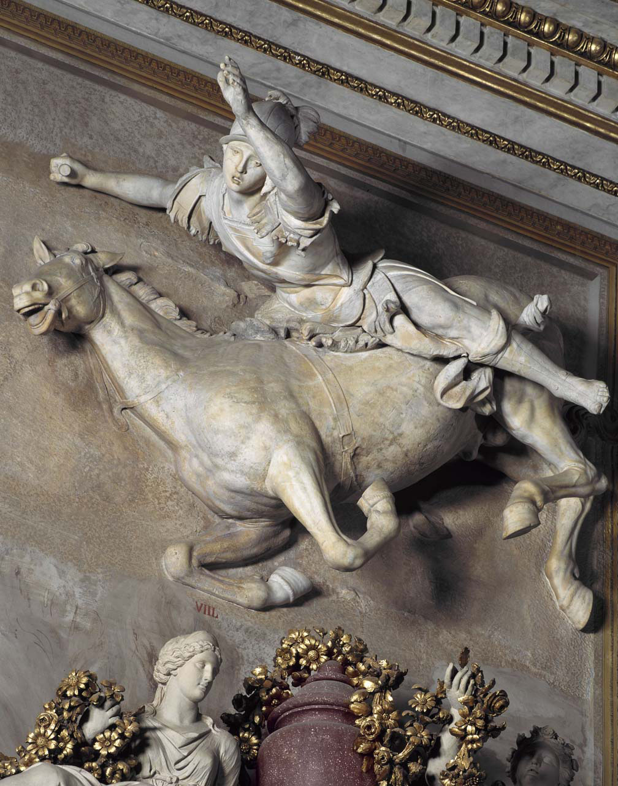

**这是什么**：入口大厅最重要的雕塑组，正对入口高处陈列。题材来自罗马传说——古罗马广场（Forum）地面突然裂开一道深渊，神谕说唯有把罗马最珍贵之物投入其中才能闭合；青年贵族马尔库斯·库尔提乌斯断言罗马最珍贵的就是「勇气与武德」，于是全副武装、纵马跃入深渊，以自我牺牲拯救全城，裂隙随即合拢。

**背景 / 来历**：它不是一件完整的古代原作。馆方藏品页说明它由两部分拼成——古代马匹残件出自 16 世纪中期对蒂沃利哈德良别墅附近的发掘；17 世纪由彼得罗·贝尼尼（Pietro Bernini，济安·贝尼尼之父）以「整合修复」方式补出腾跃的骑士，把一件古代残件改造成极富动势的巴洛克雕塑组。1777 年阿斯普鲁奇（Antonio Asprucci）把它移到入口大厅正对入口的高处，让它与天顶的罗马英雄主题上下呼应：天上是封神的罗慕路斯，地上正对你的是为城献身的库尔提乌斯。

**现场站看**：

1. **看整体动势**——马前蹄腾空、骑士身体前倾，是典型的巴洛克「定格在最高潮一瞬」。它放在入口轴线高处，就是要你一进门抬眼就被这股冲势抓住。
2. **找古今接缝**——下半的马身是古代残件、上半的骑士是 17 世纪补刻，可试着辨认大理石色泽与雕工的细微差别（马用 Pentelic、骑士用卡拉拉），这是博尔盖塞古物「古件＋后补」的代表案例。
3. **和天顶连起来看**——看完雕塑抬头看天顶罗慕路斯/卡米卢斯，理解阿斯普鲁奇的布展用意：整间厅都在讲「为罗马牺牲、再造罗马」的英雄叙事，最后盖上博尔盖塞家族的章。

## 天顶画
### ⭐⭐⭐ 必看 马里亚诺·罗西 入口大厅整面天顶湿壁画《罗慕路斯受迎进入奥林匹斯》（含四周寓意画《正义、忠诚、荣誉与时间战胜恶德》） / Mariano Rossi, _Romulus Welcomed into Olympus_ & _Justice, Fidelity, Honour, and Time Triumphing over the Vices_

- **作者 / Artist**：马里亚诺·罗西（1731–1807） / Mariano Rossi
- **作品 / Work**：《罗慕路斯受迎进入奥林匹斯》 / _Romulus Welcomed into Olympus_
- **时间**：1775–1779 年
- **位置**：入口大厅天顶

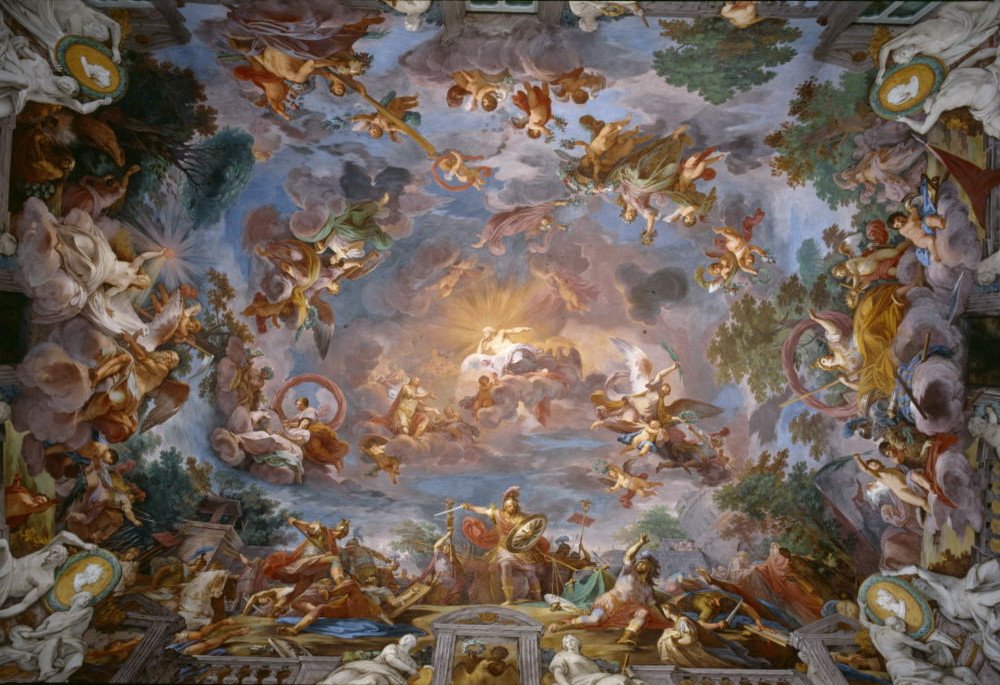

**这是什么**：占满整个入口大厅拱顶的巨型湿壁画（fresco），1775–1779 年由西西里画家马里亚诺·罗西绘制，这间厅因此直接以他命名为 Salone di Mariano Rossi（罗西大厅）。这是他公认的代表作，也是罗马 18 世纪最后一批大型幻觉天顶画的压卷之作。

> **注意：它是一整面天顶,不是两幅画。** 官方藏品库按区域把它登记成两条——画面正中的主场景《罗慕路斯受迎进入奥林匹斯》，与环绕主场景一圈的寓意画《正义、忠诚、荣誉与时间战胜恶德》。但物理上它就是连成一片的同一面湿壁画,下面合在一起讲:先看中央叙事,再看四周寓意。

**背景 / 主题**：表面画「罗慕路斯升天封神」，真正的主角其实是再造罗马的英雄卡米卢斯（Furius Camillus）。中央是朱庇特（Jupiter）在奥林匹斯迎接罗慕路斯神化；正对入口一侧画卡米卢斯撕毁向高卢王布伦努斯（Brennus）屈辱赎城的条约、击退高卢人、解救罗马。古代史家称卡米卢斯为「第二个罗慕路斯」，于是把「建城者」与「再造者」并置。壁画完成正逢亲王 Marcantonio IV Borghese 的长子卡米洛（Camillo，1775-08-08 出生）降生——与卡米卢斯同名，也呼应家族最荣耀的祖先、教皇保罗五世卡米洛·博尔盖塞。整幅画借古罗马英雄给小公子与家族贴金。

**四周的寓意层（官方另列为《正义、忠诚、荣誉与时间战胜恶德》）**：环绕中央主场景一圈的人物是整幅画的「道德层」。正面气质庄重的＝正义（Justice，常持天平/剑）、忠诚（Fidelity）、荣誉（Honour）三美德；被压制、姿态狼狈丑陋的＝诽谤（Calumny）、欺骗（Deceit）、虚伪（Falsehood）三恶德；一位带翅膀/沙漏、像老者的＝时间（Time），是「善德战胜恶德」的推手。天顶长边边缘还穿插「罗马的荣耀与胜利」小情节。它把罗马英雄的武功升华成「正义与荣誉终将胜出」的普世寓意，正是博尔盖塞家族想标榜的自我形象。

**为什么重要**：当时新古典主义已是主流，罗西却逆潮流用一套「已经过时」的巴洛克语言来画，被称为「巴洛克语汇的灿烂终曲」。强烈的 di sotto in sù（自下而上仰视短缩）+ quadratura（建筑透视幻觉）把屋顶「画穿」，人物的脚、衣摆、云团翻出镀金边框冲向真实天空。

**现场站看（专门找这几处）**：

1. **中央：朱庇特迎接罗慕路斯神化**——天顶最高最亮、云团最厚处，找一位坐在云端、威严长须、常带鹰与权杖的神＝朱庇特，他身前衣袍翻飞、被引向天界的就是罗慕路斯。认准它，整片天顶的上下结构就理顺了。
2. **右侧带母狼的罗慕路斯**——偏画面右侧找一头狼，旁边的人又是罗慕路斯（他在画里出现两次：中央封神、右侧标记其「狼孩建城者」身份）。母狼是罗马城图腾。
3. **正对入口一侧：卡米卢斯大战高卢人**——背对正门、面朝进门那侧的拱顶是地上的战争场面，刀剑旗帜混战，卡米卢斯在此反败为胜。别被画名误导，这才是真正的主题。
4. **人物「破框」错视**——盯住天顶画与镀金/灰泥边框的交界，找人物的手、脚、旗杆、垂下的衣摆越过框线、像要掉出画面的地方。站在大厅正中、正对入口轴线抬头，这个效果最强。
5. **四周扫一圈找美德与恶德**——回到中央罗慕路斯后，沿主场景边缘环视一周：端庄、持天平/剑的是美德（正义、忠诚、荣誉），被踩压、表情狼狈丑陋的是恶德（诽谤、欺骗、虚伪），带翅膀/沙漏的老者是时间——这就是官方另列的《正义、忠诚、荣誉与时间战胜恶德》那一层，长边边缘还穿插「罗马的荣耀与胜利」小情节。
6. **博尔盖塞鹰+龙纹章**——不在画面叙事里，而在天顶四周镀金木雕框和墙面檐口上，固定排布「上鹰下龙」。看到它就明白这幅画到底是给谁画的。

抬头至少看 30 秒，否则容易错过。

## 雕塑

本节先列馆方 Modern Sculpture 藏品列表，共 14 件。

### ⭐ 顺路看 罗马学派《加尔巴肖像》 / roman school, _Portrait of Galba_

- **作者 / Artist**：罗马学派 / roman school
- **作品 / Work**：《加尔巴肖像》 / _Portrait of Galba_
- **时间**：约 1830–1832 年
- **材质**：带灰纹白大理石（头）；Portasanta 大理石（胸像）
- **尺寸**：高 57 cm；头高 27 cm
- **馆藏编号**：LI
- **位置**：入口大厅（马里亚诺·罗西大厅）
- **官网介绍页**：[官网介绍英文](https://www.collezionegalleriaborghese.it/en/opere/portrait-of-galba-2)｜馆藏编号 LI

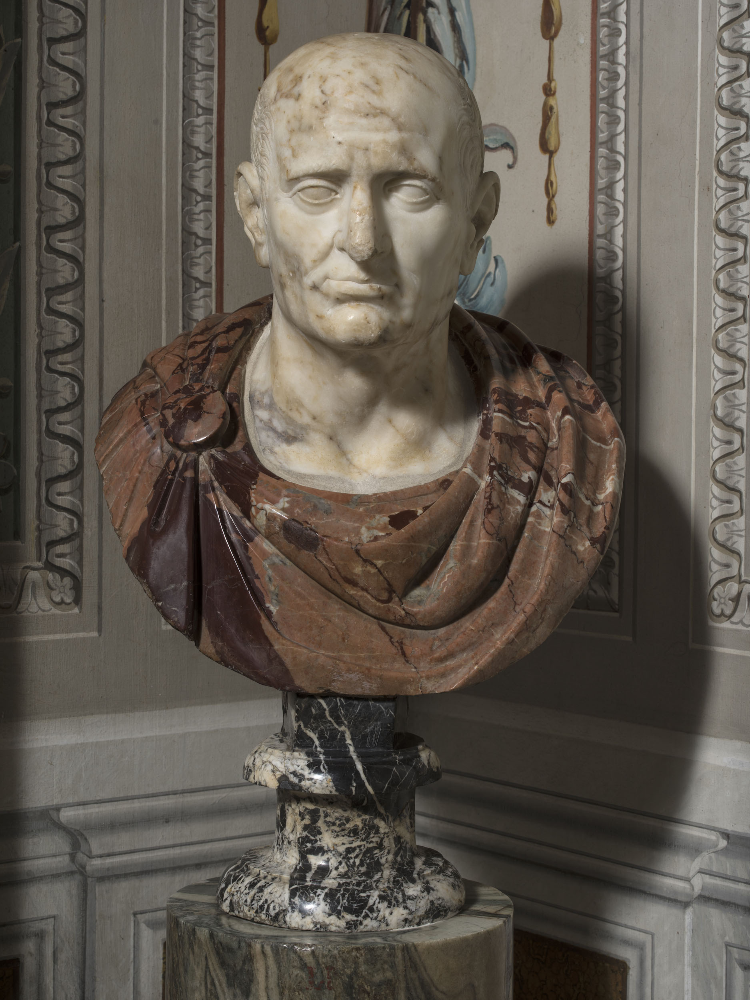

**这是什么**：一尊约 1830–1832 年的迦尔巴（Galba，公元 68–69 年在位的「四帝之年」皇帝）肖像，头部用带灰纹的白大理石、胸像用红斑岩般的 Portasanta 大理石。

**背景 / 看点**：它属于 19 世纪卡米洛·博尔盖塞重新布置别墅时增补的近代仿古作品，用来呼应、补全大厅里那套 16 世纪的「十二帝」胸像序列。看点就在它的「序列感」——白头配彩色大理石胸的搭配，是文艺复兴以来收藏家展示古罗马皇帝群像的标准做法，到 19 世纪仍在沿用。属顺路一瞥即可。

### ⭐ 顺路看 乔瓦尼·巴蒂斯塔·德拉·波尔塔《恺撒肖像》 / Della Porta Giovanni Battista, _Portrait of Ceasar_

- **作者 / Artist**：乔瓦尼·巴蒂斯塔·德拉·波尔塔 / Della Porta Giovanni Battista
- **作品 / Work**：《恺撒肖像》 / _Portrait of Ceasar_
- **时间**：16 世纪最后四分之一
- **材质**：雕像级白大理石与黑灰大理石（bigio morato）
- **尺寸**：高 78 cm
- **馆藏编号**：LIII
- **位置**：入口大厅（马里亚诺·罗西大厅）
- **官网介绍页**：[官网介绍英文](https://www.collezionegalleriaborghese.it/en/opere/portrait-of-cesar)｜馆藏编号 LIII

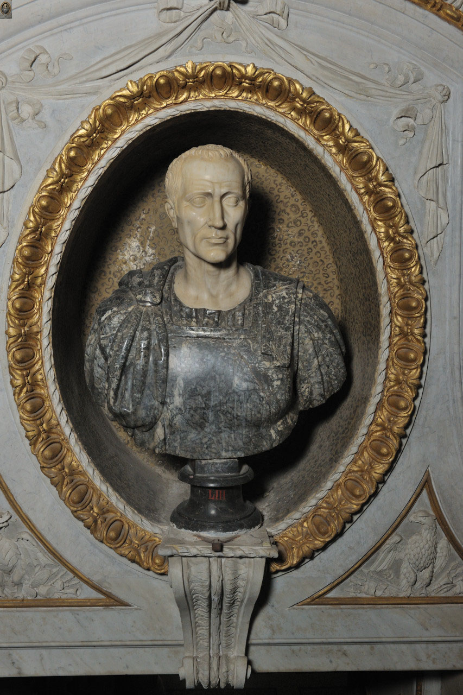

**这是什么（整组一次看）**：从这里开始的一长串 78 cm 高的皇帝胸像，是 16 世纪末乔瓦尼·巴蒂斯塔·德拉·波尔塔（Della Porta）及其工坊制作的一套**「十二凯撒」（Twelve Caesars）皇帝群像**——从尤利乌斯·凯撒、奥古斯都、提比略、卡里古拉、克劳狄乌斯、尼禄，到「四帝之年」的迦尔巴、奥托，再到弗拉维王朝的维斯帕先、提图斯、图密善。本件即开篇的尤利乌斯·凯撒（Caesar）。

**背景**：把罗马前十二位统治者做成成套胸像，是文艺复兴到巴洛克时期欧洲宫廷与红衣主教最热衷的收藏门类——既炫耀古典学养，又把自己摆进「帝王正统」的谱系里。这套由 Della Porta 工坊承制，正是博尔盖塞家族这种政治自我想象的体现。

**看点（整组通用）**：① **彩色大理石玩材质**——每尊都是「白色大理石头像＋彩色大理石胸甲/披风」的拼配，胸像用了非洲大理石（africano）、bigio morato 黑灰大理石、breccia（角砾岩）、Portasanta 等名贵彩石，看点之一就是逐尊比对它们不同的石色组合。② **不是古代原作**——这是 16 世纪「仿古新作」，依古币和古代肖像范式想象出每位皇帝的相貌，所以你看到的「尼禄」「卡里古拉」更多是文艺复兴人的理解，而非考古真容。③ **当装饰序列看**——它们沿墙成排陈列，作用是给大厅铺一层「罗马帝王仪仗」的底色，呼应天顶的罗马荣耀主题；逐尊细看不必，扫一排、挑材质最艳的几尊停一下即可。

### ⭐ 顺路看 乔瓦尼·巴蒂斯塔·德拉·波尔塔《维特里乌斯胸像》 / Della Porta Giovanni Battista, _Bust of Vitellius_

- **作者 / Artist**：乔瓦尼·巴蒂斯塔·德拉·波尔塔 / Della Porta Giovanni Battista
- **作品 / Work**：《维特里乌斯胸像》 / _Bust of Vitellius_
- **时间**：16 世纪
- **材质**：雕像级白大理石与黑灰大理石（bigio morato）
- **尺寸**：高 78 cm
- **馆藏编号**：LIIIa
- **位置**：入口大厅（马里亚诺·罗西大厅）
- **官网介绍页**：[官网介绍英文](https://www.collezionegalleriaborghese.it/en/opere/busto-f-vitellius)｜馆藏编号 LIIIa

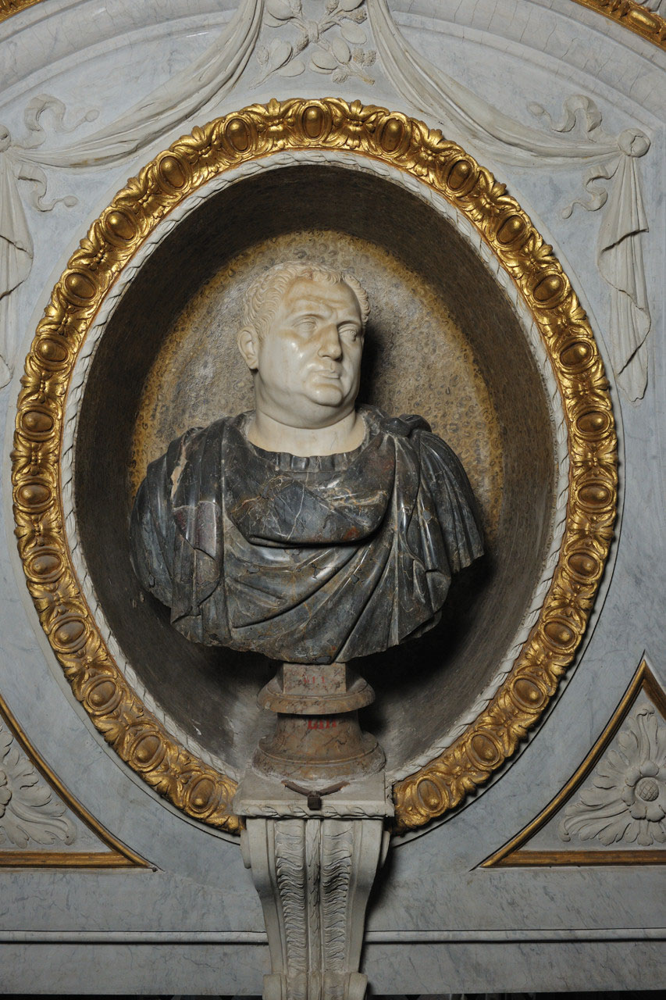

**维特里乌斯（Vitellius）**：「四帝之年」中第三位短命皇帝，公元 69 年在位仅数月即败亡；文艺复兴常把他塑成肥硕纵欲的反面典型。

属于德拉·波尔塔工坊那套「十二凯撒」彩色大理石胸像之一（整组背景见本节开头的凯撒像）。现场作为序列的一员扫过即可，留意它白头配彩色大理石胸的材质搭配。

### ⭐ 顺路看 乔瓦尼·巴蒂斯塔·德拉·波尔塔《奥古斯都胸像》 / Della Porta Giovanni Battista, _Bust of Augustus_

- **作者 / Artist**：乔瓦尼·巴蒂斯塔·德拉·波尔塔 / Della Porta Giovanni Battista
- **作品 / Work**：《奥古斯都胸像》 / _Bust of Augustus_
- **时间**：16 世纪最后四分之一
- **材质**：雕像级白大理石与珊瑚角砾岩（coral breccia）
- **尺寸**：高 78 cm
- **馆藏编号**：LIIIb
- **位置**：入口大厅（马里亚诺·罗西大厅）
- **官网介绍页**：[官网介绍英文](https://www.collezionegalleriaborghese.it/en/opere/bust-of-augustus-2)｜馆藏编号 LIIIb

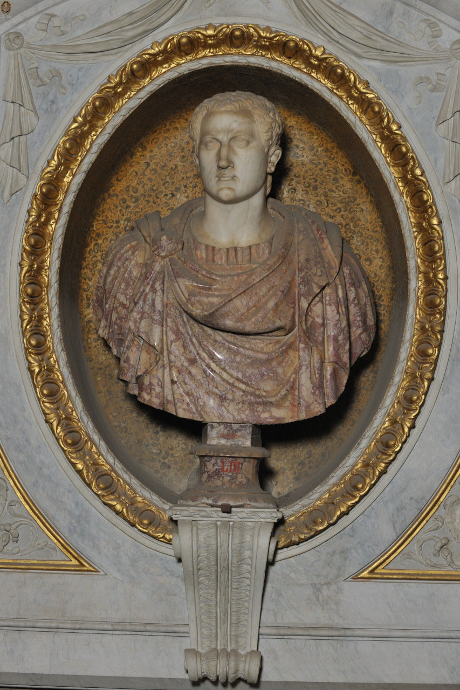

**奥古斯都（Augustus）**：罗马首位皇帝、帝国奠基者，开创延续两百年的「罗马和平」；这里是 Della Porta 想象的版本。

属于德拉·波尔塔工坊那套「十二凯撒」彩色大理石胸像之一（整组背景见本节开头的凯撒像）。现场作为序列的一员扫过即可，留意它白头配彩色大理石胸的材质搭配。

### ⭐ 顺路看 乔瓦尼·巴蒂斯塔·德拉·波尔塔及工坊《提比略肖像》 / Della Porta Giovanni Battista and workshop, _Portrait of Tiberius_

- **作者 / Artist**：乔瓦尼·巴蒂斯塔·德拉·波尔塔及工坊 / Della Porta Giovanni Battista and workshop
- **作品 / Work**：《提比略肖像》 / _Portrait of Tiberius_
- **时间**：16 世纪最后四分之一
- **材质**：大理石
- **尺寸**：高 78 cm
- **馆藏编号**：LIIIc
- **位置**：入口大厅（马里亚诺·罗西大厅）
- **官网介绍页**：[官网介绍英文](https://www.collezionegalleriaborghese.it/en/opere/portrait-of-tiberius-1)｜馆藏编号 LIIIc

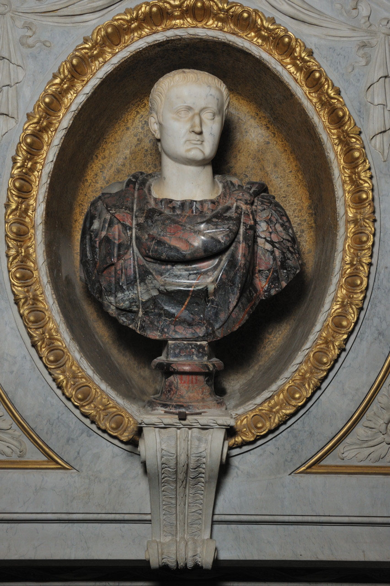

**提比略（Tiberius）**：奥古斯都继任者、第二位皇帝，晚年隐居卡普里，史家笔下阴郁多疑。

属于德拉·波尔塔工坊那套「十二凯撒」彩色大理石胸像之一（整组背景见本节开头的凯撒像）。现场作为序列的一员扫过即可，留意它白头配彩色大理石胸的材质搭配。

### ⭐ 顺路看 乔瓦尼·巴蒂斯塔·德拉·波尔塔及工坊《卡利古拉肖像》 / Della Porta Giovanni Battista and workshop, _Portrait of Caligula_

- **作者 / Artist**：乔瓦尼·巴蒂斯塔·德拉·波尔塔及工坊 / Della Porta Giovanni Battista and workshop
- **作品 / Work**：《卡利古拉肖像》 / _Portrait of Caligula_
- **时间**：16 世纪最后四分之一
- **材质**：雕像级白大理石与美第奇角砾岩（Breccia Medicea）
- **尺寸**：高 78 cm
- **馆藏编号**：LIIId
- **位置**：入口大厅（马里亚诺·罗西大厅）
- **官网介绍页**：[官网介绍英文](https://www.collezionegalleriaborghese.it/en/opere/portrait-of-caligula-1)｜馆藏编号 LIIId

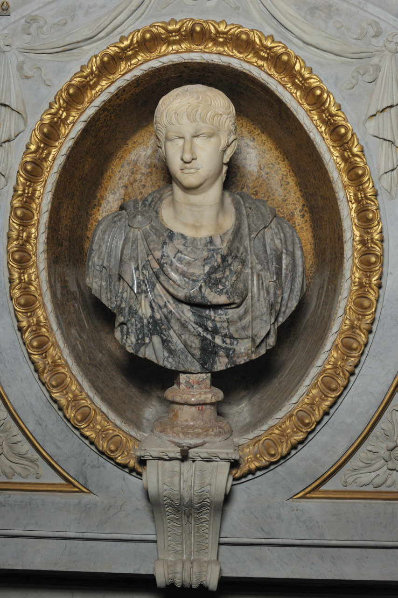

**卡里古拉（Caligula）**：第三位皇帝，以暴虐荒诞著称，在位四年即遇刺；名字意为「小军靴」。

属于德拉·波尔塔工坊那套「十二凯撒」彩色大理石胸像之一（整组背景见本节开头的凯撒像）。现场作为序列的一员扫过即可，留意它白头配彩色大理石胸的材质搭配。

### ⭐ 顺路看 乔瓦尼·巴蒂斯塔·德拉·波尔塔及工坊《克劳狄乌斯肖像》 / Della Porta Giovanni Battista and workshop, _Portrait of Claudius_

- **作者 / Artist**：乔瓦尼·巴蒂斯塔·德拉·波尔塔及工坊 / Della Porta Giovanni Battista and workshop
- **作品 / Work**：《克劳狄乌斯肖像》 / _Portrait of Claudius_
- **时间**：16 世纪最后四分之一
- **材质**：雕像级白大理石与非洲大理石（africano）
- **尺寸**：高 78 cm
- **馆藏编号**：LIIIe
- **位置**：入口大厅（马里亚诺·罗西大厅）
- **官网介绍页**：[官网介绍英文](https://www.collezionegalleriaborghese.it/en/opere/portrait-of-claudius-1)｜馆藏编号 LIIIe

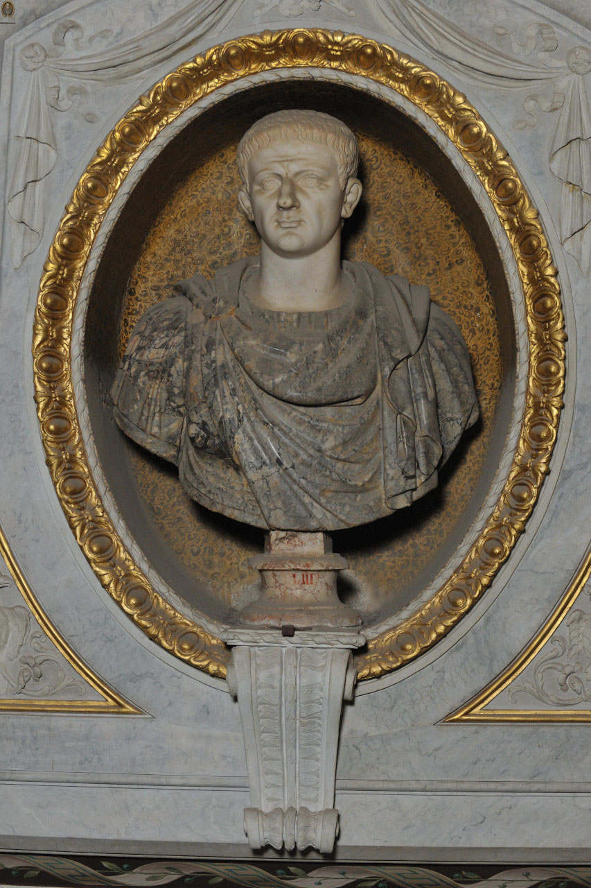

**克劳狄乌斯（Claudius）**：第四位皇帝，征服不列颠、兴修水利，史上常被低估的务实统治者。

属于德拉·波尔塔工坊那套「十二凯撒」彩色大理石胸像之一（整组背景见本节开头的凯撒像）。现场作为序列的一员扫过即可，留意它白头配彩色大理石胸的材质搭配。

### ⭐ 顺路看 乔瓦尼·巴蒂斯塔·德拉·波尔塔及工坊《尼禄肖像》 / Della Porta Giovanni Battista and workshop, _Portrait of Nero_

- **作者 / Artist**：乔瓦尼·巴蒂斯塔·德拉·波尔塔及工坊 / Della Porta Giovanni Battista and workshop
- **作品 / Work**：《尼禄肖像》 / _Portrait of Nero_
- **时间**：16 世纪最后四分之一
- **材质**：雕像级白大理石与美第奇角砾岩（Breccia Medicea）
- **尺寸**：高 78 cm
- **馆藏编号**：LIIIf
- **位置**：入口大厅（马里亚诺·罗西大厅）
- **官网介绍页**：[官网介绍英文](https://www.collezionegalleriaborghese.it/en/opere/portrait-of-nero-1)｜馆藏编号 LIIIf

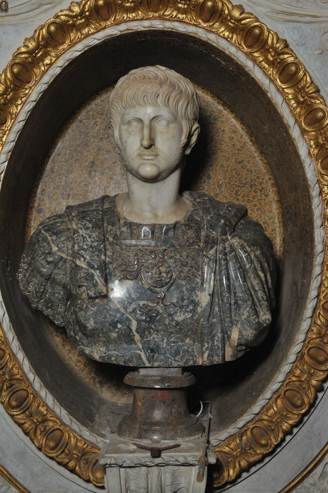

**尼禄（Nero）**：第五位皇帝，因罗马大火与迫害基督徒而恶名昭著，自杀终结尤利乌斯-克劳狄王朝。

属于德拉·波尔塔工坊那套「十二凯撒」彩色大理石胸像之一（整组背景见本节开头的凯撒像）。现场作为序列的一员扫过即可，留意它白头配彩色大理石胸的材质搭配。

### ⭐ 顺路看 乔瓦尼·巴蒂斯塔·德拉·波尔塔《加尔巴肖像》 / Della Porta Giovanni Battista, _Portrait of Galba_

- **作者 / Artist**：乔瓦尼·巴蒂斯塔·德拉·波尔塔 / Della Porta Giovanni Battista
- **作品 / Work**：《加尔巴肖像》 / _Portrait of Galba_
- **时间**：16 世纪最后四分之一
- **材质**：雕像级白大理石与非洲大理石（africano）
- **尺寸**：高 78 cm
- **馆藏编号**：LIIIg
- **位置**：入口大厅（马里亚诺·罗西大厅）
- **官网介绍页**：[官网介绍英文](https://www.collezionegalleriaborghese.it/en/opere/portrait-of-galba-1)｜馆藏编号 LIIIg

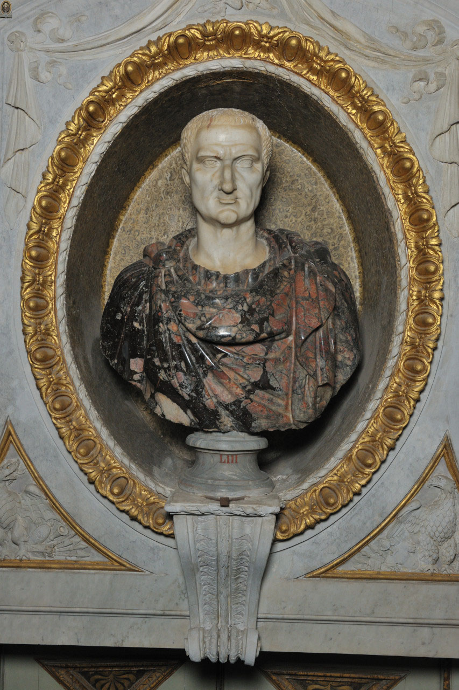

**迦尔巴（Galba）**：「四帝之年」开局者，年迈即位、数月后被禁卫军所杀。注意本厅另有一尊 19 世纪后补的迦尔巴（编号 LI）可对照。

属于德拉·波尔塔工坊那套「十二凯撒」彩色大理石胸像之一（整组背景见本节开头的凯撒像）。现场作为序列的一员扫过即可，留意它白头配彩色大理石胸的材质搭配。

### ⭐ 顺路看 乔瓦尼·巴蒂斯塔·德拉·波尔塔及工坊《奥托肖像》 / Della Porta Giovanni Battista and workshop, _Portrait of Ottone_

- **作者 / Artist**：乔瓦尼·巴蒂斯塔·德拉·波尔塔及工坊 / Della Porta Giovanni Battista and workshop
- **作品 / Work**：《奥托肖像》 / _Portrait of Ottone_
- **时间**：16 世纪最后四分之一
- **材质**：雕像级白大理石与非洲大理石（africano）
- **尺寸**：高 78 cm
- **馆藏编号**：LIIIh
- **位置**：入口大厅（马里亚诺·罗西大厅）
- **官网介绍页**：[官网介绍英文](https://www.collezionegalleriaborghese.it/en/opere/portrait-of-ottone-1)｜馆藏编号 LIIIh

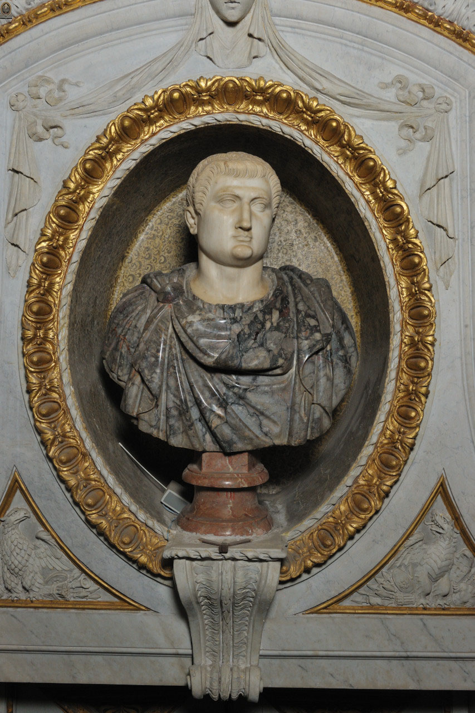

**奥托（Ottone / Otho）**：「四帝之年」第二位皇帝，败于维特里乌斯后自尽，在位仅约三个月。

属于德拉·波尔塔工坊那套「十二凯撒」彩色大理石胸像之一（整组背景见本节开头的凯撒像）。现场作为序列的一员扫过即可，留意它白头配彩色大理石胸的材质搭配。

### ⭐ 顺路看 乔瓦尼·巴蒂斯塔·德拉·波尔塔《韦斯帕芗肖像》 / Della Porta Giovanni Battista, _Portrait of Vespasian_

- **作者 / Artist**：乔瓦尼·巴蒂斯塔·德拉·波尔塔 / Della Porta Giovanni Battista
- **作品 / Work**：《韦斯帕芗肖像》 / _Portrait of Vespasian_
- **时间**：16 世纪最后四分之一
- **材质**：雕像级白大理石与金角砾岩（breccia dorata）
- **尺寸**：高 78 cm
- **馆藏编号**：LIIIi
- **位置**：入口大厅（马里亚诺·罗西大厅）
- **官网介绍页**：[官网介绍英文](https://www.collezionegalleriaborghese.it/en/opere/portrait-of-vespasian)｜馆藏编号 LIIIi

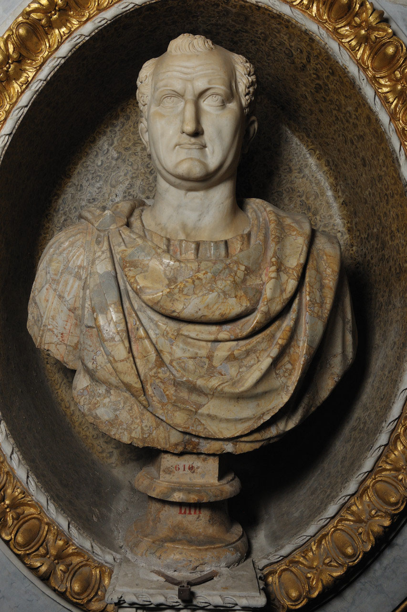

**维斯帕先（Vespasian）**：弗拉维王朝开创者，结束内乱、开建斗兽场，务实节俭的「平民皇帝」。

属于德拉·波尔塔工坊那套「十二凯撒」彩色大理石胸像之一（整组背景见本节开头的凯撒像）。现场作为序列的一员扫过即可，留意它白头配彩色大理石胸的材质搭配。

### ⭐ 顺路看 乔瓦尼·巴蒂斯塔·德拉·波尔塔及工坊《提图斯肖像》 / Della Porta Giovanni Battista and workshop, _Portrait of Titus_

- **作者 / Artist**：乔瓦尼·巴蒂斯塔·德拉·波尔塔及工坊 / Della Porta Giovanni Battista and workshop
- **作品 / Work**：《提图斯肖像》 / _Portrait of Titus_
- **时间**：16 世纪最后四分之一
- **材质**：雕像级白大理石与非洲大理石（africano）
- **尺寸**：高 78 cm
- **馆藏编号**：LIIIl
- **位置**：入口大厅（马里亚诺·罗西大厅）
- **官网介绍页**：[官网介绍英文](https://www.collezionegalleriaborghese.it/en/opere/portrait-of-titus-1)｜馆藏编号 LIIIl

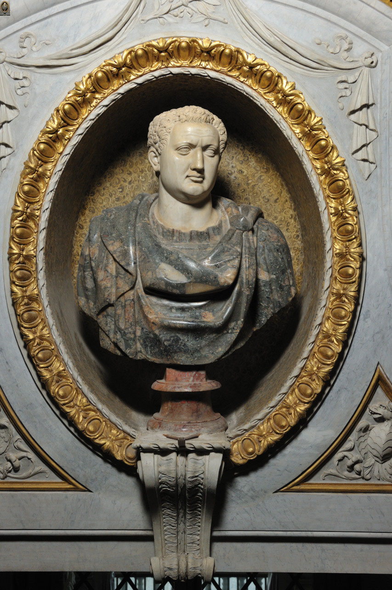

**提图斯（Titus）**：维斯帕先长子，攻陷耶路撒冷、落成斗兽场，在位仅两年即病逝。

属于德拉·波尔塔工坊那套「十二凯撒」彩色大理石胸像之一（整组背景见本节开头的凯撒像）。现场作为序列的一员扫过即可，留意它白头配彩色大理石胸的材质搭配。

### ⭐ 顺路看 乔瓦尼·巴蒂斯塔·德拉·波尔塔及工坊《图密善肖像》 / Della Porta Giovanni Battista and workshop, _Portrait of Domitian_

- **作者 / Artist**：乔瓦尼·巴蒂斯塔·德拉·波尔塔及工坊 / Della Porta Giovanni Battista and workshop
- **作品 / Work**：《图密善肖像》 / _Portrait of Domitian_
- **时间**：16 世纪最后四分之一
- **材质**：雕像级白大理石与非洲大理石（africano）
- **尺寸**：高 78 cm
- **馆藏编号**：LIIIm
- **位置**：入口大厅（马里亚诺·罗西大厅）
- **官网介绍页**：[官网介绍英文](https://www.collezionegalleriaborghese.it/en/opere/portrait-of-domitian-1)｜馆藏编号 LIIIm

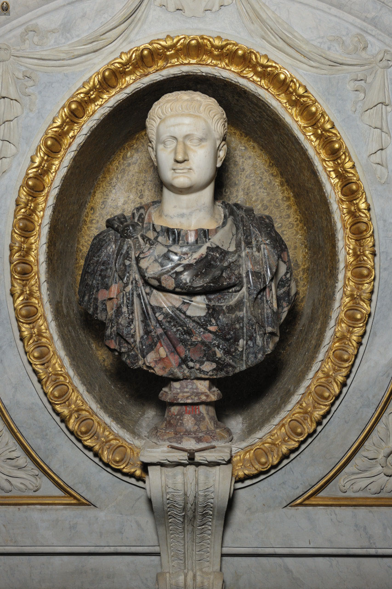

**图密善（Domitian）**：弗拉维王朝末帝、提图斯之弟，强化集权、晚年趋于高压，遇刺后遭「除忆诅咒」。

属于德拉·波尔塔工坊那套「十二凯撒」彩色大理石胸像之一（整组背景见本节开头的凯撒像）。现场作为序列的一员扫过即可，留意它白头配彩色大理石胸的材质搭配。

### ⭐ 顺路看 古罗马艺术《角斗士与猎人地面马赛克》 / Roman art, _Floor Mosaic with Gladiators and Hunters_

- **作者 / Artist**：古罗马艺术 / Roman art
- **作品 / Work**：《角斗士与猎人地面马赛克》 / _Floor Mosaic with Gladiators and Hunters_
- **时间**：公元 3–4 世纪
- **材质**：大理石马赛克石块
- **尺寸**：5681 × 2156 cm
- **位置**：入口大厅（马里亚诺·罗西大厅）
- **官网介绍页**：[官网介绍英文](https://www.collezionegalleriaborghese.it/en/opere/floor-mosaic-with-gladiators-and-hunters-0)｜馆藏编号 arc-001

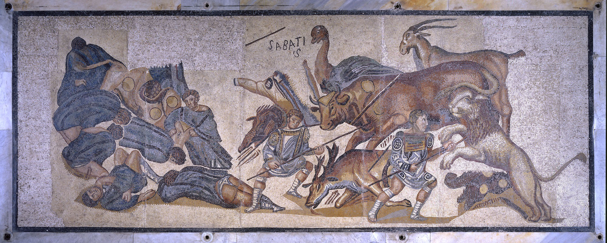

**这是什么（整组一次看）**：大厅中央地面这几块马赛克，原本是同一片公元 3–4 世纪罗马别墅地板的不同段落，馆方按片分编号（arc-001/002/003/009/010/016/021）。题材是角斗（munera）与猎兽（venatio）场面。

**背景 / 来历**：1834 年为亲王 Francesco Borghese 在家族 Torrenova 庄园发掘一座古罗马郊外别墅时出土，原铺在内庭柱廊地面，原长约 45 米；现存带人物的画面段总长约 27.9 米，用 strappo 揭取法整块剥离，1902 年由意大利国家购藏。这是意大利本土极罕见的角斗士马赛克之一（此类题材在北非常见，在意大利却凤毛麟角）。

**为什么是镇厅级文物——「角斗士的球星卡」**：最大看点是大量人物旁边都标着**真名**，常带 **VIC(TOR)＝胜者**标记，倒地战死者旁有希腊字母 **Θ（Theta＝阵亡标记）**。这等于一套 1800 年前的「角斗士球星卡」，是研究罗马角斗文化的一级文献。画风刻意刻画垂死者凹陷的眼窝、扭曲的脸来引发怜悯，被学者称为「罗马表现主义」。

**现场怎么看（禁踩，站旁边俯瞰）**：
1. **认人小抄**：长发＝蛮族出身；名字带 VIC＝当场获胜；旁边一个 Θ＝当场战死；画里比例缩小、拿鞭子的呆板人物＝监战员（incitator），故意画得千人一面，与角斗士的传神刻画形成对比。
2. **猎兽段（venatio）**：找围攻公牛、与狮子搏斗、背景有鸵鸟麋鹿的场面，猎人 Sabatius 大战公牛是亮点。
3. **角斗段（munera）**：找成对收官的角斗士，胜者一脚踩在战死者摊开的手掌上、旁边带 Θ；其中 Pampineus 是罕见的「全装甲角斗士」。
4. 别低头快走——这是地上而非墙上的主角，值得绕着边沿走一圈把名字找出来。

### ⭐ 顺路看 古罗马艺术《角斗士与猎人地面马赛克》 / Roman art, _Floor Mosaic with Gladiators and Hunters_

- **作者 / Artist**：古罗马艺术 / Roman art
- **作品 / Work**：《角斗士与猎人地面马赛克》 / _Floor Mosaic with Gladiators and Hunters_
- **时间**：公元 3–4 世纪
- **材质**：大理石马赛克石块
- **尺寸**：5400 × 2246 cm
- **位置**：入口大厅（马里亚诺·罗西大厅）
- **官网介绍页**：[官网介绍英文](https://www.collezionegalleriaborghese.it/en/opere/floor-mosaic-with-gladiators-and-hunters)｜馆藏编号 arc-002

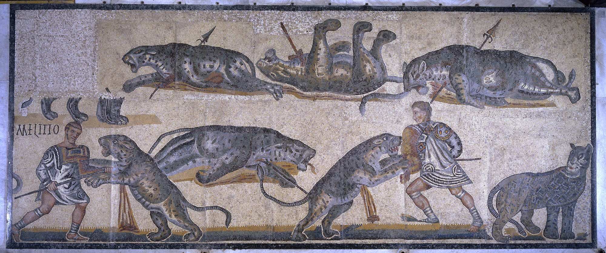

**这是什么**：角斗士与猎兽地板马赛克的另一段（与大厅中央其余几块同属 1834 年 Torrenova 出土、原长约 45 米的同一片别墅地面）。

**看点**：和主块一样，留意人物旁的拉丁人名、VIC（胜者）与 Θ（阵亡）标记；这一段同样是「角斗士球星卡」的一部分。整体看点见 arc-001 那块的完整说明，逐块绕行即可把不同场景看全。

### ⭐ 顺路看 古罗马艺术《角斗士与猎人地面马赛克》 / Roman art, _Floor Mosaic with Gladiators and Hunters_

- **作者 / Artist**：古罗马艺术 / Roman art
- **作品 / Work**：《角斗士与猎人地面马赛克》 / _Floor Mosaic with Gladiators and Hunters_
- **时间**：公元 3–4 世纪
- **材质**：大理石马赛克石块
- **尺寸**：5701 × 2199 cm
- **位置**：入口大厅（马里亚诺·罗西大厅）
- **官网介绍页**：[官网介绍英文](https://www.collezionegalleriaborghese.it/en/opere/floor-mosaic-with-gladiators-and-hunters-3)｜馆藏编号 arc-003

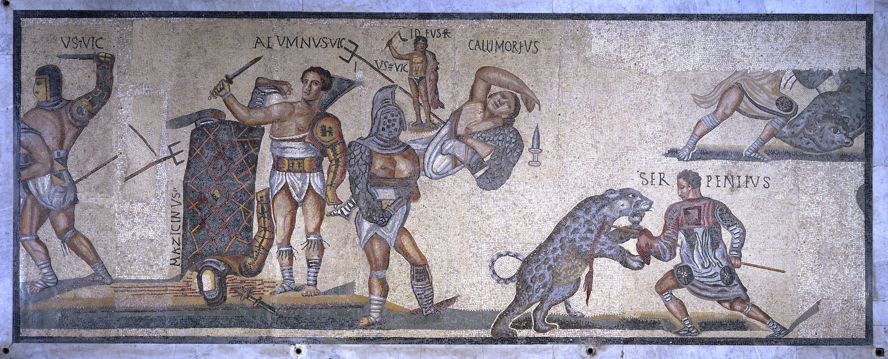

**这是什么**：角斗士与猎兽地板马赛克的另一段（与大厅中央其余几块同属 1834 年 Torrenova 出土、原长约 45 米的同一片别墅地面）。

**看点**：和主块一样，留意人物旁的拉丁人名、VIC（胜者）与 Θ（阵亡）标记；这一段同样是「角斗士球星卡」的一部分。整体看点见 arc-001 那块的完整说明，逐块绕行即可把不同场景看全。

### ⭐ 顺路看 古罗马艺术《角斗士与猎人地面马赛克》 / Roman art, _Floor Mosaic with Gladiators and Hunters_

- **作者 / Artist**：古罗马艺术 / Roman art
- **作品 / Work**：《角斗士与猎人地面马赛克》 / _Floor Mosaic with Gladiators and Hunters_
- **时间**：公元 3–4 世纪
- **材质**：大理石马赛克石块
- **尺寸**：5720 × 2200 cm
- **位置**：入口大厅（马里亚诺·罗西大厅）
- **官网介绍页**：[官网介绍英文](https://www.collezionegalleriaborghese.it/en/opere/floor-mosaic-with-gladiators-and-hunters-4)｜馆藏编号 arc-009

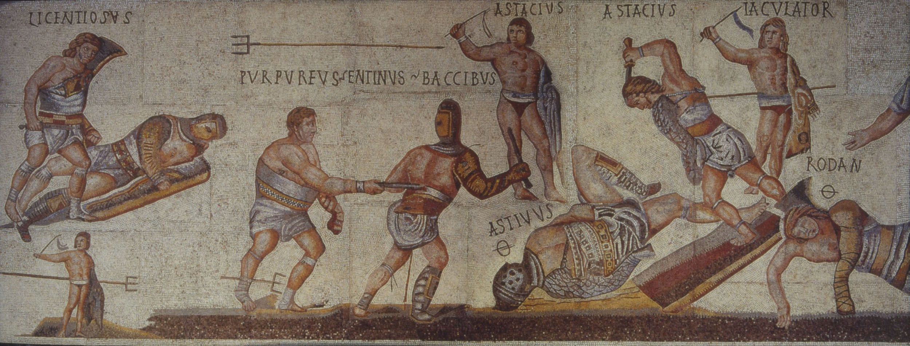

**这是什么**：角斗士与猎兽地板马赛克的另一段（与大厅中央其余几块同属 1834 年 Torrenova 出土、原长约 45 米的同一片别墅地面）。

**看点**：和主块一样，留意人物旁的拉丁人名、VIC（胜者）与 Θ（阵亡）标记；这一段同样是「角斗士球星卡」的一部分。整体看点见 arc-001 那块的完整说明，逐块绕行即可把不同场景看全。

### ⭐ 顺路看 古罗马艺术《角斗士与猎人地面马赛克》 / Roman art, _Floor Mosaic with Gladiators and Hunters_

- **作者 / Artist**：古罗马艺术 / Roman art
- **作品 / Work**：《角斗士与猎人地面马赛克》 / _Floor Mosaic with Gladiators and Hunters_
- **时间**：公元 3–4 世纪
- **材质**：大理石马赛克石块
- **尺寸**：540 × 860 cm
- **位置**：入口大厅（马里亚诺·罗西大厅）
- **官网介绍页**：[官网介绍英文](https://www.collezionegalleriaborghese.it/en/opere/floor-mosaic-with-gladiators-and-hunters-5)｜馆藏编号 arc-010

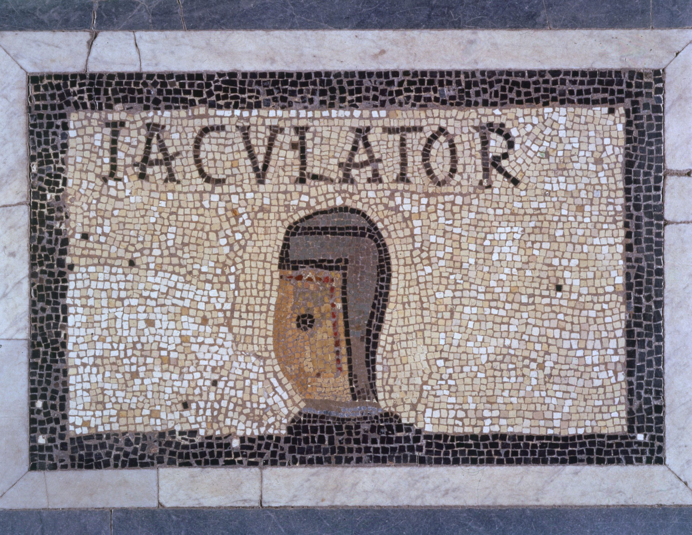

**这是什么**：角斗士与猎兽地板马赛克的另一段（与大厅中央其余几块同属 1834 年 Torrenova 出土、原长约 45 米的同一片别墅地面）。

**看点**：和主块一样，留意人物旁的拉丁人名、VIC（胜者）与 Θ（阵亡）标记；这一段同样是「角斗士球星卡」的一部分。整体看点见 arc-001 那块的完整说明，逐块绕行即可把不同场景看全。

### ⭐ 顺路看 古罗马艺术《厄洛斯与花环饰带》 / Roman art, _Frieze with Eros and Garland_

- **作者 / Artist**：古罗马艺术 / Roman art
- **作品 / Work**：《厄洛斯与花环饰带》 / _Frieze with Eros and Garland_
- **时间**：公元 2 世纪中叶
- **材质**：细颗粒白大理石
- **尺寸**：54 × 205 cm；古代原刻部分 54 × 78 cm
- **位置**：入口大厅（马里亚诺·罗西大厅）
- **官网介绍页**：[官网介绍英文](https://www.collezionegalleriaborghese.it/en/opere/frieze-with-eros-and-garland)｜馆藏编号 arc-011

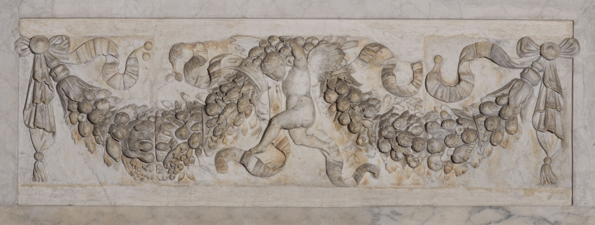

**这是什么**：一块古罗马石棺残片，题材是「小爱神抬花环」。画面是长翅膀的小爱神（Eros/丘比特）凌空、双腿岔成舞步、用低垂的头顶顶起一条堆满果实的华丽花环（festoon），两端由飘带挑起。现尺寸 54×205 cm，但**真正的古代原刻只有中央那一段（54×78 cm）**，两侧是 19 世纪补刻。

**背景 / 含义**：满载果实的花环象征丰饶与生命循环，「抬花环的小爱神」是希腊化以来流行的母题，大量用于罗马石棺——在丧葬语境里是对死亡的安慰，寓意生命延续、灵魂安乐。

**看点**：① **古今缝合**——现场试着辨认，只有正中爱神到花环中段是古代真品，两侧都是后补，是博尔盖塞古物的典型拼接案例。② **石棺改门楣**——它被加宽改造、装到大厅门洞上方当门头装饰（overdoor），所以才是今天这个横长条形态；一件本承载死亡与重生寓意的丧葬浮雕，被拆下来当纯装饰。卢浮宫藏有一块极相似的「姊妹」。

### ⭐ 顺路看 古罗马艺术《角斗士与猎人地面马赛克》 / Roman art, _Floor Mosaic with Gladiators and Hunters_

- **作者 / Artist**：古罗马艺术 / Roman art
- **作品 / Work**：《角斗士与猎人地面马赛克》 / _Floor Mosaic with Gladiators and Hunters_
- **时间**：公元 3–4 世纪
- **材质**：大理石马赛克石块
- **尺寸**：5387 × 2246 cm
- **位置**：入口大厅（马里亚诺·罗西大厅）
- **官网介绍页**：[官网介绍英文](https://www.collezionegalleriaborghese.it/en/opere/floor-mosaic-with-gladiators-and-hunters-6)｜馆藏编号 arc-016

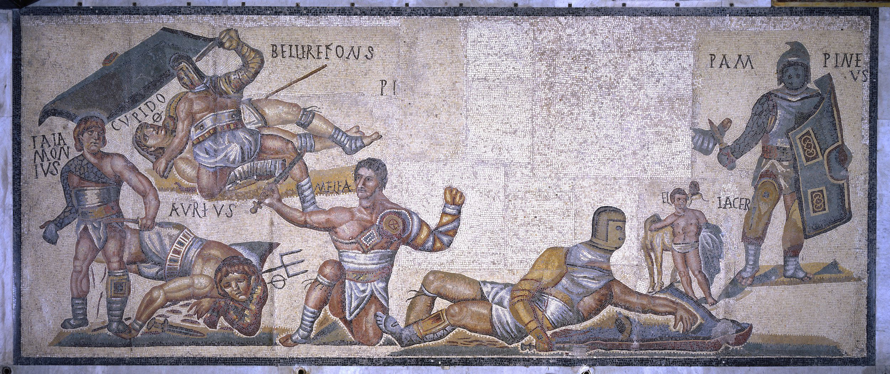

**这是什么**：角斗士与猎兽地板马赛克的另一段（与大厅中央其余几块同属 1834 年 Torrenova 出土、原长约 45 米的同一片别墅地面）。

**看点**：和主块一样，留意人物旁的拉丁人名、VIC（胜者）与 Θ（阵亡）标记；这一段同样是「角斗士球星卡」的一部分。整体看点见 arc-001 那块的完整说明，逐块绕行即可把不同场景看全。

### ⭐ 顺路看 古罗马艺术《角斗士与猎人地面马赛克》 / Roman art, _Floor mosaic with gladiators and hunters_

- **作者 / Artist**：古罗马艺术 / Roman art
- **作品 / Work**：《角斗士与猎人地面马赛克》 / _Floor mosaic with gladiators and hunters_
- **时间**：公元 3–4 世纪
- **材质**：大理石马赛克石块
- **尺寸**：543 × 865 cm
- **位置**：入口大厅（马里亚诺·罗西大厅）
- **官网介绍页**：[官网介绍英文](https://www.collezionegalleriaborghese.it/en/opere/floor-mosaic-with-gladiators-and-hunters-1)｜馆藏编号 arc-021

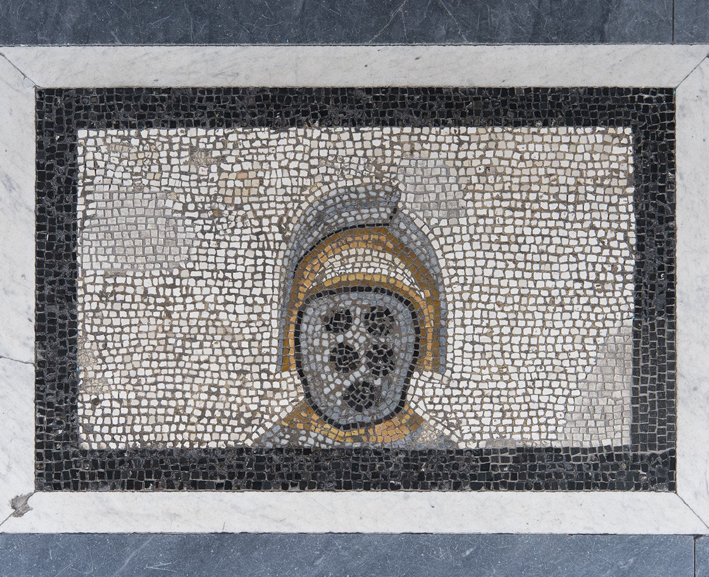

**这是什么**：角斗士与猎兽地板马赛克的另一段（与大厅中央其余几块同属 1834 年 Torrenova 出土、原长约 45 米的同一片别墅地面）。

**看点**：和主块一样，留意人物旁的拉丁人名、VIC（胜者）与 Θ（阵亡）标记；这一段同样是「角斗士球星卡」的一部分。整体看点见 arc-001 那块的完整说明，逐块绕行即可把不同场景看全。

### ⭐ 顺路看 古罗马艺术《斑岩浴盆》 / Roman art, _Labrum, porphyry basin_

- **作者 / Artist**：古罗马艺术 / Roman art
- **作品 / Work**：《斑岩浴盆》 / _Labrum, porphyry basin_
- **时间**：公元 2–3 世纪
- **材质**：红色斑岩
- **尺寸**：高 20 cm；直径 88 cm；周长 277 cm
- **位置**：入口大厅（马里亚诺·罗西大厅）
- **官网介绍页**：[官网介绍英文](https://www.collezionegalleriaborghese.it/en/opere/labrum-porphyry-basin)｜馆藏编号 CLXVI

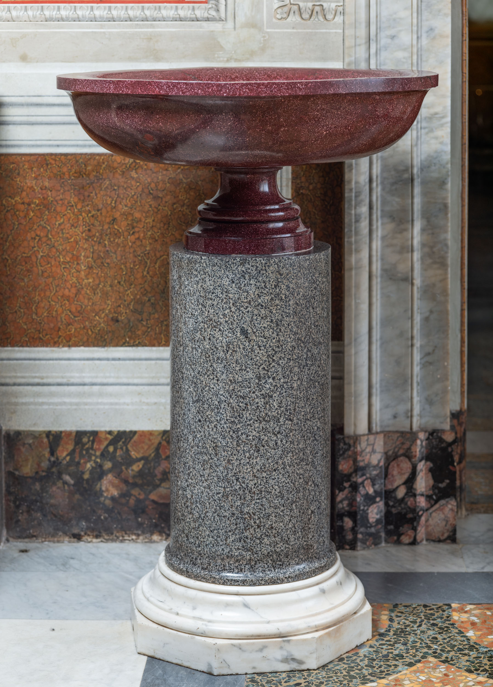

**这是什么**：公元 2–3 世纪罗马的红色斑岩（red porphyry）大盆，高 20 cm、直径 88 cm（底座是约 1700 年石匠 Paolo Santi 后配的）。「Labrum」古代泛指与沐浴礼仪有关的水盆，但**这件盆底没有出水孔**，无法接喷泉，实为一件昂贵的纯装饰摆件。

**看点全在材质——「帝王之石」**：这件没有人物雕刻，看点就是石头本身。红色斑岩只产自埃及东部沙漠 Mons Porphyrites 一处矿场，开采运输极贵、几乎被皇室垄断；它的紫红色（porphyry 本意就是「紫」）在罗马是皇帝专属的颜色，所以斑岩器物天然等于「权力象征」，戴克里先 301 年《物价敕令》里还记着它的天价。看它时关键不是「雕了什么」，而是「用什么石头雕的」——材质即身份。旁边另有一件作配对用的同材质斑岩盆（现代仿制）。

### ⭐ 顺路看 古罗马艺术《酒神主题装饰烛台》 / Roman art, _Candelabrum with Bacchic Decoration_

- **作者 / Artist**：古罗马艺术 / Roman art
- **作品 / Work**：《酒神主题装饰烛台》 / _Candelabrum with Bacchic Decoration_
- **时间**：公元 1–2 世纪
- **材质**：白色大理石
- **尺寸**：高 325 cm
- **位置**：入口大厅（马里亚诺·罗西大厅）
- **官网介绍页**：[官网介绍英文](https://www.collezionegalleriaborghese.it/en/opere/candelabrum-with-bacchic-decoration)｜馆藏编号 I

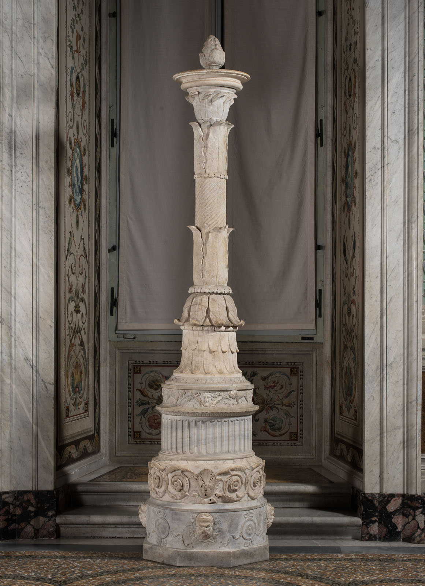

**这是什么**：古罗马白色大理石（卢尼产）烛架/灯架，**高达 325 cm**，是大厅里很有存在感的「垂直地标」，立柱顶端原本承托油灯或烛火。现在这件是 19 世纪用若干古代残件＋现代补件拼接而成的「组合体」：古代真品主要是带茛苕（acanthus）螺旋纹的鼓形构件，以及饰有 S 形凹槽纹（strigil）、上下收茛苕叶冠的柱身。

**题材 / 看点**：装饰里有面具（masks）、卷叶藤蔓、狮子——面具配缠绕藤蔓正是酒神巴克斯（Bacchus/Dionysus）的标志，呼应宴饮、戏剧与丰饶的狂欢氛围，故名「酒神题材」烛架，正暗合古罗马宴会「灯火＋美酒＋戏剧」的享乐场景。现场可试着「找真件」：缠卷草的鼓和带凹槽纹的柱身是古代真品，多边形底座、面具饰带、顶部花苞多为现代补刻；3.25 米的体量适合从下往上看它层层叠叠的叶饰与面具。

### ⭐ 顺路看 古罗马艺术《男子肖像，置于现代胸像上》 / Roman art, _Portrait of a Man on Modern Bust_

- **作者 / Artist**：古罗马艺术 / Roman art
- **作品 / Work**：《男子肖像，置于现代胸像上》 / _Portrait of a Man on Modern Bust_
- **时间**：公元前 1 世纪（头）；16 世纪末至 17 世纪（胸像）
- **材质**：细颗粒白大理石（头），花斑雪花石（alabastro fiorito，胸像）
- **尺寸**：连胸像高 61 cm；头高 34 cm
- **位置**：入口大厅（马里亚诺·罗西大厅）
- **官网介绍页**：[官网介绍英文](https://www.collezionegalleriaborghese.it/en/opere/portrait-of-a-man-on-modern-bust)｜馆藏编号 IIIL

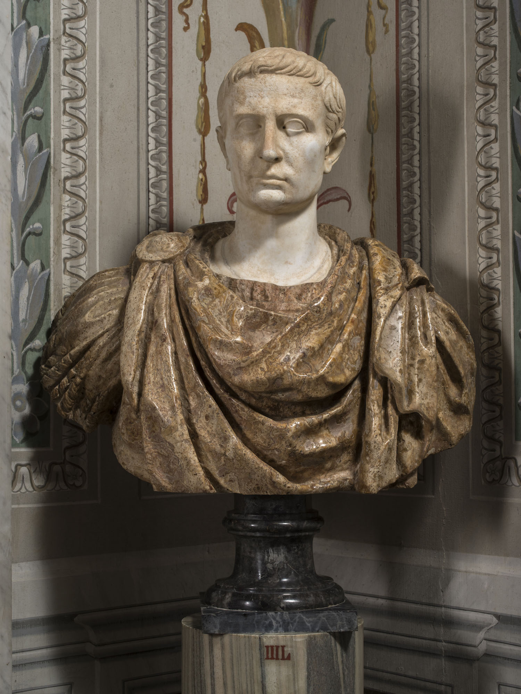

**这是什么**：一颗公元前 1 世纪的古代男子肖像头，装在 16 世纪末至 17 世纪后配的彩色大理石（alabastro fiorito 花斑雪花石）胸像上，连胸像高 61 cm。

**看点**：① **共和晚期写实风**——古代头像属罗马共和末期的「写实肖像」传统，刻意保留皱纹、瘦削，与帝国时期的理想化美容相反，现场可看它面部的年龄感。② **头身后配**——古代头＋近代彩石胸是博尔盖塞古物的典型做法，花斑雪花石的胸座本身就是收藏家炫耀名贵石材的小舞台。属顺路看。

### ⭐ 顺路看 古罗马艺术《巨型肖像：哈德良》 / Roman art, _Colossal Portrait of Hadrian_

- **作者 / Artist**：古罗马艺术 / Roman art
- **作品 / Work**：《巨型肖像：哈德良》 / _Colossal Portrait of Hadrian_
- **时间**：公元 2 世纪中叶
- **材质**：白色大理石
- **尺寸**：连胸像高 140 cm；头高 70 cm
- **位置**：入口大厅（马里亚诺·罗西大厅）
- **官网介绍页**：[官网介绍英文](https://www.collezionegalleriaborghese.it/en/opere/colossal-portrait-of-hadrian)｜馆藏编号 IIL

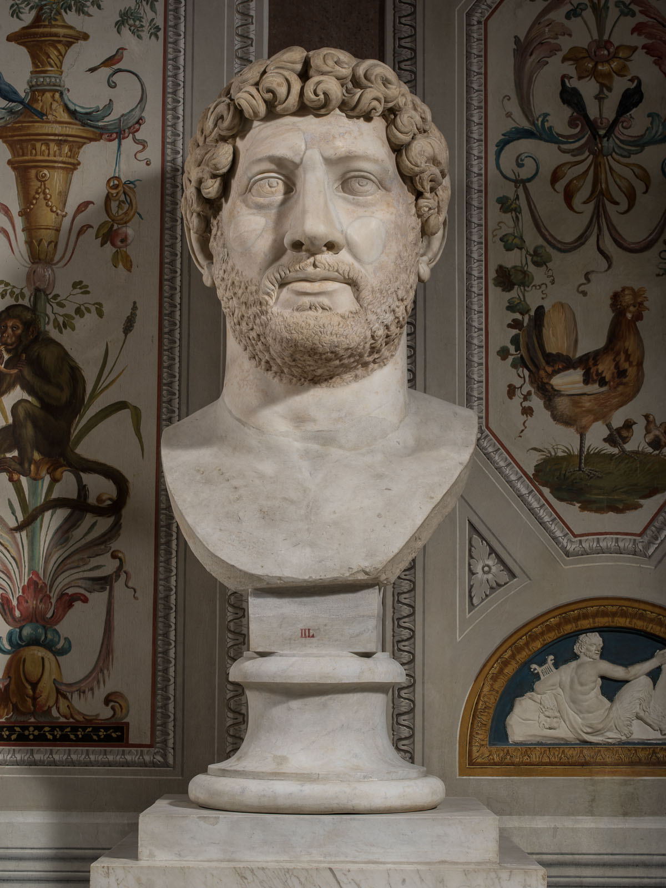

**这是什么**：公元 2 世纪中叶的哈德良巨像头像，连胸像高 140 cm，单是头部就 70 cm 高（约真人两倍）。古代原作核心为真，但 19 世纪做过大量修复：前额一圈卷发、鼻子、面颊、耳朵、部分颈部都是后补，头还被安到了一个替换的胸像上。它与对面的安敦宁·庇护巨像在大厅里成对陈列，是 19 世纪卡米洛·博尔盖塞重装别墅时的「双帝守门」设计。

**他是谁**：哈德良（117–138 在位），「五贤帝」之一，停止扩张、巩固边防（不列颠「哈德良长城」以他命名），热爱希腊文化、四处巡游，也是万神殿现存样貌的重建者。

**现场站看**：
1. **胡须的革命**——哈德良是第一位蓄络腮胡的罗马皇帝，开创了之后皇帝普遍留须的风潮；浓密短卷胡把希腊哲人气质与罗马军人气概结合，与前任图拉真的「光脸」形成对比。
2. **眼神与尺度**——眼睛刻出瞳孔、眼皮浮肿、额头皱纹，配上巨像尺度，呈现紧张有神的成熟帝王气场。
3. **「被修复得太多」的提醒**——温克尔曼曾盛赞它是最美的哈德良像，1891 年起学者指出它后世补刻过多，正是「古罗马原作其实常被后世大幅美容」的好范例。

### ⭐ 顺路看 古罗马艺术《饰花彩及涅瑞伊得斯持阿喀琉斯武器的石棺；正面残段》 / Roman art, _Sarcophagus decorated with festoons and Nereids carrying Achilles’ weapons; section of the front_

- **作者 / Artist**：古罗马艺术 / Roman art
- **作品 / Work**：《饰花彩及涅瑞伊得斯持阿喀琉斯武器的石棺；正面残段》 / _Sarcophagus decorated with festoons and Nereids carrying Achilles’ weapons; section of the front_
- **时间**：公元 130–150 年
- **材质**：带蓝色纹理的白大理石
- **尺寸**：高 52 cm，宽 60 cm
- **位置**：入口大厅（马里亚诺·罗西大厅）
- **官网介绍页**：[官网介绍英文](https://www.collezionegalleriaborghese.it/en/opere/sarcophagus-decorated-with-festoons-and-nereids-carrying-achilles-weapons-section-of-the-front)｜馆藏编号 IILa

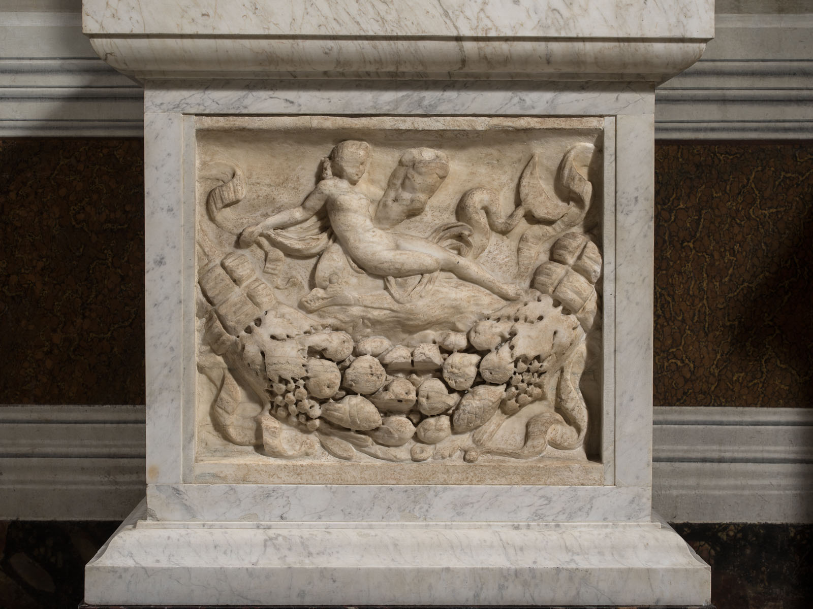

**这是什么**：一段公元 130–150 年的石棺正面残片，带蓝色纹理的白大理石，雕「花环（festoon）＋ 涅瑞伊得斯（Nereids）为阿喀琉斯送来神兵」的题材。

**背景 / 看点**：题材出自神话——阿喀琉斯的母亲、海中仙女忒提斯请火神为儿子打造神甲，由众海仙女（涅瑞伊得斯）乘海兽渡海送来。罗马石棺爱用「花环＋神话」组合：垂挂的果实花环象征丰饶与生命循环，神话场景则寄托对逝者的英雄化想象。本件是正面段；本厅另有同一具石棺的左侧段（编号 XXXVa），可两段并看，拼出原棺样貌。属顺路看，留意花环下方的小幅神话浮雕。

### ⭐ 顺路看 古罗马艺术《着托加男子雕像，配非原配米南德头像》 / Roman art, _Statue of a togate man with a (not original) head of Menander_

- **作者 / Artist**：古罗马艺术 / Roman art
- **作品 / Work**：《着托加男子雕像，配非原配米南德头像》 / _Statue of a togate man with a (not original) head of Menander_
- **时间**：公元 30–50 年（雕像）；公元 1 世纪（头）
- **材质**：卢尼大理石
- **尺寸**：不含底座高 186 cm，头 27 cm
- **位置**：入口大厅（马里亚诺·罗西大厅）
- **官网介绍页**：[官网介绍英文](https://www.collezionegalleriaborghese.it/en/opere/statue-of-a-togate-man-with-a-not-original-head-of-menander)｜馆藏编号 IVL

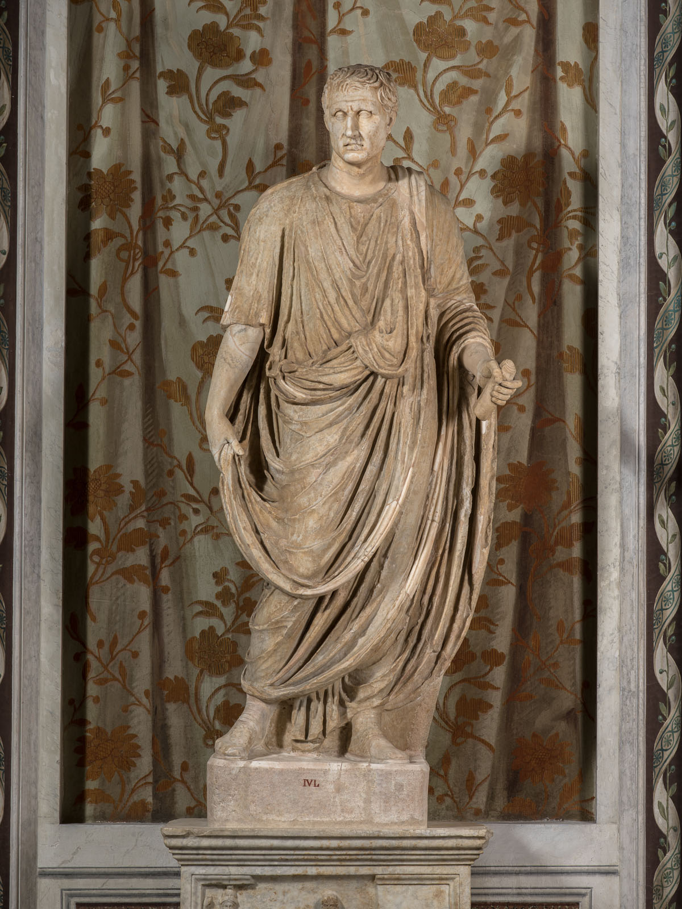

**这是什么**：公元 30–50 年的托加（toga）男子立像，配了一颗**非原配的「米南德」头**（公元 1 世纪），卢尼大理石，连座近 1.9 m 高。

**看点**：① **托加＝罗马公民身份**——厚重缠绕的托加长袍是罗马成年男性公民的正装，这类立像是元老、官员的标准纪念像。② **张冠李戴的头**——身体本是无名罗马公民像，却装上了希腊喜剧大师米南德（Menander）的肖像头，是收藏修复时「凑一个名头」的典型。和本厅奥古斯都大祭司像（XLI）一样，都是讲「头身后配」现象的好例子。属顺路看。

### ⭐ 顺路看 古罗马艺术《带向密涅瓦献祭场景的葬祭祭坛》 / Roman art, _Funerary altar with a scene of a sacrifice to Minerva_

- **作者 / Artist**：古罗马艺术 / Roman art
- **作品 / Work**：《带向密涅瓦献祭场景的葬祭祭坛》 / _Funerary altar with a scene of a sacrifice to Minerva_
- **时间**：约公元 1 世纪末
- **材质**：卢尼大理石
- **尺寸**：高 84 cm；宽 77 cm；深 50 cm；带人物画框 35 × 45 cm
- **位置**：入口大厅（马里亚诺·罗西大厅）
- **官网介绍页**：[官网介绍英文](https://www.collezionegalleriaborghese.it/en/opere/funerary-altar-with-a-scene-of-a-sacrifice-to-minerva)｜馆藏编号 IVLa

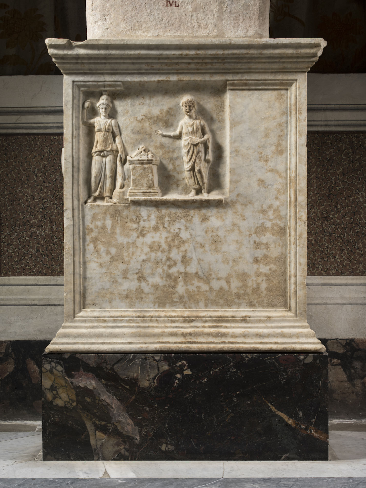

**这是什么**：公元 1 世纪末的古罗马墓祭坛（funerary/cinerary altar），卢尼大理石，正面浮雕一幕「向密涅瓦（Minerva）献祭」的场景。

**背景 / 看点**：罗马火葬时代，骨灰常存放在这种祭坛形石龛里，正面刻铭文与浮雕。这件的看点是正面那块约 35×45 cm 的小浮雕——找献祭场景里头戴盔、持矛与盾的密涅瓦（雅典娜），以及祭坛、祭司等元素。它属于大厅里成组陈列的几件墓祭坛之一，体现罗马丧葬艺术如何把神祇与日常仪式刻进墓碑。属顺路看，留意它精细的小浮雕与边框装饰。

### ⭐ 顺路看 古罗马艺术《肖像：安敦宁·庇护》 / Roman art, _Portrait of Antoninus Pius_

- **作者 / Artist**：古罗马艺术 / Roman art
- **作品 / Work**：《肖像：安敦宁·庇护》 / _Portrait of Antoninus Pius_
- **时间**：公元 2 世纪中叶
- **材质**：白色大理石
- **尺寸**：连胸像高 132 cm；头高 90 cm
- **位置**：入口大厅（马里亚诺·罗西大厅）
- **官网介绍页**：[官网介绍英文](https://www.collezionegalleriaborghese.it/en/opere/portrait-of-antoninus-pius)｜馆藏编号 L

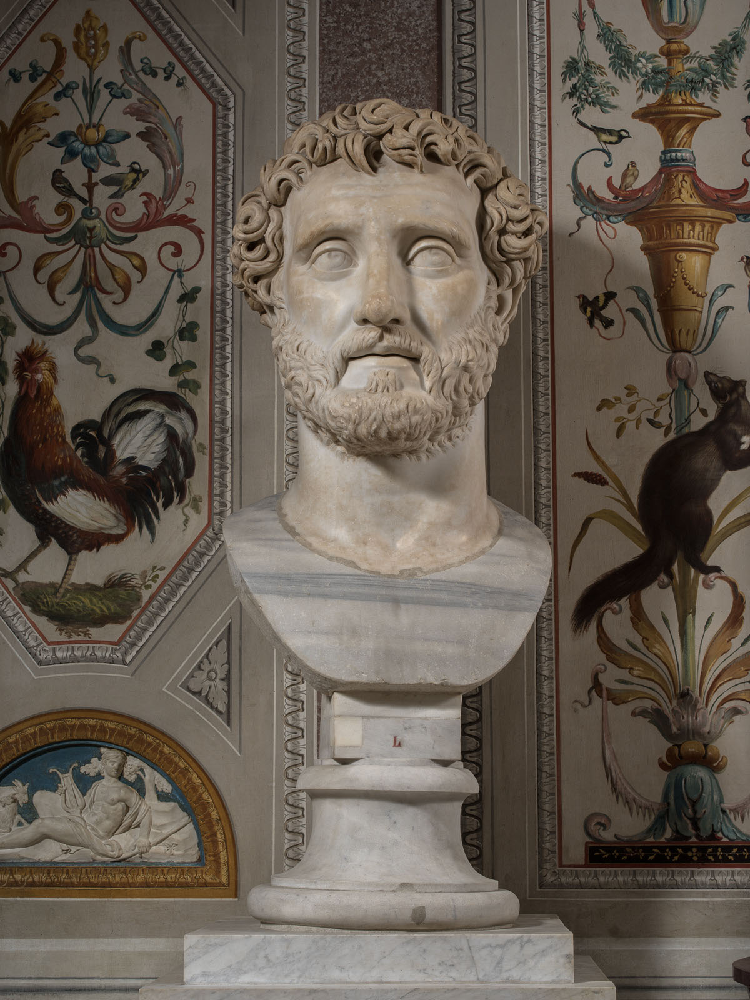

**这是什么**：公元 2 世纪中叶（很可能对应 148 年「在位十周年庆」）的安敦宁·庇护巨像，整块白大理石雕成，连胸像高 132 cm、头部 90 cm（比对面哈德良那尊还大）。古代原作，但前额、卷发、胡须经后世修复、表面被打磨过度光滑，下巴左侧等处仍存古代原始雕工。与哈德良像成对陈列。

**他是谁**：安敦宁·庇护（138–161 在位），哈德良继任者、「五贤帝」之一，在位 23 年几无战事、政局安定繁荣，是罗马黄金时代的代表。「Pius（虔诚/孝顺）」尊号源于他对前任哈德良的尊崇。

**现场站看**：
1. **仁厚长者气质**——表情温和慈祥、眼睛微微上抬，与「虔诚者」名号呼应。
2. **发型辨识点**——前额卷发向左偏斜、在额骨上形成「逗号」形，是认出他这一类型肖像的标志。
3. **古代雕工**——头顶发缕精细凿刻营造绘画般光影，眉弓内侧还留着凿子深沟，可看古代雕刻工序；与对面哈德良像并看，能直观比较「光脸传统 vs 蓄须革命」两代帝王形象。

### ⭐ 顺路看 古罗马艺术《石棺正面残段，饰花彩、小爱神与海洋纹样》 / Roman art, _Section of a sarcophagus front, decorated with festoons, Erotes and sea motifs_

- **作者 / Artist**：古罗马艺术 / Roman art
- **作品 / Work**：《石棺正面残段，饰花彩、小爱神与海洋纹样》 / _Section of a sarcophagus front, decorated with festoons, Erotes and sea motifs_
- **时间**：公元 130–140 年
- **材质**：卢尼大理石
- **尺寸**：高 56 cm，宽 62 cm
- **位置**：入口大厅（马里亚诺·罗西大厅）
- **官网介绍页**：[官网介绍英文](https://www.collezionegalleriaborghese.it/en/opere/section-of-a-sarcophagus-front-decorated-with-festoons-erotes-and-sea-motifs)｜馆藏编号 La

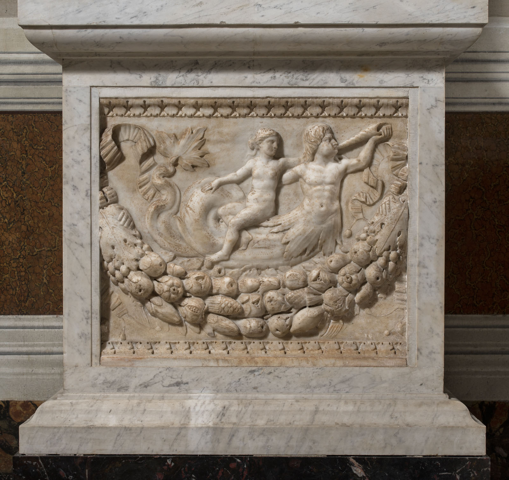

**这是什么 / 看点**：公元 130–140 年的另一段石棺正面残片，卢尼大理石，雕「花环（festoon）＋小爱神（Erotes）＋海洋母题」。和本厅其他花环石棺一脉相承：抬花环的小爱神象征生命延续，海洋题材（海兽、波浪）则常暗示灵魂渡海赴福地。现场可与本厅另外两段石棺（IILa、XXXVa）并看，比较「神话叙事型」与「纯装饰纹样型」两种花环石棺的差别。属顺路看。

### ⭐ 顺路看 古罗马艺术《阿耳忒弥斯雕像》 / Roman art, _Statue of Artemis_

- **作者 / Artist**：古罗马艺术 / Roman art
- **作品 / Work**：《阿耳忒弥斯雕像》 / _Statue of Artemis_
- **时间**：公元 2 世纪中叶
- **材质**：彭忒利科大理石
- **尺寸**：不含底座高 1.73 m；头 0.26 m
- **位置**：入口大厅（马里亚诺·罗西大厅）
- **官网介绍页**：[官网介绍英文](https://www.collezionegalleriaborghese.it/en/opere/statue-of-artemis-2)｜馆藏编号 LII

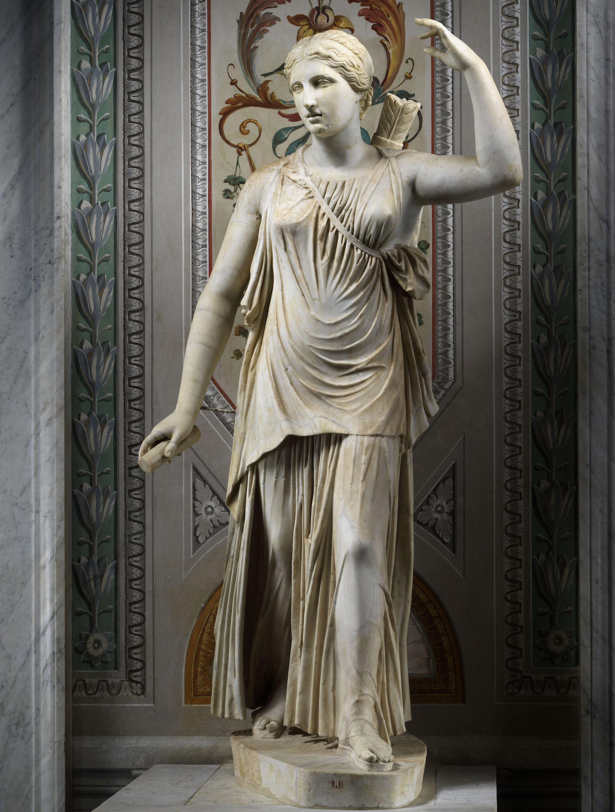

**这是什么**：公元 2 世纪中叶的阿耳忒弥斯（罗马名狄安娜）像，彭忒利科大理石，真人大小（连座 1.73 m），属「科隆纳型（Colonna type）」，是希腊原型的罗马复制品；**头与身并非同一件**，左右臂、左脚为 1820 年雕刻家 Felice Festa 修复补配。

**她是谁**：狩猎女神、野生动物与荒野的守护者，也是月亮女神，宙斯之女、阿波罗的孪生姐姐；终身守贞、桀骜独立。

**看点**：被捕捉在奔跑疾行的动态中——右腿伸直支撑、左腿前迈；身穿希顿加佩普洛斯，斜挎胸前的背带系着箭袋，左臂上举正做从箭袋抽箭的动作，右手原应握弓（现为补配），脚穿厚底凉鞋。1820 年由 Camillo Borghese 亲王在家族葡萄园 Vigna Lucidi 出土。大厅里另有一件几乎同款（编号 XXXIII），两件对称摆在门两侧——可对照看「同型复制品＋不同修复」。

### ⭐ 顺路看 古罗马艺术《酒神主题浮雕》 / Roman art, _Dionysian Relief_

- **作者 / Artist**：古罗马艺术 / Roman art
- **作品 / Work**：《酒神主题浮雕》 / _Dionysian Relief_
- **时间**：公元前 1 世纪
- **材质**：彭忒利科大理石
- **尺寸**：高 58 cm；宽 138 cm（古代部分）
- **位置**：入口大厅（马里亚诺·罗西大厅）
- **官网介绍页**：[官网介绍英文](https://www.collezionegalleriaborghese.it/en/opere/dionysian-relief-2)｜馆藏编号 VIIIL

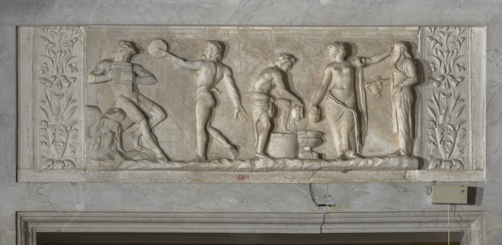

**这是什么**：公元前 1 世纪的「酒神浮雕」（Dionysian relief），彭忒利科大理石，长约 1.38 m（古代部分）。

**看点**：题材是酒神狄俄尼索斯的随从队伍（thiasos）——常见萨堤尔、酒神女祭司（maenad）持杖（thyrsus）、奏乐起舞的场面，是希腊化「新阿提卡」装饰浮雕的典型，罗马人爱用它来装点别墅与花园，营造宴饮欢愉的氛围。本厅有数件同类酒神浮雕成组陈列，现场可比较它们人物姿态与乐器的差异，整体作为「酒神主题装饰带」一并欣赏即可。属顺路看。

### ⭐ 顺路看 古罗马艺术《肖像雕像：萨洛尼娜》 / Roman art, _Portrait Statue of Salonina_

- **作者 / Artist**：古罗马艺术 / Roman art
- **作品 / Work**：《肖像雕像：萨洛尼娜》 / _Portrait Statue of Salonina_
- **时间**：公元 150–170 年，公元 260–268 年二次改刻
- **材质**：细颗粒白大理石
- **尺寸**：高 211 cm
- **位置**：入口大厅（马里亚诺·罗西大厅）
- **官网介绍页**：[官网介绍英文](https://www.collezionegalleriaborghese.it/en/opere/portrait-statue-of-salonina)｜馆藏编号 VIL

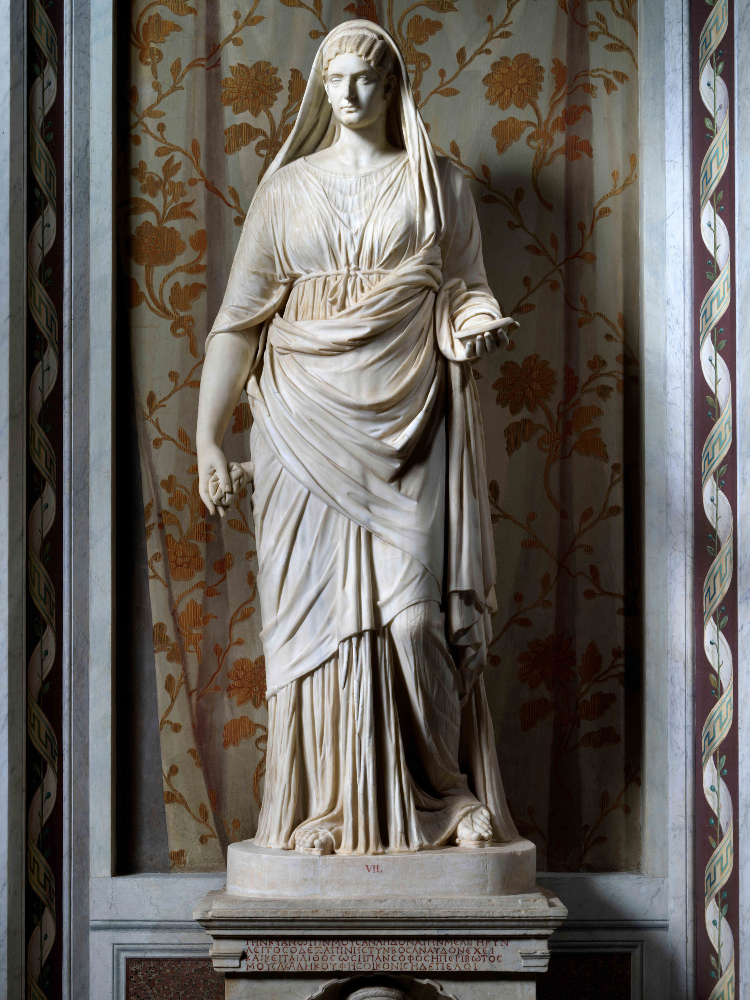

**这是什么**：公元 150–170 年雕成、约 260–268 年又被改刻的女性帝王肖像立像（Salonina），细颗粒白大理石，高 211 cm。

**她是谁 / 看点**：萨洛尼娜（Cornelia Salonina）是公元 3 世纪皇帝加里恩努斯（Gallienus）的皇后。看点在它的**「二次改刻」**——一具更早（约公元 150–170 年）的女性雕像，到 3 世纪被重新加工、换上当朝皇后的发型与面容，是罗马「旧像改新主」（节省成本、又快速产出官方肖像）的常见做法。现场可留意头部与身体在风格、年代上的微妙不一致；身披帕拉（palla）大袍，属端庄的官方女性立像范式。

### ⭐ 顺路看 古罗马艺术《佩特罗尼娅·穆萨葬祭祭坛》 / Roman art, _Funerary Altar of Petronia Musa_

- **作者 / Artist**：古罗马艺术 / Roman art
- **作品 / Work**：《佩特罗尼娅·穆萨葬祭祭坛》 / _Funerary Altar of Petronia Musa_
- **时间**：约公元 110–140 年
- **材质**：卢尼大理石
- **尺寸**：高 94 cm；宽 92 cm；深 56 cm；希腊文字高 1.5–1.2 cm；拉丁文字高 3.5 cm
- **位置**：入口大厅（马里亚诺·罗西大厅）
- **官网介绍页**：[官网介绍英文](https://www.collezionegalleriaborghese.it/en/opere/funerary-altar-of-petronia-musa)｜馆藏编号 VILa

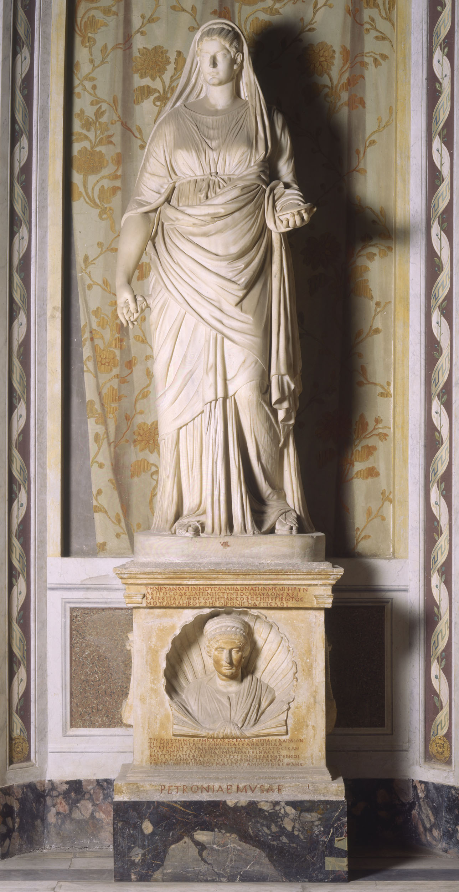

**这是什么 / 看点**：公元约 110–140 年的墓祭坛，纪念一位名叫 Petronia Musa 的女性，卢尼大理石，体量较大（高 94 cm）。最大看点是它的**双语铭文**——同时刻有希腊文（字母高约 1.2–1.5 cm）与拉丁文（约 3.5 cm），反映罗马帝国早期希腊语在丧葬与文化场合的并用。现场可找正面的题名铭文，辨认逝者名字，感受这是一块「有名有姓」的私人纪念物，而非神话装饰。属顺路看。

### ⭐ 顺路看 古罗马艺术《跳舞的萨堤尔雕像》 / Roman art, _Statue of a Dancing Satyr_

- **作者 / Artist**：古罗马艺术 / Roman art
- **作品 / Work**：《跳舞的萨堤尔雕像》 / _Statue of a Dancing Satyr_
- **时间**：公元 2 世纪
- **材质**：彭忒利科大理石
- **尺寸**：不含底座高 209 cm（古代躯干 100 cm）
- **位置**：入口大厅（马里亚诺·罗西大厅）
- **官网介绍页**：[官网介绍英文](https://www.collezionegalleriaborghese.it/en/opere/statue-of-a-dancing-satyr)｜馆藏编号 VL

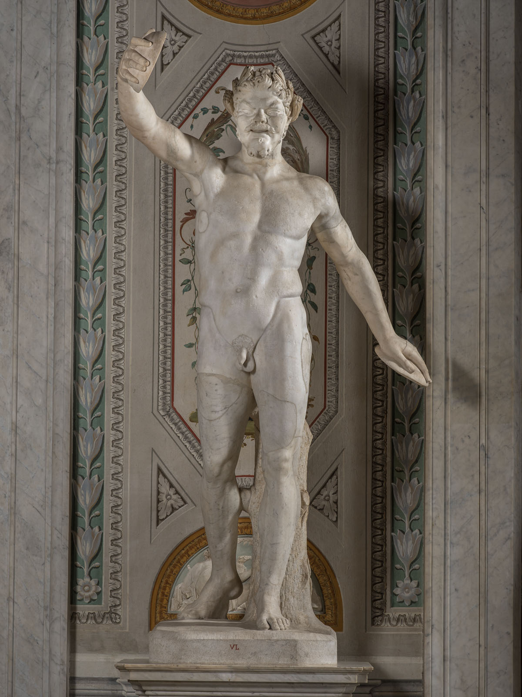

**这是什么**：公元 2 世纪的「舞蹈萨堤尔」像，彭忒利科大理石，连座高 209 cm。是希腊化原型的罗马复制品且严重修复——**只有古代躯干（约 100 cm）和尾巴接合处是原件**，小腿、双臂、颈、头、底座、树干都是约 17 世纪后补。

**他是谁**：萨堤尔（Satyr）是半人半兽的山野精灵、酒神的随从，好酒纵情、放荡不羁，常在醉态中跳起癫狂的酒神之舞，象征本能、欢愉与自然的野性力量。

**看点**：身体强烈扭转、向上腾跃、腹肌绷紧，正是「癫狂醉态、纵情狂舞」的典型萨堤尔；双手持铙钹（cymbals）起舞（修复补全）。与庞贝「农牧神之家」著名小铜像《跳舞的农牧神》极相近，学者认为源头是约公元前 200 年锡基翁的青铜《舞蹈萨堤尔》。现场可只看那段古代躯干向上扭转的姿态——这是它被归入「独立狂舞萨堤尔」一类的关键。

### ⭐ 顺路看 古罗马艺术《墨勒阿革洛斯雕像，配现代头像》 / Roman art, _Statue of Meleager, with modern head_

- **作者 / Artist**：古罗马艺术 / Roman art
- **作品 / Work**：《墨勒阿革洛斯雕像，配现代头像》 / _Statue of Meleager, with modern head_
- **时间**：约公元 140–150 年
- **材质**：卢尼大理石
- **尺寸**：不含底座高 197 cm；头高 34 cm
- **位置**：入口大厅（马里亚诺·罗西大厅）
- **官网介绍页**：[官网介绍英文](https://www.collezionegalleriaborghese.it/en/opere/statue-of-meleager-with-modern-head)｜馆藏编号 XL

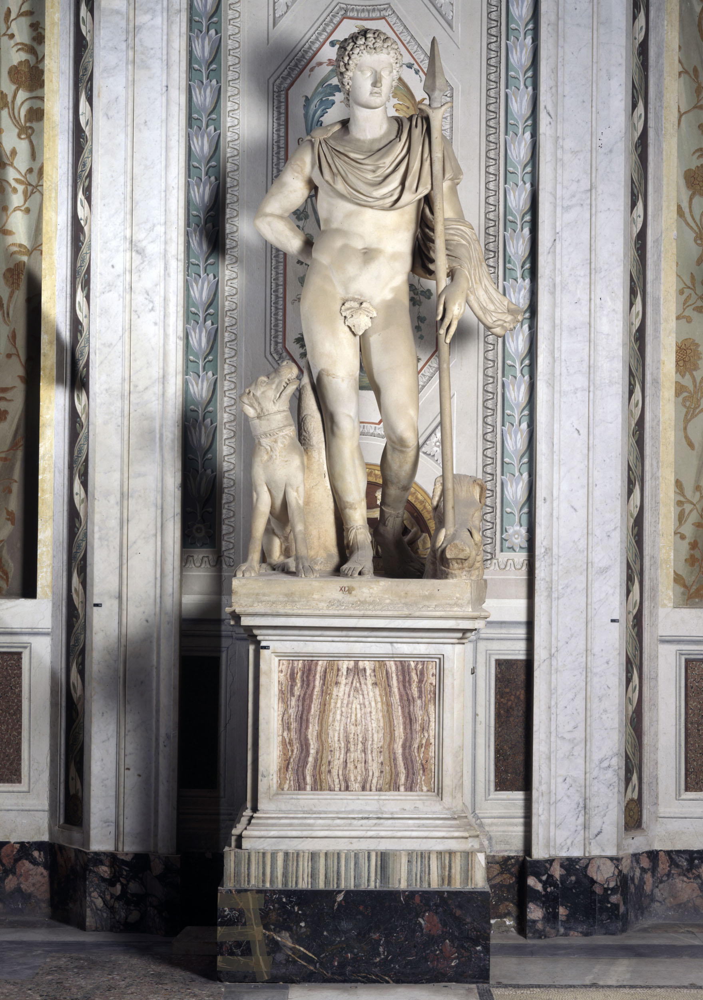

**这是什么**：约公元 140–150 年的墨勒阿格洛斯像，卢尼大理石，连座高 197 cm，是公元前 4 世纪大师斯科帕斯（Scopas）青铜原作的罗马复制品；**头部为后世补配**，另有双腿、右臂、颈、上胸、长矛、野猪局部等大量 17 世纪修复。

**他是谁**：墨勒阿格洛斯是卡吕冬（Calydon）的英雄王子。狩猎女神阿耳忒弥斯因其父忘记献祭，怒放一头巨型野猪蹂躏卡吕冬；他召集群英与猎犬，亲手猎杀了这头「卡吕冬野猪」，成就希腊神话最著名的群英狩猎之一。

**看点**：青年裸体倚树干、重心在右腿、身体呈优美 S 形；除一件搭右肩的短斗篷（chlamys）外全裸，脚穿系皮结的猎靴；**右侧蹲一只仰望主人的猎犬，左侧地上是被矛抵住的野猪头**——直接点出卡吕冬野猪狩猎主题。现场就靠「猎犬＋野猪头」两个道具认出他是谁。1613 年最早记载于博尔盖塞宫，馆方页面还引用了奥维德《变形记》和荷马《伊利亚特》中刺杀野猪的诗句。

### ⭐ 顺路看 古罗马艺术《奥古斯都肖像头像，接于着托加身体上》 / Roman art, _Portrait Head of Augustus, attached to a togaed body_

- **作者 / Artist**：古罗马艺术 / Roman art
- **作品 / Work**：《奥古斯都肖像头像，接于着托加身体上》 / _Portrait Head of Augustus, attached to a togaed body_
- **时间**：约公元前 10 年（肖像）；公元 70–80 年（托加雕像）
- **材质**：彭忒利科大理石
- **尺寸**：高 236 cm（含底座）；224 cm（雕像）；35 cm（头）
- **位置**：入口大厅（马里亚诺·罗西大厅）
- **官网介绍页**：[官网介绍英文](https://www.collezionegalleriaborghese.it/en/opere/portrait-head-of-augustus-attached-to-a-togaed-body)｜馆藏编号 XLI

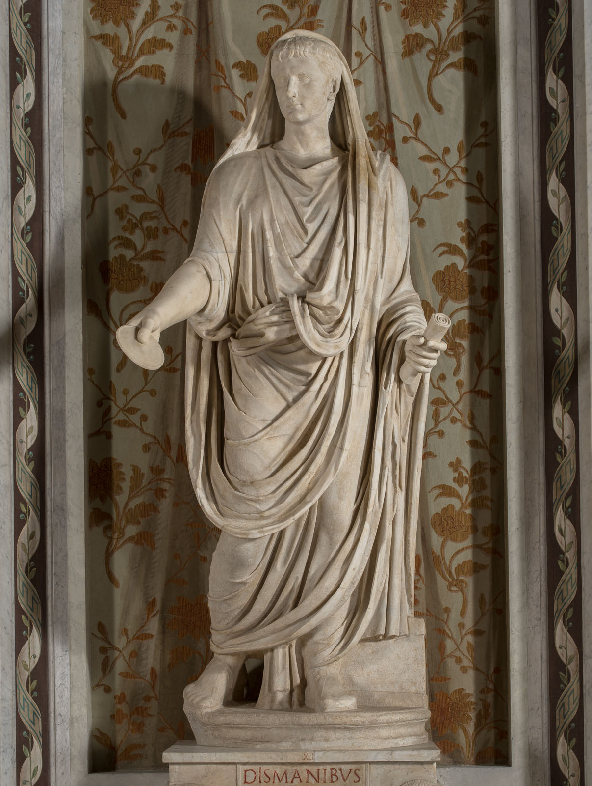

**这是什么**：奥古斯都的大祭司立像，头像约公元前 10 年（奥古斯都晚期），托加身体约公元 70–80 年，连座高 236 cm。**头与身不属于同一件作品**——头是真品，身体晚了约 70–90 年；鼻子、右手「祭碟」、覆头头巾均为修复添加。

**他是谁**：奥古斯都（原名屋大维），罗马第一位皇帝（前 27–公元 14 在位），终结内战、开创延续两百年的「罗马和平」，是整个帝国的奠基者。

**现场站看**：
1. **大祭司造型**——把奥古斯都塑成 Pontifex Maximus，托加长袍向上蒙住头部（velato capite，蒙头献祭的祭司姿态），手持祭碟与书卷，脚边放着装文件的圆筒盒（capsa），一整套祭司「道具」。
2. **理想化青春**——头像属官方标准像「Prima Porta 型」，前额两束燕尾状卷发、太阳穴钳形发缕；罗马传统是把皇帝永远塑造得年轻不显老。
3. **头身后配的最佳范例**——一具无名托加身体装上更早的皇帝头，再加工成大祭司像；这种「托加立像」模板在帝国时代被大量复制，堪称古罗马的「标准证件照」。

### ⭐ 顺路看 古罗马艺术《弗拉维娅·达芙涅葬祭祭坛》 / Roman art, _Funerary Altar of Flavia Dafne_

- **作者 / Artist**：古罗马艺术 / Roman art
- **作品 / Work**：《弗拉维娅·达芙涅葬祭祭坛》 / _Funerary Altar of Flavia Dafne_
- **时间**：公元 1 世纪下半叶
- **材质**：卢尼大理石
- **尺寸**：高 102 cm；宽 83 cm；深 62 cm；字高 35–43 cm
- **位置**：入口大厅（马里亚诺·罗西大厅）
- **官网介绍页**：[官网介绍英文](https://www.collezionegalleriaborghese.it/en/opere/funerary-altar-of-flavia-dafne)｜馆藏编号 XLIa

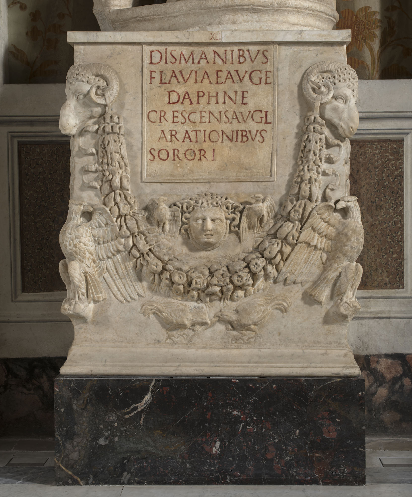

**这是什么 / 看点**：公元 1 世纪下半叶的墓祭坛，纪念 Flavia Dafne，卢尼大理石，高逾 1 米。和本厅其他几件墓祭坛一样，正面刻逝者姓名铭文（字母较大、清晰）。看点在于「Flavia」这一姓氏属弗拉维家族的释奴或关联者，「Dafne（达芙妮）」是常见于女奴/释奴的希腊式名字——一块石头就透露出帝国早期的社会身份信息。属顺路看，可与编号 VILa、XXXIXa、IVLa 几件并看，感受罗马墓祭坛的成组样式。

### ⭐ 顺路看 古罗马艺术《巨型雕像：狄俄尼索斯》 / Roman art, _Colossal Statue of Dionysus_

- **作者 / Artist**：古罗马艺术 / Roman art
- **作品 / Work**：《巨型雕像：狄俄尼索斯》 / _Colossal Statue of Dionysus_
- **时间**：公元 160–180 年
- **材质**：帕罗斯大理石
- **尺寸**：不含底座高：至葡萄串 310 cm；至头部 272 cm；头 43 cm
- **位置**：入口大厅（马里亚诺·罗西大厅）
- **官网介绍页**：[官网介绍英文](https://www.collezionegalleriaborghese.it/en/opere/colossal-statue-of-dionysus)｜馆藏编号 XLIX

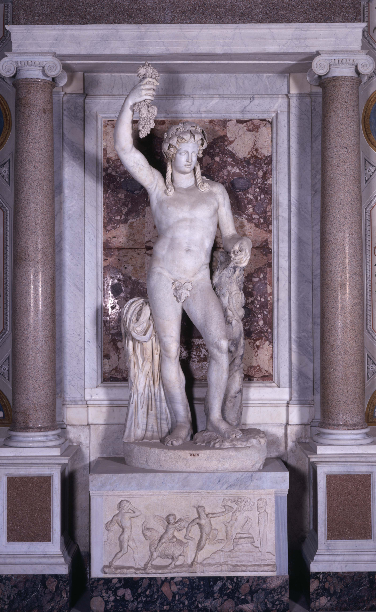

**这是什么**：公元 160–180 年罗马原作的狄俄尼索斯巨像，帕罗斯白大理石，连葡萄串高约 310 cm。风格很可能脱胎自公元前 4 世纪希腊原型；**头部不是古代原件**（后世仿制），高举葡萄串的右臂姿势也是 18–19 世纪修复时改出来的。

**他是谁**：狄俄尼索斯（罗马名巴克斯）是酒神，也是葡萄种植、狂欢与戏剧之神，常以青春俊美、近乎女性化的柔美形象出现，身边总跟着萨堤尔与酒神女祭司组成的「狂欢队伍」（thiasos）。

**现场站看**：
1. **S 形身姿与酒神标志**——裸体站立、重心在右腿、身体呈优美 S 形（contrapposto）；右侧树干缠葡萄藤，头戴常春藤/葡萄叶发带。
2. **原姿势的来历**——手臂搭头顶的「休憩式」取自普拉克西特列斯《吕克昂的阿波罗》，从前 4 世纪起也用来表现「醉酒的狄俄尼索斯」。
3. **它原本不是独像**——左肩和左髋背后有被磨平、用石膏盖住的支撑痕，说明身旁原来靠着一个萨堤尔、是一组群像；修复时萨堤尔被去掉、换成那根缠藤树干。1607 年由红衣主教 Scipione Borghese 买入。

### ⭐ 顺路看 古罗马艺术《酒神主题浮雕》 / Roman art, _Dionysian Relief_

- **作者 / Artist**：古罗马艺术 / Roman art
- **作品 / Work**：《酒神主题浮雕》 / _Dionysian Relief_
- **时间**：公元前 1 世纪
- **材质**：彭忒利科大理石
- **尺寸**：高 58 cm；宽 138 cm（古代部分）
- **位置**：入口大厅（马里亚诺·罗西大厅）
- **官网介绍页**：[官网介绍英文](https://www.collezionegalleriaborghese.it/en/opere/dionysian-relief-4)｜馆藏编号 XLIXa

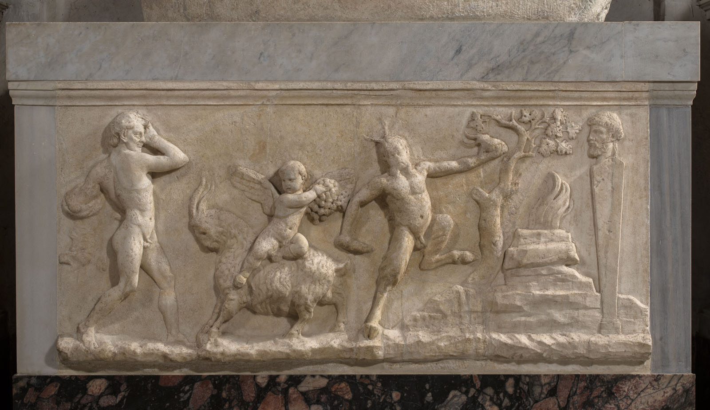

**这是什么**：公元前 1 世纪的「酒神浮雕」（Dionysian relief），彭忒利科大理石，长约 1.38 m（古代部分）。

**看点**：题材是酒神狄俄尼索斯的随从队伍（thiasos）——常见萨堤尔、酒神女祭司（maenad）持杖（thyrsus）、奏乐起舞的场面，是希腊化「新阿提卡」装饰浮雕的典型，罗马人爱用它来装点别墅与花园，营造宴饮欢愉的氛围。本厅有数件同类酒神浮雕成组陈列，现场可比较它们人物姿态与乐器的差异，整体作为「酒神主题装饰带」一并欣赏即可。属顺路看。

### ⭐ 顺路看 古罗马艺术《常春藤叶烛台》 / Roman art, _Candleholder with Ivy Leaves_

- **作者 / Artist**：古罗马艺术 / Roman art
- **作品 / Work**：《常春藤叶烛台》 / _Candleholder with Ivy Leaves_
- **时间**：公元 1–2 世纪
- **材质**：白色大理石
- **尺寸**：高 270 cm
- **位置**：入口大厅（马里亚诺·罗西大厅）
- **官网介绍页**：[官网介绍英文](https://www.collezionegalleriaborghese.it/en/opere/candleholder-with-ivy-leaves)｜馆藏编号 XXX

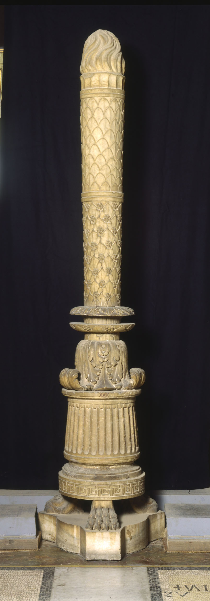

**这是什么 / 看点**：另一座古罗马大理石烛架/灯架，高 270 cm，装饰以**常春藤叶（ivy）**为主。常春藤同样是酒神的标志植物，与本厅另一座 325 cm 的酒神题材烛台（编号 I）形成一对垂直陈设，分立空间两侧。和那座一样，它多半也是古代残件与后世补件的拼接，看点在高耸柱身上层层叠叠的叶饰带；属顺路一瞥的装饰性陈列。

### ⭐ 顺路看 古罗马艺术《科隆纳型阿耳忒弥斯雕像，配非原配肖像头像》 / Roman art, _Statue of Artemis of the Colonna Type, with non-original portrait head_

- **作者 / Artist**：古罗马艺术 / Roman art
- **作品 / Work**：《科隆纳型阿耳忒弥斯雕像，配非原配肖像头像》 / _Statue of Artemis of the Colonna Type, with non-original portrait head_
- **时间**：约公元 250 年（身体）；约公元 115 年（头）
- **材质**：白色大理石
- **尺寸**：高 182 cm（含底座）；173 cm（雕像）；149 cm（身体）；24 cm（头）
- **位置**：入口大厅（马里亚诺·罗西大厅）
- **官网介绍页**：[官网介绍英文](https://www.collezionegalleriaborghese.it/en/opere/statue-of-artemis-of-the-colonna-type-with-non-original-portrait-head)｜馆藏编号 XXXIII

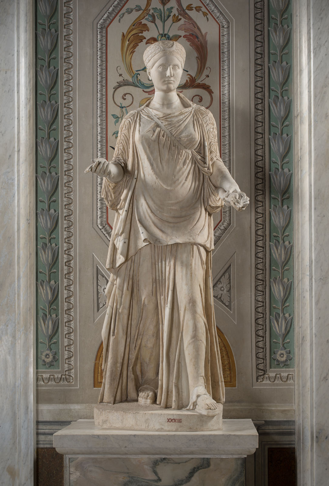

**这是什么 / 看点**：与编号 LII 几乎同款的另一尊「科隆纳型」狩猎女神阿耳忒弥斯，身体约公元 250 年、头却约公元 115 年且为**非原配的肖像头**（把一位贵妇/公主的肖像头安到女神身上，是罗马把凡人「神化」成狄安娜的常见做法）。两尊对称立在门两侧，作用是给入口做对称仪仗。现场可与 LII 并看，比较同一雕像类型的两件复制品、以及各自不同的头身拼配方式。

### ⭐ 顺路看 古罗马艺术《扮作朱庇特的克劳狄乌斯肖像，配现代提比略头像》 / Roman art, _Portrait of Claudius as Jupiter, with a modern head of Tiberius_

- **作者 / Artist**：古罗马艺术 / Roman art
- **作品 / Work**：《扮作朱庇特的克劳狄乌斯肖像，配现代提比略头像》 / _Portrait of Claudius as Jupiter, with a modern head of Tiberius_
- **时间**：公元 1 世纪
- **材质**：卢尼大理石
- **尺寸**：不含底座高 178 cm；头高 32 cm
- **位置**：入口大厅（马里亚诺·罗西大厅）
- **官网介绍页**：[官网介绍英文](https://www.collezionegalleriaborghese.it/en/opere/portrait-of-claudius-as-jupiter-with-a-modern-head-of-tiberius)｜馆藏编号 XXXIX

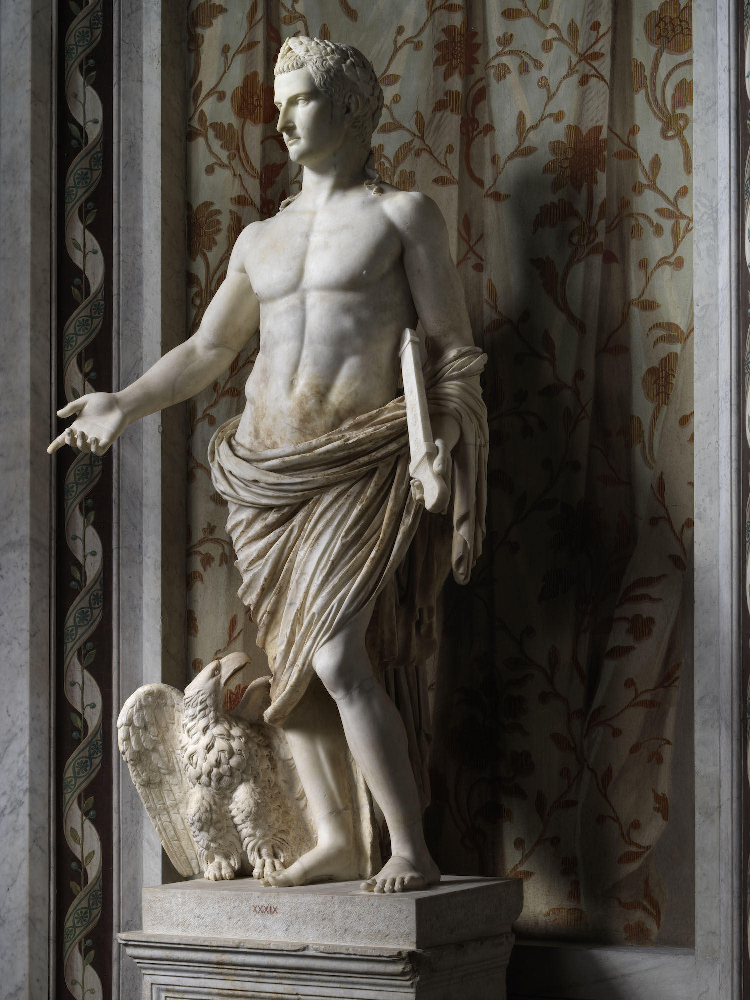

**这是什么**：一具公元 1 世纪、把皇帝塑成朱庇特模样的半裸坐/立像（克劳狄乌斯 as Jupiter），但**头部是后世补配的提比略头**，连巴掌大的接合都是近代拼装，连座高 178 cm。

**看点**：① **帝王神化**——把在世或已故皇帝塑成持权杖、半裸披袍的朱庇特，是罗马帝王崇拜的标准图式，宣示其神性与统治正当性。② **错配的身份**——身体本属克劳狄乌斯、头却是提比略，是博尔盖塞古物「张冠李戴式修复」的典型，提醒你展厅里「某皇帝像」的头身未必是一回事。属顺路看，但和奥古斯都大祭司像并看，能凑齐「皇帝扮祭司／皇帝扮神」两种神化套路。

### ⭐ 顺路看 古罗马艺术《带卧榻宴饮者形象的葬祭祭坛》 / Roman art, _Funerary altar with Banqueter Reclining on a Kline_

- **作者 / Artist**：古罗马艺术 / Roman art
- **作品 / Work**：《带卧榻宴饮者形象的葬祭祭坛》 / _Funerary altar with Banqueter Reclining on a Kline_
- **时间**：约公元 80–90 年
- **材质**：卢尼大理石
- **尺寸**：高 99 cm；宽 78 cm；深 50 cm；带人物嵌板 22 × 40 cm
- **位置**：入口大厅（马里亚诺·罗西大厅）
- **官网介绍页**：[官网介绍英文](https://www.collezionegalleriaborghese.it/en/opere/funerary-altar-with-banqueter-reclining-on-a-kline)｜馆藏编号 XXXIXa

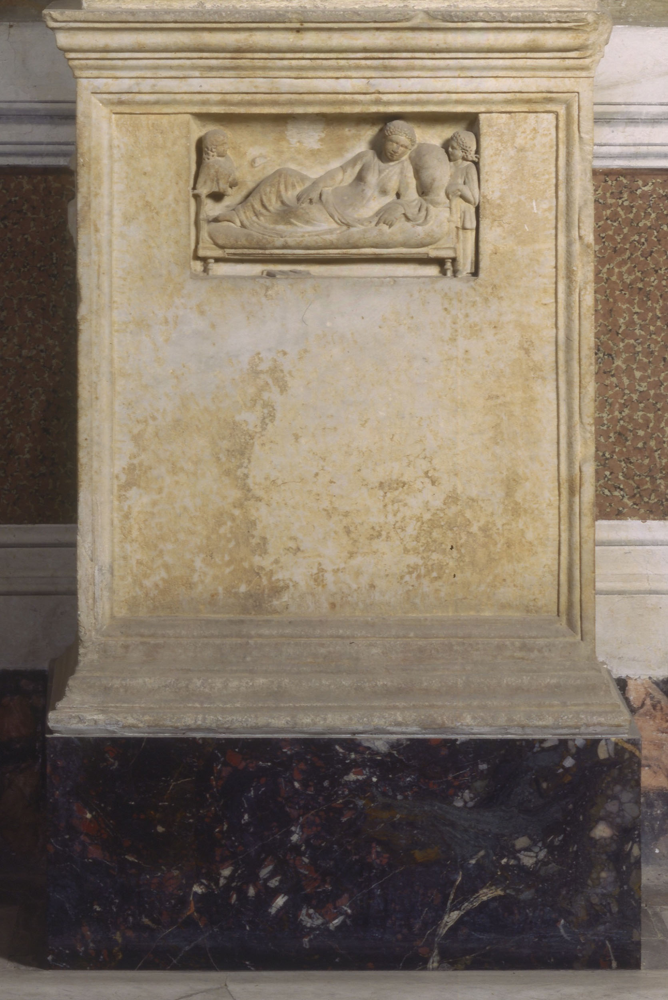

**这是什么 / 看点**：公元约 80–90 年的墓祭坛，正面小浮雕（约 22×40 cm）刻一位**斜倚在卧榻（kline）上宴饮的逝者**。「宴饮图」是希腊化以来流行的丧葬母题——把死者表现为永享盛宴的样子，寓意死后的安乐与丰足。现场就看那方小浮雕里斜倚执杯的人物与卧榻、小桌等宴饮道具。它和本厅另外几件墓祭坛构成一组，展示罗马人如何用「神祇献祭 / 双语题名 / 永恒宴饮」等不同方式装点墓碑。属顺路看。

### ⭐ 顺路看 古罗马艺术《巨型神祇头像，修复为伊西斯》 / Roman art, _Colossal Head of a Divinity, restored as Isis_

- **作者 / Artist**：古罗马艺术 / Roman art
- **作品 / Work**：《巨型神祇头像，修复为伊西斯》 / _Colossal Head of a Divinity, restored as Isis_
- **时间**：公元 2 世纪
- **材质**：亚洲大理石
- **尺寸**：连胸像高 145 cm；头高 76 cm
- **位置**：入口大厅（马里亚诺·罗西大厅）
- **官网介绍页**：[官网介绍英文](https://www.collezionegalleriaborghese.it/en/opere/colossal-head-of-a-divinity-restored-as-isis)｜馆藏编号 XXXV

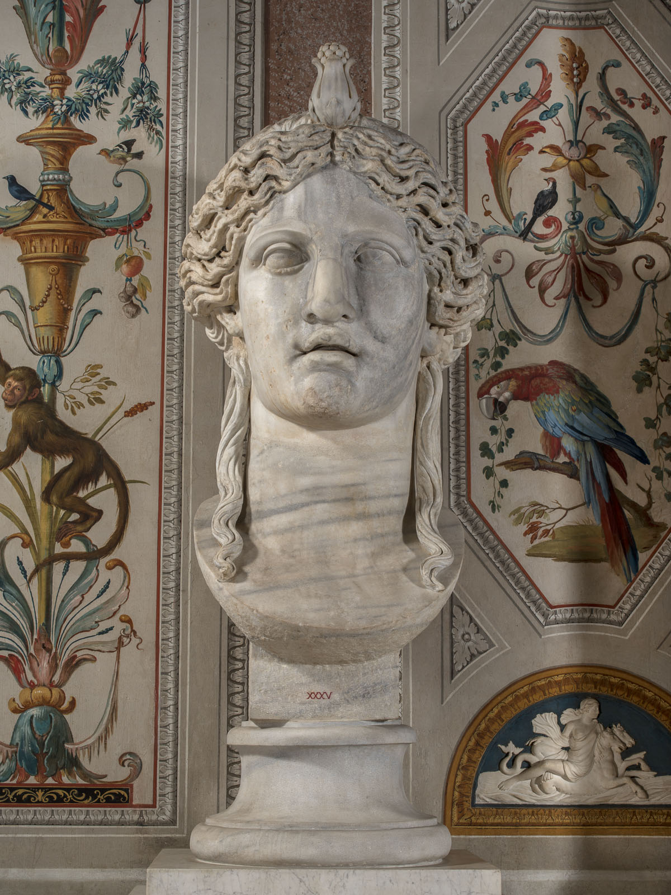

**这是什么 / 看点**：一颗公元 2 世纪的巨像神祇头部，亚洲大理石，连胸高 145 cm、头高 76 cm，**被后世修复成伊西斯（Isis）**。原本可能是某位女神的神庙崇拜像残件，巨大的尺度正说明它来自真人数倍的崇拜雕像。看点：① 尺度——头就近 0.8 米，可想见原像在神庙中的体量；② 「修复成伊西斯」——后人依埃及女神伊西斯的图式（如额前发结、头饰）给这颗来历不明的神头安了一个身份，是古物在近代被「重新命名」的例子。属顺路看，与另一颗女性巨像神头（XXXVII）可对照。

### ⭐ 顺路看 古罗马艺术《饰花彩及涅瑞伊得斯持阿喀琉斯武器的石棺；左侧饰水果花彩与幻想动物》 / Roman art, _Sarcophagus decorated with festoons and Nereids carrying Achilles’ weapons; left side decorated with festoon of fruit and a fantastical animal_

- **作者 / Artist**：古罗马艺术 / Roman art
- **作品 / Work**：《饰花彩及涅瑞伊得斯持阿喀琉斯武器的石棺；左侧饰水果花彩与幻想动物》 / _Sarcophagus decorated with festoons and Nereids carrying Achilles’ weapons; left side decorated with festoon of fruit and a fantastical animal_
- **时间**：公元 130–150 年
- **材质**：带蓝色纹理的白大理石
- **尺寸**：高 52 cm，宽 60 cm
- **位置**：入口大厅（马里亚诺·罗西大厅）
- **官网介绍页**：[官网介绍英文](https://www.collezionegalleriaborghese.it/en/opere/sarcophagus-decorated-with-festoons-and-nereids-carrying-achilles-weapons)｜馆藏编号 XXXVa

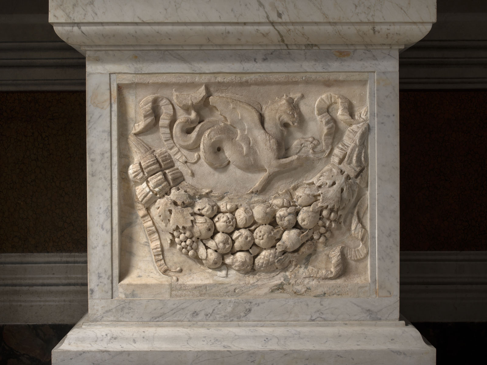

**这是什么 / 看点**：与编号 IILa 同属一具石棺——这是它的**左侧面段**，同样雕花环（festoon），并配一只幻想动物。正面（IILa）讲涅瑞伊得斯送阿喀琉斯神兵，侧面则以果实花环＋奇兽收边。两段并看，能还原一具罗马「花环式石棺」的完整装饰逻辑：正面叙事、侧面纹样，整体用丰饶意象安慰生者。属顺路看。

### ⭐ 顺路看 古罗马艺术《战斗中的萨堤尔雕像》 / Roman art, _Statue of a Fighting Satyr_

- **作者 / Artist**：古罗马艺术 / Roman art
- **作品 / Work**：《战斗中的萨堤尔雕像》 / _Statue of a Fighting Satyr_
- **时间**：公元 120–140 年
- **材质**：卢尼大理石
- **尺寸**：不含底座高 238 cm
- **位置**：入口大厅（马里亚诺·罗西大厅）
- **官网介绍页**：[官网介绍英文](https://www.collezionegalleriaborghese.it/en/opere/statue-of-a-fighting-satyr)｜馆藏编号 XXXVI

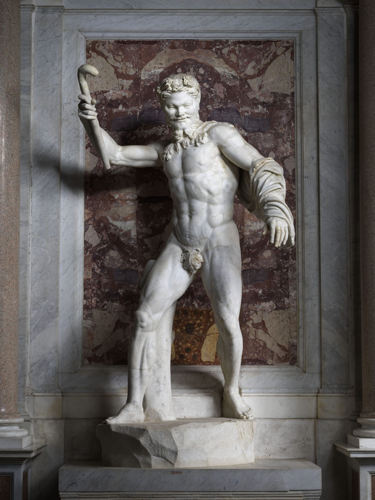

**这是什么**：公元 120–140 年的「战斗中的萨堤尔」巨像，卢尼大理石，连座高达 238 cm，是大厅里体量最大的雕像之一。

**他是谁 / 看点**：同样是酒神随从萨堤尔，但这件不是狂舞、而是**搏斗中的张力**——身体大幅扭转、肌肉紧绷，像在与人/兽角力或挣脱束缚的瞬间。它和那尊「舞蹈萨堤尔」（编号 VL）正好凑成酒神世界的两种状态：一狂喜、一激斗。近 2.4 米的尺度让它非常有压迫感，现场值得退后几步从下往上看身体的螺旋扭势（古代擅长用这种 figura serpentinata 制造动感）；和它一样，多半也经过大量后世修复。

### ⭐ 顺路看 古罗马艺术《酒神主题浮雕》 / Roman art, _Dionysian Relief_

- **作者 / Artist**：古罗马艺术 / Roman art
- **作品 / Work**：《酒神主题浮雕》 / _Dionysian Relief_
- **时间**：公元前 1 世纪
- **材质**：彭忒利科大理石
- **尺寸**：高 58 cm；宽 138 cm（古代部分）
- **位置**：入口大厅（马里亚诺·罗西大厅）
- **官网介绍页**：[官网介绍英文](https://www.collezionegalleriaborghese.it/en/opere/dionysian-relief)｜馆藏编号 XXXVIa

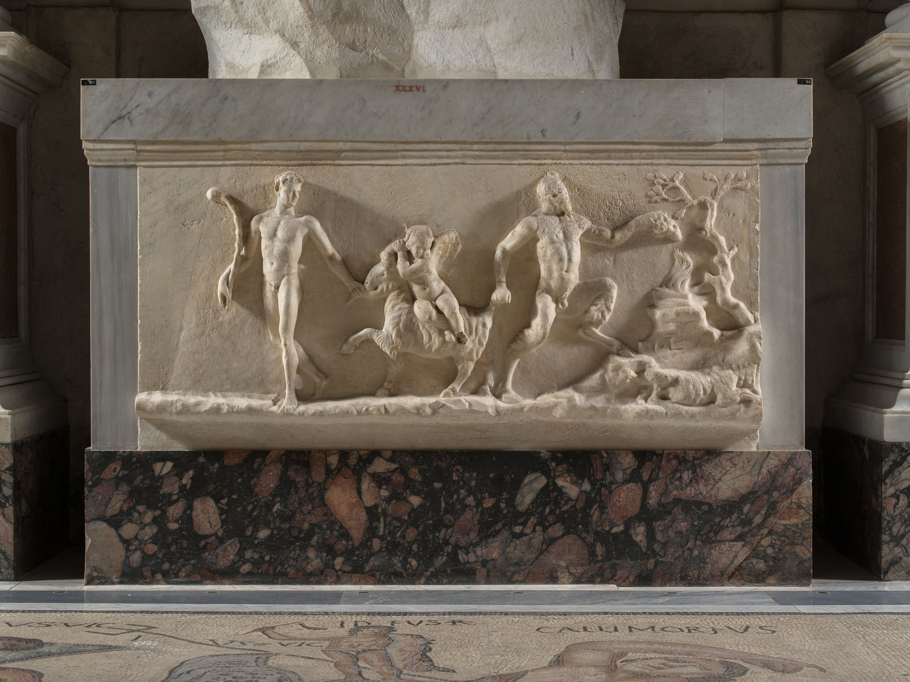

**这是什么**：公元前 1 世纪的「酒神浮雕」（Dionysian relief），彭忒利科大理石，长约 1.38 m（古代部分）。

**看点**：题材是酒神狄俄尼索斯的随从队伍（thiasos）——常见萨堤尔、酒神女祭司（maenad）持杖（thyrsus）、奏乐起舞的场面，是希腊化「新阿提卡」装饰浮雕的典型，罗马人爱用它来装点别墅与花园，营造宴饮欢愉的氛围。本厅有数件同类酒神浮雕成组陈列，现场可比较它们人物姿态与乐器的差异，整体作为「酒神主题装饰带」一并欣赏即可。属顺路看。

### ⭐ 顺路看 古罗马艺术《女性神祇巨型头像》 / Roman art, _Colossal Head of a Female Divinity_

- **作者 / Artist**：古罗马艺术 / Roman art
- **作品 / Work**：《女性神祇巨型头像》 / _Colossal Head of a Female Divinity_
- **时间**：公元 1 世纪
- **材质**：彭忒利科大理石
- **尺寸**：高 143 cm；头 112 cm
- **位置**：入口大厅（马里亚诺·罗西大厅）
- **官网介绍页**：[官网介绍英文](https://www.collezionegalleriaborghese.it/en/opere/colossal-head-of-a-female-divinity)｜馆藏编号 XXXVII

**这是什么 / 看点**：一颗公元 1 世纪的女性神祇巨像头部，彭忒利科大理石，高 143 cm、头部 112 cm，体量惊人。和编号 XXXV 一样，它来自一尊真人数倍的神庙崇拜像，如今只存头部。看点纯在**尺度与古典面容**——巨大的鹅蛋脸、对称端庄的五官，是希腊古典理想化女神的样貌。两颗巨像神头并看，能直观感受罗马神庙崇拜像的惊人体量，以及「只剩一颗头」的残件如何被搬进别墅当装饰陈列。属顺路看。

## 其他
### ⭐ 顺路看 文琴佐·帕切蒂、马西米利亚诺·拉布勒尔、托马索·里吉等《墙面装饰，饰花卉与动物图案及灰泥浮雕饰章》 / Vincenzo Pacetti, Massimiliano Laboureur, Tommaso Righi and others, _Wall Decorations with Floral and Animal Motifs and Stucco Cameos_

- **作者 / Artist**：文琴佐·帕切蒂、马西米利亚诺·拉布勒尔、托马索·里吉等 / Vincenzo Pacetti, Massimiliano Laboureur, Tommaso Righi and others
- **作品 / Work**：《墙面装饰，饰花卉与动物图案及灰泥浮雕饰章》 / _Wall decorations with floral and animal motifs and stucco cameos_
- **时间**：1775–1779 年改造期
- **位置**：入口大厅墙面

入口大厅是进入博尔盖塞的第一场「总序」。天顶讲罗马英雄与家族荣耀，墙面装饰和雕塑则把古代、近代修复、家族继承与收藏趣味整合成一个空间。

**看点**：这套墙面装饰由帕切蒂、拉布勒尔、里吉等人在 1775–1779 年改造期完成，满布**花卉、动物纹样与灰泥浮雕章（stucco cameos）**。现场扫一圈墙面与檐口，会反复看到「上鹰下龙」的博尔盖塞家族纹章——它把整片「罗马荣耀」的叙事框进博尔盖塞家族的话语；以及成排嵌在墙上的古代雕像、胸像与浮雕，体现 18 世纪末「古件＋新装饰」融为一体的陈列美学。进门别急着走，先抬头看天顶、再环视一圈墙面，就读懂了整座别墅的「开场白」。

## 资料来源 / Sources

- Galleria Borghese 官方房间页：[Ingresso - Salone di Mariano Rossi](https://galleriaborghese.cultura.gov.it/il-museo/la-villa/ingresso-salone-di-mariano-rossi/)
- Galleria Borghese 藏品页（库尔提乌斯）：[Roman art / attributed to Pietro Bernini, _Marcus Curtius Throws Himself into the Chasm_](https://www.collezionegalleriaborghese.it/en/opere/marcus-curtius-throws-himself-into-the-chasm)
- Galleria Borghese 藏品筛选：[Modern Sculpture, Entrance Hall](https://www.collezionegalleriaborghese.it/en/collezione/scultura?sala=s0)
- Galleria Borghese 藏品筛选：[Ancient Art, Entrance Hall](https://www.collezionegalleriaborghese.it/en/collezione/arte-antica?sala=s0)
