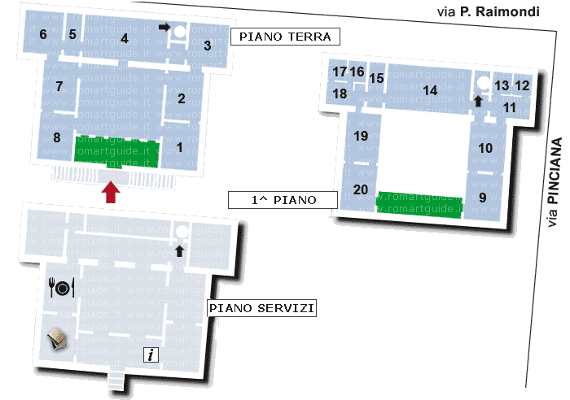

**一句话**：博尔盖塞美术馆（Galleria Borghese）是罗马一座由 17 世纪红衣主教的私人别墅改成的国家美术馆，以"小而精"著称——尤其是全世界最密集的贝尼尼雕塑，加上卡拉瓦乔、提香、拉斐尔、卡诺瓦等顶级名作，被公认为罗马最值得看的博物馆之一。

**这是什么 / 来历**：它的核心是红衣主教希皮奥内·博尔盖塞（Scipione Borghese，教皇保罗五世之侄）的私人收藏。希皮奥内既是贝尼尼最早的伯乐，也是一位不择手段的收藏家——曾强夺拉斐尔的《卸下圣体》、借故没收别人的卡拉瓦乔。他在 1610 年代为这批藏品建起城外的"平乔别墅"（Villa Borghese Pinciana）。1807 年家族把约 800 件古罗马雕塑卖给拿破仑（今藏卢浮宫），1902 年整座别墅与剩余藏品由意大利国家收购，1903 年作为国家美术馆开放至今。

**为什么重要**：① 贝尼尼的大本营——《阿波罗与达芙妮》《被劫掠的普罗瑟皮娜》《大卫》《埃涅阿斯背父》四大名作同处一楼，是看巴洛克雕塑"让大理石变成肉与树叶"的最佳地点；② 一屋六幅卡拉瓦乔；③ 二层画廊藏提香《圣爱与俗爱》、拉斐尔《卸下圣体》及大批威尼斯名作；④ 卡诺瓦的《保利娜·波拿巴》。

**建筑与园林本身就是展品**：别墅坐落在罗马最大的城市公园博尔盖塞园（Villa Borghese）中。18 世纪末，马尔坎托尼奥·博尔盖塞（Marcantonio IV Borghese）请建筑师安东尼奥·阿斯普鲁奇（Antonio Asprucci）主持了一次彻底的新古典主义改造，核心思路是"一室一主题"——每间厅的天顶画、壁炉、灰泥装饰都围绕这间厅的主角藏品来组织。所以参观时不只看雕塑和画，更要抬头看天顶：天顶与陈列往往讲的是同一个故事（各厅详情见本目录各文件的"天顶画"章节）。

**怎么逛（很重要）**：博尔盖塞实行**分时段预约、限时约 2 小时**的参观制，每个时段人数受控、到点清场，所以节奏要紧凑。布局上分**一层（雕塑层，8 个厅）＋ 二层画廊（Pinacoteca，绘画为主）**。本目录即按官方参观动线把各厅拆成单独文件，配合景点调研 07 博尔盖塞美术馆 Galleria Borghese（建筑 / 历史 / 票务）一起用。

---

**Galleria Borghese 藏品总览** · D2 14:00–16:00 参观；2h 限时严格

> 本目录 9 个文件按**博尔盖塞美术馆参观顺序**（一楼 8 室 + 二楼画廊）拆分，配合景点调研 07 博尔盖塞美术馆 Galleria Borghese（建筑/历史/票务）使用。
>
> 14:00 入场后建议参观顺序：**Salone Mariano Rossi（入口大厅）→ Sala I（保利娜）→ II（大卫）→ III（阿波罗与达芙妮）→ IV（凯撒厅）→ V（双性人）→ VI（埃涅阿斯）→ VII（埃及）→ VIII（卡拉瓦乔）→ 上楼 Pinacoteca**——参考各厅文件。

### 各厅速查索引

#### 一层（雕塑层，约 50 件）

| Sala | 名字 | 核心作品 | 调研文件 |
| --- | --- | --- | --- |
| 0 | Salone Mariano Rossi（入口大厅） | Mariano Rossi《罗慕路斯凯旋》天顶画 + 古罗马《奥古斯都》像 + 古角斗士马赛克 + 贝尼尼晚期《真理》 | 见本文下方 |
| I | Sala della Paolina（保利娜厅） | 卡诺瓦《保利娜·博尔盖塞 Venus Victrix》（1808） | [G - 01 Sala I - 保利娜厅](../sala-i-paolina/) |
| II | Sala del Sole / Sala del David（太阳厅 / 大卫厅） | 贝尼尼《大卫》（1623–24）+ 天顶画 Domenico Cresti《法厄同的坠落》 | [G - 02 Sala II - 大卫厅](../sala-ii-david/) |
| III | Sala di Apollo e Dafne（阿波罗与达芙妮厅） | 贝尼尼《阿波罗与达芙妮》（1622–25） | [G - 03 Sala III - 阿波罗与达芙妮厅](../sala-iii-apollo-daphne/) |
| IV | Sala degli Imperatori / 凯撒厅（中央方厅） | 贝尼尼《被劫掠的普罗瑟皮娜 / 冥王劫掠》（1621–22）+ 18 张古罗马皇帝半身像 + 安东尼《海洋骑士 Nereid》 | [G - 04 Sala IV - 凯撒厅](../sala-iv-emperors/) |
| V | Sala dell'Ermafrodito（双性人厅） | 罗马 2 世纪《沉睡的双性人》复制类型 + Andrea Bergondi 1774 大理石床垫（不是 Bernini 床垫） | [G - 05 Sala V - 双性人厅](../sala-v-hermaphrodite/) |
| VI | Sala di Enea e Anchise（埃涅阿斯厅） | 贝尼尼《埃涅阿斯背父》（1618–19，贝尼尼 20 岁早期作）+ Cosroe Dusi 天顶画 | [G - 06 Sala VI - 埃涅阿斯厅](../sala-vi-aeneas/) |
| VII | Sala Egizia（埃及厅） | 埃及主题装饰 + Borghese 家族 18 世纪埃及藏 + 罗马时代仿古典雕塑 | [G - 07 Sala VII - 埃及厅](../sala-vii-egyptian/) |
| VIII | Sala del Sileno / 卡拉瓦乔厅 | **6 件卡拉瓦乔油画**；Bernini《真理》馆方当前在 Room VI，Scipione 两尊半身像在 Room XIV | [G - 08 Sala VIII - 卡拉瓦乔厅](../sala-viii-caravaggio/) |

#### 二层（绘画层 Pinacoteca，约 150 件）

| Sala | 主题 | 核心作品 |
| --- | --- | --- |
| IX | 拉斐尔厅 | **拉斐尔《基督遗体运往墓穴 / Pala Baglioni》（1507）+《独角兽女士》（若展出）** |
| X | 风格主义/早期巴洛克 | Bronzino《施洗者圣约翰》+ 其他风格主义作品 |
| XI | Ganymede 厅 | Garofalo《扫罗皈依》（若展出）+ Sodoma《圣家庭》（若展出） |
| XII | Bacchae 厅 | 16 世纪威尼斯派；Lorenzo Lotto《男士肖像》按馆方 Room XX 一起看 |
| XIII | Cesarini 厅 | 16 世纪意大利绘画 + Bassano 系列 |
| XIV | Lanfranco 画廊 / Loggia | Lanfranco 天顶画《诸神的议会》+ Bernini 多件半身像 + 路易十四陶土像 |
| XV | 鲁本斯/卡拉奇厅 | Annibale Carracci《采桑椹的男孩》+ Domenico Fetti 等 |
| XVI | Domenichino 厅 | **Domenichino《狩猎的狄安娜》**（1616–17，从 Cardinal Aldobrandini 抢来的） |
| XVII | 风格主义房 | Bronzino + Beccafumi |
| XVIII | 鲁本斯继续 + 17 世纪 | 鲁本斯《苏珊娜与长老》《哀悼死去的基督》 |
| XIX | 北意 / Domenichino 重点 | **Domenichino《狄安娜狩猎》** + Pordenone《犹滴》；柯雷乔《达娜厄》若展出再看 |
| XX | **威尼斯派至尊厅** | **提香《圣爱与俗爱》** + 提香《维纳斯蒙住丘比特》+ Antonello da Messina《男士肖像》+ Giovanni Bellini《圣母子》+ Veronese《施洗者布道》+ Palma il Vecchio《圣谈话》 |

详见 L1 - 09 Pinacoteca - 二层画廊。

> **本轮核验来源（2026-06-04）**：博尔盖塞官方藏品库 / 房间页，重点核对了《沉睡的双性人》、Room VII 埃及厅、Caravaggio Room VIII、Bernini《真理》、Scipione Borghese 半身像、《山羊 Amalthea》、Pinacoteca Room XX 等条目。位置会随展陈变化，临近出发前再查“Work not currently exhibited”和 Room 信息。

### 必看 TOP 10（按重要性 + 现场冲击力排序）

D2 时间紧（2h），如果裴导讲解能覆盖到下面 10 件，**博尔盖塞 80% 价值已得**：

| # | 作品 | 艺术家 | 年代 | 厅 | 看点一句话 |
| --- | --- | --- | --- | --- | --- |
| 1 | **阿波罗与达芙妮 _Apollo e Dafne_** | Bernini | 1622–25 | Sala III | 全博物馆 **No. 1 必看**——大理石变手指变树叶的瞬间凝固；贝尼尼 24 岁巅峰 |
| 2 | **被劫掠的普罗瑟皮娜 _Ratto di Proserpina_** | Bernini | 1621–22 | Sala IV | 冥王手指**深陷少女大腿肉**的"大理石变肉"奇迹；贝尼尼 23 岁作 |
| 3 | **大卫 _David_** | Bernini | 1623–24 | Sala II | 巴洛克"动态雕塑"开山作；大卫脸是 Bernini 自画像 |
| 4 | **下十字架 / Pala Baglioni** | 拉斐尔 | 1507 | Sala IX | 拉斐尔从佛罗伦萨派转向罗马派的转折期作；Scipione 强夺事件主角 |
| 5 | **圣爱与俗爱 _Amor sacro e Amor profano_** | 提香 | 1514 | Sala XX | 威尼斯派最神秘画作，500 年学界争议含义；婚姻寓言 + 维纳斯姊妹双形 |
| 6 | **拿水果篮的男孩 _Fanciullo con canestro di frutta_** | 卡拉瓦乔 | 约 1595 | Sala VIII | 卡拉瓦乔早期作；写实派静物先驱 |
| 7 | **大卫与歌利亚的头 _David con la testa di Golia_** | 卡拉瓦乔 | 约 1609–10 | Sala VIII | **歌利亚的头是卡拉瓦乔自画像**——画家死前赎罪寄给 Scipione 求大赦 |
| 8 | **保利娜·博尔盖塞 Venus Victrix** | Canova | 1804–08 | Sala I | 拿破仑妹妹半裸躺像——意大利新古典主义巅峰；当时丑闻 |
| 9 | **埃涅阿斯背父 _Enea e Anchise_** | Bernini | 1618–19 | Sala VI | 贝尼尼 20 岁出道作；3 代人物（祖/父/孙）合体雕像 |
| 10 | **沉睡的双性人 _Ermafrodito dormiente_** | 罗马艺术 + Andrea Bergondi | 公元 2 世纪 + 1774 | Sala V | 希腊化原型的罗马复制类型 + 18 世纪大理石床垫；真正 Bernini 床垫版本已在卢浮宫 |

### Salone Mariano Rossi（入口大厅 / Sala 0）

### Scipione Borghese 收藏史简史（在 07 博尔盖塞美术馆 Galleria Borghese 已详述）

简要时间线：
- **1605** 叔父 Camillo Borghese 当选教皇 Paul V → Scipione 升红衣主教 + 教廷秘书
- **1608** 强夺拉斐尔《基督遗体运往墓穴 / 巴廖尼祭坛画》from 佩鲁贾 Baglioni 家族小教堂
- **1607** 没收 Cavalier d'Arpino 全部藏品（以非法持有武器为由）→ 收入 2 幅卡拉瓦乔早期作：《病态小巴克斯》《拿水果篮的男孩》
- **1610–13** Bernini 12 岁入 Scipione 视野
- **1613–16** Villa Borghese Pinciana 别墅建造
- **1618–25** Bernini 4 大名作连续完成（埃涅阿斯背父 → 冥王劫掠 → 大卫 → 阿波罗与达芙妮）
- **1633** Scipione 去世
- **1804–08** Canova 为 Pauline Borghese（家族公主，拿破仑妹妹）做半裸像 → 当时丑闻
- **1807–08** Camillo Borghese 王子（Pauline 丈夫）把约 800 件古罗马藏品卖给拿破仑 → 今藏卢浮宫
- **1902** 意大利国家用 3.6M lire 收购整套
- **1903** 正式开放为国家美术馆

### 6/29 周一参观策略

#### 时间分配（14:00–16:00 共 120 min）

- **14:00–14:05** Salone Mariano Rossi 候场期看天顶 + 角斗士马赛克
- **14:05–15:00** 一层 8 室（每室 7 min，贝尼尼集中的 II/III/IV/VI 室多花时间）
- **15:00–15:55** 二层 Pinacoteca（每室 5 min，提香/拉斐尔/威尼斯派重点室停 10 min；柯雷乔《达娜厄》若未展出就跳过）
- **15:55–16:00** 回到一层取包出馆

#### 拍照与注意事项

- **一层雕塑厅**：允许拍照，**禁闪光、禁三脚架、禁自拍杆**
- **二层 Pinacoteca**：**完全禁拍照**（油画对闪光极度敏感）
- 安静！博尔盖塞氛围严肃，避免大声讲话
- 卫生间在地下层

#### 必看作品如果时间不够

如果时间真的紧，**重点保证看到 TOP 5**：
1. 阿波罗与达芙妮（Sala III）
2. 冥王劫掠（Sala IV）
3. 卡拉瓦乔大卫与歌利亚的头（Sala VIII）
4. 拉斐尔下十字架（Sala IX）
5. 提香圣爱与俗爱（Sala XX）

**其他任何一件错过都不要紧**——但这 5 件错过就是没来过博尔盖塞。

---

← 返回 2026-06-29 周一 罗马 D2 详情 · 配套阅读：07 博尔盖塞美术馆 Galleria Borghese（建筑/历史/票务） · D2 整体艺术索引（待建）
