第 1 室（保利娜厅）因卡诺瓦为拿破仑之妹保利娜·波拿巴所作的半卧裸像得名，是全馆最著名的房间之一；天顶以德·安杰利斯的「维纳斯与埃涅阿斯」组画呼应，整厅围绕「美与爱」展开。

**必看与核心展品（⭐⭐⭐ 必看 + 核心）**

| 推荐 | 展品 | 作者 | 一句话看点 |
|---|---|---|---|
| ⭐⭐⭐ 必看 | 《保利娜·波拿巴扮作胜利维纳斯》 | 卡诺瓦 | 全馆 icon，新古典「会呼吸的大理石」 |
| ⭐⭐⭐ 必看 | 天顶《维纳斯与埃涅阿斯的故事》（五联组画） | 德·安杰利斯 | 与雕像呼应的「爱与史诗」连环天顶 |
| ⭐⭐⭐ 必看 | 《巴克斯赫尔墨柱像》 | 路易吉·瓦拉迪耶 | 多彩材质炫技的赫尔墨柱，新古典精工陈设 |

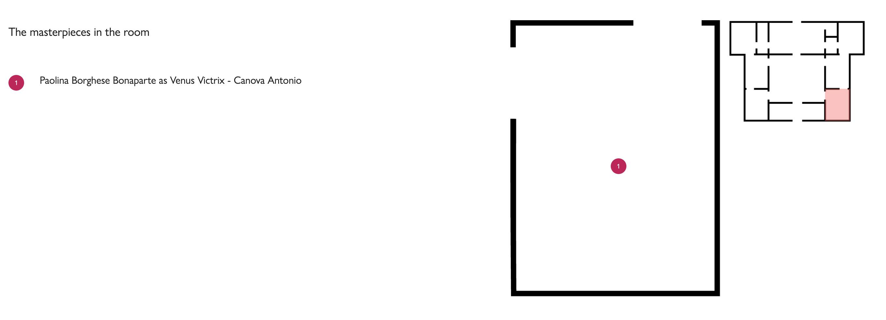

**展厅官网介绍页**：[Room 1 - Paolina Room](https://galleriaborghese.cultura.gov.it/en/il-museo/la-villa/sala-1-sala-della-paolina/)

## 核心展品

### ⭐⭐⭐ 必看 安东尼奥·卡诺瓦《保利娜·博尔盖塞·波拿巴扮作胜利者维纳斯》 / Canova Antonio, _Paolina Borghese Bonaparte as Venus Victrix_

- **作者 / Artist**：安东尼奥·卡诺瓦 / Canova Antonio
- **作品 / Work**：《保利娜·博尔盖塞·波拿巴扮作胜利者维纳斯》 / _Paolina Borghese Bonaparte as Venus Victrix_
- **时间**：1804–1808 年
- **材质**：卡拉拉大理石
- **尺寸**：人物高 92 cm；含床榻高 160 cm
- **位置**：保利娜厅（第 1 室）
- **官网介绍页**：[作为胜利维纳斯的保利娜·博尔盖塞·波拿巴 / Paolina Borghese Bonaparte come Venere vincitrice｜Galleria Borghese 官方藏品库](https://www.collezionegalleriaborghese.it/en/opere/paolina-borghese-bonaparte-as-venus-victrix)｜馆藏编号 LIV

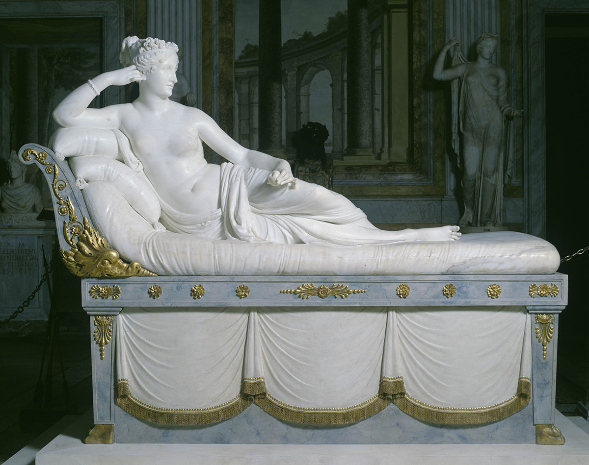

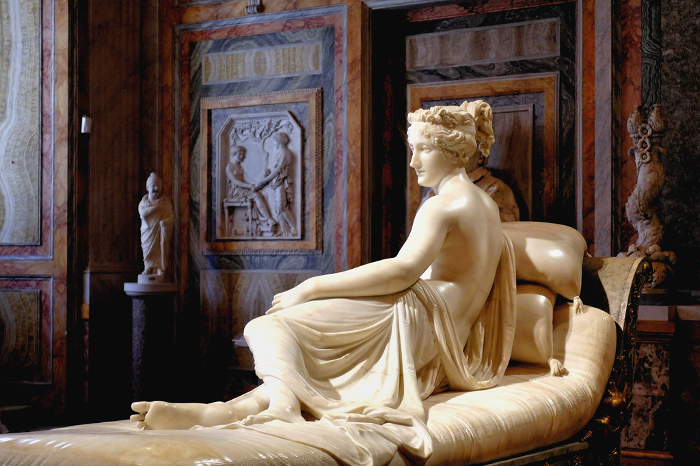

**这是什么**：Sala I 的绝对主角，也是新古典主义雕塑里最有名的作品之一。卡诺瓦（Antonio Canova）把拿破仑的妹妹保利娜·波拿巴·博尔盖塞（Pauline Bonaparte）塑成半卧的「胜利维纳斯」（Venus Victrix）：她斜倚帝政式长榻、上身半裸，左手托一只金苹果。金苹果是帕里斯（Paris）审判判给「最美者」的奖品——把它交到保利娜手上，等于公开宣告：她就是当世第一美人。

**人物：被雕成女神的那个人**：保利娜是拿破仑最宠、也最让他头疼的妹妹，1803 年嫁入罗马豪门、成为卡米洛·博尔盖塞（Camillo Borghese）亲王夫人——一桩典型的政治联姻。她嫌罗马沉闷，与丈夫很快貌合神离，以爱打扮、爱享乐、绯闻缠身闻名。最广为流传的轶事是：有人惊问她怎能为这尊像近乎全裸地摆姿，她若无其事地答——画室里生着炉子，并不冷。多半是她自己编出来招摇的俏皮话，却精准刻画了这位「女神模特」的性子。

**技法：怎么把大理石做出体温**：现场最该惊叹、又最看不出的是表面。粗坯按等大石膏模、由工坊助手循定位点凿出，卡诺瓦只亲手做「最后一手」（ultima mano）：用浮石蘸水（acqua di rota）反复推磨到近乎半透，再以蜂蜡罩一层微泛粉的光泽，让冷白的卡拉拉大理石透出近乎肤色的暖意。他偏爱在烛光下、由人举灯缓缓转看，光影流过时肌肤「像会呼吸」。这正是为什么侧光、慢绕远比正面平光动人。

**图像学：它站在哪条传统上**：半卧的裸体女性是文艺复兴以来的大题材（乔尔乔内、提香《乌尔比诺的维纳斯》一脉），卡诺瓦把它从画布搬上大理石，又接通古罗马「半卧的维纳斯／阿里阿德涅」像。「胜利维纳斯」特指赢得金苹果的维纳斯；那张厚褥卷枕的长榻则是当时最时髦的帝政式卧榻（récamier），把神话女神稳稳落进 1800 年代的贵族客厅。

**政治与接受史**：把一个波拿巴家的女人塑成「胜利女神」，本身就是拿破仑王朝的形象工程，也给博尔盖塞-波拿巴这桩联姻镀金。但作品太香艳，卡米洛长期半私密收着：据说看客先聚在厚帷幕前，由亲王拉开帘子，烛光里一尊半卧女神骤然显现、还能在旋转底座上缓缓转动——这种「欲遮还露」反倒成就了它的传奇。雕像 1889 年才移入本厅，与天顶维纳斯-埃涅阿斯、帕里斯审判主题对上号，如今是全馆招牌。长榻内部原装一套可让雕像 360° 旋转的木机械，1997 年修复时恢复过。

**现场站看**：

1. **左手的金苹果**——先找她左手托起的苹果（「胜利维纳斯」身份的钥匙）；再抬头看天顶中央帕里斯把金苹果判给维纳斯，两只金苹果上下呼应，整间厅「天顶神话／地面肖像」的结构一下就通。
2. **被压陷的床垫与卷枕**——看身体压在褥垫上的接触处，大理石被「压」出柔软的凹陷与褶皱；用最硬的石头模拟最软的填充物，是全作炫技的核心。
3. **薄纱与肌肤的质感差**——看覆在下半身的薄纱如何透出腿形，与上身打磨到近乎发光的肌肤对比，体会「让大理石有体温」的表面处理。
4. **侧光看「呼吸感」**——别只在正面平光下看；尽量侧着光、压低视线，肌肤的微妙起伏最活，最接近卡诺瓦烛光观赏的本意。
5. **这张脸像不像她**——凑近看面容：它被高度理想化成女神标准脸，与其说写实肖像，不如说是「把她升格为维纳斯」；理想与肖像之间的拉扯，正是这件「以真人扮女神」之作的微妙处。
6. **务必绕行一圈**——它原为可旋转观赏而作，正面、侧脸到背部线条都经过推敲；雕像如今不转，就靠自己绕榻一周，别只在正面拍一张就走。
7. **和同厅的维纳斯对照**——看完转去同厅那尊古罗马「卢浮-那不勒斯型阿佛洛狄忒」（LVIII）：一个是 2000 年前的女神范式、一个是把真人塑成女神，本厅维纳斯主线就闭环了。

## 天顶画

### ⭐⭐⭐ 必看 多梅尼科·德·安杰利斯《维纳斯与埃涅阿斯的故事》（天顶五联组画总览） / Domenico de Angelis, _Stories of Venus and Aeneas_

- **作者 / Artist**：多梅尼科·德·安杰利斯 / Domenico de Angelis
- **作品 / Work**：《维纳斯与埃涅阿斯的故事》 / _Stories of Venus and Aeneas_
- **时间**：1779 年
- **位置**：保利娜厅天顶

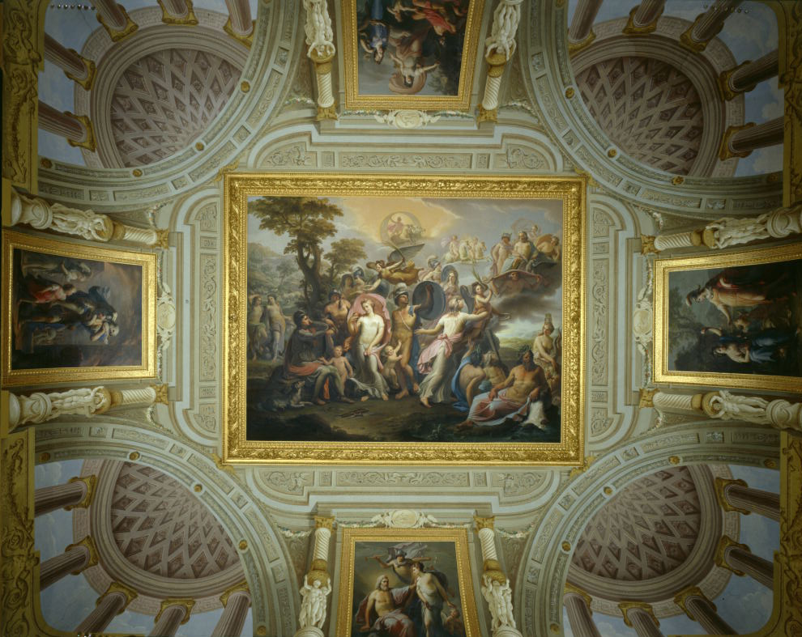

**这是什么**：整面拱顶是一组由五幅画组成的天顶画，主题是维纳斯（Venus）与埃涅阿斯（Aeneas）的故事，由新古典主义画家多梅尼科·德·安杰利斯（Domenico de Angelis，1735–1804）于 1779 年绘成。五幅画「一主四辅」：正中央是画幅最大的《帕里斯的审判》，四周环绕四幅情节画。画与画之间那套以假乱真的描金建筑框架（quadratura 错视）出自另一位专画建筑透视的画师乔万尼·巴蒂斯塔·马尔凯蒂（Giovanni Battista Marchetti，1730–1800）之手——抬头看到的「立体边框、檐口、浮雕」，其实大多是平面画出来的幻觉。

**背景 / 来历**：这面天顶不是孤立的装饰，而是 1770 年代末博尔盖塞别墅大改造的一环。亲王马尔坎托尼奥四世·博尔盖塞（Marcantonio IV Borghese）从约 1775 年起，请建筑师安东尼奥·阿斯普鲁奇（Antonio Asprucci）统筹翻新这座「猎庄」（Casina），1778–1780 年间把过时的挂毯、皮革换成彩色大理石与湿壁画，本厅天顶正是 1779 年这轮工程的产物。本厅 18 世纪还一度叫「花瓶厅」（Vase Room），因曾陈列一件现藏卢浮宫的古代新阿提卡式大瓶（crater）；1807 年拿破仑出售大批博尔盖塞古物后，19 世纪第二个十年由路易吉·卡尼纳（Luigi Canina）重整陈列，方成今貌。要紧的是：天顶比卡诺瓦（Canova）的《保利娜》早了约三十年——它本是为「维纳斯＝埃涅阿斯之母＝罗马（及尤利乌斯家族）始祖」这条罗马起源神话而画，用来抬高博尔盖塞家族；直到 1889 年卡诺瓦那尊「胜利维纳斯」移入本厅，「天顶的维纳斯」与「地面的维纳斯」才被对接成今天这层「神话呼应现实」的双关。

**叙事弧线**：五幅画连起来是一条「从一只金苹果到罗马建国」的因果链——中央《帕里斯的审判》点燃祸端（维纳斯赢得金苹果、许诺海伦，埋下特洛伊战争），四幅辅画接着演特洛伊覆灭与劫后余生：密涅瓦请命运女神剪断特洛伊国运、维纳斯求朱庇特保住儿子、埃涅阿斯背父携子逃出火城、朱诺仍不罢休唆使风神追击。终点指向《埃涅阿斯纪》开篇的海上漂泊，也就是罗马的源头。

**现场站看（整片天顶怎么读）**：

1. **先定位中央的《帕里斯的审判》**——拱顶正中、画幅最大的一组（三女神＋牧羊人＋金苹果）就是叙事起点，认准它再往四周看。
2. **按因果顺序绕看四幅辅画**——围着中央画走一圈：审判结怨 → 密涅瓦剪断特洛伊命线 → 维纳斯求朱庇特救子 → 埃涅阿斯逃离火城 → 朱诺求风神追击；每幅找出「谁在求谁、手里拿什么」，故事就串起来了。
3. **盯描金框架找「画出来的立体」**——边框、檐口、转角的「浮雕」多是马尔凯蒂平面画出的错视；特意站在厅中央正对入口抬头，幻觉最强。
4. **天顶与地面的金苹果上下对照**——天顶帕里斯把金苹果判给维纳斯，地面卡诺瓦《保利娜》左手又托同一只金苹果；站在雕像旁抬头，「神话第一美人」与「现实博尔盖塞夫人」一线贯通，是本厅最妙的设计。
5. **记一条跨厅线索**——本厅维纳斯-埃涅阿斯主题在别处还有回声：Sala VI 中央贝尼尼《埃涅阿斯、安喀塞斯与阿斯卡尼俄斯》是「逃离特洛伊」的雕塑版，本厅那尊「卢浮-那不勒斯型阿佛洛狄忒」（LVIII）也呼应「维纳斯＝埃涅阿斯之母」。

### ⭐⭐⭐ 必看 多梅尼科·德·安杰利斯《帕里斯的审判》 / Domenico de Angelis, _Judgment of Paris_

- **作者 / Artist**：多梅尼科·德·安杰利斯 / Domenico de Angelis
- **作品 / Work**：《帕里斯的审判》 / _Judgment of Paris_
- **时间**：1779 年
- **位置**：天顶中央画

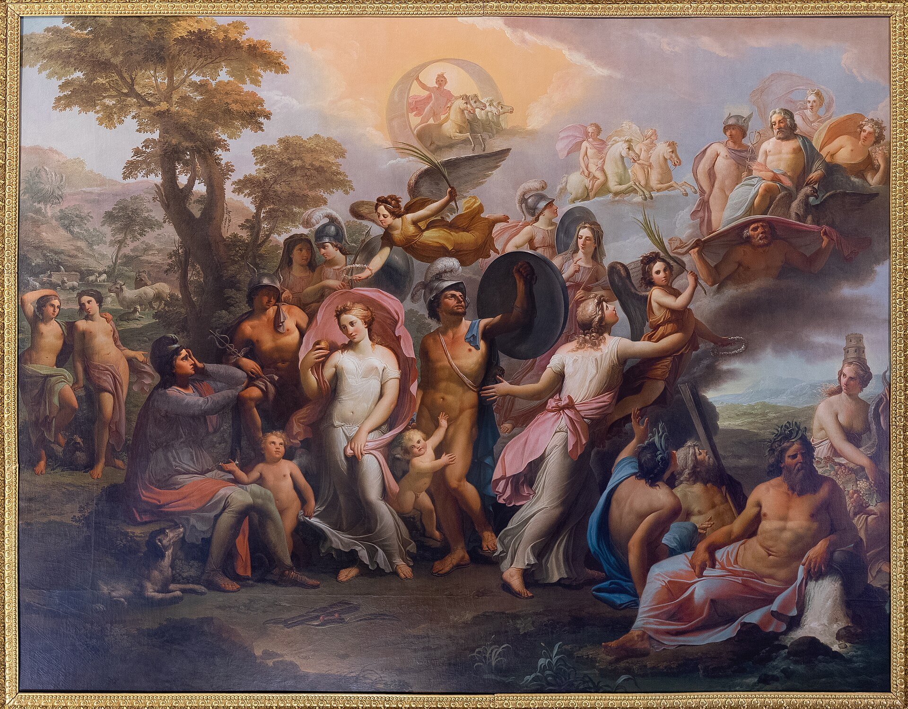

**这是什么**：天顶正中、画幅最大的一幅，也是理解整间 Sala I 的钥匙。故事起于一场婚宴：不和女神厄里斯（Eris）抛下一只刻着「给最美者」的金苹果，朱诺（Juno）、密涅瓦（Minerva）、维纳斯（Venus）三位女神争执不下，宙斯命特洛伊王子、当时在伊达山牧羊的帕里斯（Paris）来裁断。三女神各开价码贿赂他：朱诺许以王权、密涅瓦许以智慧武功、维纳斯许以天下第一美人海伦（Helen）。帕里斯把金苹果判给维纳斯——也因此招来朱诺、密涅瓦两位落选女神对特洛伊的刻骨怨恨，并因抢走已婚的海伦点燃十年特洛伊战争，最终毁灭特洛伊。这一判，正是天顶四幅辅画乃至整部《埃涅阿斯纪》的总开关。

**背景 / 来历**：1779 年德·安杰利斯所绘，属阿斯普鲁奇主持的本厅装饰程序（整组背景见上「五联组画总览」）。把「帕里斯审判」放在拱顶最高、最亮、最大的中央位是有意为之——它既是神话因果的起点，又借「评选最美女神」的母题，暗暗呼应这间厅日后要供奉的「最美夫人」。

**看点**：「帕里斯的审判」是整个西方艺术里被画得最多的题材之一，看点在于德·安杰利斯如何在仰视的天顶上组织这组「三女神＋牧羊人＋金苹果」的经典构图，以及它与地面卡诺瓦《保利娜》手中金苹果的上下呼应——这是全馆最精彩的「天顶／地面」对话设计。

**现场站看**：

1. **认出三女神与帕里斯**——天顶正中找那组人物：手持牧杖、坐姿的青年牧羊人是帕里斯，朝他伸手、即将接过金苹果的就是维纳斯；旁边两位（常带孔雀的是朱诺、带盔甲头盔的是密涅瓦）便是落选者。
2. **盯住那只金苹果**——它是全幅的戏眼，也是「胜利维纳斯」身份的钥匙；记住它的位置，下一步好和地面对照。
3. **和地面卡诺瓦连起来看**——抬头看完天顶的金苹果，低头看卡诺瓦《保利娜》左手托着的同一只金苹果，馆方有意让两只金苹果上下叠合；站在雕像旁正对天顶中央，最能体会这层「把博尔盖塞夫人升格为最美女神」的设计。
4. **顺时针接着看后果**——记住「审判结怨」是因，再绕看四周四幅「特洛伊覆灭」辅画，整片天顶的因果链就通了。

### ⭐⭐ 推荐 多梅尼科·德·安杰利斯《密涅瓦请求命运女神阿特洛波斯剪断特洛伊的生命之线》 / Domenico de Angelis, _Minerva Asks the Fate Atropos to Cut Troy's Thread of Life_

- **作者 / Artist**：多梅尼科·德·安杰利斯 / Domenico de Angelis
- **作品 / Work**：《密涅瓦请求命运女神阿特洛波斯剪断特洛伊的生命之线》 / _Minerva asks the Fate Atropos to cut Troy's thread of life_
- **时间**：1779 年
- **位置**：天顶侧面画之一

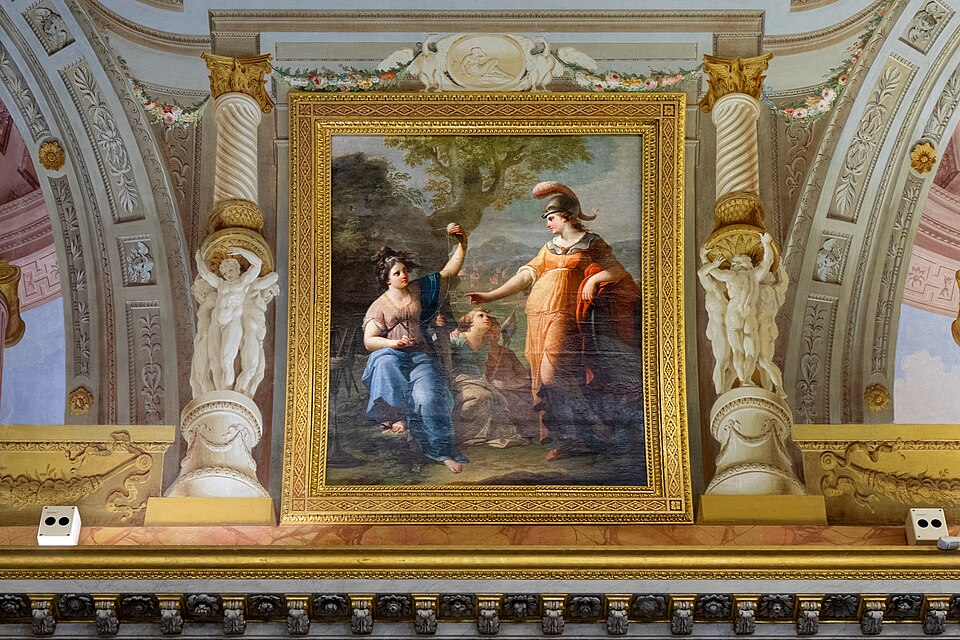

**这是什么**：帕里斯（Paris）审判落选后，被冒犯的智慧与战争女神密涅瓦（Minerva）出手报复：她请求命运三女神中专司「终结」的阿特洛波斯（Atropos）剪断特洛伊（Troy）的生命之线。希腊神话里，命运三女神（Moirai）一个纺线、一个量线、阿特洛波斯持剪刀断线——线一断，人或城的寿数即尽。这幅画把「特洛伊将亡」这件抽象国运，落实成「一根线被剪断」的可视瞬间。

**背景 / 来历**：1779 年德·安杰利斯绘，天顶四幅辅画之一（整组背景见「五联组画总览」）。它紧承中央《帕里斯的审判》——审判是因，剪线是第一个后果，把神的私怨升级为整座城邦的死刑判决。

**看点**：看德·安杰利斯怎么用「剪断生命线」这一个动作，把「特洛伊注定灭亡」讲成一幅画。**现场站看**：找密涅瓦（常配盔甲）与持剪刀的阿特洛波斯之间那根被剪的线——它就是全幅的戏眼，也点明这是审判结怨之后、特洛伊厄运的开端。

### ⭐⭐ 推荐 多梅尼科·德·安杰利斯《维纳斯说服朱庇特拯救埃涅阿斯》 / Domenico de Angelis, _Venus Convinces Jupiter to Save Aeneas_

- **作者 / Artist**：多梅尼科·德·安杰利斯 / Domenico de Angelis
- **作品 / Work**：《维纳斯说服朱庇特拯救埃涅阿斯》 / _Venus convinces Jupiter to save Aeneas_
- **时间**：1779 年
- **位置**：天顶侧面画之一

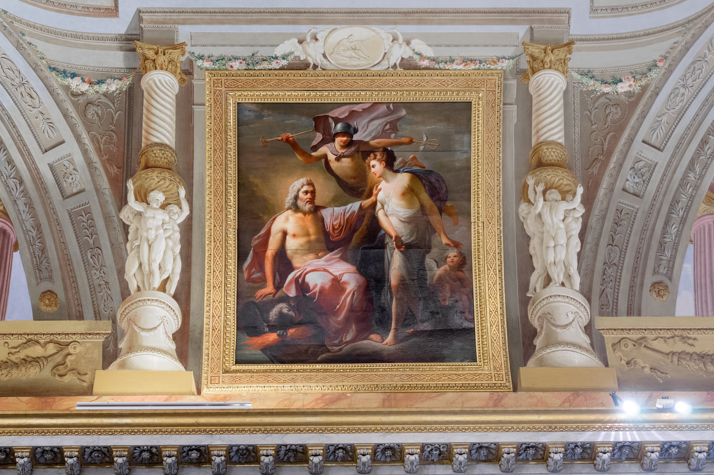

**这是什么**：维纳斯（Venus）在这里从「赢得金苹果的最美女神」转成「护子心切的母亲」。她的凡间儿子埃涅阿斯（Aeneas）是特洛伊将领，眼看特洛伊将亡，维纳斯上奥林匹斯向众神之王朱庇特（Jupiter）求情，请他保住埃涅阿斯一脉——正是这条血脉日后辗转到意大利、成为罗马（及尤利乌斯家族）的祖先。

**背景 / 来历**：1779 年德·安杰利斯绘，天顶四幅辅画之一（整组背景见「五联组画总览」）。在叙事链里它是转折点：前面众神合力毁灭特洛伊，这一幕维纳斯逆转风向，为「劫后余生、另起炉灶」留下种子，把故事从「特洛伊之死」接向「罗马之生」。

**看点**：这是天顶上「维纳斯母亲身份」最关键的一幕，也是全馆维纳斯-埃涅阿斯主题的枢纽。**现场站看**：认出维纳斯向朱庇特（常配鹰与权杖、居高位）恳求的姿态；看完它再去 Sala VI 看贝尼尼《埃涅阿斯、安喀塞斯与阿斯卡尼俄斯》，会发现这条「维纳斯救子→埃涅阿斯逃亡→罗马起源」的线，其实横跨好几个房间。

### ⭐⭐⭐ 必看 多梅尼科·德·安杰利斯《埃涅阿斯带着父亲安喀塞斯和儿子阿斯卡尼俄斯逃离特洛伊》 / Domenico de Angelis, _Aeneas Flees Troy with His Father, Anchises, and His Son, Ascanius_

- **作者 / Artist**：多梅尼科·德·安杰利斯 / Domenico de Angelis
- **作品 / Work**：《埃涅阿斯带着父亲安喀塞斯和儿子阿斯卡尼俄斯逃离特洛伊》 / _Aeneas flees Troy with his father, Anchises, and his son, Ascanius_
- **时间**：1779 年
- **位置**：天顶侧面画之一

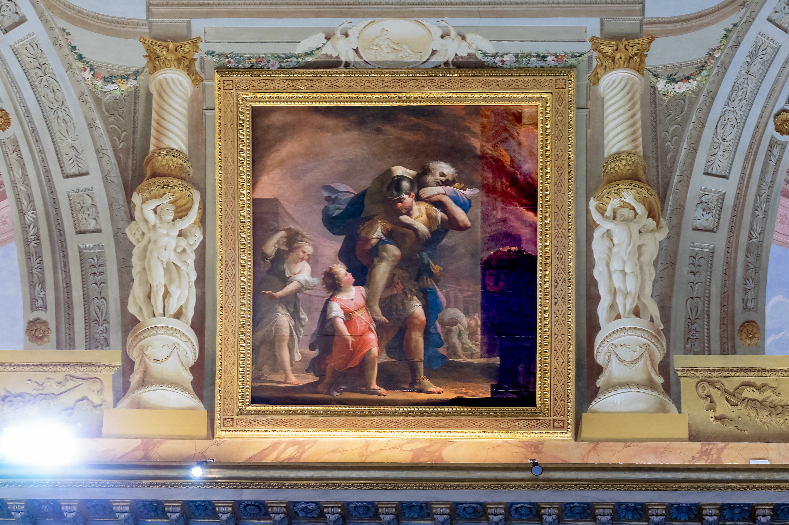

**这是什么**：埃涅阿斯神话里最有名、流传最广的一幕——特洛伊城破火起，埃涅阿斯（Aeneas）背起年迈的父亲安喀塞斯（Anchises）、牵着年幼的儿子阿斯卡尼俄斯（Ascanius）逃出火海。这「三代同逃」浓缩了罗马人最看重的德性 pietas（对父祖、神明、家国的虔敬责任）：老父抱着家族守护神像、幼子接续香火，埃涅阿斯一肩扛起过去与未来。

**背景 / 来历**：1779 年德·安杰利斯绘，天顶四幅辅画之一（整组背景见「五联组画总览」）。它是叙事链的高潮——维纳斯求情之后，血脉真正得救、踏上通往罗马的路。

**看点**：这幕「背父携子」是从古至今反复被雕、被画的罗马建国母题，本馆里就有天顶画与雕塑两个媒介版本可对照——这正是它值得专门停下来看的原因。

**现场站看**：

1. **认出「背父、牵子」的三代结构**——找画中那组人：壮年埃涅阿斯居中，肩上扛着的老人是父亲安喀塞斯（Anchises），手边牵着、跟在身侧的幼童是儿子阿斯卡尼俄斯（Ascanius）。一眼认出「老—中—幼」三代，就抓住了这幅的全部意思。
2. **看老父手里抱着什么**——安喀塞斯怀里通常抱着家族守护神像（penates）。这件道具是关键：逃命时丢什么都不丢神像，点出 pietas（对神明与父祖的虔敬）——埃涅阿斯扛走的不只是父亲，是整个特洛伊的香火与神祇。
3. **和 Sala VI 的贝尼尼对照看**——记住这组三人姿态，到 Sala VI 看中央贝尼尼早期大理石群像《埃涅阿斯、安喀塞斯与阿斯卡尼俄斯》：同一题材，一个是 1779 年的天顶湿壁画、一个是 1618–19 年的青年贝尼尼雕塑，比较「画里怎么排三代」和「立体怎么堆三代」，是本馆跨厅呼应里最值得专门对照的一组。
4. **在叙事链里定位它**——它紧接上一幅「维纳斯求朱庇特救子」：求情得准，这一幕血脉才真正逃出火城、踏上通往罗马的路，是整片天顶的情节高潮。

### ⭐ 顺路看 多梅尼科·德·安杰利斯《朱诺请求埃俄罗斯释放风暴袭击埃涅阿斯》 / Domenico de Angelis, _Juno Asks Aeolus to Unleash Storms against Aeneas_

- **作者 / Artist**：多梅尼科·德·安杰利斯 / Domenico de Angelis
- **作品 / Work**：《朱诺请求埃俄罗斯释放风暴袭击埃涅阿斯》 / _Juno asks Aeolus to unleash storms against Aeneas_
- **时间**：1779 年
- **位置**：天顶侧面画之一

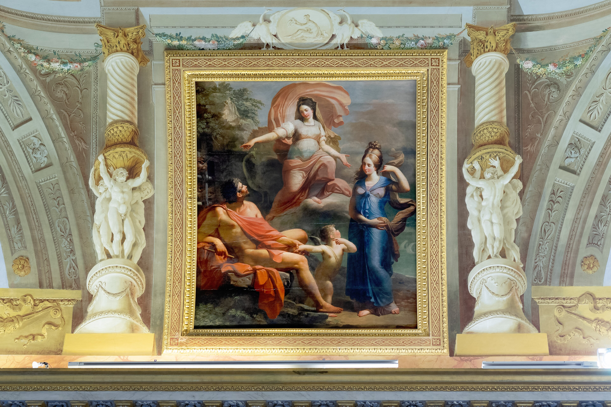

**这是什么**：天后朱诺（Juno）——帕里斯审判的另一位落选者——对特洛伊及其遗民的怨恨延续到战后。她请风神埃俄罗斯（Aeolus）放出狂风暴雨，去摧毁埃涅阿斯（Aeneas）渡海的船队。这正是维吉尔《埃涅阿斯纪》开篇第一幕：埃涅阿斯刚出特洛伊就遭海上风暴，被迫漂流到迦太基。

**背景 / 来历**：1779 年德·安杰利斯绘，天顶四幅辅画之一（整组背景见「五联组画总览」）。它把天顶故事的终点，正好接到《埃涅阿斯纪》的起点——特洛伊已亡，通往罗马的漫长漂泊就此开始。

**看点**：顺路看。认出朱诺向风神埃俄罗斯（常被画成掌管风袋、风口的形象）下令放风暴的场景；它收束整片天顶，也提示「这只是罗马起源故事的序幕」。

## 雕塑

本节先列馆方 Modern Sculpture 藏品列表，共 4 件。

### ⭐⭐⭐ 必看 路易吉·瓦拉迪耶《巴克斯赫尔墨柱像》 / Valadier Luigi, _Herm of Bacchus_

- **作者 / Artist**：路易吉·瓦拉迪耶 / Valadier Luigi
- **作品 / Work**：《巴克斯赫尔墨柱像》 / _Herm of Bacchus_
- **时间**：1773 年
- **材质**：青铜、玫瑰雪花石（alabastro a rose）、非洲绿大理石（verde africano）、阿基坦白与黑大理石
- **尺寸**：高 175 cm
- **馆藏编号**：CXXXXV
- **位置**：保利娜厅（第 1 室）
- **官网介绍页**：[官网介绍英文](https://www.collezionegalleriaborghese.it/en/opere/herm-of-bacchus)｜馆藏编号 CXXXXV

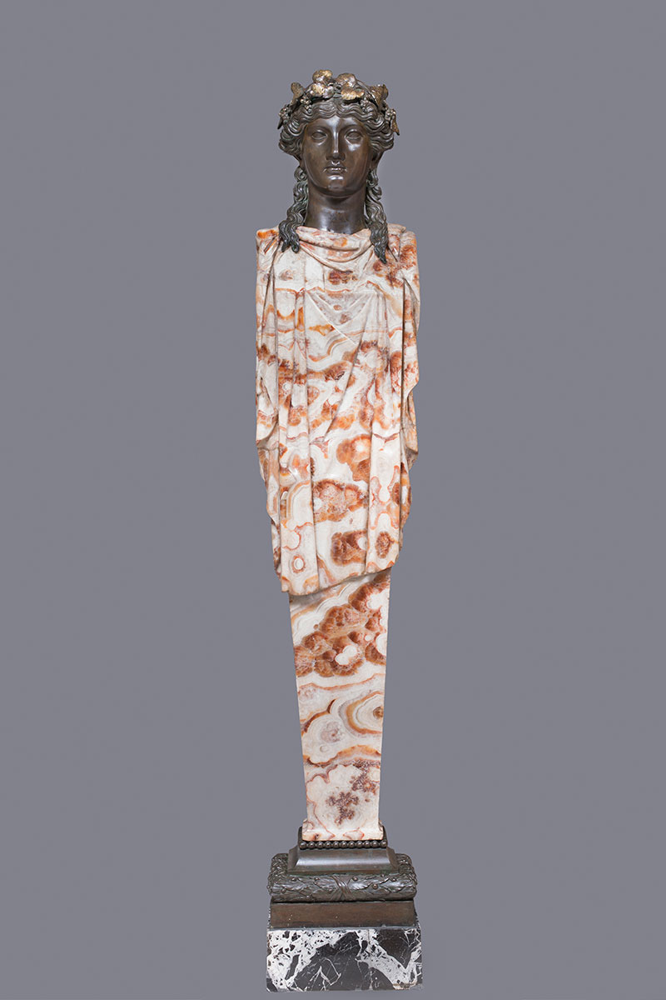

**内容（这是什么）**：175 cm 高的「酒神赫尔墨柱」（Herm of Bacchus）——一根方形石柱顶着一颗酒神（Dionysus / Bacchus）青铜头像。「赫尔墨柱」（herm）是古希腊罗马那种「只雕头像、下接方柱、不做四肢」的界石式雕像；这里柱身用多色名贵硬石拼成，青铜头戴一顶常春藤与葡萄串编成的冠——这正是酒神的两样标志性植物。

**背景 / 来历**：1773 年由亲王马尔坎托尼奥·博尔盖塞（Marcantonio Borghese）为家族在战神广场（Campo Marzio）的宫邸定制，后才进入别墅。它长期被当成古代真品，直到近代查到付款记录，才坐实作者是 18 世纪罗马最负盛名的金匠兼青铜大师路易吉·瓦拉迪耶（Luigi Valadier）——青铜头由他亲手铸造，柱身则是石匠贝内代托·马丘基（Benedetto Maciucchi）把一块古代花斑雪花石（alabastro a rose）改刻而成，是典型的「古件＋新作」拼合。它有多以假乱真？连同时代的雕塑巨匠卡诺瓦（Canova）都被骗过——他盛赞这是「当时罗马最现代的作品」，却把作者认成了别人。瓦拉迪耶的做旧手法是关键：给青铜罩上仿古的绿锈、在发丝上点金，模拟古铜历经岁月的那种暗沉光泽，正是这套手艺让行家也走了眼。

**看点**：这是本厅一件「以假乱真」的炫技样本，也浓缩了 18 世纪末罗马豪门最时髦的「彩色硬石＋青铜」趣味。把它和同厅卡诺瓦《保利娜》并看尤其有意思：一个让冷白大理石透出体温、一个让新铸青铜冒充古物，是同一时代、同一座别墅里两种顶级工艺野心的对照。

**现场站看**：

1. **先认出酒神标志**——看青铜头上那顶常春藤＋葡萄串编成的冠，确认这是酒神巴克斯。这是辨认题材最快的钥匙。
2. **找两处做旧痕迹**——凑近看发丝上的点金与青铜表面的绿锈，都是瓦拉迪耶刻意做出的「古铜年代感」，今天仍清晰可辨；正是这套做旧当年骗过了卡诺瓦一辈的行家。
3. **看材质的冲撞**——对比深色青铜头与多色石柱身（玫瑰雪花石、非洲绿大理石、黑白大理石）：这种「彩石＋青铜」的强烈对照，是当时罗马顶级宅邸最爱的奢侈趣味。
4. **留意柱头与柱身的接缝**——青铜头与石柱相接处，正是「古人旧石＋瓦拉迪耶新铸」两半拼合的地方，是本厅「古件＋后配」母题的又一个活样本。
5. **和卡诺瓦《保利娜》对照收尾**——记住「连卡诺瓦都把它当古代杰作、还认错作者」这桩轶事，站在它与《保利娜》之间，体会同一座别墅里 18 世纪末两种炫技工艺的较劲。

### ⭐ 顺路看 作者不详，罗马学派《凯旋的丘比特》 / Unknown sculptor, Roman school, _Cupid Triumphant_

- **作者 / Artist**：作者不详，罗马学派 / Unknown sculptor, Roman school
- **作品 / Work**：《凯旋的丘比特》 / _Cupid Triumphant_
- **时间**：约 1610–1620 年
- **材质**：大理石
- **尺寸**：70 × 60 cm
- **馆藏编号**：LXXIV
- **位置**：保利娜厅（第 1 室）
- **官网介绍页**：[官网介绍英文](https://www.collezionegalleriaborghese.it/en/opere/cupid-triumphant)｜馆藏编号 LXXIV

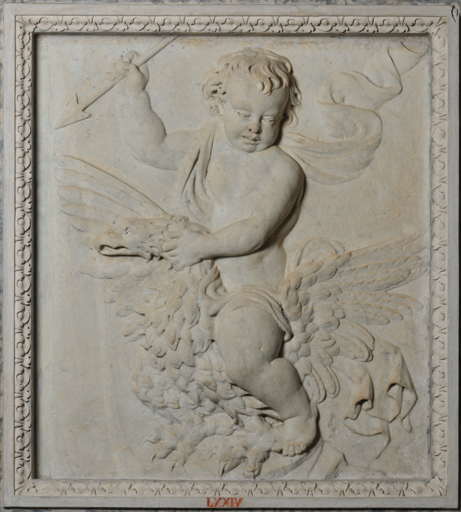

**内容（这是什么）**：一方小幅大理石浮雕，雕一个表情狡黠的丘比特（Cupid / Amor）骑在一只鹰背上、手举一支箭。鹰是博尔盖塞家族的纹章动物之一，被驮得明显吃力地踩在岩石上。

**背景 / 来历**：约 1610–1620 年罗马派作品，曾被归到彼得罗·贝尼尼（Pietro Bernini）（贝尼尼之父）名下，但无定论。约 1780 年左右在安东尼奥·阿斯普鲁奇（Antonio Asprucci）主持别墅装饰时被嵌进本厅墙面。它实际是把 16 世纪末流行的「丘比特骑天鹅」金属小板图式改编而来，把天鹅换成鹰，专门向博尔盖塞家族致敬。

**看点**：顺路看的一件小品。看点就在「鹰＝博尔盖塞纹章」这个细节——丘比特骑的不是常见的天鹅，而是家族徽鸟，是为这座别墅量身改的图。

### ⭐ 顺路看 罗马学派《大西庇阿肖像》 / roman school, _Portrait of Scipio Africanus_

- **作者 / Artist**：罗马学派 / roman school
- **作品 / Work**：《大西庇阿肖像》 / _Portrait of Scipio Africanus_
- **时间**：17 世纪
- **材质**：雕像用大理石与黑灰大理石（bigio morato）
- **尺寸**：高 64 cm
- **馆藏编号**：LXXVI
- **位置**：保利娜厅（第 1 室）
- **官网介绍页**：[官网介绍英文](https://www.collezionegalleriaborghese.it/en/opere/portrait-of-scipio-africanus)｜馆藏编号 LXXVI

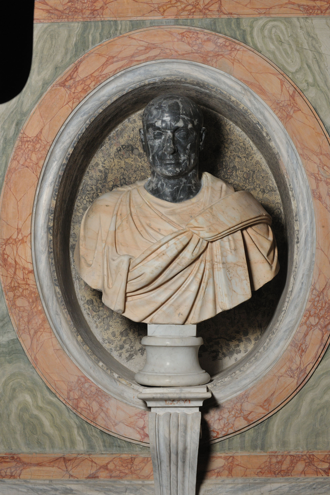

**内容（这是什么）**：「大西庇阿」（Scipio Africanus）半身像——击败汉尼拔的罗马名将。光头、椭圆脸、直鼻、深法令纹，是这位将军在近代肖像里的固定模样。

**背景 / 来历**：17 世纪罗马派作品（非古代原作），作者不详。值得玩味的是它的「身份来历」：这套秃头相貌其实源自古代「伊西斯祭司」像，被近代借用来代表西庇阿——因为传说西庇阿每天剃头，是把剃光头的风气带进罗马的人，所以「秃」就成了他的认人标记。

**看点**：最大看点是材质的「反色」玩法——头部用深色的 bigio morato 大理石、胸像用白色雕像大理石，故意把传统白头深身的配色倒过来。一说深色头石也在暗合将军的「肤色/名号」。这种彩色大理石趣味正是 17 世纪罗马所偏爱。

### ⭐ 顺路看 古罗马艺术《穿长斗篷的男孩》 / Roman art, _Boy Wearing a Long Mantle_

- **作者 / Artist**：古罗马艺术 / Roman art
- **作品 / Work**：《穿长斗篷的男孩》 / _Boy Wearing a Long Mantle_
- **时间**：公元 2 世纪
- **材质**：卢尼大理石
- **尺寸**：高 73 cm
- **位置**：保利娜厅（第 1 室）
- **官网介绍页**：[官网介绍英文](https://www.collezionegalleriaborghese.it/en/opere/boy-wearing-a-long-mantle)｜馆藏编号 CVIC

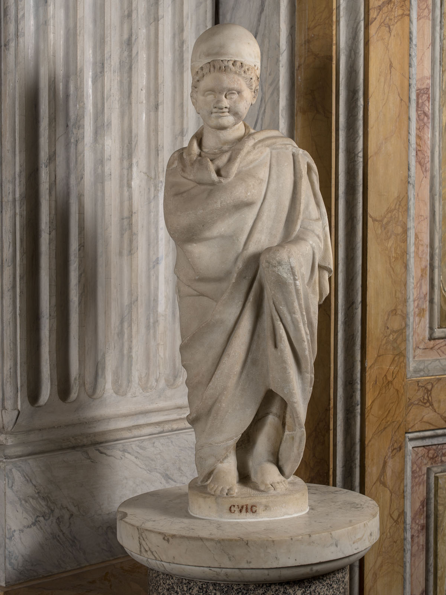

**内容（整组一次看）**：本厅四角散布着三尊几乎一样的小童像（编号 CVIC、LXV、LXIX），都是 73 cm 上下、裹在一件长篷斗里只露出双脚、头戴半蛋形小帽（pileus）的男孩。他们对应的是忒勒斯福洛斯（Telesphoros）——医神阿斯克勒庇俄斯（Asclepius）的儿子或助手「带来康复者」的图式，也常与凯尔特的「兜帽精灵」（genius cucullatus）相通；这类小像在古代常摆进私家花园讨吉利。

**背景 / 来历（整组通用）**：三尊都是 2 世纪罗马作品（Luni 大理石），原先散落在 Villa Pinciana 的园林里；拿破仑征购、家族藏品重组后才被收进室内陈列，19 世纪起进入本厅。馆方注明本件（CVIC）的头部并非原配。同型的另一尊曾被送往卢浮宫。

**看点**：靠「斗篷＋小帽＋裹得只露脚」三件道具就能认出这是忒勒斯福洛斯——医神之子，寓意既能治愈也能带走生命的双关小神。三尊并看，找它们头偏向、帽顶、露腿多少这些细微差别。整组背景见此件。

### ⭐ 顺路看 古罗马艺术《斯彭冬葬祭祭坛》 / Roman art, _Funerary Altar of Spendon_

- **作者 / Artist**：古罗马艺术 / Roman art
- **作品 / Work**：《斯彭冬葬祭祭坛》 / _Funerary Altar of Spendon_
- **时间**：公元 1 世纪上半叶
- **材质**：白大理石
- **尺寸**：高 67 cm；宽 73 cm；深 46 cm；字高 2.5-5.5 cm
- **位置**：保利娜厅（第 1 室）
- **官网介绍页**：[官网介绍英文](https://www.collezionegalleriaborghese.it/en/opere/funerary-altar-of-spendon)｜馆藏编号 IVa

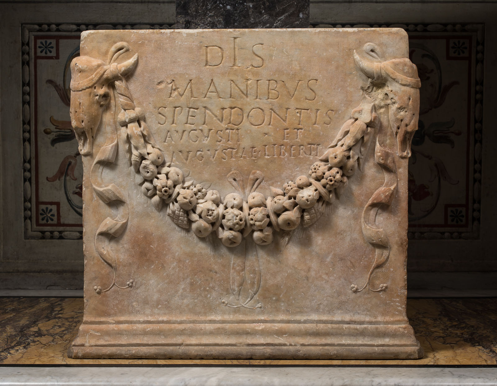

**内容（这是什么）**：一座方形墓祭坛，正面前角各雕一只「牛颅」（bucranium），牛角上垂下饰带、串起一道花果松果编成的丰饶花环；两侧分别刻献祭用的浅盘（patera）与小水罐（urceus）。正面五行铭文献给一位奥古斯都的被释奴斯彭东（Spendon）。

**背景 / 来历**：约公元 1 世纪上半叶。它在馆里几经挪用——19 世纪在门廊里被当成一尊勒达（Leda）残像的底座，20 世纪进过小堂，1990 年代末在入口大厅当过一尊「基督头像」的底座，2021 年才入本厅。

**看点**：顺路看。重点找正面那段拉丁铭文，认出逝者名字斯彭东与「奥古斯都被释奴」身份；再看两侧的盘与罐——这是罗马祭坛固定的「祭司持盘、助祭持罐」象征组合，本厅另一座祭坛（IXCa）也有同样道具，可对照看。

### ⭐ 顺路看 古罗马艺术《女性头像，修复为伊西斯（胸像非原配）》 / Roman art, _Female Head, restored as Isis (bust not original)_

- **作者 / Artist**：古罗马艺术 / Roman art
- **作品 / Work**：《女性头像，修复为伊西斯（胸像非原配）》 / _Female Head, restored as Isis (bust not original)_
- **时间**：约公元 2 世纪中叶
- **材质**：白大理石（头部）；带深色纹理的灰大理石（胸像）
- **尺寸**：连胸像高 50 cm；含颈头高 29 cm；宽 48 cm
- **位置**：保利娜厅（第 1 室）
- **官网介绍页**：[官网介绍英文](https://www.collezionegalleriaborghese.it/en/opere/female-head-restored-as-isis-bust-not-original)｜馆藏编号 IXC

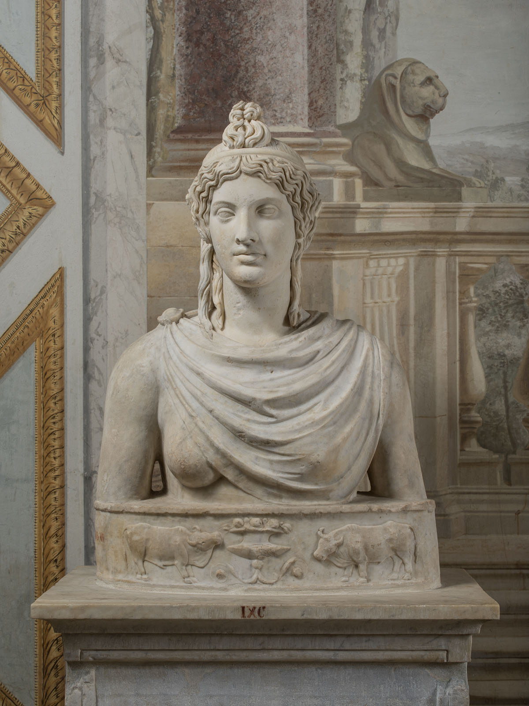

**内容（这是什么）**：一尊女性胸像，薄衣滑落露出右乳。学界或认作大地女神特鲁斯（Tellus）、或认作埃及女神伊西斯（Isis）——后一说主导了 19 世纪的修复，所以现名「修复为伊西斯」。

**背景 / 来历**：头部为公元 2 世纪中叶的罗马作品，仿公元前 5 世纪希腊样式；但所配的灰色带纹胸像并非原物（标题已注明 bust not original）。它在馆里搬了很多次——1854 年还在 7 号「埃及厅」，1893 年在 2 号厅，1998 年才定到本厅。

**看点**：顺路看。这是本厅典型的「古代头＋后配胸像」组合，正可看古今石材的差别：白色大理石的头配灰色带深纹的胸。圆形底座上还有两头相对的公牛与果篮浮雕。

### ⭐ 顺路看 古罗马艺术《克劳狄乌斯·费利克斯葬祭祭坛》 / Roman art, _Funerary Altar of Claudius Felix_

- **作者 / Artist**：古罗马艺术 / Roman art
- **作品 / Work**：《克劳狄乌斯·费利克斯葬祭祭坛》 / _Funerary Altar of Claudius Felix_
- **时间**：公元 2 世纪
- **材质**：卢尼大理石
- **尺寸**：高 76 cm，宽 53 cm；深 37 cm（铭文区）；4.2-4.5 cm 字高
- **位置**：保利娜厅（第 1 室）
- **官网介绍页**：[官网介绍英文](https://www.collezionegalleriaborghese.it/en/opere/funerary-altar-of-claudius-felix)｜馆藏编号 IXCa

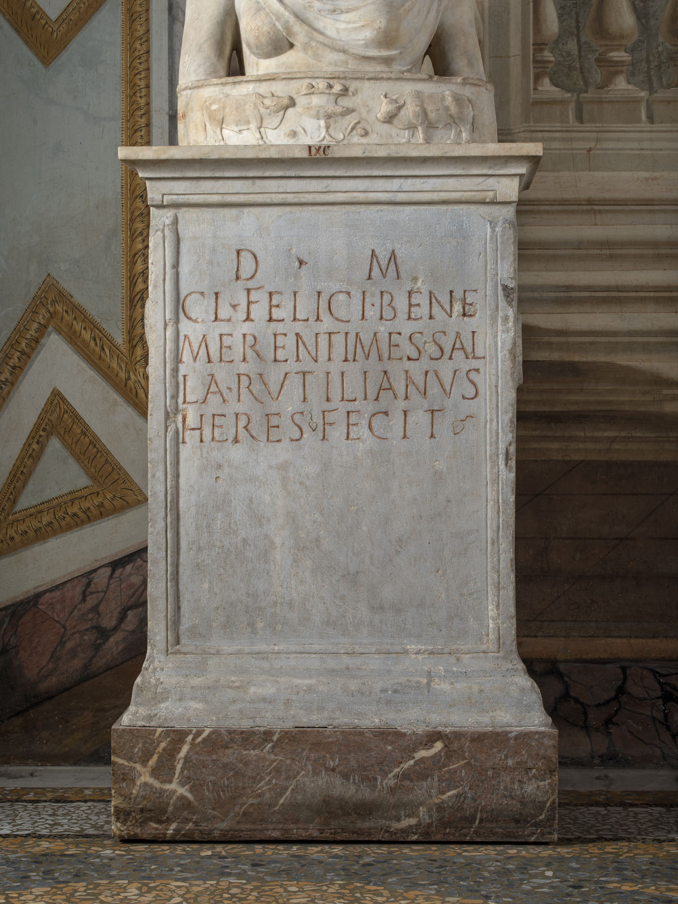

**内容（这是什么）**：另一座墓祭坛，正面铭文说明逝者克劳狄乌斯·费利克斯（Claudius Felix）的墓由其继承人梅萨拉·鲁提利安努斯（Messalla Rutilianus）操办；两侧同样刻着小水罐（urceus）与献祭浅盘（patera）。

**背景 / 来历**：2 世纪作品（Luni 大理石），1830–1832 年间为卡米洛·博尔盖塞（Camillo Borghese）亲王在罗马近郊 Mentana 发掘出土——是本厅少数能落实到具体出土地的古件之一。原本顶部冠石已失。

**看点**：顺路看。和 IVa 那座并看——两侧的「盘＋罐」是罗马祭坛的固定象征（祭司持盘、助祭 camillus 持罐），原本各有所指，后来退化成纯装饰母题。铭文里的「费利克斯（幸运）」是奴隶、被释奴常用的吉祥名。

### ⭐ 顺路看 古罗马艺术《雕像：阿波罗》 / Roman art, _Statue of Apollo_

- **作者 / Artist**：古罗马艺术 / Roman art
- **作品 / Work**：《雕像：阿波罗》 / _Statue of Apollo_
- **时间**：公元 2 世纪
- **材质**：白大理石
- **尺寸**：含底座总高 88.5 cm；雕像 81 cm；古代部分残存 33 cm；头部 11 cm
- **位置**：保利娜厅（第 1 室）
- **官网介绍页**：[官网介绍英文](https://www.collezionegalleriaborghese.it/en/opere/statue-of-apollo-2)｜馆藏编号 LV

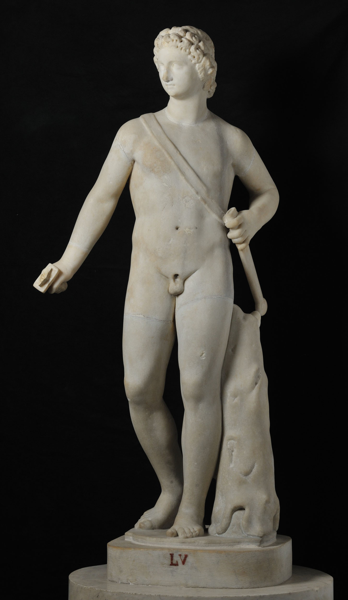

**内容（这是什么）**：一尊小于真人的男子裸像（约 81 cm）。它本是阿波罗（Apollo）像，后被改造成「年轻英雄/亚历山大大帝」的样子。

**背景 / 来历**：典型的「古件＋后补」——只有裸体躯干是 2 世纪古代真品（仅存约 33 cm），四肢与那颗 11 cm 的头都是后世补配，头还是近代重做、被改刻成亚历山大模样。它原属德拉·波尔塔（Della Porta）收藏，1609 年由博尔盖塞家族购入；17 世纪曾与那尊现藏卢浮宫的《垂死的塞内卡》并列陈列，被当作「角斗士」。

**看点**：顺路看，但身世很典型。看胸前斜挎的背带（balteus）——它本该用来托一把基萨拉琴，说明这原是「弹琴的阿波罗」，后世却把它修成了持剑英雄。1889 年卡诺瓦（Canova）的《保利娜》入厅时，这尊「亚历山大」被挪到角落，呼应拿破仑时代对亚历山大形象的偏爱。

### ⭐ 顺路看 古罗马艺术《带酒神主题浮雕的祭坛》 / Roman art, _Altar with Dionysian Relief_

- **作者 / Artist**：古罗马艺术 / Roman art
- **作品 / Work**：《带酒神主题浮雕的祭坛》 / _Altar with Dionysian Relief_
- **时间**：公元 2 世纪
- **材质**：白大理石
- **尺寸**：高 90 cm（含修复补配），直径 50 cm
- **位置**：保利娜厅（第 1 室）
- **官网介绍页**：[官网介绍英文](https://www.collezionegalleriaborghese.it/en/opere/altar-with-dionysian-relief)｜馆藏编号 LVI

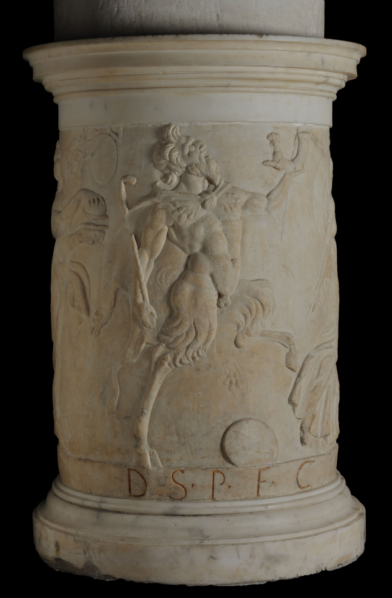

**内容（这是什么）**：一座圆形祭坛，浮雕一列酒神（Dionysus）随从的行进队伍：一个长胡羊腿的农牧神（faun）持短杖与角杯，后随一名手持响板起舞的女祭司（Maenad）、一名回头奔跑的萨堤尔（satyr），人物之间垂挂着排箫、手鼓等酒神祭具，烘托乡野祭仪气氛。

**背景 / 来历**：2 世纪罗马作品，上下两端为后世修复。16 世纪已在博尔盖塞收藏；1819–1832 年卡米洛·博尔盖塞（Camillo Borghese）重组陈列时被搬进本厅，当作那尊「修复为乌拉尼亚」女像（LVI-B）的底座。上缘那行缩写献辞是后刻的假铭文。

**看点**：顺路看。本厅有两座狄俄尼索斯圆祭坛（此件 LVI 与对面 LVIIIa），可并看：本件人物更杂（牧神＋女祭司＋萨堤尔），主打「酒神乡野行列」的热闹。留意人物间垂挂的乐器祭具，是辨认酒神题材的现成线索。

### ⭐ 顺路看 古罗马艺术《女子雕像，修复为乌拉尼亚（头像非原配）》 / Roman art, _Statue of a Woman, restored as Urania (head not original)_

- **作者 / Artist**：古罗马艺术 / Roman art
- **作品 / Work**：《女子雕像，修复为乌拉尼亚（头像非原配）》 / _Statue of a Woman, restored as Urania (head not original)_
- **时间**：公元 1 世纪
- **材质**：细颗粒白大理石
- **尺寸**：古代部分含底座高 131 cm；古代部分高 125 cm；含非原配头部高 152 cm
- **位置**：保利娜厅（第 1 室）
- **官网介绍页**：[官网介绍英文](https://www.collezionegalleriaborghese.it/en/opere/statue-of-a-woman-restored-as-urania-head-not-original)｜馆藏编号 LVI-B

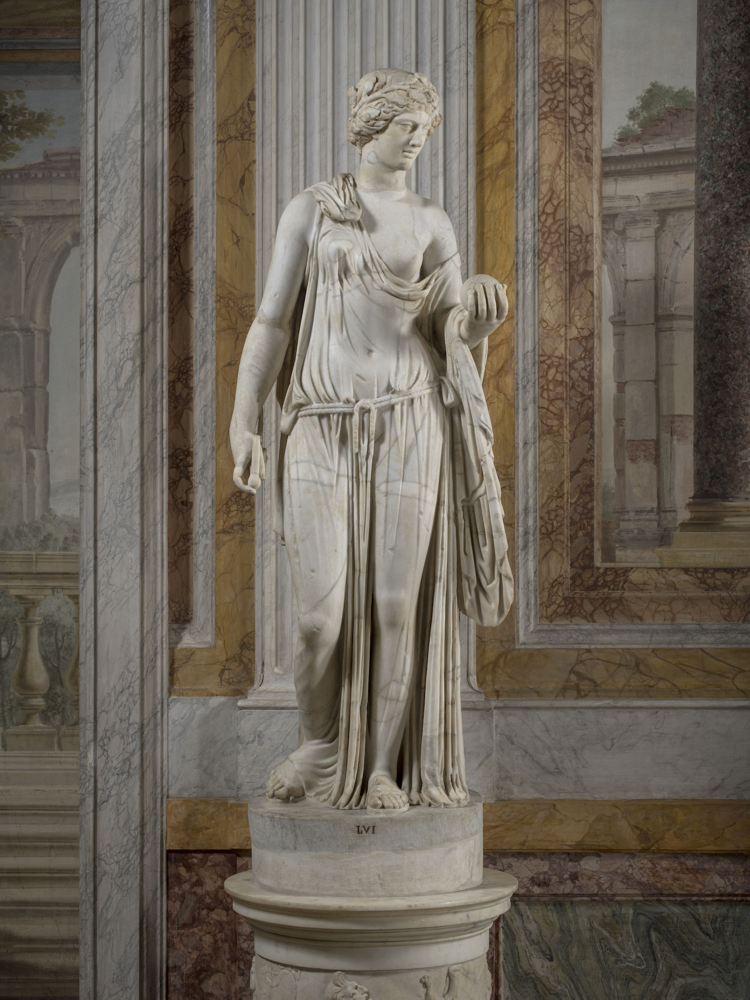

**内容（这是什么）**：一尊正面而立的年轻女像，穿贴体薄长衣、细腰带，左手托一个地球仪、右手持圆规——因此被「修复为」天文女神乌拉尼亚（Urania）。

**背景 / 来历**：躯干为公元 1 世纪古代真品，但那颗头、左臂、托球的左手、持规的右手全是 19 世纪补配，正是这些后加的「天文道具」才把她变成缪斯。学界更倾向认为原型其实关联「卢浮-那不勒斯型阿佛洛狄忒」。它就立在那座狄俄尼索斯圆祭坛（LVI）之上。

**看点**：顺路看，身世典型。看她手里的地球仪与圆规——这两样「天文学」属性都是后世修复时加的，原作未必是缪斯。这是本厅「靠后世添加道具改换身份」的好例子。

### ⭐ 顺路看 古罗马艺术《卢浮宫-那不勒斯型阿佛洛狄忒雕像，配非原配头像》 / Roman art, _Statue of Aphrodite (Louvre-Naples type) with a non-original head_

- **作者 / Artist**：古罗马艺术 / Roman art
- **作品 / Work**：《卢浮宫-那不勒斯型阿佛洛狄忒雕像，配非原配头像》 / _Statue of Aphrodite (Louvre-Naples type) with a non-original head_
- **时间**：公元 1 世纪中叶
- **材质**：彭忒利科大理石
- **尺寸**：不含底座高 165 cm
- **位置**：保利娜厅（第 1 室）
- **官网介绍页**：[官网介绍英文](https://www.collezionegalleriaborghese.it/en/opere/statue-of-aphrodite-louvre-naples-type-with-a-non-original-head)｜馆藏编号 LVIII

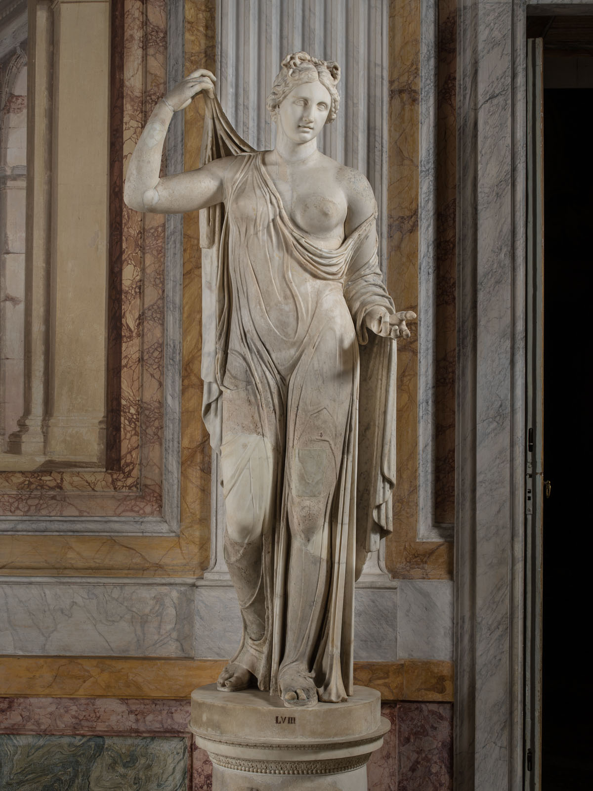

**内容（这是什么）**：一尊维纳斯（Venus / Aphrodite）立像，重心落左腿、右脚尖点地，右臂上举撩起斗篷，左臂前伸（原本所持之物已失）。薄如蝉翼的「湿衣」紧贴身体、从左肩滑落露出乳房。

**背景 / 来历**：公元 1 世纪中叶的尤利-克劳狄时期复制品，原型是著名的「卢浮-那不勒斯型」阿佛洛狄忒（约公元前 420–400 年青铜原作，归于菲狄亚斯或波留克列特斯一派）。所配的头并非同一类型、且经大量改刻。19 世纪重组陈列时被刻意与同型变体（LVI-B）成对摆放，以凸显藏品间的题材呼应。

**看点**：顺路看，但雕工出色。重点看「湿衣」效果——透明薄衣贴体、衣褶几乎金属化的处理，是这一名作类型的精髓。它在帝国早期遍布全帝国，与维纳斯作为埃涅阿斯之母、尤利乌斯家族始祖的崇拜热潮直接相关，恰好呼应本厅天顶的维纳斯-埃涅阿斯主题。

### ⭐ 顺路看 古罗马艺术《带酒神主题浮雕的祭坛》 / Roman art, _Altar with Dionysian Relief_

- **作者 / Artist**：古罗马艺术 / Roman art
- **作品 / Work**：《带酒神主题浮雕的祭坛》 / _Altar with Dionysian Relief_
- **时间**：公元前 1 世纪末至公元 1 世纪初
- **材质**：白大理石
- **尺寸**：高 92 cm（含修复补配），直径 45 cm
- **位置**：保利娜厅（第 1 室）
- **官网介绍页**：[官网介绍英文](https://www.collezionegalleriaborghese.it/en/opere/altar-with-dionysian-relief-2)｜馆藏编号 LVIIIa

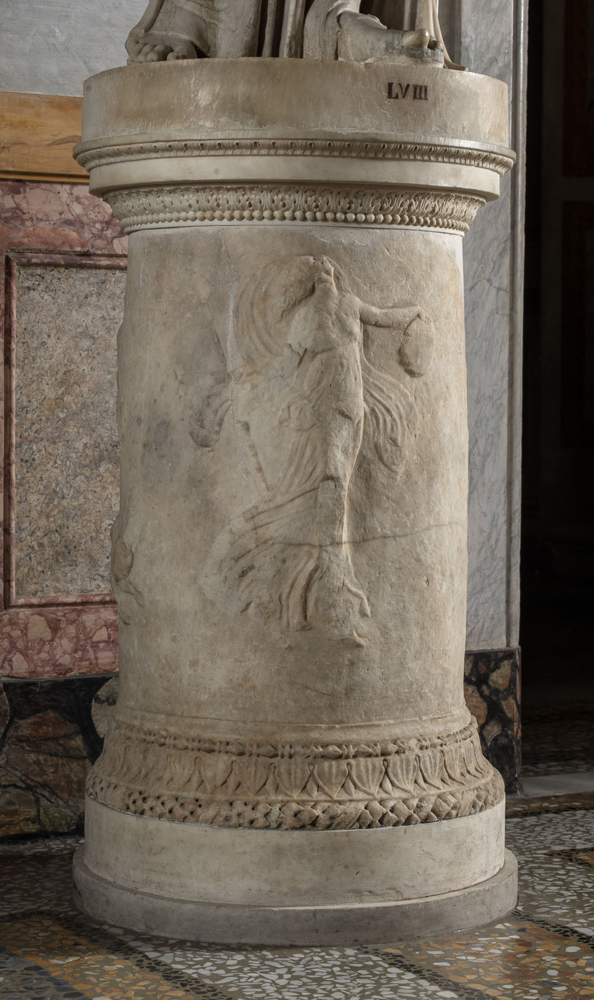

**内容（这是什么）**：另一座圆形祭坛，浮雕三名酒神女祭司（Maenad / Bacchante）持铙钹与酒神杖（thyrsus）起舞，前有一只豹引导。

**背景 / 来历**：约公元前 1 世纪末至公元 1 世纪初，整体严重风化、上部为后补。同样在 19 世纪重组陈列时被搬进本厅，当过那尊「卢浮-那不勒斯型阿佛洛狄忒」（LVIII）的底座。这种「跳舞的女祭司」图式有约六十件传世，常被归到希腊雕刻家卡利马科斯（Callimachus）（公元前 5 世纪末）名下，衣纹近似雅典娜·尼刻神庙栏板。

**看点**：顺路看。与对面的 LVI 祭坛并看——本件主打「女祭司舞列＋引路豹」，是新阿提卡「跳舞女祭司」名作的罗马翻版。上缘装饰母题与罗马广场和谐神庙（提比略 7 BCE–10 CE 重修）相近，是断代的依据。

### ⭐ 顺路看 古罗马艺术《帕西法厄神话石棺：弥诺斯向波塞冬献祭》 / Roman art, _Sarcophagus with the Myth of Pasiphaë: Minos Making a Sacrifice to Poseidon_

- **作者 / Artist**：古罗马艺术 / Roman art
- **作品 / Work**：《帕西法厄神话石棺：弥诺斯向波塞冬献祭》 / _Sarcophagus with the Myth of Pasiphaë: Minos Making a Sacrifice to Poseidon_
- **时间**：公元 150–160 年
- **材质**：卢尼大理石
- **尺寸**：高 78 cm；宽 80 cm
- **位置**：保利娜厅（第 1 室）
- **官网介绍页**：[官网介绍英文](https://www.collezionegalleriaborghese.it/en/opere/sarcophagus-with-the-myth-of-pasipha-minos-making-a-sacrifice-to-poseidon)｜馆藏编号 LXI

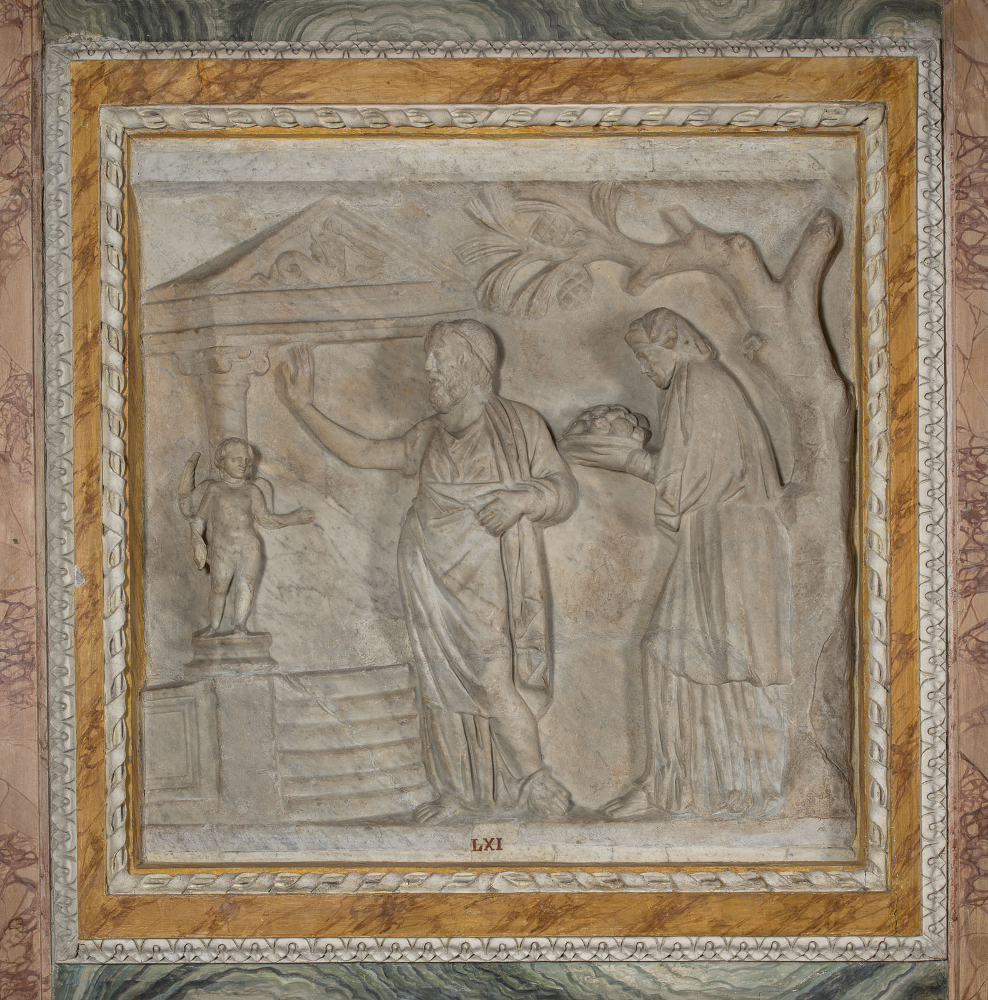

**内容（这是什么）**：一块石棺侧板，雕克里特王米诺斯（Minos）在波塞冬神庙前献祭、身后跟一名女子。这是「帕西法厄神话」石棺的右侧短边——帕西法厄是米诺斯之妻，被波塞冬降下狂恋公牛之祸，命匠人代达罗斯（Dedalus）造一头空心木牛藏身其中，与公牛结合生下牛头怪弥诺陶。

**背景 / 来历**：约公元 2 世纪中叶（Luni 大理石）。这具石棺的正面长边与左侧短边今藏卢浮宫——整具棺 16 世纪还完整地在梵蒂冈观景庭，1615 年建博尔盖塞别墅时被锯成三块分用作装饰，本件因此留在了罗马。锯解时还被改刻过（一个原有的小爱神被磨掉、另一个小像的头被转向）。

**看点**：顺路看。最大看点是「一棺三分、跨馆相认」——本件只是右侧献祭一幕，正面的造木牛、交媾、生下牛头怪等关键情节都在卢浮宫那两块上。现场看米诺斯蒙头献祭的姿态（蒙头＝主祭），想象它原本接续的完整神话叙事。

### ⭐ 顺路看 古罗马艺术《勒达与天鹅、厄洛斯及小安东尼娅肖像》 / Roman art, _Leda and the Swan with Eros, portrait of Antonia Minor_

- **作者 / Artist**：古罗马艺术 / Roman art
- **作品 / Work**：《勒达与天鹅、厄洛斯及小安东尼娅肖像》 / _Leda and the Swan with Eros, portrait of Antonia Minor_
- **时间**：公元 3 世纪初（雕像组）；约公元 35 年（头部）
- **材质**：帕罗斯大理石（雕像组）；卢尼大理石（头部）
- **尺寸**：高 120 cm；宽 158 cm；头部 30 cm
- **位置**：保利娜厅（第 1 室）
- **官网介绍页**：[官网介绍英文](https://www.collezionegalleriaborghese.it/en/opere/leda-and-the-swan-with-eros-portrait-of-antonia-minor)｜馆藏编号 LXII

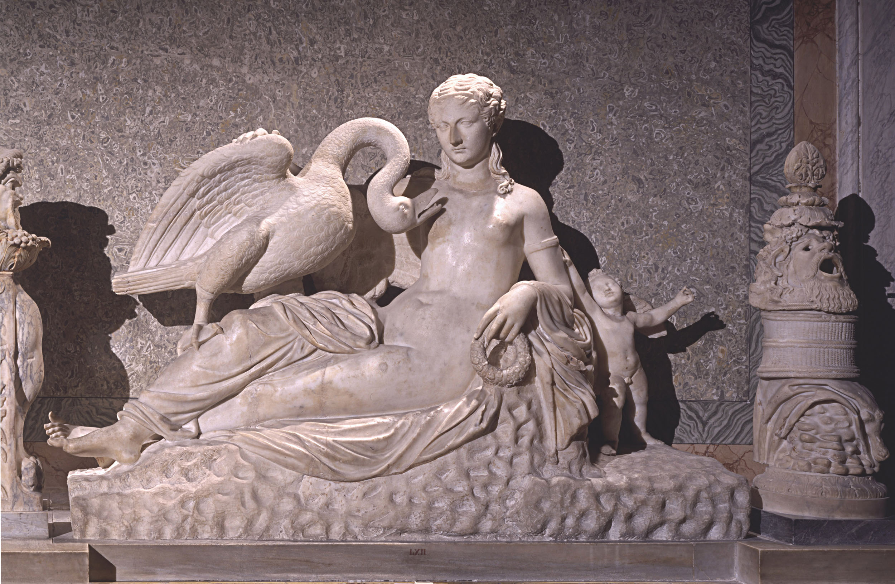

**内容（这是什么）**：「丽达与天鹅」（Leda and the Swan）群像。丽达半卧在欧罗塔斯河岸，天鹅栖在她身上、喙轻触其右胸，身后一个小爱神（Eros）依偎着她。神话里宙斯化作天鹅与丽达结合，她随后产下一枚蛋，孵出波吕克斯与海伦。

**背景 / 来历**：群像主体为公元 3 世纪初罗马作品（Parian 大理石），缺失部分是 19 世纪补配；那颗头并不属于本像，被认为是公元约 35 年的安东尼娅（Antonia Minor，奥古斯都的外甥女、皇帝克劳狄之母）肖像。曾长期被当成近代作品，直到 1996–97 年修复才确认古代内核。1826 年还在别墅花园，1832 年记录在本厅现位。

**看点**：顺路看，但题材有趣。靠「天鹅触胸＋小爱神依偎」这组道具就能认出丽达神话。再看那颗「张冠李戴」的头——一具神话群像配了一颗皇室女性肖像头，是本厅「头身错配」的代表；它与对面那组「坐姿女子＋小爱神」（LXXII）是有意做成的左右呼应陈列。

### ⭐ 顺路看 古罗马艺术《桌足，双赫尔墨柱与面具，现代任意拼合的异质残件》 / Roman art, _Trapezophoron, Double Herm with Masks, heterogeneous fragments arbitrarily assembled in modern times_

- **作者 / Artist**：古罗马艺术 / Roman art
- **作品 / Work**：《桌足，双赫尔墨柱与面具，现代任意拼合的异质残件》 / _Trapezophoron, Double Herm with Masks, heterogeneous fragments arbitrarily assembled in modern times_
- **时间**：公元 1 世纪
- **材质**：古黄大理石（桌腿支架）；白大理石（面具）
- **尺寸**：高 86 cm；仅桌腿支架部分高 55 cm；宽 201 cm
- **位置**：保利娜厅（第 1 室）
- **官网介绍页**：[官网介绍英文](https://www.collezionegalleriaborghese.it/en/opere/trapezophor-on-double-herm-with-masks)｜馆藏编号 LXIIa

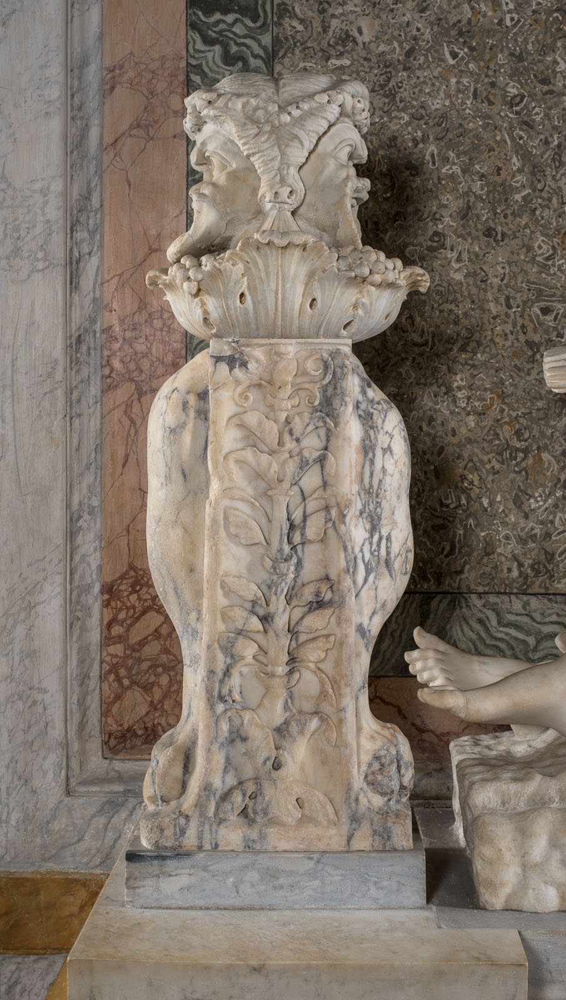

**内容（这是什么）**：一件「拼装」装饰雕——黄色古大理石的支撑台座（trapezophoron，两侧兽爪、正面植物烛台纹）顶着一段带面具的双面赫尔墨柱。

**背景 / 来历**：典型的「奇美拉式」（chimeric）拼合——其中只有那段植物烛台台座是公元 1 世纪古代真品，双面赫尔柱是后配。约 1828 年本厅重新装饰时拼装而成，摆在「丽达与天鹅」（LXII）一侧，与另一件（LXIIb）成对侧立。

**看点**：顺路看。看点正是它的「真假混搭」——古代台座＋近代补件被随意凑在一起，是 19 世纪把零散古物拼成装饰摆件的做法。和它对侧的 LXIIb 一起，专为衬托中间的丽达群像而设。

### ⭐ 顺路看 古罗马艺术《匣形器，饰萨堤尔面具，现代任意拼合的异质残件》 / Roman art, _Cista with Satyr Mask, heterogeneous fragments arbitrarily assembled in modern times_

- **作者 / Artist**：古罗马艺术 / Roman art
- **作品 / Work**：《匣形器，饰萨堤尔面具，现代任意拼合的异质残件》 / _Cista with Satyr Mask, heterogeneous fragments arbitrarily assembled in modern times_
- **时间**：公元 1 世纪
- **材质**：白大理石
- **尺寸**：高 86 cm
- **位置**：保利娜厅（第 1 室）
- **官网介绍页**：[官网介绍英文](https://www.collezionegalleriaborghese.it/en/opere/cista-with-satyr-mask)｜馆藏编号 LXIIb

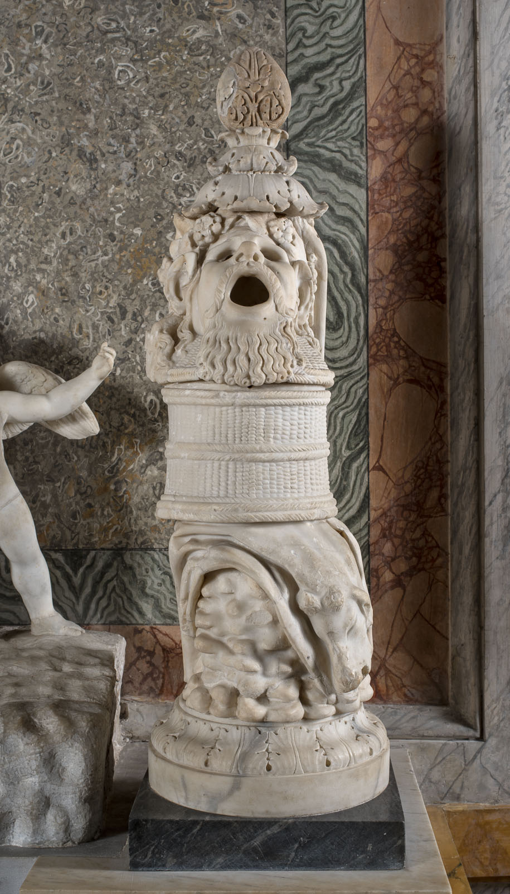

**这是什么**：与 LXIIa 成对的另一件拼装装饰雕——一座环饰莨苕叶的圆座，上托覆羊皮的岩堆、再托一只柳条圣篮（cista mystica），顶端覆一张萨堤尔面具，全部是酒神题材元素。

属于本厅那对「奇美拉式」拼合装饰之一（整组背景见 LXIIa）：约 1828 年拼装、摆在「丽达与天鹅」另一侧成对。现场两件并看即可，留意萨堤尔面具、羊皮与圣篮这几样酒神（Dionysus）祭仪道具，以及它和 LXIIa 一样「古件＋后配凑成」的性质。

### ⭐ 顺路看 古罗马艺术《雅典娜祭坛前的埃阿斯与卡珊德拉浮雕》 / Roman art, _Relief of Ajax and Cassandra at the Altar of Athena_

- **作者 / Artist**：古罗马艺术 / Roman art
- **作品 / Work**：《雅典娜祭坛前的埃阿斯与卡珊德拉浮雕》 / _Relief of Ajax and Cassandra at the Altar of Athena_
- **时间**：公元前 1 世纪
- **材质**：帕罗斯大理石
- **尺寸**：84 × 84 cm
- **位置**：保利娜厅（第 1 室）
- **官网介绍页**：[官网介绍英文](https://www.collezionegalleriaborghese.it/en/opere/relief-of-ajax-and-cassandra-at-the-altar-of-athena)｜馆藏编号 LXIV

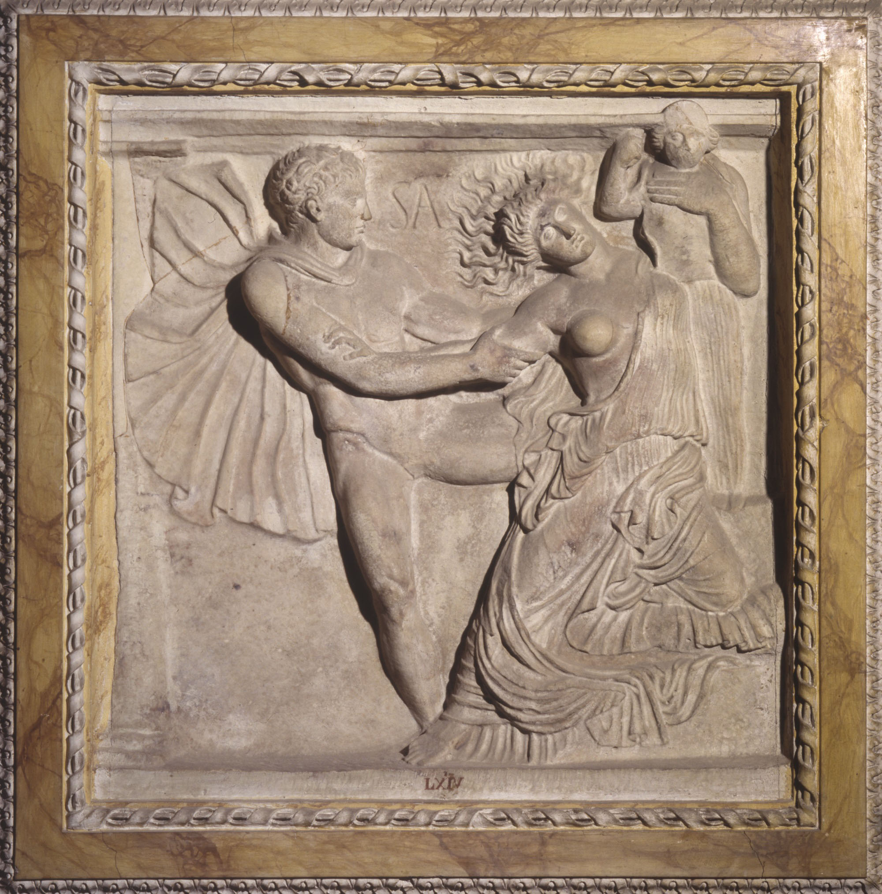

**内容（这是什么）**：浮雕「埃阿斯与卡珊德拉」（Ajax and Cassandra）——特洛伊陷落时，公主卡珊德拉逃进雅典娜神庙、抱住女神像求庇护，希腊英雄埃阿斯却无视圣地强行把她拖走。左侧裸身披风的埃阿斯双手拖拽；卡珊德拉左臂死死攀住神像、衣衫滑落露出一肩，两人头间还残留刻字「SA」（[Cas]SA[ndra]）。

**背景 / 来历**：公元前 1 世纪作品（Parian 大理石），原属一条更大的「特洛伊陷落」（Iliupersis）建筑饰带，出自新阿提卡工坊、取法塔兰托样式。1797 年温克尔曼曾在别墅地下室见过它，1832 年才记录在本厅、嵌入近代画框。清洗时还发现被人工旧锈盖住的火烧痕，或与原建筑被焚有关。

**看点**：顺路看，但故事性强。先找两头之间残存的刻字「SA」——正是它确认了人物身份。再看构图的「分裂张力」：埃阿斯向左拖、卡珊德拉向右死攀神像，把「亵渎圣地的暴行」一瞬定格。这是本厅与天顶「特洛伊覆灭」主线呼应的一件神话浮雕。

### ⭐ 顺路看 古罗马艺术《穿长斗篷的男孩》 / Roman art, _Boy Wearing a Long Mantle_

- **作者 / Artist**：古罗马艺术 / Roman art
- **作品 / Work**：《穿长斗篷的男孩》 / _Boy Wearing a Long Mantle_
- **时间**：公元 2 世纪
- **材质**：卢尼大理石
- **尺寸**：高 71 cm
- **位置**：保利娜厅（第 1 室）
- **官网介绍页**：[官网介绍英文](https://www.collezionegalleriaborghese.it/en/opere/boy-wearing-a-long-mantle-2)｜馆藏编号 LXIX

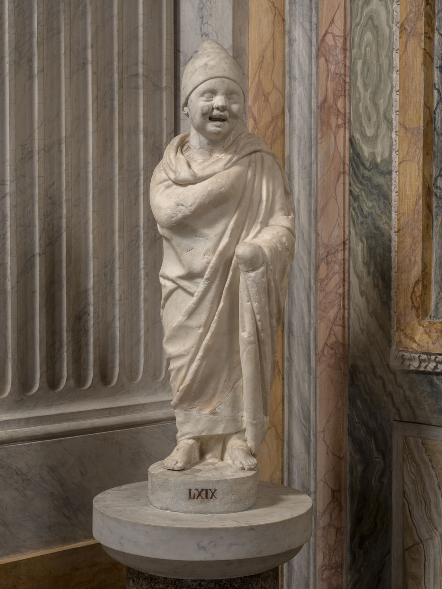

**这是什么**：着篷小童像之一（编号 LXIX，71 cm，2nd century A.D.），头偏左、面带笑意。

属于本厅那组三尊忒勒斯福洛斯（Telesphoros）小像之一（整组背景见 CVIC 那件）。1893 年它就与 LXV 一同记录在本厅现位；现场三尊并看即可，留意它与另两尊在头向上的不同。

### ⭐ 顺路看 古罗马艺术《穿长斗篷的男孩》 / Roman art, _Boy Wearing a Long Mantle_

- **作者 / Artist**：古罗马艺术 / Roman art
- **作品 / Work**：《穿长斗篷的男孩》 / _Boy Wearing a Long Mantle_
- **时间**：公元 2 世纪中叶
- **材质**：卢尼大理石
- **尺寸**：高 70 cm
- **位置**：保利娜厅（第 1 室）
- **官网介绍页**：[官网介绍英文](https://www.collezionegalleriaborghese.it/en/opere/boy-wearing-a-long-mantle-3)｜馆藏编号 LXV

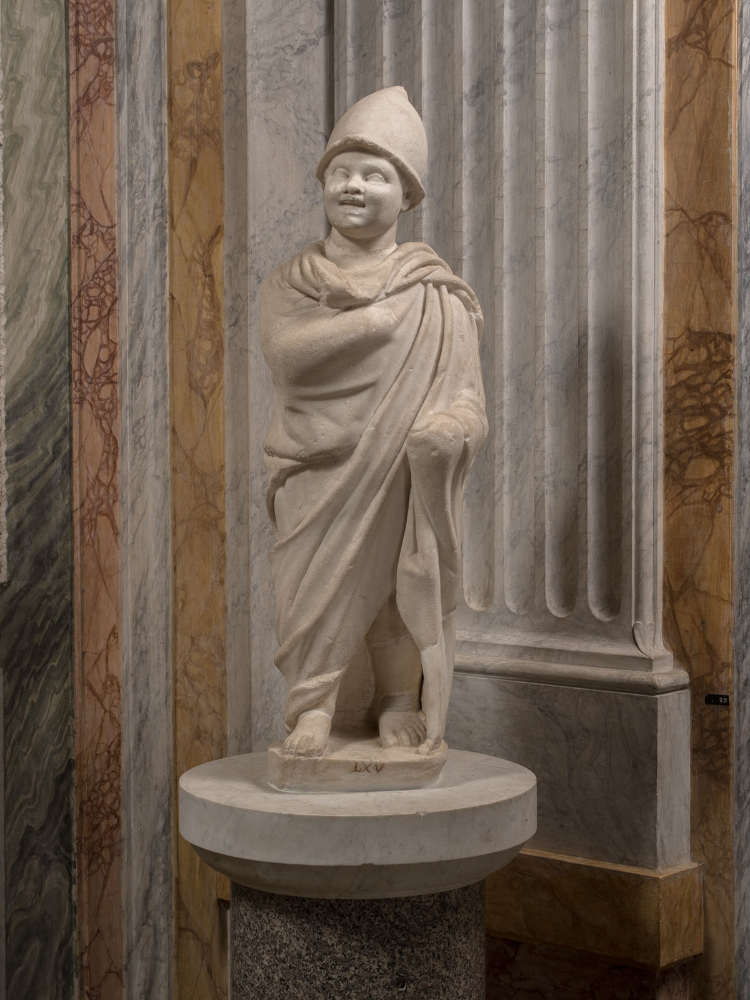

**这是什么**：着篷小童像之一（编号 LXV，70 cm，mid 2nd century A.D.），头微抬、略偏右，露出双脚和部分左腿；此件头部为原配。

属于本厅那组三尊忒勒斯福洛斯（Telesphoros）小像之一（整组背景见 CVIC 那件）。现场作为序列一员扫过即可，可与 CVIC、LXIX 三尊并看，比对姿态与露腿差别。

### ⭐ 顺路看 古罗马艺术《扮作希望女神的女子肖像雕像》 / Roman art, _Portrait Statue of a Woman as Spes_

- **作者 / Artist**：古罗马艺术 / Roman art
- **作品 / Work**：《扮作希望女神的女子肖像雕像》 / _Portrait Statue of a Woman as Spes_
- **时间**：公元 110 年
- **材质**：卢尼大理石
- **尺寸**：高 169 cm
- **位置**：保利娜厅（第 1 室）
- **官网介绍页**：[官网介绍英文](https://www.collezionegalleriaborghese.it/en/opere/portrait-statue-of-a-woman-as-spes)｜馆藏编号 LXVI

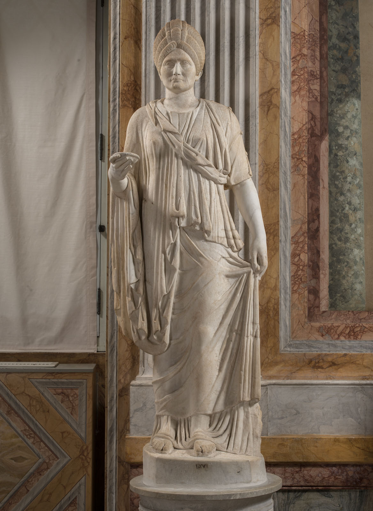

**内容（这是什么）**：一尊立姿罗马贵妇像，穿长衣外披斗篷，左手提衣裾、右手持献祭浅盘（patera）。她采用「希望女神斯佩斯（Spes）」的图式——身体仿古风「少女像」（kore）样式，是罗马常用来表现「希望」拟人、也常借用于肖像雕像的标准型。

**背景 / 来历**：公元 110 年作品（Luni 大理石）。头部单独雕成，发型尤其讲究——三层「冠状」波浪卷加一圈辫子盘成的「头巾」，正是图拉真之姊乌尔皮娅·马尔恰娜（Ulpia Marciana）带起、流行于图拉真-哈德良时期的贵妇发式。尼比（Nibby） 1832 年曾把她当成图拉真之妻普洛蒂娜（Plotina）。

**看点**：顺路看，但发型是认人钥匙。重点看头顶那套「三层冠＋辫盘头巾」——这是图拉真-哈德良时代上流女性的标志发式，靠它就能给这类无名贵妇像断代。她脚下那座圆祭坛（LXVIa）也大有来历，可一并看。

### ⭐ 顺路看 古罗马艺术《饰牛首与花环的圆形祭坛》 / Roman art, _Circular Altar with Bucrania and Garlands_

- **作者 / Artist**：古罗马艺术 / Roman art
- **作品 / Work**：《饰牛首与花环的圆形祭坛》 / _Circular Altar with Bucrania and Garlands_
- **时间**：公元 1 世纪
- **材质**：白大理石
- **尺寸**：90 cm
- **位置**：保利娜厅（第 1 室）
- **官网介绍页**：[官网介绍英文](https://www.collezionegalleriaborghese.it/en/opere/circular-altar-with-bucrania-and-garlands)｜馆藏编号 LXVIa

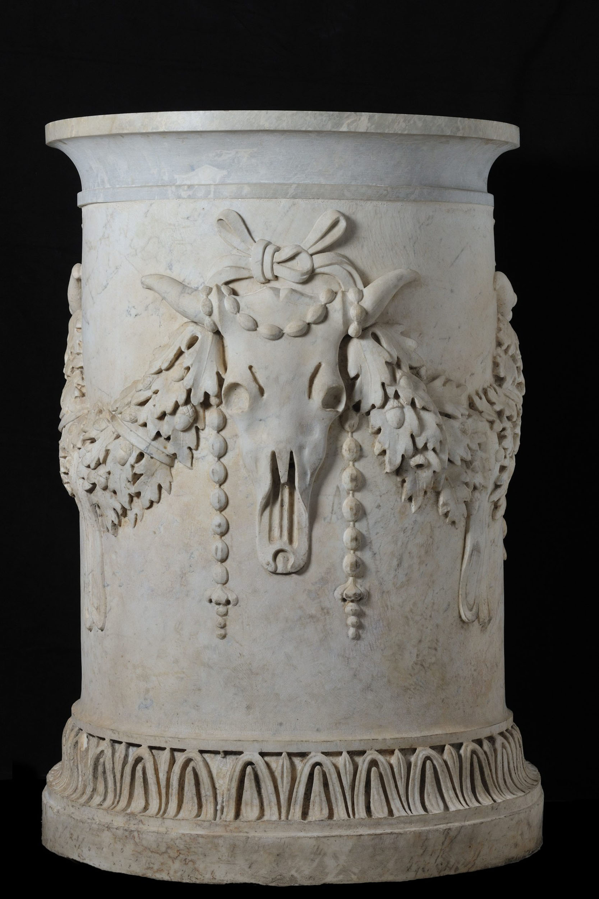

**内容（这是什么）**：一座圆形祭坛，柱身雕三只牛颅（bucrania）撑起两道橡叶橡果花环，垂带从牛角上方的结飘下，牛角间还挂着大环链。

**背景 / 来历**：约公元 1 世纪（奥古斯都时期），叶片橡果的精细程度可比拟「和平祭坛」（Ara Pacis）。它的「履历」很显赫——1619 年曾被选作贝尼尼名作《埃涅阿斯与安喀塞斯》群像的底座（为贴墙还被石匠削去约五分之一体积）；后来又当过《三个沉睡小爱神》的底座；19 世纪才挪到本厅、托起旁边那尊「希望女神型贵妇像」（LXVI）。

**看点**：顺路看，但来历有看头。一边看那精致的橡叶橡果花环（奥古斯都时代官方装饰的高水准），一边记住它当过贝尼尼《埃涅阿斯与安喀塞斯》的底座——它如今正托着上方的 LXVI 贵妇像，是本厅「古祭坛被反复挪用作底座」的活样本。

### ⭐ 顺路看 古罗马艺术《着斗篷女子雕像，修复为花神芙罗拉》 / Roman art, _Statue of a woman wearing a mantle, restored as Flora_

- **作者 / Artist**：古罗马艺术 / Roman art
- **作品 / Work**：《着斗篷女子雕像，修复为花神芙罗拉》 / _Statue of a woman wearing a mantle, restored as Flora_
- **时间**：约公元 160 年
- **材质**：卢尼大理石
- **尺寸**：不含底座高 144 cm
- **位置**：保利娜厅（第 1 室）
- **官网介绍页**：[官网介绍英文](https://www.collezionegalleriaborghese.it/en/opere/statue-of-a-woman-wearing-a-mantle-restored-as-flora)｜馆藏编号 LXVIII

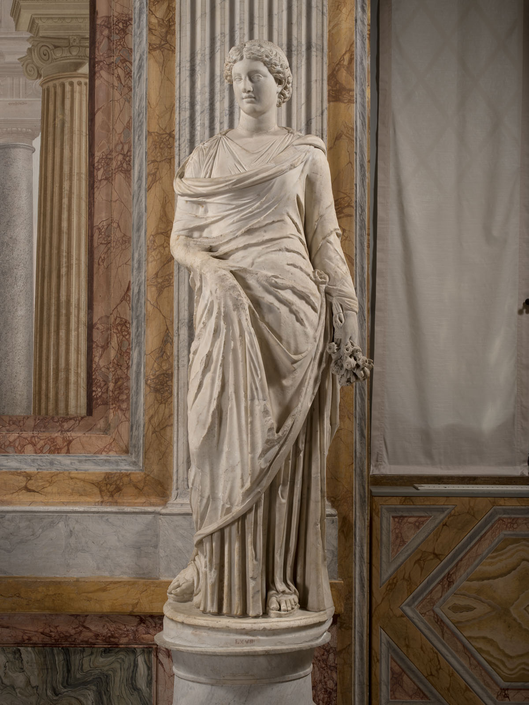

**内容（这是什么）**：一尊披斗篷的女子立像，重心落左腿，穿长衣外裹宽大 himation；19 世纪修复时给她加了一颗后配的头和一束花，于是被「修复为」花神弗洛拉（Flora）。

**背景 / 来历**：约公元 160 年（安东尼时期）作品，原本很可能是一尊肖像雕像。衣纹近晚期古典—早期希腊化风格，推测产自小亚细亚。它来自家族在 Frascati 的旧藏，1827 年由拉布勒尔（Laboureur）修复成花神。

**看点**：顺路看，身世典型。看她左手那束花和那颗头——都是 19 世纪后加的，正是这两样把一尊本来的肖像贵妇改造成了「花神」。这是本厅「后世添头加道具、改换身份」一类的又一例。

### ⭐ 顺路看 古罗马艺术《带向无敌赫拉克勒斯献祭场景的圆形祭坛》 / Roman art, _Round Altar with Scene of a Sacrifice to Hercules Invictus_

- **作者 / Artist**：古罗马艺术 / Roman art
- **作品 / Work**：《带向无敌赫拉克勒斯献祭场景的圆形祭坛》 / _Round Altar with Scene of a Sacrifice to Hercules Invictus_
- **时间**：公元前 1 世纪中叶
- **材质**：白大理石
- **尺寸**：高 53 cm
- **位置**：保利娜厅（第 1 室）
- **官网介绍页**：[官网介绍英文](https://www.collezionegalleriaborghese.it/en/opere/round-altar-with-scene-of-a-sacrifice-to-hercules-invictus)｜馆藏编号 LXVIIIa

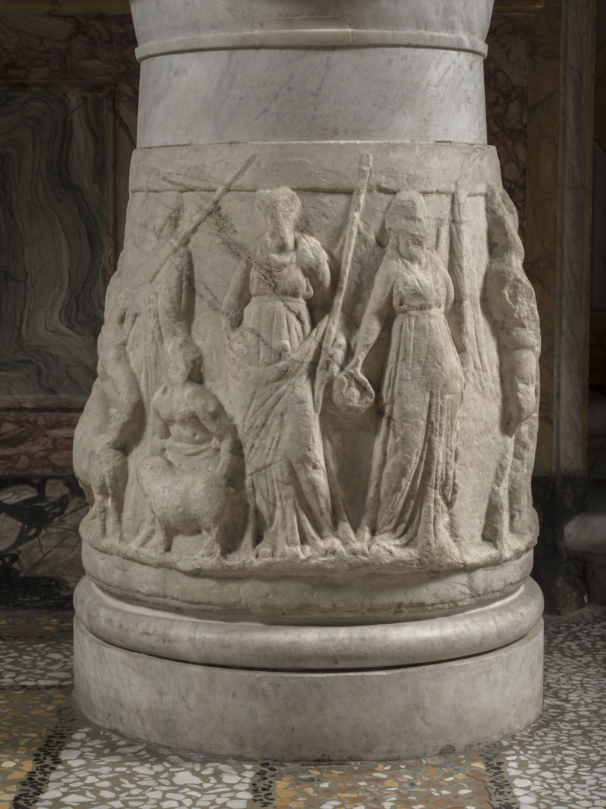

**内容（这是什么）**：一座圆形祭坛，环身浮雕一场献祭：中央大祭坛后有竖琴手、吹笛者与主祭，蒙头持盘的献祭者后随两名持束棒的扈从（lictor）和牵牲口的助祭；坛左立着三位神祇——两名女神（一带翼）与赫拉克勒斯（Hercules）。多被解作向「常胜赫拉克勒斯」（Hercules Victor/Invictus）献祭，带翼者为胜利女神，另一女神或为青春女神尤文塔斯（Iuventas）。

**背景 / 来历**：约公元前 1 世纪中叶，主要据人物所穿晚期共和风格托加断代。1832 年尼比（Nibby）记录它在本厅现位，并把场面认作净化用的「三牲祭」（suovetaurilia，献牛、猪、羊）。

**看点**：顺路看。看蒙头持盘的主祭——蒙头献祭是罗马大祭司的标准姿态；再找坛左裸身、搭狮皮、拄棍的赫拉克勒斯，确认这是向他举行的胜利献祭。竖直的权杖、束棒、棕榈、木棒都「越出」画面边框，是工匠用来制造立体感的小手法。

### ⭐ 顺路看 古罗马艺术《浮雕：阿耳忒弥斯》 / Roman art, _Relief with Artemis_

- **作者 / Artist**：古罗马艺术 / Roman art
- **作品 / Work**：《浮雕：阿耳忒弥斯》 / _Relief with Artemis_
- **时间**：公元 2 世纪上半叶
- **材质**：卢尼大理石
- **尺寸**：86 × 75 cm
- **位置**：保利娜厅（第 1 室）
- **官网介绍页**：[官网介绍英文](https://www.collezionegalleriaborghese.it/en/opere/relief-with-artemis)｜馆藏编号 LXXI

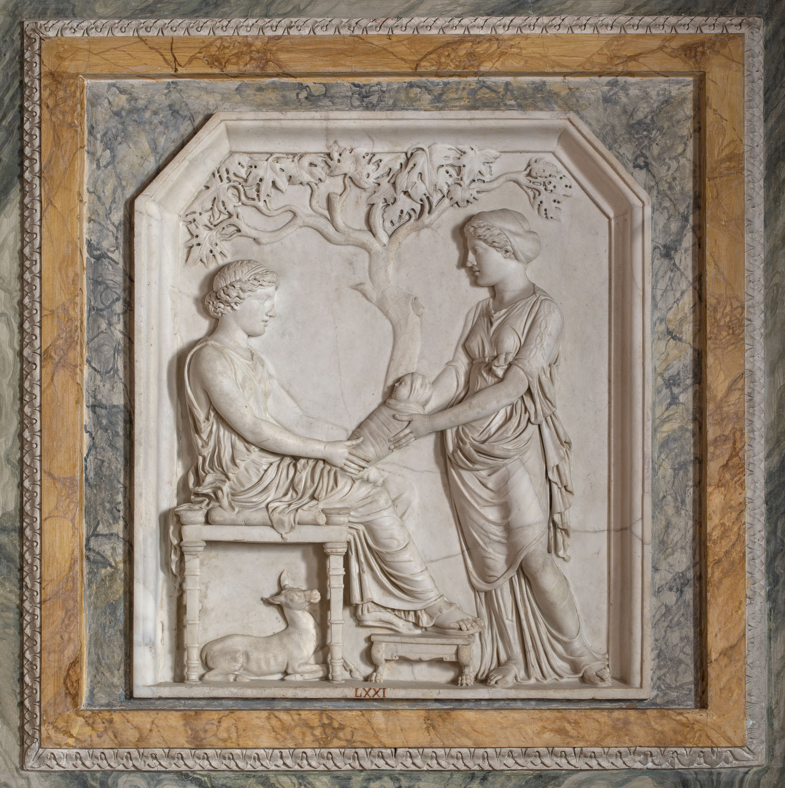

**内容（这是什么）**：一方浮雕，两名披衣女子相对：左侧坐于椅上、脚踏小凳的女子，注视着右侧站立女子递来的一个襁褓婴儿，椅下卧着一只鹿，背景一株枝叶大树框住场景。一说坐者是「育婴女神」阿耳忒弥斯（Artemis Kourotrophos），有人来求她庇护新生儿；另一说婴儿是赫拉克勒斯与奥革之子忒勒福斯（Telephus），由侍女抱来见母，那只鹿就是当年哺育被弃婴儿的鹿。

**背景 / 来历**：公元 2 世纪上半叶（Luni 大理石），1766 年在博尔盖塞家族位于 Via Labicana 的 Torrenova 庄园发掘出土——是本厅又一件能落实出土地的古件。构图借用了阿提卡墓碑「向逝者作别」的家庭场景程式。

**看点**：顺路看。看椅下那只鹿——它正是分辨两种解读的关键道具（女神的圣兽，或哺育忒勒福斯的鹿）。再看「坐者—婴儿—立者」三点连成的视线焦点，构图源自希腊墓碑的告别程式。

### ⭐ 顺路看 古罗马艺术《坐姿女性像与坐姿厄洛斯像》 / Roman art, _Seated Female Figure with Statue of Seated Eros_

- **作者 / Artist**：古罗马艺术 / Roman art
- **作品 / Work**：《坐姿女性像与坐姿厄洛斯像》 / _Seated Female Figure with Statue of Seated Eros_
- **时间**：公元 2 世纪
- **材质**：帕罗斯大理石（雕像组）；卢尼大理石（头部）
- **尺寸**：高 120 cm；宽 158 cm；头部 30 cm
- **位置**：保利娜厅（第 1 室）
- **官网介绍页**：[官网介绍英文](https://www.collezionegalleriaborghese.it/en/opere/seated-female-figure-with-statue-of-seated-eros)｜馆藏编号 LXXII

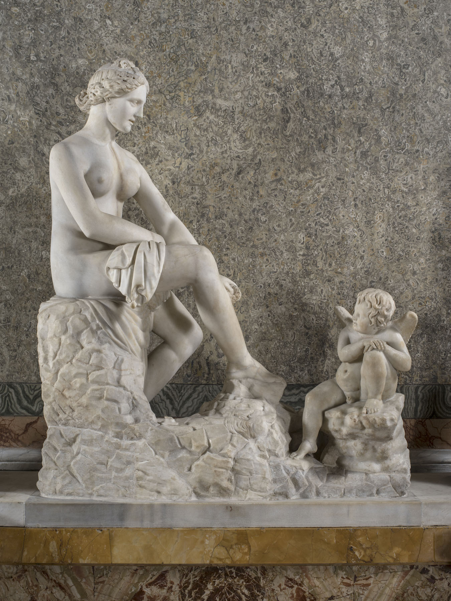

**内容（这是什么）**：一组「坐姿裸女＋坐姿小爱神」——女子坐于岩上、一脚踏石，身前一个带翼的小爱神（Eros）仰头望着她；脚边还藏着一只蛙和一只海豚。多被解作「沐浴的维纳斯」。

**背景 / 来历**：组合本身是「拼装」的——女像与小爱神原属两件不同的纪念物（海豚可能来自第三件），约 19 世纪被凑成一组，专为与对面墙上的「丽达与天鹅」（LXII）做左右呼应的 pendant。各部件大致都断在公元 2 世纪。女像 1650 年记于花园，小爱神 1700 年记于二楼「三美神厅」，1832 年才见它们已合为一组立于本厅。

**看点**：顺路看。它与对面的丽达群像（LXII）是有意做成的对称陈列，可两组对看。再留意脚边的蛙与海豚——这些零碎其实来自不同器物，是 19 世纪拼装的痕迹，而非原作一体。

### ⭐ 顺路看 古罗马艺术《柱式石棺，阿波罗与缪斯，正面》 / Roman art, _Columnar Sarcophagus with Apollo and the Muses, front_

- **作者 / Artist**：古罗马艺术 / Roman art
- **作品 / Work**：《柱式石棺，阿波罗与缪斯，正面》 / _Columnar Sarcophagus with Apollo and the Muses, front_
- **时间**：公元 220–230 年
- **材质**：亚洲大理石
- **尺寸**：高 102 cm，宽 226 cm
- **位置**：保利娜厅（第 1 室）
- **官网介绍页**：[官网介绍英文](https://www.collezionegalleriaborghese.it/en/opere/columnar-sarcophagus-with-apollo-and-the-muses-front)｜馆藏编号 LXXV

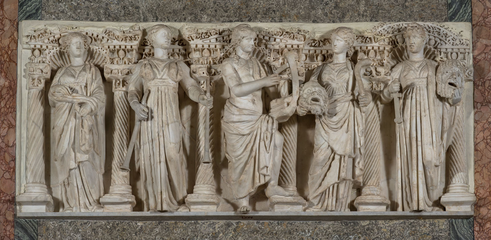

**内容（整组一次看）**：这条浮雕是一具「柱式石棺」（columnar sarcophagus）的正面，六根扭索柱把空间隔成五格，安放阿波罗与四位缪斯。自左：史诗女神卡利俄佩、持双管笛的欧忒耳佩、居中持琴的「缪斯领袖」阿波罗、持喜剧面具的塔利亚、持悲剧面具的墨尔波墨涅。对面墙上还有同一具石棺的背面（LXXVa），合起来才是完整的阿波罗与九缪斯。

**背景 / 来历（整组通用）**：公元 220–230 年（亚洲大理石），柱式石棺产自小亚细亚 Docimium，因白石优质、工匠精湛而风行罗马。整具棺曾砌在别墅东立面（即「Prospettiva」）墙上，后移到湖区围墙；拿破仑征购时只把两块短边（冥府之门、荷马）运去巴黎，正背两长面留下，1827 年由德埃斯特（D'Este）修复后分挂本厅两面相对的墙上。

**看点**：顺路看，但堪称一套「缪斯图鉴」。靠各自的道具认人——琴是阿波罗、双管笛是欧忒耳佩、喜剧/悲剧面具分属塔利亚和墨尔波墨涅。看完正面记得转身看对面的背面（LXXVa），两面合起来才凑齐九位缪斯。整组背景见此件。

### ⭐ 顺路看 古罗马艺术《柱式石棺，阿波罗与缪斯，背面》 / Roman art, _Columnar Sarcophagus with Apollo and the Muses, back_

- **作者 / Artist**：古罗马艺术 / Roman art
- **作品 / Work**：《柱式石棺，阿波罗与缪斯，背面》 / _Columnar Sarcophagus with Apollo and the Muses, back_
- **时间**：公元 220–230 年
- **材质**：亚洲大理石
- **尺寸**：高 100 cm，宽 213 cm
- **位置**：保利娜厅（第 1 室）
- **官网介绍页**：[官网介绍英文](https://www.collezionegalleriaborghese.it/en/opere/columnar-sarcophagus-with-apollo-and-the-muses-back)｜馆藏编号 LXXVa

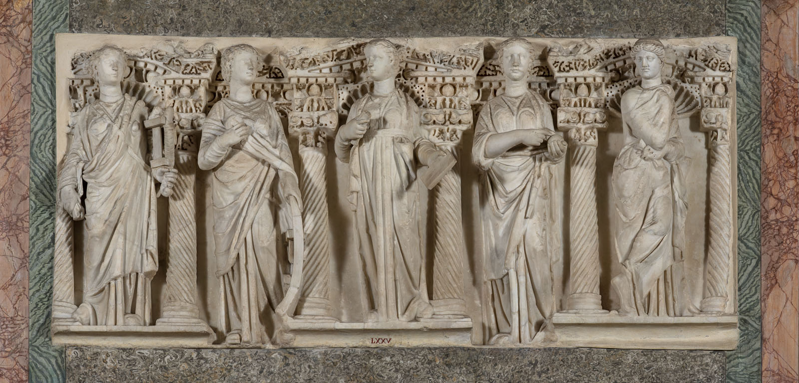

**这是什么**：同一具阿波罗与缪斯柱式石棺的背面（编号 LXXVa），同样五格扭索柱，安放另五位缪斯。自左：持弦乐器者、抒情诗女神厄拉托、历史女神克利俄、天文女神乌拉尼亚（持地球仪）、哑剧女神波吕许谟尼亚（沉思姿）。

属于上述那具石棺（整组背景见正面 LXXV）。它与正面分挂本厅两面相对的墙上——现场两面合看，才凑齐阿波罗与九位缪斯。认人同样靠道具：地球仪＝乌拉尼亚、卷轴与折板＝克利俄。

### ⭐ 顺路看 古罗马艺术《男孩肖像，置于非古代胸像上》 / Roman art, _Portrait of a Boy, on a non-ancient bust_

- **作者 / Artist**：古罗马艺术 / Roman art
- **作品 / Work**：《男孩肖像，置于非古代胸像上》 / _Portrait of a Boy, on a non-ancient bust_
- **时间**：约公元 50 年
- **材质**：白大理石；胸像为彩色大理石
- **尺寸**：连胸像高 47 cm；头部 21 cm
- **位置**：保利娜厅（第 1 室）
- **官网介绍页**：[官网介绍英文](https://www.collezionegalleriaborghese.it/en/opere/portrait-of-a-boy-on-a-non-ancient-bust)｜馆藏编号 LXXVI-bis

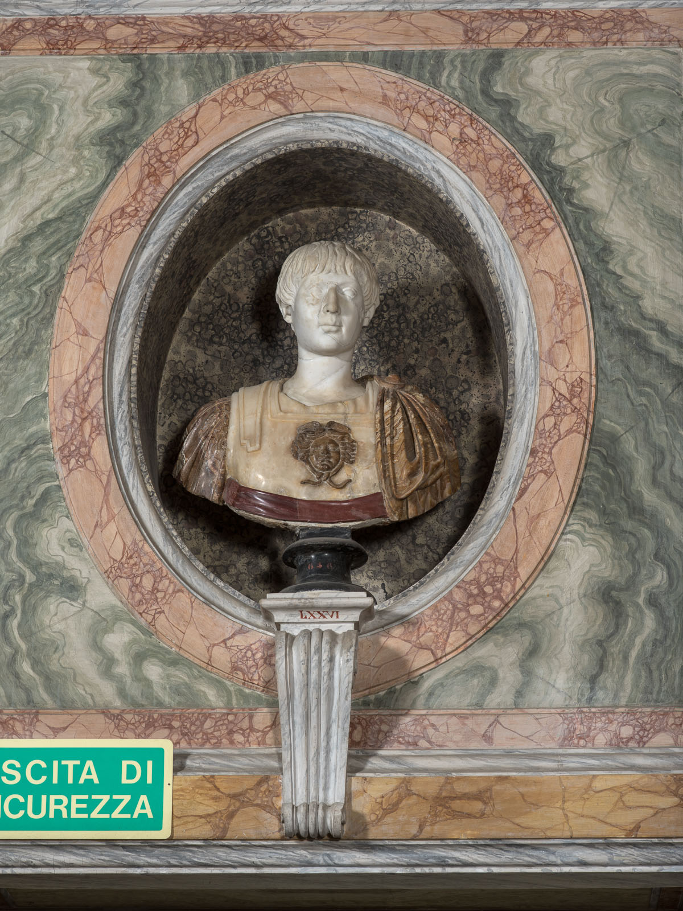

**内容（这是什么）**：一颗约十到十二岁男孩的肖像头，插在一具后配的「胸甲」（loricate）胸像上。椭圆脸、小嘴、浓密的燕尾式刘海。

**背景 / 来历**：头部约公元 50 年，胸像非古代原配。莫雷诺（Moreno）据相貌与发式认为这可能是尤利-克劳狄王朝的一位王子——甚至是克劳狄与梅萨利娜之子不列颠尼库斯（Britannicus，公元 55 年被毒杀以便尼禄上位）；但儿童肖像难以确认，也可能只是仿官方样式的私人肖像。1820 年由费利切·费斯塔（Felice Festa）修复，安进本厅高处壁龛。

**看点**：顺路看。这是本厅墙上那组「费利切·费斯塔修复、嵌入壁龛」的古代肖像之一。看「古代头＋后配胸甲身」的拼装；至于是不是不列颠尼库斯，连馆方都存疑，正好当成「儿童帝室肖像难辨身份」的例子。

### ⭐ 顺路看 古罗马艺术《男子肖像》 / Roman art, _Portrait of a Man_

- **作者 / Artist**：古罗马艺术 / Roman art
- **作品 / Work**：《男子肖像》 / _Portrait of a Man_
- **时间**：公元 230–250 年
- **材质**：卢尼大理石
- **尺寸**：连胸像高 46 cm；头部 27 cm
- **位置**：保利娜厅（第 1 室）
- **官网介绍页**：[官网介绍英文](https://www.collezionegalleriaborghese.it/en/opere/portrait-of-a-man-1)｜馆藏编号 LXXVIb

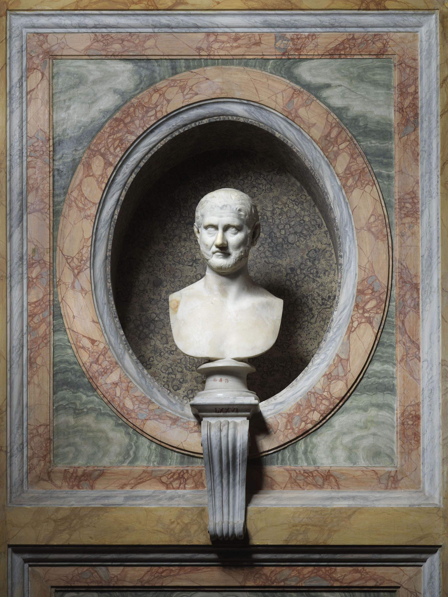

**内容（这是什么）**：一颗成年男子肖像头，插在后配胸像上。短鬈发贴头无体积、宽额三道横纹、深陷的眼上望、浓软的络腮胡。

**背景 / 来历**：约公元 230–250 年，1820 年在家族 Vigna Lucidi 庄园发掘出土。神情严峻忧郁、形体开始走向几何化，被定在亚历山大·塞维鲁（222–235）到加里恩努斯早期之间——正预告了 3 世纪「军人皇帝」肖像的那种棱角与紧张感。

**看点**：顺路看，断代价值高。看那张「开始几何化」的脸与忧郁眼神——它正卡在古典回潮与军人皇帝硬朗风格之间的过渡点，是一件能讲清 3 世纪肖像风格转向的私人肖像。属本厅壁龛肖像系列之一。

### ⭐ 顺路看 古罗马艺术《女子肖像，置于现代胸像上》 / Roman art, _Portrait of a Woman on a Modern Bust_

- **作者 / Artist**：古罗马艺术 / Roman art
- **作品 / Work**：《女子肖像，置于现代胸像上》 / _Portrait of a Woman on a Modern Bust_
- **时间**：公元 2 世纪中叶
- **材质**：卢尼大理石
- **尺寸**：连胸像高 54 cm；头高 35 cm
- **位置**：保利娜厅（第 1 室）
- **官网介绍页**：[官网介绍英文](https://www.collezionegalleriaborghese.it/en/opere/portrait-of-a-woman-on-a-modern-bust-1)｜馆藏编号 LXXVIc

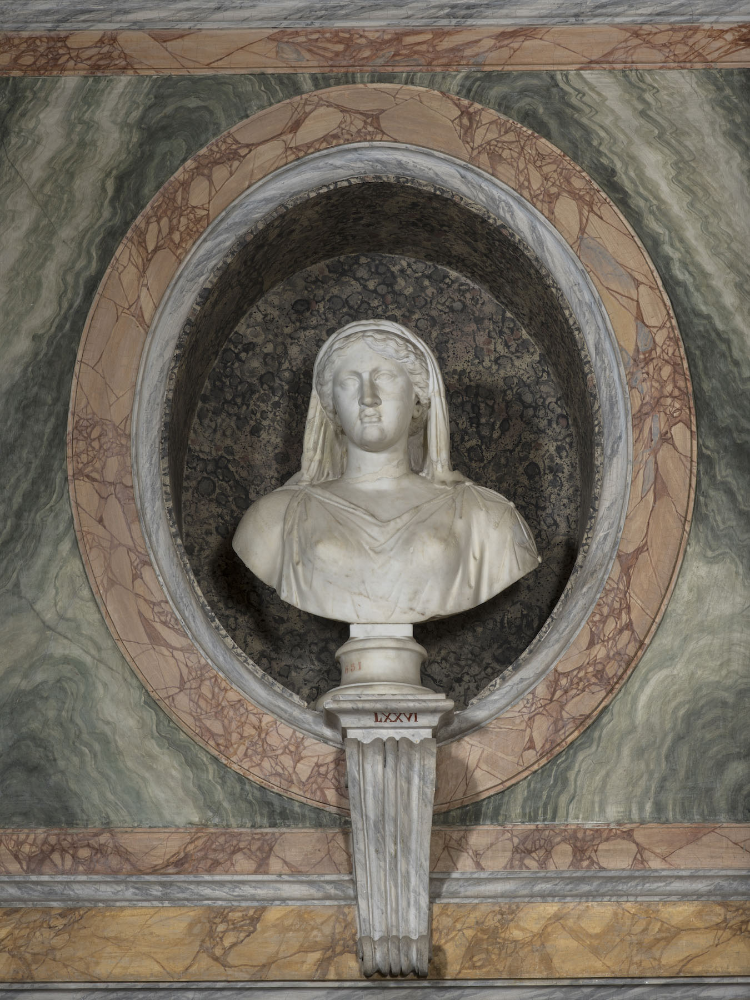

**内容（这是什么）**：一颗女子肖像头，配后配胸像，头覆面纱、略偏右；中分波浪发、杏眼、小而丰满的抿唇。

**背景 / 来历**：约公元 137–139 年。相貌对应哈德良之妻萨比娜（Vibia Sabina）的官方图式，正流行于她被神化的那几年。1820 年由费利切·费斯塔（Felice Festa）修复，1828 年起与另六件胸像同列本厅一处壁龛。

**看点**：顺路看。它属本厅壁龛那组古代肖像。看覆纱与中分波浪发——这是萨比娜被神化后官方像的标志，靠它把这颗无铭文的女像对上「哈德良皇后」。可与同龛的另几件（LXXVId 等）串看，比对女性发式的年代差。

### ⭐ 顺路看 古罗马艺术《带弗拉维娅·多米蒂拉式发型的女子肖像》 / Roman art, _Portrait of a Woman with a Flavia Domitilla-type hairstyle_

- **作者 / Artist**：古罗马艺术 / Roman art
- **作品 / Work**：《带弗拉维娅·多米蒂拉式发型的女子肖像》 / _Portrait of a Woman with a Flavia Domitilla-type hairstyle_
- **时间**：公元 1 世纪末至 2 世纪初
- **材质**：白大理石
- **尺寸**：连胸像高 47 cm；头高 21 cm
- **位置**：保利娜厅（第 1 室）
- **官网介绍页**：[官网介绍英文](https://www.collezionegalleriaborghese.it/en/opere/portrait-o-fa-woman-with-a-flavia-domitilla-type-hairstyle)｜馆藏编号 LXXVId

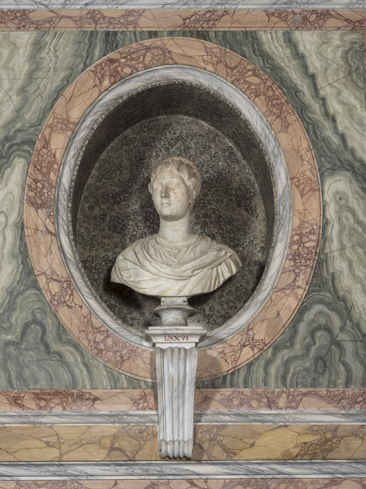

**内容（这是什么）**：一颗女子肖像头，配后配胸像。额前中分三道波浪发、脑后与头顶绕一条辫子，杏眼、小抿唇。

**背景 / 来历**：公元 1 世纪末至 2 世纪初。发式呼应弗拉维王朝女性（尤其韦帕芗之妻弗拉维娅·多米提拉，Flavia Domitilla）的官方图式，只是更简化、不那么蓬高，故断在弗拉维末到图拉真初。1820 年费斯塔（Festa）修复，1828 年起同列本厅壁龛。

**看点**：顺路看。属本厅壁龛肖像系列。看额前「三道波浪＋脑后绕辫」——这是弗拉维女性发式的简化版，可与同龛的萨比娜型女像（LXXVIc）对比，看罗马女性发式如何随时代由繁趋简、再变。

### ⭐ 顺路看 古罗马艺术《男孩肖像，置于非古代胸像上》 / Roman art, _Portrait of a Boy, on a non-ancient bust_

- **作者 / Artist**：古罗马艺术 / Roman art
- **作品 / Work**：《男孩肖像，置于非古代胸像上》 / _Portrait of a Boy, on a non-ancient bust_
- **时间**：约公元 160 年
- **材质**：卢尼大理石
- **尺寸**：连胸像高 43 cm；头高 25 cm
- **位置**：保利娜厅（第 1 室）
- **官网介绍页**：[官网介绍英文](https://www.collezionegalleriaborghese.it/en/opere/portrait-of-a-boy-on-a-non-ancient-bust-2)｜馆藏编号 LXXVIe

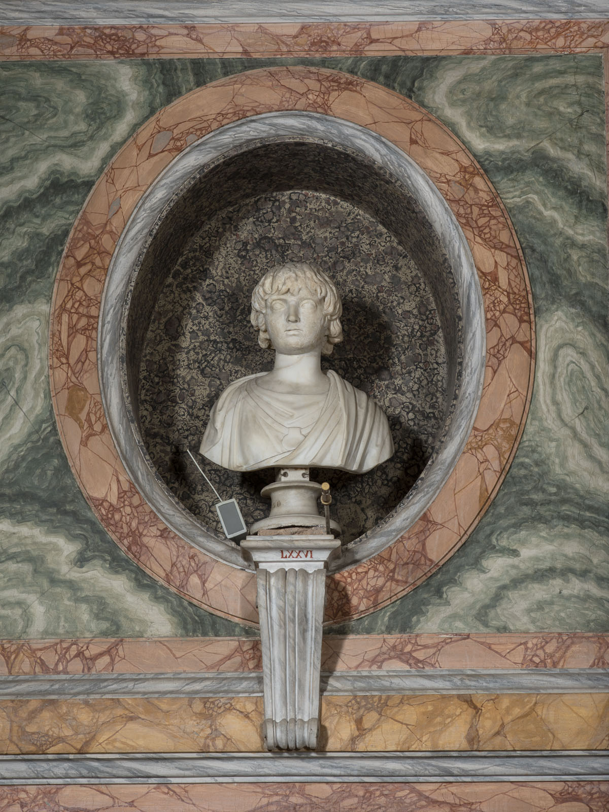

**内容（这是什么）**：一颗男孩肖像头，配后配胸像，表面磨损严重。深陷外突的大眼、小薄唇、圆胖脸颊，前额被一圈从头顶辐射开、厚而蓬乱的鬈发盖住。

**背景 / 来历**：约公元 160 年（安东尼时期早段）。蓬密鬈发的体积感与明暗处理，把它定在哈德良到塞维鲁早期那种风潮里，可比对卡比托利欧博物馆与柏林的同期男孩像；可能有丧葬用途。

**看点**：顺路看。属本厅壁龛那组肖像，也是其中编年序列的一员。看那头「辐射状蓬鬈发」用跑钻打出的明暗——正是安东尼早期肖像的时代特征。和同龛另几件男孩/成年/女性肖像串看，能感受 1 至 3 世纪肖像风格的推移。
