第 2 室（大卫厅）得名于贝尼尼的《大卫》——他把英雄拧身投石的最紧张一瞬定格成石头；天顶画《法厄同的故事》以「坠落」与张力呼应，另有卡拉瓦乔派的巴蒂斯泰洛《大卫与歌利亚》。

**必看与核心展品（⭐⭐⭐ 必看 + 核心）**

| 推荐 | 展品 | 作者 | 一句话看点 |
|---|---|---|---|
| ⭐⭐⭐ 必看 | 《大卫》 | 吉安·洛伦佐·贝尼尼 | 拧身掷石的巴洛克瞬间，要绕到「投石方向」看 |
| ⭐⭐⭐ 必看 | 天顶《法厄同的故事》（组画） | 卡恰尼加 & 阿格里科拉 | 驾日车坠落的少年，与「大卫」同讲张力与坠落 |
| ⭐⭐⭐ 必看 | 《大卫与歌利亚的头》 | 巴蒂斯泰洛·卡拉乔洛 | 卡拉瓦乔派的强烈明暗，与雕塑《大卫》对照看 |

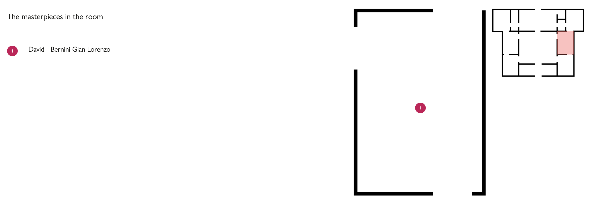

**展厅官网介绍页**：[Room 2 - David Room](https://galleriaborghese.cultura.gov.it/en/il-museo/la-villa/sala-2-sala-del-sole/)

## 核心展品

### ⭐⭐⭐ 必看 吉安·洛伦佐·贝尼尼《大卫》 / Gian Lorenzo Bernini, _David_

- **作者 / Artist**：吉安·洛伦佐·贝尼尼 / Gian Lorenzo Bernini（1598–1680）
- **作品 / Work**：《大卫》 / _David_
- **时间**：1623–1624 年
- **材质**：卡拉拉大理石
- **位置**：大卫厅（第 2 室）
- **官网介绍页**：[大卫 / David｜Galleria Borghese 官方藏品库](https://www.collezionegalleriaborghese.it/opere/david)｜馆藏编号 LXXVII

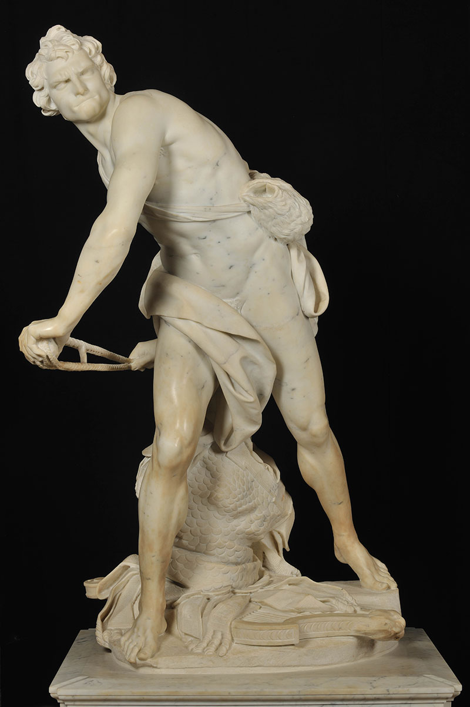

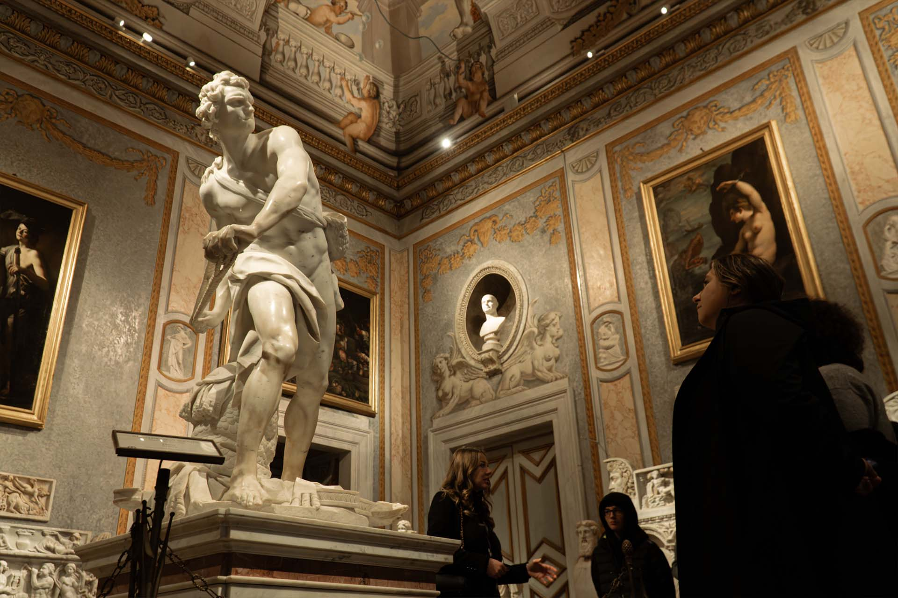

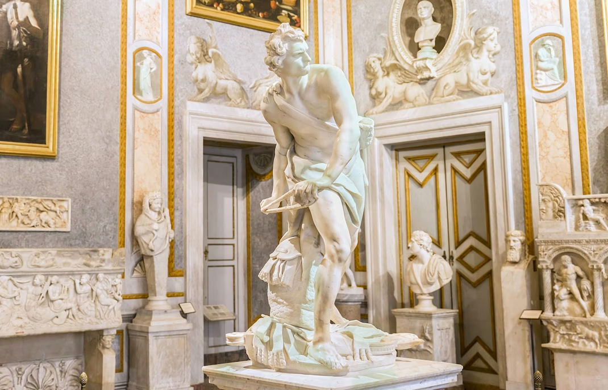

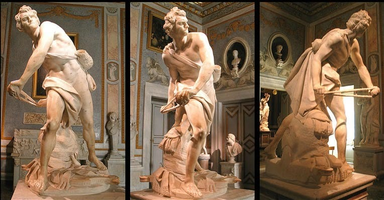

**这是什么**：Sala II 的绝对主角，也是巴洛克雕塑的开山之作之一。贝尼尼（Gian Lorenzo Bernini）二十五岁、受红衣主教希皮奥内·博尔盖塞（Scipione Borghese）委托，约八个月（1623–1624）一气呵成。他不取大卫战胜巨人歌利亚（Goliath）之后的胜利姿态，而是抓住投石索甩出前的**临界一瞬**：身体拧成弓、嘴唇紧抿、眉头锁紧、双眼死盯前方目标。

**自画像与轶事**：据传记作者巴尔迪努奇（Baldinucci）与贝尼尼之子记载，大卫这张紧绷的脸用的是**贝尼尼本人的相貌**——年轻的他对镜自塑，而替他举镜子的，正是他的保护人、未来的教皇乌尔班八世马费奥·巴尔贝里尼（Maffeo Barberini）。雕像还没完工，巴尔贝里尼就当选了教皇。

**技法与巴洛克突破**：和米开朗琪罗那尊沉静站立的《大卫》正相反，贝尼尼让动作"溢出"雕像本体、射向你所站的真实空间——这正是巴洛克雕塑的核心革命：把观者卷进事件。看绷紧的肌肉、抓地的脚趾、投石索的张力，全身像一根将放未放的弹簧。

**文艺复兴 + 巴洛克 4 大《大卫》对比**
这是西方艺术史一道经典题：4 大艺术家都做过大卫，每个版本反映各自时代的精神：

| 版本                   | 艺术家                         | 年代        | 风格      | 时刻                       |
| -------------------- | --------------------------- | --------- | ------- | ------------------------ |
| **Donatello《青铜大卫》**  | 多纳泰罗                        | 约 1440    | 文艺复兴早期  | 杀死后**踩着歌利亚头**休憩          |
| **Verrocchio《大卫》**   | Andrea del Verrocchio  韦罗基奥 | 约 1473–75 | 文艺复兴中期  | 杀死后**站着握剑**自得            |
| **Michelangelo《大卫》** | 米开朗琪罗                       | 1501–04   | 文艺复兴盛期  | **战前**——肌肉紧张准备投石         |
| **Bernini《大卫》**      | 贝尼尼                         | 1623–24   | **巴洛克** | **战中**——正在**用尽全力投石**的那一瞬 |

**多纳泰罗青铜大卫** 

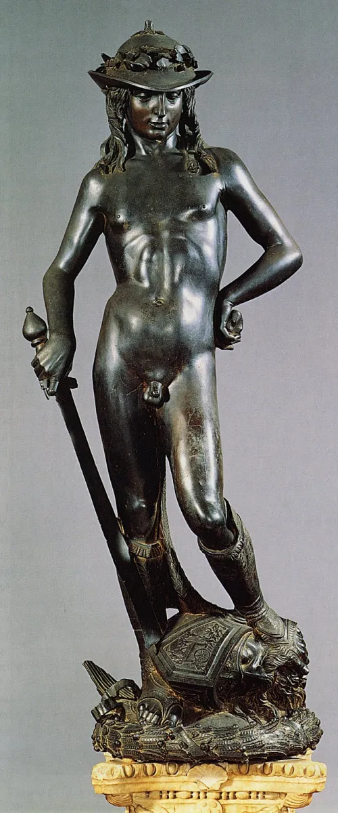

**Andrea del Verrocchio  韦罗基奥 大卫**

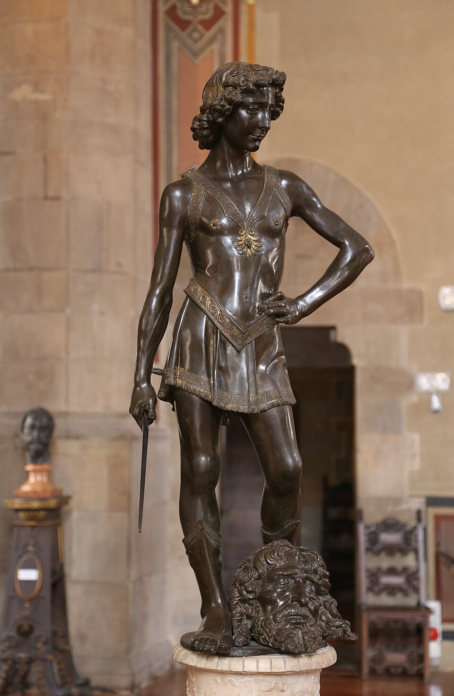

**米开朗基罗 大卫**
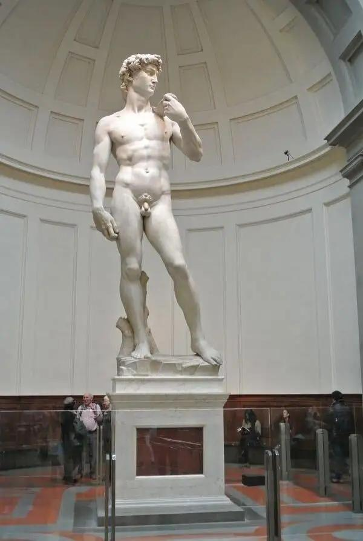

**贝尼尼 大卫
**

Bernini 的"动作中间瞬间"才是革命——他不画动作之前（米开朗琪罗）或之后（Donatello/Verrocchio），他画动作发生的那 0.5 秒。这是巴洛克雕塑相对文艺复兴雕塑的根本区别。

**赞助与家族印记**：脚边丢着扫罗（Saul）借给他的铠甲，旁边那把基塔拉琴（cithara）**末端雕成一只鹰**——鹰是博尔盖塞家族的纹章，等于把这件英雄雕像盖上主人家的章。

**现场站看**：

1. **站到他正前方**——顺着他瞄准的视线方向站，你就成了他要击杀的歌利亚；这是体会"动作射向观者"巴洛克设计的最佳位置。
2. **看那张脸**——紧咬的下唇、紧锁的眉、专注的眼，是贝尼尼的自画像；全部情绪压在出手前那一刻。
3. **绕到侧面看身体的拧转**——上身向右后扭、下身向左，全身蓄力成弓形（figura serpentinata），"力量将发未发"全在这股螺旋里。
4. **找脚边的竖琴与鹰头**——基塔拉琴末端的鹰是博尔盖塞家族纹章，旁边是扫罗的铠甲，是赞助人留下的签名。
5. **看背部**——背面较少精修，印证它原本靠墙、面向特定角度陈列，并非为 360° 自由环绕而设计。

## 天顶画

### ⭐⭐⭐ 必看 弗朗切斯科·卡恰尼加与焦阿基诺·阿格里科拉《法厄同的故事》（天顶组画总览） / Francesco Caccianiga & Gioacchino Agricola, _Story of Phaeton_

- **组画 / Cycle**：《法厄同的故事》 / _Story of Phaeton_
- **中央画作者 / Central painting**：弗朗切斯科·卡恰尼加（1700–1781） / Francesco Caccianiga
- **四周圆章作者 / Medallions**：焦阿基诺·阿格里科拉（活跃于 1758–1795） / Gioacchino Agricola
- **错视框架作者 / Quadratura**：乔瓦尼·巴蒂斯塔·马尔凯蒂（1730–1800） / Giovanni Battista Marchetti
- **时间**：1775–1777 年
- **位置**：大卫厅天顶

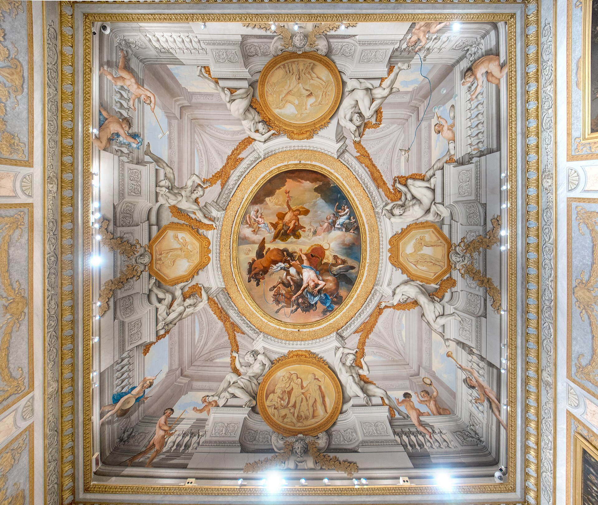

**这是什么**：整面天顶是一组「法厄同（Phaeton）的故事」组画，取自奥维德《变形记》。结构「一主四辅」：正中央一大幅《法厄同坠落》，四壁半高处嵌四枚圆章（medaglioni）演故事后续，画间是描金错视建筑框架。也正因为中央这幅「太阳车坠落」，本厅又名「太阳厅」（Sala del Sole）。法厄同是太阳神之子，他怀疑自己的神裔身份，求父亲允他驾一天太阳车以证明；却驾驭不住烈马，太阳车忽高忽低、烧焦大地，朱庇特（Jupiter）只得用雷霆把他击落，坠入埃里达诺斯河。

**背景 / 来历**：这是 1770 年代末博尔盖塞别墅整体翻新的一环——与保利娜厅天顶同属一轮装饰，由亲王马尔坎托尼奥四世·博尔盖塞委托、建筑师阿斯普鲁奇（Antonio Asprucci）统筹，1775–1777 年绘成。中央大画出自米兰画家弗朗切斯科·卡恰尼加（Francesco Caccianiga，1700–1781），四枚圆章及天顶的小天使、裸像由焦阿基诺·阿格里科拉（Gioacchino Agricola）画，那套以假乱真的描金建筑框架则出自专画透视的马尔凯蒂（Giovanni Battista Marchetti，1730–1800）——抬头看到的「立体边框、檐口」多是平面画出的幻觉。

**与地面《大卫》的呼应**：天顶与脚下贝尼尼《大卫》对话得很巧——两者都抓「年轻英雄进入危险临界点」的一瞬：法厄同是逞强失控、被雷击坠落的反面，大卫是沉着精准、一击制胜的正面；一上一下、一败一成，恰好互为镜像。这种「天顶神话呼应地面主角」的布展用意，正是本厅最值得抬头体会的设计。

**现场站看（整片天顶怎么读）**：

1. **先定位中央《法厄同坠落》**——天顶正中那团翻车坠落、雷霆四射的剧烈运动，是故事起点也是全画的戏眼。
2. **再绕看四枚圆章**——四壁半高处的圆章演「坠落的后果」：阿波罗重启天路（秩序恢复）、赫利阿得斯姐妹哀悼化作白杨（眼泪成琥珀）、黑暗笼罩大地（灾难）、黄昏星持炬指地（昼夜重整）。按「灾难→哀悼→恢复」的意思扫一圈即可。
3. **盯描金框架找「画出来的立体」**——边框、檐口的「浮雕」多是马尔凯蒂的错视，站厅中央抬头最强。
4. **天顶／地面一起读**——抬头看法厄同逞强坠落，低头看贝尼尼大卫沉着出手，体会布展有意让「失控的少年」与「制胜的少年」上下成对。

### ⭐⭐⭐ 必看 弗朗切斯科·卡恰尼加《法厄同坠落》 / Francesco Caccianiga, _The Fall of Phaeton_

- **作者 / Artist**：弗朗切斯科·卡恰尼加 / Francesco Caccianiga
- **作品 / Work**：《法厄同坠落》 / _The Fall of Phaeton_
- **时间**：1775–1777 年
- **位置**：天顶中央

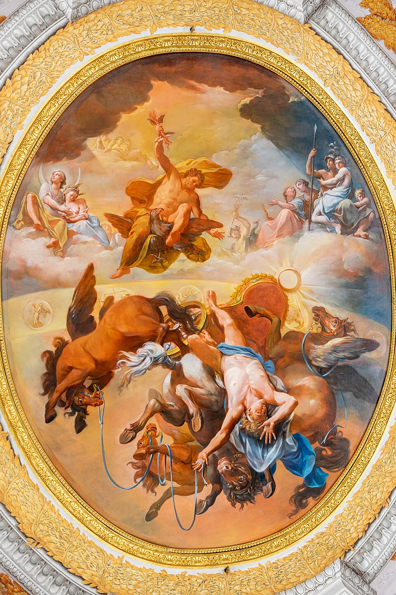

**这是什么**：天顶最大、最戏剧的一幕，也是本厅得名「太阳厅」的由来。少年法厄同（Phaeton）驾不住太阳车的烈马，车驾忽高忽低、险些烧尽天地；为救世界，朱庇特（Jupiter）掷下雷霆把他击落。卡恰尼加把翻车、坠落、雷击、惊马压进同一个剧烈旋转的画面——人、马、车一齐向下翻坠。

**背景 / 来历**：1775–1777 年米兰画家卡恰尼加（Francesco Caccianiga，1700–1781）所绘，属阿斯普鲁奇主持的本厅装饰程序（整组背景见上「天顶组画总览」）。题材取自奥维德《变形记》第二卷。

**看点**：这是一幅典型的「仰视坠落」天顶画——画家用人、马、车向下翻滚的对角动势，制造「从天顶砸下来」的临场感。它和脚下贝尼尼《大卫》正好是一对：法厄同因逞强失控而坠落，大卫因沉着精准而制胜。

**现场站看**：

1. **找翻坠的太阳车与法厄同**——天顶正中那团向下翻滚的人、马、车，就是被雷击落的法厄同；认出它，整片天顶的故事就有了起点。
2. **看「旋转坠落」的动势**——不必纠结每个配角是谁，重点感受人马车一齐下坠的螺旋构图，这是天顶画制造「画面砸向观者」的核心手法。
3. **找上方掷雷的朱庇特**——画面高处掷下雷霆的就是朱庇特，是「天罚」的来源；一道雷把「逞强」与「坠落」连成因果。
4. **抬头低头对照《大卫》**——记住这幅「失控坠落」，再低头看贝尼尼「制胜出手」，体会上下成对、一败一成的英雄临界点。

### ⭐ 顺路看 焦阿基诺·阿格里科拉《阿波罗重启天路》 / Gioacchino Agricola, _Apollo Resumes His Course_

- **作者 / Artist**：焦阿基诺·阿格里科拉 / Gioacchino Agricola
- **作品 / Work**：《阿波罗重启天路》 / _Apollo Resumes His Course_
- **时间**：1775–1777 年
- **位置**：天顶四周圆章之一

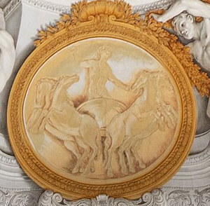

**这是什么**：法厄同闯祸坠落后，真正的太阳神阿波罗（Apollo）重新登车、让太阳恢复正常运行。它是四枚圆章里「秩序恢复」的一幕。

**背景 / 看点**：1775–1777 年阿格里科拉（Gioacchino Agricola）绘，天顶四圆章之一（整组背景见「天顶组画总览」）。顺路看——认出重新驾车的太阳神，它代表灾难之后「天道复常」，与中央那幅失控坠落正相反。

### ⭐⭐ 推荐 焦阿基诺·阿格里科拉《赫利阿得斯哀悼法厄同之死》 / Gioacchino Agricola, _The Heliades Lament Phaeton's Fall_

- **作者 / Artist**：焦阿基诺·阿格里科拉 / Gioacchino Agricola
- **作品 / Work**：《赫利阿得斯哀悼法厄同之死》 / _The Heliades Lament Phaeton's Fall_
- **时间**：1775–1777 年
- **位置**：天顶四周圆章之一

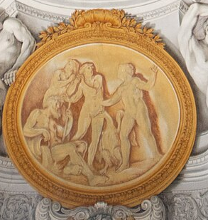

**这是什么**：赫利阿得斯（Heliades）是法厄同的姐妹。她们在埃里达诺斯河畔为弟弟之死悲恸不已，终被化作河岸的白杨树，流下的眼泪凝成琥珀——这是奥维德《变形记》里最有名的「化形」之一。

**背景 / 来历**：1775–1777 年阿格里科拉（Gioacchino Agricola）绘，天顶四圆章之一（整组背景见「天顶组画总览」）。

**看点**：四枚圆章里最动人的一幕。**现场站看**：找正在哀悼、身体开始「长成树」的姐妹们——半人半树的化形瞬间是辨认这一幕的钥匙；再记住「眼泪化琥珀」这个细节，它是法厄同悲剧的余韵。

### ⭐ 顺路看 焦阿基诺·阿格里科拉《黑暗笼罩大地》 / Gioacchino Agricola, _Darkness Covers the Earth_

- **作者 / Artist**：焦阿基诺·阿格里科拉 / Gioacchino Agricola
- **作品 / Work**：《黑暗笼罩大地》 / _Darkness Covers the Earth_
- **时间**：1775–1777 年
- **位置**：天顶四周圆章之一

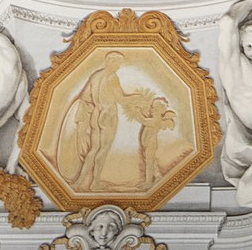

**这是什么**：太阳车失控、又骤然停摆，宇宙昼夜秩序被打乱，大地陷入黑暗。这一枚圆章表现法厄同事件带来的世界性灾难。

**背景 / 看点**：1775–1777 年阿格里科拉（Gioacchino Agricola）绘，天顶四圆章之一（整组背景见「天顶组画总览」）。顺路看——它是「秩序被毁」的一幕，与「阿波罗重启天路」的复常正好首尾呼应。

### ⭐ 顺路看 焦阿基诺·阿格里科拉《黄昏星持炬指向大地》 / Gioacchino Agricola, _The Vesper Holds the Torches towards the Earth_

- **作者 / Artist**：焦阿基诺·阿格里科拉 / Gioacchino Agricola
- **作品 / Work**：《黄昏星持炬指向大地》 / _The Vesper Holds the Torches towards the Earth_
- **时间**：1775–1777 年
- **位置**：天顶四周圆章之一
- 
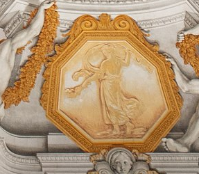

**这是什么**：黄昏星（Vesper，即暮时金星的拟人）手持火炬指向大地，点出昼夜更替、太阳运行的天文主题，为整组「太阳」母题收尾。

**背景 / 看点**：1775–1777 年阿格里科拉（Gioacchino Agricola）绘，天顶四圆章之一（整组背景见「天顶组画总览」）。顺路看——认出持炬的星辰拟人，它把法厄同故事收束回「太阳与昼夜的循环」，也正是「太阳厅」（Sala del Sole）之名的由来。

## 绘画

本节按馆方 Painting 藏品列表补充，共 6 件。核心展品如已在上文展开，这里仍保留官方清单条目，方便核对。

### ⭐⭐⭐ 必看 乔瓦尼·巴蒂斯塔·卡拉乔洛，称巴蒂斯泰洛《大卫与歌利亚的头》 / Caracciolo Giovanni Battista called Battistello, _David with the Head of Goliath_

- **作者 / Artist**：乔瓦尼·巴蒂斯塔·卡拉乔洛，称巴蒂斯泰洛 / Caracciolo Giovanni Battista called Battistello
- **作品 / Work**：《大卫与歌利亚的头》 / _David with the Head of Goliath_
- **时间**：1612 年前
- **材质**：布面油画
- **尺寸**：202 × 112 cm
- **馆藏编号**：002
- **位置**：大卫厅（第 2 室）
- **官网介绍页**：[官网介绍英文](https://www.collezionegalleriaborghese.it/en/opere/david-with-the-head-of-goliath-2)｜馆藏编号 002

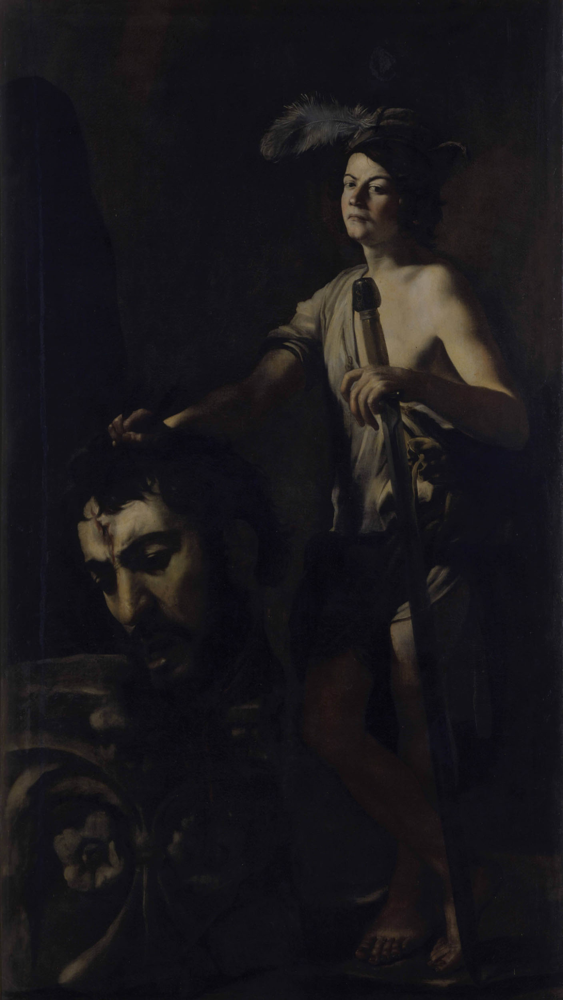

**内容（这是什么）**：那不勒斯卡拉瓦乔派（Caravaggisti）画家巴蒂斯泰洛·卡拉乔洛（Battistello Caracciolo）笔下的大卫——少年大卫独自立于画面中央，提着刚砍下的巨人歌利亚（Goliath）血淋淋的头颅，那颗头搁在一方刻着花饰的大理石座上。他姿态松弛、神情近乎抽离，仿佛对自己刚完成的血腥之举漠然置之。与厅中央贝尼尼《大卫》同题异媒，构成「投石前 vs 斩首后」的呼应。

**背景 / 来历**：它本是为红衣主教希皮奥内·博尔盖塞（Scipione Borghese）所作。长期作者不明，直到博尔盖塞档案里翻出一张画框付款收据——上书「大卫，巴蒂斯泰洛所绘」、落款 1612 年——才坐实作者与年代（这一年因此成为成画的下限）。卡拉乔洛此时已见过卡拉瓦乔（Caravaggio）那幅现藏卢浮宫的《大卫》，构图也受圭多·雷尼（Guido Reni）同题启发。

**技法看点**：这是一件能直接看懂「卡拉瓦乔式画法」的范本。画家先在画布上铺一层深暗底色（既省事，又一次解决背景与暗部），再用亮色「提」出人物——于是大卫与歌利亚的头被一束近乎刺眼的光从黑暗里拽到眼前，其余沉入暗部。与厅中央贝尼尼那尊雕塑《大卫》并看尤其有意思：一个用油彩的明暗、一个用大理石的拧转，是巴洛克绘画与雕塑「抓住一瞬」的两种办法；而且正好一件是「斩首之后的抽离」、一件是「投石之前的紧绷」，情绪一冷一热。

**现场站看**：

1. **看光怎么「提」人物**——光几乎只打亮大卫的脸、肩与歌利亚的头，其余没入黑暗。这就是卡拉瓦乔式「暗底＋亮色提形」的省力画法，整幅的戏剧性全靠这束光。
2. **读大卫的表情**——他神情松弛、近乎冷漠，对脚下刚砍下的头颅既不得意也不惊惧；这种「事后的抽离感」是本画最耐看处，与贝尼尼大卫「出手前的全力紧绷」恰成两极。
3. **找歌利亚头下的大理石座**——那颗头搁在一方刻花饰的石座上，是画家有意安排的静物式细节，把血腥之物「陈列」得格外冷静。
4. **和中央贝尼尼《大卫》对照**——退一步把油画与雕塑一起看：同一个大卫，绘画取「斩首之后」、雕塑取「投石之前」，正好把这间「大卫厅」的主题用两个时刻、两种媒介讲全。

### ⭐ 顺路看 鲁蒂利奥·马内蒂《珀耳修斯解救安德洛墨达》 / Manetti Rutilio, _Andromeda Freed by Perseus_

- **作者 / Artist**：鲁蒂利奥·马内蒂 / Manetti Rutilio
- **作品 / Work**：《珀耳修斯解救安德洛墨达》 / _Andromeda Freed by Perseus_
- **时间**：约 1611–1612 年
- **材质**：布面油画
- **尺寸**：177 × 120 cm
- **馆藏编号**：004
- **位置**：大卫厅（第 2 室）
- **官网介绍页**：[官网介绍英文](https://www.collezionegalleriaborghese.it/en/opere/andromeda-freed-by-perseus)｜馆藏编号 004

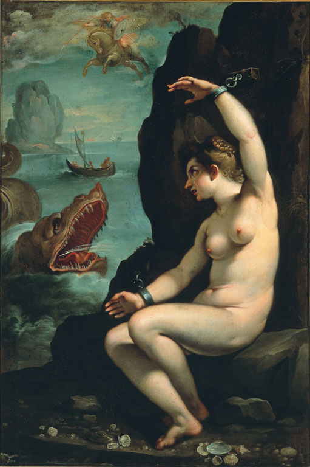

**内容（这是什么）**：锡耶纳画家鲁蒂利奥·马内蒂（Rutilio Manetti）画珀耳修斯（Perseus）骑飞马、从海怪口中救下被锁在礁石上的安德洛墨达（Andromeda）。

**看点**：约 1611–1612 年，同属卡拉瓦乔式明暗风。顺路看，留意裸身的安德洛墨达与空中珀耳修斯拉出的对角线构图。

### ⭐ 顺路看 安尼巴莱·卡拉奇《被锁链束缚的参孙》 / Carracci Annibale, _Samson in Chains_

- **作者 / Artist**：安尼巴莱·卡拉奇 / Carracci Annibale
- **作品 / Work**：《被锁链束缚的参孙》 / _Samson in Chains_
- **材质**：布面油画
- **尺寸**：180 × 130 cm
- **馆藏编号**：023
- **位置**：大卫厅（第 2 室）
- **官网介绍页**：[官网介绍英文](https://www.collezionegalleriaborghese.it/en/opere/samson-in-chains)｜馆藏编号 023

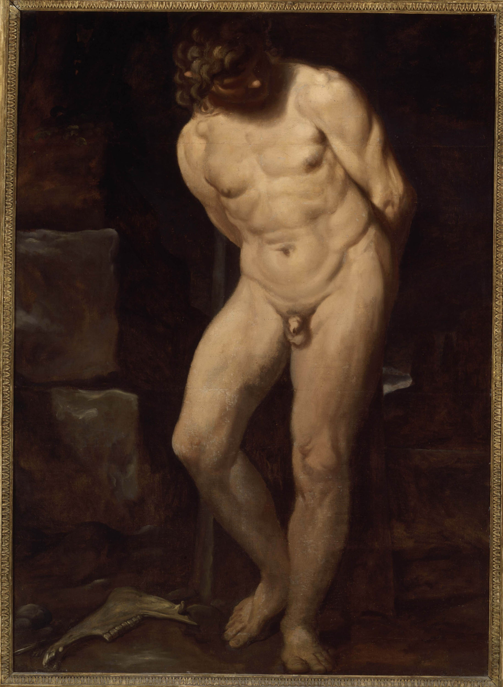

**内容（这是什么）**：博洛尼亚大师安尼巴莱·卡拉奇（Annibale Carracci）一脉所作《被锁链束缚的参孙》——《士师记》里被非利士人擒住、剃发失力的参孙（Samson）。

**看点**：顺路看。看健硕身躯与「神力已失」处境的反差——肌肉仍在、力量已无。

### ⭐ 顺路看 哈特福德大师《花、果实与蔬菜瓶》 / Master of Hartford, _Vase of Flowers, Fruit, and Vegetables_

- **作者 / Artist**：哈特福德大师 / Master of Hartford
- **作品 / Work**：《花、果实与蔬菜瓶》 / _Vase of Flowers, Fruit, and Vegetables_
- **时间**：1607 年前
- **材质**：布面油画
- **尺寸**：105 × 184 cm
- **馆藏编号**：054
- **位置**：大卫厅（第 2 室）
- **官网介绍页**：[官网介绍英文](https://www.collezionegalleriaborghese.it/en/opere/vase-of-flowers-fruit-and-vegetables)｜馆藏编号 054

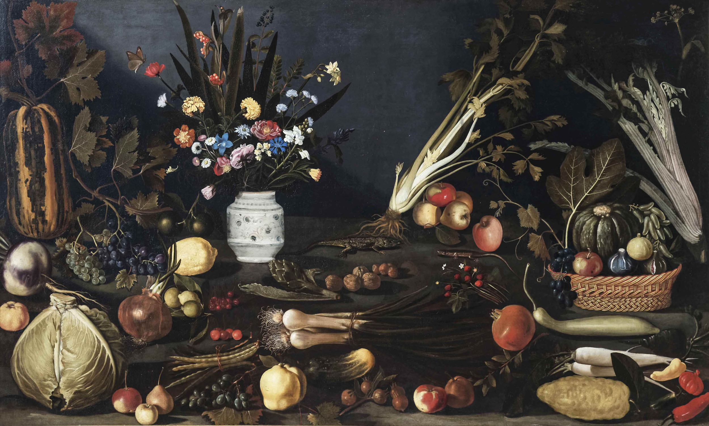

**内容（这是什么）**：以美国哈特福德一幅藏品得名的「哈特福德大师」（Master of Hartford）所作静物，被认为出自卡拉瓦乔早年圈子，是意大利独立静物画的开山之作之一。

**看点**：顺路看，但地位重要。1607 年前作品，看花果蔬菜的写实质感与光影——这是西方独立静物画刚诞生时的样子。与隔壁《鸟类静物》成对。

### ⭐ 顺路看 哈特福德大师《鸟类静物》 / Master of Hartford, _Still life with birds_

- **作者 / Artist**：哈特福德大师 / Master of Hartford
- **作品 / Work**：《鸟类静物》 / _Still life with birds_
- **时间**：1607 年前
- **材质**：布面油画
- **尺寸**：104 × 173 cm
- **馆藏编号**：301
- **位置**：大卫厅（第 2 室）
- **官网介绍页**：[官网介绍英文](https://www.collezionegalleriaborghese.it/en/opere/still-life-with-birds)｜馆藏编号 301

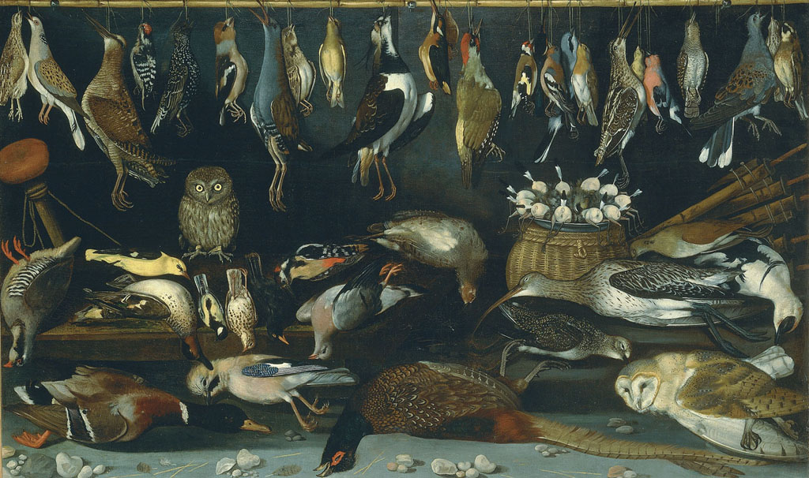

**内容 / 看点**：同一位「哈特福德大师」（Master of Hartford）的另一幅静物，画各色禽鸟。与《花、果实与蔬菜瓶》成对，同为意大利早期静物名作；顺路看，留意不同羽毛的质感刻画。

### ⭐ 顺路看 归属朱塞佩·切萨里，称骑士达尔皮诺《亚历山大大帝》 / Attributed to Cesari Giuseppe called Cavalier d'Arpino, _Alexander the Great_

- **作者 / Artist**：归属朱塞佩·切萨里，称骑士达尔皮诺 / Attributed to Cesari Giuseppe called Cavalier d'Arpino
- **作品 / Work**：《亚历山大大帝》 / _Alexander the Great_
- **时间**：17 世纪上半叶
- **材质**：布面油画
- **尺寸**：125 × 95 cm
- **馆藏编号**：469
- **位置**：大卫厅（第 2 室）
- **官网介绍页**：[官网介绍英文](https://www.collezionegalleriaborghese.it/en/opere/alexander-the-great)｜馆藏编号 469

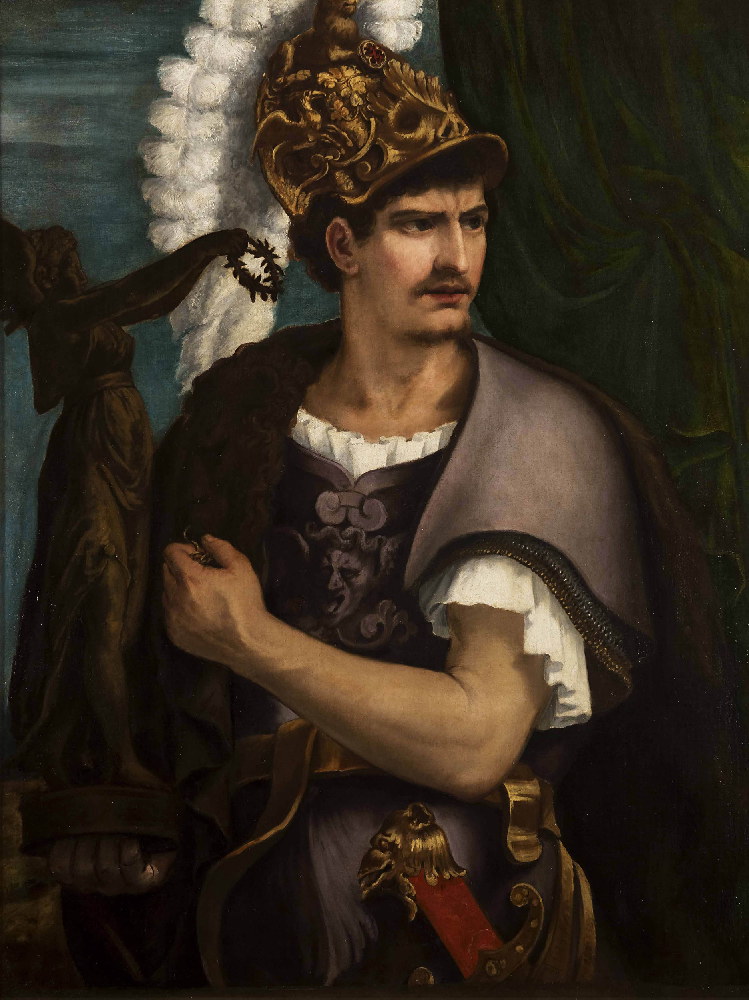

**内容 / 看点**：归在骑士达尔皮诺（Cavalier d'Arpino，本名朱塞佩·切萨里 Giuseppe Cesari）名下的《亚历山大大帝》（Alexander the Great），17 世纪上半叶作品。顺路看——达尔皮诺曾是卡拉瓦乔（Caravaggio）早年短暂的雇主，自己的画风却偏晚期风格主义的优雅。可与厅内那件古罗马《亚历山大肖像》(VIIC) 对看。
## 雕塑

本节先列馆方 Modern Sculpture 藏品列表，共 3 件。

### ⭐ 顺路看 安东尼奥·古列尔莫·格朗雅凯《绿色花岗岩瓶》 / Grandjacquet Antonio Guglielmo, _Green granite vase_

- **作者 / Artist**：安东尼奥·古列尔莫·格朗雅凯 / Grandjacquet Antonio Guglielmo
- **作品 / Work**：《绿色花岗岩瓶》 / _Green granite vase_
- **时间**：1783–1787 年
- **材质**：博尔盖塞细绿花岗岩
- **尺寸**：高 82 cm，直径 43 cm
- **馆藏编号**：CXXXII
- **位置**：大卫厅（第 2 室）
- **官网介绍页**：[官网介绍英文](https://www.collezionegalleriaborghese.it/en/opere/green-granite-vase)｜馆藏编号 CXXXII

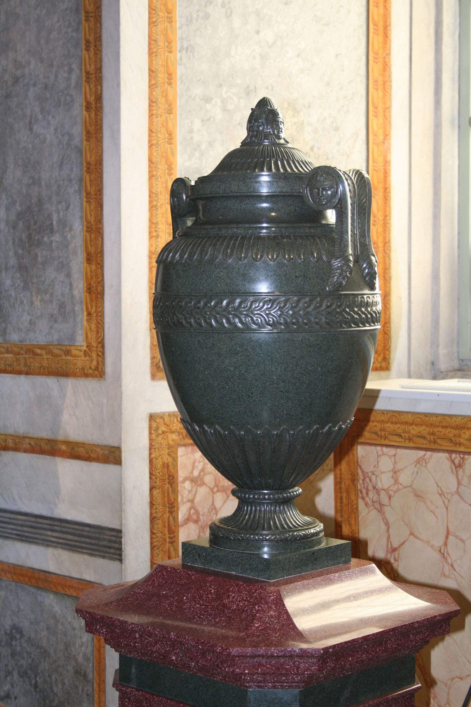

**内容 / 看点**：1783–1787 年由格朗雅凯（Grandjacquet）用「博尔盖塞细绿花岗岩」（granito verde minuto borghesiano）车制的大瓶，是 18 世纪末别墅重装时的硬石工艺品。看点全在石材：这种深绿花岗岩是家族领地特产，瓶身打磨出近镜面的光泽，材质本身即奢华。

### ⭐ 顺路看 罗马学派《塞普蒂米乌斯·塞维鲁肖像》 / roman school, _Portrait of Septimius Severus_

- **作者 / Artist**：罗马学派 / roman school
- **作品 / Work**：《塞普蒂米乌斯·塞维鲁肖像》 / _Portrait of Septimius Severus_
- **时间**：17 世纪初
- **材质**：大理石
- **尺寸**：高 38 cm
- **馆藏编号**：LX
- **位置**：大卫厅（第 2 室）
- **官网介绍页**：[官网介绍英文](https://www.collezionegalleriaborghese.it/en/opere/portrait-of-septimius-severus)｜馆藏编号 LX

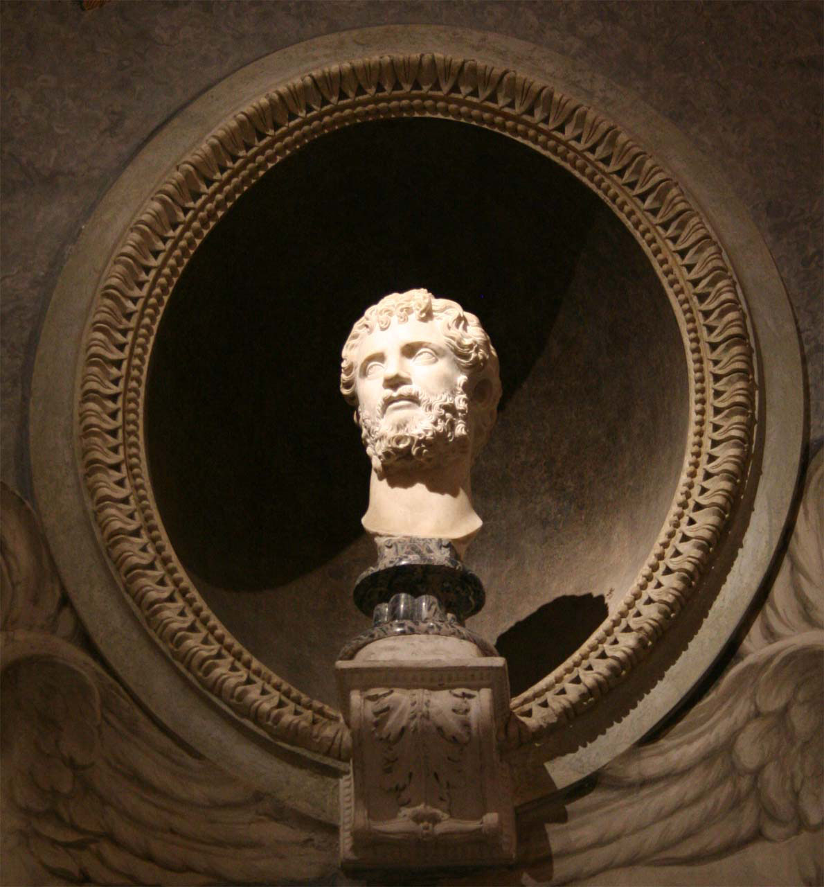

**内容 / 看点**：17 世纪初罗马派的塞普蒂米乌斯·塞维鲁（Septimius Severus，193–211 在位）半身像——非古代原作，是近代依古钱与古像想象的皇帝肖像。看他标志性的四绺额前卷发与分叉长须（刻意模仿东方神塞拉皮斯），这是塞维鲁官方像的认人记号。

### ⭐ 顺路看 古罗马艺术《卡比托利欧型阿佛洛狄忒雕像》 / Roman art, _Capitoline-Type Statue of Aphrodite_

- **作者 / Artist**：古罗马艺术 / Roman art
- **作品 / Work**：《卡比托利欧型阿佛洛狄忒雕像》 / _Capitoline-Type Statue of Aphrodite_
- **时间**：公元 2 世纪上半叶
- **材质**：卢尼大理石
- **尺寸**：不含底座高 183 cm（头部 27 cm）
- **位置**：大卫厅（第 2 室）
- **官网介绍页**：[官网介绍英文](https://www.collezionegalleriaborghese.it/en/opere/capitoline-type-statue-of-aphrodite)｜馆藏编号 C

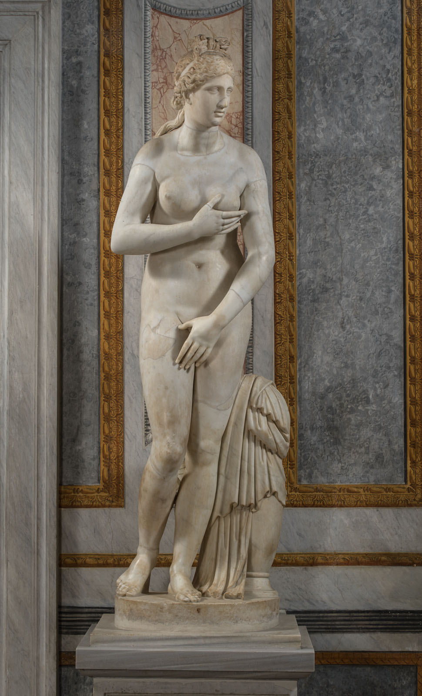

**内容（这是什么）**：著名的「卡比托利欧型」维纳斯（Aphrodite）——出浴的女神以双手半遮胸与下体（pudica 含羞姿），原型可上溯希腊化时代、与普拉克西特列斯《克尼多斯的阿佛洛狄忒》一脉。

**看点**：公元 2 世纪上半叶罗马复制品（Luni 大理石，近真人大小）。这是古代流传最广的维纳斯范式之一，看「含羞遮掩」反而强调了裸露的经典姿态。

### ⭐ 顺路看 古罗马艺术《安蒂斯蒂娅·特里费娜葬祭祭坛》 / Roman art, _Furerary Altar of Antistia Trifena_

- **作者 / Artist**：古罗马艺术 / Roman art
- **作品 / Work**：《安蒂斯蒂娅·特里费娜葬祭祭坛》 / _Furerary Altar of Antistia Trifena_
- **时间**：公元 1–2 世纪
- **材质**：卢尼大理石
- **尺寸**：高 56 cm；宽 66 cm；深 57 cm；字高 2.8 cm
- **位置**：大卫厅（第 2 室）
- **官网介绍页**：[官网介绍英文](https://www.collezionegalleriaborghese.it/en/opere/funerary-altar-of-antistia-trifena)｜馆藏编号 Ca

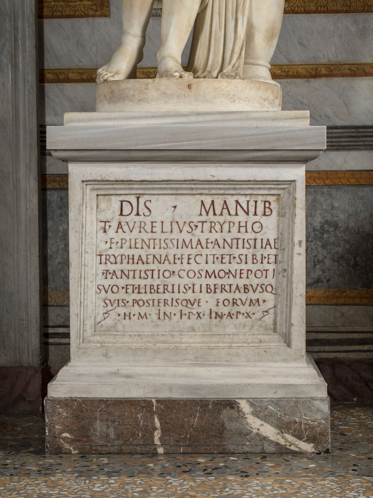

**内容 / 看点**：公元 1–2 世纪的墓祭坛，正面铭文献给一位名叫安蒂斯蒂娅·特里费娜（Antistia Trifena）的女性。顺路看，找正面题名铭文与丰饶花环/祭具，是罗马火葬时代的私人纪念物。可与 CIIa、LXXXIIIa 两座祭坛同看。

### ⭐ 顺路看 古罗马艺术《狄俄尼索斯雕像，躯干修复为弹基塔拉的阿波罗，配非原配头像》 / Roman art, _Statue of Dionysus, Torso Restored as Apollo Citharoedus, with Non-Original Head_

- **作者 / Artist**：古罗马艺术 / Roman art
- **作品 / Work**：《狄俄尼索斯雕像，躯干修复为弹基塔拉的阿波罗，配非原配头像》 / _Statue of Dionysus, Torso Restored as Apollo Citharoedus, with Non-Original Head_
- **时间**：公元 2 世纪
- **材质**：卢尼大理石
- **尺寸**：不含底座高 173 cm（头部 27 cm）
- **位置**：大卫厅（第 2 室）
- **官网介绍页**：[官网介绍英文](https://www.collezionegalleriaborghese.it/en/opere/statue-of-dionysus-torso-restored-as-apollo-citharoedus-with-non-original-head)｜馆藏编号 CII

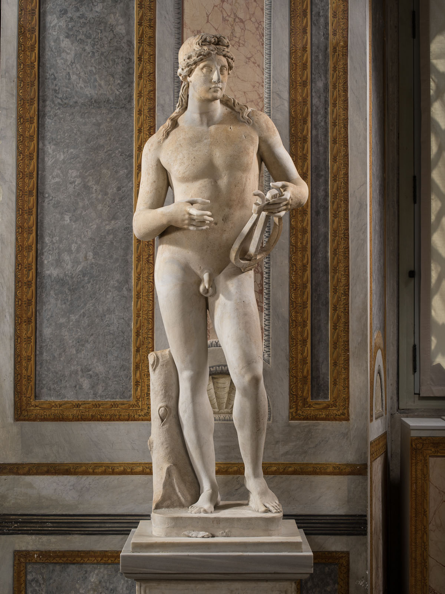

**内容 / 看点**：典型的「古件＋改身份」——一具公元 2 世纪的狄俄尼索斯（Dionysus）躯干，被后世修复成「弹基塔拉琴的阿波罗」（Apollo Citharoedus），还配了一颗非原配的头。看它直筒长袍的「琴师阿波罗」造型，再想它本是酒神，是本厅又一例后世改换身份。

### ⭐ 顺路看 古罗马艺术《马库斯·乌尔皮乌斯·赫利亚德斯葬祭祭坛》 / Roman art, _Funerary Altar of Marcus Ulpius Heliades_

- **作者 / Artist**：古罗马艺术 / Roman art
- **作品 / Work**：《马库斯·乌尔皮乌斯·赫利亚德斯葬祭祭坛》 / _Funerary Altar of Marcus Ulpius Heliades_
- **时间**：公元 2 世纪中叶
- **材质**：卢尼大理石
- **尺寸**：高 55 cm；宽 56 cm；厚 4 cm；字高 3 cm
- **位置**：大卫厅（第 2 室）
- **官网介绍页**：[官网介绍英文](https://www.collezionegalleriaborghese.it/en/opere/funerary-altar-of-marcus-ulpius-heliades)｜馆藏编号 CIIa

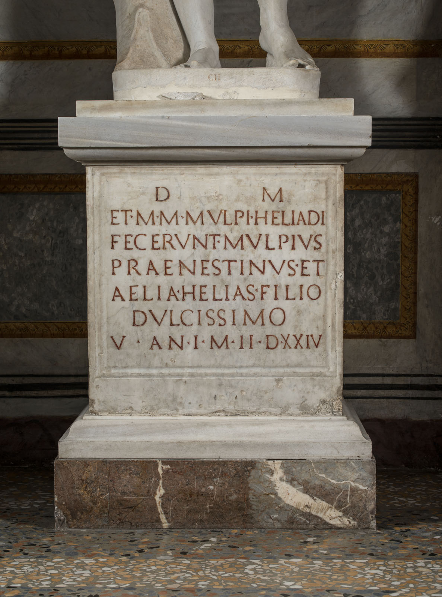

**内容 / 看点**：公元 2 世纪中叶的墓祭坛，铭文献给马库斯·乌尔皮乌斯·赫利亚德斯（Marcus Ulpius Heliades）——「乌尔皮乌斯」是图拉真家族释奴常用的氏名。顺路看，重点读铭文辨身份。

### ⭐ 顺路看 古罗马艺术《幼年赫拉克勒斯雕像》 / Roman art, _Statue of Heracles as a Boy_

- **作者 / Artist**：古罗马艺术 / Roman art
- **作品 / Work**：《幼年赫拉克勒斯雕像》 / _Statue of Heracles as a Boy_
- **时间**：公元 2 世纪
- **材质**：帕罗斯大理石
- **尺寸**：高 99 cm
- **位置**：大卫厅（第 2 室）
- **官网介绍页**：[官网介绍英文](https://www.collezionegalleriaborghese.it/en/opere/statue-of-heracles-as-a-boy)｜馆藏编号 CIII

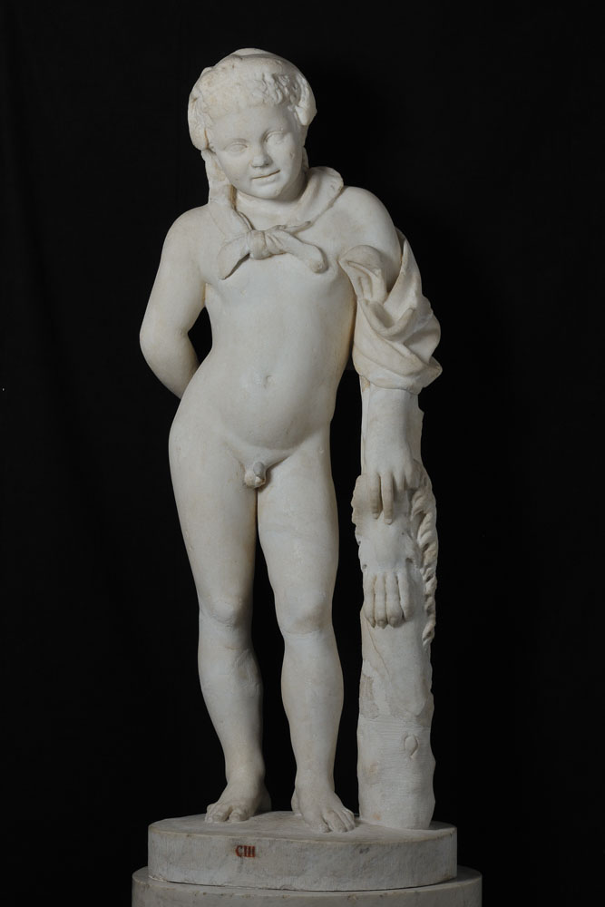

**内容 / 看点**：公元 2 世纪的「幼年赫拉克勒斯」（Heracles as a Boy）像（Parian 大理石），把婴孩塑成小力神。罗马贵族常把男童塑成幼年赫拉克勒斯以求强健吉兆。顺路看，与本厅另几尊「儿童扮神」像（LXXXIV、VIIIC）串看。

### ⭐ 顺路看 古罗马艺术《女子肖像，置于现代胸像上》 / Roman art, _Portrait of a Woman on a Modern Bust_

- **作者 / Artist**：古罗马艺术 / Roman art
- **作品 / Work**：《女子肖像，置于现代胸像上》 / _Portrait of a Woman on a Modern Bust_
- **时间**：约公元 120 年
- **材质**：卢尼大理石
- **尺寸**：头高 32 cm
- **位置**：大卫厅（第 2 室）
- **官网介绍页**：[官网介绍英文](https://www.collezionegalleriaborghese.it/en/opere/portrait-of-a-woman-on-a-modern-bust-2)｜馆藏编号 CIV

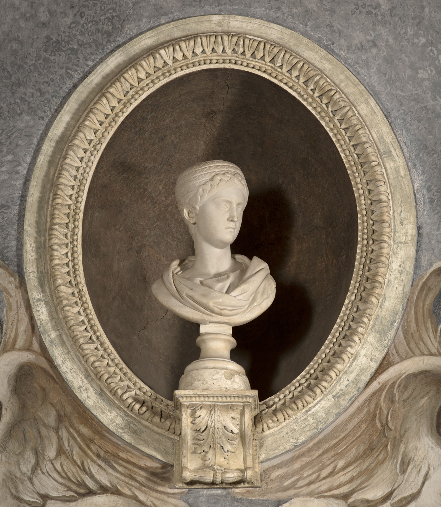

**内容 / 看点**：约公元 120 年的女子肖像头，配后配胸像。看发式——图拉真-哈德良时期贵妇高卷的「冠状」发型可帮断代。属本厅多件「古代头＋后配胸像」之一。

### ⭐ 顺路看 古罗马艺术《阿波罗巨型头像，置于现代胸像上》 / Roman art, _Colossal Head of Apollo on a Modern Bust_

- **作者 / Artist**：古罗马艺术 / Roman art
- **作品 / Work**：《阿波罗巨型头像，置于现代胸像上》 / _Colossal Head of Apollo on a Modern Bust_
- **时间**：公元 150–160 年
- **材质**：细颗粒白大理石
- **尺寸**：连胸像高 100 cm（头部 40 cm）
- **位置**：大卫厅（第 2 室）
- **官网介绍页**：[官网介绍英文](https://www.collezionegalleriaborghese.it/en/opere/colossal-head-of-apollo-on-a-modern-bust)｜馆藏编号 CXX

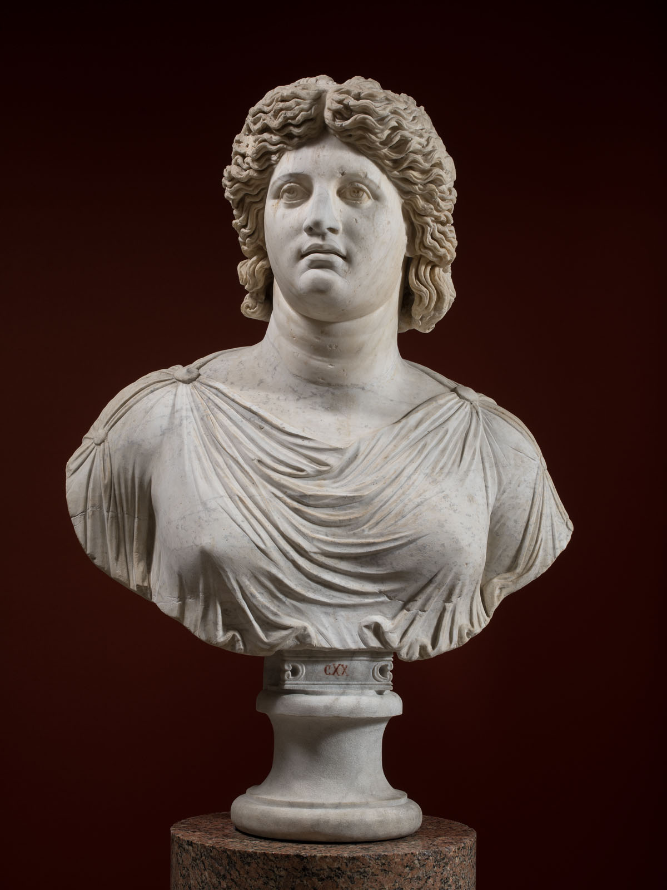

**内容 / 看点**：公元 150–160 年的阿波罗（Apollo）巨型头（头高 40 cm，约真人两倍），配近代胸像，来自真人数倍的崇拜像残件。看理想化的青春脸与中分长卷发，是古典阿波罗的标准范式。

### ⭐ 顺路看 古罗马艺术《男孩雕像，躯干修复为萨堤尔》 / Roman art, _Statue of a Boy, Torso restored as a Satyr_

- **作者 / Artist**：古罗马艺术 / Roman art
- **作品 / Work**：《男孩雕像，躯干修复为萨堤尔》 / _Statue of a Boy, Torso restored as a Satyr_
- **时间**：公元 1 世纪
- **材质**：卢尼大理石
- **尺寸**：高 106 cm
- **位置**：大卫厅（第 2 室）
- **官网介绍页**：[官网介绍英文](https://www.collezionegalleriaborghese.it/en/opere/statue-of-a-boy-torso-restored-as-a-satyr)｜馆藏编号 IC

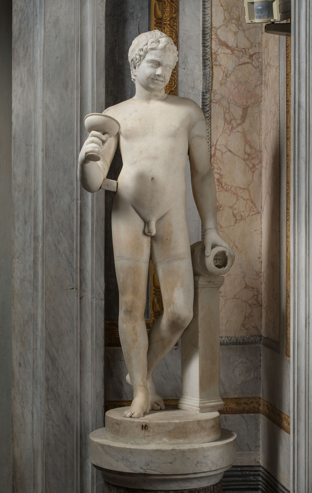

**内容 / 看点**：公元 1 世纪的男童躯干，被后世修复成小萨堤尔（Satyr，酒神随从）。又一「古件改身份」例——看后加的尖耳、尾等萨堤尔标记，如何把一尊普通男童像变进酒神世界。

### ⭐ 顺路看 希腊化艺术《有须赫尔墨柱像》 / Arte ellenistica, _Bearded Herm_

- **作者 / Artist**：希腊化艺术 / Arte ellenistica
- **作品 / Work**：《有须赫尔墨柱像》 / _Bearded Herm_
- **时间**：公元 1 世纪
- **材质**：彭忒利科大理石
- **尺寸**：连基座高 184 cm；不含基座高 151 cm
- **位置**：大卫厅（第 2 室）
- **官网介绍页**：[官网介绍英文](https://www.collezionegalleriaborghese.it/en/opere/bearded-herm)｜馆藏编号 IIC

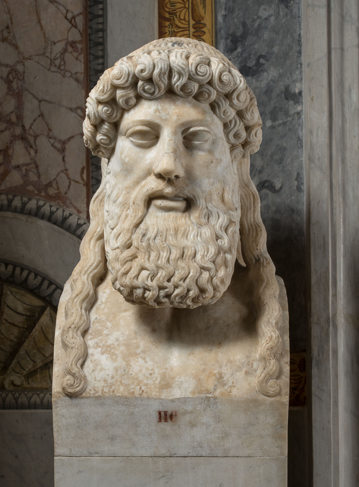

**内容（这是什么）**：赫尔墨柱（herm）——一根方柱顶着一颗头像、柱身常仅保留生殖器，源自希腊路边的赫尔墨斯界标，罗马人爱用它装点园林与廊道。

**看点**：公元 1 世纪、近 1.84 m 高的有须赫尔墨柱。本厅赫尔墨柱成排（潘、阿佛洛狄忒、赫拉克勒斯、无须男神等），可一路数过去，比较柱顶不同的神祇头像。

### ⭐ 顺路看 古罗马艺术《酒神主题浮雕》 / Roman art, _Dionysian Relief_

- **作者 / Artist**：古罗马艺术 / Roman art
- **作品 / Work**：《酒神主题浮雕》 / _Dionysian Relief_
- **时间**：公元前 1 世纪
- **材质**：彭忒利科大理石
- **尺寸**：高 58 cm；宽 138 cm（ancient parts）
- **位置**：大卫厅（第 2 室）
- **官网介绍页**：[官网介绍英文](https://www.collezionegalleriaborghese.it/en/opere/dionysian-relief-1)｜馆藏编号 IIIC

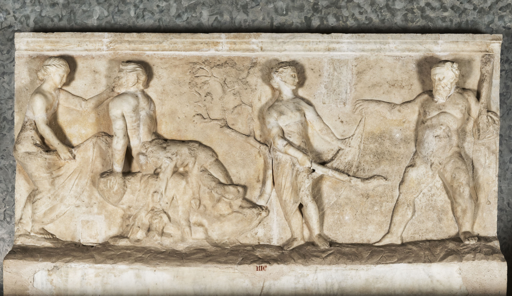

**内容 / 看点**：公元前 1 世纪的「新阿提卡」酒神浮雕，刻狄俄尼索斯（Dionysus）随从队伍（萨堤尔、女祭司持杖起舞），古代部分约 1.38 m 宽。顺路看，是罗马别墅常见的装饰浮雕，营造宴饮欢愉的气氛。

### ⭐ 顺路看 古罗马艺术《石棺盖，饰阿波罗与阿耳忒弥斯诞生及进入奥林匹斯场景，角饰为风神拟人像（非原配）》 / Roman art, _Sarcophagus lid with scenes of the birth of Apollo and Artemis and their entrance into Olympus, acroteria with personifications of the Winds (not original)_

- **作者 / Artist**：古罗马艺术 / Roman art
- **作品 / Work**：《石棺盖，饰阿波罗与阿耳忒弥斯诞生及进入奥林匹斯场景，角饰为风神拟人像（非原配）》 / _Sarcophagus lid with scenes of the birth of Apollo and Artemis and their entrance into Olympus, acroteria with personifications of the Winds (not original)_
- **时间**：约公元 150 年
- **材质**：卢尼大理石
- **尺寸**：高 34 cm，宽 194 cm
- **位置**：大卫厅（第 2 室）
- **官网介绍页**：[官网介绍英文](https://www.collezionegalleriaborghese.it/en/opere/sarcophagus-lid-with-scenes-of-the-birth-of-apollo-and-artemis-and-their-entrance-into-olympus)｜馆藏编号 IVC

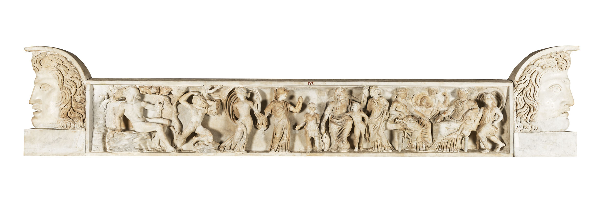

**内容 / 看点**：约公元 150 年的石棺盖，浮雕阿波罗（Apollo）与阿耳忒弥斯（Artemis）的诞生及升入奥林匹斯；两端角饰（非原配）是风神拟人头像。顺路看，留意盖面横向叙事带与后配的风神角饰。

### ⭐ 顺路看 古罗马艺术《阿波罗头像》 / Roman art, _Head of Apollo_

- **作者 / Artist**：古罗马艺术 / Roman art
- **作品 / Work**：《阿波罗头像》 / _Head of Apollo_
- **时间**：公元 2 世纪
- **材质**：白大理石
- **尺寸**：古代部分高 30 cm
- **位置**：大卫厅（第 2 室）
- **官网介绍页**：[官网介绍英文](https://www.collezionegalleriaborghese.it/en/opere/head-of-apollo)｜馆藏编号 LXIII

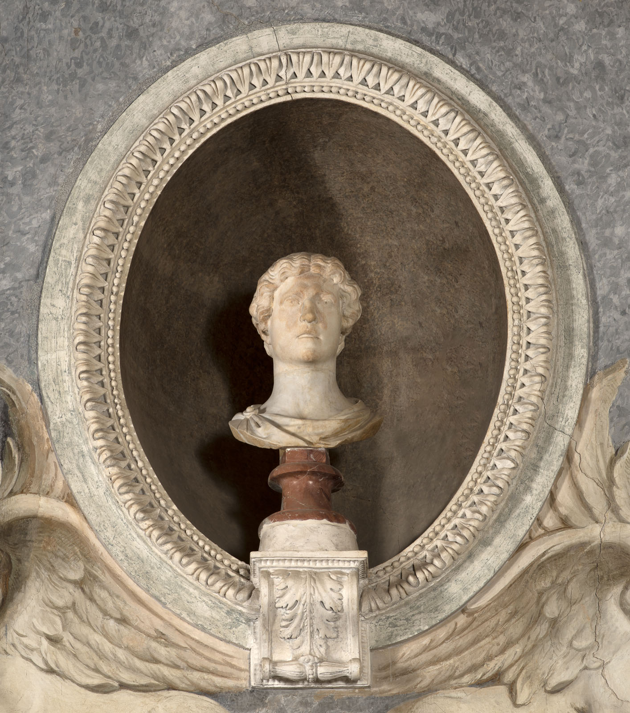

**内容 / 看点**：公元 2 世纪的阿波罗（Apollo）头（古代部分高 30 cm）。看典型的中分卷发与理想化青春脸；本厅阿波罗题材颇多（巨头 CXX、改身份的"琴师阿波罗" CII 等），可一并留意。

### ⭐ 顺路看 古罗马艺术《男子肖像，置于现代胸像上》 / Roman art, _Portrait of a Man on a Modern Bust_

- **作者 / Artist**：古罗马艺术 / Roman art
- **作品 / Work**：《男子肖像，置于现代胸像上》 / _Portrait of a Man on a Modern Bust_
- **时间**：公元 2 世纪
- **材质**：黑灰大理石（bigio morato）
- **尺寸**：连胸像高 73 cm；高 of the 头部 73 cm
- **位置**：大卫厅（第 2 室）
- **官网介绍页**：[官网介绍英文](https://www.collezionegalleriaborghese.it/en/opere/portrait-of-a-man-on-a-modern-bust-1)｜馆藏编号 LXVII

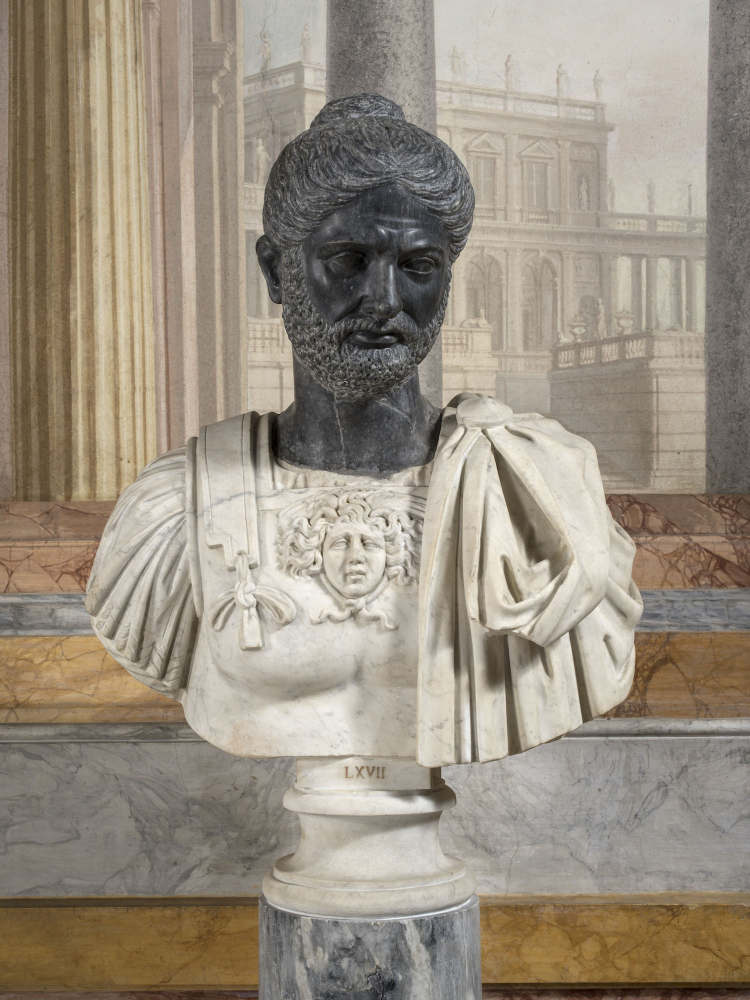

**内容 / 看点**：公元 2 世纪男子肖像，配黑灰大理石（bigio morato）后配胸像。看点之一是深色胸像与白色头部的彩色大理石搭配——17–18 世纪罗马收藏家偏爱的趣味。

### ⭐ 顺路看 古罗马艺术《柱式石棺，赫拉克勒斯功业，正面》 / Roman art, _Columnar Sarcophagus with the Labours of Hercules, front_

- **作者 / Artist**：古罗马艺术 / Roman art
- **作品 / Work**：《柱式石棺，赫拉克勒斯功业，正面》 / _Columnar Sarcophagus with the Labours of Hercules, front_
- **时间**：公元 160–170 年
- **材质**：亚洲大理石
- **尺寸**：高 100 cm，宽 240 cm；厚 29 cm
- **位置**：大卫厅（第 2 室）
- **官网介绍页**：[官网介绍英文](https://www.collezionegalleriaborghese.it/en/opere/columnar-sarcophagus-with-the-labours-of-hercules-front)｜馆藏编号 LXXIX

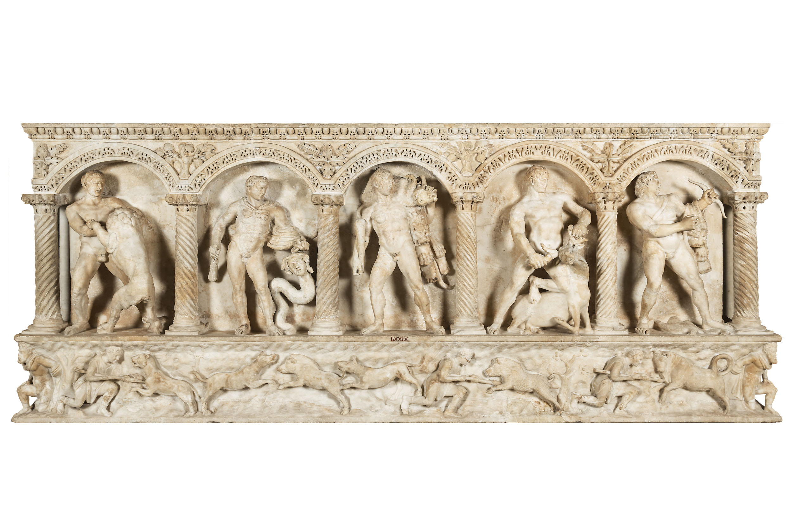

**内容（整组一次看）**：一具公元 160–170 年的「柱式石棺」（columnar sarcophagus，扭索柱分格）正面，各格安放赫拉克勒斯（Hercules）的「功业」场景。对面墙上还有同一具棺的背面（VC），两面合看才凑齐功业全套。

**背景 / 看点（整组通用）**：亚洲大理石、产自小亚细亚，因白石优质、工艺精湛而风行罗马。靠各格的怪物与道具认功业——狮、九头蛇、野猪、牝鹿……顺路看，先看正面再转身看对面 VC。

### ⭐ 顺路看 希腊化艺术《赫尔墨柱像：潘》 / Arte ellenistica, _Herm of Pan_

- **作者 / Artist**：希腊化艺术 / Arte ellenistica
- **作品 / Work**：《赫尔墨柱像：潘》 / _Herm of Pan_
- **时间**：公元 1 世纪初
- **材质**：细颗粒彭忒利科大理石
- **尺寸**：高 151 cm；头高 25 cm
- **位置**：大卫厅（第 2 室）
- **官网介绍页**：[官网介绍英文](https://www.collezionegalleriaborghese.it/en/opere/herm-of-pan)｜馆藏编号 LXXVIII

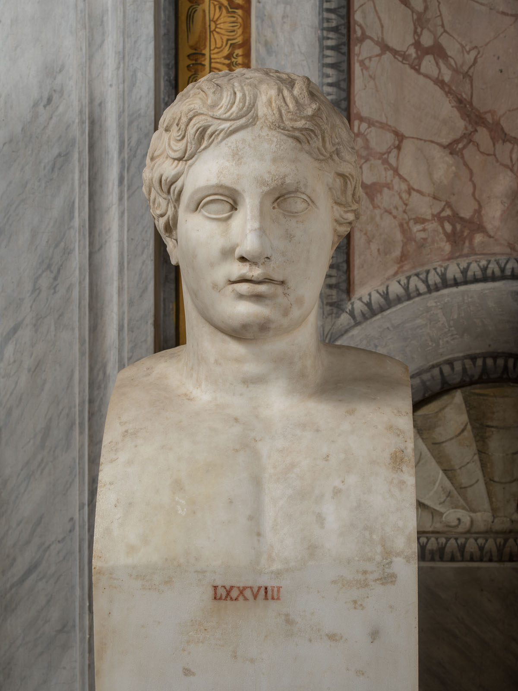

**内容 / 看点**：柱顶为羊角羊须的牧神潘（Pan）的赫尔墨柱（herm），公元 1 世纪初、细颗粒彭忒利科大理石。顺路看，找潘的山羊特征（角、尖耳、须）；与本厅其它赫尔墨柱并看。

### ⭐ 顺路看 古罗马艺术《石棺盖，饰特洛伊的亚马孙女战士与风神拟人角饰（非原配）》 / Roman art, _Sarcophagus Lid with Amazons in Troy and Acroteria with personifications of the Winds (not original)_

- **作者 / Artist**：古罗马艺术 / Roman art
- **作品 / Work**：《石棺盖，饰特洛伊的亚马孙女战士与风神拟人角饰（非原配）》 / _Sarcophagus Lid with Amazons in Troy and Acroteria with personifications of the Winds (not original)_
- **时间**：公元 2 世纪中叶
- **材质**：卢尼大理石（盖）；亚洲大理石（角饰）
- **尺寸**：高 19 cm；宽 201 cm
- **位置**：大卫厅（第 2 室）
- **官网介绍页**：[官网介绍英文](https://www.collezionegalleriaborghese.it/en/opere/sarcophagus-lid-with-amazons-in-troya-nd-acroteria-with-personifications-of-the-winds)｜馆藏编号 LXXX

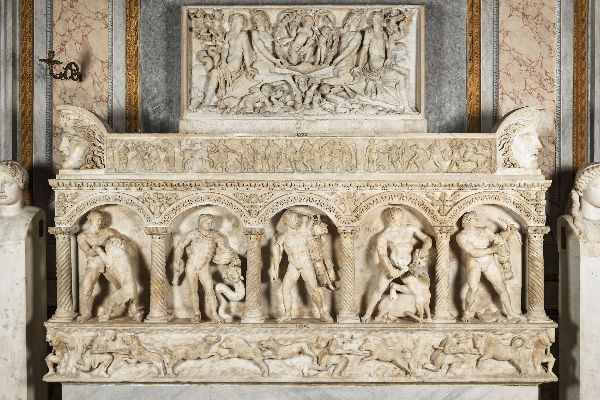

**内容 / 看点**：公元 2 世纪中叶的石棺盖，浮雕特洛伊（Troy）城下的亚马孙（Amazons）女战士，两端为后配的风神拟人角饰。顺路看，留意横向战斗叙事与后配角饰的拼合。

### ⭐ 顺路看 古罗马艺术《海洋酒神随从石棺》 / Roman art, _Sarcophagus with Marine Thiasus_

- **作者 / Artist**：古罗马艺术 / Roman art
- **作品 / Work**：《海洋酒神随从石棺》 / _Sarcophagus with Marine Thiasus_
- **时间**：公元 2–3 世纪
- **材质**：带淡蓝细纹的细颗粒白大理石
- **尺寸**：高 67 cm；长 140 cm
- **位置**：大卫厅（第 2 室）
- **官网介绍页**：[官网介绍英文](https://www.collezionegalleriaborghese.it/en/opere/sarcophagus-with-marine-thiasus)｜馆藏编号 LXXXI

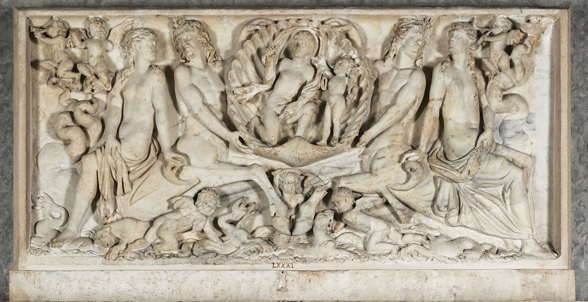

**内容 / 看点**：公元 2–3 世纪石棺，浮雕「海洋酒神队伍」（marine thiasus）——海中的涅瑞伊得斯、海怪、小爱神簇拥嬉戏，带细蓝纹的白大理石。顺路看，海洋题材在丧葬语境里寓意灵魂渡海赴福地。

### ⭐ 顺路看 古罗马艺术《无须男性神祇赫尔墨柱像》 / Roman art, _Herm of a Beardless Male Deity_

- **作者 / Artist**：古罗马艺术 / Roman art
- **作品 / Work**：《无须男性神祇赫尔墨柱像》 / _Herm of a Beardless Male Deity_
- **时间**：公元 1 世纪
- **材质**：白大理石
- **尺寸**：连柱通高 151 cm；头部 21 cm
- **位置**：大卫厅（第 2 室）
- **官网介绍页**：[官网介绍英文](https://www.collezionegalleriaborghese.it/en/opere/herm-of-a-beardless-male-deity)｜馆藏编号 LXXXII

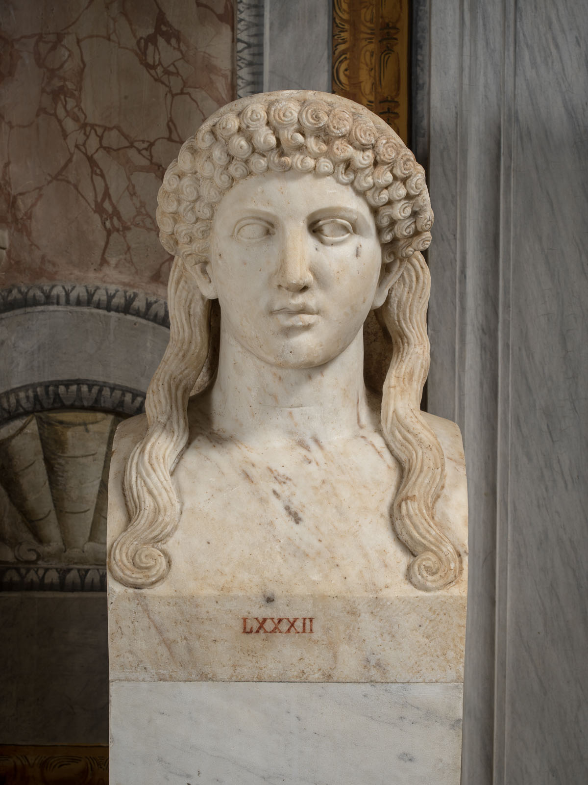

**内容 / 看点**：柱顶为一颗无须青年男神头的赫尔墨柱（herm），公元 1 世纪。顺路看，可与本厅的有须赫尔墨柱对照——有须/无须区分神祇的年龄与身份。

### ⭐ 顺路看 古罗马艺术《安蒂诺里-那不勒斯型赫拉克勒斯巨型头像》 / Roman art, _Colossal Head of Hercules of the Antinori-Naples Type_

- **作者 / Artist**：古罗马艺术 / Roman art
- **作品 / Work**：《安蒂诺里-那不勒斯型赫拉克勒斯巨型头像》 / _Colossal Head of Hercules of the Antinori-Naples Type_
- **时间**：公元 2 世纪
- **材质**：卢尼大理石
- **尺寸**：连近代胸像高 74 cm；古代部分高 42 cm，头部 0.41 cm，面部 9.29 cm
- **位置**：大卫厅（第 2 室）
- **官网介绍页**：[官网介绍英文](https://www.collezionegalleriaborghese.it/en/opere/colossal-head-of-hercules-of-the-antinori-naples-type)｜馆藏编号 LXXXIII-B

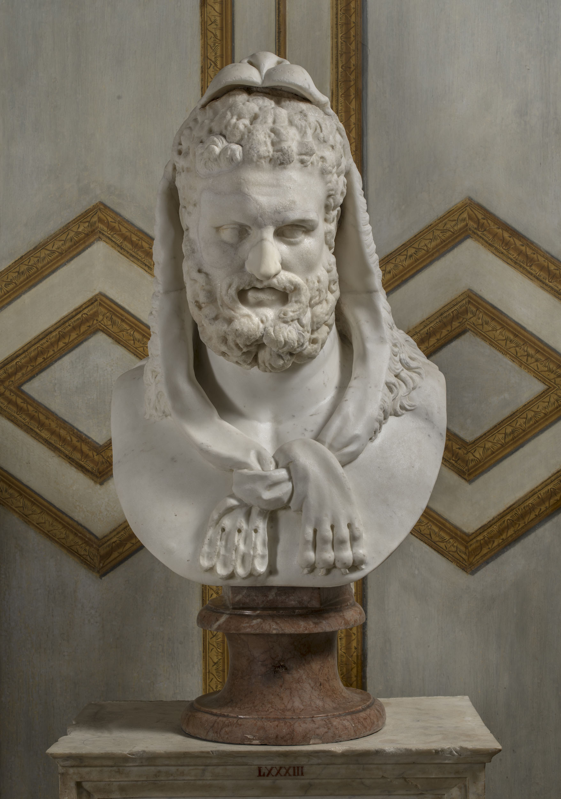

**内容 / 看点**：公元 2 世纪的赫拉克勒斯（Hercules）巨型头（「安蒂诺里-那不勒斯型」），配近代胸像，源自真人数倍的崇拜像。看浓密卷发、短须与粗犷五官，是力神的标准范式。本厅赫拉克勒斯题材成系列（功业石棺、赫尔墨柱、儿童像），可串看。

### ⭐ 顺路看 古罗马艺术《卢基乌斯·尤利乌斯·欧提基亚努斯葬祭祭坛》 / Roman art, _Funerary Altar of Lucius Julius Eutichianus_

- **作者 / Artist**：古罗马艺术 / Roman art
- **作品 / Work**：《卢基乌斯·尤利乌斯·欧提基亚努斯葬祭祭坛》 / _Funerary Altar of Lucius Julius Eutichianus_
- **时间**：公元 2 世纪
- **材质**：卢尼大理石
- **尺寸**：高 85 cm；宽 72 cm；深 43 cm；字高 4.5-5 cm
- **位置**：大卫厅（第 2 室）
- **官网介绍页**：[官网介绍英文](https://www.collezionegalleriaborghese.it/en/opere/funerary-altar-of-lucius-julius-eutichianus)｜馆藏编号 LXXXIIIa

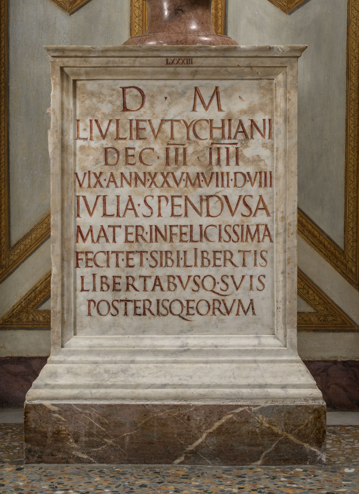

**内容 / 看点**：公元 2 世纪的墓祭坛，铭文献给卢基乌斯·尤利乌斯·欧提基亚努斯（Lucius Julius Eutichianus）。顺路看，读正面铭文，与本厅另两座祭坛（Ca、CIIa）同看罗马墓祭坛样式。

### ⭐ 顺路看 古罗马艺术《扮作战斗中赫拉克勒斯的儿童雕像》 / Roman art, _Statue of a Child as Hercules Fighting_

- **作者 / Artist**：古罗马艺术 / Roman art
- **作品 / Work**：《扮作战斗中赫拉克勒斯的儿童雕像》 / _Statue of a Child as Hercules Fighting_
- **时间**：公元 2 世纪中叶
- **材质**：卢尼大理石
- **尺寸**：高 107 cm
- **位置**：大卫厅（第 2 室）
- **官网介绍页**：[官网介绍英文](https://www.collezionegalleriaborghese.it/en/opere/statue-of-a-child-as-hercules-fighting)｜馆藏编号 LXXXIV

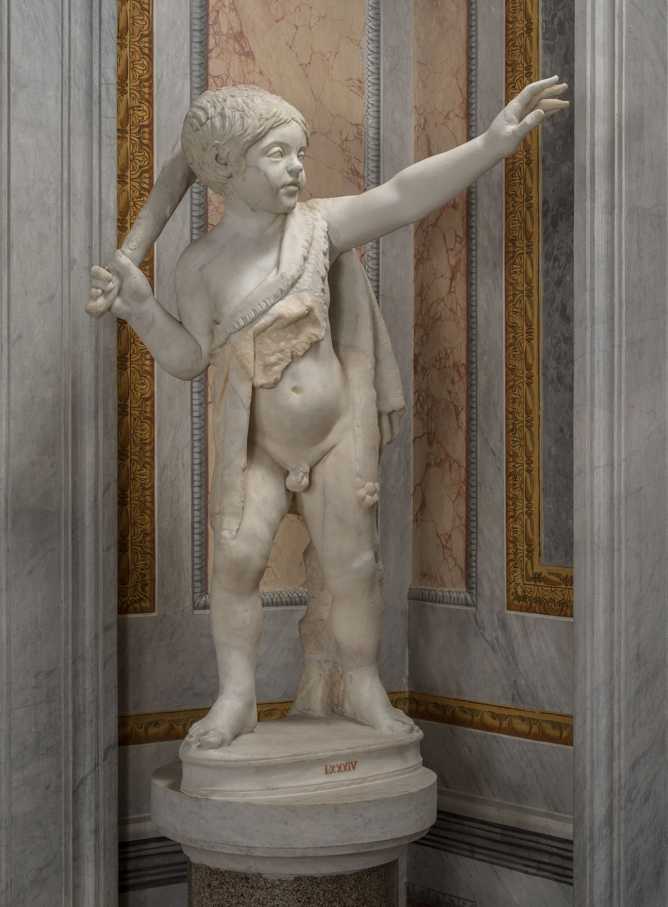

**内容 / 看点**：公元 2 世纪中叶，把一名男童塑成「搏斗中的小赫拉克勒斯」。顺路看，与 CIII（幼年赫拉克勒斯）、VIIIC（男童扮酒神）一起，构成本厅的「儿童扮神」小专题。

### ⭐ 顺路看 古罗马艺术《饰卡比托利欧三神的石棺盖》 / Roman art, _Sarcophagus Lid with the Capitoline Triad_

- **作者 / Artist**：古罗马艺术 / Roman art
- **作品 / Work**：《饰卡比托利欧三神的石棺盖》 / _Sarcophagus Lid with the Capitoline Triad_
- **时间**：公元 2 世纪末
- **材质**：卢尼大理石
- **尺寸**：高 37 cm；宽 137 cm
- **位置**：大卫厅（第 2 室）
- **官网介绍页**：[官网介绍英文](https://www.collezionegalleriaborghese.it/en/opere/sarcophagus-lid-with-the-capitoline-triad)｜馆藏编号 LXXXIX

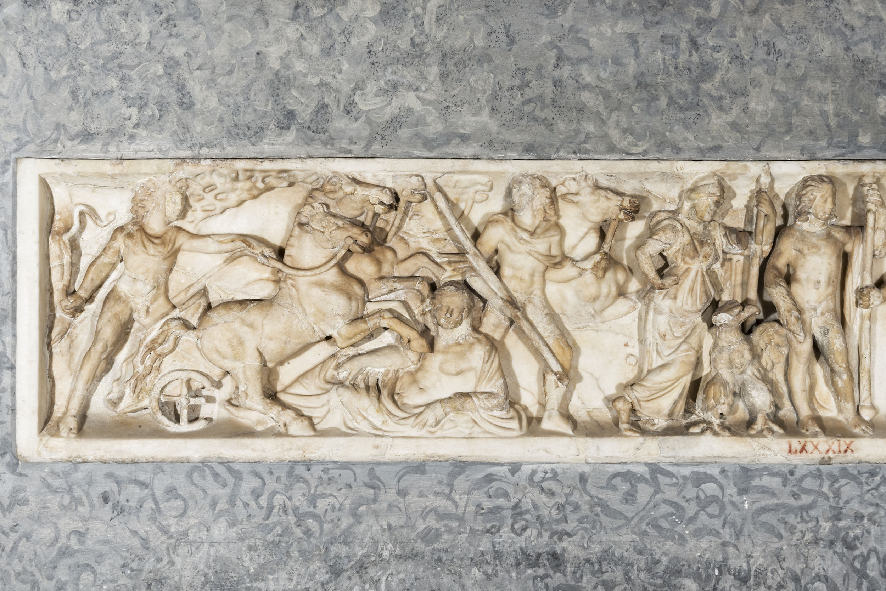

**内容 / 看点**：公元 2 世纪末的石棺盖，浮雕「卡比托利欧三神」——居中的朱庇特（Jupiter）与两侧的朱诺（Juno）、密涅瓦（Minerva）。顺路看，这是罗马国家崇拜的核心三神。

### ⭐ 顺路看 古罗马艺术《赫尔墨柱像：阿佛洛狄忒，萨福型》 / Roman art, _Herm of Aphrodite, Sappho type_

- **作者 / Artist**：古罗马艺术 / Roman art
- **作品 / Work**：《赫尔墨柱像：阿佛洛狄忒，萨福型》 / _Herm of Aphrodite, Sappho type_
- **时间**：公元 2 世纪初
- **材质**：白大理石
- **尺寸**：连胸像高 57 cm；头部 27 cm
- **位置**：大卫厅（第 2 室）
- **官网介绍页**：[官网介绍英文](https://www.collezionegalleriaborghese.it/en/opere/herm-of-aphrodite-sappho-type)｜馆藏编号 LXXXV

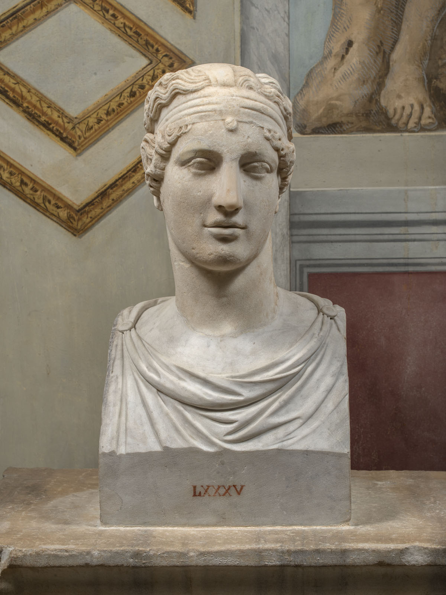

**内容 / 看点**：柱顶为「萨福型」（Sappho type）女性头的赫尔墨柱（herm），常释作阿佛洛狄忒（Aphrodite）或女诗人萨福。公元 2 世纪初。顺路看，看头发以宽带束起的古典样式。

### ⭐ 顺路看 古罗马艺术《弗拉维娅·瓦里亚娜基座》 / Roman art, _Base of Flavia Variana_

- **作者 / Artist**：古罗马艺术 / Roman art
- **作品 / Work**：《弗拉维娅·瓦里亚娜基座》 / _Base of Flavia Variana_
- **时间**：公元 1 世纪
- **材质**：卢尼大理石
- **尺寸**：高 80 cm；宽 68 cm；深 40 cm；字高 3.5 cm
- **位置**：大卫厅（第 2 室）
- **官网介绍页**：[官网介绍英文](https://www.collezionegalleriaborghese.it/en/opere/base-of-flavia-variana)｜馆藏编号 LXXXVa

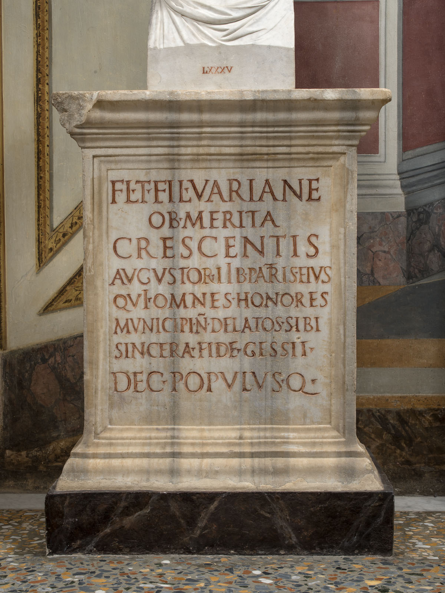

**内容 / 看点**：公元 1 世纪带铭文的基座（pedestal），题名弗拉维娅·瓦里亚娜（Flavia Variana）。顺路看，这类基座原本托着雕像或骨灰瓮，铭文是断代与身份的线索。

### ⭐ 顺路看 古罗马艺术《着斗篷的赫拉克勒斯赫尔墨柱像》 / Roman art, _Herm of Hercules, Wearing a Mantle_

- **作者 / Artist**：古罗马艺术 / Roman art
- **作品 / Work**：《着斗篷的赫拉克勒斯赫尔墨柱像》 / _Herm of Hercules, Wearing a Mantle_
- **时间**：公元 2 世纪
- **材质**：彭忒利科大理石
- **尺寸**：高 110 cm
- **位置**：大卫厅（第 2 室）
- **官网介绍页**：[官网介绍英文](https://www.collezionegalleriaborghese.it/en/opere/herm-of-hercules-wearing-a-mantle)｜馆藏编号 LXXXVI

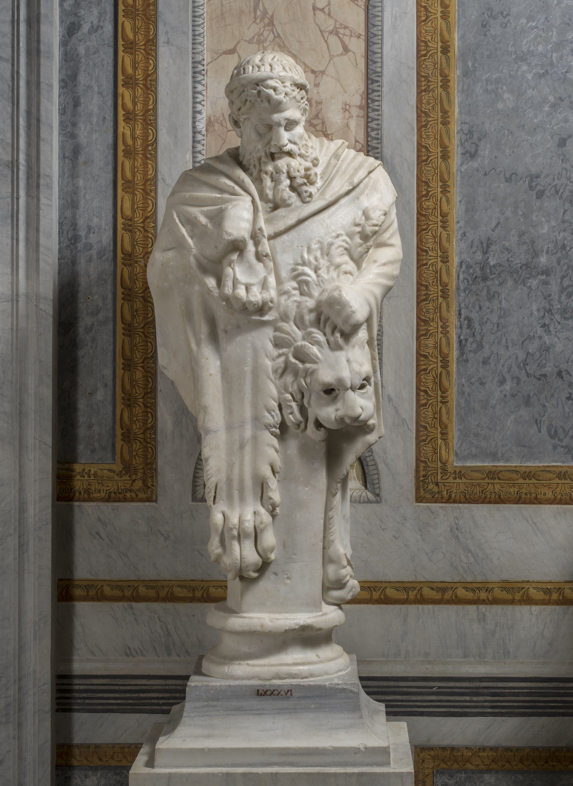

**内容 / 看点**：柱顶为披斗篷的赫拉克勒斯（Hercules）头的赫尔墨柱，公元 2 世纪。顺路看，与本厅其它赫拉克勒斯题材（巨头、儿童像、功业石棺）呼应。

### ⭐ 顺路看 古罗马艺术《无铭文基座》 / Roman art, _Anepigraphic Plinth_

- **作者 / Artist**：古罗马艺术 / Roman art
- **作品 / Work**：《无铭文基座》 / _Anepigraphic Plinth_
- **时间**：公元 2–3 世纪
- **材质**：带灰纹白大理石
- **尺寸**：高 72 cm；宽 53 cm；深 41 cm
- **位置**：大卫厅（第 2 室）
- **官网介绍页**：[官网介绍英文](https://www.collezionegalleriaborghese.it/en/opere/anepigraphic-plinth)｜馆藏编号 LXXXVIa

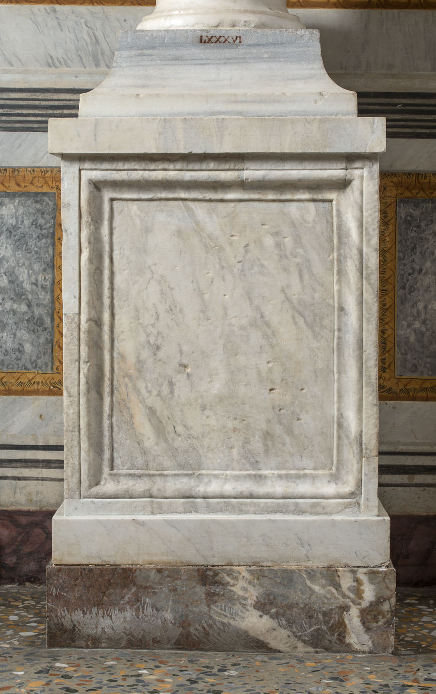

**内容 / 看点**：一件无铭文的古代大理石基座（灰纹白大理石），原为雕像/瓮的承座。顺路看，纯陈列性构件。

### ⭐ 顺路看 古罗马艺术《海洋酒神随从石棺及饰时序女神的棺盖》 / Roman art, _Sarcophagus with a Marine Thiasos and Lid with Horai_

- **作者 / Artist**：古罗马艺术 / Roman art
- **作品 / Work**：《海洋酒神随从石棺及饰时序女神的棺盖》 / _Sarcophagus with a Marine Thiasos and Lid with Horai_
- **时间**：公元 2 世纪中叶
- **材质**：卢尼大理石
- **尺寸**：高 52 cm；长 212 cm；深 60 cm（lid）
- **位置**：大卫厅（第 2 室）
- **官网介绍页**：[官网介绍英文](https://www.collezionegalleriaborghese.it/en/opere/sarcophagus-with-a-marine-thiasos-and-lid-with-horai)｜馆藏编号 LXXXVII

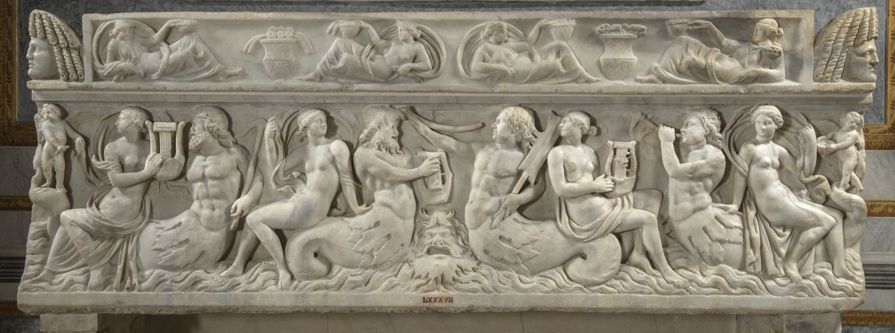

**内容 / 看点**：公元 2 世纪中叶石棺，棺身为海洋酒神队伍（marine thiasos）、棺盖刻「时序女神」（Horai，四季拟人）。顺路看——棺身海怪嬉戏＋棺盖四季，合起来是「循环与丰饶」的丧葬寓意。可与 LXXXI 并看。

### ⭐ 顺路看 古罗马艺术《植物纹饰带》 / Roman art, _Frieze with Plant Motif_

- **作者 / Artist**：古罗马艺术 / Roman art
- **作品 / Work**：《植物纹饰带》 / _Frieze with Plant Motif_
- **时间**：约公元 112 年
- **材质**：卢尼大理石
- **尺寸**：高 405 cm；宽 174 cm
- **位置**：大卫厅（第 2 室）
- **官网介绍页**：[官网介绍英文](https://www.collezionegalleriaborghese.it/en/opere/frieze-with-plant-motif)｜馆藏编号 LXXXVIII

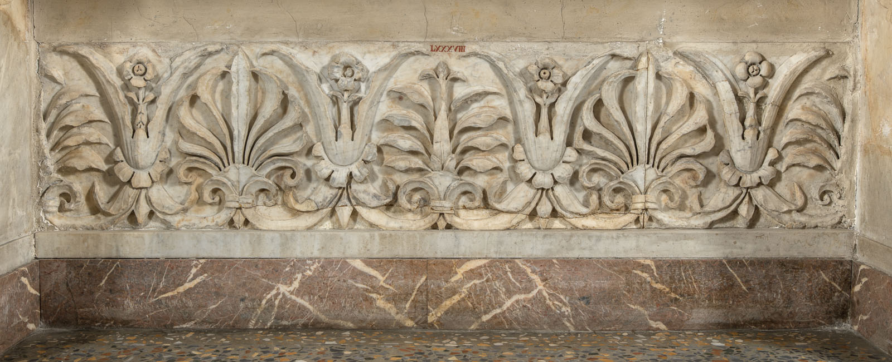

**内容 / 看点**：约公元 112 年的大型植物纹饰带（高逾 4 m），卷草莨苕纹精细，工艺水准可比拟图拉真时代的官方建筑装饰。顺路看。

### ⭐ 顺路看 古罗马艺术《柱式石棺，赫拉克勒斯功业，背面》 / Roman art, _Columnar Sarcophagus with the Labours of Hercules, back_

- **作者 / Artist**：古罗马艺术 / Roman art
- **作品 / Work**：《柱式石棺，赫拉克勒斯功业，背面》 / _Columnar Sarcophagus with the Labours of Hercules, back_
- **时间**：公元 160–170 年
- **材质**：亚洲大理石
- **尺寸**：高 100 cm，宽 235 cm；厚 22 cm
- **位置**：大卫厅（第 2 室）
- **官网介绍页**：[官网介绍英文](https://www.collezionegalleriaborghese.it/en/opere/columnar-sarcophagus-with-the-labours-of-hercules-back)｜馆藏编号 VC

**这是什么 / 看点**：同一具赫拉克勒斯功业柱式石棺的背面（编号 VC），续刻其余功业（整组背景见正面 LXXIX）。与正面分挂相对两墙，两面合看才是完整的功业系列；认人同样靠每格的怪物与道具。

### ⭐ 顺路看 古罗马艺术《有须赫尔墨柱像》 / Roman art, _Bearded Herm_

- **作者 / Artist**：古罗马艺术 / Roman art
- **作品 / Work**：《有须赫尔墨柱像》 / _Bearded Herm_
- **时间**：公元 1 世纪
- **材质**：彭忒利科大理石
- **尺寸**：连基座高 181 cm；不含基座高 150 cm
- **位置**：大卫厅（第 2 室）
- **官网介绍页**：[官网介绍英文](https://www.collezionegalleriaborghese.it/en/opere/bearded-herm-1)｜馆藏编号 VIC

**内容 / 看点**：又一根公元 1 世纪的有须赫尔墨柱（herm，近 1.81 m）。顺路看——本厅赫尔墨柱成排（IIC、LXXVIII、LXXXII、LXXXV、LXXXVI、XC…），可比较柱顶神祇与有须/无须之别。

### ⭐ 顺路看 古罗马艺术《亚历山大肖像，置于现代胸像上》 / Roman art, _Portrait of Alexander, on a modern bust_

- **作者 / Artist**：古罗马艺术 / Roman art
- **作品 / Work**：《亚历山大肖像，置于现代胸像上》 / _Portrait of Alexander, on a modern bust_
- **时间**：公元 1–2 世纪
- **材质**：彭忒利科大理石
- **尺寸**：古代部分高 36 cm，with bust 73 cm
- **位置**：大卫厅（第 2 室）
- **官网介绍页**：[官网介绍英文](https://www.collezionegalleriaborghese.it/en/opere/portrait-of-alexander-on-a-modern-bust)｜馆藏编号 VIIC

**内容 / 看点**：公元 1–2 世纪的亚历山大大帝（Alexander the Great）肖像头，配近代胸像。看微仰的头与蓬起的「狮鬃式」额发（anastolē）——这是亚历山大像的固定记号。与厅内绘画《亚历山大大帝》(469) 对看。

### ⭐ 顺路看 古罗马艺术《男孩雕像，躯干修复为幼年狄俄尼索斯》 / Roman art, _Statue of a Boy, torso restored as Dionysus as a child_

- **作者 / Artist**：古罗马艺术 / Roman art
- **作品 / Work**：《男孩雕像，躯干修复为幼年狄俄尼索斯》 / _Statue of a Boy, torso restored as Dionysus as a child_
- **时间**：公元 1 世纪
- **材质**：卢尼大理石
- **尺寸**：高 96 cm
- **位置**：大卫厅（第 2 室）
- **官网介绍页**：[官网介绍英文](https://www.collezionegalleriaborghese.it/en/opere/statue-of-a-boy-torso-restored-as-dionysus-as-a-child)｜馆藏编号 VIIIC

**内容 / 看点**：公元 1 世纪男童躯干，后世修复成「幼年狄俄尼索斯」（酒神）。同属「古件改身份」＋「儿童扮神」一类，与 CIII、LXXXIV 串看。

### ⭐ 顺路看 古罗马艺术《幼年赫拉克勒斯赫尔墨柱像，配现代头像》 / Roman art, _Herm of Hercules as a Boy, with modern head_

- **作者 / Artist**：古罗马艺术 / Roman art
- **作品 / Work**：《幼年赫拉克勒斯赫尔墨柱像，配现代头像》 / _Herm of Hercules as a Boy, with modern head_
- **时间**：公元 2 世纪中叶
- **材质**：带蓝纹白大理石
- **尺寸**：高 113 cm
- **位置**：大卫厅（第 2 室）
- **官网介绍页**：[官网介绍英文](https://www.collezionegalleriaborghese.it/en/opere/herm-of-hercules-as-a-boy-with-modern-head)｜馆藏编号 XC

**内容 / 看点**：柱顶为幼年赫拉克勒斯的赫尔墨柱，头部为近代补配，公元 2 世纪中叶。顺路看，又一「古柱＋今头」的赫拉克勒斯组合。

### ⭐ 顺路看 古罗马艺术《无铭文基座》 / Roman art, _Base with no inscription_

- **作者 / Artist**：古罗马艺术 / Roman art
- **作品 / Work**：《无铭文基座》 / _Base with no inscription_
- **时间**：公元 2–3 世纪
- **材质**：带灰纹白大理石
- **尺寸**：高 72 cm；宽 53 cm；深 41 cm
- **位置**：大卫厅（第 2 室）
- **官网介绍页**：[官网介绍英文](https://www.collezionegalleriaborghese.it/en/opere/base-with-no-inscription)｜馆藏编号 XCa

**内容 / 看点**：另一件无铭文的古代基座（灰纹白大理石），承座用途，与 LXXXVIa 同类。顺路看。

### ⭐ 顺路看 古罗马艺术《饰动物与里拉琴浮雕的祭坛》 / Roman art, _Altar with Relief of Animals and a Lyre_

- **作者 / Artist**：古罗马艺术 / Roman art
- **作品 / Work**：《饰动物与里拉琴浮雕的祭坛》 / _Altar with Relief of Animals and a Lyre_
- **时间**：公元 1 世纪
- **材质**：卢尼大理石
- **尺寸**：高 96 cm；宽 56 cm；深 48 cm
- **位置**：大卫厅（第 2 室）
- **官网介绍页**：[官网介绍英文](https://www.collezionegalleriaborghese.it/en/opere/altarwith-relief-of-animals-and-a-lyre)｜馆藏编号 XCIII

**内容 / 看点**：公元 1 世纪的祭坛，浮雕动物与里拉琴（lyre）。顺路看，里拉琴常关联阿波罗与缪斯，呼应本厅众多阿波罗题材。
## 其他

### ⭐ 顺路看 大理石地砖 / _Opus Sectile Marble Floor_

Sala II 的地面与一层其他房间一样，属于 18 世纪重布置的一部分。现场不用花太多时间，但可以注意地面如何给中央 Bernini《大卫》留出视觉中心。
