第 3 室专为贝尼尼的《阿波罗与达芙妮》而设，是全馆人气最高的雕塑之一——阿波罗追到达芙妮的一刹那，少女正化作月桂；天顶同绘这则「变形」神话，与雕像上下呼应。

**必看与核心展品（⭐⭐⭐ 必看 + 核心）**

| 推荐 | 展品 | 作者 | 一句话看点 |
|---|---|---|---|
| ⭐⭐⭐ 必看 | 《阿波罗与达芙妮》 | 吉安·洛伦佐·贝尼尼 | 指尖生叶、足下生根的「变形定格」，绕看最佳 |
| ⭐⭐ 推荐 | 天顶《阿波罗与达芙妮厅天顶》 | 安杰莱蒂 & 马尔凯蒂 | 与雕像同题的天顶装饰，抬头呼应同一神话 |

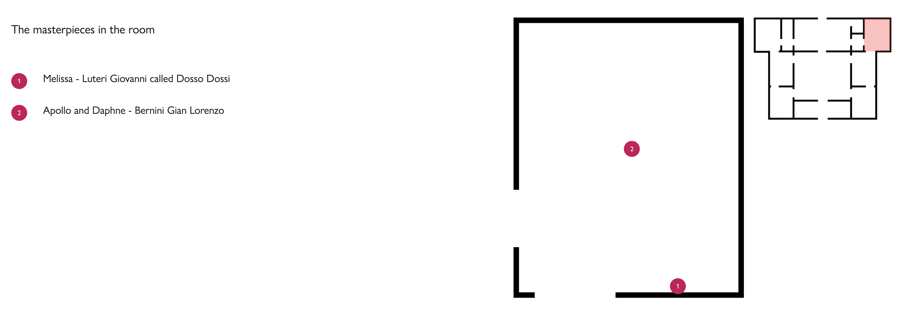

**展厅官网介绍页**：[Room 3 - Apollo and Daphne Room](https://galleriaborghese.cultura.gov.it/en/il-museo/la-villa/sala-3-sala-di-apollo-e-dafne/)

## 核心展品

### ⭐⭐⭐ 必看 吉安·洛伦佐·贝尼尼《阿波罗与达芙妮》 / Bernini Gian Lorenzo, _Apollo and Daphne_

- **作者 / Artist**：吉安·洛伦佐·贝尼尼 / Bernini Gian Lorenzo（1598–1680）
- **作品 / Work**：《阿波罗与达芙妮》 / _Apollo and Daphne_
- **时间**：1622–1625 年
- **材质**：卡拉拉大理石
- **尺寸**：高 243 cm
- **位置**：阿波罗与达芙妮厅（第 3 室）
- **官网介绍页**：[官网介绍英文](https://www.collezionegalleriaborghese.it/en/opere/apollo-and-daphne)｜馆藏编号 CV

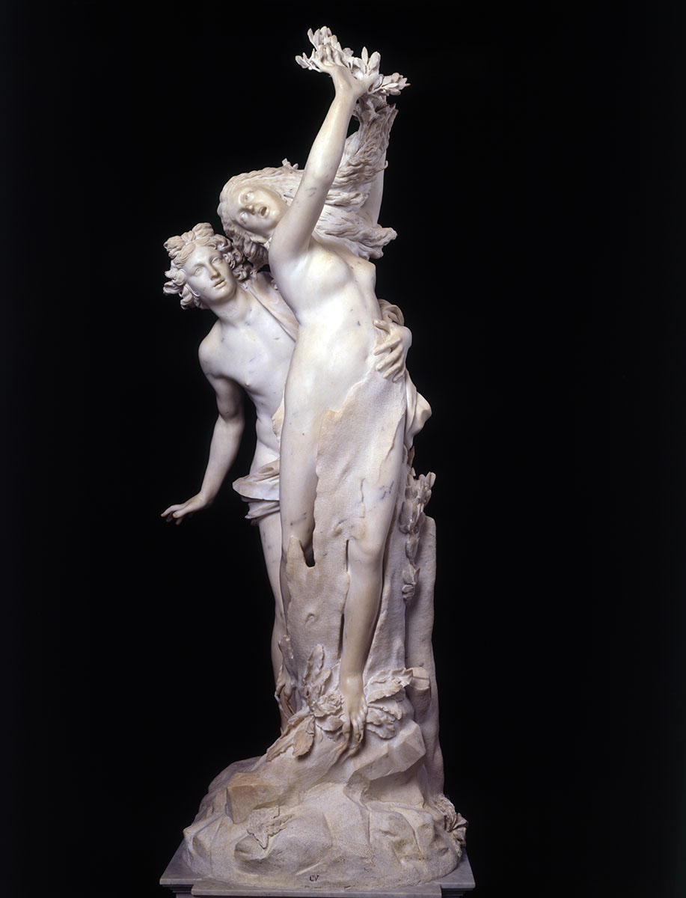

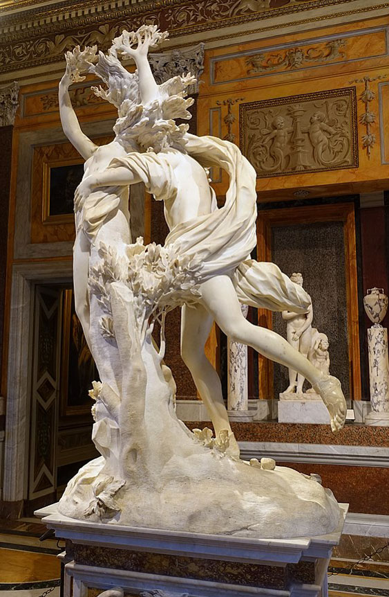

**这是什么**：Sala III 的绝对主角，贝尼尼（Gian Lorenzo Bernini）二十几岁为红衣主教希皮奥内·博尔盖塞（Scipione Borghese）所作（1622–1625，酬金 1000 斯库多）。题材出自奥维德《变形记》：丘比特（Cupid）用金箭射中阿波罗（Apollo）使他爱上仙女达芙妮（Daphne），又用铅箭射中达芙妮使她抗拒；阿波罗追上她的一刻，她求父亲河神珀纽斯（Peneus）改变形体，于是开始变成月桂树。贝尼尼抓住的正是**人变树的临界一秒**：阿波罗左手刚触到她身体，她脚下已生根、手指与头发正抽成月桂枝叶。雕这件期间他还中断近一年去做了《大卫》。

**技法：把「变形」刻进大理石**：这件把雕塑推到了从前以为只有绘画才能做到的境地。看三种不同的打磨——衣袍、皮肤、树皮各自质感分明；指尖化叶、脚趾生根、头发向后飞扬都用大理石凿出。1997 年修复发现，贝尼尼施工时给最纤薄的叶片与发丝裹上石膏「软垫」，防止后续凿击的震动把它们震断。其精细曾让人怀疑有助手朱利亚诺·菲内利（Giuliano Finelli）参与，但今多认为出自贝尼尼一人之手。

**取法与寓意**：阿波罗的姿态精确取法古代名作《观景殿的阿波罗》（Apollo Belvedere），连凉鞋都照搬；达芙妮惊恐的脸则受雷尼（Guido Reni，主教最爱的画家）《屠杀婴儿》中奔逃母亲的影响。底座原刻一条龙皮饰板，上有主教马费奥·巴尔贝里尼（Maffeo Barberini，即后来的教皇乌尔班八世）所撰道德对句——劝人「追逐易逝之美者，终将手握苦涩」；后来移位时又加刻一只鹰（博尔盖塞纹章）配奥维德诗句。达芙妮自 15 世纪起便象征「逃避隐患、保持纯洁常青」的德性，恰如四季常绿的月桂。

**陈列史（决定怎么看）**：它最初靠近礼拜堂那侧墙、放在更低的基座上，从礼拜堂进来的人**先看到的是背面**，再绕到阿波罗右侧、跟着追逐的最后一程，看他「以为得手」转为「错愕」。18 世纪末家族重整陈列，把它移到房间正中、与最重要的古代雕像并列（它是其中唯一的「现代」雕塑）；1785 年又按帕切蒂建议挪到今天的位置。

**现场站看**：

1. **达芙妮的手指变叶**——看她高举的双手指尖正抽出月桂叶，是「变形」最精彩处。
2. **脚趾生根**——低头看她脚下，脚趾正钉进地里长成树根，与上方枝叶上下呼应。
3. **阿波罗触身的一刹**——看他左手按上她腰身的接触点：再晚一瞬，触到的就只是树皮。
4. **看阿波罗的脸**——「自以为追到」的得意正转为错愕，这是全作的情绪枢纽（脸取法《观景殿阿波罗》）。
5. **绕到背面**——这本是设计中「最先被看到」的一面；绕行一圈，体会贝尼尼为「跟随式观看」铺的叙事。
6. **底座找鹰与铭文**——基座上的鹰是博尔盖塞纹章，配奥维德诗句，把神话引向「美易逝、德常青」的寓意。

## 天顶画

### ⭐⭐ 推荐 安杰莱蒂、马尔凯蒂《阿波罗与达芙妮厅天顶》 / Pietro Angeletti & Giovanni Battista Marchetti, _Ceiling of the Apollo and Daphne Room_

- **中央故事画 / Painter**：彼得罗·安杰莱蒂 / Pietro Angeletti（1758–1786）
- **错视框架 / Quadratura**：乔瓦尼·巴蒂斯塔·马尔凯蒂 / Giovanni Battista Marchetti（1730–1800）
- **总体设计**：安东尼奥·阿斯普鲁奇（Antonio Asprucci）
- **时间**：1780–1785 房间装饰期
- **位置**：Sala III 天顶

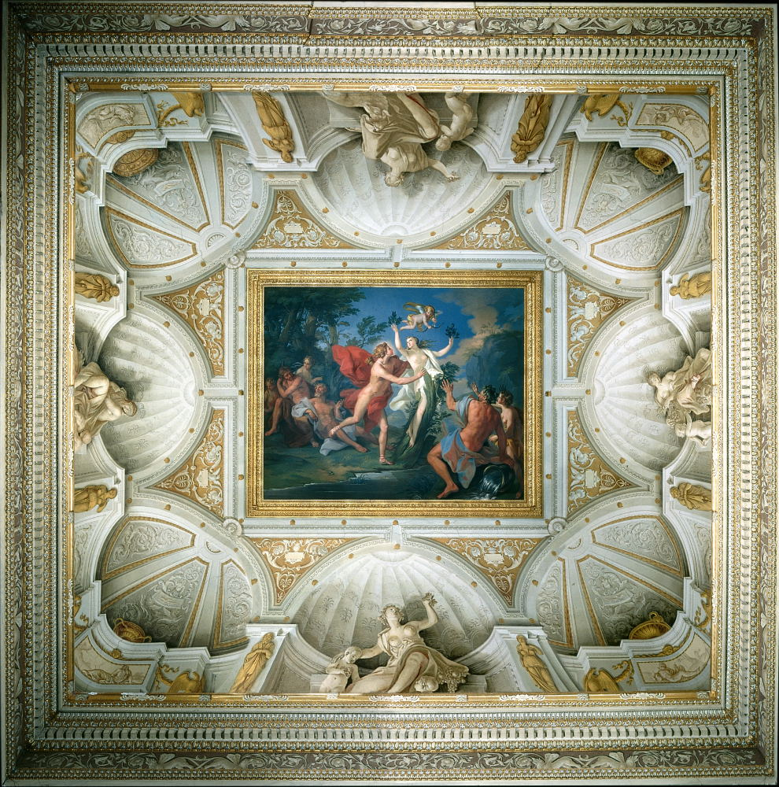

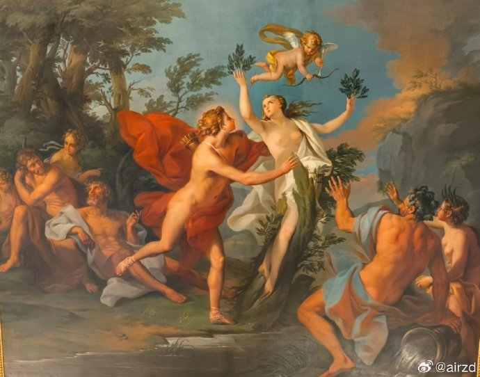

**这是什么**：抬头看到的不是好几件独立作品，而是一整面为呼应脚下贝尼尼《阿波罗与达芙妮》而设计的天顶——18 世纪末由阿斯普鲁奇（Antonio Asprucci）统一规划，把下方那定格的一秒「人变树」铺展成完整的神话叙事。它由三层叠成：中央一幅彩色故事画、四周单色的四季寓意、再加一整套用绘画假造出来的建筑框架。

**中央彩色画（其实就是同一幅）**：那块蓝底带金框的彩色场景，是安杰莱蒂（Pietro Angeletti）画的《阿波罗与达芙妮故事》。馆方藏品库给它登记过好几个很长的标题——「丘比特以爱之箭射中阿波罗、以相反之箭射中达芙妮」「达芙妮化为月桂树」——但它们指的是同一幅画，不是几幅：丘比特报复阿波罗，让他坠入爱情、让达芙妮抗拒；画面中部正是达芙妮变成月桂树的一刻，旁边见证的是她父母珀纽斯（Peneus）、克瑞乌萨（Creusa）和几位河神。它和脚下的雕塑上下呼应——天顶讲完整故事，雕塑定格最关键的一秒。

**四周的「四季」是画，不是雕**：中央画四外、贝壳形假壁龛里那些白色人像，是安杰莱蒂的《四季寓意像》——单色（grisaille）画出来的，故意画成石雕的样子骗眼睛，本质是颜料。抬头乍看像四尊大理石像，其实一尊真雕塑都没有。

**整圈框架也是画出来的（最值得玩味的一层）**：你看到的藻井、肋条、贝壳龛、檐口和那些半身从墙里「长」出来托住屋顶的人像（telamons 男像柱 / caryatids 女像柱），全部是马尔凯蒂（Giovanni Battista Marchetti）的 quadratura——专门画「假建筑」的透视画。它的原理是把绘画和几何透视绑在一起：先在平面上设定一个「观看点」（通常对着房间正中），再据此推算每条肋、每道檐口在这个视点下该有的缩短、该落的影子，然后照着画。于是平顶被「画穿」成一个有藻井、有进深、有壁龛凹凸的拱顶——但它本质上是一张铺在平面上的图，没有一根真房梁、一个真壁龛。这正是 17–18 世纪意大利天顶画的看家本事（科尔托纳、波佐都是此道高手），马尔凯蒂作为 quadraturista，干的就是给安杰莱蒂的故事画「搭一座画出来的建筑舞台」。

几个值得知道的点：其一，它用的是 **grisaille（单色画）**——刻意只用灰白棕的素色去模仿石头与灰泥，不上彩，好让中央那幅彩色故事画成为唯一的「真彩」焦点，主次一眼分明。其二，那些托臂人像不是装饰花边，而是在「演」承重：它们摆出吃力托举的姿态，给整个假拱顶一个「被撑起来」的力学借口，错觉才立得住。其三，这套框架真正的功能是「缝合」——把中央彩色画、四角四季和四面墙的真实建筑线脚接成一个连续的空间，让你抬头时感觉它们本就属于同一座厅堂，而不是天花上贴了几张画。所以这间天顶最妙的地方恰恰是：**最有体积感、最像真建筑的那部分，反而最假。**

**现场站看**：

1. **先认中央彩色画**——天顶正中蓝底金框那块，是唯一的彩色画、也是整面天顶的主角；认准它，四周结构就理顺了。
2. **找达芙妮变树的一刻**——中央画里看她身边抽出月桂枝叶、河神父母在旁见证，再低头看脚下贝尼尼定格的同一秒，体会「天顶讲全程、雕塑定格高潮」的上下呼应。
3. **四角的白人像别当雕塑**——盯贝壳龛里的「四季」白色人物，它们是单色画的错视石雕，不是真像；看明暗交界处会露出「其实是平面」的破绽。
4. **站对「甜点」看框架最立体**——quadratura 是按一个固定视点算出来的，站在房间正中抬头，假藻井、假肋条的进深和影子全部对得最准、最像真拱顶；这是画家留给你的「正确站位」。
5. **再走到墙角看它「塌」**——挪到房间一角斜着看同一片框架，透视会开始变形、错觉松动，你就能反推出「它其实是平的」——一立一破，最能体会这套魔术的机关。
6. **盯托臂人像与单色**——看那些半身托举屋顶的男像柱/女像柱，它们在「演」承重撑起假拱顶；再注意整圈框架只用灰白棕单色（grisaille），刻意不上彩，好把唯一的彩色留给中央故事画。

## 绘画

本节按馆方 Painting 藏品列表补充，共 5 件。核心展品如已在上文展开，这里仍保留官方清单条目，方便核对。

### ➖ 可略过 乔瓦尼·卢泰里，称多索·多西《阿波罗》 / Luteri Giovanni called Dosso Dossi, _Apollo_

- **作者 / Artist**：乔瓦尼·卢泰里，称多索·多西 / Luteri Giovanni called Dosso Dossi
- **作品 / Work**：《阿波罗》 / _Apollo_
- **时间**：约 1525 年
- **材质**：布面油画
- **尺寸**：191 × 116 cm
- **馆藏编号**：001
- **位置**：阿波罗与达芙妮厅（第 3 室）
- **展陈提醒 / Display note**：馆方藏品页标注 _Work not currently exhibited_
- **官网介绍页**：[官网介绍英文](https://www.collezionegalleriaborghese.it/en/opere/apollo)｜馆藏编号 001

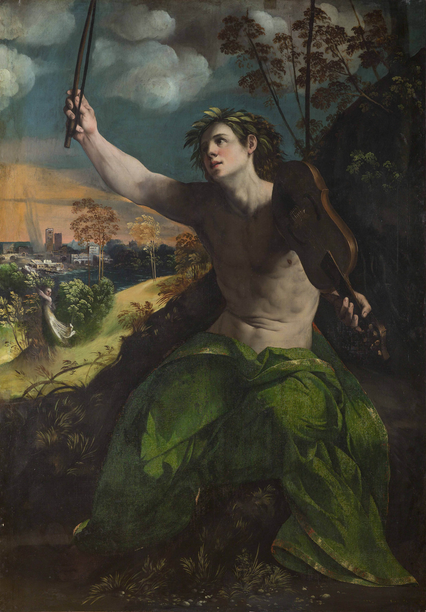

**内容（这是什么）**：多索·多西（Dosso Dossi）笔下的阿波罗（Apollo）：头戴月桂冠，右手刚把弓从肩上的臂提琴（lyra da braccio）上抬起；左后方远处，达芙妮（Daphne）正变成月桂树。取材奥维德《变形记》——阿波罗杀死巨蟒后嘲笑丘比特（Cupid），丘比特报复，使他爱上达芙妮而不得。

**背景 / 看点**：约 1525 年，很可能为费拉拉公爵阿尔丰索·德·埃斯特（Alfonso d'Este）与劳拉·迪安蒂（Laura Dianti）的结合而作——阿波罗影射擅弹臂提琴的公爵，月桂（laurel）双关「劳拉」。人物取法古代《观景殿躯干》（Belvedere Torso），并近拉斐尔《帕纳苏斯》的阿波罗与米开朗琪罗的「裸像」。1659 年经卡波尼遗赠归入博尔盖塞。**馆方标注此件当前未展出。**

### ⭐ 顺路看 保罗·布里尔（？）《幻想风景》 / Bril Paul (?), _Fantastic landscape_

- **作者 / Artist**：保罗·布里尔（？） / Bril Paul (?)
- **作品 / Work**：《幻想风景》 / _Fantastic landscape_
- **时间**：16 世纪末十年
- **材质**：布面油画
- **尺寸**：78 × 106 cm
- **馆藏编号**：013
- **位置**：阿波罗与达芙妮厅（第 3 室）
- **官网介绍页**：[官网介绍英文](https://www.collezionegalleriaborghese.it/en/opere/fantastic-landscape)｜馆藏编号 013

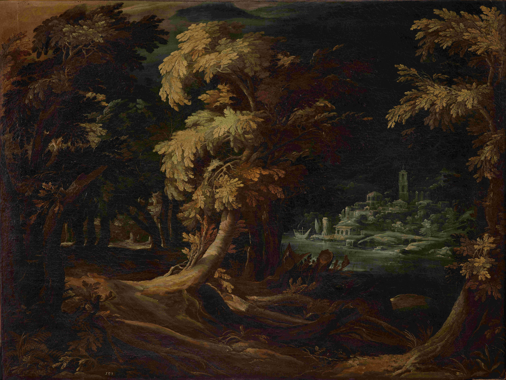

**内容（这是什么）**：归在佛兰德风景名家保罗·布里尔（Paul Bril）名下的《幻想风景》——并非写实地景，而是想象拼合的林岩、远水与点景小人，属 16 世纪末「世界风景」式构图。

**看点**：顺路看。布里尔长期在罗马活动，把北方细密的风景传统带进意大利，是独立风景画兴起期的代表。本厅有一对这样的布里尔风景（013、018），可并看构图与空气透视的远近层次。

### ⭐ 顺路看 保罗·布里尔（？）《幻想风景》 / Bril Paul (?), _Fantastic landscape_

- **作者 / Artist**：保罗·布里尔（？） / Bril Paul (?)
- **作品 / Work**：《幻想风景》 / _Fantastic landscape_
- **时间**：16 世纪末十年
- **材质**：布面油画
- **尺寸**：66 × 90 cm
- **馆藏编号**：018
- **位置**：阿波罗与达芙妮厅（第 3 室）
- **官网介绍页**：[官网介绍英文](https://www.collezionegalleriaborghese.it/en/opere/fantastic-landscape-2)｜馆藏编号 018

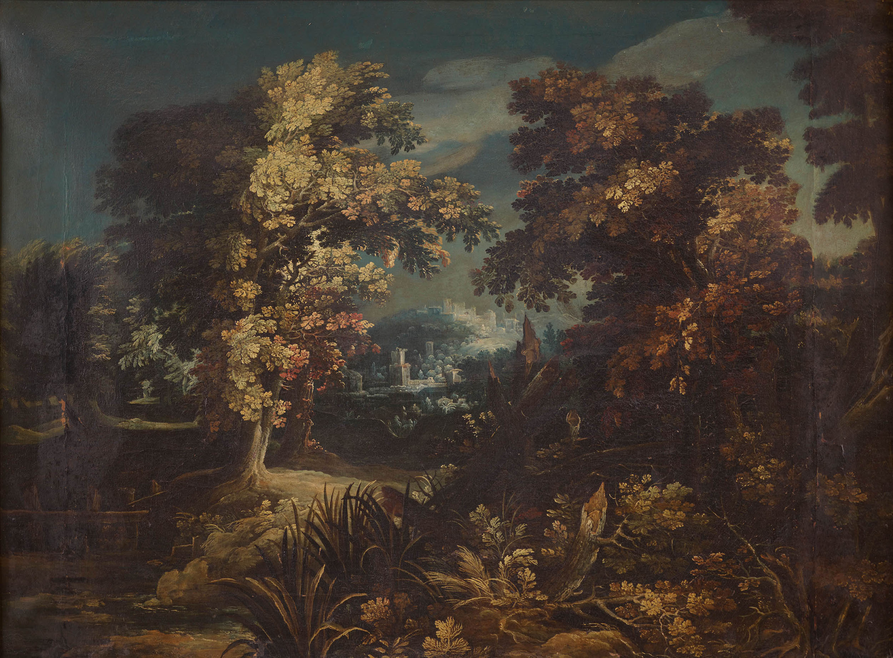

**内容 / 看点**：与 013 成对的另一幅保罗·布里尔（Paul Bril）《幻想风景》（尺幅略小）。同为 16 世纪末佛兰德式想象风景，前景林木山岩、远处以空气透视拉开层次、点缀小人物。顺路看，两幅并观即可。

### ⭐ 顺路看 乔瓦尼·卢泰里，称多索·多西《梅丽莎》 / Luteri Giovanni called Dosso Dossi, _Melissa_

- **作者 / Artist**：乔瓦尼·卢泰里，称多索·多西 / Luteri Giovanni called Dosso Dossi
- **作品 / Work**：《梅丽莎》 / _Melissa_
- **时间**：约 1518 年
- **材质**：布面油画
- **尺寸**：170 × 172 cm
- **馆藏编号**：217
- **位置**：阿波罗与达芙妮厅（第 3 室）
- **官网介绍页**：[官网介绍英文](https://www.collezionegalleriaborghese.it/en/opere/melissa)｜馆藏编号 217

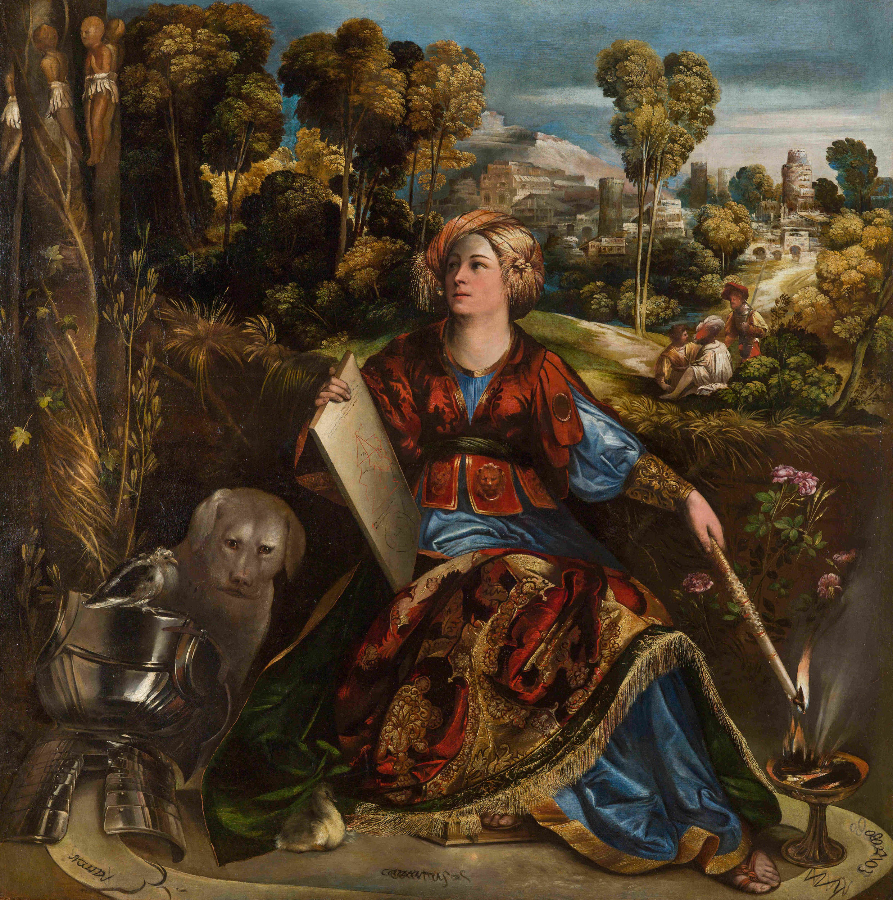

**内容（这是什么）**：多索·多西（Dosso Dossi）名作《梅丽莎》：一位戴头巾、衣着华美的女法师坐在标着犹太卡巴拉符号的魔法圈中，左手持火炬、右手持画满几何图形的板。她出自阿里奥斯托《疯狂的奥兰多》——善良女法师梅丽莎（Melissa）解除阿尔奇娜的魔法，左侧树上挂着的小蜡人即被变形的骑士。

**背景 / 看点**：约 1518 年。X 光显示魔法圈里原画着一个披甲人物（布拉达曼特），后被画家改掉。约 1607–08 年经本蒂沃利奥从费拉拉送入希皮奥内·博尔盖塞（Scipione Borghese）收藏。看点在斑斓色彩、那圈卡巴拉符号与树上的小蜡人——把一首骑士史诗压缩成一张「徽志式」的画。

### ⭐ 顺路看 乔瓦尼·卢泰里，称多索·多西《神话寓意画》 / Luteri Giovanni called Dosso Dossi, _Mythological Allegory_

- **作者 / Artist**：乔瓦尼·卢泰里，称多索·多西 / Luteri Giovanni called Dosso Dossi
- **作品 / Work**：《神话寓意画》 / _Mythological Allegory_
- **时间**：约 1529 年
- **材质**：布面油画
- **尺寸**：112 × 141，5
- **馆藏编号**：304
- **位置**：阿波罗与达芙妮厅（第 3 室）
- **官网介绍页**：[官网介绍英文](https://www.collezionegalleriaborghese.it/en/opere/mythological-allegory)｜馆藏编号 304

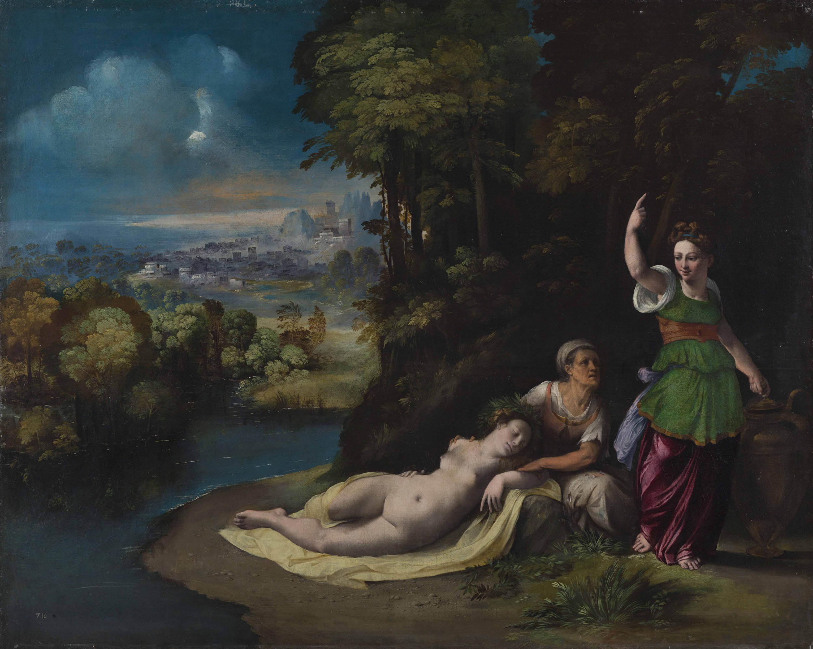

**内容（这是什么）**：多索·多西（Dosso Dossi）的《神话寓意画》：一名戴月桂冠的女子斜卧黄布上，一位衣衫褴褛的老妇守护着她，旁边穿埃斯特家族服色（绿白红）的少女右手指天、左手持青铜双耳瓶。题材极难辨——曾被解作戴安娜与卡利斯托，今多倾向「维纳斯发现普绪刻之美」。

**背景 / 看点**：约 1529 年，夜景、用光极「人工」。约 1608 年经本蒂沃利奥入希皮奥内·博尔盖塞收藏，与盖蒂博物馆藏多西另一寓意画相关，可能为劳拉·迪安蒂而作。看点：把一则复杂文学叙事浓缩成谜一般的图像，受朱利奥·罗马诺曼托瓦「普绪刻厅」与佛兰德风影响。
## 雕塑

本节先列馆方 Modern Sculpture 藏品列表，共 4 件。

### ⭐ 顺路看 保罗·桑蒂《一对紫斑白大理石双耳瓶》 / Santi Paolo, _Pair of amphorae in pavonazzetto marble_

- **作者 / Artist**：保罗·桑蒂 / Santi Paolo
- **作品 / Work**：《一对紫斑白大理石双耳瓶》 / _Pair of amphorae in pavonazzetto marble_
- **时间**：1781 年（18 世纪末别墅改造期）
- **材质**：紫斑白大理石（pavonazzetto）
- **尺寸**：40 × 26 cm， 柱高 98 cm
- **馆藏编号**：CIXa-b
- **位置**：阿波罗与达芙妮厅（第 3 室）
- **官网介绍页**：[官网介绍英文](https://www.collezionegalleriaborghese.it/en/opere/pair-of-amphorae-in-pavonazzetto-marble)｜馆藏编号 CIXa-b

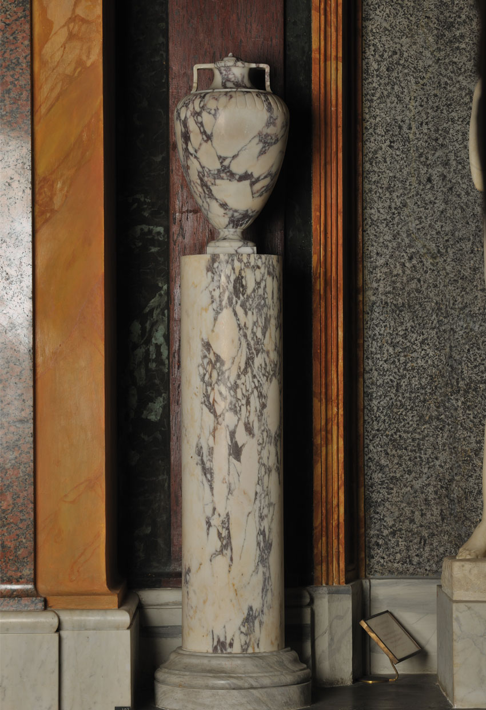

**内容（这是什么）**：一对造型对称的紫斑白大理石双耳瓶，连同其下两根同料的素面小圆柱。瓶身为饱满的卵形，上下两端饰浅浮雕的瓜棱纹，落在矮底座上、顶部以半球形小盖收口；把手上段与瓶肩齐平、下段顺着低短的瓶颈弯转——线条干净，让石材的紫色脉纹成为真正的主角。

**背景 / 看点**：1781 年由石匠保罗·桑蒂（Paolo Santi）受马尔坎托尼奥四世·博尔盖塞（Marcantonio IV Borghese）委托制作，多半依建筑师安东尼奥·阿斯普鲁奇（Antonio Asprucci）的设计图施工，是 18 世纪末别墅大改造中的装饰陈设。所用紫斑白大理石（pavonazzetto，产自今土耳其伊塞希萨尔）是古罗马最名贵、最常用的彩色大理石之一，桑蒂正是以擅长加工此类硬石著称。两瓶起初摆在今第 1 室、与一对黑大理石小瓶配对陈列，后才移来本厅。顺路看：这是「以名贵彩石本身为看点」的近代仿古工艺品，绕一圈看那道贯穿器身的紫色花纹即可，可与同厅古代石器的材质对照。

### ⭐ 顺路看 作者不详《一对基座》 / Unknown artist, _Pedestal (pair)_

- **作者 / Artist**：作者不详 / Unknown artist
- **作品 / Work**：《一对基座》 / _Pedestal (pair)_
- **时间**：17 世纪上半叶
- **材质**：白大理石
- **尺寸**：94，5 × 64 × 58，5，底板 cm 5，5
- **馆藏编号**：CVIa-CXa
- **位置**：阿波罗与达芙妮厅（第 3 室）
- **官网介绍页**：[官网介绍英文](https://www.collezionegalleriaborghese.it/en/opere/pedestal-pair)｜馆藏编号 CVIa-CXa

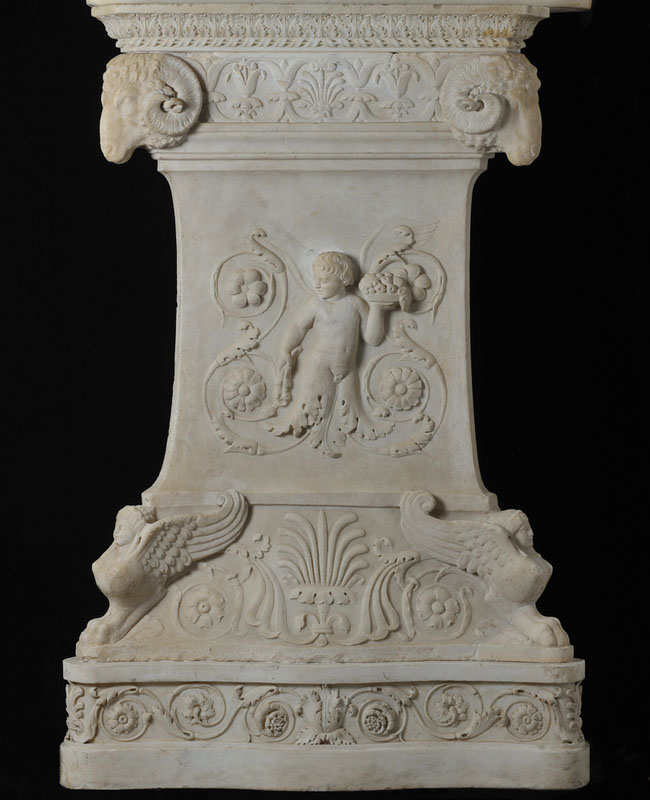

**内容（这是什么）**：一对三角形高基座，正是本厅两件「抱鸭男孩」石像（CVI、CX）的承托。基座通体浮雕：角上是带羊角、狮头的有翼狮身鹰首兽（griffin）头像，兽口吐出卷须缠绕玫瑰花饰；三个侧面正中各有一个「以茛苕叶为腿」的有翼小天使，三者道具各不相同——一个持葡萄串与牧杖，一个抱果篮、戴「宴饮花冠」，第三个头缠缎带。

**背景 / 看点**：1650 年已见于博尔盖塞收藏，应是 17 世纪上半叶罗马工匠所作的近代仿古件。学界一度以为它们是哈德良时代古物（曾推测出自圣科斯坦扎陵附近出土、后散入梵蒂冈的一组烛台），后经考证排除：1650 年它们已在别墅内，而那组古烛台当时仍在圣阿涅塞教堂。两座最早在「摩尔人厅」（今第 7 室）用作如今藏卢浮宫的《卡米利》像底座，1765 年才移入本「贝尼尼厅」（今第 3 室）。顺路看：它们本身是配角家具，但雕工华丽，留意角上的鹰首狮身兽和「茛苕叶腿」小天使，以及它和上方男孩像的「座＋像」组合关系。

### ⭐ 顺路看 罗马学派《科托尼诺雪花石双耳瓶》 / roman school, _Amphora of cotognino alabaster_

- **作者 / Artist**：罗马学派 / roman school
- **作品 / Work**：《科托尼诺雪花石双耳瓶》 / _Amphora of cotognino alabaster_
- **时间**：17 世纪
- **材质**：科托尼诺雪花石膏
- **尺寸**：40 × 40 cm
- **馆藏编号**：CXIX
- **位置**：阿波罗与达芙妮厅（第 3 室）
- **官网介绍页**：[官网介绍英文](https://www.collezionegalleriaborghese.it/en/opere/amphora-of-cotognino-alabaster)｜馆藏编号 CXIX

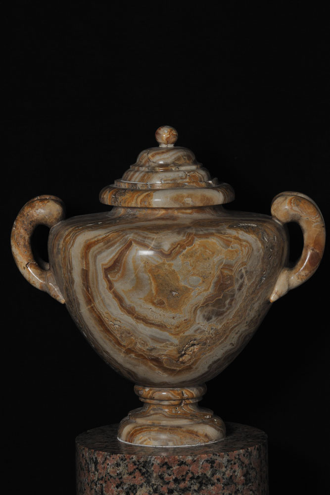

**内容（这是什么）**：一对造型对称的科托尼诺雪花石（cotognino alabaster）双耳瓶，连盖陈设。瓶身像放大的高脚杯——宽鼓的腹部、水平的肩，肩部收成一段带线脚的短颈、再外翻成口沿；两只对称的厚把手贴着瓶腹起拱、高过肩部；瓶盖作反曲线（cyma recta）线脚，顶上收成一颗球形钮，整器落在圆形带线脚的底座上。

**背景 / 看点**：定为 17 世纪罗马工匠之作，因缺订制文献，确切作者不详（学界曾提出西尔维奥·卡尔奇 Silvio Calci 或同时期为博尔盖塞家族服务的另一位石匠）。这种「大肚＋大把手＋带盖」的圆鼓造型，正是古罗马帝政时期常见的瓶式，当时多用雪花石或斑岩制成、充当骨灰瓮——这位匠人显然取法了这些古代样本。两瓶最早见于 1833 年《信托财产清册》、当时放在刻瑞斯厅（今第 1 室），1902 年由意大利国家购藏。看点全在材质本身：科托尼诺（又称「东方」）雪花石产自埃及，底色由白渐黄如蜂蜜，布满或同心圆斑、或细密蜿蜒的纹脉；匠人特意挑了纹理各异的两块石料、把花纹顺着瓶形铺开，让石头的天然脉纹成为唯一的装饰主角。顺路看：绕一圈比对两瓶不同走向的石纹，可与同厅另一对紫斑白大理石双耳瓶（CIXa-b）并看「以名贵彩石本身为看点」的近代仿古工艺。

本节继续列馆方 Ancient Art 藏品列表，共 14 件。

### ⭐ 顺路看 古罗马艺术《维纳斯、马尔斯与丘比特雕塑组》 / Roman art, _Sculpture group of Venus, Mars and Cupid_

- **作者 / Artist**：古罗马艺术 / Roman art
- **作品 / Work**：《维纳斯、马尔斯与丘比特雕塑组》 / _Sculpture group of Venus, Mars and Cupid_
- **时间**：公元 2 世纪上半叶
- **材质**：卢尼大理石
- **尺寸**：83 × 50 cm
- **位置**：阿波罗与达芙妮厅（第 3 室）
- **官网介绍页**：[官网介绍英文](https://www.collezionegalleriaborghese.it/en/opere/sculpture-group-of-venus-mars-and-cupid)｜馆藏编号 CCL

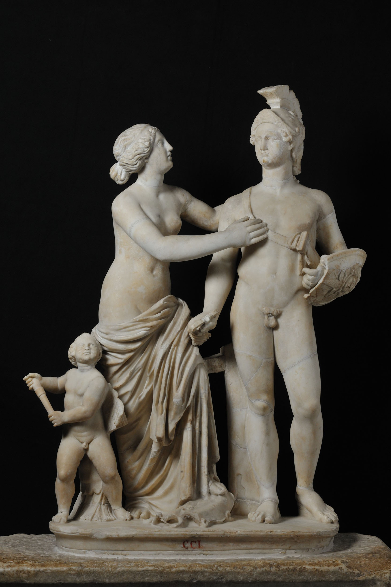

**内容（这是什么）**：安东尼时代的「和谐组像」（Concordia-Gruppe）——维纳斯（Venus）以爱安抚战神马尔斯（Mars）的暴烈，小爱神丘比特（Cupid）持火炬在旁。古人说唯有维纳斯能驯服马尔斯，让可怖战神变成温顺爱人。

**背景**：它拼合了两种希腊范式——维纳斯取「卡普阿型阿佛洛狄忒」，马尔斯则把波留克列特斯《持矛者》（Doryphoros）改造而来。原型可上溯奥古斯都时代「复仇者马尔斯」神庙的崇拜组像，纪念维纳斯（尤利乌斯家族始祖）与马尔斯（罗慕路斯之父）的结合；后世常用它给夫妇、乃至哈德良与萨比娜等帝后「扮神」立像。1609 年由博尔盖塞从德拉·波尔塔（Della Porta）收藏购入。

**看点**：顺路看，但寓意重要。丘比特点出「战神放下武力、归于和平」；再看维纳斯半裸与马尔斯「英雄式裸体」戴盔持盾的对比，是罗马「爱征服战争」的经典图式。

### ⭐ 顺路看 古罗马艺术《斯塔提乌斯葬祭祭坛》 / Roman art, _Sepulchral Altar of Statius_

- **作者 / Artist**：古罗马艺术 / Roman art
- **作品 / Work**：《斯塔提乌斯葬祭祭坛》 / _Sepulchral Altar of Statius_
- **时间**：公元 2–3 世纪
- **材质**：卢尼大理石
- **尺寸**：高 81 cm， 宽 78 cm；深 33 cm；4-3 cm 字
- **位置**：阿波罗与达芙妮厅（第 3 室）
- **官网介绍页**：[官网介绍英文](https://www.collezionegalleriaborghese.it/en/opere/sepulchral-altar-of-statius)｜馆藏编号 CCLa

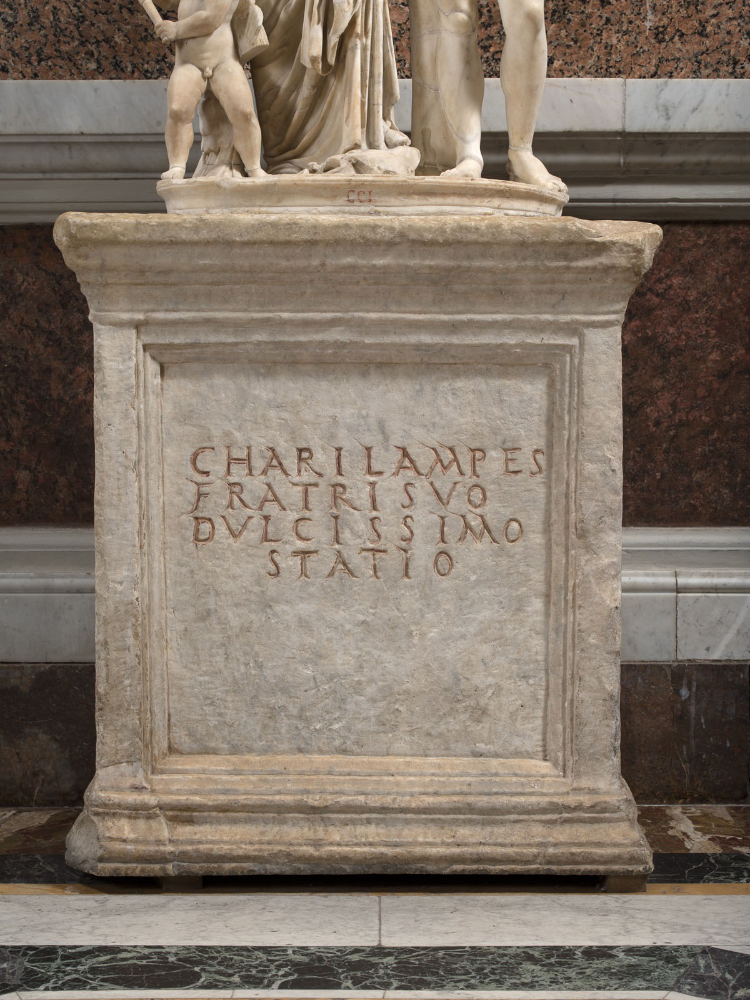

**内容（这是什么）**：一座方形古罗马葬祭祭坛，上下以突出的线脚收边。正面四行拉丁铭文「Charilampes / fratri suo / dulcissimo / Stazio」记载哥哥卡里兰佩斯（Charilampes）出资为「最温柔的」弟弟斯塔提乌斯（Statius）安葬。左侧浮雕一只奠酒罐（urceus），右侧一只奠酒碟（patera）。

**背景 / 看点**：公元 2–3 世纪作品。它早在 15 世纪就被记录在拉特兰洗礼堂，被多次摹绘；1607 年红衣主教希皮奥内·博尔盖塞（Scipione Borghese）连同切奥利（Ceoli）旧藏一批大理石一起购入。曾长期在别墅第一围园中当一尊「持蛇的阿斯克勒庇俄斯」巨像的底座，后又在门廊里垫着一尊坐姿皇帝像，1902 年归国家后才与玛尔斯-维纳斯组像等一道辗转入本厅。顺路看：看点在那对「奠酒罐＋奠酒碟」——它们固定分列祭坛两侧，本是还原祭祀时大祭司持碟、助祭少年（camillus）持罐立于坛前的位置，后来渐渐褪成丧葬石刻的程式装饰。找正面铭文辨认逝者名字即可。

### ⭐ 顺路看 古罗马艺术，仿希腊化原作《抱鸭男孩》 / Roman art, copy after hellenistic original, _Boy with a Duck_

- **作者 / Artist**：古罗马艺术，仿希腊化原作 / Roman art, copy after hellenistic original
- **作品 / Work**：《抱鸭男孩》 / _Boy with a Duck_
- **时间**：公元 2 世纪
- **材质**：白卢尼大理石
- **尺寸**：高 50 cm；宽 59 cm；头高 23 cm
- **位置**：阿波罗与达芙妮厅（第 3 室）
- **官网介绍页**：[官网介绍英文](https://www.collezionegalleriaborghese.it/en/opere/boy-with-a-duck)｜馆藏编号 CVI

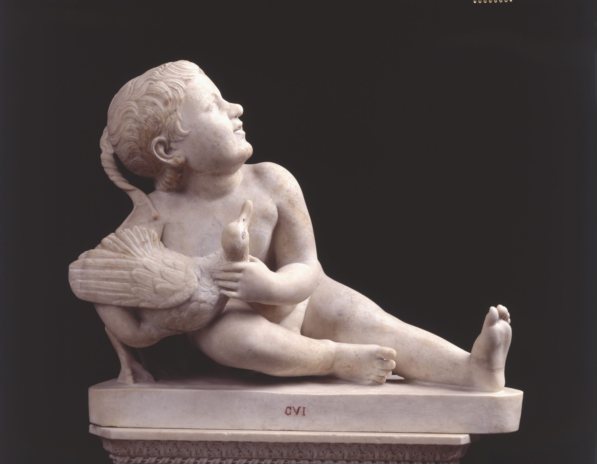

**内容（这是什么）**：一个胖乎乎的裸体男孩坐在地上，左腿伸直、脚尖朝上，右腿屈在身前，用右臂把一只鸭子搂在胸口、左手抓着鸭脖子。头微微仰向左侧、咧嘴而笑，是典型的幼童丰润体态。

**背景 / 看点**：公元 2 世纪的罗马复制品，仿一件希腊化「童子与鸟」原型。老普林尼记载雕刻家波厄托斯（Boethos）做过一组「掐鹅的男孩」，常被视为这类复制品的源头——但本件不是掐鹅，而是温柔护着鸭子的「嬉戏版」。它 16 世纪中叶已见于卡尔皮（Carpi）红衣主教在奎里纳尔山花园里的喷泉装饰（与另一件成对，鸭口出水），1650 年起入博尔盖塞收藏，历史上被叫过「丽达与天鹅」「持鸟童子」等名。近世学者依 1970 年奥普隆蒂斯（Oplontis）波培娅别墅出土的同型像，把它归为「奥普隆蒂斯/博尔盖塞型」（童子嬉抱鸟，区别于「卡比托利欧/慕尼黑型」的掐鸟），并据风格推测男孩或可解作伊西斯（Isis）之子、埃及神荷鲁斯（Horus，又名哈尔波克拉特斯 Harpocrates）。顺路看：和同厅 CX「抱两只鸭子的男孩」是同一题材的两件，可对照看「嬉戏」与「掐扼」两种处理。

### ⭐ 顺路看 古罗马艺术《渔人与牧人的喷泉雕塑组》 / Roman art, _Fountain group with Fishermen and Shepherds_

- **作者 / Artist**：古罗马艺术 / Roman art
- **作品 / Work**：《渔人与牧人的喷泉雕塑组》 / _Fountain group with Fishermen and Shepherds_
- **时间**：公元 200–225 年
- **材质**：白大理石（含石膏补配）
- **尺寸**：高 85 cm
- **位置**：阿波罗与达芙妮厅（第 3 室）
- **官网介绍页**：[官网介绍英文](https://www.collezionegalleriaborghese.it/en/opere/fountain-group-with-fishermen-and-shepherds)｜馆藏编号 CVII

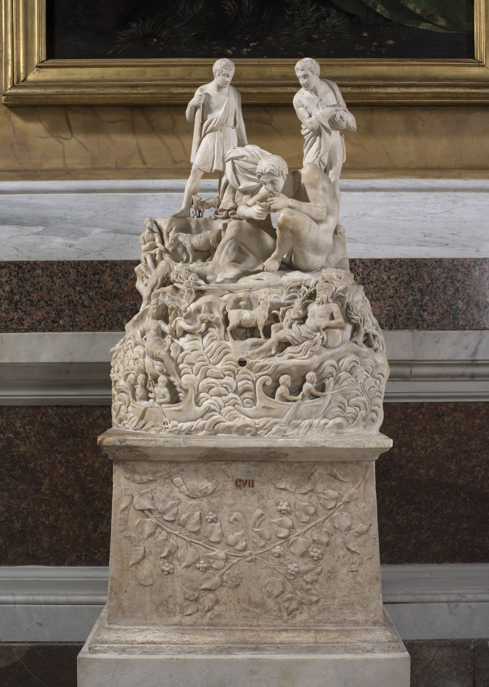

**内容（这是什么）**：一件喷泉装饰组的岩块——岩缝间是牧野世界（牧人看顾的山羊群，还有蜗牛、蜥蜴、野兔），下半被波浪犁开的是海洋世界（鱼、章鱼、两条各载桨手与渔夫的小船）；正面浪中浮出持桨、伴海怪的「海」女神塔拉萨（Thalassa），对岸是半卧、肘靠流水瓮的河神（脚边一孔正是出水口，点明它本是喷泉）。岩上三尊圆雕：较大的疑为开贝壳的渔夫，上方两尊是带山羊的牧人。

**背景 / 看点**：公元 200–225 年塞维鲁时期作品（白大理石含石膏补配）。这类「牧野＋海洋」风俗小景源自希腊化、罗马 3 世纪盛行（也见于石棺）。曾有人把端坐者读作向伽拉忒亚伸手的独眼巨人波吕斐摩斯，但更可能只是普通渔夫。顺路看，找海女神、河神与那个出水孔，体会它「会喷水的微缩山海」。

### ⭐ 顺路看 古罗马艺术《饰常春藤与缎带浮雕的祭坛》 / Roman art, _Altar with Ivy and Ribbons in Relief_

- **作者 / Artist**：古罗马艺术 / Roman art
- **作品 / Work**：《饰常春藤与缎带浮雕的祭坛》 / _Altar with Ivy and Ribbons in Relief_
- **时间**：公元 1 世纪上半叶
- **材质**：白大理石
- **尺寸**：高 44 cm；宽 63 cm；深 50 cm
- **位置**：阿波罗与达芙妮厅（第 3 室）
- **官网介绍页**：[官网介绍英文](https://www.collezionegalleriaborghese.it/en/opere/altar-with-ivy-and-ribbons-in-relief)｜馆藏编号 CVIIa

**内容（这是什么）**：一座略呈梯形的方形古罗马祭坛，上下有突出线脚。三个可见面几乎满雕茂密的常春藤枝叶与花朵，由上方两角飘下的缎带（taeniae）系住、在中间打成结——枝叶轮廓刻得清晰利落，营造出细腻的明暗起伏。

**背景 / 看点**：公元 1 世纪上半叶（奥古斯都时代）作品。它的装饰母题与奥古斯都于公元前 9 年所建《和平祭坛》（Ara Pacis）内壁上层的卷叶花饰非常接近——这正是断代的依据。它在本厅正充当着上面那件「渔人与牧人喷泉组」（CVII）的底座，约 1841–1859 年间被安置到此。顺路看：单纯的植物纹祭坛，看点在那份「奥古斯都式」精雅的卷叶浮雕，可与同厅的斯塔提乌斯祭坛（CCLa）、烛台基座（CXVIa）并看罗马祭坛装饰的不同路数。

### ⭐ 顺路看 古罗马艺术《美第奇型阿佛洛狄忒雕像，厄洛斯骑海豚》 / Roman art, _Statue of Aphrodite of the Medici type with Eros on a Dolphin_

- **作者 / Artist**：古罗马艺术 / Roman art
- **作品 / Work**：《美第奇型阿佛洛狄忒雕像，厄洛斯骑海豚》 / _Statue of Aphrodite of the Medici type with Eros on a Dolphin_
- **时间**：公元 2 世纪初
- **材质**：岛屿大理石
- **尺寸**：不含底座高 131 cm；海豚上厄洛斯高 73 cm
- **位置**：阿波罗与达芙妮厅（第 3 室）
- **官网介绍页**：[官网介绍英文](https://www.collezionegalleriaborghese.it/en/opere/statue-of-aphrodite-of-the-medici-type-with-eros-on-a-dolphin)｜馆藏编号 CVIII

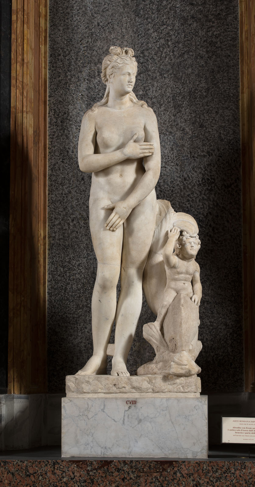

**内容（这是什么）**：「含羞维纳斯」（Aphrodite Pudica）的罗马复制品，属希腊化「美第奇型」——女神全裸、重心落左腿，双手作遮胸掩体的含羞姿；右侧一个骑海豚的小爱神（Eros）既作支撑，又点出她「自海浪中诞生」。

**背景**：公元 2 世纪上半叶的岛屿大理石作品（仅女神躯干、上肢与厄洛斯局部为古代真品，余多后世补配）。型出自佛罗伦萨乌菲兹那尊带「雅典人克莱奥墨涅斯」签名的名作；本件曾长期立在别墅园中椭圆喷泉旁作装饰，1888 年才移入本厅。

**看点**：顺路看。看「含羞遮掩」反而强调裸露的经典姿态，以及海豚＋小爱神这一「海中诞生」的支撑巧思；柔和富明暗的肌体处理是罗马 2 世纪的手法。

### ⭐ 顺路看 古罗马艺术《抱两只鸭子的男孩雕像》 / Roman art, _Statue of a Boy with Two Ducks_

- **作者 / Artist**：古罗马艺术 / Roman art
- **作品 / Work**：《抱两只鸭子的男孩雕像》 / _Statue of a Boy with Two Ducks_
- **时间**：公元 2 世纪
- **材质**：白大理石
- **尺寸**：不含底座高 73 cm
- **位置**：阿波罗与达芙妮厅（第 3 室）
- **官网介绍页**：[官网介绍英文](https://www.collezionegalleriaborghese.it/en/opere/statue-of-a-boy-with-two-ducks)｜馆藏编号 CX

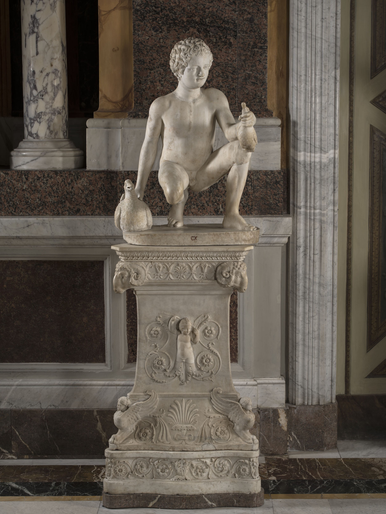

**内容（这是什么）**：一个蹲跪的裸体男孩，右腿屈跪、靠左腿支撑，右手按着地上一只鸭子，左手又抓着另一只鸭子的脖子；头扭向左侧，满头卷发、咧嘴而笑。

**背景 / 来历**：题材与同厅 CVI「抱鸭男孩」同源——都上溯老普林尼记载、归于雕刻家波厄托斯（Boethos）的希腊化「掐鹅男孩」原型，本件是公元 2 世纪的罗马变体。但要紧的是它的「身世」：**全像只有男孩的躯干是古代真品**，头、四肢、两只鸭子和底座几乎全是后世（1700 年前）补配，1819 年又经雕刻家费利切·费斯塔（Felice Festa）修复。1700 年它被当作「冬之拟人」记录在别墅内，后送往弗拉斯卡蒂的蒙德拉戈内别墅，1819 年因博尔盖塞古物大批卖给拿破仑、别墅亟需补陈而调回。**看点**：顺路看，又一例「古代真躯干＋大段后补」。因残存太少，连题材都存疑——有人猜原本可能是「掐蛇的小赫拉克勒斯」。和近旁 CVI 并看，可直观体会同一题材「原作残件」与「重度修复件」的差别；它就立在本厅那对三角基座（CVIa-CXa）之一上。

### ⭐ 顺路看 古罗马艺术《小像：科瑞修复扮作伊西斯》 / Roman art, _Statuette of a Kore Restored as Isis_

- **作者 / Artist**：古罗马艺术 / Roman art
- **作品 / Work**：《小像：科瑞修复扮作伊西斯》 / _Statuette of a Kore Restored as Isis_
- **时间**：公元 2 世纪
- **材质**：白大理石
- **尺寸**：不含底座高 106 cm；总高 112 cm
- **位置**：阿波罗与达芙妮厅（第 3 室）
- **官网介绍页**：[官网介绍英文](https://www.collezionegalleriaborghese.it/en/opere/statuette-of-a-kore-restored-as-isis)｜馆藏编号 CXI

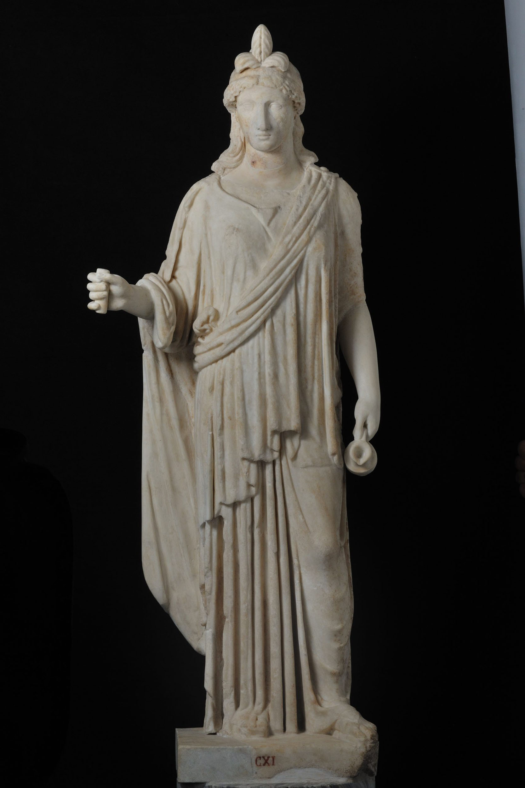

**内容（这是什么）**：一尊小于真人的披衣女像，重心落右腿、左腿微屈侧后。她穿长及足的希顿（chiton），外裹一件大幅斜披的希玛纯（himation），披风搭在前伸的右臂上（原本手中应持物，已修配）；左臂顺身下垂，手持一只小奥诺克瓶（oinochoe，长嘴酒罐），头戴饰一朵大莲花的冠。

**背景 / 看点**：本体是公元 2 世纪新阿提卡工匠仿古风「少女像（kore）」的罗马复制品——希顿衣褶密而僵直、姿态板正，正是「拟古」特征。它的身份几经改换：1650 年被叫作谷物女神刻瑞斯（Ceres）、1700 年称「持罂粟的刻瑞斯」；早年某次修复给它加上头顶莲花与小瓶，又把它改成了埃及女神伊西斯（Isis）；1828 年安东尼奥·德·埃斯特（Antonio D'Este）再修，主要补刻头发与脸。顺路看：典型的「古身＋后世添道具改换身份」之作，本厅同类还有数件（如阿波罗组装像 CXVII、扮阿波罗的男孩 CXXI），可串看这种「靠后加道具变神」的套路。

### ⭐ 顺路看 希腊化艺术《饰舞蹈人物的调酒缸》 / Arte ellenistica, _Krater with Dancing Figures_

- **作者 / Artist**：希腊化艺术 / Arte ellenistica
- **作品 / Work**：《饰舞蹈人物的调酒缸》 / _Krater with Dancing Figures_
- **时间**：公元前 1 世纪
- **材质**：彭忒利科大理石
- **尺寸**：高 73 cm
- **位置**：阿波罗与达芙妮厅（第 3 室）
- **官网介绍页**：[官网介绍英文](https://www.collezionegalleriaborghese.it/en/opere/krater-with-dancing-figures)｜馆藏编号 CXVI

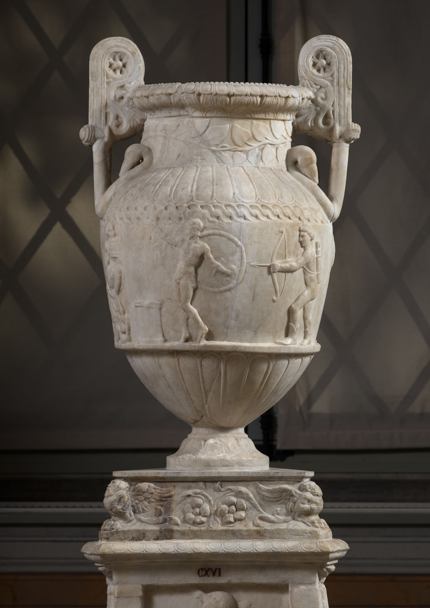

**内容（这是什么）**：公元前 1 世纪的新阿提卡大理石调酒缸（krater），1832 年前发现于博尔盖塞家族 Torrenova 庄园，是现存最早的新阿提卡雕刻之一。缸身浮雕一圈：三名着长衣女子与三名持盔、盾、剑的裸体男子，在端坐吹排箫的牧神潘（Pan）前起舞；其中一名女子被后世胡乱修成「阿波罗」，那个持弓的小爱神也是后补。

**背景 / 看点**：颈部缠常春藤、口沿饰卵锭纹，两耳作天鹅颈造型、收为卷涡加玫瑰花心。女子属「三位披衣舞女」程式（4 世纪雅典宁芙浮雕传统），男子的持械之舞叫 pyrrhiche；男女两主题并置，正体现公元前 1 世纪雅典新阿提卡艺术的折衷趣味（同作坊还出了卢浮宫著名的「索西比俄斯瓶」）。顺路看，绕缸看那圈舞蹈饰带与天鹅耳。

### ⭐ 顺路看 古罗马艺术《烛台基座》 / Roman art, _Candelabra Base_

- **作者 / Artist**：古罗马艺术 / Roman art
- **作品 / Work**：《烛台基座》 / _Candelabra Base_
- **时间**：公元前 1 世纪
- **材质**：彭忒利科大理石
- **尺寸**：高 141 cm
- **位置**：阿波罗与达芙妮厅（第 3 室）
- **官网介绍页**：[官网介绍英文](https://www.collezionegalleriaborghese.it/en/opere/candelabra-base)｜馆藏编号 CXVIa

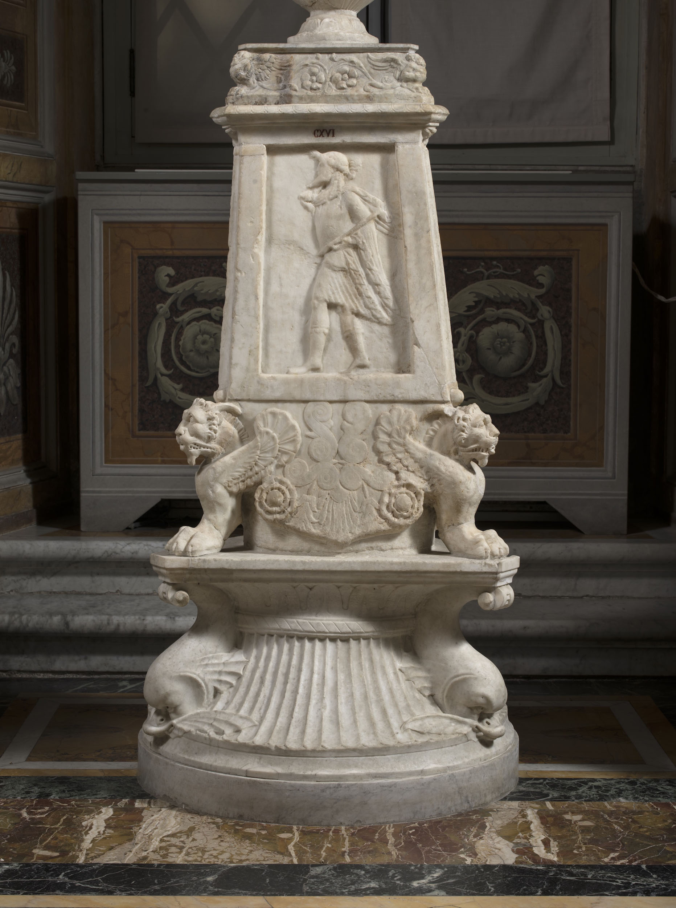

**内容（这是什么）**：一座三角形烛台基座，立在一个近代加配的圆形底座上。三个角各饰一只长羊角、狮头的有翼鹰首狮身兽（griffin）头像；三个侧面分别浮雕赫尔墨斯（Hermes，持双蛇杖）、狄俄倪索斯（Dionysus，持苹果与酒神杖）和一名女性（多被认作维纳斯 Venus，也有学者读作四季女神 Horae 之一）。三神皆侧身、僵直地向左移步，是典型的「拟古」程式。

**背景 / 看点**：公元前 1 世纪的新阿提卡作品（彭忒利科大理石），多半来自雅典，是同型烛台座的复制谱系之一（卢浮宫、保守宫、梵蒂冈、突尼斯马赫迪亚沉船都有同类）。1804 年已记录在别墅、当时被误称「伊特鲁里亚祭坛」；圆底座与海豚、上沿线脚都是 19 世纪补配。它原本顶上还放着一只调酒缸。顺路看：看点在三神的拟古浮雕与角上的鹰首狮身兽，可与同厅另一件新阿提卡石器——「饰舞蹈人物的调酒缸」（CXVI）配套看，两件正好是新阿提卡作坊「基座＋缸」的典型组合。

### ⭐ 顺路看 古罗马艺术《阿波罗雕像，伴鹰首狮身兽与三脚架，配非相关头像》 / Roman art, _Statue of Apollo with Griffin and Tripod, with unrelated Head_

- **作者 / Artist**：古罗马艺术 / Roman art
- **作品 / Work**：《阿波罗雕像，伴鹰首狮身兽与三脚架，配非相关头像》 / _Statue of Apollo with Griffin and Tripod, with unrelated Head_
- **时间**：公元 130–140 年（雕像）；公元前 1 世纪（头部）
- **材质**：白大理石（雕像）；彭忒利科大理石（头部）
- **尺寸**：高 141 cm；头部 21.5 cm
- **位置**：阿波罗与达芙妮厅（第 3 室）
- **官网介绍页**：[官网介绍英文](https://www.collezionegalleriaborghese.it/en/opere/statue-of-apollo-with-griffin-and-tripod-with-unrelated-head)｜馆藏编号 CXVII

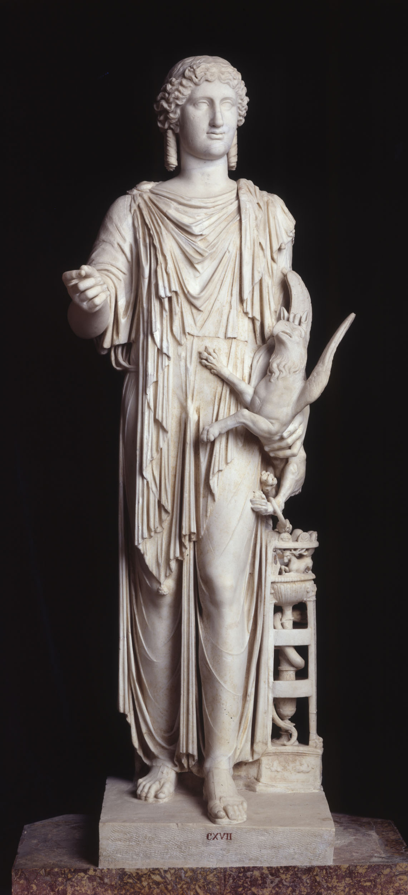

**内容（这是什么）**：略小于真人的阿波罗（Apollo）像，左腿前迈、右臂前伸（原握的祭碟已失），左手扶一只鹰首狮身兽（griffin）——griffin 与基座上成对的飞天鹅都暗示阿波罗自极北「希珀玻瑞亚」之地归来。左侧的三脚架（tripod，德尔斐神谕之器）中柱缠着被他射杀的巨蟒皮同（Python），盆沿还刻牡鹿与两把里拉琴，影射他与赫拉克勒斯争夺三脚架的神话。

**背景**：哈德良时代罗马工坊的「拟古」组装件——衣纹混用古风与古典两套样式；那颗头并非原配，是新阿提卡的阿波罗头（约公元前 5 世纪末原型）。1888 年才移入本厅，顶替送往楼上待售的「阿那克里翁」像。

**看点**：顺路看。这是「集各时代元素于一身的拟古拼装＋后配头」的典型——找三脚架上的蟒蛇皮同、基座的飞天鹅、盆沿的鹿与里拉，全是阿波罗神话的密码。

### ⭐ 顺路看 古罗马艺术《扮作阿波罗的男孩雕像，配非相关肖像头像》 / Roman art, _Statue of a Boy as Apollo, with unrelated Head Portrait_

- **作者 / Artist**：古罗马艺术 / Roman art
- **作品 / Work**：《扮作阿波罗的男孩雕像，配非相关肖像头像》 / _Statue of a Boy as Apollo, with unrelated Head Portrait_
- **时间**：公元 2 世纪（人像）；公元 2–3 世纪（头部）
- **材质**：白大理石
- **尺寸**：不含底座高 97 cm；头部 16 cm
- **位置**：阿波罗与达芙妮厅（第 3 室）
- **官网介绍页**：[官网介绍英文](https://www.collezionegalleriaborghese.it/en/opere/statue-of-a-boy-as-apollo-with-unrelated-head-portrait)｜馆藏编号 CXXI

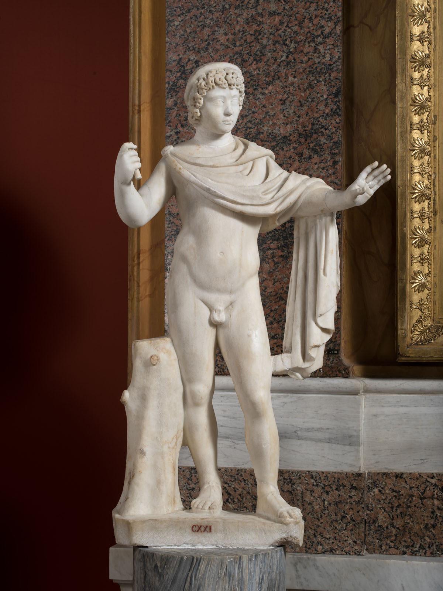

**内容（这是什么）**：一尊小型裸体男童立像，重心落左腿、右腿前伸，斗篷搭在水平抬起的左臂上。因姿态（左臂侧展、原本下垂的右臂、头的朝向）近似梵蒂冈名作《观景殿的阿波罗》（射手阿波罗），故被认作阿波罗。

**背景 / 看点**：人像为公元 2 世纪，但配了一颗**非原配的男童肖像头**（公元 2–3 世纪之交）——大眼凸出、瞳孔上挑、卷发用跑钻打出强烈明暗，是塞维鲁时代肖像风格，隐约让人想起盖塔、卡拉卡拉的童年像。1828 年由安东尼奥·德·埃斯特修复、先置第 1 室，1888 年移入本厅。顺路看，又一例「古身＋后配头」，可与同厅阿波罗像（CXVII）对照。

### ⭐ 顺路看 古罗马艺术《小像：阿耳忒弥斯》 / Roman art, _Statuette of Artemis_

- **作者 / Artist**：古罗马艺术 / Roman art
- **作品 / Work**：《小像：阿耳忒弥斯》 / _Statuette of Artemis_
- **时间**：公元 2 世纪
- **材质**：白大理石
- **尺寸**：不含底座高 92 cm；头部 12 cm
- **位置**：阿波罗与达芙妮厅（第 3 室）
- **官网介绍页**：[官网介绍英文](https://www.collezionegalleriaborghese.it/en/opere/statuette-of-artemis)｜馆藏编号 CXXIII

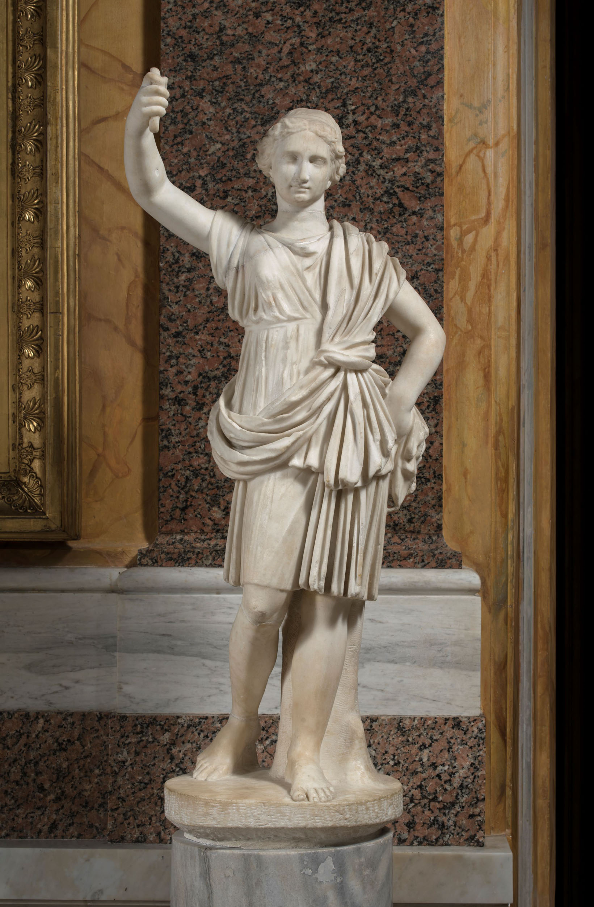

**内容（这是什么）**：一尊小型狩猎女神阿耳忒弥斯（Artemis）像，重心落左腿、右腿后撤，呈行走之势。她穿一件束在胸下的短希顿（chiton），外面的希玛纯（himation）斜搭过胸、在身前打成一团柔软的褶结，左手在胯边攥着垂落的衣料；右臂（修复件）上举。

**背景 / 来历**：公元 2 世纪罗马作品，**古代真品仅存躯干**，底座、右足、左腿下段、右臂右肩皆为后补。1828 年由安东尼奥·德·埃斯特（Antonio D'Este）修复（账目记为「狄安娜小像」，费 80 斯库多、配了一颗合适的头），此后辗转第 2 室、第 1 室，1888 年才定位本厅。**看点**：顺路看。早年曾被当作亚马逊女战士，今多依短希顿、前结的披风与手臂姿态，归入「拉夫里亚型阿耳忒弥斯」（Laphria Artemis，原型据保萨尼阿斯归于雕刻家达摩丰）。和同厅几尊「古身＋后配头/后补肢」的像（CXI、CX、CXXI）一样，是辨认古代真品与近代修复的好例子。

### ⭐ 顺路看 古罗马艺术《雪花石狮子雕像》 / Roman art, _Statue of a Lion of alabaster_

- **作者 / Artist**：古罗马艺术 / Roman art
- **作品 / Work**：《雪花石狮子雕像》 / _Statue of a Lion of alabaster_
- **时间**：公元 1 世纪（躯体）；16 世纪（头部）
- **材质**：雪花石膏
- **尺寸**：高 44 cm；宽 66 cm
- **位置**：阿波罗与达芙妮厅（第 3 室）
- **官网介绍页**：[官网介绍英文](https://www.collezionegalleriaborghese.it/en/opere/statue-of-a-lion-of-alabaster)｜馆藏编号 CXXXXII

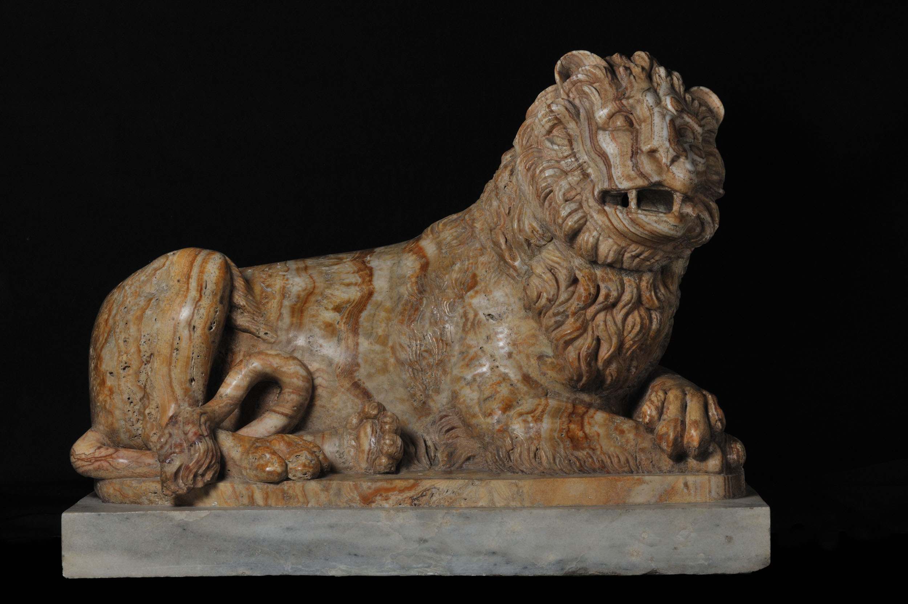

**内容（这是什么）**：一头蹲伏的雪花石狮子。它的躯体是公元 1 世纪的古代真品，**那颗明显偏大的头却是 16 世纪的一具喷泉面具改装上去的**——头身石料的纹理、颜色对不上，鬃毛后还能看到拼接的嵌块。文献还显示狮背上原本坐着一个小天使（putto）。

**背景 / 看点**：这类雪花石狮属希腊化风格的丧葬纪念物母题，在中意大利和亚得里亚海一带的墓碑上很常见——狮子是「守墓者」，既隐喻死亡的暴烈，又是对逝者的颂扬。它原属乔瓦尼·巴蒂斯塔·德拉·波尔塔（Giovanni Battista Della Porta）收藏（当时记作「黄大理石狮子带小巴库斯」），1607 年由乔瓦尼·巴蒂斯塔·博尔盖塞购入；因被当作近代作品，1807 年才幸免于卖给拿破仑，后由第 1 室移入本厅。1617 年石匠贝尔纳迪诺·拉迪（Bernardino Radi）曾修过它，腹、颈、左后腿、尾都由不同雪花石碎块拼合。**看点**：顺路看。最值得找的是那处「头身错配」——盯头与鬃毛交界的拼缝、比例失调的大头和变了的石纹，正是「古代躯体＋16 世纪喷泉面具改头」的活标本。

## 其他

### 安东尼奥·阿斯普鲁奇《第三厅装饰设计》 / Antonio Asprucci, _Decorative Design of Room 3_

- **设计 / Design**：安东尼奥·阿斯普鲁奇 / _Antonio Asprucci_（1723–1808）
- **时间**：1780–1785 年

Sala III 的 18 世纪装饰是围绕贝尼尼《阿波罗与达芙妮》重新组织的。贝尼尼雕塑最初靠近礼拜堂旁墙放置，18 世纪末才移到现在的中心位置；房间天顶和周边装饰也随之被设计成呼应雕塑主题的整体空间。
