第 4 室（皇帝厅）四壁列十七位古罗马皇帝的彩色斑岩胸像，正中是贝尼尼的《普洛塞庇娜被劫》——巴洛克雕塑的巅峰之一，冥王的手指陷进少女的大腿；天顶绘《伽拉忒亚的胜利》。

**必看与核心展品（⭐⭐⭐ 必看 + 核心）**

| 推荐 | 展品 | 作者 | 一句话看点 |
|---|---|---|---|
| ⭐⭐⭐ 必看 | 《普洛塞庇娜被劫》 | 吉安·洛伦佐·贝尼尼 | 「手指陷进大理石」的名场面，绕看抢夺动势 |
| ⭐⭐ 推荐 | 天顶《伽拉忒亚故事》（含《伽拉忒亚的胜利》） | 德·安杰利斯 | 海中仙女驾贝车的胜利，与四壁帝王相映 |

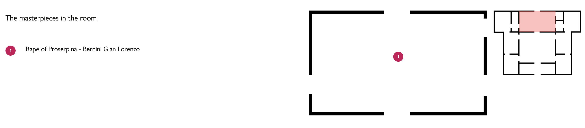

**展厅官网介绍页**：[Room 4 - Room of the Emperors](https://galleriaborghese.cultura.gov.it/en/il-museo/la-villa/sala-4-sala-degli-imperatori/)

## 核心展品

### ⭐⭐⭐ 必看 吉安·洛伦佐·贝尼尼《普洛塞庇娜被劫》 / Gian Lorenzo Bernini, _Rape of Proserpine_

- **作者 / Artist**：吉安·洛伦佐·贝尼尼（1598–1680） / Gian Lorenzo Bernini（1598–1680）
- **作品 / Work**：《普洛塞庇娜被劫》 / _Rape of Proserpine_
- **时间**：1621–1622
- **材质**：大理石
- **尺寸**：高 255 cm，不含底座
- **位置**：皇帝厅（第 4 室）
- **官网介绍页**：[普罗塞庇娜的劫掠 / Ratto di Proserpina｜Galleria Borghese 官方藏品库](https://www.collezionegalleriaborghese.it/opere/ratto-di-proserpina)｜馆藏编号 CCLXVIII

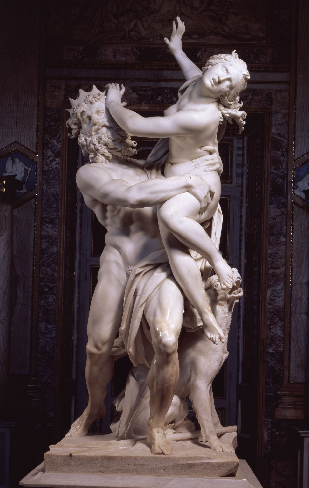

**内容（这是什么）**：本厅正中这组高 2.55 米的大理石群像，定格的是冥王普鲁托（Pluto，希腊名哈得斯）抢夺谷物女神之女普洛塞庇娜（Proserpina，希腊名珀耳塞福涅）的瞬间。神话见于克劳狄安与奥维德《变形记》：少女在恩纳附近的湖畔采花，被破地而出的冥王掳走；母亲、丰收女神刻瑞斯（Ceres）痛失爱女，令大地干旱荒芜，迫使朱庇特（Jupiter）出面调停，约定普洛塞庇娜每年有一段时间返回人间——这正是四季循环的由来。贝尼尼（Gian Lorenzo Bernini）不画故事的开头或结尾，只抓最暴烈的一刻：冥王已把挣扎的少女架起、正要拖入冥府。

**技法：让大理石长出血肉**：群像作于 1621–1622 年，贝尼尼时年才二十出头。最被反复引用的细节，是普鲁托五指掐进普洛塞庇娜大腿与腰侧、把坚硬的石头压出柔软"陷肉"的错觉——硬质材料模拟出体温与弹性，这是贝尼尼"用大理石挑战绘画"的招牌手法。他通过长期研究古代雕像、重新发掘古代技法，把紧绷的肌肉、柔嫩的肌肤、飞扬的发须和滚落的泪珠这些截然不同的质感，一次性凿在同一块石头上。

**委托与流转史**：群像由红衣主教希皮奥内·博尔盖塞（Scipione Borghese）委托，1621 年 6 月有一笔 300 斯库多的分期付款记录。但作品几乎一完工就易主：1621 年初卢多维西家族的成员当选教皇格里高利十五世，博尔盖塞为讨好新任枢机卢多维科·卢多维西（Ludovico Ludovisi），随即把这件杰作转赠出去，1622 年运抵卢多维西别墅。19 世纪末卢多维西别墅因城市改造被拆，群像几经辗转，1908 年由意大利国家购入博尔盖塞美术馆，安置在皇帝厅正中；原带巴贝里尼（即后来的教皇乌尔班八世）题诗的基座已佚，今座为 1911 年新配。

**图像学：站在古典的肩上**：群像的复杂缠绕姿态与少女的剧烈扭转，继承了 16 世纪样式主义"螺旋构图"的炫技传统；但普鲁托腿部那股蹬地发力的张力，公认呼应了博尔盖塞收藏中的古代名作《博尔盖塞角斗士》。贝尼尼把古代雕塑的力量感与卡拉奇法尔内塞宫天顶画的自然主义糅合，催生出一种全新的巴洛克语言，让神话"真实可信"。

**现场站看**：

1. **掐进大腿的手指**——绕到普洛塞庇娜右髋一侧，看普鲁托拇指与四指压入皮肉的"陷肉"凹陷。这是全馆最著名的"以石仿肉"细节，证明硬石也能装出弹性与体温。
2. **脸颊上的泪珠**——凑近看少女脸部，眼角有一颗将落未落的大理石泪滴；它点明这不是抒情画面，而是一桩暴力绑架。
3. **务必绕行一圈**——这组像为多角度观看而作：从普鲁托一侧看是力量、占有与胜利，从普洛塞庇娜一侧看是惊恐、挣扎与呼救，正面看两人脸朝相反方向。走一圈才看得全。
4. **她推拒的双手**——看少女一手抵住冥王的脸、一手向天张开求救，身体却被牢牢架住，制造出"想逃逃不掉"的瞬间张力。
5. **冥王发力的腿**——看他蹬地、肌肉贲张的下盘，这处姿态被认为直接引用了古代名作《博尔盖塞角斗士》。
6. **飞扬的须发与衣褶**——看冥王的卷须胡、少女飘起的发丝，再对比她光洁的肌肤，体会贝尼尼在同一块石头上凿出了多少种质感。
7. **脚边的三头犬刻耳柏洛斯（Cerberus）**——低头看群像底部，看守冥府入口的三头犬告诉你：这里已是冥界门口，劫掠正在"得逞"的临界点。
8. **与本厅的呼应**——看完雕塑，留意它被放在皇帝厅正中、四周环绕斑岩帝王胸像与海神主题天顶：一件讲"劫掠与季节循环"的神话群像，被嵌进一整套 18 世纪末的华丽陈列里。

## 天顶画

### ⭐⭐ 推荐 多梅尼科·德·安杰利斯《伽拉忒亚故事》 / Domenico de Angelis, _Stories of Galatea_

- **作者 / Artist**：多梅尼科·德·安杰利斯（1735–1804） / Domenico de Angelis（1735–1804）
- **组画**：《伽拉忒亚故事》 / _Stories of Galatea_
- **时间**：1778–1780 年
- **位置**：皇帝厅天顶

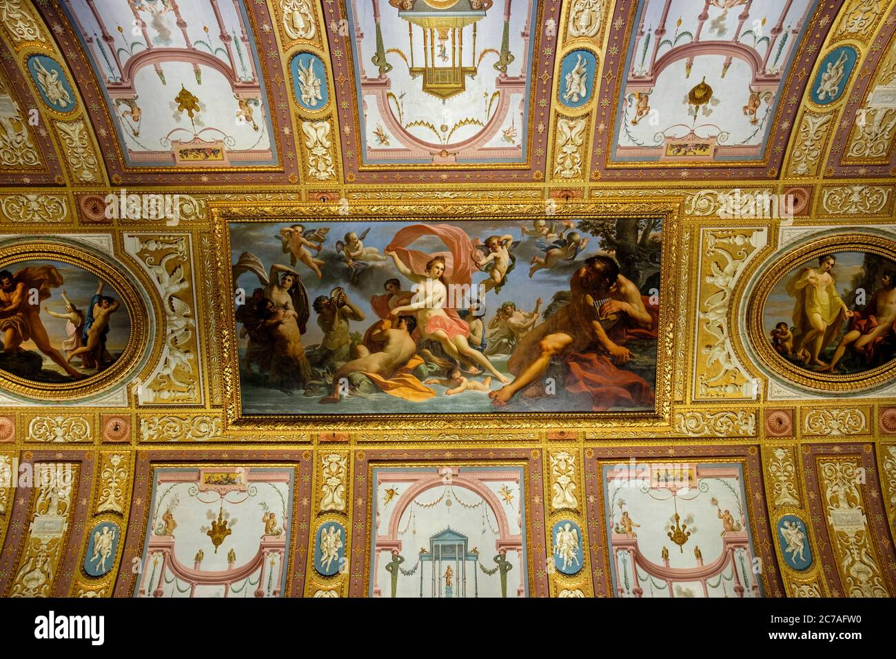

**内容（这是什么）**：占据皇帝厅整片天顶的大型组画，主题不是常被误传的"罗马诸神聚会"，而是取自奥维德《变形记》的海中仙女伽拉忒亚（Galatea）故事，由画家多梅尼科·德·安杰利斯（Domenico de Angelis）于 1778–1780 年绘制。

**背景 / 来历**：组画是 18 世纪末博尔盖塞别墅大改造的一部分，与房间正中的贝尼尼神话群像、四周的海神灰泥板共同把整厅统一在"古典神话 + 海洋"的主题之下。

**看点**：天顶分中央主画与四角侧画，串起伽拉忒亚、独眼巨人波吕斐摩斯（Polyphemus）与牧人阿喀斯（Acis）的三角悲剧。抬头时先找中央最亮处的主画，再顺着看四周椭圆，整条故事线就清楚了。

### ⭐⭐ 推荐 多梅尼科·德·安杰利斯《伽拉忒亚的胜利》 / Domenico de Angelis, _The Triumph of Galatea_

- **作者 / Artist**：多梅尼科·德·安杰利斯 / Domenico de Angelis
- **作品 / Work**：《伽拉忒亚的胜利》 / _The Triumph of Galatea_
- **时间**：1778–1780 年
- **位置**：天顶中央画

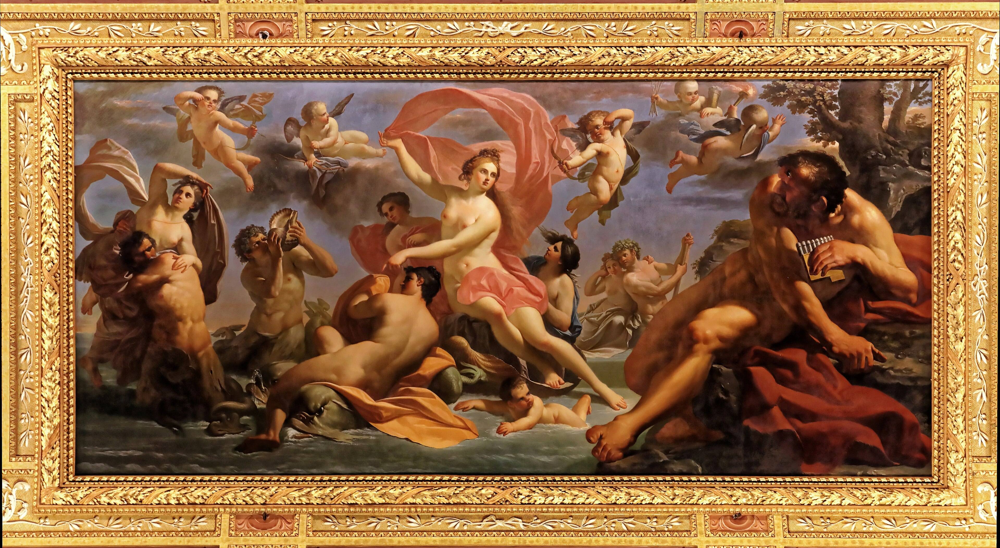
**内容（这是什么）**：天顶正中的主画。伽拉忒亚（Galatea）是海神涅柔斯（Nereus）的女儿，被独眼巨人波吕斐摩斯（Polyphemus）苦苦爱慕，自己却爱着英俊牧人阿喀斯（Acis）。

**背景 / 看点**：馆方说明特意点出人物方位——波吕斐摩斯在画面左侧、阿喀斯在右侧。现场站在厅中央抬头，认准这片最大最亮的场景，它是整个天顶叙事的核心。

### ⭐ 顺路看 多梅尼科·德·安杰利斯《波吕斐摩斯的嫉妒》 / Domenico de Angelis, _The Jealousy of Polyphemus_

- **作者 / Artist**：多梅尼科·德·安杰利斯 / Domenico de Angelis
- **作品 / Work**：《波吕斐摩斯的嫉妒》 / _The Jealousy of Polyphemus_
- **时间**：1778–1780 年
- **位置**：天顶侧面椭圆画之一

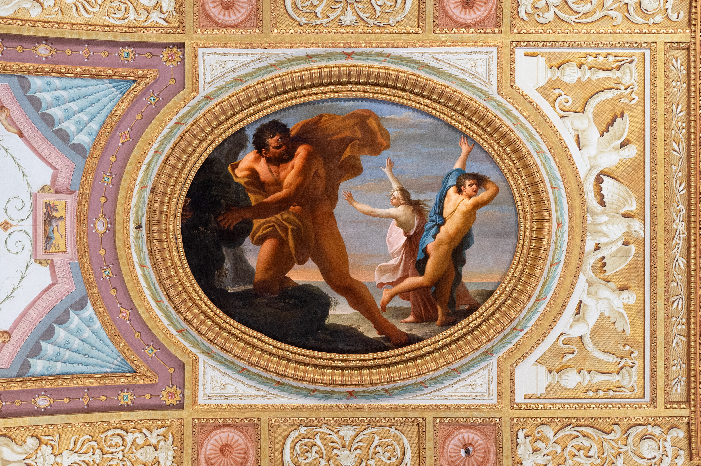

**内容 / 看点**：四角侧画之一，画波吕斐摩斯（Polyphemus）因嫉妒向情敌阿喀斯（Acis）投掷巨石。它是中央伽拉忒亚故事的悲剧转折——爱慕化为暴力。与对侧的《伽拉忒亚告别阿喀斯》连看，故事更完整。

### ⭐ 顺路看 多梅尼科·德·安杰利斯《伽拉忒亚告别阿喀斯》 / Domenico de Angelis, _Galatea's Farewell to Acis_

- **作者 / Artist**：多梅尼科·德·安杰利斯 / Domenico de Angelis
- **作品 / Work**：《伽拉忒亚告别阿喀斯》 / _Galatea's Farewell to Acis_
- **时间**：1778–1780 年
- **位置**：天顶侧面椭圆画之一

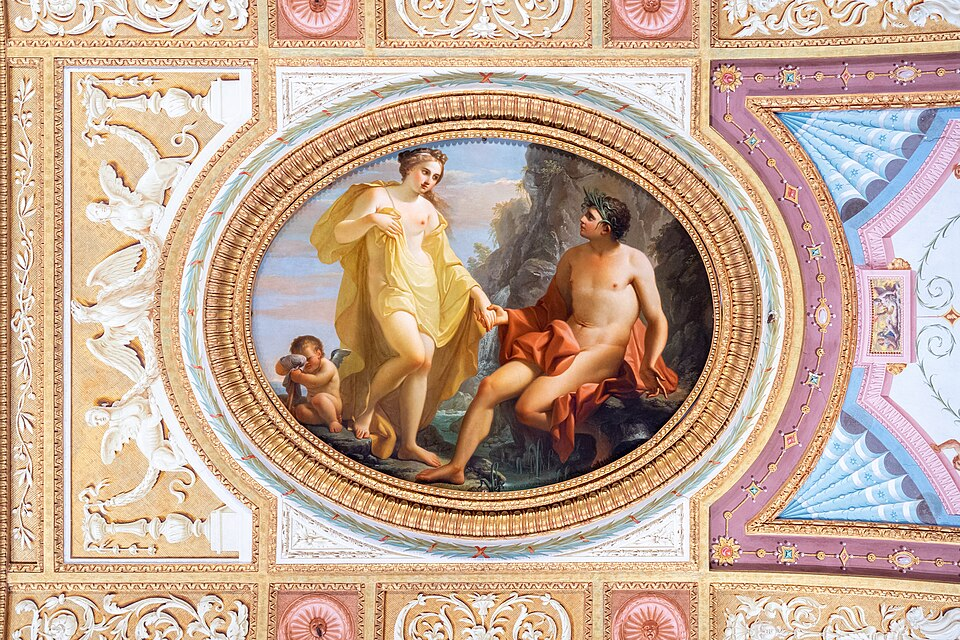

**内容 / 看点**：另一幅侧面椭圆画，伽拉忒亚（Galatea）向阿喀斯（Acis）诀别。按神话，阿喀斯被巨石砸死后化为一条溪流。把这两幅侧画与中央《伽拉忒亚的胜利》串起来，"爱—嫉妒—死亡—化为流水"的整条线就连上了。

### ⭐ 顺路看 乔阿基诺·阿格里科拉《星座、黄道十二宫与四季寓意像》 / Gioacchino Agricola, _Constellations, Signs of the Zodiac, and Allegories of the Four Seasons_

- **作者 / Artist**：乔阿基诺·阿格里科拉（活跃于 1758–1795） / Gioacchino Agricola（active 1758–1795）
- **作品 / Work**：《星座、黄道十二宫与四季寓意像》 / _Constellations, Signs of the Zodiac, and Allegories of the Four Seasons_
- **时间**：约 1778–1780 年 天顶装饰期
- **位置**：天顶小椭圆、圆形单色画与四季人物

**内容 / 看点**：这些不是主叙事画，而是天顶系统里的辅助图像：小椭圆画星座符号、圆形单色画（grisaille）画黄道十二宫，另有四季拟人像，由乔阿基诺·阿格里科拉（Gioacchino Agricola）绘制。它们与下方的四季坎塔罗斯杯、瓦拉迪耶桌上的四季头像互相呼应，把"四季 / 天象"的母题铺满全厅。

## 雕塑

本节先列馆方 Modern Sculpture 藏品列表，共 28 件。

### ⭐ 顺路看 安东尼奥·苏西尼《法尔内塞公牛，置于现代斑岩基座上》 / Susini Antonio, _Farnese Bull, on modern base of porphyry_

- **作者 / Artist**：安东尼奥·苏西尼 / Susini Antonio
- **作品 / Work**：《法尔内塞公牛，置于现代斑岩基座上》 / _Farnese Bull, on modern base of porphyry_
- **时间**：17 世纪初
- **材质**：青铜
- **尺寸**：高 47 cm
- **馆藏编号**：CCXLIX
- **位置**：皇帝厅（第 4 室）
- **官网介绍页**：[官网介绍英文](https://www.collezionegalleriaborghese.it/en/opere/farnese-bull-on-modern-base-of-porphyry)｜馆藏编号 CCXLIX

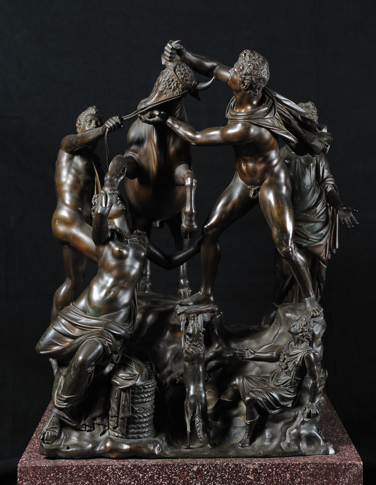

**内容（这是什么）**：佛罗伦萨雕塑家安东尼奥·苏西尼（Antonio Susini）制作的小型青铜，是著名古代巨像《法尔内塞公牛》的缩小复制品——原作描绘底尔刻（Dirce）被两兄弟绑上野牛受刑的神话场景。

**背景 / 看点**：苏西尼是詹博洛尼亚（Giambologna）工坊的高手，专做这类可上手把玩的青铜小样。它立在现代斑岩基座上，是 18 世纪末陈列里"以小铜件呼应古代名作"的典型；现场可对比它精细的失蜡铸造与四周的大理石作品。

### ⭐ 顺路看 马西米利亚诺·拉布勒尔与洛伦佐·卡尔代利《饰夏季形象的坎塔罗斯杯》 / Laboureur Massimiliano / Cardelli Lorenzo, _Kantharos vase with a representation of Summer_

- **作者 / Artist**：马西米利亚诺·拉布勒尔与洛伦佐·卡尔代利 / Laboureur Massimiliano / Cardelli Lorenzo
- **作品 / Work**：《饰夏季形象的坎塔罗斯杯》 / _Kantharos vase with a representation of Summer_
- **时间**：1783–1785 年
- **材质**：雕像用大理石
- **尺寸**：100 × 70 cm
- **馆藏编号**：CL
- **位置**：皇帝厅（第 4 室）
- **官网介绍页**：[官网介绍英文](https://www.collezionegalleriaborghese.it/en/opere/kantharos-vase-with-a-representation-of-summer)｜馆藏编号 CL

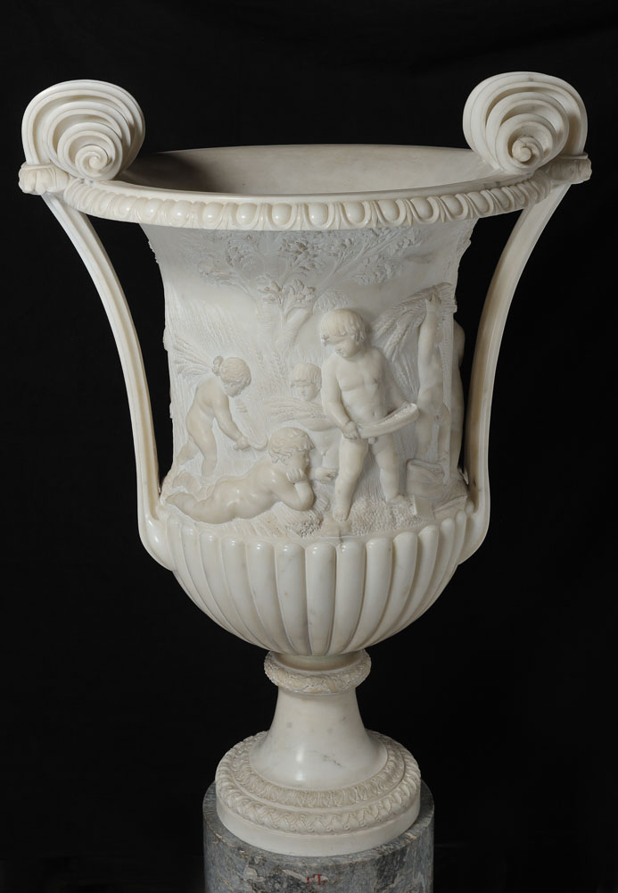

**内容（整组一次看）**：从这件起，本厅有一套四只大理石坎塔罗斯杯（kantharos，古希腊双耳高足酒杯），由雕刻家马西米利亚诺·拉布勒尔（Massimiliano Laboureur）与洛伦佐·卡尔代利（Lorenzo Cardelli）于 1783–1785 年制作，分别以浮雕表现春、夏、秋、冬四季。这一件是"夏"。

**背景 / 看点**：四季是本厅反复出现的母题（天顶的四季拟人、瓦拉迪耶桌上的四季头像都与之呼应）。四只杯造型相同、只换季节属物（夏多见麦穗），现场可四只并看，按属物认季节。

### ⭐ 顺路看 罗马学派《韦斯帕芗肖像》 / roman school, _Portrait of Vespasian_

- **作者 / Artist**：罗马学派 / roman school
- **作品 / Work**：《韦斯帕芗肖像》 / _Portrait of Vespasian_
- **时间**：17 世纪
- **材质**：斑岩与东方雪花石膏
- **尺寸**：高 90 cm
- **馆藏编号**：CLI
- **位置**：皇帝厅（第 4 室）
- **官网介绍页**：[官网介绍英文](https://www.collezionegalleriaborghese.it/en/opere/portrait-of-vespasian-1)｜馆藏编号 CLI

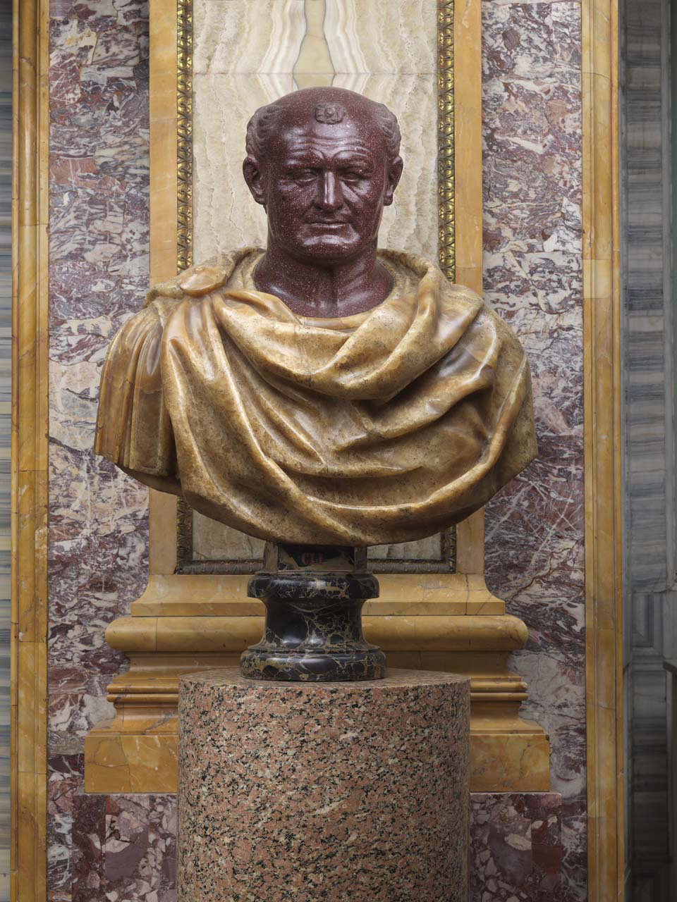

**内容（整组一次看）**：从这件起，本厅沿墙立着一长列彩色大理石人物胸像，这正是"皇帝厅（Sala degli Imperatori）"得名的由来。它们多为 17 世纪制作，典型做法是以斑岩雕躯干（斑岩自古象征"帝王紫"）、配东方雪花石膏等彩石，头像另雕；18 世纪末建筑师阿斯普鲁奇（Antonio Asprucci）改造本厅时把它们统一编排成"帝王仪仗"。

**背景 / 看点（整组通用）**：① 看材质即身份——斑岩的暗红紫正是古罗马的"帝王紫"，用昂贵彩石本身就是炫耀；② 它们不是古代原作，而是文艺复兴—巴洛克时期依古币、古像想象出的"仿古新作"，且常是头、身、胸分别拼配；③ 当装饰序列看——沿墙成排，为大厅铺出帝王谱系的底色。这一件是罗马皇帝韦斯帕芗（Vespasian，69–79 在位），弗拉维王朝开创者，以务实和兴建罗马斗兽场著称。

### ⭐ 顺路看 罗马学派《奥托肖像》 / roman school, _Portrait of Otho_

- **作者 / Artist**：罗马学派 / roman school
- **作品 / Work**：《奥托肖像》 / _Portrait of Otho_
- **时间**：17 世纪
- **材质**：斑岩与东方雪花石膏
- **尺寸**：高 95 cm
- **馆藏编号**：CLII
- **位置**：皇帝厅（第 4 室）
- **官网介绍页**：[官网介绍英文](https://www.collezionegalleriaborghese.it/en/opere/portrait-of-otho)｜馆藏编号 CLII

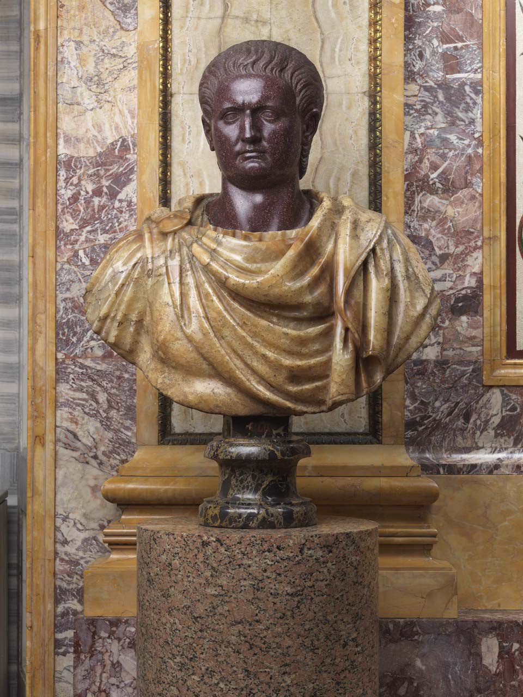

**内容 / 看点**：奥托（Otho），"四帝之年"（公元 69 年）第二位短命皇帝，在位仅约三个月。属本厅彩石帝王胸像系列之一，整组背景见编号 CLI 韦斯帕芗那件。

### ⭐ 顺路看 马西米利亚诺·拉布勒尔与洛伦佐·卡尔代利《饰秋季形象的坎塔罗斯杯》 / Laboureur Massimiliano / Cardelli Lorenzo, _Kantharos vase with a representation of Autumn_

- **作者 / Artist**：马西米利亚诺·拉布勒尔与洛伦佐·卡尔代利 / Laboureur Massimiliano / Cardelli Lorenzo
- **作品 / Work**：《饰秋季形象的坎塔罗斯杯》 / _Kantharos vase with a representation of Autumn_
- **时间**：1783–1785 年
- **材质**：雕像用大理石
- **尺寸**：100 × 70 cm
- **馆藏编号**：CLIII
- **位置**：皇帝厅（第 4 室）
- **官网介绍页**：[官网介绍英文](https://www.collezionegalleriaborghese.it/en/opere/kantharos-vase-with-a-representation-of-autumn)｜馆藏编号 CLIII

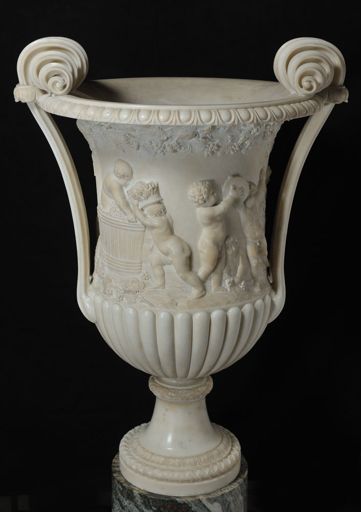

**内容 / 看点**：四季坎塔罗斯杯中的"秋"（多见葡萄藤蔓与果实）。整组造型一致、以浮雕属物区分季节，整组背景见编号 CL 那只"夏"。

### ⭐ 顺路看 罗马学派《图密善肖像》 / roman school, _Portrait of Domitian_

- **作者 / Artist**：罗马学派 / roman school
- **作品 / Work**：《图密善肖像》 / _Portrait of Domitian_
- **时间**：17 世纪
- **材质**：斑岩与东方雪花石膏
- **尺寸**：高 90 cm
- **馆藏编号**：CLIV
- **位置**：皇帝厅（第 4 室）
- **官网介绍页**：[官网介绍英文](https://www.collezionegalleriaborghese.it/en/opere/portrait-of-domitian)｜馆藏编号 CLIV

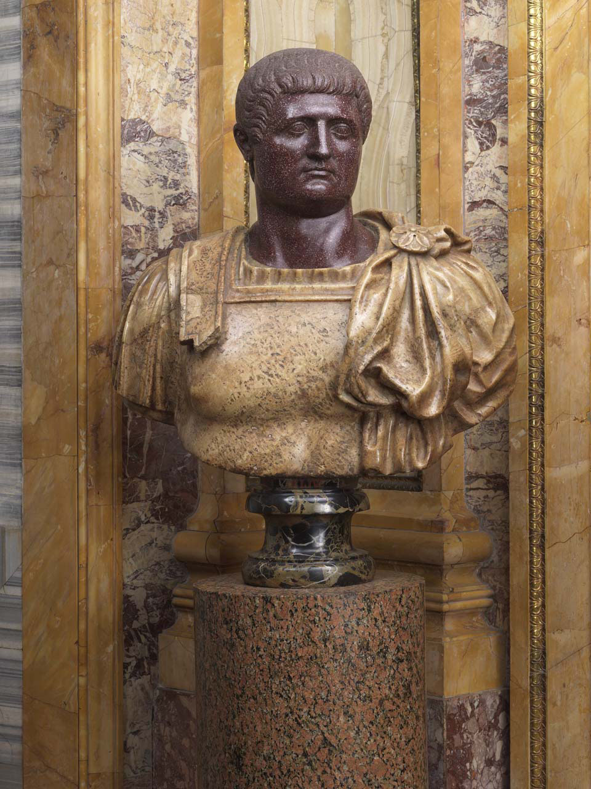

**内容 / 看点**：图密善（Domitian，81–96 在位），弗拉维王朝末帝，以专制和死后遭"除忆诅咒"闻名。系列之一，整组背景见编号 CLI。

### ⭐ 顺路看 马西米利亚诺·拉布勒尔与洛伦佐·卡尔代利《饰冬季形象的坎塔罗斯杯》 / Laboureur Massimiliano / Cardelli Lorenzo, _Kantharos vase with a representation of Winter_

- **作者 / Artist**：马西米利亚诺·拉布勒尔与洛伦佐·卡尔代利 / Laboureur Massimiliano / Cardelli Lorenzo
- **作品 / Work**：《饰冬季形象的坎塔罗斯杯》 / _Kantharos vase with a representation of Winter_
- **时间**：1783–1785 年
- **材质**：雕像用大理石
- **尺寸**：100 × 70 cm
- **馆藏编号**：CLVI
- **位置**：皇帝厅（第 4 室）
- **官网介绍页**：[官网介绍英文](https://www.collezionegalleriaborghese.it/en/opere/kantharos-vase-with-a-representation-of-winter)｜馆藏编号 CLVI

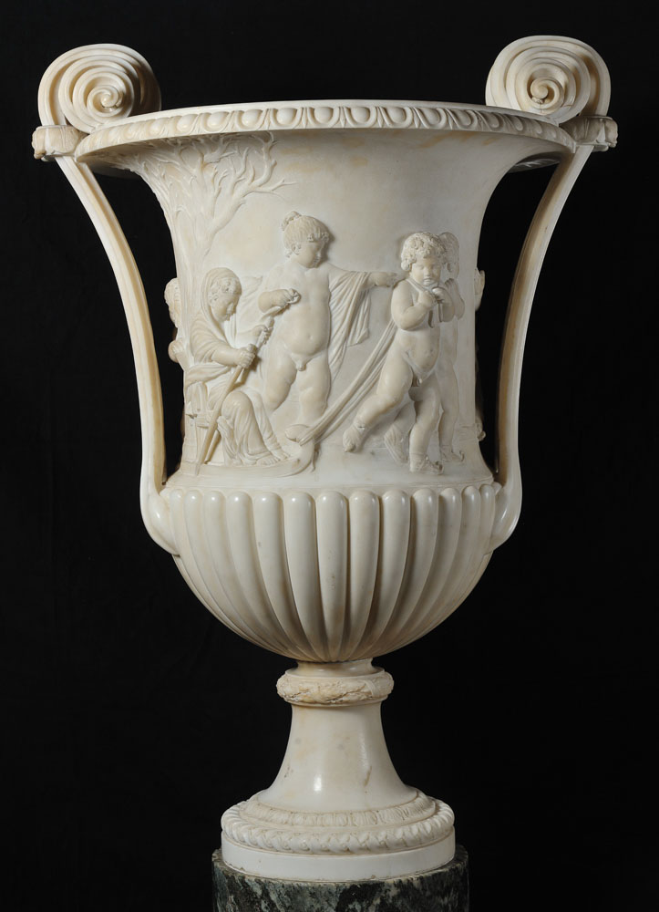

**内容 / 看点**：四季坎塔罗斯杯中的"冬"（多见枯枝、裹衣等寒季意象）。整组背景见编号 CL 那只"夏"。

### ⭐ 顺路看 罗马学派《卡利古拉肖像》 / roman school, _Portrait of Caligula_

- **作者 / Artist**：罗马学派 / roman school
- **作品 / Work**：《卡利古拉肖像》 / _Portrait of Caligula_
- **时间**：17 世纪
- **材质**：斑岩与东方雪花石膏
- **尺寸**：高 90 cm
- **馆藏编号**：CLVII
- **位置**：皇帝厅（第 4 室）
- **官网介绍页**：[官网介绍英文](https://www.collezionegalleriaborghese.it/en/opere/portrait-of-caligula)｜馆藏编号 CLVII

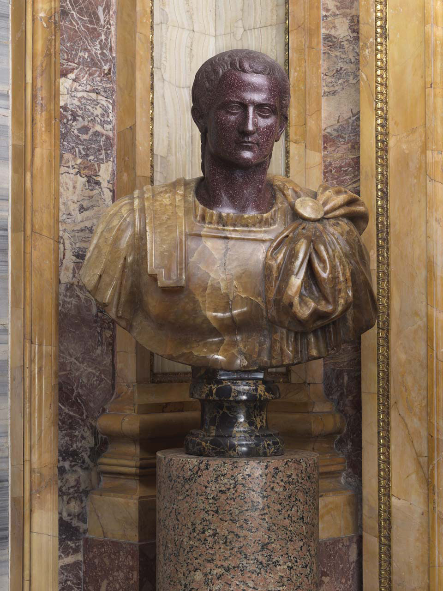

**内容 / 看点**：卡利古拉（Caligula，37–41 在位），以暴虐荒诞著称的青年皇帝。系列之一，整组背景见编号 CLI。

### ⭐ 顺路看 罗马学派《维特里乌斯肖像》 / roman school, _Portrait of Vitellius_

- **作者 / Artist**：罗马学派 / roman school
- **作品 / Work**：《维特里乌斯肖像》 / _Portrait of Vitellius_
- **时间**：17 世纪
- **材质**：斑岩与东方雪花石膏
- **尺寸**：高 88 cm
- **馆藏编号**：CLVIII
- **位置**：皇帝厅（第 4 室）
- **官网介绍页**：[官网介绍英文](https://www.collezionegalleriaborghese.it/en/opere/portrait-of-vitellius-2)｜馆藏编号 CLVIII

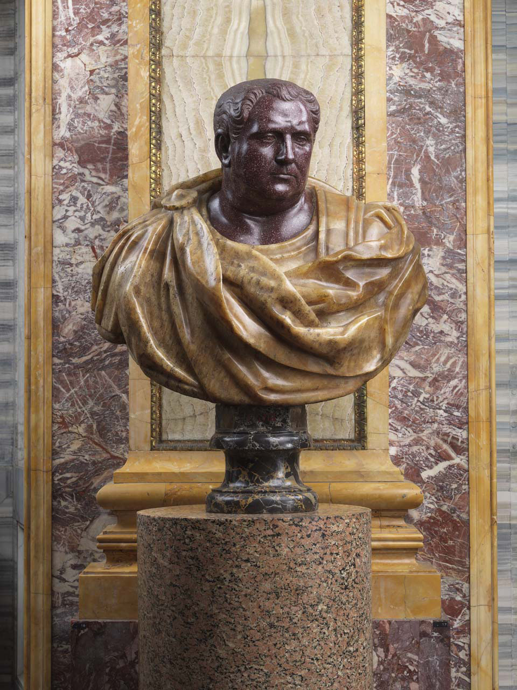

**内容 / 看点**：维特里乌斯（Vitellius），"四帝之年"第三位皇帝，以贪食形象流传。系列之一，整组背景见编号 CLI；本厅另有范切利所作同名胸像（编号 CXXXX）可对看。

### ⭐ 顺路看 罗马学派《提比略肖像》 / roman school, _Portrait of Tiberius_

- **作者 / Artist**：罗马学派 / roman school
- **作品 / Work**：《提比略肖像》 / _Portrait of Tiberius_
- **时间**：17 世纪
- **材质**：斑岩与东方雪花石膏
- **尺寸**：高 94 cm
- **馆藏编号**：CLXII
- **位置**：皇帝厅（第 4 室）
- **官网介绍页**：[官网介绍英文](https://www.collezionegalleriaborghese.it/en/opere/portrait-of-tiberius)｜馆藏编号 CLXII

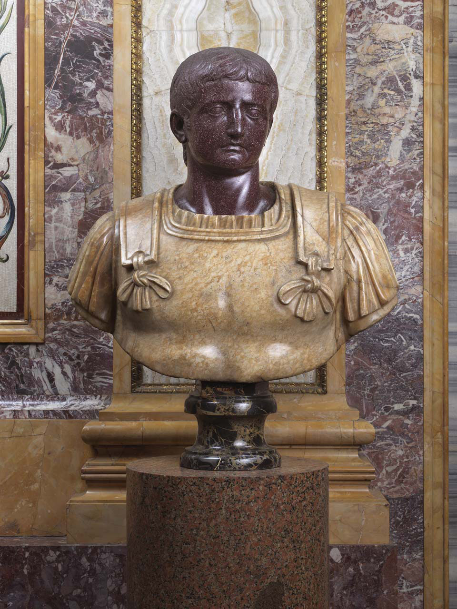

**内容 / 看点**：提比略（Tiberius，14–37 在位），奥古斯都的继任者。系列之一，整组背景见编号 CLI。

### ⭐ 顺路看 西尔维奥·卡尔奇《一对黑古大理石瓮，置于龙形支座和鎏金金属座上》 / Calci Silvio, _Pair of Urns in Nero Antico Marble Resting on Dragons with Gilded Metal Plinth_

- **作者 / Artist**：西尔维奥·卡尔奇 / Calci Silvio
- **作品 / Work**：《一对黑古大理石瓮，置于龙形支座和鎏金金属座上》 / _Pair of Urns in Nero Antico Marble Resting on Dragons with Gilded Metal Plinth_
- **时间**：17 世纪上半叶
- **材质**：黑古大理石与鎏金金属
- **尺寸**：52 × 60 cm
- **馆藏编号**：CLXIII-CLXVII
- **位置**：皇帝厅（第 4 室）
- **官网介绍页**：[官网介绍英文](https://www.collezionegalleriaborghese.it/en/opere/pair-of-urns-in-nero-antico-marble-resting-on-dragons-with-gilded-metal-plinth)｜馆藏编号 CLXIII-CLXVII

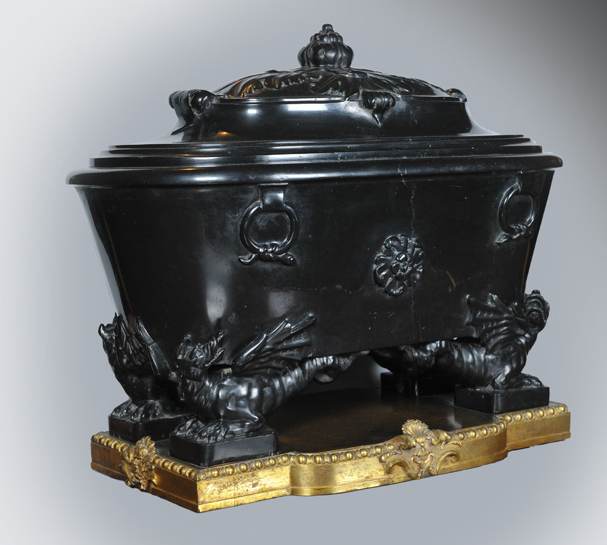

**内容（这是什么）**：一对黑古大理石（nero antico）瓮，由西尔维奥·卡尔奇（Silvio Calci）于 17 世纪上半叶制作，瓮身托在龙形支座上、配鎏金金属底座。

**看点**：深黑的古大理石配金色龙座，是巴洛克"珍贵彩石 + 鎏金"装饰趣味的标本；现场注意龙形支座的造型，以及金属与石材的色彩对比。

### ⭐ 顺路看 保罗·桑蒂《斑岩杯》 / Santi Paolo, _Porphyry cup_

- **作者 / Artist**：保罗·桑蒂 / Santi Paolo
- **作品 / Work**：《斑岩杯》 / _Porphyry cup_
- **时间**：1782–1783 年
- **材质**：斑岩
- **尺寸**：40 × 90 cm
- **馆藏编号**：CLXIV
- **位置**：皇帝厅（第 4 室）
- **官网介绍页**：[官网介绍英文](https://www.collezionegalleriaborghese.it/en/opere/porphyry-cup)｜馆藏编号 CLXIV

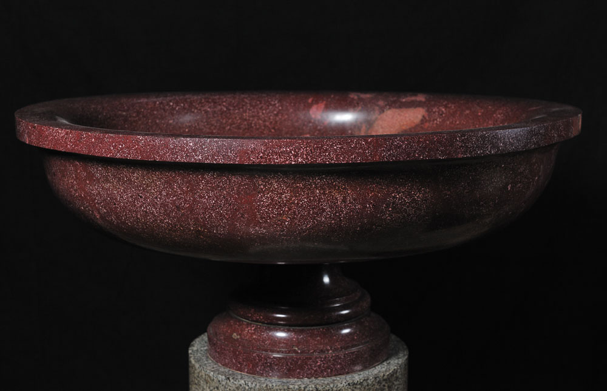

**内容 / 看点**：保罗·桑蒂（Paolo Santi）1782–1783 年制作的斑岩大杯。斑岩硬度极高、极难加工，能车磨出这样规整的大杯本身就是炫技；它属本厅"以名贵彩石呼应古代帝王气派"的装饰系统之一。

### ⭐ 顺路看 马西米利亚诺·拉布勒尔与洛伦佐·卡尔代利《饰春季形象的坎塔罗斯杯》 / Laboureur Massimiliano / Cardelli Lorenzo, _Kantharos vase with a representation of Spring_

- **作者 / Artist**：马西米利亚诺·拉布勒尔与洛伦佐·卡尔代利 / Laboureur Massimiliano / Cardelli Lorenzo
- **作品 / Work**：《饰春季形象的坎塔罗斯杯》 / _Kantharos vase with a representation of Spring_
- **时间**：1783–1785 年
- **材质**：雕像用大理石
- **尺寸**：100 × 70 cm
- **馆藏编号**：CXLVII
- **位置**：皇帝厅（第 4 室）
- **官网介绍页**：[官网介绍英文](https://www.collezionegalleriaborghese.it/en/opere/kantharos-vase-with-a-representation-of-spring)｜馆藏编号 CXLVII

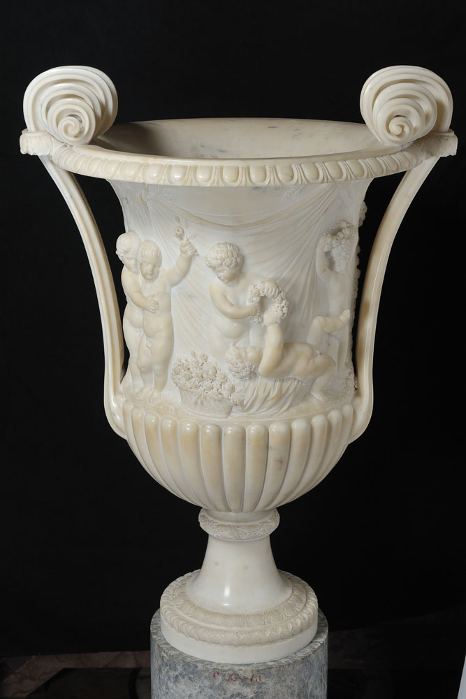

**内容 / 看点**：四季坎塔罗斯杯中的"春"（多见花卉与嫩枝）。整组背景见编号 CL 那只"夏"；现场把春夏秋冬四只串看最有意思。

### ⭐ 顺路看 罗马学派《图拉真肖像》 / roman school, _Portrait of Trajan_

- **作者 / Artist**：罗马学派 / roman school
- **作品 / Work**：《图拉真肖像》 / _Portrait of Trajan_
- **时间**：17 世纪
- **材质**：斑岩与东方雪花石膏
- **尺寸**：高 87 cm
- **馆藏编号**：CXXIV
- **位置**：皇帝厅（第 4 室）
- **官网介绍页**：[官网介绍英文](https://www.collezionegalleriaborghese.it/en/opere/portrait-of-trajan)｜馆藏编号 CXXIV

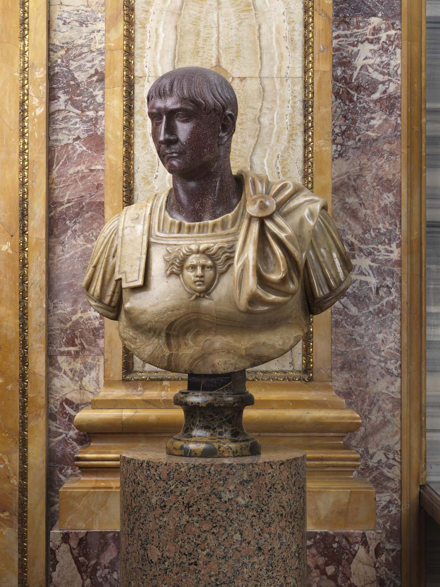

**内容 / 看点**：图拉真（Trajan，98–117 在位），"五贤帝"之一，帝国版图在他治下达到极盛。系列之一，整组背景见编号 CLI。

### ⭐ 顺路看 洛伦佐·尼扎与洛伦佐·卡尔代利《红斑岩无耳瓶》 / Nizza Lorenzo / Cardelli Lorenzo, _Vase without handles in red porphyry_

- **作者 / Artist**：洛伦佐·尼扎与洛伦佐·卡尔代利 / Nizza Lorenzo / Cardelli Lorenzo
- **作品 / Work**：《红斑岩无耳瓶》 / _Vase without handles in red porphyry_
- **时间**：1622 年后（至 1780 年）
- **材质**：斑岩
- **尺寸**：75 × 45 cm
- **馆藏编号**：CXXV
- **位置**：皇帝厅（第 4 室）
- **官网介绍页**：[官网介绍英文](https://www.collezionegalleriaborghese.it/en/opere/vase-without-handles-in-red-porphyry)｜馆藏编号 CXXV

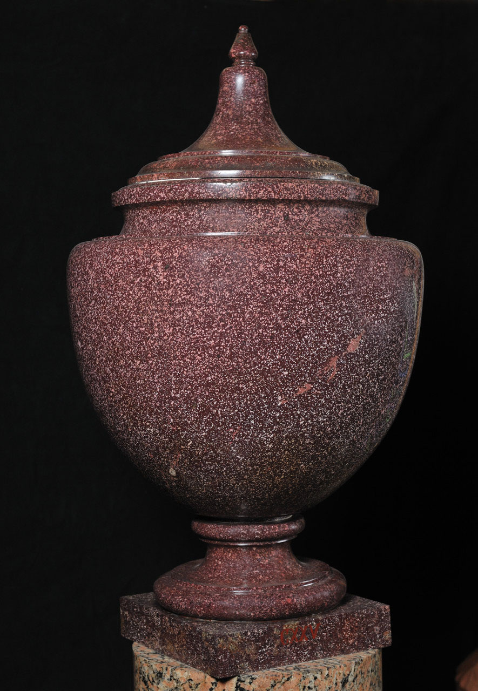

**内容 / 看点**：洛伦佐·尼扎（Lorenzo Nizza）与洛伦佐·卡尔代利（Lorenzo Cardelli）制作的红斑岩无耳瓶。与本厅另一只红斑岩带耳瓶（编号 CXXXVIII）成对；看点在斑岩的暗红紫色——古罗马的"帝王紫"，与满厅帝王主题相扣。

### ⭐ 顺路看 罗马学派《加尔巴肖像》 / roman school, _Portrait of Galba_

- **作者 / Artist**：罗马学派 / roman school
- **作品 / Work**：《加尔巴肖像》 / _Portrait of Galba_
- **时间**：17 世纪
- **材质**：斑岩与东方雪花石膏
- **尺寸**：高 90 cm
- **馆藏编号**：CXXVII
- **位置**：皇帝厅（第 4 室）
- **官网介绍页**：[官网介绍英文](https://www.collezionegalleriaborghese.it/en/opere/portrait-of-galba)｜馆藏编号 CXXVII

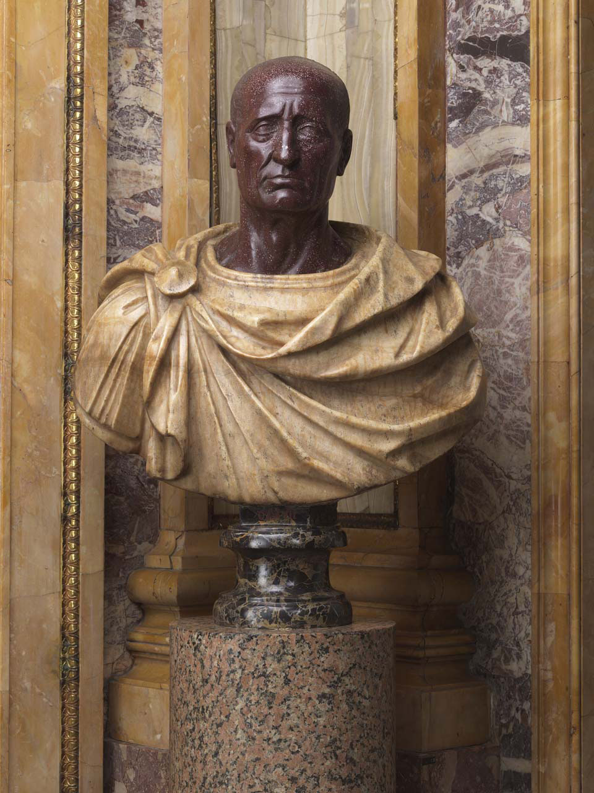

**内容 / 看点**：加尔巴（Galba），"四帝之年"第一位皇帝，推翻尼禄后短暂在位即遇刺。系列之一，整组背景见编号 CLI。

### ⭐ 顺路看 罗马学派《克劳狄乌斯肖像》 / roman school, _Portrait of Claudius_

- **作者 / Artist**：罗马学派 / roman school
- **作品 / Work**：《克劳狄乌斯肖像》 / _Portrait of Claudius_
- **时间**：17 世纪
- **材质**：斑岩与东方雪花石膏
- **尺寸**：高 98 cm
- **馆藏编号**：CXXVIII
- **位置**：皇帝厅（第 4 室）
- **官网介绍页**：[官网介绍英文](https://www.collezionegalleriaborghese.it/en/opere/portrait-of-claudius)｜馆藏编号 CXXVIII

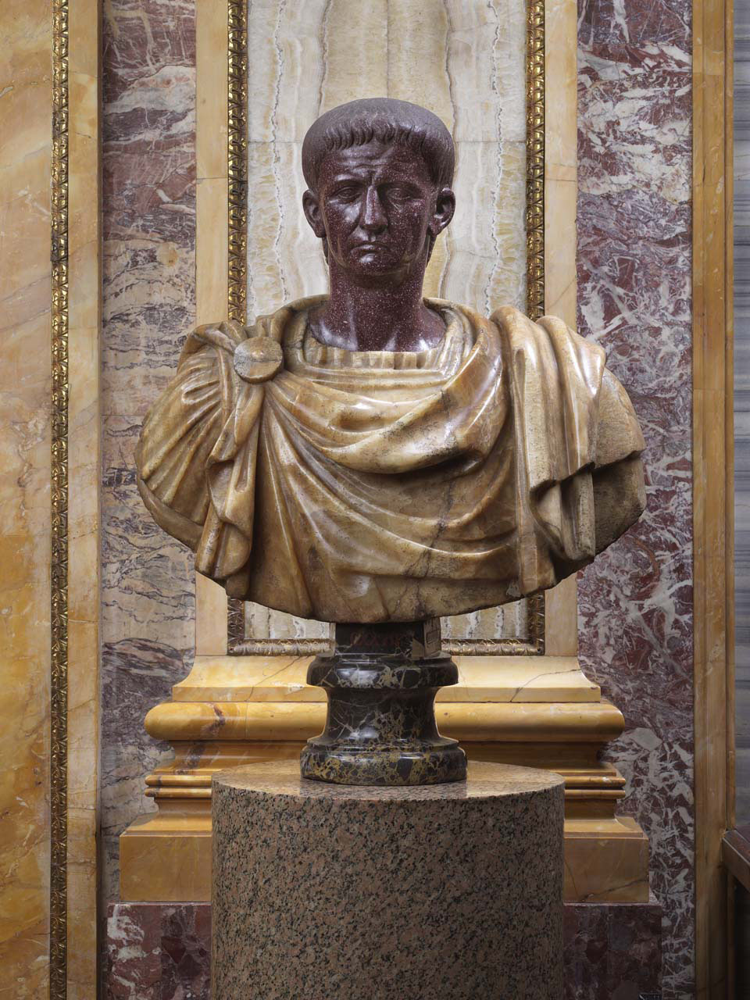

**内容 / 看点**：克劳狄乌斯（Claudius，41–54 在位），征服不列颠的皇帝。系列之一，整组背景见编号 CLI。

### ⭐ 顺路看 归属西尔维奥·卡尔奇《一对鹰首形把手双耳瓶》 / Attributed to Calci Silvio, _Pair of Amphorae with Handles in the Form of Eagle Protomes_

- **作者 / Artist**：归属西尔维奥·卡尔奇 / Attributed to Calci Silvio
- **作品 / Work**：《一对鹰首形把手双耳瓶》 / _Pair of Amphorae with Handles in the Form of Eagle Protomes_
- **时间**：17 世纪上半叶
- **材质**：黑古大理石
- **尺寸**：42 × 32 cm
- **馆藏编号**：CXXX-CXXXIII
- **位置**：皇帝厅（第 4 室）
- **官网介绍页**：[官网介绍英文](https://www.collezionegalleriaborghese.it/en/opere/pair-of-amphorae-with-handles-in-the-form-of-eagle-protomes)｜馆藏编号 CXXX-CXXXIII

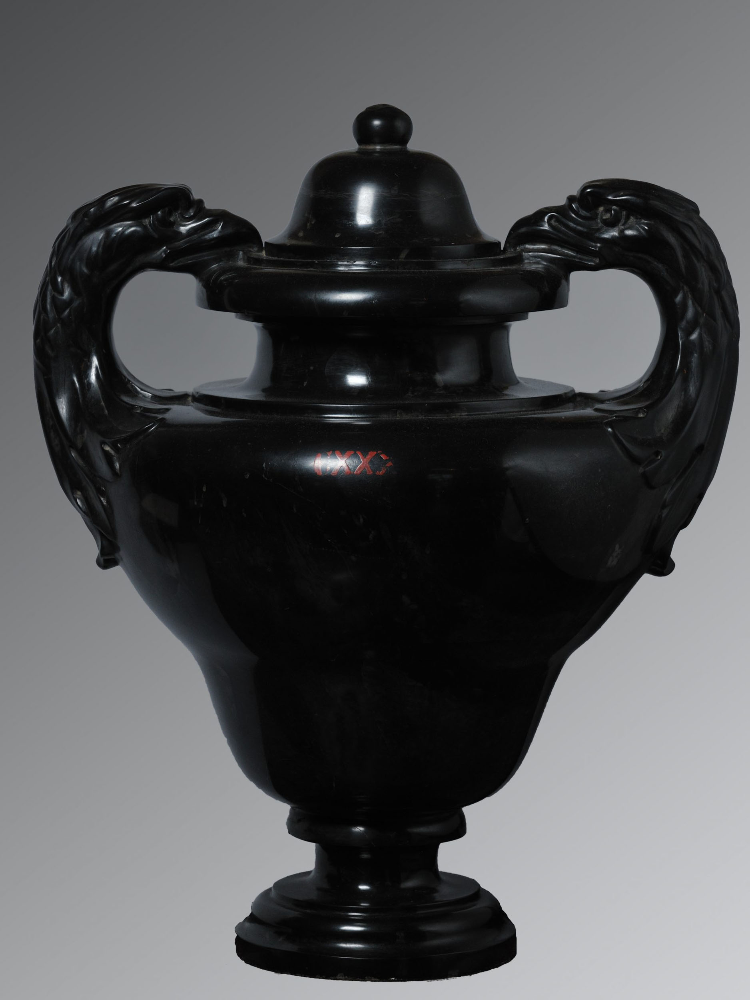

**内容 / 看点**：一对黑古大理石双耳瓶，把手做成鹰首（protome 即"兽首"造型），归属西尔维奥·卡尔奇（Silvio Calci）。鹰是朱庇特与罗马帝国的象征，用在帝王厅恰如其分；现场看两侧鹰首把手的雕工。

### ⭐ 顺路看 罗马学派《奥古斯都肖像》 / roman school, _Portrait of Augustus_

- **作者 / Artist**：罗马学派 / roman school
- **作品 / Work**：《奥古斯都肖像》 / _Portrait of Augustus_
- **时间**：17 世纪
- **材质**：斑岩与东方雪花石膏
- **尺寸**：高 90 cm
- **馆藏编号**：CXXXIX
- **位置**：皇帝厅（第 4 室）
- **官网介绍页**：[官网介绍英文](https://www.collezionegalleriaborghese.it/en/opere/portrait-of-augustus)｜馆藏编号 CXXXIX

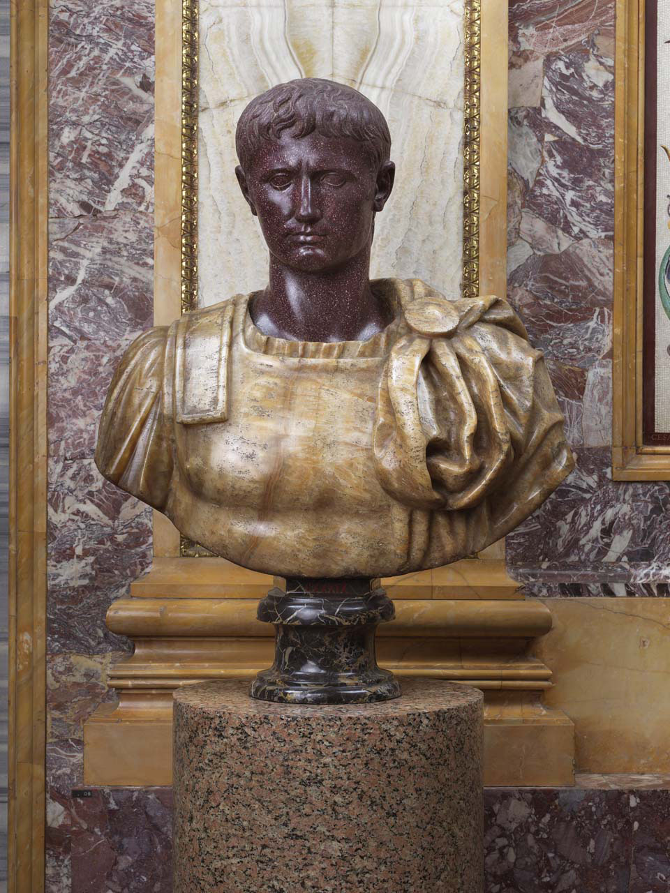

**内容 / 看点**：奥古斯都（Augustus，前 27–公元 14 在位），罗马首位皇帝、帝国奠基者，是这套帝王序列的源头人物。系列之一，整组背景见编号 CLI。

### ⭐ 顺路看 罗马学派《大西庇阿肖像》 / roman school, _Portrait of Scipio Africanus_

- **作者 / Artist**：罗马学派 / roman school
- **作品 / Work**：《大西庇阿肖像》 / _Portrait of Scipio Africanus_
- **时间**：17 世纪
- **材质**：斑岩与东方雪花石膏
- **尺寸**：高 85 cm
- **馆藏编号**：CXXXV
- **位置**：皇帝厅（第 4 室）
- **官网介绍页**：[官网介绍英文](https://www.collezionegalleriaborghese.it/en/opere/portrait-of-scipio-africanus-1)｜馆藏编号 CXXXV

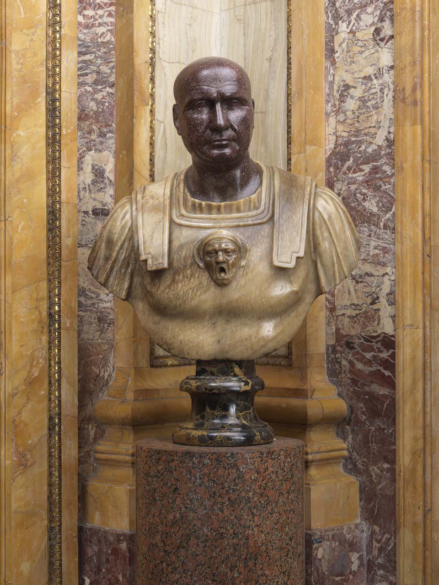

**内容 / 看点**：大西庇阿（Scipio Africanus），共和国名将，扎马之战击败汉尼拔。他并非皇帝，被纳入序列体现"罗马伟人"的扩充。系列之一，整组背景见编号 CLI。

### ⭐ 顺路看 罗马学派《阿格里帕肖像》 / roman school, _Portrait of Agrippa_

- **作者 / Artist**：罗马学派 / roman school
- **作品 / Work**：《阿格里帕肖像》 / _Portrait of Agrippa_
- **时间**：17 世纪
- **材质**：斑岩与东方雪花石膏
- **尺寸**：高 92 cm
- **馆藏编号**：CXXXVI
- **位置**：皇帝厅（第 4 室）
- **官网介绍页**：[官网介绍英文](https://www.collezionegalleriaborghese.it/en/opere/portrait-of-agrippa)｜馆藏编号 CXXXVI

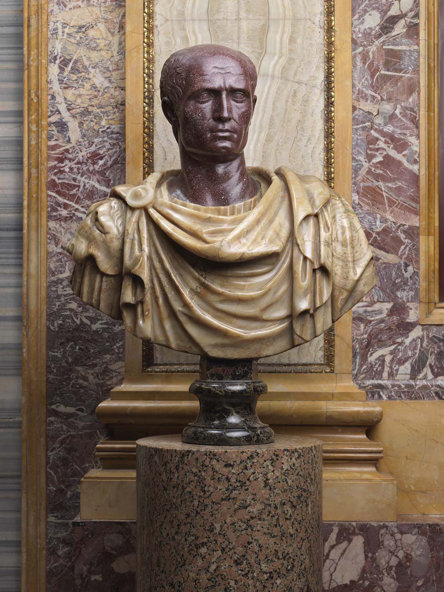

**内容 / 看点**：阿格里帕（Agrippa），奥古斯都的女婿与左膀右臂、万神殿的最初兴建者。系列之一，整组背景见编号 CLI。

### ⭐ 顺路看 洛伦佐·尼扎与洛伦佐·卡尔代利《红斑岩带耳瓶》 / Nizza Lorenzo / Cardelli Lorenzo, _Vase with handles in red porphyry_

- **作者 / Artist**：洛伦佐·尼扎与洛伦佐·卡尔代利 / Nizza Lorenzo / Cardelli Lorenzo
- **作品 / Work**：《红斑岩带耳瓶》 / _Vase with handles in red porphyry_
- **时间**：约 1620–1780 年
- **材质**：红斑岩
- **尺寸**：77 × 45 cm
- **馆藏编号**：CXXXVIII
- **位置**：皇帝厅（第 4 室）
- **官网介绍页**：[官网介绍英文](https://www.collezionegalleriaborghese.it/en/opere/vase-with-handles-in-red-porphyry)｜馆藏编号 CXXXVIII

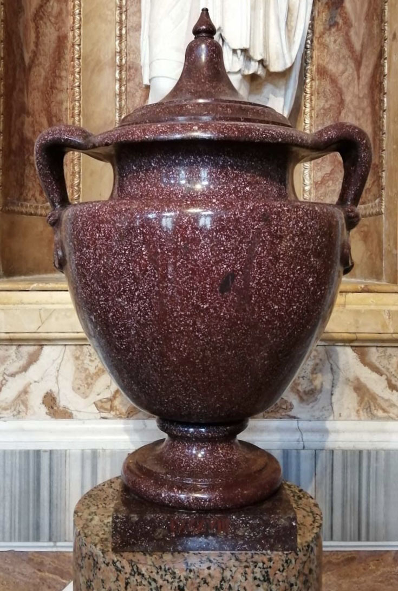

**内容 / 看点**：同由尼扎与卡尔代利制作的红斑岩带耳瓶，与无耳瓶（编号 CXXV）成对。现场两只并看，体会同一彩石、有耳无耳的成对陈列趣味。

### ⭐ 顺路看 科西莫·范切利《维特里乌斯肖像》 / Fancelli Cosimo, _Portrait of Vitellius_

- **作者 / Artist**：科西莫·范切利 / Fancelli Cosimo
- **作品 / Work**：《维特里乌斯肖像》 / _Portrait of Vitellius_
- **时间**：17 世纪
- **材质**：斑岩与东方雪花石膏
- **尺寸**：高 88 cm
- **馆藏编号**：CXXXX
- **位置**：皇帝厅（第 4 室）
- **官网介绍页**：[官网介绍英文](https://www.collezionegalleriaborghese.it/en/opere/portrait-of-vitellius-3)｜馆藏编号 CXXXX

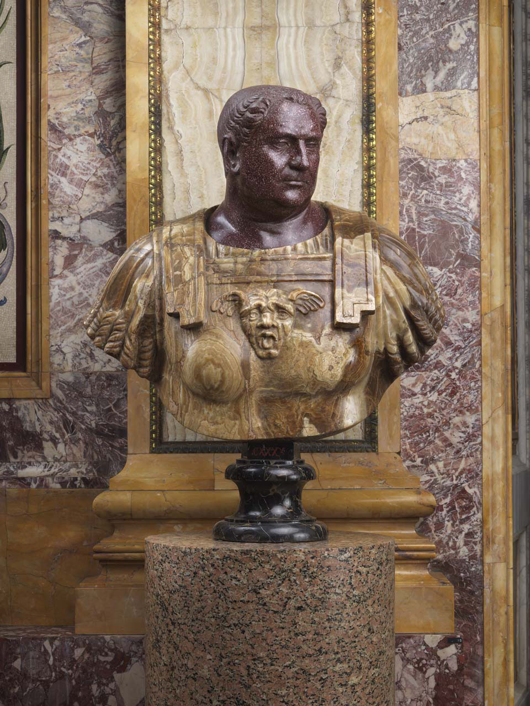

**内容 / 看点**：维特里乌斯（Vitellius）胸像，由科西莫·范切利（Cosimo Fancelli）所作，与罗马学派的同名胸像（编号 CLVIII）形成一组对看。同属本厅彩石帝王序列，整组背景见编号 CLI。

### ⭐ 顺路看 罗马学派《提图斯肖像》 / roman school, _Portrait of Titus_

- **作者 / Artist**：罗马学派 / roman school
- **作品 / Work**：《提图斯肖像》 / _Portrait of Titus_
- **时间**：17 世纪
- **材质**：斑岩与东方雪花石膏
- **尺寸**：高 95 cm
- **馆藏编号**：CXXXXIV
- **位置**：皇帝厅（第 4 室）
- **官网介绍页**：[官网介绍英文](https://www.collezionegalleriaborghese.it/en/opere/portrait-of-titus)｜馆藏编号 CXXXXIV

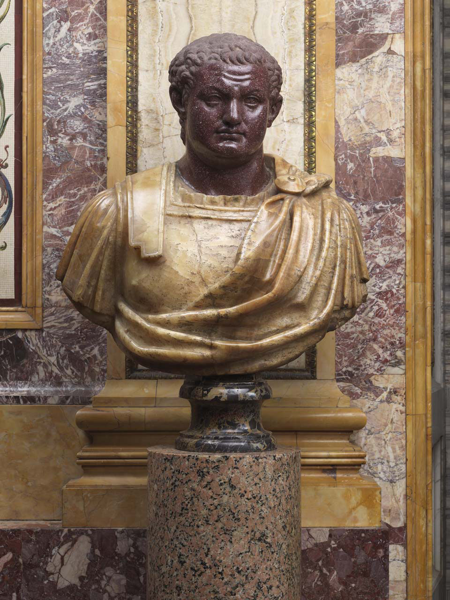

**内容 / 看点**：提图斯（Titus，79–81 在位），韦斯帕芗之子，攻陷耶路撒冷、建成斗兽场。系列之一，整组背景见编号 CLI。

### ⭐ 顺路看 罗马学派《尼禄肖像》 / roman school, _Portrait of Nero_

- **作者 / Artist**：罗马学派 / roman school
- **作品 / Work**：《尼禄肖像》 / _Portrait of Nero_
- **时间**：17 世纪
- **材质**：斑岩与东方雪花石膏
- **尺寸**：高 94 cm
- **馆藏编号**：CXXXXIX
- **位置**：皇帝厅（第 4 室）
- **官网介绍页**：[官网介绍英文](https://www.collezionegalleriaborghese.it/en/opere/portrait-of-nero)｜馆藏编号 CXXXXIX

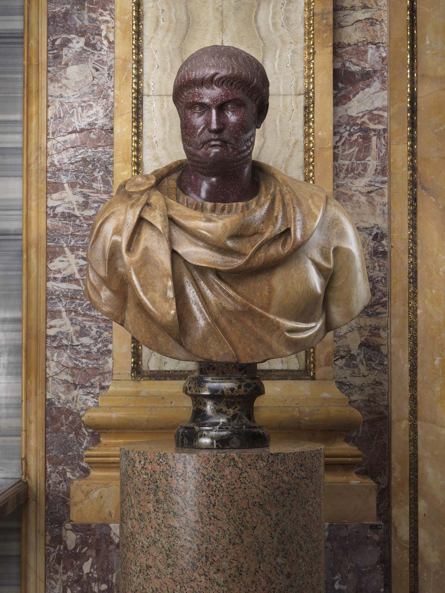

**内容 / 看点**：尼禄（Nero，54–68 在位），以纵火传说与暴政著称的尤利乌斯—克劳狄王朝末帝。系列之一，整组背景见编号 CLI。

### ⭐ 顺路看 罗马学派《朱诺胸像》 / roman school, _Bust of Juno_

- **作者 / Artist**：罗马学派 / roman school
- **作品 / Work**：《朱诺胸像》 / _Bust of Juno_
- **时间**：头部 17 世纪，胸像 18 世纪
- **材质**：红古大理石、东方雪花石膏
- **尺寸**：高 68 cm
- **馆藏编号**：CXXXXVI
- **位置**：皇帝厅（第 4 室）
- **官网介绍页**：[官网介绍英文](https://www.collezionegalleriaborghese.it/en/opere/bust-of-juno)｜馆藏编号 CXXXXVI

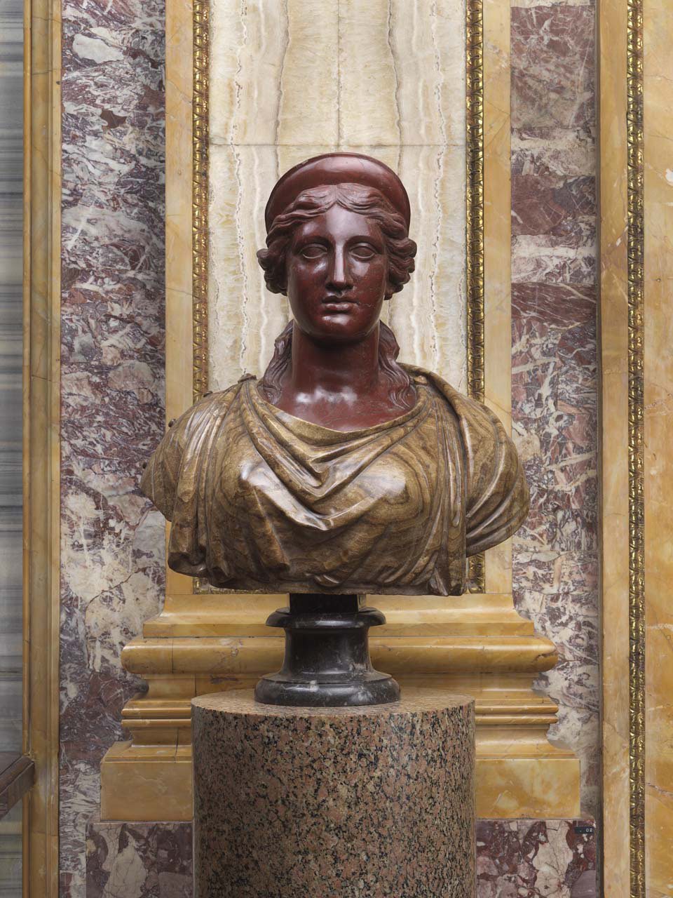

**内容 / 看点**：朱诺（Juno）胸像，罗马天后、朱庇特之妻。馆方注明头部为 17 世纪、胸像为 18 世纪拼配，材质为红古大理石加东方雪花石膏。这是序列里少见的女神题材，现场可留意它"头身分制、再行组合"的拼接做法（整组背景见编号 CLI）。

### ⭐ 顺路看 罗马学派《西塞罗肖像》 / roman school, _Portrait of Cicero_

- **作者 / Artist**：罗马学派 / roman school
- **作品 / Work**：《西塞罗肖像》 / _Portrait of Cicero_
- **时间**：17 世纪
- **材质**：斑岩与东方雪花石膏
- **尺寸**：高 94 cm
- **馆藏编号**：CXXXXVIII
- **位置**：皇帝厅（第 4 室）
- **官网介绍页**：[官网介绍英文](https://www.collezionegalleriaborghese.it/en/opere/portrait-of-cicero)｜馆藏编号 CXXXXVIII

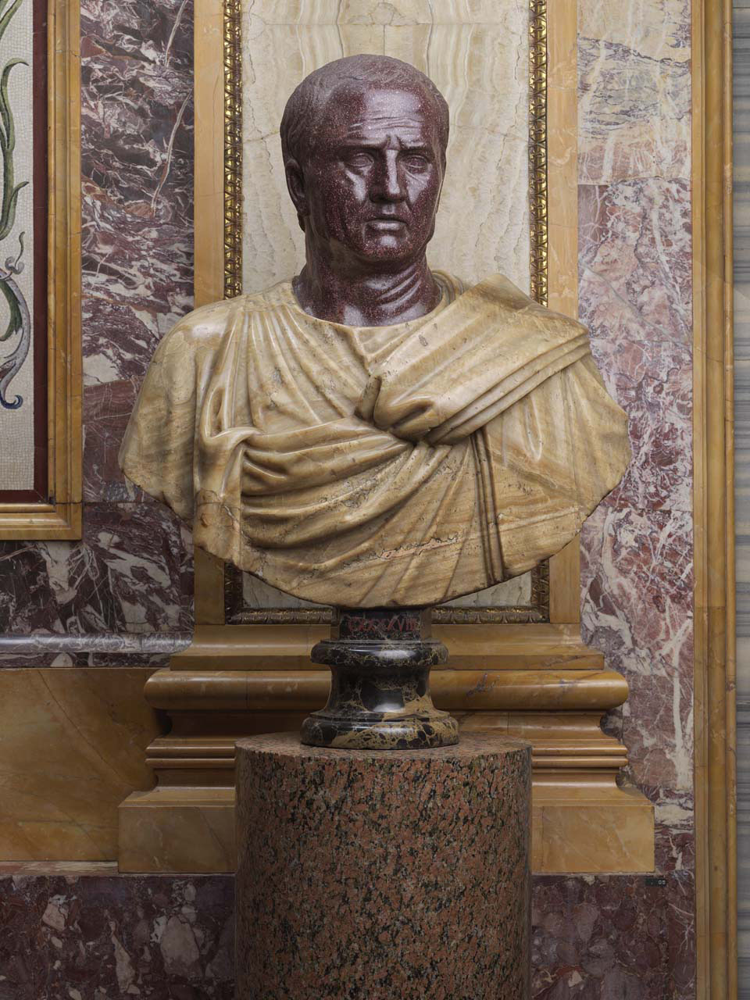

**内容 / 看点**：西塞罗（Cicero），共和国末期的演说家与政治家，同属被扩充进帝王序列的"罗马伟人"之列。整组背景见编号 CLI。

本节继续列馆方 Ancient Art 藏品列表，共 7 件。

### ⭐ 顺路看 托马索·费代利《韦斯帕芗肖像》 / Fedeli Tommaso, _Portrait of Vespasian_

- **作者 / Artist**：托马索·费代利 / Fedeli Tommaso
- **作品 / Work**：《韦斯帕芗肖像》 / _Portrait of Vespasian_
- **时间**：17 世纪
- **材质**：斑岩与东方雪花石膏
- **尺寸**：高 86 cm
- **位置**：皇帝厅（第 4 室）
- **官网介绍页**：[官网介绍英文](https://www.collezionegalleriaborghese.it/en/opere/portrait-of-vespasian-2)｜馆藏编号 CLV

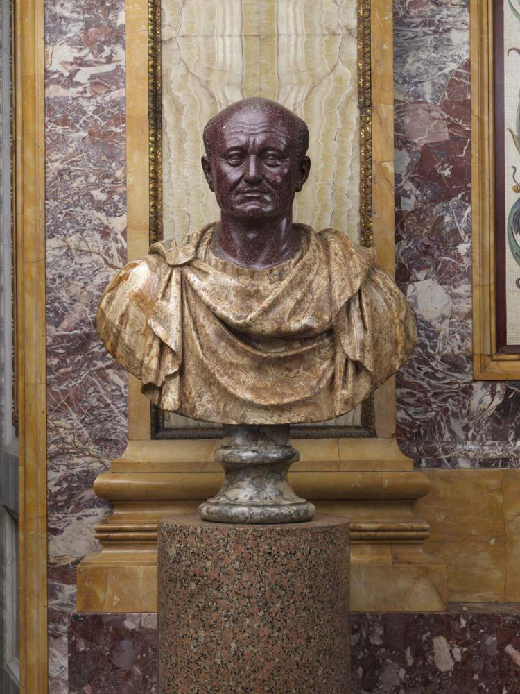

**内容 / 看点**：韦斯帕芗（Vespasian）胸像，由托马索·费代利（Tommaso Fedeli）所作的斑岩加东方雪花石膏作品，与罗马学派的同名胸像（编号 CLI）成对。它虽列在"古代艺术"段，实为 17 世纪的仿古新作；同属本厅彩石帝王序列，整组背景见编号 CLI。

### ⭐ 顺路看 作者不详《伴海豚的女性神祇雕像》 / Unknown artist, _Female Deity Statue with a Dolphin_

- **作者 / Artist**：作者不详 / Unknown artist
- **作品 / Work**：《伴海豚的女性神祇雕像》 / _Female Deity Statue with a Dolphin_
- **时间**：公元 120–130 年
- **材质**：白色大理石
- **尺寸**：不含底座高 161 cm； 头部 22 cm
- **位置**：皇帝厅（第 4 室）
- **官网介绍页**：[官网介绍英文](https://www.collezionegalleriaborghese.it/en/opere/female-deity-statue-with-a-dolphin)｜馆藏编号 CLXI

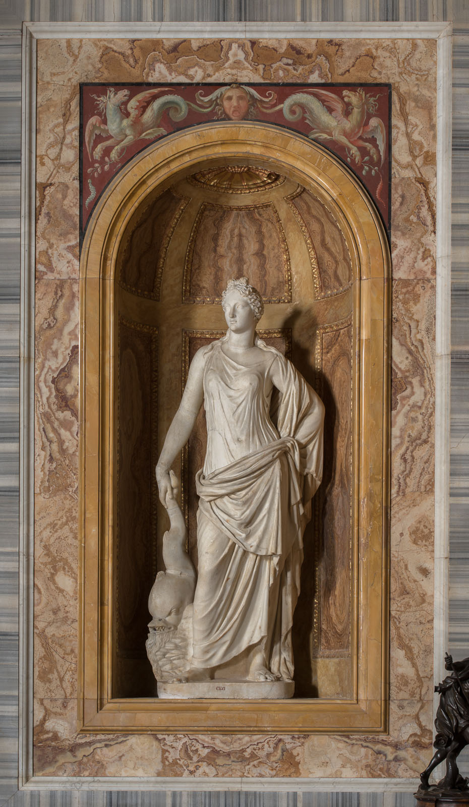

**内容（这是什么）**：公元 120–130 年的白色大理石女性神祇立像，因脚边伴有海豚，通常被认作爱与美的女神维纳斯（Venus，希腊名阿佛洛狄忒）——海豚是她从海中诞生的标志。

**背景 / 看点**：这是罗马时代依希腊原型制作的雕像，头与身的年代、真伪常需分辨。现场认准脚边的海豚这一"身份道具"，再看它是古代残件还是经近代修复补配。

### ⭐ 顺路看 古罗马艺术《女猎神阿耳忒弥斯雕像》 / Roman art, _Statue of Artemis the Huntress_

- **作者 / Artist**：古罗马艺术 / Roman art
- **作品 / Work**：《女猎神阿耳忒弥斯雕像》 / _Statue of Artemis the Huntress_
- **时间**：公元 2 世纪
- **材质**：粗颗粒大理石
- **尺寸**：不含底座高 1.72 m； 头部 0.24 m
- **位置**：皇帝厅（第 4 室）
- **官网介绍页**：[官网介绍英文](https://www.collezionegalleriaborghese.it/en/opere/statue-of-artemis-the-huntress)｜馆藏编号 CXXIX

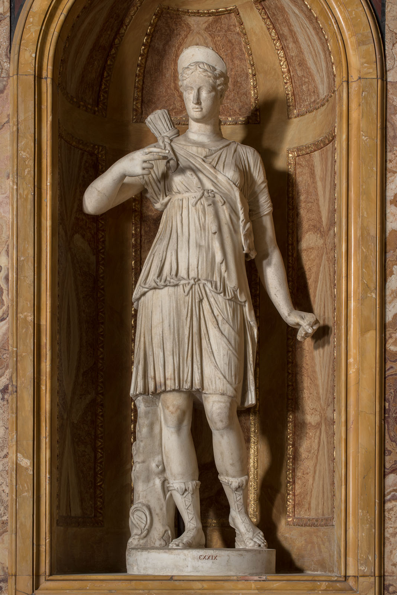

**内容（这是什么）**：公元 2 世纪的女猎神阿耳忒弥斯（Artemis，罗马名狄安娜）立像，狩猎与月亮女神，标志是短猎装、箭囊与猎犬。

**背景 / 看点**：本厅有三尊阿耳忒弥斯（另见编号 CXXVI、CXXXVII），都是罗马时代依希腊原型制作的复制或变体，常见"古代躯干 + 后世修复头臂"的组合。三尊并看，可比较同一女神的不同范式与修复状况。

### ⭐ 顺路看 古罗马艺术《阿耳忒弥斯雕像》 / Roman art, _Statue of Artemis_

- **作者 / Artist**：古罗马艺术 / Roman art
- **作品 / Work**：《阿耳忒弥斯雕像》 / _Statue of Artemis_
- **时间**：躯干公元 100–110 年；头部公元 2 世纪
- **材质**：细颗粒白色大理石（或为彭忒利科大理石）
- **尺寸**：高 166 cm (含底座)； statue 156 cm； 头部 19 cm
- **位置**：皇帝厅（第 4 室）
- **官网介绍页**：[官网介绍英文](https://www.collezionegalleriaborghese.it/en/opere/statue-of-artemis)｜馆藏编号 CXXVI

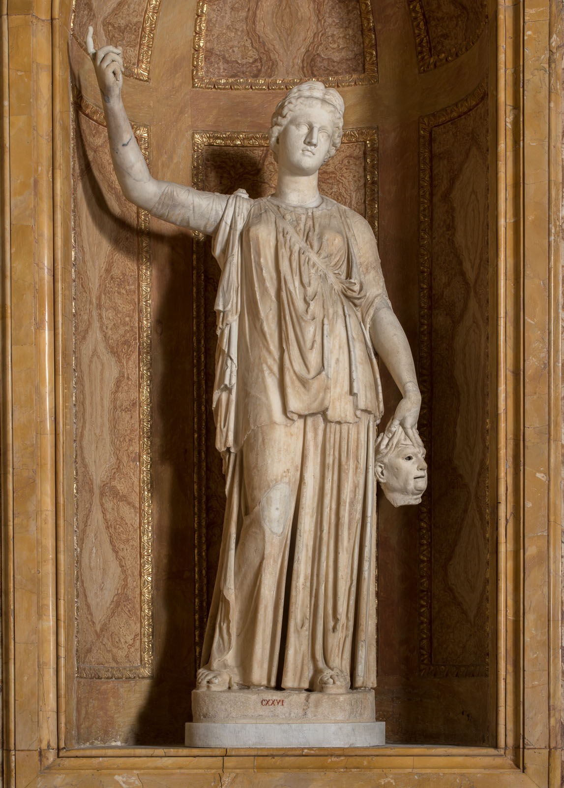

**内容 / 看点**：又一尊阿耳忒弥斯（Artemis）立像。馆方注明躯干为公元 100–110 年、头部为公元 2 世纪——典型的"古代身躯 + 另配头部"组合，材质或为彭忒利科大理石。现场对比颈部接缝与石色差异，找古今拼配的痕迹（同厅另两尊见编号 CXXIX、CXXXVII）。

### ⭐ 顺路看 古罗马艺术《雕像：狄俄尼索斯》 / Roman art, _Statue of Dionysus_

- **作者 / Artist**：古罗马艺术 / Roman art
- **作品 / Work**：《雕像：狄俄尼索斯》 / _Statue of Dionysus_
- **时间**：公元 120–130 年
- **材质**：白色大理石
- **尺寸**：不含底座高 157 cm； 古代部分 58 cm
- **位置**：皇帝厅（第 4 室）
- **官网介绍页**：[官网介绍英文](https://www.collezionegalleriaborghese.it/en/opere/statue-of-dionysus)｜馆藏编号 CXXXIV

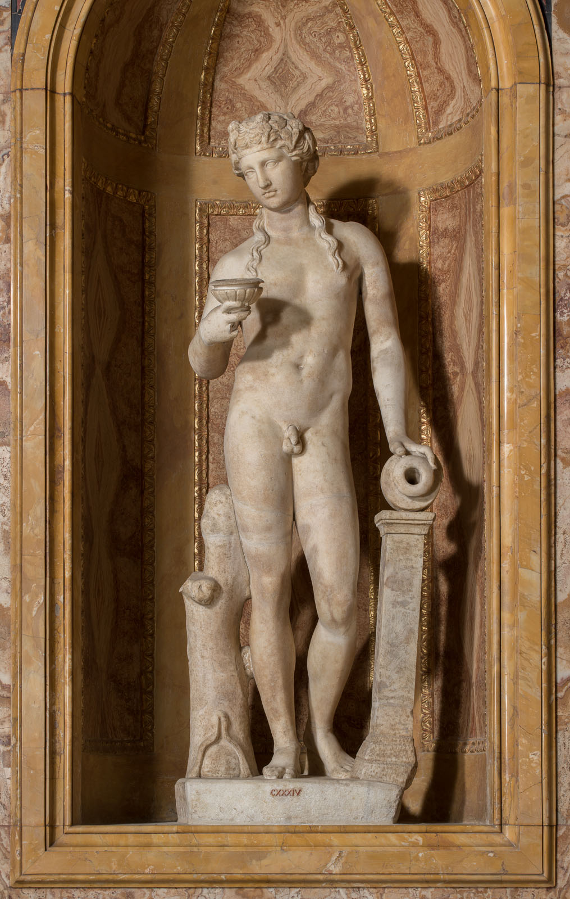

**内容（这是什么）**：公元 120–130 年的酒神狄俄尼索斯（Dionysus，罗马名巴克科斯）立像，酒与狂欢之神，标志是常春藤、葡萄与豹。

**背景 / 看点**：馆方注明仅"古代部分约 58 cm"为真，其余为后世补全——是本馆"小块古代残件 + 大量近代修复"的典型例子。现场试着辨认哪一段石色、雕工更古旧。本厅另有一尊"狄俄尼索斯与豹"（编号 CXXXXIII）可对看。

### ⭐ 顺路看 古罗马艺术《博尔盖塞型阿耳忒弥斯雕像》 / Roman art, _Statue of Artemis of the Borghese type_

- **作者 / Artist**：古罗马艺术 / Roman art
- **作品 / Work**：《博尔盖塞型阿耳忒弥斯雕像》 / _Statue of Artemis of the Borghese type_
- **时间**：公元 120–130 年
- **材质**：彭忒利科大理石
- **尺寸**：含底座总高 164 cm； statue 155 cm； 头部 22 cm
- **位置**：皇帝厅（第 4 室）
- **官网介绍页**：[官网介绍英文](https://www.collezionegalleriaborghese.it/en/opere/statue-of-artemis-of-the-borghese-type)｜馆藏编号 CXXXVII

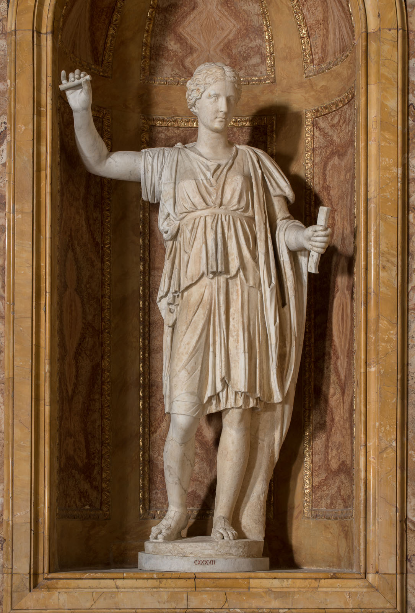

**内容 / 看点**：第三尊阿耳忒弥斯（Artemis），属公认的"博尔盖塞型阿耳忒弥斯"——一种以本馆藏品命名的著名雕像范式，彭忒利科大理石，公元 120–130 年。看点正在它的"型"：以本馆为标准样的女猎神范式，可与同厅另两尊（编号 CXXIX、CXXVI）比较姿态差异。

### ⭐ 顺路看 古罗马艺术《狄俄尼索斯与豹雕像》 / Roman art, _Statue of Dionysus with a Panther_

- **作者 / Artist**：古罗马艺术 / Roman art
- **作品 / Work**：《狄俄尼索斯与豹雕像》 / _Statue of Dionysus with a Panther_
- **时间**：公元 100–150 年
- **材质**：白色大理石
- **尺寸**：高 165 cm； 头部 23 cm
- **位置**：皇帝厅（第 4 室）
- **官网介绍页**：[官网介绍英文](https://www.collezionegalleriaborghese.it/en/opere/statue-of-dionysus-with-a-panther)｜馆藏编号 CXXXXIII

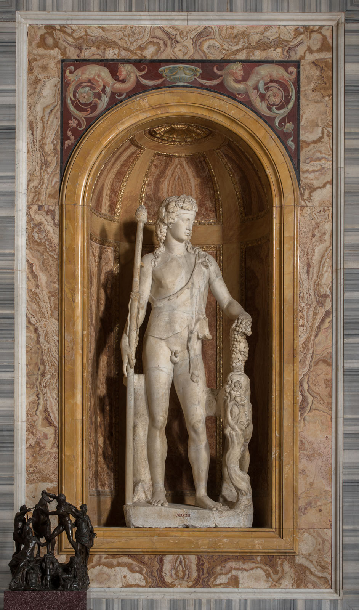

**内容 / 看点**：公元 100–150 年的"狄俄尼索斯与豹"立像，豹（酒神的圣兽）伴在脚边点明身份。与另一尊狄俄尼索斯（编号 CXXXIV）同为罗马时代依希腊原型的作品；现场认准豹这一属物，并看材质与修复痕迹。

## 其他

本节按馆方 Furniture 藏品列表补充，共 1 件。

### ⭐⭐ 推荐 安东尼奥·阿斯普鲁奇《皇帝厅陈列设计》 / Antonio Asprucci, _Display Design of the Room of the Emperors_

- **作者 / Artist**：安东尼奥·阿斯普鲁奇（1723–1808） / Antonio Asprucci（1723–1808）
- **作品 / Work**：《皇帝厅陈列设计》 / _Display design of the Room of the Emperors_
- **时间**：18 世纪末改造期
- **位置**：皇帝厅（第 4 室）

**内容（这是什么）**：本厅的整体陈列方案，由建筑师安东尼奥·阿斯普鲁奇（Antonio Asprucci）在 18 世纪末博尔盖塞别墅大改造中设计。

**背景 / 看点**：阿斯普鲁奇用多种彩色大理石的并置来组织整间房——斑岩帝王胸像、彩石瓶瓮、镶嵌墙面、四季母题与海神天顶被编排成一个统一系统。也就是说，皇帝厅不只是"放了贝尼尼雕塑的大厅"，房间本身就是一件 18 世纪末的综合陈列设计；现场不妨退到厅中央，把墙、瓶、像、天顶当作一个整体来看。

### ⭐ 顺路看 乔瓦尼·巴蒂斯塔·马尔凯蒂《庞贝风格建筑错视画》 / Giovanni Battista Marchetti, _Pompeian-Inspired Architectural Trompe-l'oeil_

- **作者 / Artist**：乔瓦尼·巴蒂斯塔·马尔凯蒂（1730–1800） / Giovanni Battista Marchetti（1730–1800）
- **作品 / Work**：《庞贝风格建筑错视画》 / _Pompeian-inspired architectural trompe-l'oeil_
- **时间**：约 1778–1780 年 天顶装饰期
- **位置**：皇帝厅天顶建筑幻觉框架

**内容 / 看点**：天顶的建筑幻觉框架，由乔瓦尼·巴蒂斯塔·马尔凯蒂（Giovanni Battista Marchetti）绘制。馆方说明它受庞贝壁画启发，作用是把德·安杰利斯的伽拉忒亚叙事画与阿格里科拉的星座、四季图像整合进一个完整的天顶建筑框架。现场抬头看那些"以假乱真"的描绘建筑构件，它们其实都是平面绘画。

### ⭐ 顺路看 多位艺术家《与海神相关场景的灰泥镶板》 / Various Artists, _Stucco Panels with Scenes Connected with Sea Gods_

- **作者 / Artist**：多位艺术家 / various artists
- **作品 / Work**：《饰海神场景的灰泥镶板》 / _Stucco panels with scenes connected with sea gods_
- **时间**：1778–1779 年
- **位置**：天顶檐口下方

**内容 / 看点**：天顶檐口下方有 11 块与海神相关的灰泥浮雕板，制作于 1778–1779 年。它们与伽拉忒亚天顶故事同属海洋神话系统，现场抬头沿檐口扫一圈即可，不必逐块停留。

### ⭐⭐ 推荐 路易吉·瓦拉迪耶《一对十二边形桌》 / Luigi Valadier, _Pair of Twelve-Sided Tables_

- **作者 / Artist**：路易吉·瓦拉迪耶（1726–1785） / Luigi Valadier（1726–1785）
- **作品 / Work**：《一对十二边形桌》 / _Pair of twelve-sided tables_
- **时间**：1773 年
- **材质**：斑岩、古黄大理石、古绿大理石、阿基坦 黑白石、镀金铜
- **尺寸**：93 × 140 × 88 cm
- **位置**：皇帝厅（第 4 室）
- **官网介绍页**：[十二边桌一对 / Coppia di tavoli dodecagonali｜Galleria Borghese 官方藏品库](https://www.collezionegalleriaborghese.it/opere/coppia-di-tavoli-dodecagonali)｜馆藏编号 CCLXXXII-CCLXXXIII

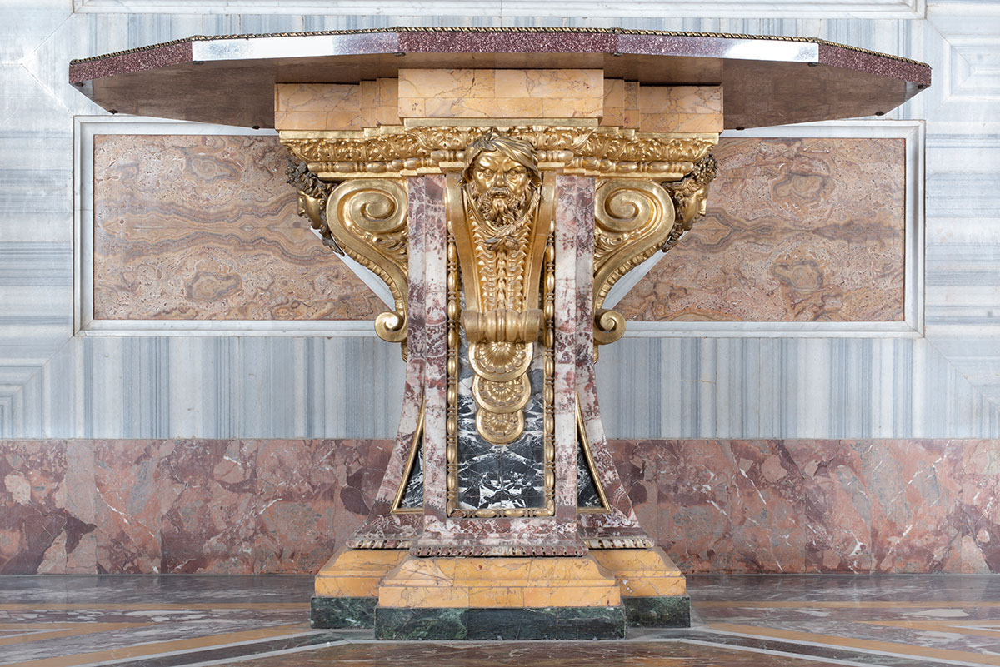

**内容（这是什么）**：路易吉·瓦拉迪耶（Luigi Valadier）1773 年制作的一对十二边形桌，由斑岩、古黄大理石（giallo antico）、古绿大理石（verde antico）、阿基坦黑白石与镀金铜组合而成。

**背景 / 看点**：瓦拉迪耶是 18 世纪罗马最负盛名的金匠与装饰大师。馆方强调，他用多种珍贵石材与鎏金铜饰营造出强烈的色彩与材质对比；桌上的四季头像又与全厅反复出现的四季主题相连。这是本厅极值得顺手细看的装饰艺术精品——凑近看不同彩石的拼镶与铜饰做工。

### ⭐ 顺路看 作者不详《蓝色马赛克底上的怪诞式马赛克与灰泥浮雕饰章》 / Anonymous, _Grotesque Mosaics and Stucco Cameos on Blue Mosaic Grounds_

- **作者 / Artist**：作者不详 / Anonymous
- **作品 / Work**：《蓝色马赛克底上的怪诞纹样与灰泥浮雕饰章》 / _grotesque mosaics and stucco cameos on blue mosaic grounds_
- **时间**：18 世纪末房间装饰期
- **位置**：皇帝厅墙面

**内容 / 看点**：墙面的四块怪诞纹样（grottesche）马赛克、镶金青铜柱头的大理石壁柱，以及蓝色马赛克底上的灰泥浮雕饰框，共同营造出皇帝厅的"古代感"。它们不是独立藏品，却是理解本厅为何如此华丽的关键；现场扫一眼墙面的蓝底马赛克与浮雕饰章即可。

## 资料来源 / Sources

- Galleria Borghese 官方房间页：[Room 4 - Room of the Emperors](https://galleriaborghese.cultura.gov.it/en/il-museo/la-villa/sala-4-sala-degli-imperatori/)
- Galleria Borghese 藏品页：[Gian Lorenzo Bernini, _Rape of Proserpine_](https://www.collezionegalleriaborghese.it/en/opere/rape-of-proserpine)
- Galleria Borghese 藏品筛选：[Modern Sculpture, Room 4](https://www.collezionegalleriaborghese.it/en/collezione/scultura?sala=s4)
- Galleria Borghese 藏品筛选：[Ancient Art, Room 4](https://www.collezionegalleriaborghese.it/en/collezione/arte-antica?sala=s4)
- Galleria Borghese 藏品筛选：[Furniture, Room 4](https://www.collezionegalleriaborghese.it/en/collezione/arredi?sala=s4)

