第 9 室（旧称「美惠三女神厅」）以拉斐尔的《卸下圣体》为镇厅，集中陈列翁布里亚—托斯卡纳文艺复兴名作（佩鲁吉诺、波提切利等）；天顶马龙绘「埃涅阿斯与狄多」五联悲剧。

**必看与核心展品（⭐⭐⭐ 必看 + 核心）**

| 推荐 | 展品 | 作者 | 一句话看点 |
|---|---|---|---|
| ⭐⭐⭐ 必看 | 《卸下圣体（将死去的基督送往墓穴）》 | 拉斐尔 | 二楼绘画镇馆之宝，拉斐尔赴罗马前的盖棺之作 |
| ⭐⭐⭐ 必看 | 《施洗者圣约翰》 | 仿拉斐尔 | 名作的高质量摹本，对照原作看构图 |
| ⭐⭐⭐ 必看 | 《施洗者圣约翰》 | 布龙齐诺 | 佛罗伦萨样式主义的冷峻青年圣徒 |
| ⭐⭐ 推荐 | 《圣塞巴斯蒂安》 | 佩鲁吉诺 | 拉斐尔老师笔下宁静均衡的殉道者 |
| ⭐⭐ 推荐 | 《圣母子、幼年圣约翰与天使》 | 波提切利及工坊 | 佛罗伦萨家用圆形虔敬画的优雅样本 |
| ⭐⭐ 推荐 | 天顶《埃涅阿斯与狄多故事》（五联） | 安东·冯·马龙 | 把一则完整爱情悲剧画成五联连环天顶 |

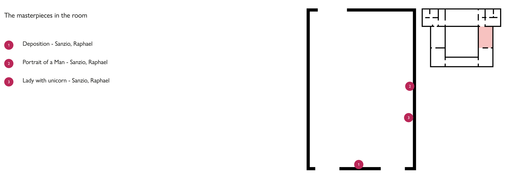

**展厅官网介绍页**：[Room 9 - Dido Room](https://galleriaborghese.cultura.gov.it/en/il-museo/la-villa/sala-9-sala-di-didone/)

## 核心展品

### ⭐⭐⭐ 必看 拉斐尔·桑齐奥《卸下圣体（将死去的基督送往墓穴）》 / Sanzio, Raphael, _Deposition (The Carrying of the Dead Christ to the Sepulchre)_
- **作者 / Artist**：拉斐尔·桑齐奥 / Sanzio, Raphael
- **作品 / Work**：《卸下圣体（将死去的基督送往墓穴）》 / _Deposition (The Carrying of the Dead Christ to the Sepulchre)_
- **时间**：1507 年
- **材质**：油彩木板
- **尺寸**：174.5 × 178.5 cm
- **位置**：狄多厅（第 9 室）
- **官网介绍页**：[基督下葬 / Deposizione (Trasporto di Cristo morto al sepolcro)｜Galleria Borghese 官方藏品库](https://www.collezionegalleriaborghese.it/opere/deposizione-trasporto-di-cristo-morto-al-sepolcro)｜馆藏编号 369

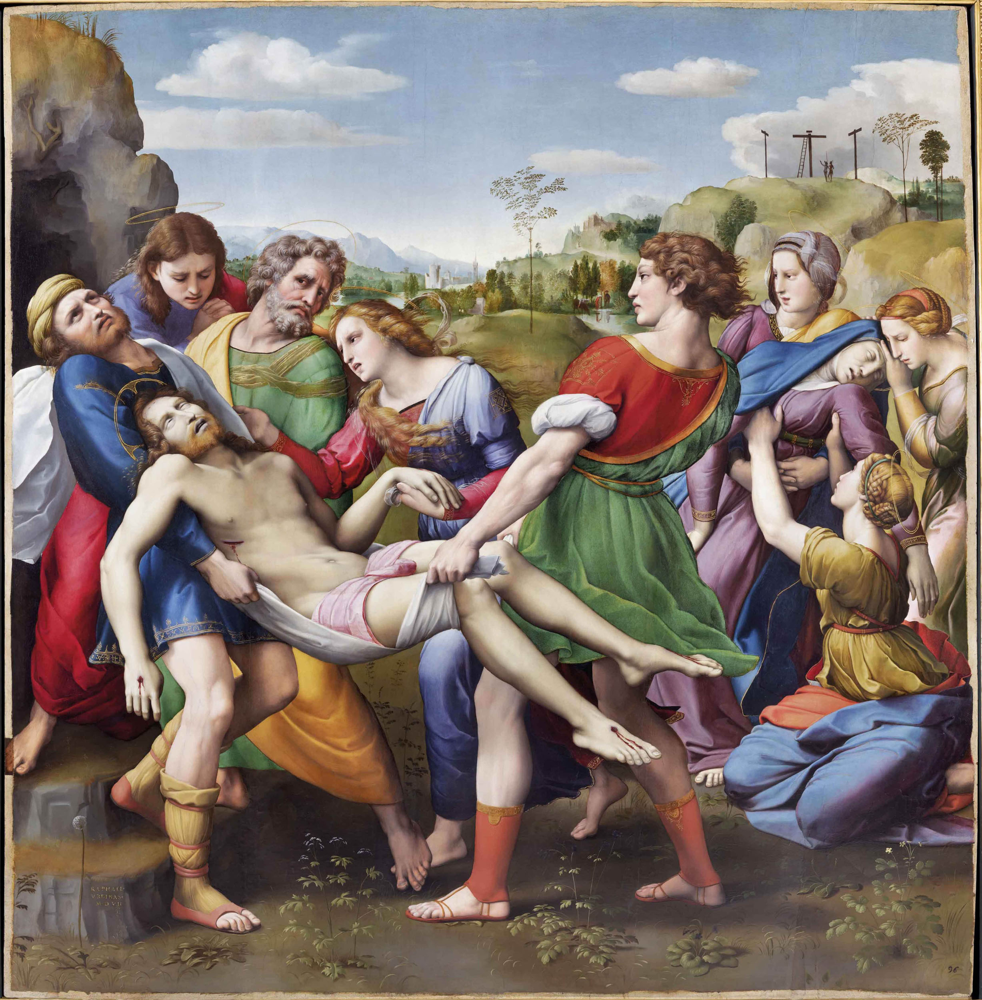

这是本厅、乃至整座博尔盖塞美术馆绘画部分的镇厅之宝，也是二楼最应优先看的一件文艺复兴作品。木板左下台阶上以金字签着「RAPHAEL · VRBINAS · M · D · VII」（拉斐尔，乌尔比诺人，1507），是拉斐尔 24 岁离开佛罗伦萨、即将奔赴罗马教廷前的盖棺之作。它常被沿用旧称《卸下圣体》，但画的其实是更晚一刻——众人正抬着基督遗体走向右侧岩壁中的墓穴，所以更准确的名字是「将死去的基督送往墓穴」（也按订件人之姓叫「巴廖内祭坛画 / Pala Baglioni」）。

**这是什么**：画面前景是一组正在行进的人物，把覆着玫瑰色腰布的基督用布兜抬起，向左上方那座两级台阶通往的山岩墓穴走去。已先登上土坡的圣约翰（Giovanni）俯身哀视，全组唯一的女子抹大拉的马利亚（Maria Maddalena）奔来托住基督的手。稍后景右侧，圣母（Vergine）昏厥倒下，由三位虔诚妇女合力扶住——这一「圣母晕厥（lo spasimo）」的情节在当时教会其实并不鼓励，拉斐尔却忠实画出，正是因为它服务于方济各会语境下「以母之痛代信徒之痛」的虔修传统。远景在墓穴岩壁与各各他山之间展开，两名士兵在山顶指着仍架着梯子的十字架；山谷溪畔的水塘边还有一对站立的男女和一名让马饮水的骑士。

**委托与身世：一位母亲为惨死之子的祭坛画**：这块木板由佩鲁贾贵族妇人阿塔兰塔·巴廖内（Atalanta Baglioni）委托，作为她在佩鲁贾圣方济各圣殿（San Francesco al Prato）家族礼拜堂的祭坛画。礼拜堂里已葬着她的儿子格里弗内托（Grifonetto）——他在 1500 年佩鲁贾领主权的家族血仇内讧中被杀。十九世纪以来学者多把丧子之痛读作委托动机（尽管下葬与作画相隔七年）：抬尸的高贵青年可被理解为对亡子的理想化哀悼，而晕厥的圣母则对应母亲本人的丧痛。原作并非孤立一块——它原是一座木构祭坛的主屏，上方有《祝福的天父》顶饰（今在佩鲁贾翁布里亚国家美术馆），下方有一排灰调单色画《三超德》（信、望、爱，今在梵蒂冈博物馆）。

**希皮奥内的「深夜强夺」**：画在佩鲁贾留了整整一百年。红衣主教希皮奥内·博尔盖塞（Scipione Borghese）年轻时曾在该城读大学，对它早就熟稔；他当上教宗保罗五世的宠侄后志在必得。1608 年 3 月 18 日深夜至 19 日凌晨，在修士的串通下，这块祭坛画被偷偷取走、火速运抵罗马，由保罗五世转赠侄子希皮奥内——这是博尔盖塞收藏史上最著名的一桩「教权强取」。为平息佩鲁贾人的愤怒，希皮奥内事后送去五盏银灯和一幅摹本作「补偿」。今天圣方济各圣殿里挂的，正是当年留下的卡瓦利埃·达尔皮诺（Cavalier d'Arpino）摹本。

**素描里看得见的构图革命**：与本画相关的拉斐尔亲笔素描数量庞大，串起来能看到一条清晰的演化线——从传统、静止的「哀悼（Compianto）」式悼亡，一步步推向动态的「抬尸送葬」。把一个有时间流动的叙事场景放上祭坛主屏，本身就是革命性的：这类「连环画式」情节过去只配出现在祭坛底座（predella）的小格里。馆方近年的科技检测还原了拉斐尔的工作方法：他把抬尸组与圣母组分开起稿、再「拼装」成整体；主组几乎没有改稿痕迹，只删掉了马利亚身旁一个回头的女子以加强动势。构图上学者公认它综合了多重来源——西尼奥雷利的奥尔维耶托《哀悼》、米开朗琪罗（梵蒂冈《圣殇》的基督、多尼圆形画的跪姿女子、佛罗伦萨学院的《圣马太》），乃至曼特尼亚 1480 年前后的版画《下葬》。

**现场站看**：

1. **先找左下台阶上的金字签名**——「RAPHAEL VRBINAS MDVII」嵌在抬尸者将要踏上的两级石阶上。它不只是落款，更是拉斐尔把自己的名字放在「通往墓穴之路」起点的宣示，标记着他告别佛罗伦萨、迈向罗马盛期的转折。
2. **盯住基督垂落的手与马利亚的手**——基督左臂无力下坠（中世纪以来表现「死亡」的经典手法），抹大拉的马利亚正俯身去托住它。这一组手是全画情感最浓的焦点，也是「她奔来」这个动作把静止哀悼变成行进叙事的关键。
3. **看抬基督的那个屈膝青年**——他半蹲、背肌紧绷、回头看向基督，姿态明显借自米开朗琪罗。把他和右侧圣体一起看，能体会拉斐尔此刻正大量「吸收」米氏的雕塑式人体。
4. **右侧的圣母晕厥组**——三名妇女合力扶住瘫软的圣母：一人从腋下托起、一人扶额、一人环腰。注意它和左侧抬尸组在重量与方向上的呼应——一边抬起圣子、一边接住圣母，两个「承托」动作左右平衡。
5. **退后看整幅的斜向运动**——人物排成一条从右下圣母、经基督、向左上墓穴的对角线。正是这条上行斜线，把「哀悼」改写成「送葬途中」，是此画区别于所有前作的结构发明。
6. **抬头扫一眼远景右上的各各他**——小小的十字架仍架着梯子、两名士兵在指点。它交代了刚发生的事，也把私密的近景悲剧锚定在福音叙事里。
7. **记住它「不在原地」**——眼前所见是 1608 年被强夺来罗马的主屏；顶饰《天父》与底座《三超德》已分散在佩鲁贾和梵蒂冈。看的时候在脑中把它「复原」成一整座祭坛，才懂这块木板原本的体量。

### ⭐⭐ 推荐 彼得罗·瓦努奇，称佩鲁吉诺《圣塞巴斯蒂安》 / Pietro Vannucci called Perugino, _Saint Sebastian_
- **作者 / Artist**：彼得罗·瓦努奇，称佩鲁吉诺 / Pietro Vannucci called Perugino
- **作品 / Work**：《圣塞巴斯蒂安》 / _Saint Sebastian_
- **时间**：约 1495 年
- **材质**：油彩木板
- **尺寸**：110 × 62 cm
- **位置**：狄多厅（第 9 室）
- **官网介绍页**：[圣塞巴斯蒂安 / San Sebastiano｜Galleria Borghese 官方藏品库](https://www.collezionegalleriaborghese.it/opere/san-sebastiano-2)｜馆藏编号 386

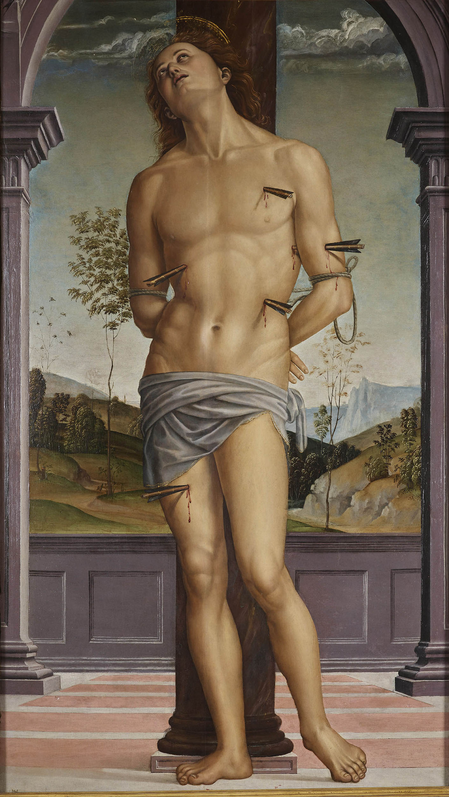

**这是什么**：殉道者圣塞巴斯蒂安（San Sebastiano）——他是罗马禁卫军军官，因信基督被绑在柱（或树）上乱箭穿身，后成为文艺复兴最常画的题材（既能堂皇展示理想化的青年裸体，又被当作「抵御瘟疫」的主保圣人）。画中他双手反绑、身中数箭，仍仰首作平静的虔信状。

**背景 / 看点**：佩鲁吉诺是翁布里亚画派的领袖，也是青年拉斐尔的老师。把这件和同厅的拉斐尔并看，能直接读出师承——佩鲁吉诺标志性的澄澈光线、对称稳定的构图、面容甜美宁静的人物，正是拉斐尔早期的出发点。看点就在「平静」二字：身受箭刑却毫无痛苦表情，是翁布里亚画派以优雅克制处理殉道题材的典型。

### ⭐⭐ 推荐 桑德罗·波提切利及工坊《圣母子、幼年施洗者圣约翰与天使》 / Sandro Botticelli and workshop, _Madonna and Child with the Infant Saint John the Baptist and Angels_
- **作者 / Artist**：桑德罗·波提切利及工坊 / Sandro Botticelli and workshop
- **作品 / Work**：《圣母子、幼年施洗者圣约翰与天使》 / _Madonna and Child with the Infant Saint John the Baptist and Angels_
- **时间**：1488–1490 年
- **材质**：蛋彩木板
- **尺寸**：直径 170 cm
- **位置**：狄多厅（第 9 室）
- **官网介绍页**：[圣母子、幼年圣约翰与天使 / Madonna con Bambino, San Giovannino e angeli｜Galleria Borghese 官方藏品库](https://www.collezionegalleriaborghese.it/opere/madonna-con-bambino-san-giovannino-e-angeli)｜馆藏编号 348

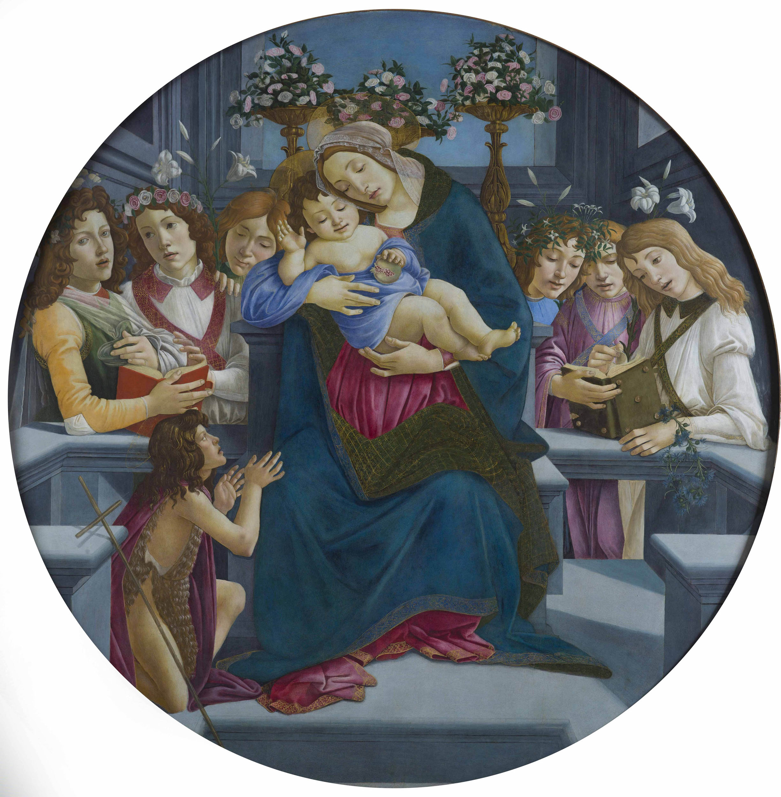

**这是什么**：一幅直径达 1.7 米的大型圆形画（tondo），画圣母怀抱圣婴、幼年的施洗者圣约翰（San Giovannino）与数名天使环绕。

**背景 / 看点**：tondo（圆形画）是 15 世纪末佛罗伦萨最受欢迎的家用宗教画形制，常作为富裕家庭的婚房或居室陈设，用于私人虔敬。这件出自波提切利（Sandro Botticelli）工坊，可见大师的典型语汇——细长流畅的轮廓线、忧郁柔美的圣母面容。看点在于把它当「佛罗伦萨家庭虔敬画」的代表来看：圆形构图如何把人物自然收拢进画框，以及波提切利式线条的优雅，与同厅翁布里亚、北方诸作放在一起，正好对照各画派的不同气质。

## 天顶画

### ⭐⭐ 推荐 安东·冯·马龙《埃涅阿斯与狄多故事》 / Anton von Maron, _Story of Aeneas and Dido_

- **作者 / Artist**：安东·冯·马龙（1733–1808） / Anton von Maron
- **作品 / Work**：《埃涅阿斯与狄多故事》（五幅） / _Story of Aeneas and Dido_
- **时间**：18 世纪末（平乔别墅新古典改造期）
- **材质**：布面油画（五幅，镶嵌入天顶）
- **位置**：狄多厅天顶（第 9 室，旧称「美惠三女神厅」）
- **官网介绍页**：[Room 9 - Dido Room｜Galleria Borghese 房间页](https://galleriaborghese.cultura.gov.it/en/il-museo/la-villa/sala-9-sala-di-didone/)

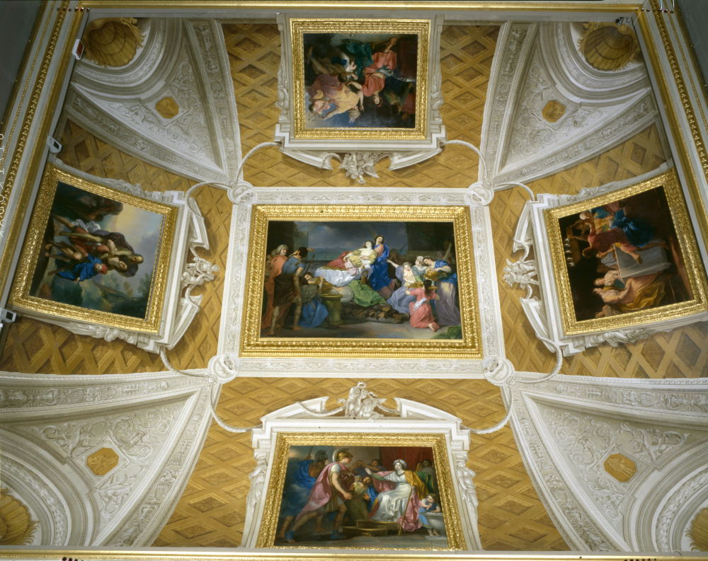

**内容（这是什么）**：这间厅得名于天顶——五幅一组的「埃涅阿斯与狄多故事」。故事取自维吉尔（Virgil）《埃涅阿斯纪》：特洛伊陷落后，英雄埃涅阿斯（Aeneas）流亡途中漂到北非迦太基，女王狄多（Dido）盛情接待并爱上了他；两人一度结合，但朱庇特派信使墨丘利（Mercury）下凡，命埃涅阿斯不可贪恋私情、必须继续西行去意大利建立罗马；埃涅阿斯忍痛起航，狄多在绝望中登上柴堆、伏剑自焚。这是整部史诗里最著名的爱情悲剧——「责任（建立罗马的天命）压倒爱情」的母题。

**背景 / 来历**：五幅画出自奥地利画家安东·冯·马龙（Anton von Maron，1733–1808）之手。他是新古典主义领袖安东·拉斐尔·门格斯（Anton Raphael Mengs，1728–1779）的学生兼助手，1750 年代末来到罗马并定居，后来还娶了门格斯的妹妹——把这套天顶放进「门格斯—温克尔曼的新古典罗马」语境里看，就懂它端庄、清晰、重叙事的画风从何而来。这间厅旧称「美惠三女神厅（le Tre Grazie）」，正是 18 世纪末马尔坎托尼奥·博尔盖塞（Marcantonio IV Borghese）请建筑师安东尼奥·阿斯普鲁奇（Antonio Asprucci）统筹的别墅大改造中，给每间厅「定一个主题」后才改叫狄多厅的。要提醒的是：本厅墙上挂的是拉斐尔《卸下圣体》等文艺复兴名作，与天顶的狄多主题并不同源——所以这里天顶是独立的一套叙事装饰，不必硬往墙上的画上联系。

**看点**：它是别墅里少见的「把一则完整悲剧画成五联画」的天顶——不是单一寓意，而是有头有尾的连环叙事。看点在于读出这条「相遇→相爱→神令→别离→殉情」的叙事链，以及它如何用最克制的新古典语言（清晰的轮廓、舞台式的构图）讲一个最炽烈的爱情故事。中央那幕《狄多自杀》是全组的情感落点。

#### 逐幅分述（五幅）：

##### 中央《狄多自杀》/ _Dido's Suicide_

全组的核心与情感落点，画女王在埃涅阿斯离去后绝望自尽（登上柴堆、伏剑而死）。它占天顶正中、画幅最大，定下整组的悲剧基调。

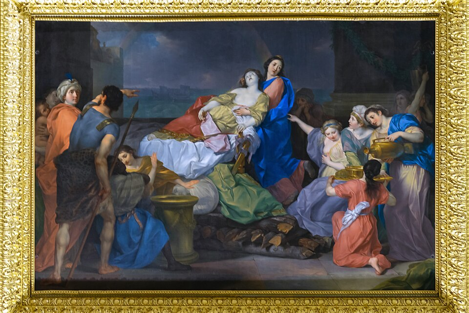

##### 《埃涅阿斯逃离特洛伊》/ _Aeneas Fleeing Troy_

故事的「前情」：特洛伊陷落之夜，埃涅阿斯背父携子逃出火城，开始流亡。这一幕交代了他为何会漂到迦太基，是叙事链的起点。

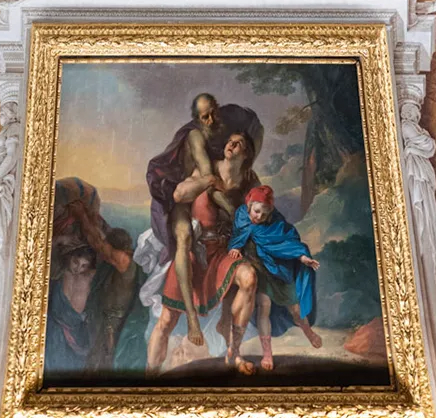

##### 《狄多接待埃涅阿斯与同伴阿卡特斯》/ _Dido Receiving Aeneas and Achates_

「相遇」一幕：女王狄多在宫中接见流亡而来的埃涅阿斯及其忠实同伴阿卡特斯（Achates），两人的命运由此交织。

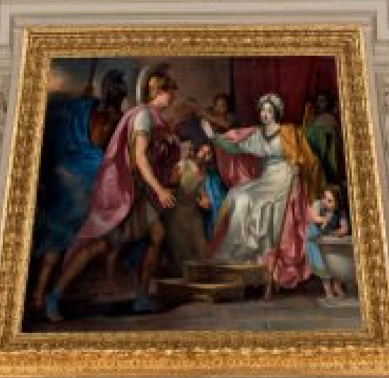

##### 《迦太基宴会》/ _Dido's Banquet_

「相爱」的高光：狄多设盛宴款待埃涅阿斯，席间听他讲述特洛伊的覆灭与流亡，渐生爱意。这是全剧最华美、最温情的一幕。

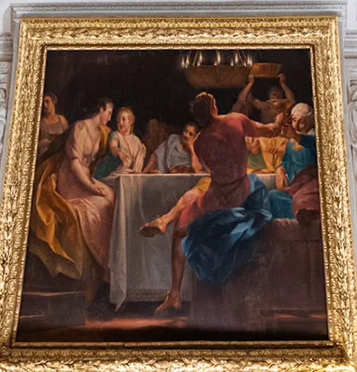

##### 《墨丘利奉朱庇特命催促埃涅阿斯离开迦太基》/ _Mercury Exhorting Aeneas to Leave Carthage_

「神令／转折」：朱庇特派信使墨丘利（Mercury）下凡，命埃涅阿斯不可贪恋私情、须继续西行建立罗马。正是这道神令逼他离开、酿成狄多之死——是悲剧的直接推手。

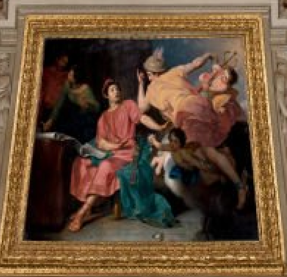

**现场站看**：

1. **先认中央的《狄多自杀》**——天顶正中、最大的一格，画女王伏剑（或登上柴堆）自尽。认准这幕悲剧落点，整组五联画的基调就定住了。
2. **顺四周读叙事链**——绕厅把四周四幅串起来看：《埃涅阿斯逃离特洛伊》（流亡起点）→《狄多接待埃涅阿斯与同伴阿卡特斯（Achates）》（相遇）→《迦太基宴会》（相爱的高光）→《墨丘利奉朱庇特命催促埃涅阿斯离开迦太基》（神令／转折）。配上中央的自焚，就是完整的「相遇—相爱—神令—别离—殉情」。
3. **找那位「奉命拆散恋人」的信使墨丘利**——在「催促离开」那幕里找戴飞翼帽、持节杖（caduceus）的墨丘利。他是全剧的「机械降神」：是诸神的命令而非埃涅阿斯薄情，逼他离开——这点能改变你对这对恋人结局的理解。
4. **体会「门格斯式」的克制**——注意人物清晰的轮廓、雕塑感的姿态和舞台般的布局，这是马龙从门格斯学来的新古典画风：再激烈的情节，也用冷静、端庄的方式呈现。
5. **抬头至少看 30 秒**——这是房间命名的由来，也是阿斯普鲁奇「一室一主题」改造的样本；天顶自成一台戏，值得单独读完。

## 绘画

本节按馆方 Painting 藏品列表补充，共 27 件。核心展品如已在上文展开，这里仍保留官方清单条目，方便核对。

### ⭐ 顺路看 弗朗切斯科·莱博利尼，称弗朗切斯科·弗兰恰《玫瑰园中的圣母子》 / Raibolini Francesco called Francesco Francia, _Madonna with Child in a Rose Garden_

- **作者 / Artist**：弗朗切斯科·莱博利尼，称弗朗切斯科·弗兰恰 / Raibolini Francesco called Francesco Francia
- **作品 / Work**：《玫瑰园中的圣母子》 / _Madonna with Child in a Rose Garden_
- **材质**：油彩木板
- **尺寸**：86 × 64 cm
- **馆藏编号**：061
- **位置**：狄多厅（第 9 室）
- **官网介绍页**：[官网介绍英文](https://www.collezionegalleriaborghese.it/en/opere/madonna-with-child-in-a-rose-garden)｜馆藏编号 061

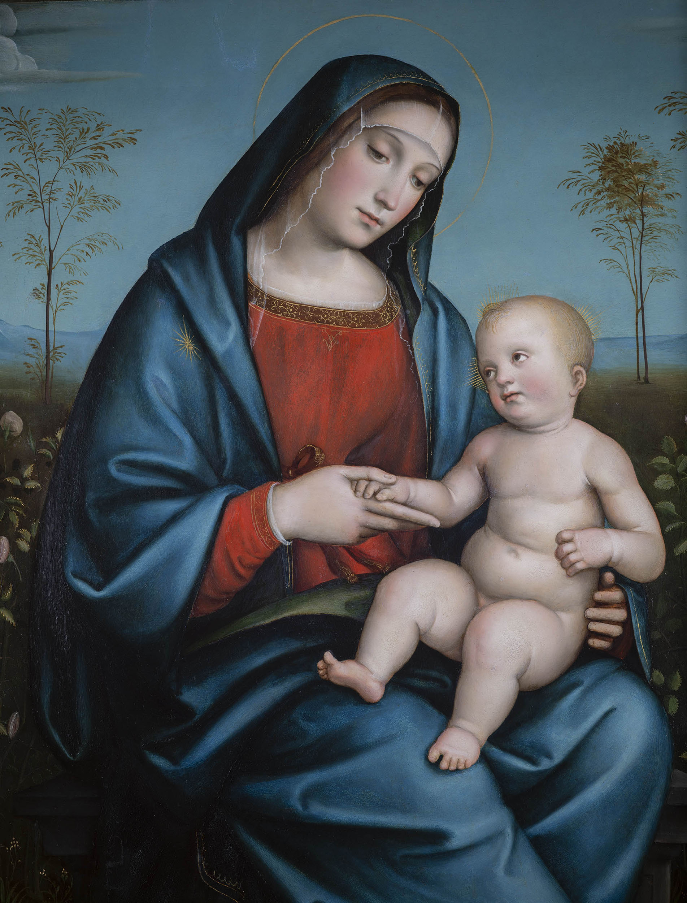

**这是什么 / 看点**：圣母抱圣婴坐在开满玫瑰的花园中。弗兰恰（Francesco Francia）是博洛尼亚画派的代表，本行金匠出身，画风以细腻打磨、珐琅般的光洁著称。玫瑰园是圣母图像学里的「封闭花园（hortus conclusus）」母题，红玫瑰象征基督受难、白玫瑰象征圣母纯洁。属顺路看，可与同厅佛罗伦萨、翁布里亚诸作对照各画派气质。

### ⭐ 顺路看 弗朗切斯科·莱博利尼，称弗朗切斯科·弗兰恰《圣司提反》 / Raibolini Francesco called Francesco Francia, _Saint Stephen_

- **作者 / Artist**：弗朗切斯科·莱博利尼，称弗朗切斯科·弗兰恰 / Raibolini Francesco called Francesco Francia
- **作品 / Work**：《圣司提反》 / _Saint Stephen_
- **时间**：1485–1490 年
- **材质**：油彩木板
- **尺寸**：73 × 52.5 cm
- **馆藏编号**：065
- **位置**：狄多厅（第 9 室）
- **官网介绍页**：[官网介绍英文](https://www.collezionegalleriaborghese.it/en/opere/saint-stephen)｜馆藏编号 065

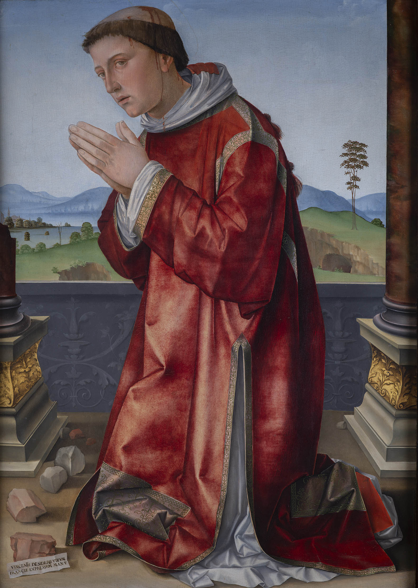

**这是什么 / 看点**：圣司提反（Santo Stefano）是基督教第一位殉道者（首位「致命见证」），因传教被犹太公会用石头砸死。辨认他的标志物是头顶或肩上放着的几块石头。这件同样出自博洛尼亚的弗兰恰，画风细致光洁；现场就靠「石头」这个道具认出他是谁。属顺路看。

### ⭐ 顺路看 佩德罗·马丘卡《圣家》 / Machuca Pedro, _Holy Family_

- **作者 / Artist**：佩德罗·马丘卡 / Machuca Pedro
- **作品 / Work**：《圣家》 / _Holy Family_
- **时间**：约 1518 年
- **材质**：油彩木板
- **尺寸**：58 × 47 cm
- **馆藏编号**：174
- **位置**：狄多厅（第 9 室）
- **官网介绍页**：[官网介绍英文](https://www.collezionegalleriaborghese.it/en/opere/holy-family-2)｜馆藏编号 174

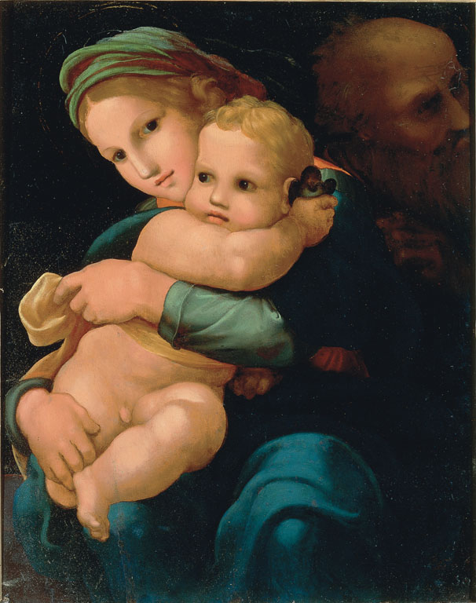

**这是什么 / 看点**：圣家题材（圣母、圣婴与圣约瑟）。作者佩德罗·马丘卡（Pedro Machuca）是位西班牙画家兼建筑师，曾在意大利受拉斐尔圈子的训练，后来回西班牙设计了阿尔罕布拉宫内查理五世宫殿。看点正在这层「西班牙人画意大利风」的身份——把它当一件意大利盛期风格在伊比利亚的传播样本来看，比单看画面更有意思。属顺路看。

### ➖ 可略过 伊波利托·科斯塔工坊《墓中的基督》 / Workshop of Costa Ippolito, _Christ in the Sepulchre_

- **作者 / Artist**：伊波利托·科斯塔工坊 / Workshop of Costa Ippolito
- **作品 / Work**：《墓中的基督》 / _Christ in the Sepulchre_
- **时间**：16 世纪下半叶
- **材质**：油彩木板
- **尺寸**：84 × 71 cm
- **馆藏编号**：302
- **位置**：狄多厅（第 9 室）
- **展陈提醒**：馆方藏品页标注「当前未展出」。
- **官网介绍页**：[官网介绍英文](https://www.collezionegalleriaborghese.it/en/opere/christ-in-the-sepulchre)｜馆藏编号 302

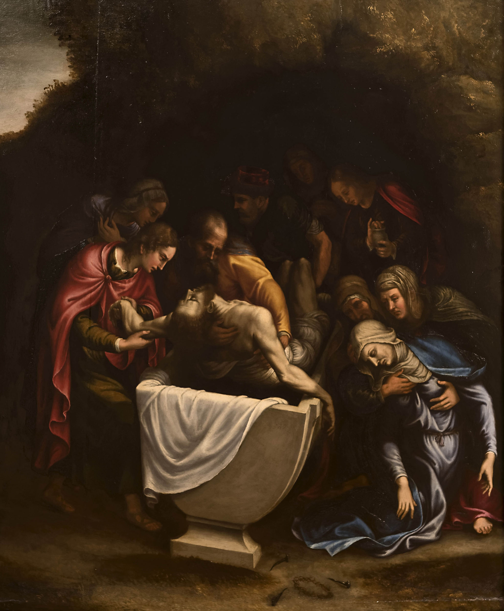

**这是什么 / 看点**：表现死去的基督立于（或半起于）墓中、展示创口的「悲苦之人（Imago Pietatis）」式虔修画，供信徒默想受难之用。出自费拉拉画家伊波利托·科斯塔的工坊。因当前未展出，现场可略过；它与本厅其他「基督受难—下葬」主题（如拉斐尔《卸下圣体》）同属一条图像脉络，可作背景了解。

### ⭐ 顺路看 安德烈亚·达尼奥洛，称安德烈亚·德尔·萨尔托及工坊《圣母子与幼年施洗者圣约翰》 / Andrea d'Agnolo called Andrea del Sarto and workshop, _Madonna and Child with The Infant Saint John the Baptist_

- **作者 / Artist**：安德烈亚·达尼奥洛，称安德烈亚·德尔·萨尔托及工坊 / Andrea d'Agnolo called Andrea del Sarto and workshop
- **作品 / Work**：《圣母子与幼年施洗者圣约翰》 / _Madonna and Child with The Infant Saint John the Baptist_
- **时间**：约 1513 年
- **材质**：油彩木板
- **尺寸**：80 × 60 cm
- **馆藏编号**：336
- **位置**：狄多厅（第 9 室）
- **官网介绍页**：[官网介绍英文](https://www.collezionegalleriaborghese.it/en/opere/madonna-and-child-with-the-infant-saint-john-the-baptist-6)｜馆藏编号 336

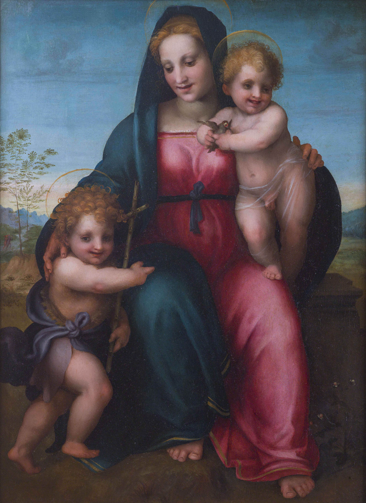

**这是什么 / 看点**：圣母子与幼年施洗者圣约翰的私人虔敬画。安德烈亚·德尔·萨尔托（Andrea del Sarto）是佛罗伦萨盛期到风格主义过渡的领军画家，以柔和的明暗渐隐（sfumato）和雍容的人物著称，瓦萨里称他「无瑕的画家（pittore senza errori）」。此件有工坊参与，看点在其典型的柔润色调与三角形稳定构图；与同厅波提切利、洛伦佐·迪·克雷迪等佛罗伦萨圣母像并看最佳。属顺路看。

### ⭐ 顺路看 皮耶罗·迪·洛伦佐，称皮耶罗·迪·科西莫《朝拜圣婴基督》 / Piero di Lorenzo called Piero di Cosimo, _Adoration of the Christ Child_

- **作者 / Artist**：皮耶罗·迪·洛伦佐，称皮耶罗·迪·科西莫 / Piero di Lorenzo called Piero di Cosimo
- **作品 / Work**：《朝拜圣婴基督》 / _Adoration of the Christ Child_
- **时间**：1510–1512 年之后
- **材质**：蛋彩木板
- **尺寸**：直径 140 cm
- **馆藏编号**：343
- **位置**：狄多厅（第 9 室）
- **官网介绍页**：[官网介绍英文](https://www.collezionegalleriaborghese.it/en/opere/adoration-of-the-christ-child)｜馆藏编号 343

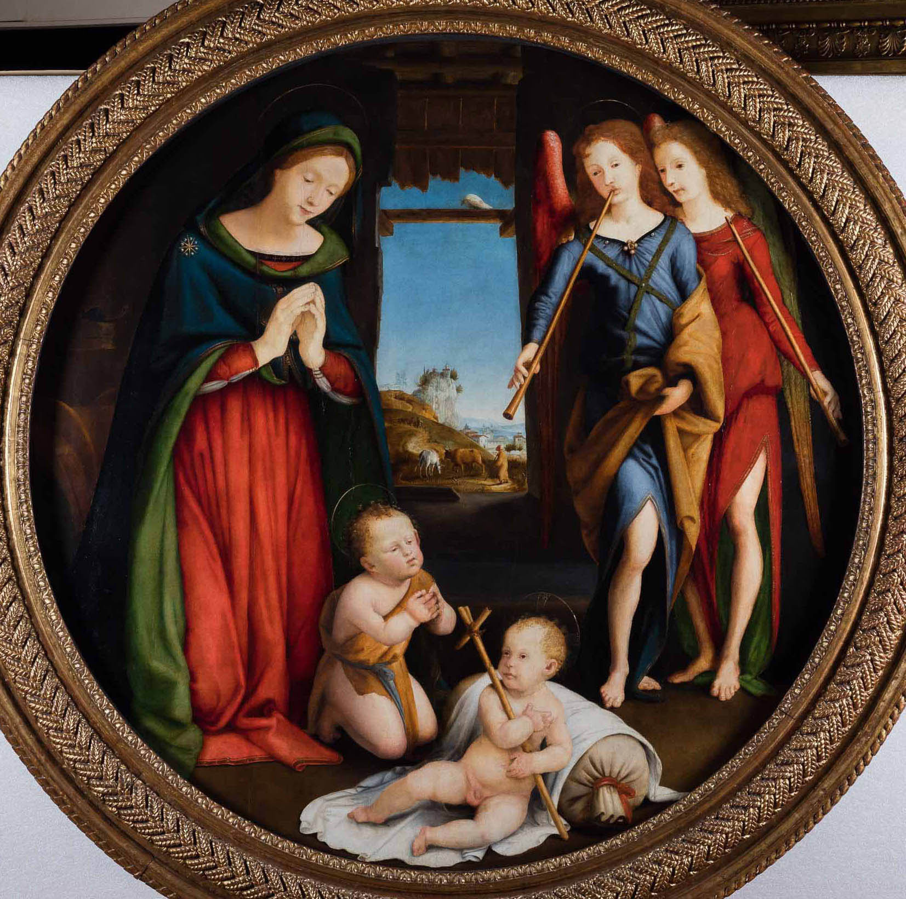

**这是什么 / 看点**：圣母与诸人物俯身朝拜地上的圣婴，又一件大型圆形画（直径 1.4 米）。皮耶罗·迪·科西莫（Piero di Cosimo）是佛罗伦萨一位想象力奇特的画家，瓦萨里记载他性情古怪、偏爱奇思异景。看点在于把它和同厅波提切利那件 tondo 对看——同为佛罗伦萨圆形家用虔敬画，却各有性情。属顺路看。

### ➖ 可略过 博尔盖塞圆画大师《朝拜圣婴》 / Maestro del Tondo Borghese, _Adoration of the Child_

- **作者 / Artist**：博尔盖塞圆画大师 / Maestro del Tondo Borghese
- **作品 / Work**：《朝拜圣婴》 / _Adoration of the Child_
- **时间**：15 世纪末
- **材质**：蛋彩木板
- **尺寸**：直径 78 cm
- **馆藏编号**：352
- **位置**：狄多厅（第 9 室）
- **展陈提醒**：馆方藏品页标注「当前未展出」。
- **官网介绍页**：[官网介绍英文](https://www.collezionegalleriaborghese.it/en/opere/adoration-of-the-child-3)｜馆藏编号 352

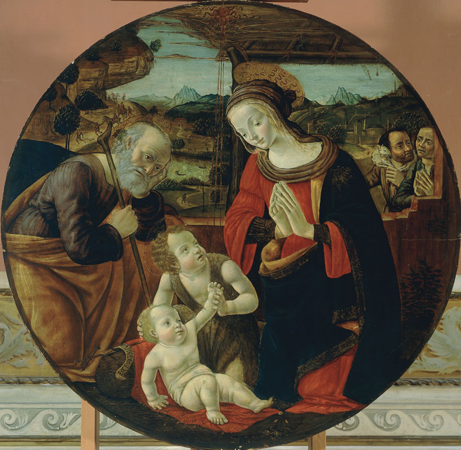

**这是什么 / 看点**：朝拜圣婴题材的小型圆形画。作者身份不明，学界以这件代表作给他起了「博尔盖塞圆画大师（Maestro del Tondo Borghese）」这一约定俗成的「应急名」——这正是看点本身：当作品确属同一只手却查不到真名时，艺术史就用其名作来命名一位「无名大师」。因当前未展出，现场可略过。

### ⭐ 顺路看 归属拉斐利诺·德尔·科莱《福尔纳丽娜》 / Attributed to Raffaellino del Colle, _La Fornarina_

- **作者 / Artist**：归属拉斐利诺·德尔·科莱 / Attributed to Raffaellino del Colle
- **作品 / Work**：《福尔纳丽娜》 / _La Fornarina_
- **时间**：16 世纪上半叶
- **材质**：油彩画布，后转移至木板
- **尺寸**：86 × 58.5 cm
- **馆藏编号**：355
- **位置**：狄多厅（第 9 室）
- **官网介绍页**：[官网介绍英文](https://www.collezionegalleriaborghese.it/en/opere/la-fornarina)｜馆藏编号 355

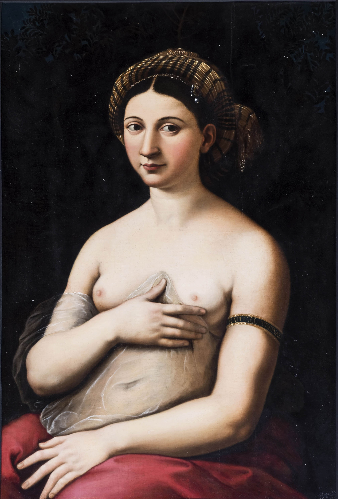

**这是什么 / 看点**：「福尔纳丽娜（La Fornarina，意为『面包师的女儿』）」相传是拉斐尔的恋人玛格丽塔·卢蒂（Margherita Luti）的半裸肖像。拉斐尔的著名原作今藏罗马巴贝里尼宫；本厅这件是其同时代版本，归在拉斐尔学生拉斐利诺·德尔·科莱名下。看点正在「名作的回声」——把它和本厅的拉斐尔真迹对看，能体会一位巨星画家的图式如何被弟子与摹本不断复制传播。属顺路看。

### ➖ 可略过 拉斐尔·桑齐奥《抱独角兽的女子》 / Sanzio, Raphael, _Lady with Unicorn_

- **作者 / Artist**：拉斐尔·桑齐奥 / Sanzio, Raphael
- **作品 / Work**：《抱独角兽的女子》 / _Lady with Unicorn_
- **时间**：约 1505–1506 年
- **材质**：原为油彩木板，后将画层转移至画布（再装于新木板）
- **尺寸**：67 × 56 cm
- **位置**：狄多厅（第 9 室）
- **展陈提醒**：馆方藏品页标注「当前未展出（Opera attualmente non esposta）」——它本是拉斐尔名作、平日的看点级展品，但若到访时确认不在墙上，现场只能略过；这里仍把讲解写足，供出发前了解。
- **官网介绍页**：[官网介绍英文](https://www.collezionegalleriaborghese.it/en/opere/lady-with-unicorn)｜馆藏编号 371

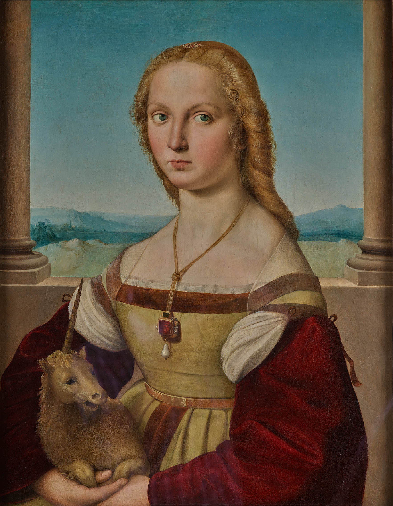

**这是什么**：拉斐尔早年的一幅年轻女子肖像。她侧身坐在敞廊栏杆前，两侧立柱框住画面上半，身后是雾色晕染的丘陵风景。她穿浅绿紧身胸衣、深红丝绒袖，颈上金链坠着一颗中央红宝石（或石榴石）、下接水滴形珍珠的吊坠，怀里抱着一头小小的独角兽——独角兽是传统的「贞洁」象征。整幅的三分之四侧坐姿、双手交叠于身前、敞廊＋远景的布局，明显来自达·芬奇（Leonardo）《蒙娜丽莎》刚刚带来的肖像新范式；卢浮宫一幅被认作本画准备稿的素描，更直接印证拉斐尔在佛罗伦萨期间见过达·芬奇的构图。

**身世：被改画成「圣加大肋纳」、又被复原**：这幅画最大的看点是它戏剧性的「变身史」。直到 1936 年，画上的女子一直被画成亚历山大的圣加大肋纳（Santa Caterina d'Alessandria）——独角兽的位置画着她的标志物「带齿的轮子」，肩上还披着一件沉重的斗篷，挡住了身后的风景，整个人物轮廓都被改过。1833 年的博尔盖塞财产清册里，它也只是「一幅佩鲁吉诺画派的圣加大肋纳像」。1927 年，朗吉（Roberto Longhi）率先把它判给拉斐尔；1933 年馆方做 X 光，照出了底下的原始构图，遂决定修复。修复极其冒险：先固定颜料层，再「牺牲」原木板，把画层整体转移到画布上、装于新木板，用手术刀剔除后加的覆盖层——独角兽这才重见天日。1960 年中央修复院再做检查时，X 光又在独角兽之下照出更早的一只狗（象征「婚姻忠贞」）。换言之，这块板上至少叠压着三层身份：原作的少女抱狗 → 改成抱独角兽 → 再被画成持轮的圣加大肋纳。

**她到底是谁**：原始委托与肖像对象至今成谜。一种有力的说法（科利瓦 Coliva 提出）认为她是订婚待嫁时的玛达莱娜·多尼（Maddalena Doni），据此把年代提前到 1504–1505 年，早于乌菲齐那对著名的多尼夫妇像。无论是谁，从抱狗（忠贞）到抱独角兽（贞洁）的图像逻辑，都指向一幅与婚姻相关的女性肖像。

**看点**：① 它是「一幅画里的三幅画」——肉眼看是抱独角兽的少女，X 光下却藏着持轮圣女与抱狗少女，是讲「绘画考古」最生动的案例。② 看达·芬奇的影子——三分之四侧坐、交叠的双手、敞廊与远景，都是《蒙娜丽莎》刚刚定义的肖像语法，拉斐尔在此现学现用。③ 珠宝的写实——红宝石吊坠与水滴珍珠画得晶莹剔透，是辨识 16 世纪初佛罗伦萨贵族盛装的好标本。

### ⭐ 顺路看 朱利奥·皮皮，称朱利奥·罗马诺《圣母子与幼年施洗者圣约翰》 / Pippi Giulio called Giulio Romano, _Madonna and Child with The Infant Saint John the Baptist_

- **作者 / Artist**：朱利奥·皮皮，称朱利奥·罗马诺 / Pippi Giulio called Giulio Romano
- **作品 / Work**：《圣母子与幼年施洗者圣约翰》 / _Madonna and Child with The Infant Saint John the Baptist_
- **时间**：16 世纪二三十年代
- **材质**：油彩木板
- **尺寸**：126 × 85 cm
- **馆藏编号**：374
- **位置**：狄多厅（第 9 室）
- **官网介绍页**：[官网介绍英文](https://www.collezionegalleriaborghese.it/en/opere/madonna-and-child-with-the-infant-saint-john-the-baptist-8)｜馆藏编号 374

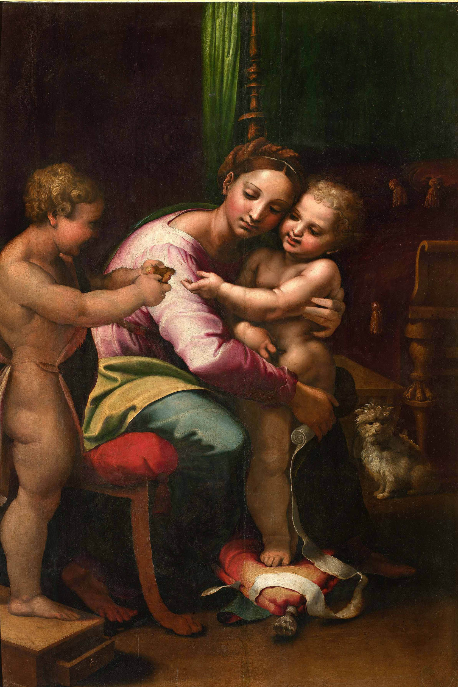

**这是什么 / 看点**：圣母子与幼年施洗者圣约翰。作者朱利奥·罗马诺（Giulio Romano）是拉斐尔最重要的弟子兼遗产继承人，拉斐尔死后接手其工坊，后赴曼托瓦设计、装饰著名的得特宫（Palazzo Te），是风格主义（Mannerism）的奠基人之一。看点在于辨认「拉斐尔之后」的味道——比老师更紧实结实、略带紧张感的人物，是盛期向风格主义过渡的标本。属顺路看。

### ⭐ 顺路看 安德烈亚·达尼奥洛，称安德烈亚·德尔·萨尔托《哀悼基督与四圣人》 / Andrea d'Agnolo called Andrea del Sarto, _Pietà with Four Saints_

- **作者 / Artist**：安德烈亚·达尼奥洛，称安德烈亚·德尔·萨尔托 / Andrea d'Agnolo called Andrea del Sarto
- **作品 / Work**：《哀悼基督与四圣人》 / _Pietà with Four Saints_
- **时间**：约 1508 年
- **材质**：油彩木板
- **尺寸**：22 × 172 cm
- **馆藏编号**：375
- **位置**：狄多厅（第 9 室）
- **官网介绍页**：[官网介绍英文](https://www.collezionegalleriaborghese.it/en/opere/pieta-with-four-saints)｜馆藏编号 375

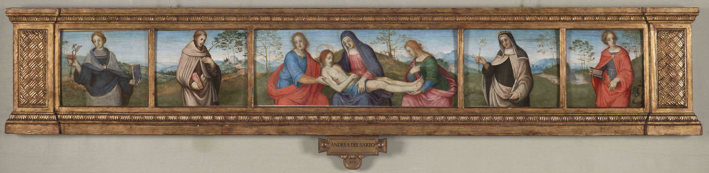

**这是什么 / 看点**：极扁长（仅 22 cm 高、172 cm 宽）的横幅小画，画死去的基督由人哀悼，两侧分立四位圣人。这种狭长比例说明它原是一座祭坛画底部的「底座画（predella）」。作者是佛罗伦萨名家安德烈亚·德尔·萨尔托的早期作品。看点：先从尺寸读出它「祭坛底座」的身份，再欣赏萨尔托一贯柔润的色调；它是本厅唯一一件能直观说明「predella」概念的展品。属顺路看。

### ⭐ 顺路看 贝尔纳迪诺·迪·贝托，称平图里基奥《十字架上的基督与圣克里斯托福、圣耶柔米》 / Bernardino di Betto called Pinturicchio, _Christ on the Cross between Saints Christopher and Jerome_

- **作者 / Artist**：贝尔纳迪诺·迪·贝托，称平图里基奥 / Bernardino di Betto called Pinturicchio
- **作品 / Work**：《十字架上的基督与圣克里斯托福、圣耶柔米》 / _Christ on the Cross between Saints Christopher and Jerome_
- **时间**：1473 年前，或约 1475–1478 年
- **材质**：油彩木板
- **尺寸**：59 × 40 cm
- **馆藏编号**：377
- **位置**：狄多厅（第 9 室）
- **官网介绍页**：[官网介绍英文](https://www.collezionegalleriaborghese.it/en/opere/christ-on-the-cross-between-saints-christopher-and-jerome)｜馆藏编号 377

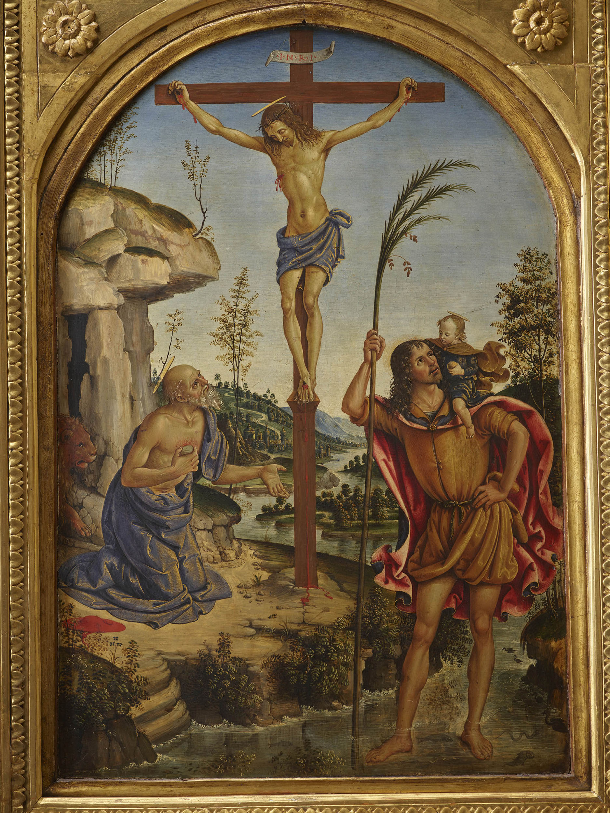

**这是什么 / 看点**：十字架上的基督，两侧立着圣克里斯托福（San Cristoforo）与圣耶柔米（San Girolamo）。平图里基奥（Pinturicchio）是翁布里亚画派画家、佩鲁吉诺的合作者，以繁密华丽的细节和明亮色彩著称。这是他极早期的小幅作品。现场认人靠道具：圣克里斯托福是肩扛幼年基督渡河的巨人，圣耶柔米常作苦修隐士、伴有狮子。属顺路看。

### ⭐ 顺路看 乔瓦尼·巴蒂斯塔·本韦努蒂，称奥尔托拉诺《哀悼基督》 / Benvenuti Giovanni Battista called Ortolano, _The Lamentation_

- **作者 / Artist**：乔瓦尼·巴蒂斯塔·本韦努蒂，称奥尔托拉诺 / Benvenuti Giovanni Battista called Ortolano
- **作品 / Work**：《哀悼基督》 / _The Lamentation_
- **时间**：1515–1520 年
- **材质**：油彩木板，后转移至铝板
- **尺寸**：241 × 181.5 cm
- **馆藏编号**：390
- **位置**：狄多厅（第 9 室）
- **官网介绍页**：[官网介绍英文](https://www.collezionegalleriaborghese.it/en/opere/the-lamentation)｜馆藏编号 390

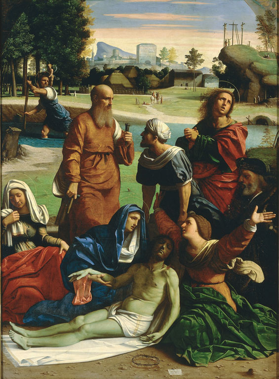

**这是什么 / 看点**：本厅尺幅最大的一件（高 2.4 米），画众人围着卸下的基督遗体哀悼（Lamentation/Compianto）。作者奥尔托拉诺（绰号意为「菜农」）是费拉拉画派画家，画风受同乡多索·多西与北方的影响，色彩浓郁、情感外露。看点：它与本厅其他「下葬—哀悼」主题（拉斐尔《卸下圣体》、科斯塔《墓中的基督》等）构成一条受难图像链，可对照费拉拉与中部意大利处理同一题材的不同情感强度。属顺路看。

### ➖ 可略过 归属拉斐尔·桑齐奥《男子肖像》 / Attributed to Sanzio, Raphael, _Portrait of a Man_

- **作者 / Artist**：归属拉斐尔·桑齐奥 / Attributed to Sanzio, Raphael
- **作品 / Work**：《男子肖像》 / _Portrait of a Man_
- **时间**：1502–1504 年
- **材质**：油彩木板
- **尺寸**：46 × 31 cm
- **馆藏编号**：397
- **位置**：狄多厅（第 9 室）
- **展陈提醒**：馆方藏品页标注「当前未展出」——它是归在拉斐尔名下的第三件本厅拉斐尔作品，但归属有争议、且当前不在墙上，现场可略过。
- **官网介绍页**：[官网介绍英文](https://www.collezionegalleriaborghese.it/en/opere/portrait-of-a-man-9)｜馆藏编号 397

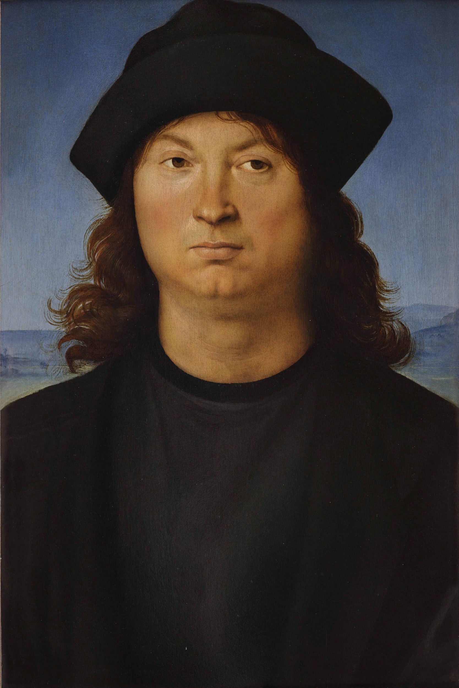

**这是什么 / 看点**：一幅小幅男子半身肖像，断代约 1502–1504 年，即拉斐尔最早期、尚在翁布里亚活动的阶段。归属至今有争议——有学者认作青年拉斐尔，也有人归给其师佩鲁吉诺的圈子。看点正在这层「真伪悬案」：它与本厅的《抱独角兽的女子》同属博尔盖塞收藏中「拉斐尔归属」的讨论案例，是观察一位巨匠早期面貌如何在学界反复商榷的标本。因当前未展出，仅作背景了解。

### ⭐ 顺路看 彼得罗·瓦努奇，称佩鲁吉诺《圣母子》 / Vannucci Pietro called Perugino, _Madonna and Child_

- **作者 / Artist**：彼得罗·瓦努奇，称佩鲁吉诺 / Vannucci Pietro called Perugino
- **作品 / Work**：《圣母子》 / _Madonna and Child_
- **时间**：约 1515 年
- **材质**：油彩木板
- **尺寸**：44 × 34 cm
- **馆藏编号**：401
- **位置**：狄多厅（第 9 室）
- **官网介绍页**：[官网介绍英文](https://www.collezionegalleriaborghese.it/en/opere/madonna-and-child-11)｜馆藏编号 401

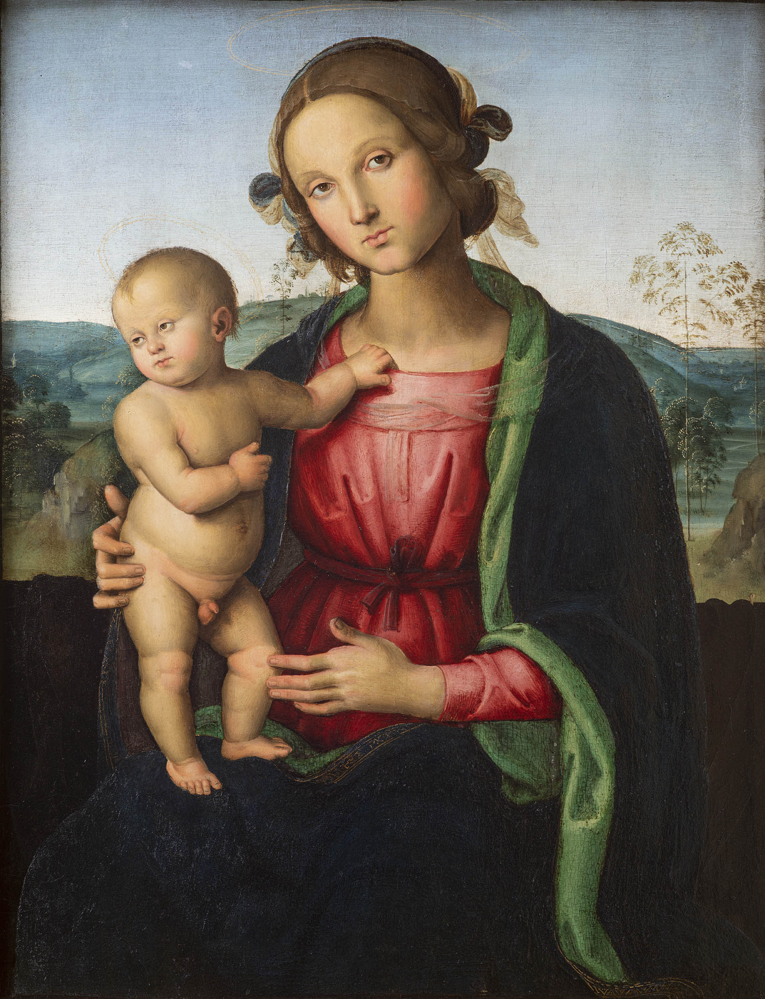

**这是什么 / 看点**：佩鲁吉诺晚年的一件小幅圣母子。本厅有他两件作品（另一件是《圣塞巴斯蒂安》），可一起看出翁布里亚画派标志性的甜美宁静与对称构图。看点：把它和拉斐尔的《卸下圣体》并观，正是「老师与学生」的隔空对照——拉斐尔正是从佩鲁吉诺这套柔和语汇出发，再一步步走向罗马盛期。属顺路看。

### ⭐ 顺路看 罗马学派《教宗尤利乌斯二世肖像》 / roman school, _Portrait of Pope Julius II_

- **作者 / Artist**：罗马学派 / roman school
- **作品 / Work**：《教宗尤利乌斯二世肖像》 / _Portrait of Pope Julius II_
- **时间**：16 世纪下半叶
- **材质**：布面油画
- **尺寸**：101 × 83.5 cm
- **馆藏编号**：413
- **位置**：狄多厅（第 9 室）
- **官网介绍页**：[官网介绍英文](https://www.collezionegalleriaborghese.it/en/opere/portrait-of-pope-julius-ii)｜馆藏编号 413

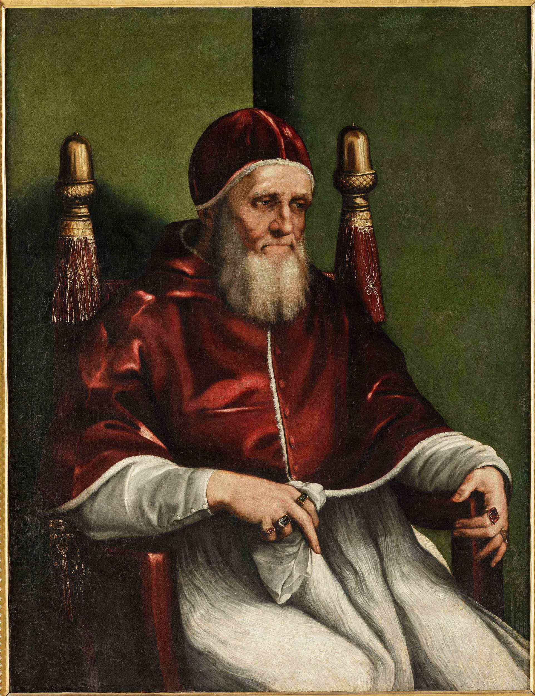

**这是什么 / 看点**：教宗尤利乌斯二世（Giulio II，1503–1513 在位）的坐姿肖像。他是文艺复兴最重要的「赞助型教宗」——委托米开朗琪罗画西斯廷天顶、拉斐尔画签字厅、布拉曼特重建圣彼得大教堂。这件出自罗马画派之手，构图源自拉斐尔那幅开创性的尤利乌斯二世坐像名作（原作今藏伦敦国家美术馆）。看点：它是「拉斐尔图式的回声」之一，与本厅其他拉斐尔及其追随者之作呼应；现场可辨认教宗的白须低头、若有所思的侧坐姿——这一「沉思的坐像」正是拉斐尔为后世肖像立下的范式。属顺路看。

### ⭐⭐⭐ 必看 仿拉斐尔《施洗者圣约翰》 / copy after Sanzio, Raphael, _Saint John the Baptist_

- **作者 / Artist**：仿拉斐尔（拉斐尔近圈） / copy after Sanzio, Raphael
- **作品 / Work**：《施洗者圣约翰》 / _Saint John the Baptist_
- **时间**：16 世纪第二个二十五年（约 1525–1550 年）
- **材质**：布面油画
- **尺寸**：172 × 153 cm
- **馆藏编号**：420
- **位置**：狄多厅（第 9 室）
- **官网介绍页**：[官网介绍英文](https://www.collezionegalleriaborghese.it/en/opere/saint-john-the-baptist-4)｜馆藏编号 420

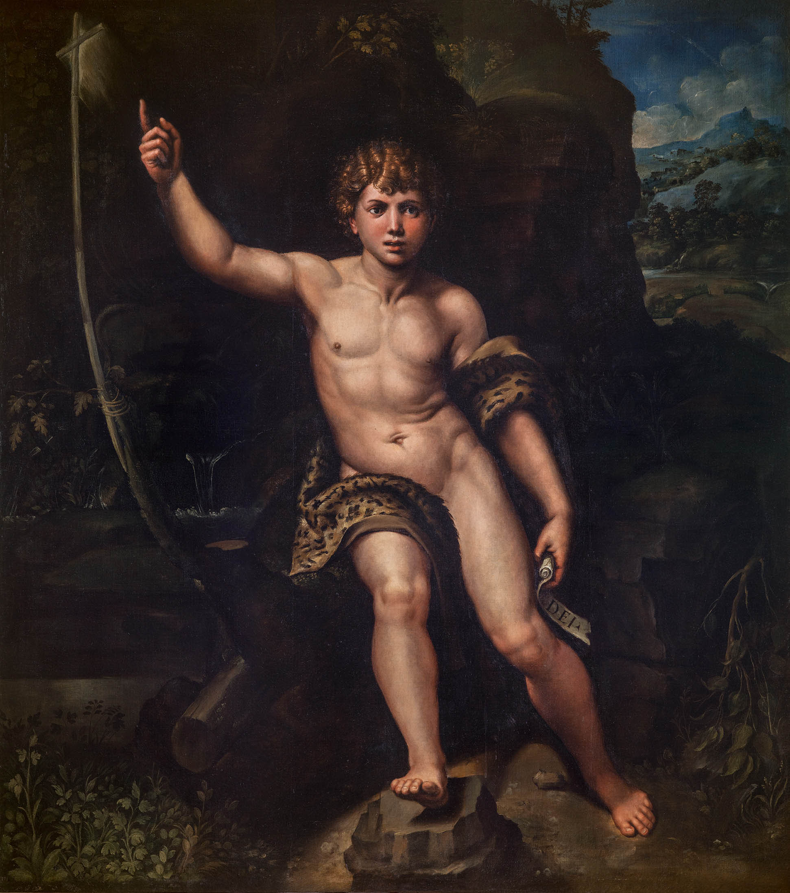

**这是什么**：施洗者圣约翰（San Giovanni Battista）以一种不寻常的样貌出现——不是常见的留须苦行者，而是一名无须的裸体青年，仅披一张豹皮（取代了惯常的骆驼皮）。他坐在一面渗出泉水的岩壁前，另一侧风景向远山与繁茂草木的湛蓝天空敞开。其余仍是约翰的标准标志物：他右手指向插在芦苇杆顶端的十字架，身旁卷轴上写着「Ecce Agnus Dei（看，神的羔羊）」（只露出后半句）。

**背景 / 来历**：这是拉斐尔一件极受欢迎的《施洗者圣约翰》原型的众多摹本之一——已知同题材摹本在各国收藏中约有 40 件，公认质量最高的一件藏佛罗伦萨乌菲齐（其是否拉斐尔亲笔今仍有争议）。瓦萨里记载拉斐尔曾为蓬佩奥·科隆纳画过一幅圣约翰（约 1517 年后），许多学者把乌菲齐那件与之对应。博尔盖塞这件早在 1613 年就出现在弗朗库奇歌咏希皮奥内·博尔盖塞画廊的诗中，说明那时已入藏；历来著录多把它归为「朱利奥·罗马诺仿拉斐尔」，馆方现谨慎定为「拉斐尔近圈」。

**看点 / 现场站看**：

1. **先认「豹皮＋芦苇十字架＋羔羊卷轴」三件道具**——它们一齐确认主角是施洗者圣约翰，也点出他「为基督作见证（看，神的羔羊）」的身份。注意他用骆驼皮的「惯例」被换成了豹皮，是此型的特别之处。
2. **盯住他右手的指示动作**——手指向上引向芦苇十字架。许多学者在这个手势里看到达·芬奇的影子（达·芬奇晚年在罗马也画过指天的圣约翰），由此推测莱奥纳多对拉斐尔处理这一题材有影响。
3. **看青年裸体的塑形**——这正是文艺复兴把宗教题材当成「理想化青年人体」舞台的典型；把它和同厅佩鲁吉诺《圣塞巴斯蒂安》、布龙齐诺《施洗者圣约翰》并看，能串起一条「圣徒即美少年」的图像线索。
4. **记住它「是摹本」**——这件的价值不在「真迹」，而在它实证了拉斐尔图式如何被反复复制、传遍欧洲。看的时候把它当「一个超级流行原型的众多回声之一」来读，更有意思。

### ⭐ 顺路看 巴托洛梅奥·德拉·波尔塔，称弗拉·巴托洛梅奥《祝福的基督》 / Della Porta Bartolomeo called Fra Bartolomeo, _Christ Blessing_

- **作者 / Artist**：巴托洛梅奥·德拉·波尔塔，称弗拉·巴托洛梅奥 / Della Porta Bartolomeo called Fra Bartolomeo
- **作品 / Work**：《祝福的基督》 / _Christ Blessing_
- **时间**：15 世纪末至 16 世纪初
- **材质**：油彩木板
- **尺寸**：59 × 46 cm
- **馆藏编号**：421
- **位置**：狄多厅（第 9 室）
- **官网介绍页**：[官网介绍英文](https://www.collezionegalleriaborghese.it/en/opere/christ-blessing)｜馆藏编号 421

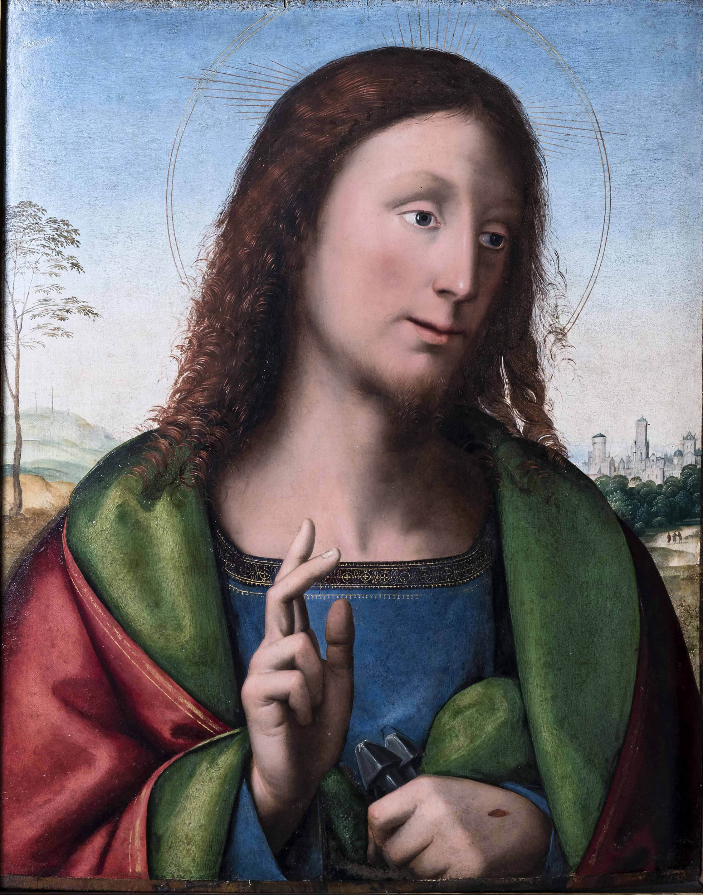

**这是什么 / 看点**：基督半身像，右手作祝福手势。作者弗拉·巴托洛梅奥（Fra Bartolomeo）是佛罗伦萨多明我会修士画家，萨伏那洛拉的追随者，以庄重宁静、体块明确的盛期古典风格著称，与拉斐尔互有影响。看点在其简洁肃穆的虔修气质——一件供个人默想的小幅圣像。本厅另有他一件《朝拜圣婴》（馆藏编号 439）可一并看。属顺路看。

### ⭐ 顺路看 多梅尼科·乌巴尔迪尼，称普利戈《圣家与幼年施洗者圣约翰》 / Ubaldini Domenico detto Puligo Domenico, _Holy Family with the Infant Saint John the Baptist_

- **作者 / Artist**：多梅尼科·乌巴尔迪尼，称普利戈 / Ubaldini Domenico detto Puligo Domenico
- **作品 / Work**：《圣家与幼年施洗者圣约翰》 / _Holy Family with the Infant Saint John the Baptist_
- **时间**：约 1526 年
- **材质**：油彩木板
- **尺寸**：73 × 55 cm
- **馆藏编号**：432
- **位置**：狄多厅（第 9 室）
- **官网介绍页**：[官网介绍英文](https://www.collezionegalleriaborghese.it/en/opere/holy-family-with-the-infant-saint-john-the-baptist-4)｜馆藏编号 432

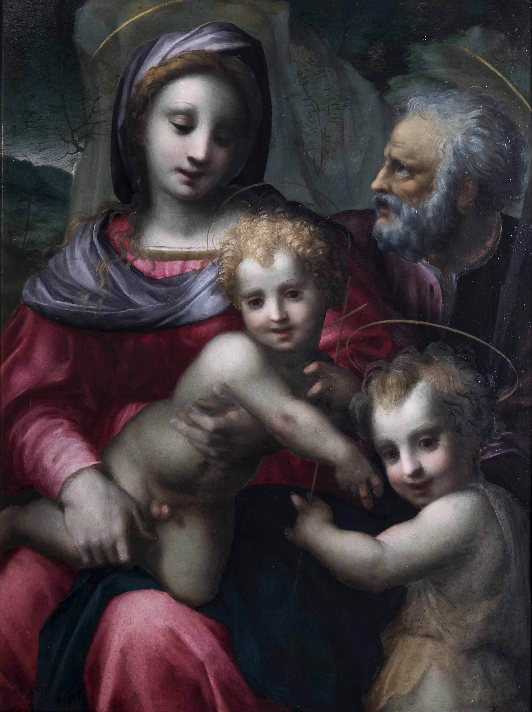

**这是什么 / 看点**：圣家与幼年施洗者圣约翰的私人虔敬画。普利戈（Domenico Puligo）是佛罗伦萨画家、安德烈亚·德尔·萨尔托的追随者，以柔和朦胧的明暗（sfumato）和甜美的人物面容见长。本厅另有他一件《圣母子与两位天使》（馆藏编号 468），两件并看可识别他一贯的柔润风格。属顺路看。

### ⭐ 顺路看 洛伦佐·迪·克雷迪《圣母子与幼年施洗者圣约翰》 / Lorenzo di Credi, _Madonna and Child with The Infant Saint John the Baptist_

- **作者 / Artist**：洛伦佐·迪·克雷迪 / Lorenzo di Credi
- **作品 / Work**：《圣母子与幼年施洗者圣约翰》 / _Madonna and Child with The Infant Saint John the Baptist_
- **时间**：15 世纪最后十年
- **材质**：蛋彩木板
- **尺寸**：直径 88 cm
- **馆藏编号**：433
- **位置**：狄多厅（第 9 室）
- **官网介绍页**：[官网介绍英文](https://www.collezionegalleriaborghese.it/en/opere/madonna-and-child-with-the-infant-saint-john-the-baptist-11)｜馆藏编号 433

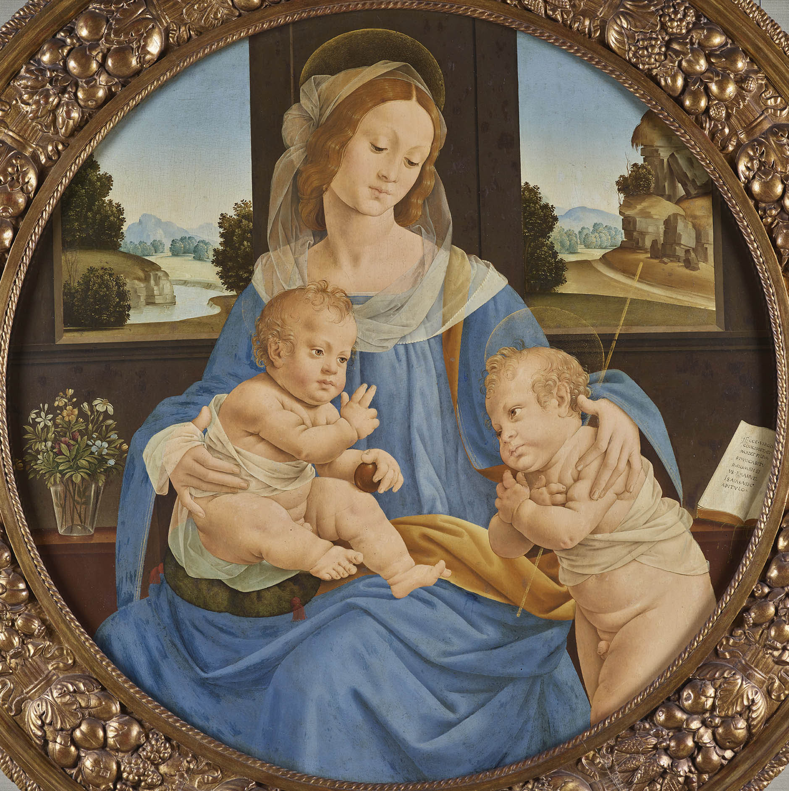

**这是什么 / 看点**：又一件佛罗伦萨圆形画（直径 88 cm），画圣母子与幼年圣约翰。洛伦佐·迪·克雷迪（Lorenzo di Credi）是韦罗基奥工坊的高徒，与达·芬奇同门，画风以一丝不苟的细致打磨和明净清冷的色调著称。看点：把它与同厅波提切利、皮耶罗·迪·科西莫的 tondo 并看，三件圆形画正好凑成一组「佛罗伦萨家用虔敬画」的对照样本。属顺路看。

### ⭐ 顺路看 巴托洛梅奥·德拉·波尔塔，称弗拉·巴托洛梅奥《朝拜圣婴》 / Della Porta Bartolomeo called Fra Bartolomeo, _Adoration of the Child_

- **作者 / Artist**：巴托洛梅奥·德拉·波尔塔，称弗拉·巴托洛梅奥 / Della Porta Bartolomeo called Fra Bartolomeo
- **作品 / Work**：《朝拜圣婴》 / _Adoration of the Child_
- **时间**：约 1495 年
- **材质**：油彩木板
- **尺寸**：直径 87 cm
- **馆藏编号**：439
- **位置**：狄多厅（第 9 室）
- **官网介绍页**：[官网介绍英文](https://www.collezionegalleriaborghese.it/en/opere/adoration-of-the-child-4)｜馆藏编号 439

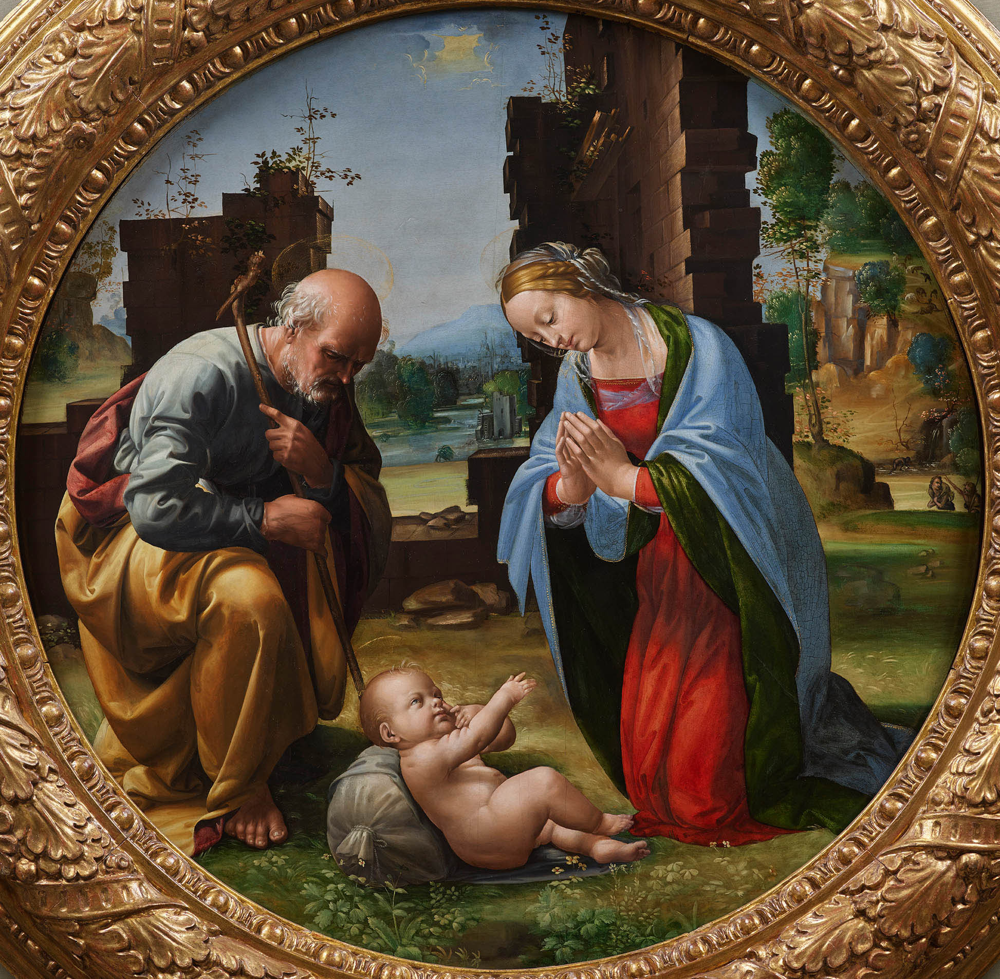

**这是什么 / 看点**：弗拉·巴托洛梅奥的一件圆形画（直径 87 cm），画圣母俯身朝拜地上的圣婴。这是他较早期、修道前后的作品，可见佛罗伦萨盛期那种庄重的体块与对称构图。看点：它和同厅他另一件《祝福的基督》（馆藏编号 421）同台，能看出这位多明我会修士画家从早年圆形画到成熟圣像的发展。属顺路看。

### ⭐⭐⭐ 必看 阿尼奥洛·迪·科西莫，称布龙齐诺《施洗者圣约翰》 / Agnolo di Cosimo called Bronzino, _Saint John the Baptist_

- **作者 / Artist**：阿尼奥洛·迪·科西莫，称布龙齐诺 / Agnolo di Cosimo called Bronzino
- **作品 / Work**：《施洗者圣约翰》 / _Saint John the Baptist_
- **时间**：约 1560 年
- **材质**：油彩木板
- **尺寸**：120 × 92 cm
- **馆藏编号**：444
- **位置**：狄多厅（第 9 室）
- **官网介绍页**：[官网介绍英文](https://www.collezionegalleriaborghese.it/en/opere/saint-john-the-baptist-5)｜馆藏编号 444

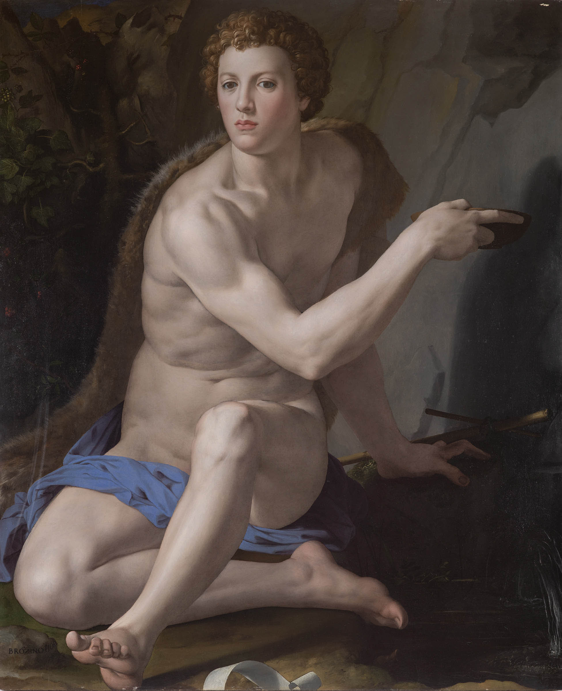

**这是什么**：本厅最精彩的风格主义（Mannerism）绘画。表面是一身近乎全裸、肌肉如雕像般的青年施洗者圣约翰——肩披兽皮、持芦苇十字架，右手端着刚从泉边盛满水的洗礼钵，下方还有半截「Ecce Agnus Dei（看，神的羔羊）」卷轴（卷轴被截断，是木板后来被裁小所致）。左下角石头上刻着签名「Bro(n)zino Fiore(ntino)」。

**背景 / 来历：一幅披着圣徒外衣的肖像**：学界普遍认为，这其实是科西莫一世·德·美第奇（Cosimo I de' Medici）之子乔瓦尼·德·美第奇（Giovanni de' Medici）扮成同名主保圣人「施洗者约翰」的肖像。乔瓦尼自幼被安排走教会路线，1560 年受封枢机、次年又任比萨大主教（受封时年仅 16–17 岁，正合画中青年的年纪）。这幅画很可能就是为庆祝这两项任命而委托布龙齐诺所作——同时借「佛罗伦萨主保圣人」之像，宣告 1559 年《卡托-康布雷齐和约》后科西莫治下的新稳定。布龙齐诺是美第奇宫廷的首席画师，以冷峻光洁、珐琅般的表面和高度世故的肖像著称。此画至迟 1610 年已入希皮奥内·博尔盖塞收藏（有当年为它配框的付款记录）。

**现场站看**：

1. **先找左下石头上的签名**——「Bronzino Fiorentino」刻在石上，确认这是大师亲笔，也提醒你它出自美第奇宫廷的核心画师之手。
2. **认全圣约翰的标志物**——肩上兽皮、芦苇十字架、手中洗礼钵、下方残卷「Ecce Agnus Dei」。四件道具让他无疑是施洗者约翰；但接着你会发现，画家几乎在用这些「宗教标签」包装一具世俗化的青年身体。
3. **盯住那具「雕像般」的裸体**——布龙齐诺让人物姿态优雅却略显别扭、扭转用力，肌体借鉴了梵蒂冈的古代名作《观景殿躯干（Belvedere Torso）》。这是风格主义的精髓：把人体当成炫技的雕塑去摆弄。
4. **看「圣」与「俗」的拉扯**——丰密的卷发、微红的嘴唇、冷瓷般的肤质，都把形象从神秘的苦修者拉向世俗的青年贵族。记住「他其实是 16 岁的美第奇枢机」，再看这张脸，就能读出肖像与圣像两层身份的并置。
5. **和同厅另一件圣约翰对照**——本厅还有一件「仿拉斐尔《施洗者圣约翰》」（馆藏编号 420）。两件并看：一边是拉斐尔式的优雅原型摹本，一边是布龙齐诺冷峻世故的宫廷风格主义，正好量出从盛期到风格主义的距离。

### ⭐ 顺路看 归属彼得罗·博纳科尔西，称佩林·德尔·瓦加《基督降生》 / Attributed to Bonaccorsi Pietro called Perin del Vaga, _Nativity_

- **作者 / Artist**：归属彼得罗·博纳科尔西，称佩林·德尔·瓦加 / Attributed to Bonaccorsi Pietro called Perin del Vaga
- **作品 / Work**：《基督降生》 / _Nativity_
- **时间**：约 1518 年
- **材质**：油彩木板
- **尺寸**：90 × 67 cm
- **馆藏编号**：464
- **位置**：狄多厅（第 9 室）
- **官网介绍页**：[官网介绍英文](https://www.collezionegalleriaborghese.it/en/opere/nativity-8)｜馆藏编号 464

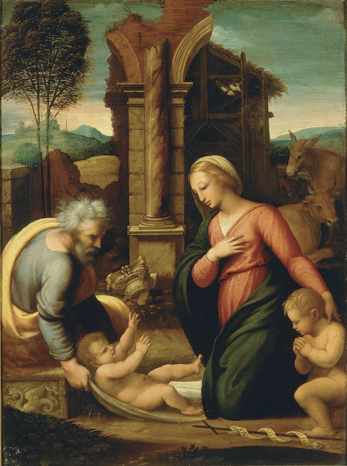

**这是什么 / 看点**：基督降生场景，众人朝拜马槽中的圣婴。归在佩林·德尔·瓦加（Perin del Vaga）名下——他是拉斐尔的弟子，参与过梵蒂冈凉廊的装饰，后活跃于热那亚与罗马（圣天使堡的装饰）。看点同样在「拉斐尔工坊的余韵」：它与本厅朱利奥·罗马诺、拉斐利诺·德尔·科莱诸作一起，勾出拉斐尔身后弟子们如何把老师的语汇带向风格主义。属顺路看。

### ⭐ 顺路看 多梅尼科·乌巴尔迪尼，称普利戈《圣母子与两位天使》 / Ubaldini Domenico detto Puligo Domenico, _Virgin and Child with Two Angels_

- **作者 / Artist**：多梅尼科·乌巴尔迪尼，称普利戈 / Ubaldini Domenico detto Puligo Domenico
- **作品 / Work**：《圣母子与两位天使》 / _Virgin and Child with Two Angels_
- **时间**：1512–1515 年
- **材质**：油彩木板
- **尺寸**：直径 68 cm
- **馆藏编号**：468
- **位置**：狄多厅（第 9 室）
- **官网介绍页**：[官网介绍英文](https://www.collezionegalleriaborghese.it/en/opere/virgin-and-child-with-two-angels)｜馆藏编号 468

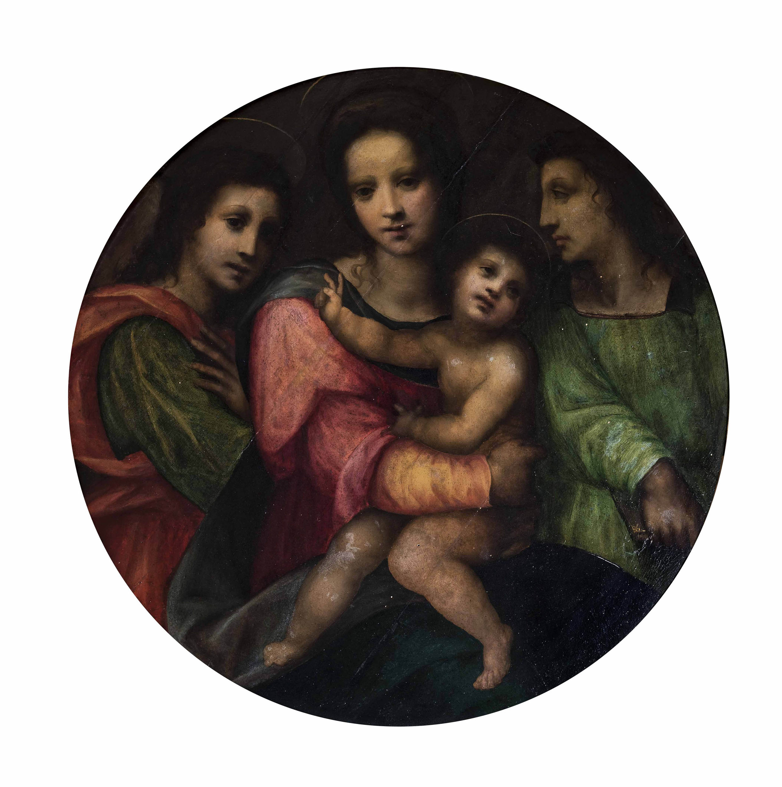

**这是什么 / 看点**：普利戈的又一件圆形画（直径 68 cm），圣母子两侧伴两位天使。与本厅他另一件《圣家与幼年施洗者圣约翰》（馆藏编号 432）同看，能稳稳认出他承自安德烈亚·德尔·萨尔托的柔和明暗与甜美面容。属顺路看，可归进本厅那组佛罗伦萨圆形虔敬画一并扫过。
## 雕塑

本节先列馆方 Modern Sculpture 藏品列表，共 2 件。

### ⭐ 顺路看 罗马学派《雪花石碗》 / roman school, _Bowl in Alabaster_

- **作者 / Artist**：罗马学派 / roman school
- **作品 / Work**：《雪花石碗》 / _Bowl in Alabaster_
- **时间**：1781 年之前
- **材质**：条纹黄色雪花石膏
- **尺寸**：20 × 56 cm
- **馆藏编号**：CI
- **位置**：狄多厅（第 9 室）
- **官网介绍页**：[官网介绍英文](https://www.collezionegalleriaborghese.it/en/opere/bowl-in-alabaster)｜馆藏编号 CI

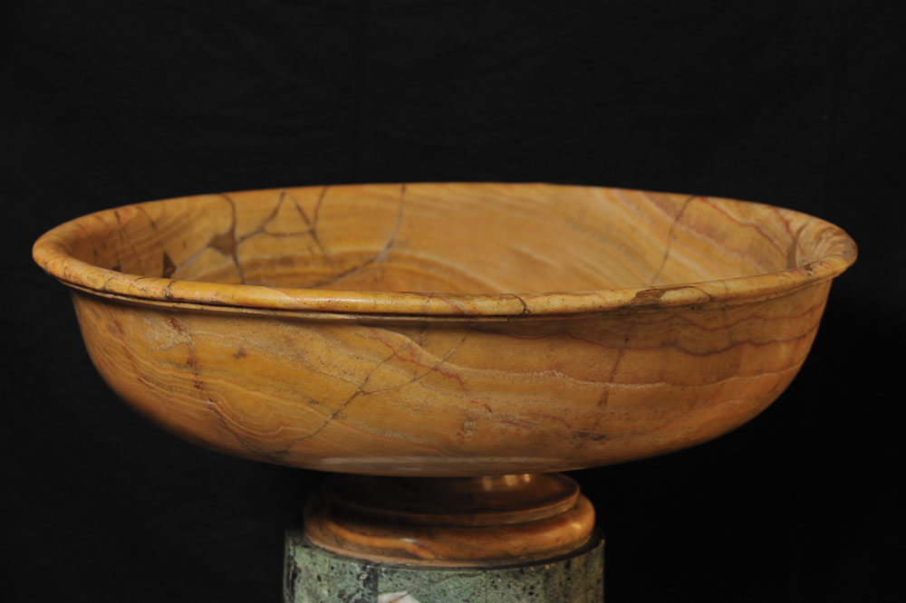

**这是什么 / 看点**：一只用条纹黄色雪花石膏车制的浅碗，属 18 世纪别墅陈设的装饰器物。看点在材质本身——雪花石膏半透明、纹理如行云流水，正是博尔盖塞家族用珍稀彩石炫示财富与品位的一贯做法。它和本厅的壁炉、马赛克桌面同属阿斯普鲁奇翻新时配置的装饰系统，帮助理解整间厅的陈设逻辑。属顺路看。

### ⭐ 顺路看 罗马学派《拔刺男孩》 / roman school, _Boy with thorn_

- **作者 / Artist**：罗马学派 / roman school
- **作品 / Work**：《拔刺男孩》 / _Boy with thorn_
- **时间**：1608 年之前
- **材质**：大理石
- **尺寸**：高 85 cm
- **馆藏编号**：CLXXVI
- **位置**：狄多厅（第 9 室）
- **官网介绍页**：[官网介绍英文](https://www.collezionegalleriaborghese.it/en/opere/boy-with-thorn)｜馆藏编号 CLXXVI

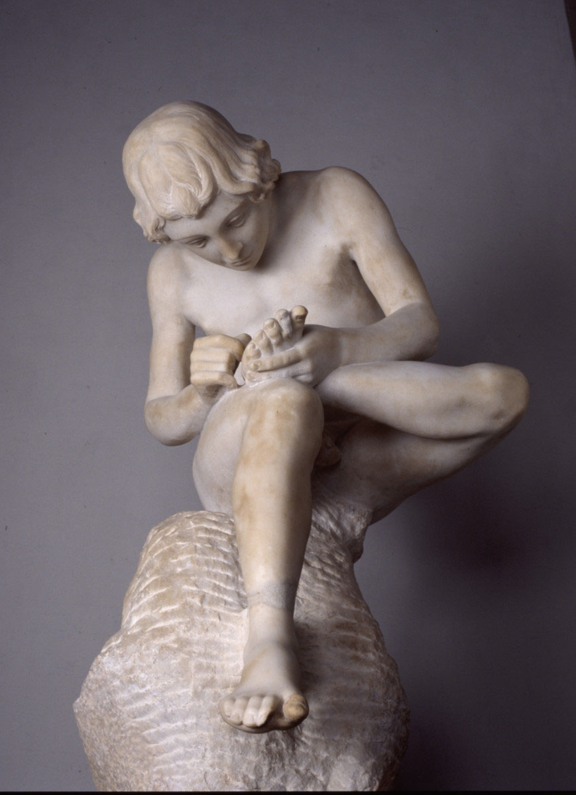

**这是什么 / 看点**：一名低头专注、正从脚底拔出一根刺的少年。这是古代名作《拔刺者（Spinario）》的大理石翻刻——原型是罗马卡比托利欧博物馆那尊著名的古铜像，文艺复兴以来被反复复制，是「最受喜爱的古代母题」之一。看点正在「认出原型」：少年屈身拔刺的纯真姿态，自古被当作宁静专注的典范；把这件大理石版当作一座「古典名作的回声」来看，与本厅墙上那些「拉斐尔图式的摹本」恰好形成雕塑与绘画两条平行的「复制」线索。属顺路看。
## 其他

本节按馆方 Furniture 藏品列表补充，共 2 件。

### ⭐ 顺路看 文琴佐·帕切蒂与安东尼奥·德·罗西《壁炉》 / Pacetti Vincenzo / De Rossi Antonio, _Fireplace_

- **作者 / Artist**：文琴佐·帕切蒂与安东尼奥·德·罗西 / Pacetti Vincenzo / De Rossi Antonio
- **作品 / Work**：《壁炉》 / _Fireplace_
- **时间**：约 1783–1785 年
- **材质**：白色大理石、紫晶、红色古典大理石（rosso antico）、绿色花岗岩；鎏金铜镶饰
- **尺寸**：高 140 cm；宽 205 cm；深 76 cm
- **馆藏编号**：camini-IX
- **位置**：狄多厅（第 9 室）
- **官网介绍页**：[官网介绍英文](https://www.collezionegalleriaborghese.it/en/opere/fireplace)｜馆藏编号 camini-IX

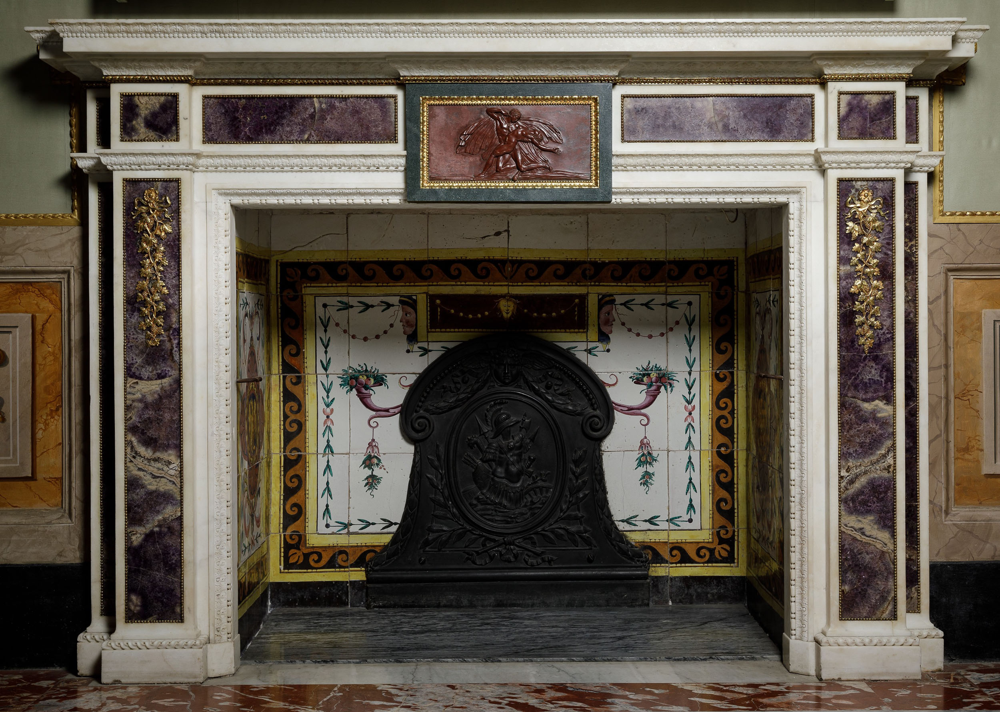

**这是什么 / 看点**：1780 年代为本厅量身打造的华丽壁炉，是阿斯普鲁奇（Antonio Asprucci）主持别墅整体翻新的产物。看点全在材质拼配——白色大理石主体上嵌着紫晶、红色古典大理石、绿色花岗岩，再加鎏金铜饰，是新古典时期「以彩石炫示」的典型。别只盯着墙上的画：天顶、壁炉、墙面装饰共同构成这间厅的整体观感，正是 18 世纪末改造让每间房都有独立主题、而非单纯挂画空间的体现。属顺路看。

### ⭐ 顺路看 古罗马艺术《桌子，桌面为描绘丘比特采摘葡萄的地面马赛克残片》 / Roman art, _Table, with floor mosaic fragment as a top depicting cupids harvesting grapes_

- **作者 / Artist**：古罗马艺术 / Roman art
- **作品 / Work**：《桌子，桌面为描绘丘比特采摘葡萄的地面马赛克残片》 / _Table, with floor mosaic fragment as a top depicting cupids harvesting grapes_
- **时间**：桌面马赛克为公元 4 世纪中叶；桌架为 18 世纪最后二十五年
- **材质**：鎏金木与金属；角砾岩；大理石马赛克镶块
- **尺寸**：高 96 cm；深 71 cm；长 144 cm
- **馆藏编号**：mobili-25
- **位置**：狄多厅（第 9 室）
- **官网介绍页**：[官网介绍英文](https://www.collezionegalleriaborghese.it/en/opere/table-with-floor-mosaic-fragment)｜馆藏编号 mobili-25

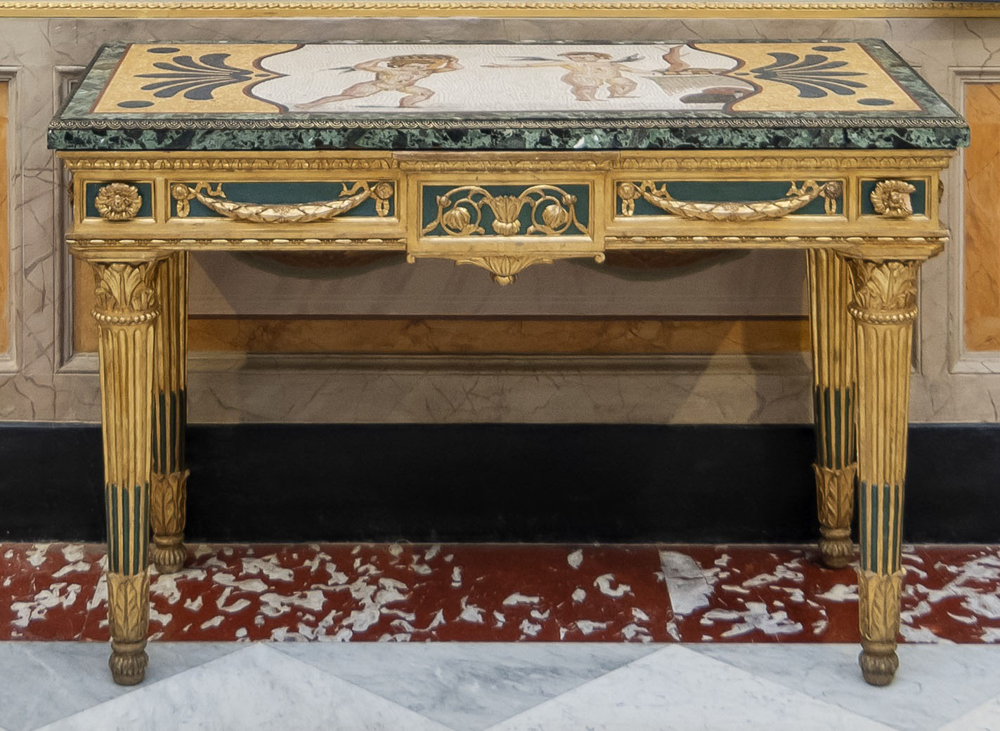

**这是什么 / 看点**：一张「古今拼装」的桌子——桌面是一块公元 4 世纪中叶的古罗马地面马赛克残片（题材为小爱神丘比特采摘葡萄），18 世纪末被镶进一具鎏金木桌架，做成华丽家具。看点正在这种「古件＋后世底座」的组合：把真正的古代马赛克当成桌面来用，是博尔盖塞收藏把古物改造、融入近代陈设的典型手法。现场低头看桌面，辨认采葡萄的小爱神，再想想它原本铺在某座罗马别墅地上。属顺路看。

### ⭐ 顺路看 房间装饰与壁炉 / Room Decoration and Fireplace

- **位置**：狄多厅（第 9 室）

二楼这间厅的天顶画、壁炉、怪诞纹（grottesche）和透视错觉装饰，共同构成完整的参观体验。尤其是 18 世纪末安东尼奥·阿斯普鲁奇（Antonio Asprucci）主持的整体改造，让每间房间都拥有独立主题（本厅即以天顶的「狄多故事」命名），而不只是挂画的空房间。进厅时别急着看墙上的画，先抬头看天顶、环视墙面与壁炉，把房间当成一件「总体艺术品」来感受。

## 资料来源 / Sources

- Galleria Borghese 官方房间页：[Room 9](https://galleriaborghese.cultura.gov.it/en/il-museo/la-villa/sala-9-sala-di-didone/)
- Galleria Borghese 藏品筛选：[Painting, Room 9](https://www.collezionegalleriaborghese.it/en/collezione/pittura?sala=s9)
- Galleria Borghese 藏品筛选：[Modern Sculpture, Room 9](https://www.collezionegalleriaborghese.it/en/collezione/scultura?sala=s9)
- Galleria Borghese 藏品筛选：[Ancient Art, Room 9](https://www.collezionegalleriaborghese.it/en/collezione/arte-antica?sala=s9)
- Galleria Borghese 藏品筛选：[Furniture, Room 9](https://www.collezionegalleriaborghese.it/en/collezione/arredi?sala=s9)
