第 5 室（双性人厅）因古罗马《沉睡的赫尔玛佛洛狄忒》得名——一具从一面看是熟睡少女、绕到另一面才露出男女双性的躯体；天顶博翁维奇尼绘同一则神话的连环画，雕像与天顶上下呼应「双性变形」的故事。

**必看与核心展品（⭐⭐⭐ 必看 + 核心）**

| 推荐 | 展品 | 作者 | 一句话看点 |
|---|---|---|---|
| ⭐⭐⭐ 必看 | 《沉睡的赫尔玛佛洛狄忒》 | 古罗马艺术（仿希腊原型） | 必须绕看——一面睡美人、另一面双性反转 |
| ⭐⭐ 推荐 | 天顶《赫尔玛佛洛狄忒与萨尔玛基斯的故事》 | 尼古拉·博翁维奇尼 | 讲同一神话的「过程」，与雕像的「结果」呼应 |

**展厅官网介绍页**：[Room 5 - Hermaphrodite Room](https://galleriaborghese.cultura.gov.it/en/il-museo/la-villa/sala-5-sala-dellermafrodito/)

## 核心展品

### ⭐⭐⭐ 必看 古罗马艺术（仿希腊原型）《沉睡的赫尔玛佛洛狄忒》 / Roman art (after a Greek prototype), _Sleeping Hermaphrodite_

- **作者 / Artist**：古罗马艺术（仿希腊原型） / Roman art (after a Greek prototype)
- **作品 / Work**：《沉睡的赫尔玛佛洛狄忒》 / _Sleeping Hermaphrodite_
- **时间**：古代部分为公元 2 世纪罗马复制品（仿公元前 2 世纪希腊化原型）；床榻、枕头与多处补配为 1774 年由安德烈亚·贝尔贡迪（Andrea Bergondi）所作
- **材质**：希腊大颗粒大理石（古代躯体）；卡拉拉白大理石（床榻）
- **尺寸**：162 × 172 cm；古代部分 145 cm
- **位置**：双性人厅（第 5 室）
- **官网介绍页**：[官方藏品库](https://www.collezionegalleriaborghese.it/opere/ermafrodito-dormiente)｜馆藏编号 CLXXII

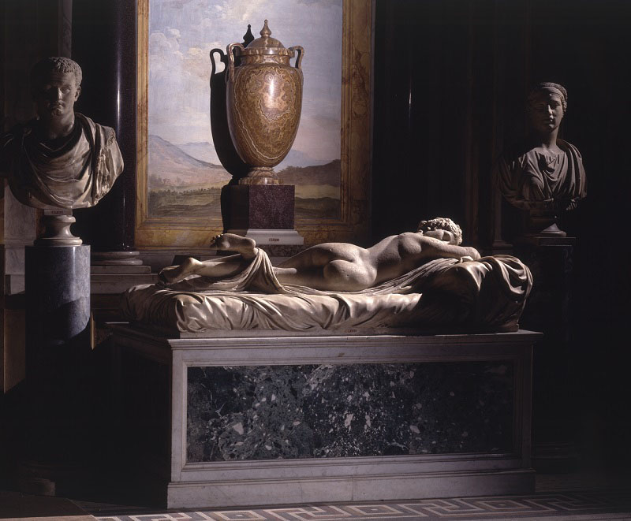

本厅以这件《沉睡的赫尔玛佛洛狄忒》命名，是镇厅之作，也是博尔盖塞「古代躯体＋近代床榻」拼合传统最迷人的范例之一。

**题材：奥维德笔下的合体神话**：赫尔玛佛洛狄忒（Hermaphroditus）是赫尔墨斯（Hermes）与阿佛洛狄忒（Aphrodite）之子，名字与相貌都取自父母，在小亚细亚的圣山伊达山（Monte Ida）长大。奥维德（Ovidius）《变形记》第四卷讲：他十五岁出游，来到卡里亚（Caria）一汪清泉，泉中水泽仙女萨尔玛基斯（Salmacis）惊其美貌、示爱被拒；少年下水沐浴时，仙女强行缠抱并向众神祈求「永不分离」，神应其愿，两具身体就此合为一体——「不再是二人，却又兼具二者之形，既不可称男，也不可称女」。这件雕像正是把这场神话凝定为一具「兼有男女特征」的沉睡身体。

**这一件的身世：不是贝尼尼那件**：很多人会把它当成那件由贝尼尼（Gian Lorenzo Bernini）配床垫的名作——但那是另一件。博尔盖塞家族原藏两件《沉睡的赫尔玛佛洛狄忒》：一件 1620 年由贝尼尼配上著名的大理石床垫，1807 年随古物藏品卖给拿破仑（Napoleone），今藏卢浮宫；眼前这一件长期堆在平乔别墅（Villa Pinciana）的库房里，1774 年才请雕塑家贝尔贡迪为它配了床垫、枕头和裹着柔软褶皱的床单，先陈列于家族在战神广场（Campo Marzio）的宫邸，到 19 世纪初被搬进平乔别墅，正好顶替了离去的贝尼尼那件的位置。所以它的身份是「一具古代躯体（公元 2 世纪罗马复制品）＋一套 18 世纪的床榻」，而非完整原作。

**修复与争议：头是不是后配的**：官方修复记录列出的近代补配部分包括头部、右肘、连腕的左手、左腿下半段、右脚跟与脚趾，以及对应的床单残块和整张床垫。其中头部是否为贝尔贡迪所配仍有争议：1774 年的账目只记了「修复一尊古代大理石像，并翻新床垫、枕头与床单褶皱」（付贝尔贡迪 250 斯库多），并未单独提及如此重要的换头；而温克尔曼（Winckelmann）在 1774 年修复之前见过此像，也没说它无头或缺头——这都让「头部为近代新作」的说法存疑。现场不必纠结结论，但可以带着这道悬案去看头部与躯体的衔接。

**图像学谱系：睡眠型与它的姐妹们**：依老普林尼（Plinius）记载，希腊雕塑家波吕克勒斯（Polycles）曾作一尊著名的赫尔玛佛洛狄忒；多数学者认为这件「睡卧型」的原型是公元前 2 世纪、带古典主义倾向的希腊化作品。它的构图与「沉睡的阿里阿德涅」（梵蒂冈）、雅典出土的「卧姿狂女（迈那得斯）」同出一脉——都是侧卧、骨盆微抬、上身轻转的睡美人式样。同型复制品散见于卢浮宫（同出博尔盖塞旧藏，是最贴切的对照件）、罗马马西莫宫、佛罗伦萨乌菲齐、圣彼得堡冬宫。

**视觉机关：两个观看面的反转**：雕像最精彩处在于「上身相对骨盆作轻微扭转」，由此造出两个截然不同的观看面——从一侧看，是侧腹、丰润起伏的臀线与安详的睡脸，活脱脱一位熟睡的少女；绕到对面，才赫然露出男性生殖器与乳房，揭开「双性」的真相。这套「先误读、再反转」的设计就是这件作品的灵魂，也是为什么它必须绕着看，不能只站正面。

**现场站看**：

1. **先从「睡美人」那一面站定**——选侧腹、臀线与面庞朝向你的一侧先看，第一印象会是一具柔美熟睡的女性身体。先建立这个「误读」，反转才有冲击力。
2. **务必绕到背面（另一侧）**——走到对面，注意下腹与胸口，会发现男性生殖器与女性乳房同时出现。这一步是整件作品的「题眼」，不绕过去就等于没看。
3. **看软垫与硬石的对比**——贝尔贡迪用坚硬的卡拉拉白大理石凿出床垫、枕头和裹着褶皱的床单，凹陷、起皱、柔软的触感全是石头「装」出来的；身体压在垫上的下陷感是看点，故意制造「石头会软」的错觉。
4. **比一比两种大理石**——古代躯体是偏暖、颗粒粗的希腊大理石，1774 年的床榻是更白、更细的卡拉拉大理石，色泽与质地有差。借这道色差去想象「哪些是古代真品、哪些是 18 世纪补的」。
5. **盯头与颈、左腿下段、右肘这几处接缝**——这些都在官方补配清单上。带着「头到底是不是后配」的悬案去找衔接处的雕工与表面处理差异。
6. **看头发与脸的「做旧」表面**——脸与发的表面被有意做得粗糙、不抛光，是为了和保存较差的古代躯体协调；这是「让新补的部分假装一样老」的修复心思。
7. **想一下它和卢浮宫那件的关系**——它与卢浮宫「贝尼尼版」同属一个雕塑类型、同出博尔盖塞旧藏。维斯孔蒂曾推测两件原本成对陈列、分置一室两侧，好让人从两个方向都看到赫尔玛佛洛狄忒——这正解释了「为什么这种像天生要被绕着看」。
8. **抬头把雕像和天顶连起来**——看完雕像抬头看本厅天顶画，讲的正是萨尔玛基斯与赫尔玛佛洛狄忒合体的同一则神话；整间厅是围绕这一个主题布置的。

## 天顶画

### ⭐⭐ 推荐 尼古拉·博翁维奇尼《赫尔玛佛洛狄忒与萨尔玛基斯的故事》 / Nicola Buonvicini, _Story of Hermaphroditus and Salmacis_

- **作者 / Artist**：尼古拉·博翁维奇尼 / Nicola Buonvicini（图框与壁面装饰：乔万·巴蒂斯塔·马尔凯蒂 / Giovan Battista Marchetti；灰泥小天使：温琴佐·帕切蒂 / Vincenzo Pacetti）
- **作品 / Work**：《赫尔玛佛洛狄忒与萨尔玛基斯的故事》 / _Story of Hermaphroditus and Salmacis_
- **时间**：1781–1782 年（平乔别墅新古典改造期）
- **材质**：布面油画（镶嵌入天顶），周边为绘制的图框装饰与灰泥
- **位置**：双性人厅天顶（第 5 室）

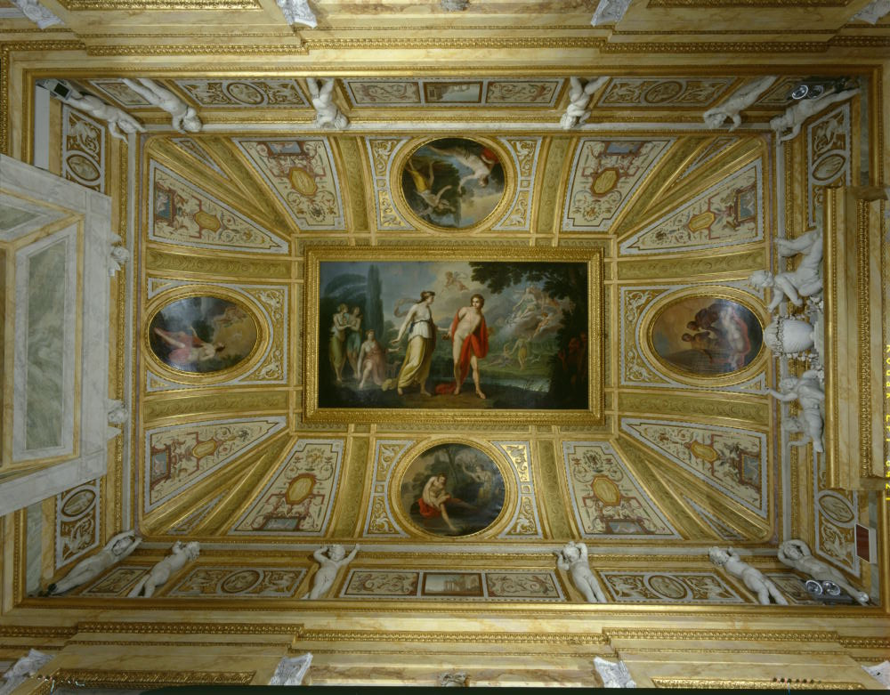

**内容（这是什么）**：本厅天顶讲的是奥维德（Ovidius）《变形记》第四卷的赫尔玛佛洛狄忒（Hermaphroditus）神话，与脚下镇厅雕像是同一个故事。赫尔玛佛洛狄忒是赫尔墨斯（Hermes）与阿佛洛狄忒（Aphrodite）之子，十五岁出游来到小亚细亚卡里亚（Caria）的一汪清泉；泉中水泽仙女萨尔玛基斯（Salmacis）一见钟情、示爱被拒；趁少年下水沐浴，仙女强行缠抱并向众神祈求「永不分离」，神应其愿，两具身体就此合为一体——「不再是二人，却又兼具二者之形，既不可称男，也不可称女」。天顶用多幅画面把这则故事分幕铺开（出游遇泉、仙女爱慕、少年入水、强抱合体），所以题名是「故事 / Story」而非单一场景。

**不是「无名湿壁画」——是 1781–82 年的一组布面油画，三人合作**：这点要纠正常见误会。它并非作者不详，也不是直接画在灰泥上的湿壁画，而是**尼古拉·博翁维奇尼（Nicola Buonvicini）于 1781–82 年所作的布面油画**，画好后镶嵌进天顶框格里。环绕画心的建筑式图框装饰与壁面绘饰，出自**乔万·巴蒂斯塔·马尔凯蒂（Giovan Battista Marchetti，1730–1800）**之手；天顶四周那 **16 个灰泥小天使（putti）则是温琴佐·帕切蒂（Vincenzo Pacetti，1746–1820）**的作品。一面天顶＝油画＋绘制图框＋灰泥雕饰三种活计拼成，是 18 世纪贵族府邸天顶的典型分工。

**背景：阿斯普鲁奇主持的「整厅一个主题」改造**：这套天顶不是孤立的装饰，而是 18 世纪 70–80 年代马尔坎托尼奥·博尔盖塞（Marcantonio IV Borghese）请建筑师安东尼奥·阿斯普鲁奇（Antonio Asprucci）统筹的别墅大改造的一部分。改造的核心思路，是把每间厅都做成一个主题统一的整体——天顶画的故事要呼应这间厅的主角藏品。所以双性人厅的逻辑非常清晰：1774 年贝尔贡迪为新入藏的《沉睡的赫尔玛佛洛狄忒》配好床榻摆在厅中央，天顶就在 1781–82 年配上同一则神话的连环画，连同厅里那只经阿斯普鲁奇 1779 年改造的斑岩盆，整间厅围绕「赫尔玛佛洛狄忒／爱欲与变形」一个母题来组织。理解了这层，就明白为什么要把雕像和天顶连起来看：它们本来就是同一套设计里的「地」与「天」。

**看点**：它是整间厅主题的「天花板说明书」，但更妙的是一上一下的叙事分工——天顶讲故事的「过程」（仙女如何缠住少年、如何祈愿合体），脚下的雕像则定格故事的「结果」（一具兼有男女的沉睡身体）。现场不妨先抬头把天顶的几幕看懂，再低头绕看雕像的双性反转，体会房间被当成一个整体来布置的用意。

**逐幅分述（五幅，按奥维德原诗的情节）**：馆方未给天顶每幅单独命名，这里按它所依据的奥维德《变形记》第四卷情节，把这套五幅组画分幕说明，方便现场对号入座：

### **中间大图** 

**《赫尔玛佛洛狄忒斯与萨尔玛基斯》**  
意大利语可写作：**Ermafrodito e Salmacide**  
英文：**Hermaphroditus and Salmacis**

画面正在讲神话的关键开端：

中间披红布的俊美少年是 **赫尔玛佛洛狄忒斯 Hermaphroditus / Ermafrodito**。  
左侧站着、向他靠近的女子是水泽仙女 **萨尔玛基斯 Salmacis / Salmacide**，她被他的美貌吸引，正在向他求爱。  
赫尔玛佛洛狄忒斯的姿态明显是后退、拒绝。  
右上云端那对神祇是他的父母：**赫尔墨斯 Mercury / Hermes** 和 **维纳斯 Venus / Aphrodite**。  
右侧树林里露出的两个半人半兽形象，应是**萨堤尔/潘神一类的林野神**，作为旁观者增强神话场景感。

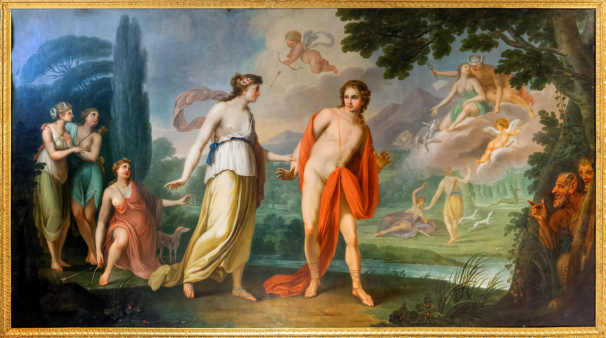

### **水边的赫尔玛佛洛狄忒斯，萨尔玛基斯在树丛中窥视 / 接近**

水泽仙女萨尔玛基斯一见这美少年便倾心，从泉边迎上来向他表白爱意，是两人初次照面、情愫初动的一幕。 赫尔玛佛洛狄忒斯在水边低头，右侧有女仙从树林中出现。这里大概是萨尔玛基斯第一次看见赫尔玛佛洛狄忒斯，被他的美貌吸引。

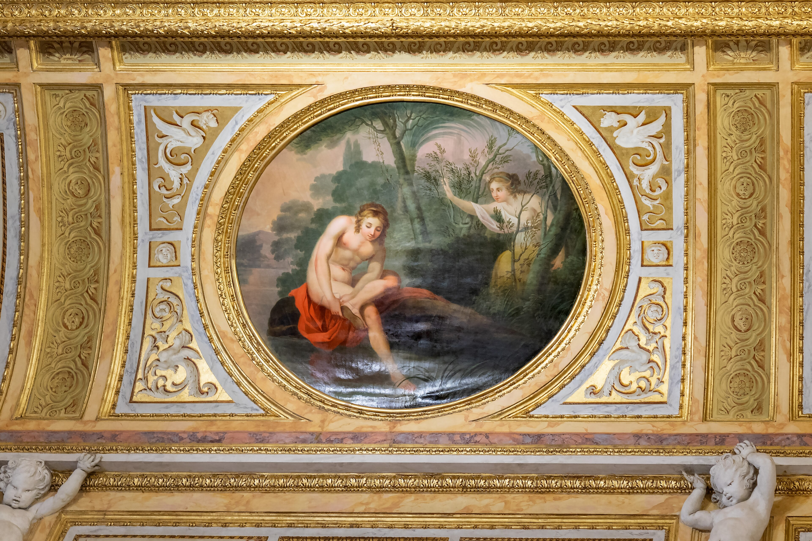
### **萨尔玛基斯向赫尔玛佛洛狄忒斯求爱 / 追逐**

男青年半躺在水边，女仙伸手靠近。这是她主动追求、试图拥抱他的场景。

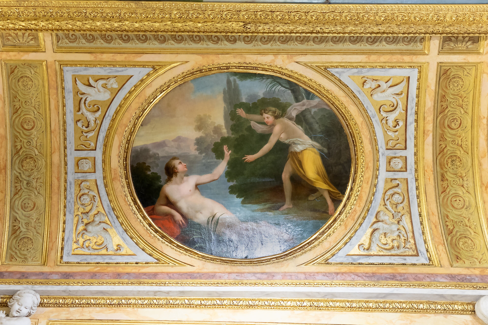
### **萨尔玛基斯与赫尔玛佛洛狄忒斯结合之后，神话结果被呈现**

画面里有两个男性/神祇般人物，旁边是躺卧的身体；这个应是神话后段：萨尔玛基斯强行与赫尔玛佛洛狄忒斯合体，形成兼具男女特征的“双性人”。不过这一幅我不敢 100% 确定具体标题，博尔盖塞官网只笼统说这些画讲述 Ermafrodito 的神话，没有逐幅列标题。

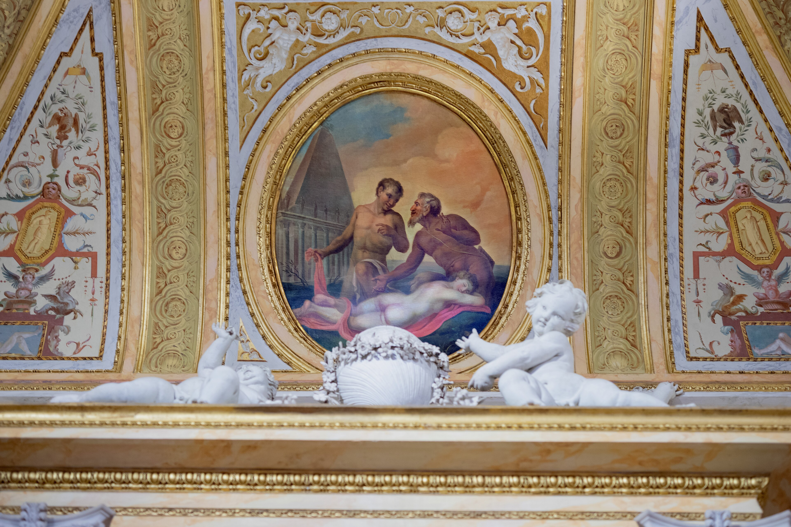

###  **赫尔玛佛洛狄忒斯向父母祈求
**
赫尔玛佛洛狄忒斯被水泽仙女**萨尔玛基斯 Salmacis**强行抱住，两人合为一体后，他坐在水边，向自己的神祇父母——**赫尔墨斯 Hermes** 和 **阿佛洛狄忒 Aphrodite / Venus**——祈求，让这池水以后也会削弱、改变进入其中的男性。

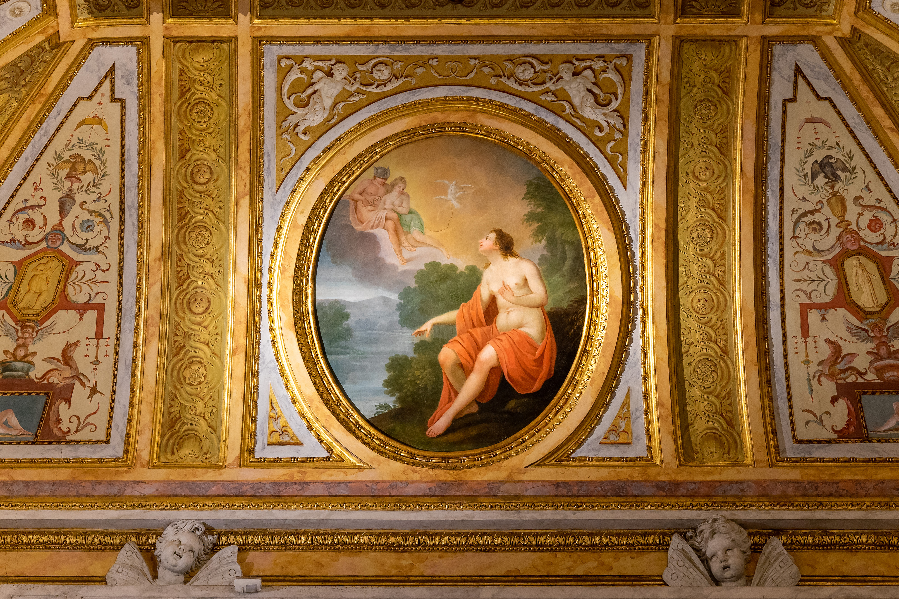

> 注：天顶正中的大幅油画多为这一连环故事的核心场景，四周另有马尔凯蒂的图框装饰与帕切蒂的 16 个灰泥小天使（非叙事画，见上文）。

**现场站看**：

1. **先认出「合体」那一幕**——在天顶几幅画里找仙女紧抱少年、两人纠缠入水的高潮场景，这是与脚下雕像直接对应的一幕；认准它，整组故事的次序就理顺了。
2. **顺着故事走一圈**——绕着厅转，按「少年出游遇泉 → 仙女爱慕示爱 → 少年下水沐浴 → 强抱合体」的次序把几幅画串起来读，体会天顶被当成连环叙事来画。
3. **看画与「框」的分工**——注意画心的人物油画（博翁维奇尼）和环绕它的建筑式图框、壁面绘饰（马尔凯蒂）是两种活计；留意画布镶入框格的边界，这不是一整片画上去的湿壁画。
4. **数一数 16 个灰泥小天使**——天顶四周帕切蒂做的白色灰泥小天使（putti）是立体的雕饰，不是画的；它们和绘画图框共同构成这套天顶的「画＋塑」混合层次。
5. **抬头—低头连起来看**——这是本厅设计的「题眼」：天顶（过程）＋雕像（结果）＋斑岩盆与古代陈列（材质与古风氛围）本就是阿斯普鲁奇同一套方案，抬头至少看 30 秒再低头看雕像，房间的整体用意才出得来。

## 绘画

本节按馆方 Painting 藏品列表补充，共 4 件。核心展品如已在上文展开，这里仍保留官方清单条目，方便核对。

### ⭐ 顺路看 保罗·布里尔（？）《古典神庙与猎人的风景画》 / Bril Paul (?), _Landscape with a Classical Temple and a Hunter_

- **作者 / Artist**：保罗·布里尔（？） / Bril Paul (?)
- **作品 / Work**：《古典神庙与猎人的风景画》 / _Landscape with a Classical Temple and a Hunter_
- **时间**：16 世纪最后十年
- **材质**：布面油画
- **尺寸**：84 × 111 cm
- **馆藏编号**：012
- **位置**：双性人厅（第 5 室）
- **官网介绍页**：[官方藏品库](https://www.collezionegalleriaborghese.it/en/opere/landscape-with-a-classical-temple-and-a-hunter)｜馆藏编号 012

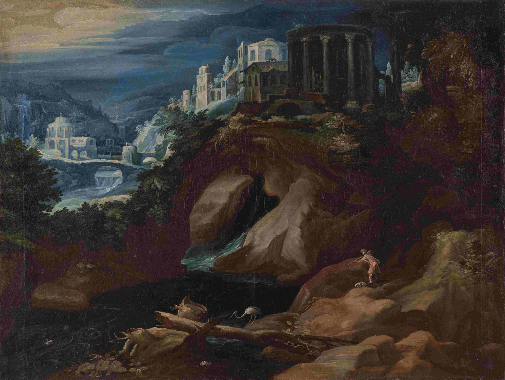

**这是什么 / 看点**：16 世纪末的布面油画，归在弗拉芒画家保罗·布里尔（Paul Bril）名下（带问号，归属存疑）。画面是一片理想化的古典风景——远处立着古典神庙，近景有猎人。布里尔是把北方细密风景带到罗马的关键人物，这类「神庙废墟＋点景小人物」的理想风景对日后的古典风景画影响很大。现场看远近一层层退向蓝灰的「大气透视」，以及点缀其间的小小人物。

### ⭐ 顺路看 保罗·布里尔（？）《幻想风景》 / Bril Paul (?), _Fantastic landscape_

- **作者 / Artist**：保罗·布里尔（？） / Bril Paul (?)
- **作品 / Work**：《幻想风景》 / _Fantastic landscape_
- **时间**：约 1595–1596 年
- **材质**：布面油画
- **尺寸**：66 × 90 cm
- **馆藏编号**：019
- **位置**：双性人厅（第 5 室）
- **官网介绍页**：[官方藏品库](https://www.collezionegalleriaborghese.it/en/opere/fantastic-landscape-4)｜馆藏编号 019

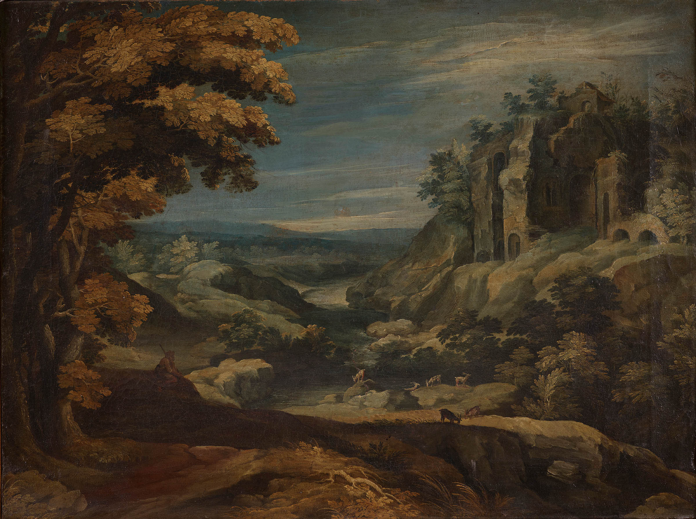

**这是什么 / 看点**：约 1595–1596 年的布面油画，同样归在保罗·布里尔（Paul Bril）名下。这是一幅「幻想风景」——并非写生实景，而是把山岩、树木、流水自由组合出的想象自然。看点在于北方画派对自然细节的偏爱与略带奇崛的构景，可与本厅另几幅布里尔风景对照着看。

### ⭐ 顺路看 弗雷德里克·范·瓦尔肯博赫《圣耶柔米的风景画》 / Valckenborch Frederick van, _Landscape with Saint Jerome_

- **作者 / Artist**：弗雷德里克·范·瓦尔肯博赫 / Valckenborch Frederick van
- **作品 / Work**：《圣耶柔米的风景画》 / _Landscape with Saint Jerome_
- **时间**：约 1595–1605 年
- **材质**：布面油画
- **尺寸**：80 × 90 cm
- **馆藏编号**：020
- **位置**：双性人厅（第 5 室）
- **官网介绍页**：[官方藏品库](https://www.collezionegalleriaborghese.it/en/opere/landscape-with-saint-jerome-2)｜馆藏编号 020

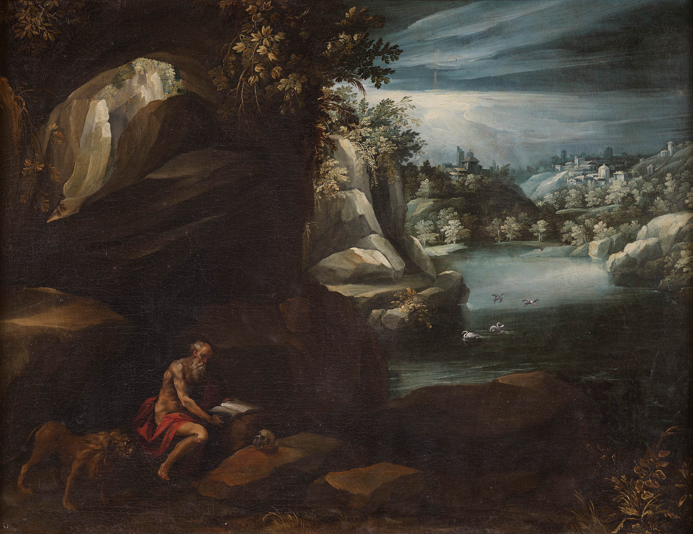

**这是什么 / 看点**：约 1595–1605 年的布面油画，作者是弗拉芒画家弗雷德里克·范·瓦尔肯博赫（Frederick van Valckenborch）。题材是「圣耶柔米（Saint Jerome）在荒野」——这位翻译《圣经》的教父常被画成隐居旷野苦修的样子。这里宗教题材其实是配角，真正的主角是大幅山野风景；现场找一找画中那个不起眼的圣人小人物，体会「风景为主、圣徒点景」的北方画法。

### ⭐ 顺路看 保罗·布里尔及助手《牧人的风景画》 / Bril Paul and aid, _Landscape with Shepherds_

- **作者 / Artist**：保罗·布里尔及助手 / Bril Paul and aid
- **作品 / Work**：《牧人的风景画》 / _Landscape with Shepherds_
- **时间**：约 1602 年
- **材质**：布面油画
- **尺寸**：66 × 90 cm
- **馆藏编号**：021
- **位置**：双性人厅（第 5 室）
- **官网介绍页**：[官方藏品库](https://www.collezionegalleriaborghese.it/en/opere/landscape-with-shepherds)｜馆藏编号 021

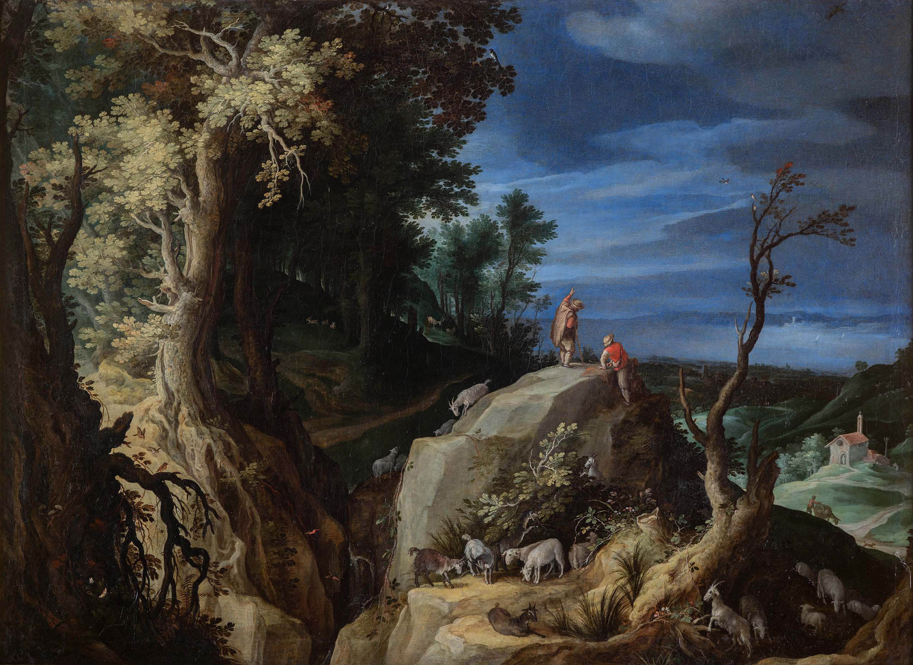

**这是什么 / 看点**：约 1602 年的布面油画，出自保罗·布里尔（Paul Bril）与助手之手，画牧人在风景中放牧。田园牧歌式的题材＋北方细腻的树石描绘，是布里尔工坊的典型产品。它与本厅另三幅风景（012、019、020）成组，可一并比较布里尔一派的风景语言。

### ⭐ 顺路看 罗马学派《密涅瓦胸像》 / roman school, _Bust of Minerva_

- **作者 / Artist**：罗马学派 / roman school
- **作品 / Work**：《密涅瓦胸像》 / _Bust of Minerva_
- **时间**：17 世纪上半叶
- **材质**：大理石
- **尺寸**：高 82 cm
- **馆藏编号**：CCXXXI
- **位置**：双性人厅（第 5 室）
- **官网介绍页**：[官方藏品库](https://www.collezionegalleriaborghese.it/en/opere/bust-of-minerva)｜馆藏编号 CCXXXI

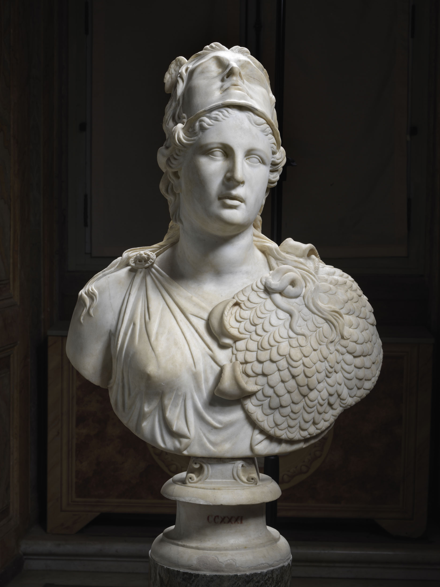

**这是什么 / 看点**：17 世纪上半叶的大理石《密涅瓦胸像》，出自罗马派工坊。密涅瓦（Minerva）即希腊的雅典娜，是智慧与战争女神，标志是头盔。它是一件近代（而非古代）雕塑，放在以古代藏品为主的厅里，正好与同厅的古罗马头像对照「近代仿古」与「古代真品」的差别。

### ⭐ 顺路看 安东尼奥·古列尔莫·格朗雅凯《雪花石双耳瓶》 / Grandjacquet Antonio Guglielmo, _Amphora of alabaster_

- **作者 / Artist**：安东尼奥·古列尔莫·格朗雅凯 / Grandjacquet Antonio Guglielmo
- **作品 / Work**：《雪花石双耳瓶》 / _Amphora of alabaster_
- **时间**：18 世纪
- **材质**：花斑雪花石（alabastro fiorito）
- **尺寸**：84 × 42 cm
- **馆藏编号**：CLXXIII
- **位置**：双性人厅（第 5 室）
- **官网介绍页**：[官方藏品库](https://www.collezionegalleriaborghese.it/en/opere/amphora-of-alabaster-2)｜馆藏编号 CLXXIII

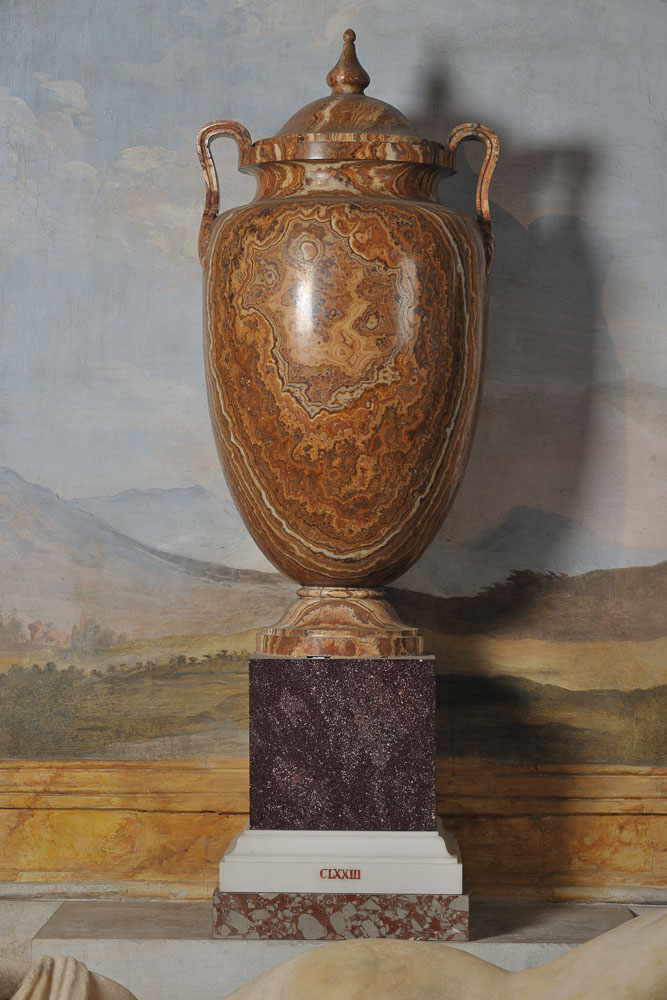

**这是什么 / 看点**：18 世纪雕塑家安东尼奥·古列尔莫·格朗雅凯（Antonio Guglielmo Grandjacquet）所作的雪花石双耳瓶（amphora），材质是带天然花纹的「花斑雪花石」（alabastro fiorito）。这是一件以珍贵石材取胜的装饰器物——博尔盖塞收藏尤其喜欢用斑岩、雪花石这类彩色名贵石材点缀房间。现场欣赏石料天然的纹理与色彩，以及瓶身、双耳的车旋造型。

### ⭐ 顺路看 古罗马艺术《捕鱼场景地面马赛克》 / Roman art, _Floor Mosaic with Fishing Scene_

- **作者 / Artist**：古罗马艺术 / Roman art
- **作品 / Work**：《捕鱼场景地面马赛克》 / _Floor Mosaic with Fishing Scene_
- **时间**：公元 2–3 世纪
- **材质**：大理石嵌片（tesserae）
- **尺寸**：高 165 cm；宽 224 cm（含边框）
- **位置**：双性人厅（第 5 室）
- **官网介绍页**：[官方藏品库](https://www.collezionegalleriaborghese.it/en/opere/floor-mosaic-with-fishing-scene)｜馆藏编号 arc-007

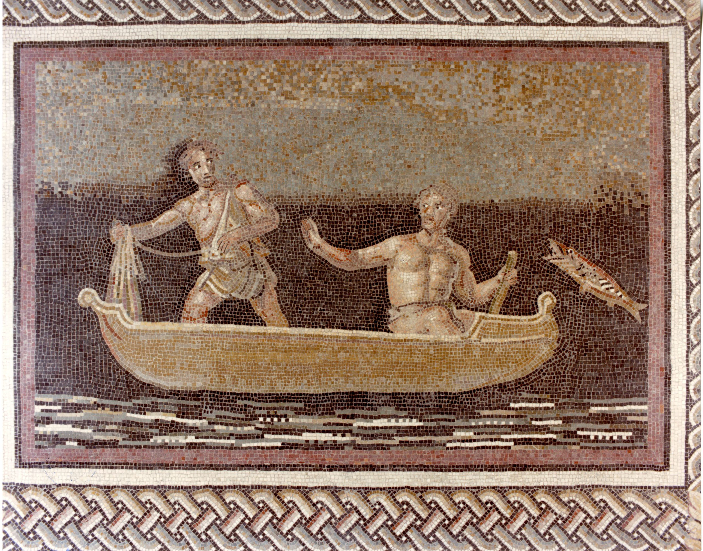

**这是什么（两块一起看）**：本厅地面这两块马赛克（编号 arc-007、arc-008）属同一类古罗马地面装饰，题材都是捕鱼场景——小船、渔人与水中游鱼，用细小的彩色大理石粒（tesserae）拼成。

**看点**：留意水波、鱼群和船只如何全靠石粒色块拼出；这类「海生／捕鱼」题材在古罗马别墅与浴场地面很常见，寓意水的世界与丰饶。现场禁止踩踏，站在旁边俯看，并与另一块 arc-008 对照构图。

### ⭐ 顺路看 古罗马艺术《捕鱼场景地面马赛克》 / Roman art, _Floor Mosaic with Fishing Scene_

- **作者 / Artist**：古罗马艺术 / Roman art
- **作品 / Work**：《捕鱼场景地面马赛克》 / _Floor Mosaic with Fishing Scene_
- **时间**：公元 2–3 世纪
- **材质**：大理石嵌片（tesserae）
- **尺寸**：高 145 cm；宽 170 cm（含边框）
- **位置**：双性人厅（第 5 室）
- **官网介绍页**：[官方藏品库](https://www.collezionegalleriaborghese.it/en/opere/floor-mosaicwith-fishing-scene-2)｜馆藏编号 arc-008

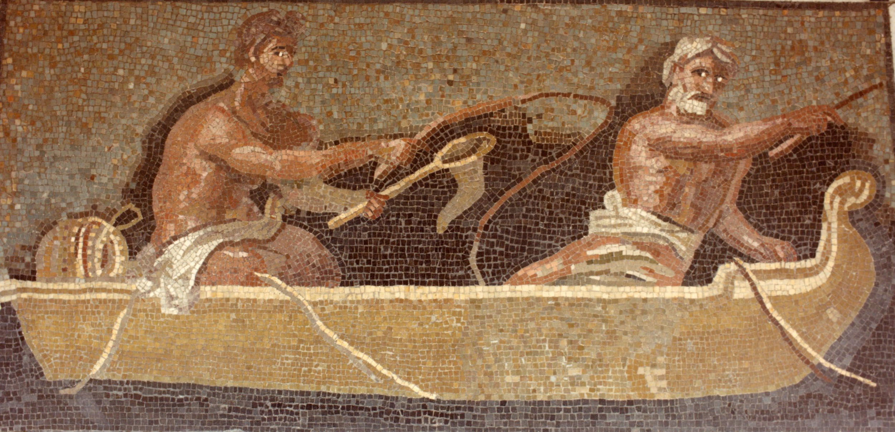

**这是什么 / 看点**：另一块捕鱼场景地面马赛克，与 arc-007 同类（整体题材与看法见 arc-007 那块）。此块尺幅略小，可比较两块在船只、鱼群布局上的不同。

### ⭐ 顺路看 古罗马艺术《吹笛的年轻萨堤尔》 / Roman art, _Young Satyr Playing the Flute_

- **作者 / Artist**：古罗马艺术 / Roman art
- **作品 / Work**：《吹笛的年轻萨堤尔》 / _Young Satyr Playing the Flute_
- **时间**：公元 2 世纪
- **材质**：白大理石
- **尺寸**：不含底座高 133 cm
- **位置**：双性人厅（第 5 室）
- **官网介绍页**：[官方藏品库](https://www.collezionegalleriaborghese.it/en/opere/young-satyr-playing-the-flute)｜馆藏编号 CCXXVI

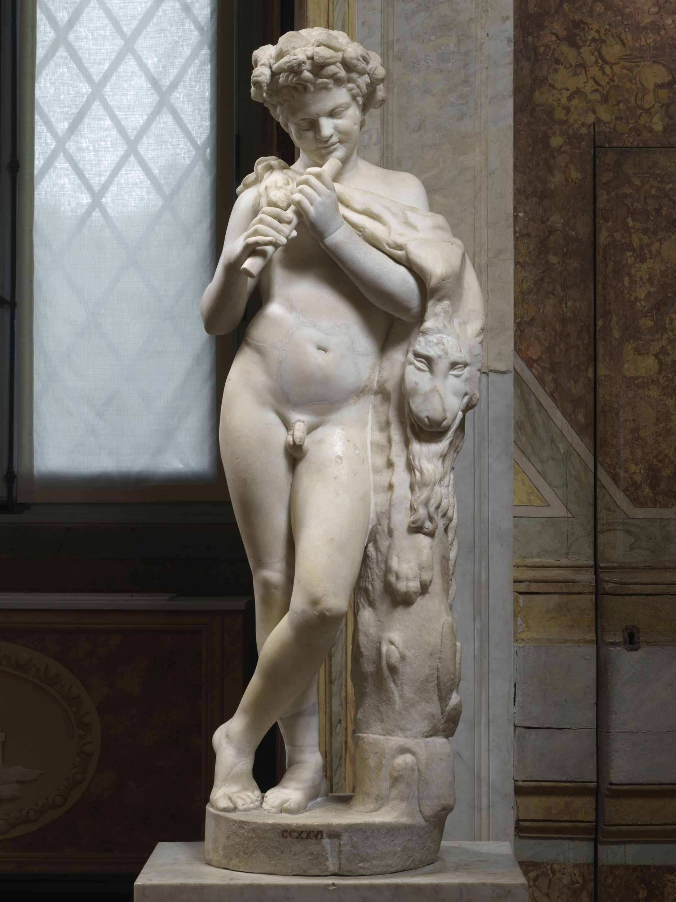

**这是什么**：公元 2 世纪的白大理石雕像，刻一名年轻的萨堤尔（Satyr，酒神随从、半人半兽的山林精灵）在吹笛。

**看点**：萨堤尔是酒神狄俄尼索斯（Dionysus）队伍里的常客，象征山林、音乐与放纵的欢愉。本厅另有一件吹潘笛的年轻萨堤尔（编号 CCXXVIII），两件可当一对来看——同为吹奏乐器的少年萨堤尔，比较姿态与乐器的差别。古代雕像常经后世修复，现场可留意肢体接缝。

### ⭐ 顺路看 古罗马艺术《桌足残段》 / Roman art, _Trapezophoron, section_

- **作者 / Artist**：古罗马艺术 / Roman art
- **作品 / Work**：《桌足残段》 / _Trapezophoron, section_
- **时间**：公元 2 世纪
- **材质**：白大理石
- **尺寸**：高 35 cm；宽 60 cm；厚 7 cm
- **位置**：双性人厅（第 5 室）
- **官网介绍页**：[官方藏品库](https://www.collezionegalleriaborghese.it/en/opere/trapezophoron-section)｜馆藏编号 CCXXVIa

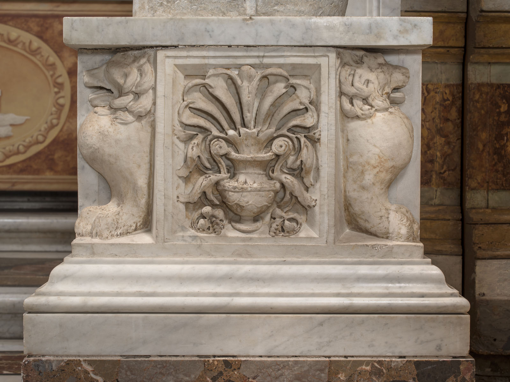

**这是什么（四件一起看）**：本厅有四件古罗马「桌足残段」（trapezophoron，编号 CCXXVIa、CCXXVIIIa、CCXXXXa、CCXXXXIIa），都是公元 2 世纪白大理石。trapezophoron 指古罗马豪华大理石餐桌或边桌的雕花支腿／支架，常雕成兽爪、狮身或带卷叶的装饰构件。

**看点**：这些是家具的残件而非独立雕像，能让人想象古罗马富宅里大理石桌案的奢华。四件尺寸相近（高约 35–36 cm），现场可成组扫看、比较雕饰；逐件背景都见本件。

### ⭐ 顺路看 古罗马艺术《持潘笛的年轻萨堤尔》 / Roman art, _Young Satyr with Pan Pipes_

- **作者 / Artist**：古罗马艺术 / Roman art
- **作品 / Work**：《持潘笛的年轻萨堤尔》 / _Young Satyr with Pan Pipes_
- **时间**：公元 2 世纪
- **材质**：白大理石
- **尺寸**：不含底座高 133 cm
- **位置**：双性人厅（第 5 室）
- **官网介绍页**：[官方藏品库](https://www.collezionegalleriaborghese.it/en/opere/young-satyr-with-pan-pipes)｜馆藏编号 CCXXVIII

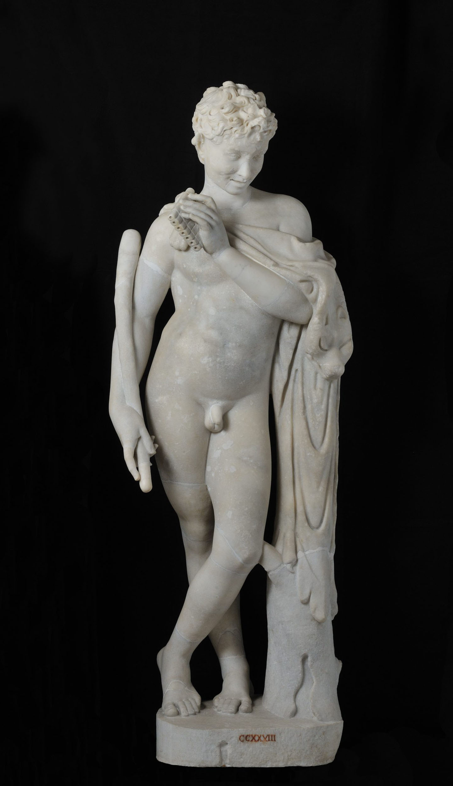

**这是什么 / 看点**：公元 2 世纪白大理石的年轻萨堤尔像，手持潘笛（排箫）。它与编号 CCXXVI 的「吹笛萨堤尔」是天然的一对（萨堤尔背景见那一件）；现场比较两件少年萨堤尔的乐器与体态，体会酒神世界的音乐主题。

### ⭐ 顺路看 古罗马艺术《桌足残段》 / Roman art, _Trapezophoron, section_

- **作者 / Artist**：古罗马艺术 / Roman art
- **作品 / Work**：《桌足残段》 / _Trapezophoron, section_
- **时间**：公元 2 世纪
- **材质**：白大理石
- **尺寸**：高 35 cm；宽 60 cm；厚 5.6 cm
- **位置**：双性人厅（第 5 室）
- **官网介绍页**：[官方藏品库](https://www.collezionegalleriaborghese.it/en/opere/trapezophoron-section-4)｜馆藏编号 CCXXVIIIa

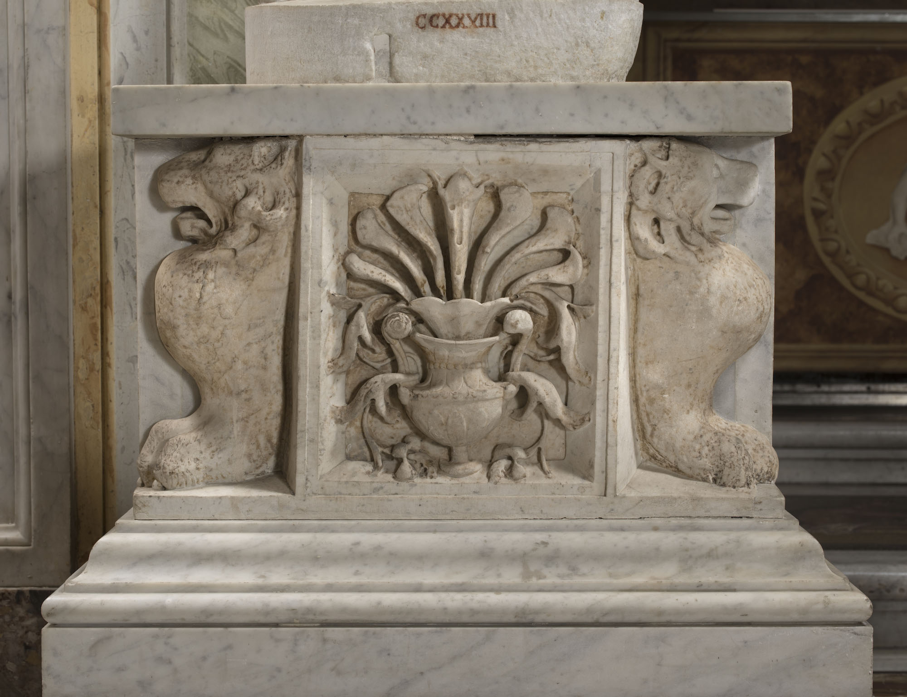

**这是什么 / 看点**：古罗马桌足残段之一（整组背景见编号 CCXXVIa），公元 2 世纪白大理石的餐桌支腿构件。现场作为一组家具残件之一顺路看即可。

### ⭐ 顺路看 古罗马艺术《着斗篷女子雕像，配肖像头像》 / Roman art, _Statue of a Woman Wearing a Mantle with a Portrait Head_

- **作者 / Artist**：古罗马艺术 / Roman art
- **作品 / Work**：《着斗篷女子雕像，配肖像头像》 / _Statue of a Woman Wearing a Mantle with a Portrait Head_
- **时间**：公元 180–190 年（身体）；公元 270–275 年（头部）
- **材质**：带黄调的白大理石
- **尺寸**：不含底座高 180 cm；头部 28 cm
- **位置**：双性人厅（第 5 室）
- **官网介绍页**：[官方藏品库](https://www.collezionegalleriaborghese.it/en/opere/statue-of-a-woman-wearing-a-mantle-with-a-portrait-head)｜馆藏编号 CCXXXX

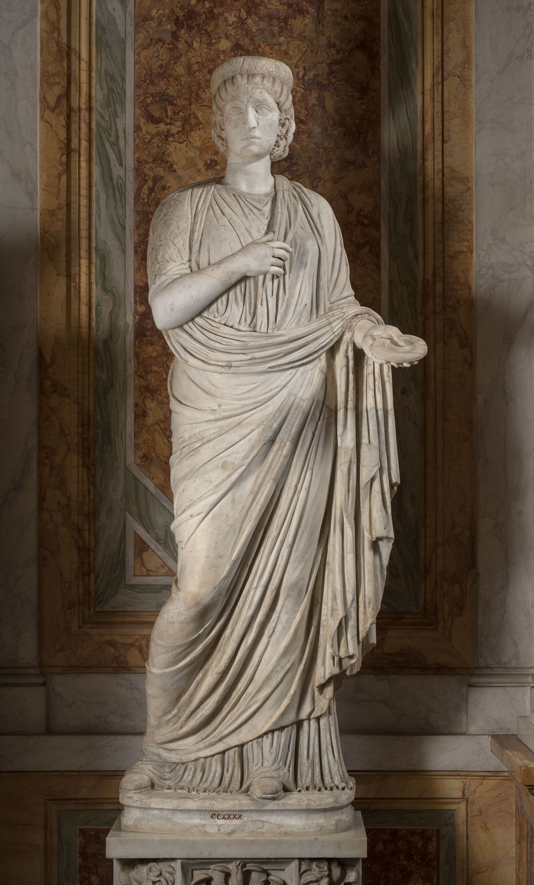

**这是什么（一组着斗篷女性像）**：本厅有几件古罗马着斗篷（披风）的女性立像（编号 CCXXXX、CCXXXXII、CLXIX 等），都是身体与头部分别雕成、再组合的拼配像。这一件的身体作于公元 180–190 年，头部却是公元 270–275 年的肖像头——明显是「身体与头相差近百年、后来拼配」。

**看点**：这正是古罗马（及近代收藏）常见的「换头」现象——一具标准的披风女性身体，可以配上不同时代、不同人物的肖像头。现场看头与颈的衔接处，想象身体与头相差近一个世纪；并与同厅另几件着斗篷女性像对照。

### ⭐ 顺路看 古罗马艺术《桌足残段》 / Roman art, _Trapezophoron, section_

- **作者 / Artist**：古罗马艺术 / Roman art
- **作品 / Work**：《桌足残段》 / _Trapezophoron, section_
- **时间**：公元 2 世纪
- **材质**：白大理石
- **尺寸**：高 36 cm；宽 58 cm；厚 7.5 cm
- **位置**：双性人厅（第 5 室）
- **官网介绍页**：[官方藏品库](https://www.collezionegalleriaborghese.it/en/opere/trapezophoron-section-2)｜馆藏编号 CCXXXXa

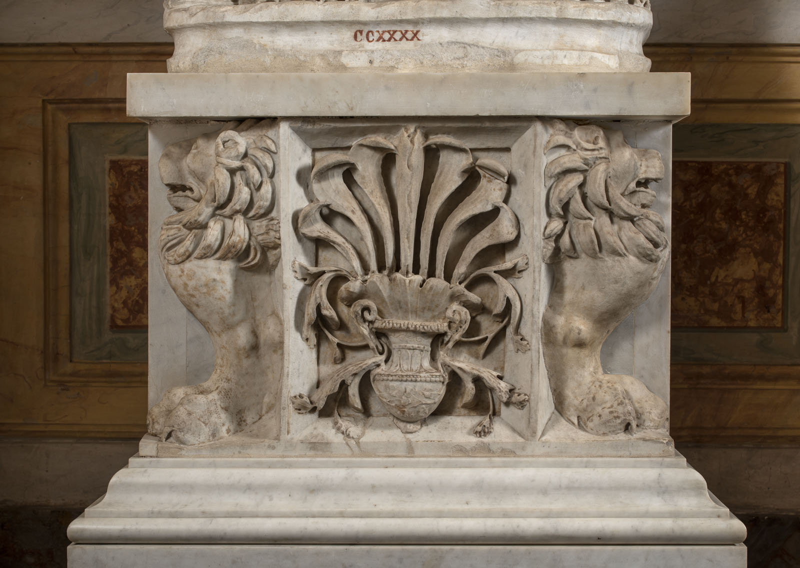

**这是什么 / 看点**：又一件古罗马桌足残段（整组背景见编号 CCXXVIa），公元 2 世纪白大理石。可与其余三件并看，体会古罗马家具雕饰。

### ⭐ 顺路看 古罗马艺术《着斗篷女子雕像，小赫库兰尼姆女子型变体》 / Roman art, _Statue of a Woman Wearing a Mantle, Variant of the ‘Piccola Ercolanese’ Type_

- **作者 / Artist**：古罗马艺术 / Roman art
- **作品 / Work**：《着斗篷女子雕像，小赫库兰尼姆女子型变体》 / _Statue of a Woman Wearing a Mantle, Variant of the ‘Piccola Ercolanese’ Type_
- **时间**：公元 130–140 年
- **材质**：白大理石
- **尺寸**：不含底座高 184 cm；头部 28 cm
- **位置**：双性人厅（第 5 室）
- **官网介绍页**：[官方藏品库](https://www.collezionegalleriaborghese.it/en/opere/statue-of-a-woman-wearing-a-mantle-variant-of-the-piccola-ercolanese-type)｜馆藏编号 CCXXXXII

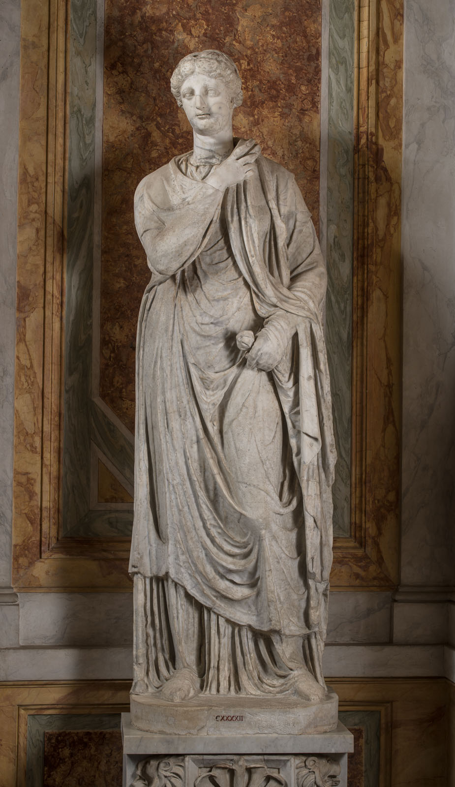

**这是什么 / 看点**：公元 130–140 年的着斗篷女性立像，属「小赫库兰尼姆女子」（Piccola Ercolanese）型的变体——这是希腊化时期定型、罗马大量复制的一种端庄披风女性立像样式，以赫库兰尼姆出土的两尊得名。与本厅其他着斗篷女性像同看（组背景见编号 CCXXXX），现场留意披风裹身、手臂收拢的典型姿态。

### ⭐ 顺路看 古罗马艺术《桌足残段》 / Roman art, _Trapezophoron, section_

- **作者 / Artist**：古罗马艺术 / Roman art
- **作品 / Work**：《桌足残段》 / _Trapezophoron, section_
- **时间**：公元 2 世纪
- **材质**：白大理石
- **尺寸**：高 36 cm；宽 58 cm
- **位置**：双性人厅（第 5 室）
- **官网介绍页**：[官方藏品库](https://www.collezionegalleriaborghese.it/en/opere/trapezophoron-section-3)｜馆藏编号 CCXXXXIIa

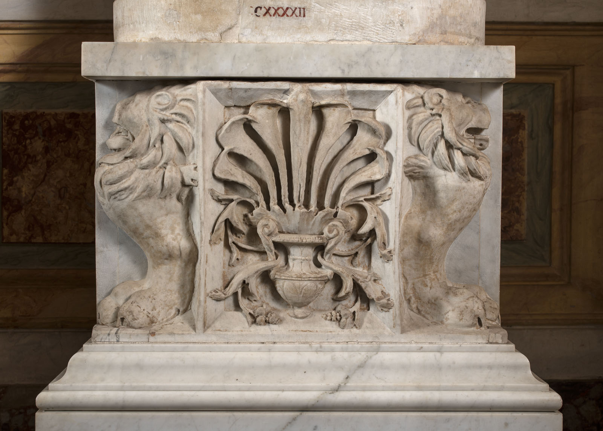

**这是什么 / 看点**：第四件古罗马桌足残段（整组背景见编号 CCXXVIa），公元 2 世纪白大理石。四件成组陈列，顺路扫看即可。

### ⭐ 顺路看 古罗马艺术《着斗篷女性像，修复为刻瑞斯》 / Roman art, _Statue of a Female Figure Wearing a Mantle, Restored as Ceres_

- **作者 / Artist**：古罗马艺术 / Roman art
- **作品 / Work**：《着斗篷女性像，修复为刻瑞斯》 / _Statue of a Female Figure Wearing a Mantle, Restored as Ceres_
- **时间**：公元 2 世纪
- **材质**：细晶黄调大理石
- **尺寸**：不含底座高 185 cm；头部 27 cm
- **位置**：双性人厅（第 5 室）
- **官网介绍页**：[官方藏品库](https://www.collezionegalleriaborghese.it/en/opere/statue-of-a-female-figure-wearing-a-mantle-restored-as-ceres)｜馆藏编号 CLXIX

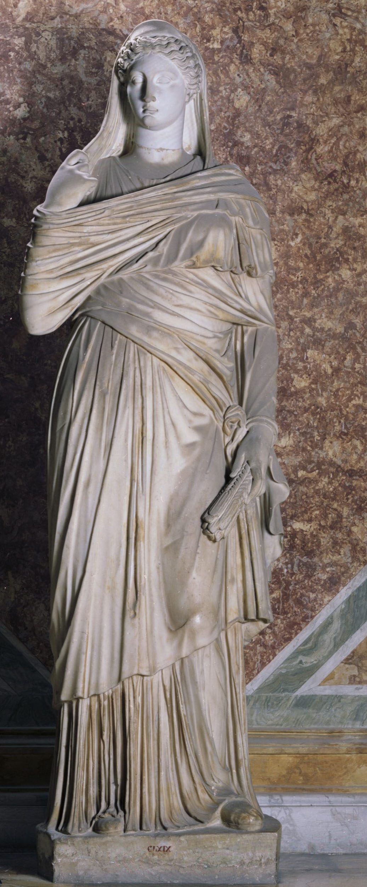

**这是什么 / 看点**：公元 2 世纪的着斗篷女性立像，近代被修复／改造成「刻瑞斯」（Ceres，谷物与丰饶女神，希腊名得墨忒耳）。这是典型的「给古代躯体安一个神的身份」——靠补加属物，把一具无名女性像变成女神。现场可想：它本来未必是刻瑞斯，神的身份是后世修复者赋予的（着斗篷女性像组背景见编号 CCXXXX）。

### ⭐ 顺路看 古罗马艺术《提图斯肖像，置于现代胸像上》 / Roman art, _Portrait of Titus on a Modern Bust_

- **作者 / Artist**：古罗马艺术 / Roman art
- **作品 / Work**：《提图斯肖像，置于现代胸像上》 / _Portrait of Titus on a Modern Bust_
- **时间**：约公元 78 年
- **材质**：卢尼大理石
- **尺寸**：连胸像高 66 cm；头部 30 cm
- **位置**：双性人厅（第 5 室）
- **官网介绍页**：[官方藏品库](https://www.collezionegalleriaborghese.it/en/opere/portrait-of-titus-on-a-modern-bust)｜馆藏编号 CLXXI

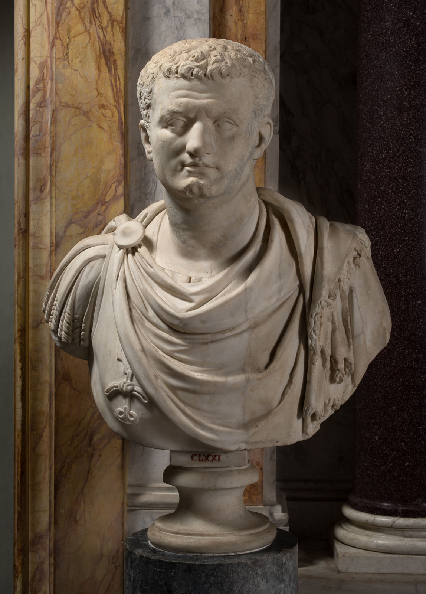

**这是什么（古代头像＋近代胸像）**：本厅有几件「古代肖像头＋近代大理石胸像座」拼成的胸像（如编号 CLXXI、CLXXIX、CLXXXI，以及 CLXXIV）。这一件的头是约公元 78 年的提图斯（Titus）肖像——韦帕芗之子、攻陷耶路撒冷的将领、后来的罗马皇帝（79–81 在位），用卢尼大理石雕成，下半截胸像座是近代补配。

**看点**：辨认头与座的大理石色差和雕工差，就能看出「古代真品的头＋近代的座」这一博尔盖塞常见组合。提图斯的圆脸短发是弗拉维王朝肖像的标志，可与本厅另几件帝王／人物头像对照看。

### ⭐ 顺路看 古罗马艺术《胸像：阿佛洛狄忒扮作萨福》 / Roman art, _Bust of Aphrodite as Sappho_

- **作者 / Artist**：古罗马艺术 / Roman art
- **作品 / Work**：《胸像：阿佛洛狄忒扮作萨福》 / _Bust of Aphrodite as Sappho_
- **时间**：公元 2 世纪初
- **材质**：白大理石
- **尺寸**：连胸像高 62 cm；头部 29 cm
- **位置**：双性人厅（第 5 室）
- **官网介绍页**：[官方藏品库](https://www.collezionegalleriaborghese.it/en/opere/bust-of-aphrodite-as-sappho)｜馆藏编号 CLXXIV

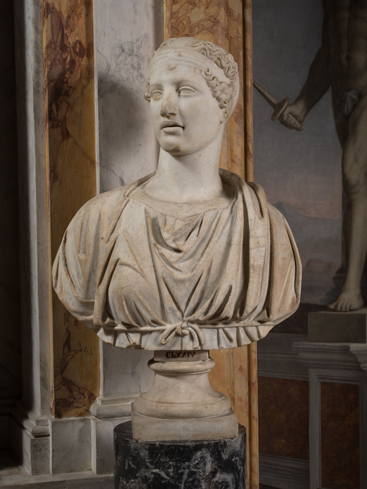

**这是什么 / 看点**：公元 2 世纪初的白大理石胸像，把阿佛洛狄忒（Aphrodite，爱与美的女神）表现成女诗人萨福（Sappho）的样子——即「神祇借用名人面貌」的混合型肖像。它与本厅几件「古代头＋近代座」胸像同类（背景见编号 CLXXI）；放在这间以双性、爱欲为主题的厅里，爱神题材正好与赫尔玛佛洛狄忒神话呼应。

### ⭐ 顺路看 古罗马艺术《女子肖像，置于现代胸像上》 / Roman art, _Portrait of a Woman on Modern Bust_

- **作者 / Artist**：古罗马艺术 / Roman art
- **作品 / Work**：《女子肖像，置于现代胸像上》 / _Portrait of a Woman on Modern Bust_
- **时间**：约公元 40 年
- **材质**：白大理石
- **尺寸**：连胸像高 50 cm；头部 23 cm
- **位置**：双性人厅（第 5 室）
- **官网介绍页**：[官方藏品库](https://www.collezionegalleriaborghese.it/en/opere/portrait-of-a-woman-on-modern-bust)｜馆藏编号 CLXXIX

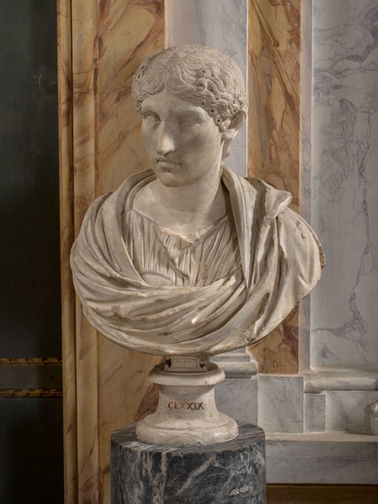

**这是什么 / 看点**：约公元 40 年（早期帝国）的罗马女子肖像头，安在近代胸像座上（古代头＋近代座的组合背景见编号 CLXXI）。现场留意发型——早期帝国的女性发式是给罗马肖像断代的重要线索；头与座的衔接处可看出古今拼配。

### ⭐ 顺路看 古罗马艺术《持水罐男孩雕像》 / Roman art, _Statue of a Boy with a Pitcher_

- **作者 / Artist**：古罗马艺术 / Roman art
- **作品 / Work**：《持水罐男孩雕像》 / _Statue of a Boy with a Pitcher_
- **时间**：公元 1 世纪
- **材质**：帕罗斯大理石
- **尺寸**：高 90 cm
- **位置**：双性人厅（第 5 室）
- **官网介绍页**：[官方藏品库](https://www.collezionegalleriaborghese.it/en/opere/statue-of-a-boy-with-a-pitcher)｜馆藏编号 CLXXX

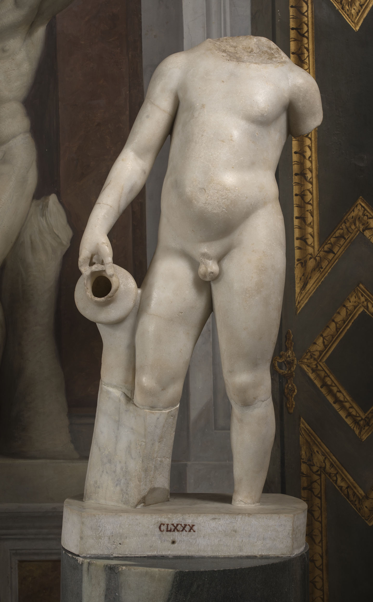

**这是什么 / 看点**：公元 1 世纪的帕罗斯大理石雕像，刻一名持水罐（pitcher）的男孩，多半是斟酒侍童一类的题材。古代雕像常经后世修复，现场可留意肢体与水罐的接补痕迹；作为同厅古代陈列的一员顺路看即可。

### ⭐ 顺路看 古罗马艺术《科瑞头像，置于现代胸像上》 / Roman art, _Head of a Kore, on a modern bust_

- **作者 / Artist**：古罗马艺术 / Roman art
- **作品 / Work**：《科瑞头像，置于现代胸像上》 / _Head of a Kore, on a modern bust_
- **时间**：公元前 5 世纪
- **材质**：帕罗斯大理石
- **尺寸**：连胸像高 59 cm；头高 25 cm
- **位置**：双性人厅（第 5 室）
- **官网介绍页**：[官方藏品库](https://www.collezionegalleriaborghese.it/en/opere/head-of-a-kore-on-a-modern-bust)｜馆藏编号 CLXXXI

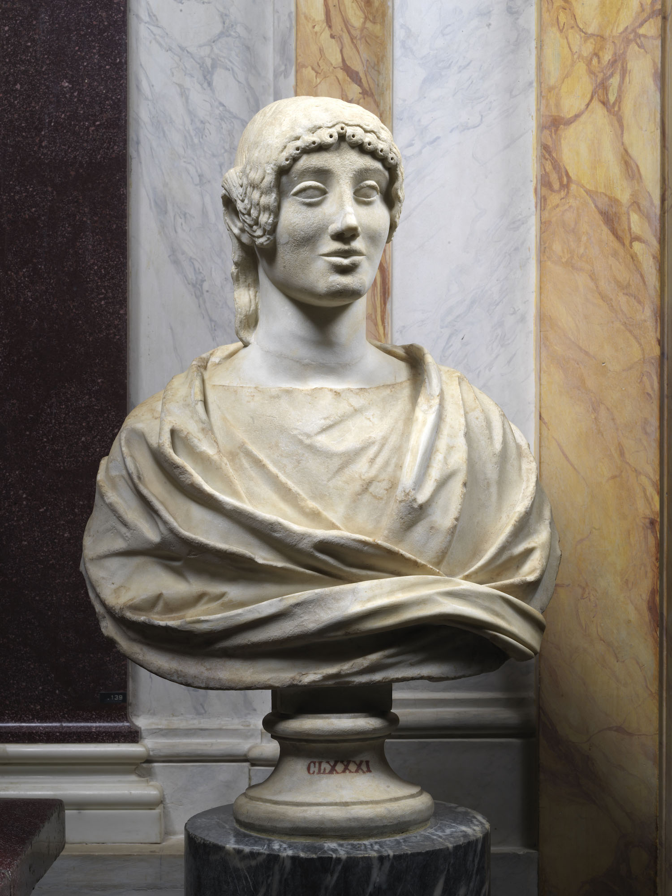

**这是什么 / 看点**：一件珍贵的早期希腊「科瑞」（Kore，古风时期的少女立像）头像，断代到公元前 5 世纪，用帕罗斯大理石雕成，现安在近代胸像座上（古今拼配背景见编号 CLXXI）。看点在于它的年代——这是本厅最古老的雕刻之一，比厅里多数罗马复制品早六七百年；留意古风少女含蓄端正的脸型与发辫。

### ⭐ 顺路看 古罗马艺术《雅典娜·帕耳忒诺斯雕像》 / Roman art, _Statue of Athena Parthenos_

- **作者 / Artist**：古罗马艺术 / Roman art
- **作品 / Work**：《雅典娜·帕耳忒诺斯雕像》 / _Statue of Athena Parthenos_
- **时间**：公元 120–150 年
- **材质**：彭忒利科大理石
- **尺寸**：高 102 cm
- **位置**：双性人厅（第 5 室）
- **官网介绍页**：[官方藏品库](https://www.collezionegalleriaborghese.it/en/opere/statue-of-athena-parthenos)｜馆藏编号 VIII

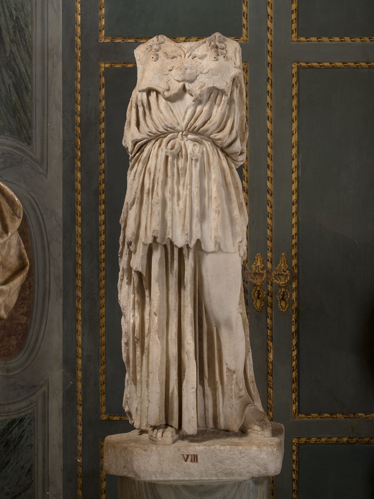

**这是什么 / 看点**：公元 120–150 年、用彭忒利科大理石（雅典卫城同款石材）雕的《雅典娜·帕耳忒诺斯》小型复制品。原作是公元前 5 世纪菲狄亚斯（Phidias）为帕特农神庙所作的黄金象牙巨像，早已失传，只能靠这类罗马复制品想象其样貌。看点正在「以小见大」——透过它窥见古代最著名的失传神像；留意女神的头盔与护胸甲（aegis）等标志。

### ➖ 可略过 本厅无官方 Furniture 藏品列表 / No Official Furniture List for Room 5 - Hermaphrodite Room

- **位置**：双性人厅（第 5 室）

馆方藏品库没有为本厅返回 Furniture（陈设家具）类作品列表；房间装饰、天顶框景、壁面灰泥与陈列史，按房间介绍页的说明处理即可。

### ⭐ 顺路看 古罗马艺术《斑岩盆》 / Roman art, _Porphyry Basin_

- **作者 / Artist**：古罗马艺术 / Roman art
- **作品 / Work**：《斑岩盆》 / _Porphyry Basin_
- **时间**：公元 2 世纪
- **材质**：斑岩
- **位置**：双性人厅（第 5 室）
- **官网介绍页**：[官方藏品库](https://www.collezionegalleriaborghese.it/opere/vasca-in-porfido)｜馆藏编号 CLXV

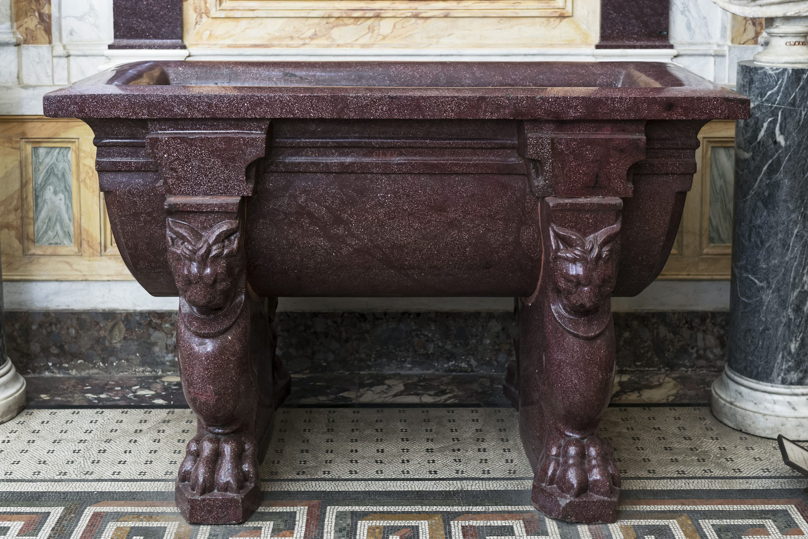

**这是什么 / 看点**：一只古罗马的斑岩（porfido）大盆。斑岩是产自埃及的深紫红色硬石，在古罗马是「帝王紫」的象征，开采与雕琢都极费工，专属皇室；到近代又成了贵族收藏炫耀财力与品位的名贵石材。这件盆的叙事性不如核心雕塑，但正好说明博尔盖塞为什么爱用斑岩、雪花石这类珍贵石材来组织房间——材质本身就是身份。现场欣赏石料浓郁的紫红色泽与温润打磨的盆体。

## 资料来源 / Sources

- Galleria Borghese 官方房间页：[Room 5](https://galleriaborghese.cultura.gov.it/en/il-museo/la-villa/sala-5-sala-dellermafrodito/)
- Galleria Borghese 藏品筛选：[Painting, Room 5](https://www.collezionegalleriaborghese.it/en/collezione/pittura?sala=s5)
- Galleria Borghese 藏品筛选：[Modern Sculpture, Room 5](https://www.collezionegalleriaborghese.it/en/collezione/scultura?sala=s5)
- Galleria Borghese 藏品筛选：[Ancient Art, Room 5](https://www.collezionegalleriaborghese.it/en/collezione/arte-antica?sala=s5)
- Galleria Borghese 藏品筛选：[Furniture, Room 5](https://www.collezionegalleriaborghese.it/en/collezione/arredi?sala=s5)
