第 6 室（旧称「角斗士厅」）正中是贝尼尼二十一岁的群像《埃涅阿斯背父逃离特洛伊》，另有他晚年的《真理》；天顶佩舍《诸神会议》与地面的史诗主题上下呼应。

**必看与核心展品（⭐⭐⭐ 必看 + 核心）**

| 推荐 | 展品 | 作者 | 一句话看点 |
|---|---|---|---|
| ⭐⭐⭐ 必看 | 《埃涅阿斯、安喀塞斯与阿斯卡尼俄斯》 | 吉安·洛伦佐·贝尼尼 | 二十一岁之作，一块石头雕出三代人三种皮肤 |
| ⭐⭐⭐ 必看 | 《真理（时间揭示的真理）》 | 吉安·洛伦佐·贝尼尼 | 贝尼尼晚年自辩之作，未完成的寓言裸像 |
| ⭐⭐ 推荐 | 天顶《诸神会议》 | 洛朗·佩舍 | 诸神为特洛伊战争「表决」，与地面逃亡呼应 |

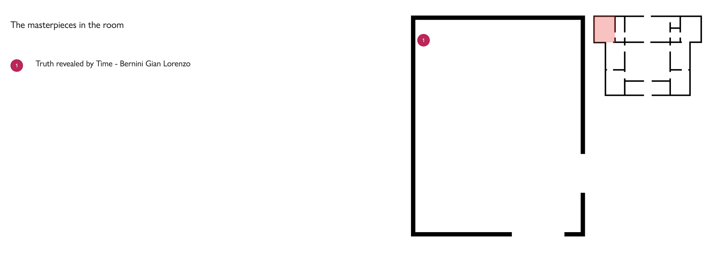

**展厅官网介绍页**：[Room 6 - Aeneas and Anchises Room](https://galleriaborghese.cultura.gov.it/en/il-museo/la-villa/sala-6-sala-del-gladiatore/)

## 核心展品

### ⭐⭐⭐ 必看 吉安·洛伦佐·贝尼尼《埃涅阿斯、安喀塞斯与阿斯卡尼俄斯》 / Gian Lorenzo Bernini, _Aeneas, Anchises and Ascanius_

- **作者 / Artist**：吉安·洛伦佐·贝尼尼（1598–1680） / Gian Lorenzo Bernini
- **作品 / Work**：《埃涅阿斯、安喀塞斯与阿斯卡尼俄斯》 / _Aeneas, Anchises and Ascanius_
- **时间**：1619 年
- **材质**：大理石
- **尺寸**：高 220 cm
- **位置**：埃涅阿斯与安喀塞斯厅（第 6 室）
- **官网介绍页**：[埃涅阿斯、安喀塞斯与阿斯卡尼俄斯 / Enea, Anchise e Ascanio｜Galleria Borghese 官方藏品库](https://www.collezionegalleriaborghese.it/opere/enea-anchise-e-ascanio)｜馆藏编号 CLXXXII

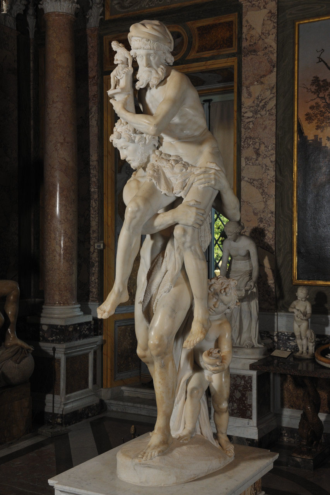

**内容（这是什么）**：这是本厅的中心作品，刻的是特洛伊陷落之夜的逃亡。题材出自维吉尔（Virgil）《埃涅阿斯纪》（Aeneid）第二卷：希腊人攻入特洛伊、城池燃起大火，英雄埃涅阿斯（Aeneas）背起年迈瘫腿、走不动路的父亲安喀塞斯（Anchises），牵着幼子阿斯卡尼俄斯（Ascanius）连夜出逃，日后辗转来到意大利，成为罗马人的始祖。雕像把三个人叠成一道向前涌动的纵列：埃涅阿斯双手托住父亲的左腿、父亲的右腿自然垂在他胸前，肢体交错缠绕；老人安喀塞斯怀里捧着特洛伊的家神「佩纳特斯」（Penates）小雕像，戴弗里吉亚帽（Phrygian cap，象征特洛伊/东方）的小阿斯卡尼俄斯一只手扶在父亲肩上、另一只手提着维斯塔（Vesta）女神的圣火——这「圣火」和「家神」就是要把特洛伊的香火、神祇和正统一并带去新家园。三人都近乎全裸，仅一张兽皮搭过身体。

**背景 / 来历**：这是贝尼尼（Bernini）为博尔盖塞家族枢机希皮奥内·博尔盖塞（Scipione Borghese）做的第一组大型群像，年仅约二十一岁。一张 1619 年的付款收据传世，正好钉死了一桩从 17 世纪就争论不休的归属问题：早期学者（如桑德拉特）认为它是贝尼尼与父亲彼得罗·贝尼尼（Pietro Bernini）合作的产物，收据的发现确认了主创是年轻的吉安·洛伦佐本人（父亲彼得罗本是名匠，把家传的精湛凿工传给了儿子，群像里仍能感到那种学院式的扎实）。它最初摆在别墅（今美术馆楼）的第 3 室，1832 年前后几经搬迁——先上二楼（今第 14 室）、再到门厅——直到 1888 年才正式安放到第 6 室正中，取代了原本立在这里、1808 年被拿破仑运去巴黎（今藏卢浮宫）的名作《角斗士》（阿加西亚斯作）。也正因如此，这间厅至今的官方旧称仍叫「角斗士厅」。雕像最早的底座是一具刻着花环与牛头骨（bucrania）的古代圆形祭坛（仍属博尔盖塞收藏，馆藏编号 LXVI），19 世纪先换成木座，最后才是今天这具由皮耶特罗·福尔图纳蒂雕的大理石基座。1902 年随别墅一起由意大利国家购入。

**技法：用大理石雕出三种皮肤**：这件最该贴近看的，是贝尼尼怎样让同一块大理石长出三种年龄的肉体——孩子的肌肤柔嫩饱满、壮年埃涅阿斯绷紧的皮下透出结实肌肉、老人安喀塞斯则枯瘪松弛、青筋与皱褶毕露。「人生三阶段（三代人）」是这件的隐藏主题，而贝尼尼不是靠加标签、而是靠石头表面的不同处理把它说了出来。老人安喀塞斯那具佝偻、瘫软的身体，被认为可与卡拉瓦乔（Caravaggio）笔下写实的老圣杰罗姆（《圣杰罗姆》当时也在希皮奥内的收藏里）一较高下；而埃涅阿斯挺拔的躯体，几乎是米开朗基罗（Michelangelo）在罗马神庙圣母堂那尊《基督》的镜像——年轻的贝尼尼在这里既炫技、也在向两位前辈致敬。

**图像学谱系**：埃涅阿斯背父逃亡是个有长久图像传统的母题。和本作构图最接近的，是卡拉奇兄弟（Carracci）在博洛尼亚法瓦宫「埃涅阿斯厅」画的《逃离特洛伊》——侧面视角、埃涅阿斯只用一侧肩膀扛父；这与拉斐尔（Raphael）在梵蒂冈「博尔戈火灾厅」里让埃涅阿斯把父亲驮在背上的画法形成对照。贝尼尼显然消化了这些前作，再把它从「平面叙事」翻译成可以绕看的三维纵列。

**赞助与政治寓意**：这组像对枢机来说远不只是神话。题材暗含一条「权力传承」的政治神学：王权（imperium）由埃涅阿斯从特洛伊带到罗马，又从罗马传到教会与教皇手中——而此刻它正靠年轻的「枢机侄」希皮奥内来护持。学者指出贝尼尼有意把埃涅阿斯塑成年轻的希皮奥内、把他扛着的老父对应当时的教皇（希皮奥内的伯父保罗五世）：拉丁文 _scipio_ 本义正是「老人拄的手杖」，与 Scipione（希皮奥内）一名谐音双关——年轻枢机就是支撑年迈教皇的那根「手杖」。一件取材荷马—维吉尔史诗的雕像，就这样被读成了博尔盖塞家族的形象工程。

**现场站看**：

1. **从正面偏右站定看**——贝尼尼是按「正面＋右侧」这一个视角来构思的，左侧和背面有些地方他刻意没完工（料定看不到）。所以别一上来就绕到左后方，先在正面稍偏右处站定，看到的才是他要你看到的「最佳角度」。
2. **比三种皮肤**——把视线从最上的孩子、到中间的埃涅阿斯、再到最下的老人滑一遍：嫩肉、绷紧的壮年肌肉、枯瘪的老皮，三种质感出自同一块石头。这是全件技法的核心，也是「人生三阶段」主题的全部表达。
3. **找老人怀里的家神和孩子手里的圣火**——安喀塞斯抱着佩纳特斯家神小像，阿斯卡尼俄斯提着维斯塔圣火、戴着弗里吉亚帽。认出这两样「随身行李」，就懂了这场逃亡的真正分量：他们带走的是特洛伊的神与香火。
4. **看三条腿如何交错**——埃涅阿斯双手抱住父亲一条腿、父亲另一条腿垂落在他胸前，肢体彼此缠绕。这种把三代人「锁」成一道向上盘旋的纵列，是巴洛克群像的雏形。
5. **认埃涅阿斯＝米开朗基罗《基督》**——记住他挺拔的站姿与扭转，这几乎是米开朗基罗神庙圣母堂《基督》的镜像；年轻贝尼尼在向前辈隔空致意。
6. **想象那把「手杖」**——知道 scipio＝手杖、埃涅阿斯影射枢机希皮奥内、老父影射教皇之后，再看这「青年扛老人」的姿态，就读出了它的政治潜台词。
7. **联系天顶一起看**——看完雕像抬头看天顶佩舍的《诸神会议》：下方是个人的逃亡，上方是诸神为特洛伊战争分立两派、由朱庇特裁断——整间厅在讲同一个「特洛伊→罗马」的史诗主题。
8. **想想脚下原本是谁**——这个位置 1888 年前立的是名作《角斗士》（1808 年被运去巴黎、至今在卢浮宫）。贝尼尼这组像是「接替」了它，连带让本厅的旧名「角斗士厅」沿用至今。

### ⭐⭐⭐ 必看 吉安·洛伦佐·贝尼尼《真理（时间揭示的真理）》 / Gian Lorenzo Bernini, _Allegory of Truth_

- **作者 / Artist**：吉安·洛伦佐·贝尼尼（1598–1680） / Gian Lorenzo Bernini
- **作品 / Work**：《真理（时间揭示的真理）》 / _Allegory of Truth_
- **时间**：1646–1652 年
- **材质**：卡拉拉大理石
- **尺寸**：高 280 cm
- **位置**：埃涅阿斯与安喀塞斯厅（第 6 室）
- **官网介绍页**：[时间揭示的真理 / La Verità｜Galleria Borghese 官方藏品库](https://www.collezionegalleriaborghese.it/opere/la-verita)｜馆藏编号 CCLXXVIII

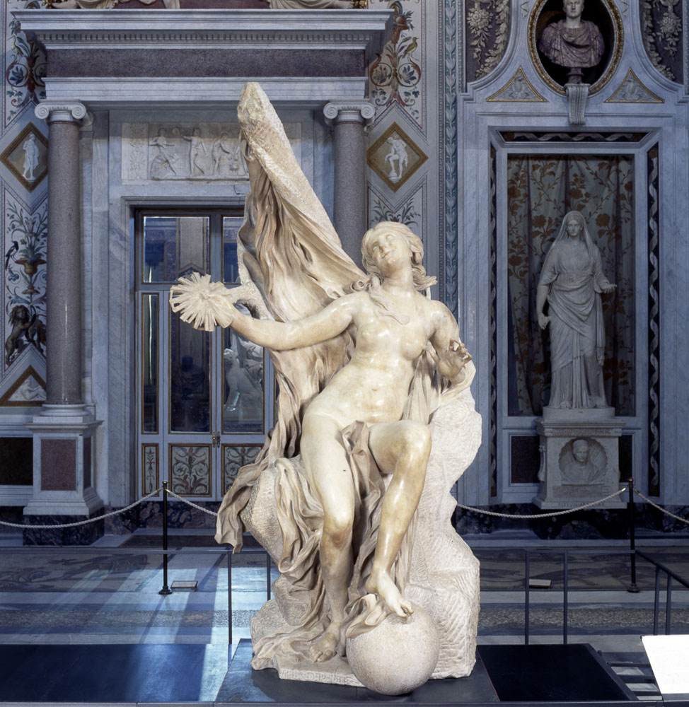

**内容（这是什么）**：一位微笑的裸体少女，坐在岩石上、身下垫着一块布幔，右手高举一枚带人脸的太阳圆盘、左脚踏在地球仪上，目光向上张望。她是「真理」的拟人化——这套图像（持太阳、踏地球）出自切萨雷·里帕（Cesare Ripa）那本影响极大的《图像学》（Iconologia，1603 版）：太阳象征真理「照亮万物」的力量，地球则说她超越尘世。但这尊像只是一组群像的一半：贝尼尼原计划在她上方再雕一个飞翔的「时间（Time）」老人，由倾塌的廊柱、方尖碑、陵墓托着、手持镰刀，把她从遮蔽中「揭开」——主题就是「时间揭示真理」。第二个人像始终没有动工。

**背景 / 来历：一件贝尼尼为自己刻的「申辩状」**：这是贝尼尼一生中少有的、不为赞助人、而为自己刻的作品，时间正卡在他职业生涯最低谷的 1646–1652 年。此前教皇乌尔班八世（Urban VIII，巴尔贝里尼家族）命他给圣彼得大教堂正立面加建两座钟楼（前任马代尔诺起的头），结果出现结构隐患，教皇下令拆掉已建起的第一座；1644 年新教皇英诺森十世（Innocent X，潘菲利家族）即位后不但彻底搁置工程，还改用他的劲敌博罗米尼（Borromini）做建筑师。声誉跌到谷底的贝尼尼，便以「时间终将为蒙冤者讨回公道」自勉，构思了这组《时间揭示真理》。可仅仅两年后他就重获教廷青睐、忙得无暇收尾，群像就此停在「只有真理、没有时间」的状态。他更立下遗嘱性质的限定继承（fideicommissum），规定此像只传长房男嗣、不得变卖，要后代记住这条道德训诫。雕像在贝尼尼家族府邸（先在梅尔切德街、后在科尔索大道）传到 1924 年，才寄存于博尔盖塞美术馆，1958 年由意大利国家购入。

**技法：让大理石「自己发光」**：少女的肌肤几乎被打磨抛光到极致，目的就是让人觉得「真理之体」本身在散发光亮——这与身下处理较粗、留着凿痕的布幔、岩石、地球仪形成强烈对比，是看贝尼尼如何用「光洁 vs 粗粝」分出主次的好标本。1997 年修复时还在石面上发现大量贝尼尼亲手画的炭笔线——那是他给自己标的「凿子该走的路线」，等于直接在大理石上画的施工草图。

**看点 / 与同厅对照**：把它和厅中央的早期《埃涅阿斯》并看，就是一部「贝尼尼的两端」：一边是约二十一岁、为讨枢机欢心而作的叙事群像，技法已惊人却仍带学院的拘谨；另一边是近五十岁、在事业危机里为自己而刻的哲理寓言，技法更自由、情绪也更私人。多份贝尼尼亲笔素描（今藏莱比锡、卢浮宫）留下了「真理」倾角与底座反复推敲的过程；她的姿态还被指与科雷乔（Correggio）那幅未完成的《美德寓意》有渊源。

**现场站看**：

1. **找太阳盘与地球仪**——右手举的太阳圆盘上有张人脸（真理照亮万物），左脚踏地球仪（超越尘世）。认出这两件「标配道具」，就知道她是「真理」而非普通裸女。
2. **想象她头顶缺的那位「时间」**——上方本该有个飞翔的白胡子老人持镰刀把她揭开。脑补这块「空缺」，才懂这件为何是「半部作品」，也才懂它的标题。
3. **比肌肤与布幔的打磨差**——光洁如发光的身体 vs 留着凿痕的岩石和布幔，是贝尼尼有意的主次对比，也是辨认「哪里完工、哪里留手」的直接证据。
4. **联系它的「身世」看表情**——记住这是失意的贝尼尼为自己刻的「申辩」，再看她那张向上张望、近乎从容的微笑，就读出了「时间会还我公道」的潜台词。

## 天顶画

### ⭐⭐ 推荐 洛朗·佩舍《诸神会议》 / Laurent Pécheux, _Council of the Gods_

- **作者 / Artist**：洛朗·佩舍（1729–1821） / Laurent Pécheux
- **作品 / Work**：《诸神会议》 / _Council of the Gods_
- **时间**：1777–1783 年（平乔别墅新古典改造期）
- **位置**：埃涅阿斯与安喀塞斯厅天顶（第 6 室，旧称「角斗士厅」）

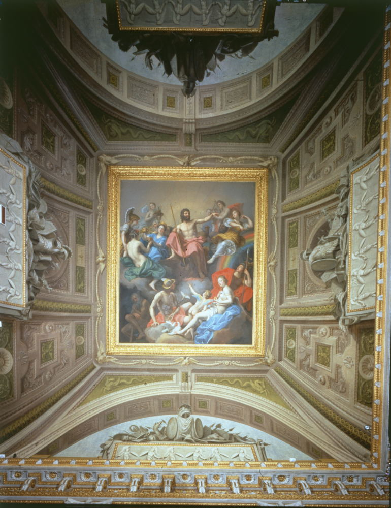

**内容（这是什么）**：占满本厅拱顶的大型天顶画，画的是奥林匹斯诸神为特洛伊战争开「会」。题材出自荷马（Homer）史诗传统：特洛伊战争打到关键处，众神在主神朱庇特（Jupiter）主持下分成两派——一派（如朱诺、密涅瓦）护希腊人，一派（如维纳斯、阿波罗、马尔斯）护特洛伊人——为是否、如何干预战局争执不下，最后由居中的朱庇特裁断。换句话说，这场仗在凡间打、在天上也打，画的就是诸神在云端为人间战争「投票表决」的一幕。

**背景 / 来历**：这是法国画家洛朗·佩舍（Laurent Pécheux，长期在罗马工作）于 1777–1783 年所作，是 18 世纪 70–80 年代马尔坎托尼奥·博尔盖塞（Marcantonio IV Borghese）请建筑师安东尼奥·阿斯普鲁奇（Antonio Asprucci）统筹的别墅大改造的一环。改造的核心思路是「一室一主题」：每间厅的天顶都要呼应这间厅的内容。本厅原以立在正中的古代名作《角斗士》（1808 年被拿破仑运去巴黎、今藏卢浮宫）得名「角斗士厅」，但其装饰主题早已围绕特洛伊—埃涅阿斯史诗布置，所以天顶选了「诸神会议」；后来 1888 年贝尼尼的《埃涅阿斯背父》搬进厅中央，地面（人间逃亡）与天顶（诸神裁断）便严丝合缝地接成同一个故事。

**看点**：天顶与地面是一套配好的「上下文」，这正是阿斯普鲁奇改造的精髓——抬头是诸神在云端决定特洛伊战争的走向（史诗的「天意」层），低头是埃涅阿斯背着老父逃出燃烧的特洛伊（史诗的「凡人」层）。一个人的逃亡之所以重大，是因为它被嵌在「特洛伊陷落→埃涅阿斯流亡→罗马建城」这条由诸神拍板的命运链里。先读懂天顶的「神意」，再看雕像的「人事」，整间厅的设计用意才出得来。

**现场站看**：

1. **先认中央主持的朱庇特**——找到天顶最高、最受众神环绕、居中仲裁的那位主神，整片「诸神裁判席」的结构就理顺了；他是这场天上会议的主席。
2. **分辨「两派」诸神**——试着在他两侧找出对立的两组神祇：一边偏护希腊（朱诺、密涅瓦），一边偏护特洛伊（维纳斯、阿波罗）。认出这种「分坐两边」的对峙，就读出了「会议／表决」的戏剧张力，而不只是众神聚会。
3. **靠标志物认神**——朱庇特的鹰与雷霆、维纳斯身边的小爱神、马尔斯的盔甲、墨丘利的飞翼帽，都是辨认各路神祇的「身份证」，挑几个找出来。
4. **抬头—低头连起来看**——先在地面看完贝尼尼《埃涅阿斯背父》，再抬头看这片天顶：下方是凡人在神意洪流里的个人命运，上方是诸神决定这场战争的走向，一在人间、一在天上，讲的是同一桩特洛伊的事。抬头至少看 30 秒。
5. **想想这是「整体改造」的一块**——天顶画、地面雕像、墙面装饰本是阿斯普鲁奇同一套「一室一主题」方案的部件；明白这点，就懂了为什么这间旧名「角斗士厅」的房间，处处在讲埃涅阿斯。

## 绘画

本节按馆方 Painting 藏品列表补充，共 4 件。核心展品如已在上文展开，这里仍保留官方清单条目，方便核对。

### ⭐ 顺路看 归属乔瓦尼·巴蒂斯塔·帕吉《丘比特与普绪刻》 / Attributed to Paggi Giovanni Battista, _Cupid and Psyche_

- **作者 / Artist**：归属乔瓦尼·巴蒂斯塔·帕吉 / Attributed to Paggi Giovanni Battista
- **作品 / Work**：《丘比特与普绪刻》 / _Cupid and Psyche_
- **时间**：17 世纪头十年
- **材质**：布面油画
- **尺寸**：113 × 146 cm
- **馆藏编号**：052
- **位置**：埃涅阿斯与安喀塞斯厅（第 6 室）
- **官网介绍页**：[官网介绍英文](https://www.collezionegalleriaborghese.it/en/opere/cupid-and-psyche-2)｜馆藏编号 052

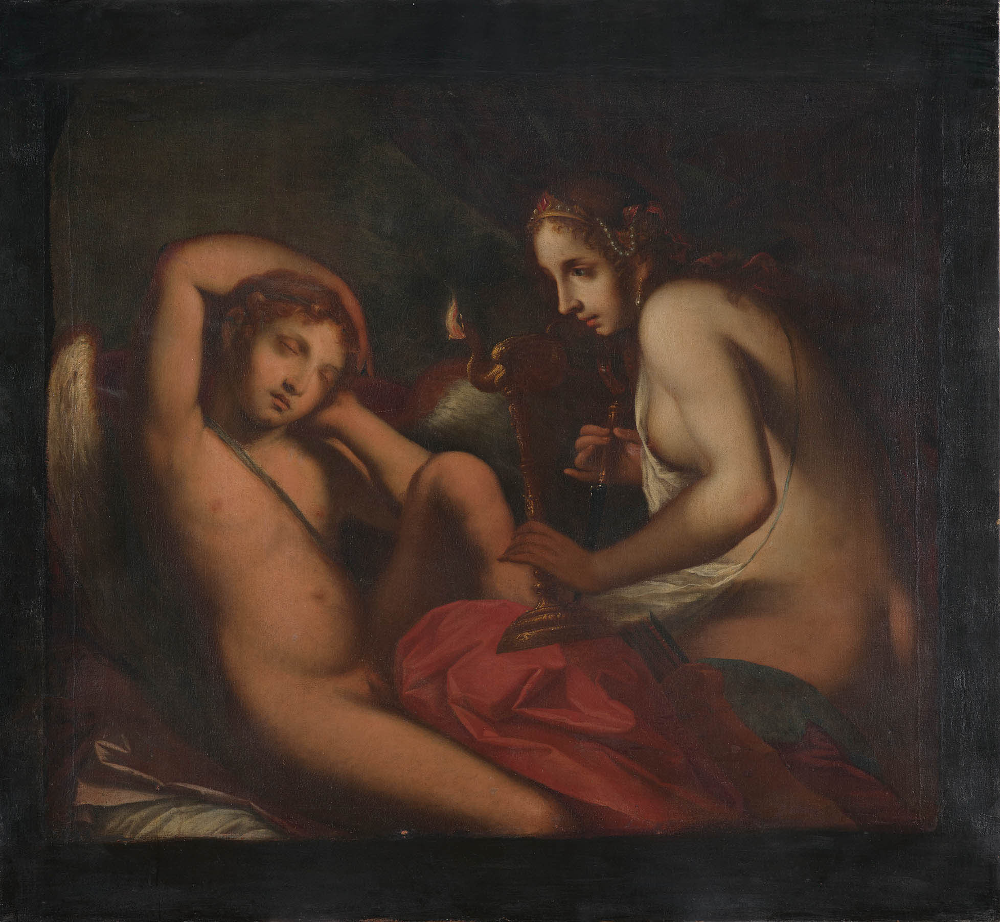

**这是什么 / 看点**：画爱神丘比特（Cupid）与凡间公主普绪刻（Psyche）的神话——两人历经考验终成眷属。归属热那亚画家帕吉（Paggi Giovanni Battista），约作于 17 世纪头十年。属本厅顺路看的小品，与中央史诗群像调子相映成趣。

### ⭐ 顺路看 乔瓦尼·玛丽亚·莫兰迪《圣母之死》 / Morandi Giovanni Maria, _Death of the Virgin_

- **作者 / Artist**：乔瓦尼·玛丽亚·莫兰迪 / Morandi Giovanni Maria
- **作品 / Work**：《圣母之死》 / _Death of the Virgin_
- **时间**：约 1657–1659 年
- **材质**：布面油画
- **尺寸**：134 × 147 cm
- **馆藏编号**：405
- **位置**：埃涅阿斯与安喀塞斯厅（第 6 室）
- **官网介绍页**：[官网介绍英文](https://www.collezionegalleriaborghese.it/en/opere/death-of-the-virgin)｜馆藏编号 405

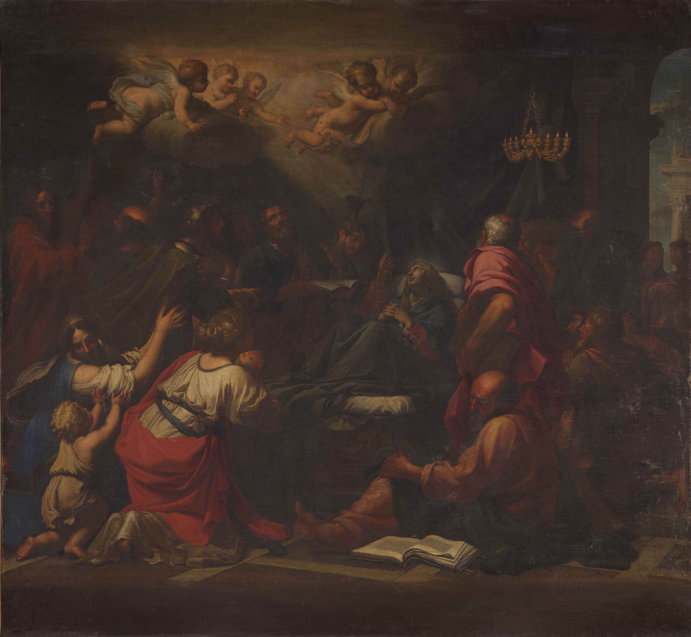

**这是什么 / 看点**：莫兰迪（Morandi Giovanni Maria）约 1657–1659 年的《圣母之死》，表现圣母在使徒环绕中安然辞世的传统题材。属 17 世纪罗马的宗教画，作为同厅流派补充，顺路一看即可。

### ⭐ 顺路看 让-巴蒂斯特·蒂耶尔斯《波吕达马斯在奥林匹斯山杀狮的风景，或〈清晨〉》 / Tierce Jean-Baptiste, _Landscape with Polydamas Slaying the Lion on Mount Olympus or Morning_

- **作者 / Artist**：让-巴蒂斯特·蒂耶尔斯 / Tierce Jean-Baptiste
- **作品 / Work**：《波吕达马斯在奥林匹斯山杀狮的风景，或〈清晨〉》 / _Landscape with Polydamas Slaying the Lion on Mount Olympus or Morning_
- **时间**：1782–1783 年
- **材质**：布面油画
- **尺寸**：300 × 185 cm
- **馆藏编号**：604
- **位置**：埃涅阿斯与安喀塞斯厅（第 6 室）
- **官网介绍页**：[官网介绍英文](https://www.collezionegalleriaborghese.it/en/opere/landscape-with-polydamas-slaying-the-lion-on-mount-olympus-or-morning)｜馆藏编号 604

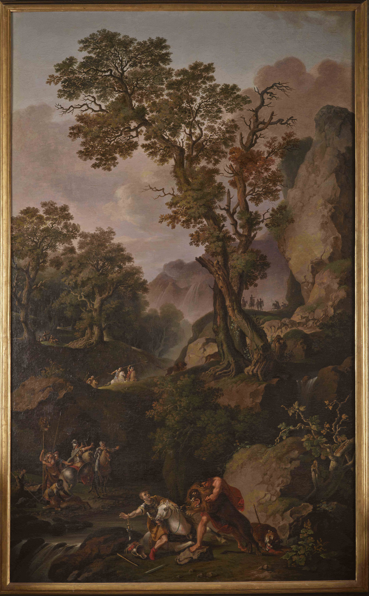

**这是什么 / 看点**：法国画家蒂耶尔斯（Tierce Jean-Baptiste）1782–1783 年的大幅风景画，与编号 605《黄昏》成对（本幅为《清晨》）。画面以神话「波吕达马斯（Polydamas）在奥林匹斯山杀狮」为点景，真正主角是清晨的山水光线——一对「晨昏」装饰风景，呼应本厅 18 世纪末重新装修的趣味。两幅并看即可。

### ⭐ 顺路看 让-巴蒂斯特·蒂耶尔斯《克罗顿的米隆被狮子吞噬的风景，或〈黄昏〉》 / Tierce Jean-Baptiste, _Landscape with Milo of Croton Devoured by a Lion, or Dusk_

- **作者 / Artist**：让-巴蒂斯特·蒂耶尔斯 / Tierce Jean-Baptiste
- **作品 / Work**：《克罗顿的米隆被狮子吞噬的风景，或〈黄昏〉》 / _Landscape with Milo of Croton Devoured by a Lion, or Dusk_
- **时间**：1782–1783 年
- **材质**：布面油画
- **尺寸**：300 × 185 cm
- **馆藏编号**：605
- **位置**：埃涅阿斯与安喀塞斯厅（第 6 室）
- **官网介绍页**：[官网介绍英文](https://www.collezionegalleriaborghese.it/en/opere/landscape-with-milo-of-croton-devoured-by-a-lion-or-dusk)｜馆藏编号 605

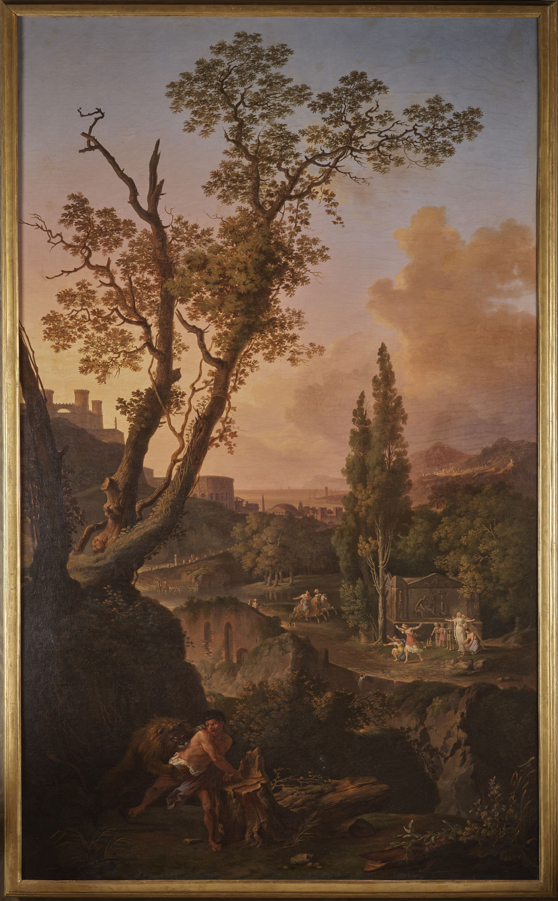

**这是什么 / 看点**：与编号 604《清晨》成对的另一幅（本幅为《黄昏》），点景神话换成「克罗顿的米隆（Milo of Croton）被狮子吞噬」。同为蒂耶尔斯 1782–1783 年作，作为「晨昏」装饰风景与 604 并看；整体说明见 604。

### ⭐ 顺路看 乔瓦尼·坎皮《猎人》 / Campi Giovanni, _Hunters_

- **作者 / Artist**：乔瓦尼·坎皮 / Campi Giovanni
- **作品 / Work**：《猎人》 / _Hunters_
- **时间**：1651–1653 年
- **材质**：比利时黑石、古黄大理石、黄角砾石与鎏金金属
- **尺寸**：高 65 cm (含底板)
- **馆藏编号**：CCLXXIV-CCLXXV
- **位置**：埃涅阿斯与安喀塞斯厅（第 6 室）
- **官网介绍页**：[官网介绍英文](https://www.collezionegalleriaborghese.it/en/opere/hunters)｜馆藏编号 CCLXXIV-CCLXXV

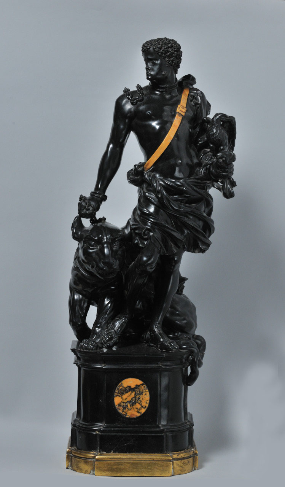

**这是什么 / 看点**：坎皮（Campi Giovanni）1651–1653 年作的一对装饰性镶嵌作品，用比利时黑石、古黄大理石、黄角砾石与鎏金金属拼成。看点在彩色石材的拼贴工艺——属 17 世纪中叶的近代陈设，与古代雕塑、中央群像形成材质对照。顺路看。

### ⭐ 顺路看 乔瓦尼·坎皮《小爱神的酒神狂欢》 / Campi Giovanni, _Bacchanal of Putti_

- **作者 / Artist**：乔瓦尼·坎皮 / Campi Giovanni
- **作品 / Work**：《小爱神的酒神狂欢》 / _Bacchanal of Putti_
- **时间**：1649–1651 年
- **材质**：青金石底上的黑大理石；框为青金石、鎏金金属与木；两侧以鎏金金属与木的双龙为托，框顶立鹰
- **尺寸**：100 × 80 cm
- **馆藏编号**：CCLXXVI
- **位置**：埃涅阿斯与安喀塞斯厅（第 6 室）
- **官网介绍页**：[官网介绍英文](https://www.collezionegalleriaborghese.it/en/opere/bacchanal-of-putti)｜馆藏编号 CCLXXVI

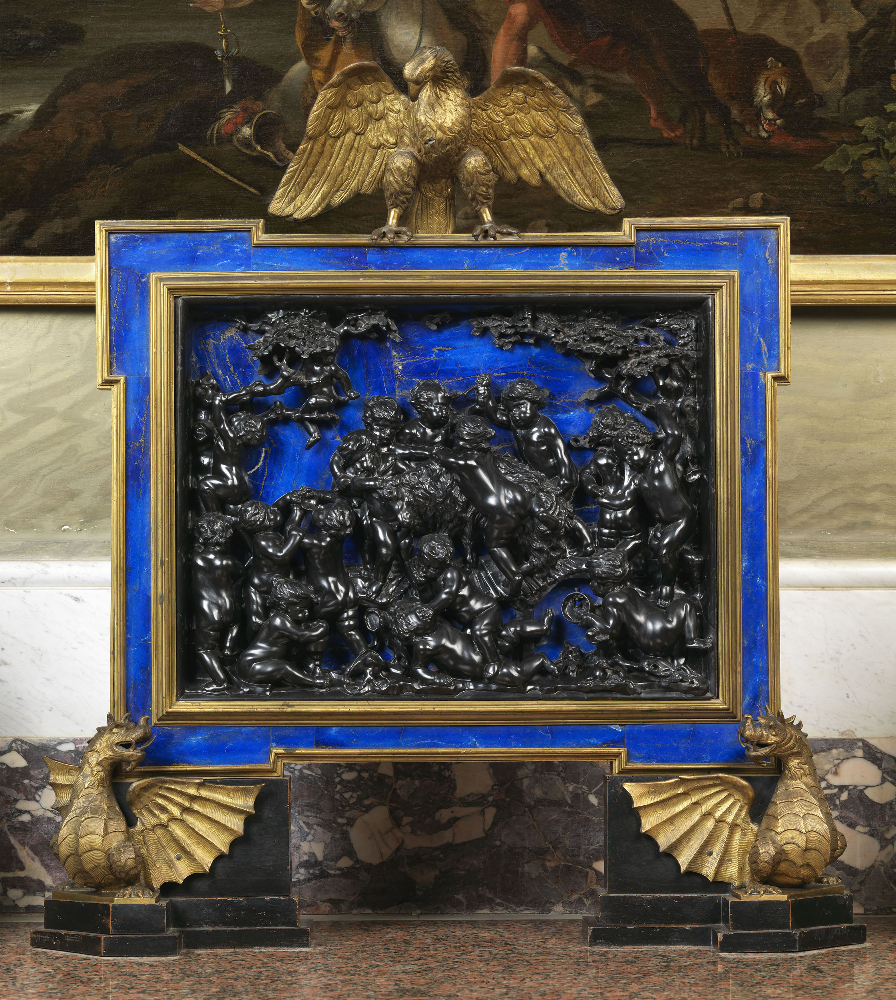

**这是什么 / 看点**：坎皮 1649–1651 年的一件奢华镶板——青金石底上的黑大理石小爱神「酒神狂欢」浮雕，框以青金石、鎏金金属与木，两侧鎏金双龙、顶上立鹰。看点全在贵重材质的层层堆叠与博尔盖塞收藏的炫示趣味。顺路看。

### ⭐ 顺路看 归属吉利斯·范登弗利特，称埃吉迪奥·德拉·里维耶拉《三个沉睡的小爱神》 / Attributed to Van den Vliete Gillis called Egidio della Riviera, _Three Sleeping Putti_

- **作者 / Artist**：归属吉利斯·范登弗利特，称埃吉迪奥·德拉·里维耶拉 / Attributed to Van den Vliete Gillis called Egidio della Riviera
- **作品 / Work**：《三个沉睡的小爱神》 / _Three Sleeping Putti_
- **时间**：1609 年前
- **材质**：古黄大理石、锡耶纳黄大理石、白大理石、黑大理石
- **尺寸**：90 × 65 cm
- **馆藏编号**：CLXXXIV
- **位置**：埃涅阿斯与安喀塞斯厅（第 6 室）
- **官网介绍页**：[官网介绍英文](https://www.collezionegalleriaborghese.it/en/opere/three-sleeping-putti)｜馆藏编号 CLXXXIV

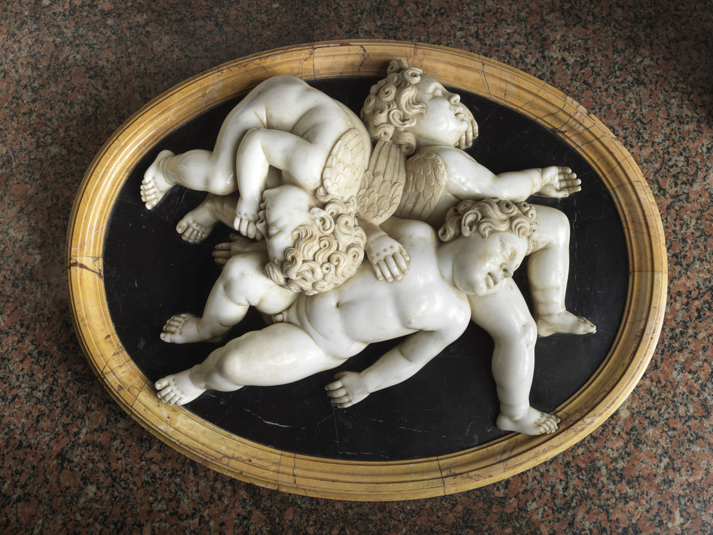

**这是什么 / 看点**：归属佛兰德雕刻家范登弗利特（Van den Vliete Gillis，在罗马称埃吉迪奥·德拉·里维耶拉）、1609 年前的作品，用古黄、锡耶纳黄、白、黑等多色大理石雕三个沉睡的小爱神。看点是多色大理石的配色与「沉睡小爱神」这一讨喜母题。顺路看。

### ⭐ 顺路看 古罗马艺术《阿斯克勒庇俄斯与忒勒斯福罗斯（头像非原配）》 / Roman art, _Asclepius (head not original) with Telesphoros_

- **作者 / Artist**：古罗马艺术 / Roman art
- **作品 / Work**：《阿斯克勒庇俄斯与忒勒斯福罗斯（头像非原配）》 / _Asclepius (head not original) with Telesphoros_
- **时间**：公元 2 世纪
- **材质**：白大理石
- **尺寸**：不含底座高 132 cm； 神像头高 22 cm； 忒勒斯福罗斯高 51 cm
- **位置**：埃涅阿斯与安喀塞斯厅（第 6 室）
- **官网介绍页**：[官网介绍英文](https://www.collezionegalleriaborghese.it/en/opere/asclepius-head-not-original-with-telesphoros)｜馆藏编号 CIC

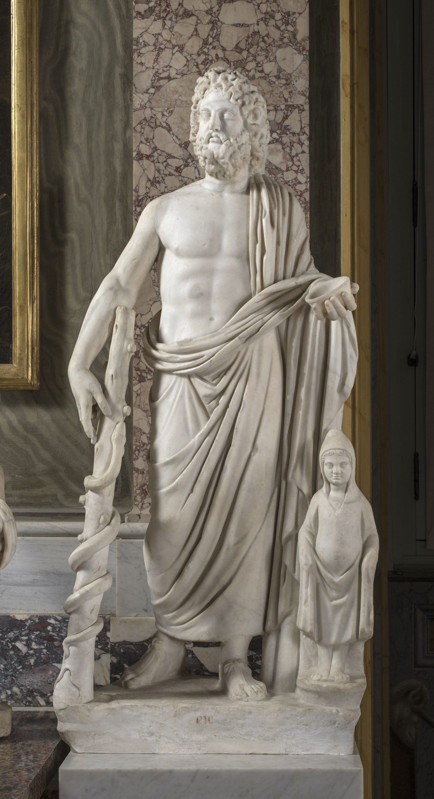

**这是什么 / 看点**：医神阿斯克勒庇俄斯（Asclepius）与司康复的侍童小神忒勒斯福罗斯（Telesphoros，裹兜帽斗篷）的组像。馆方明确标注神像头部为后世配补、非原配——是本厅「古代躯体＋后配头部」的典型，现场可比对头与身的接缝与质感。顺路看。

### ⭐ 顺路看 古罗马艺术《盆形石棺残段，饰三位托加人物》 / Roman art, _Tub-Shaped Sarcophagus with Three Togated Figures, Fragment_

- **作者 / Artist**：古罗马艺术 / Roman art
- **作品 / Work**：《盆形石棺残段，饰三位托加人物》 / _Tub-Shaped Sarcophagus with Three Togated Figures, Fragment_
- **时间**：公元 300 年
- **材质**：卢尼大理石
- **尺寸**：高 68 cm, 宽 90 cm
- **位置**：埃涅阿斯与安喀塞斯厅（第 6 室）
- **官网介绍页**：[官网介绍英文](https://www.collezionegalleriaborghese.it/en/opere/tub-shaped-sarcophagus-with-three-togated-figures-fragment)｜馆藏编号 CIIC

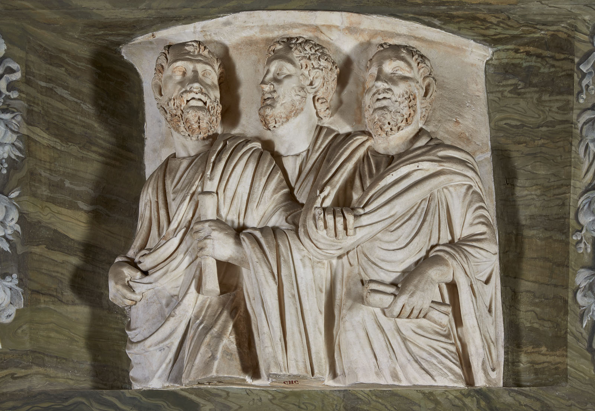

**这是什么 / 看点**：约公元 300 年一具「盆形石棺」的正面残段，浮雕三位身着托加袍的罗马人。残件加题材都很典型：托加袍是罗马公民身份的标志。现场看人物衣褶与残断处即可，顺路看。

### ⭐ 顺路看 古罗马艺术《着斗篷女性像，配非原配肖像头像》 / Roman art, _Statue of a Female Figure Wearing a Mantle, with a portrait head that is not original_

- **作者 / Artist**：古罗马艺术 / Roman art
- **作品 / Work**：《着斗篷女性像，配非原配肖像头像》 / _Statue of a Female Figure Wearing a Mantle, with a portrait head that is not original_
- **时间**：公元 3 世纪初
- **材质**：白大理石
- **尺寸**：不含底座高 200 cm； 头高 30 cm
- **位置**：埃涅阿斯与安喀塞斯厅（第 6 室）
- **官网介绍页**：[官网介绍英文](https://www.collezionegalleriaborghese.it/en/opere/statue-of-a-female-figure-wearing-a-mantle)｜馆藏编号 CIIIC

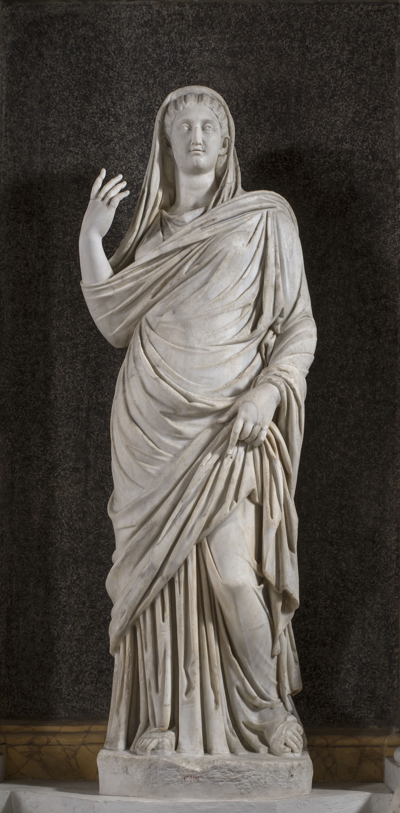

**这是什么 / 看点**：一尊披斗篷的女性立像，所配肖像头部非原配（后世拼合）。这类「古代身躯＋另配头像」在博尔盖塞古物里很常见——现场重点找颈部接缝，辨认头身年代是否对得上。顺路看。

### ⭐ 顺路看 古罗马艺术《死者卧于卧榻上的葬祭纪念碑》 / Roman art, _Funerary Monument with the Deceased Reclining on a Kline_

- **作者 / Artist**：古罗马艺术 / Roman art
- **作品 / Work**：《死者卧于卧榻上的葬祭纪念碑》 / _Funerary Monument with the Deceased Reclining on a Kline_
- **时间**：公元 1 世纪
- **材质**：白大理石
- **尺寸**：高 60 cm； 宽 150 cm
- **位置**：埃涅阿斯与安喀塞斯厅（第 6 室）
- **官网介绍页**：[官网介绍英文](https://www.collezionegalleriaborghese.it/en/opere/funerary-monument-with-the-deceased-reclining-on-a-kline)｜馆藏编号 CIVC

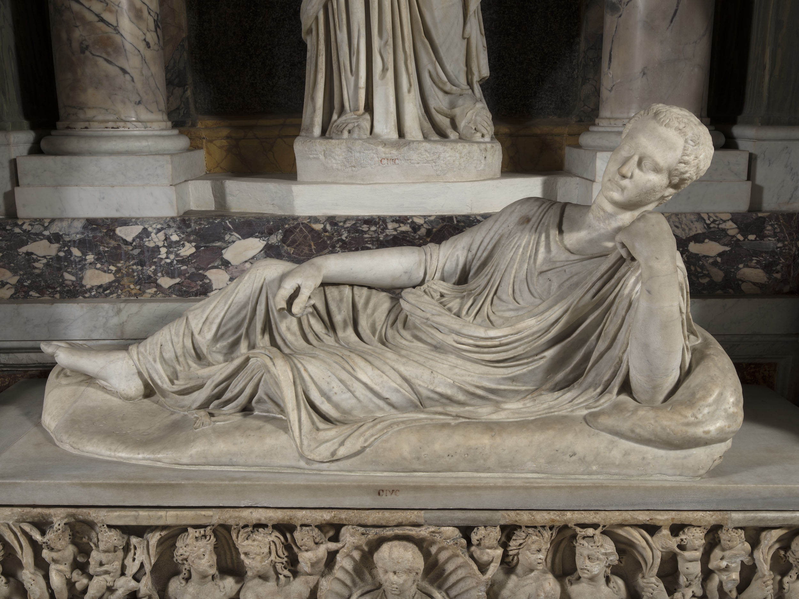

**这是什么 / 看点**：公元 1 世纪的葬祭纪念碑，死者以「卧榻（kline）宴饮」姿态斜倚——罗马人用「永恒的宴席」来表现逝者的安详。与本厅另几件石棺、棺盖同属丧葬题材，可一并扫看。顺路看。

### ⭐ 顺路看 古罗马艺术《海洋酒神随从石棺》 / Roman art, _Sarcophagus with Marine Thiasos_

- **作者 / Artist**：古罗马艺术 / Roman art
- **作品 / Work**：《海洋酒神随从石棺》 / _Sarcophagus with Marine Thiasos_
- **时间**：公元 3 世纪上半叶
- **材质**：白大理石
- **尺寸**：高 57 cm； 长 207 cm； 深 66 cm
- **位置**：埃涅阿斯与安喀塞斯厅（第 6 室）
- **官网介绍页**：[官网介绍英文](https://www.collezionegalleriaborghese.it/en/opere/sarcophagus-with-marine-thiasos-1)｜馆藏编号 CIVCa

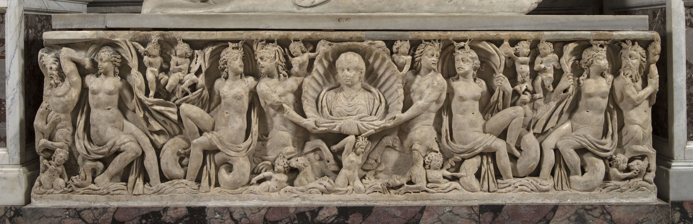

**这是什么 / 看点**：石棺正面雕「海洋酒神随从（marine thiasos）」——海神、涅瑞伊得斯、海怪与小爱神在波涛间嬉游的队列。海洋题材寄托「灵魂渡海赴福地」的想象，是公元 3 世纪流行的石棺图式。顺路看。

### ⭐ 顺路看 古罗马艺术《持盆宁芙雕像，头像非原配》 / Roman art, _Statue of a Nymph with a Basin, head not original to the body_

- **作者 / Artist**：古罗马艺术 / Roman art
- **作品 / Work**：《持盆宁芙雕像，头像非原配》 / _Statue of a Nymph with a Basin, head not original to the body_
- **时间**：公元 2 世纪
- **材质**：白大理石
- **尺寸**：不含底座高 139 cm； 头高 25 cm
- **位置**：埃涅阿斯与安喀塞斯厅（第 6 室）
- **官网介绍页**：[官网介绍英文](https://www.collezionegalleriaborghese.it/en/opere/statue-of-a-nymph-with-a-basin)｜馆藏编号 CIXC

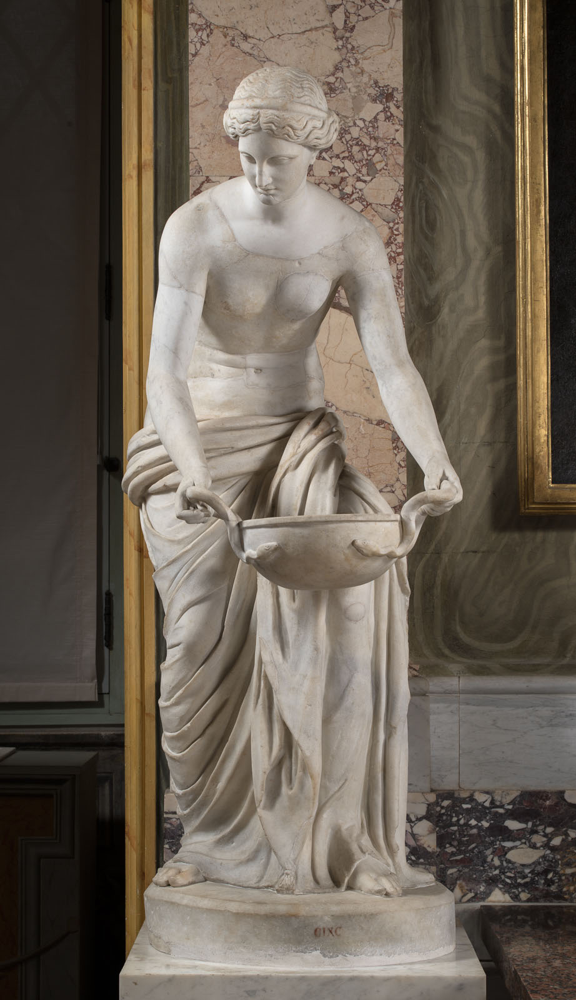

**这是什么 / 看点**：持盆的宁芙（Nymph，水泽女神）立像，头部同样非原配。题材本是装点喷泉的水景雕塑；现场可与同厅其它「头身后配」的古像（如阿斯克勒庇俄斯 CIC、女性像 CIIIC）连起来看修复手法。顺路看。

### ⭐ 顺路看 古罗马艺术《雕像：雅典娜》 / Roman art, _Statue of Athena_

- **作者 / Artist**：古罗马艺术 / Roman art
- **作品 / Work**：《雕像：雅典娜》 / _Statue of Athena_
- **时间**：公元 2 世纪
- **材质**：卢尼大理石
- **尺寸**：不含底座高 154 cm (不含头盔头高 21 cm)
- **位置**：埃涅阿斯与安喀塞斯厅（第 6 室）
- **官网介绍页**：[官网介绍英文](https://www.collezionegalleriaborghese.it/en/opere/statue-of-athena)｜馆藏编号 CLXXXIII

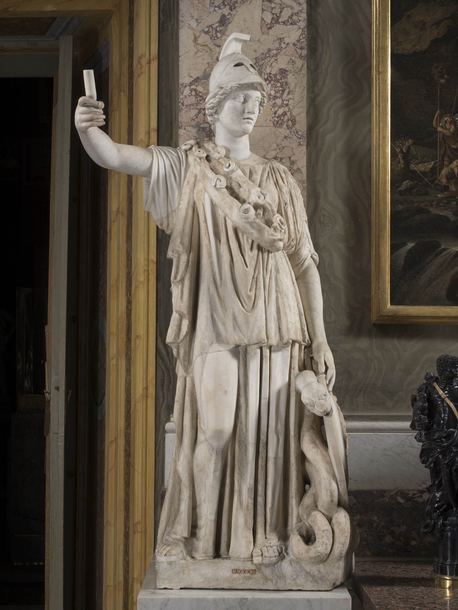

**这是什么 / 看点**：智慧与战争女神雅典娜（Athena）立像，公元 2 世纪罗马仿作，多仿自希腊古典原型。认她本靠头盔与盾甲。卢尼大理石，顺路看。

### ⭐ 顺路看 古罗马艺术《饰葬祭小爱神、金属工人与工匠小爱神的饰带》 / Roman art, _Frieze with funerary Erotes, metal-working and artisan Erotes_

- **作者 / Artist**：古罗马艺术 / Roman art
- **作品 / Work**：《饰葬祭小爱神、金属工人与工匠小爱神的饰带》 / _Frieze with funerary Erotes, metal-working and artisan Erotes_
- **时间**：公元 120–150 年
- **材质**：卢尼大理石
- **尺寸**：高 33 cm, 宽 140 cm
- **位置**：埃涅阿斯与安喀塞斯厅（第 6 室）
- **官网介绍页**：[官网介绍英文](https://www.collezionegalleriaborghese.it/en/opere/frieze-with-funerary-erotes-metal-working-and-artisan-erotes)｜馆藏编号 CLXXXIX

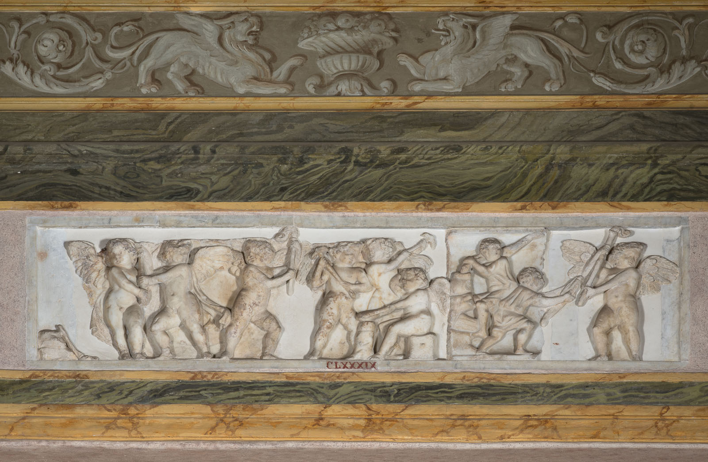

**这是什么 / 看点**：一条公元 120–150 年的浮雕饰带，刻小爱神（Erotes）在做金工、当工匠——把「劳作的小爱神」用于丧葬装饰，既轻盈又寓意生命延续。现场看小爱神各自的工具与动作，颇有趣味。顺路看。

### ⭐ 顺路看 古罗马艺术《着托加男孩雕像》 / Roman art, _Statue of a togate boy_

- **作者 / Artist**：古罗马艺术 / Roman art
- **作品 / Work**：《着托加男孩雕像》 / _Statue of a togate boy_
- **时间**：公元 1 世纪
- **材质**：卢尼大理石
- **尺寸**：不含底座高 123 cm, 头部 20 cm
- **位置**：埃涅阿斯与安喀塞斯厅（第 6 室）
- **官网介绍页**：[官网介绍英文](https://www.collezionegalleriaborghese.it/en/opere/statue-of-a-togate-boy)｜馆藏编号 CLXXXV

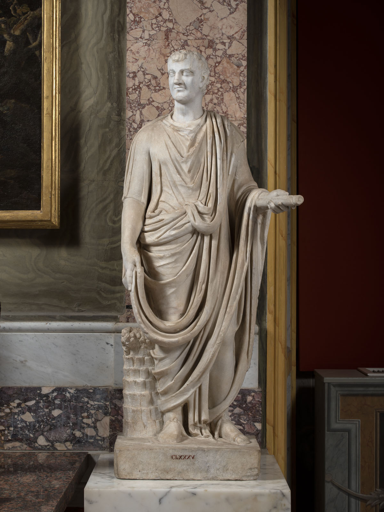

**这是什么 / 看点**：身着托加袍的男孩立像，公元 1 世纪。托加袍标明罗马公民身份，孩童着正装多见于家族纪念性肖像。与同厅《年轻女孩肖像》（CVC）可对看罗马儿童肖像。顺路看。

### ⭐ 顺路看 古罗马艺术《神祇巨型头像，置于现代胸像上》 / Roman art, _Colossal head of a divinity, on modern bust_

- **作者 / Artist**：古罗马艺术 / Roman art
- **作品 / Work**：《神祇巨型头像，置于现代胸像上》 / _Colossal head of a divinity, on modern bust_
- **时间**：公元 2 世纪
- **材质**：细颗粒白大理石
- **尺寸**：头高 43 cm
- **位置**：埃涅阿斯与安喀塞斯厅（第 6 室）
- **官网介绍页**：[官网介绍英文](https://www.collezionegalleriaborghese.it/en/opere/colossal-head-of-a-divinity-on-modern-bust)｜馆藏编号 CLXXXVI

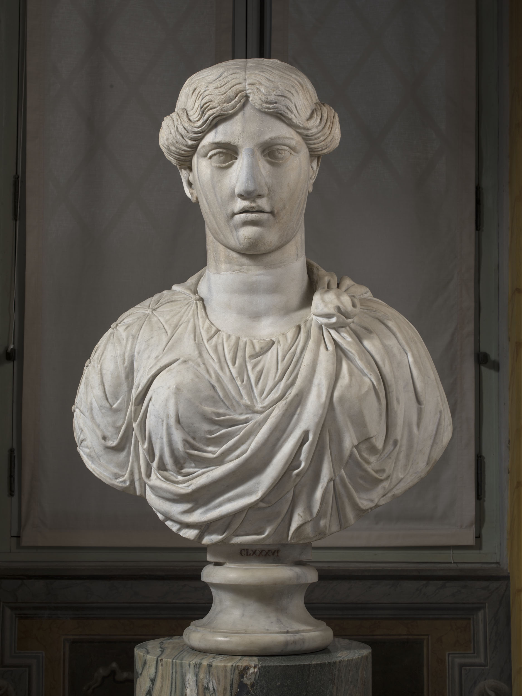

**这是什么 / 看点**：一颗公元 2 世纪的神祇巨型头像（头高 43 cm，约真人两倍），如今安在一具近代补配的胸像上。又一例「古代头像＋后配身体」，与中央展品的修复传统呼应。现场看头与胸像的材质、做工差别。顺路看。

### ⭐ 顺路看 古罗马艺术《卧榻式石棺盖，死者卧姿》 / Roman art, _Sarcophagus lid at Kline with deceased lying down_

- **作者 / Artist**：古罗马艺术 / Roman art
- **作品 / Work**：《卧榻式石棺盖，死者卧姿》 / _Sarcophagus lid at Kline with deceased lying down_
- **时间**：公元 2–3 世纪
- **材质**：亚洲白大理石
- **尺寸**：高 50 cm； 宽 210 cm； 深 80 cm
- **位置**：埃涅阿斯与安喀塞斯厅（第 6 室）
- **官网介绍页**：[官网介绍英文](https://www.collezionegalleriaborghese.it/en/opere/sarcophagus-lid-at-kline-with-deceased-lying-down)｜馆藏编号 CLXXXVII

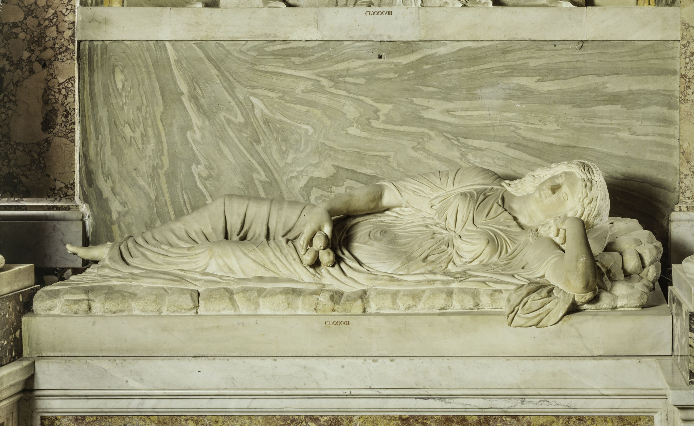

**这是什么 / 看点**：一具石棺的盖子，做成「卧榻」形、死者斜卧其上——是 CIVC 那类「卧榻宴饮」丧葬图式的盖件版本。亚洲白大理石。与同厅几件丧葬作品一并看即可。顺路看。

### ⭐ 顺路看 古罗马艺术《三人物葬祭浮雕》 / Roman art, _Funerary relief with three figures_

- **作者 / Artist**：古罗马艺术 / Roman art
- **作品 / Work**：《三人物葬祭浮雕》 / _Funerary relief with three figures_
- **时间**：公元前 20 年
- **材质**：卢尼大理石
- **尺寸**：高 175 cm, 宽 163 cm
- **位置**：埃涅阿斯与安喀塞斯厅（第 6 室）
- **官网介绍页**：[官网介绍英文](https://www.collezionegalleriaborghese.it/en/opere/funerary-relief-with-three-figures)｜馆藏编号 CLXXXVIII

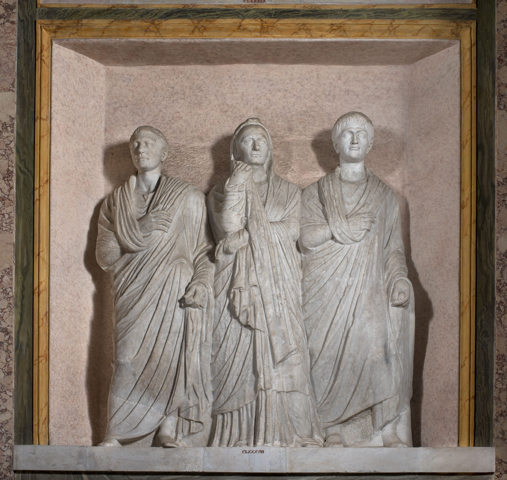

**这是什么 / 看点**：约公元前 20 年的葬祭浮雕，框出三位人物的半身像——这种「肖像龛」式墓碑常用于释奴家庭，把全家像挂上街面墓墙。年代偏早（接近奥古斯都时代），是本厅古物里较早的一件。顺路看。

### ⭐ 顺路看 古罗马艺术《年轻女孩肖像雕像》 / Roman art, _Portrait Statue of a Young Girl_

- **作者 / Artist**：古罗马艺术 / Roman art
- **作品 / Work**：《年轻女孩肖像雕像》 / _Portrait Statue of a Young Girl_
- **时间**：公元 1 世纪
- **材质**：彭忒利科大理石
- **尺寸**：不含底座高 130 cm； 仅头高 17 cm
- **位置**：埃涅阿斯与安喀塞斯厅（第 6 室）
- **官网介绍页**：[官网介绍英文](https://www.collezionegalleriaborghese.it/en/opere/portrait-statue-of-a-young-girl)｜馆藏编号 CVC

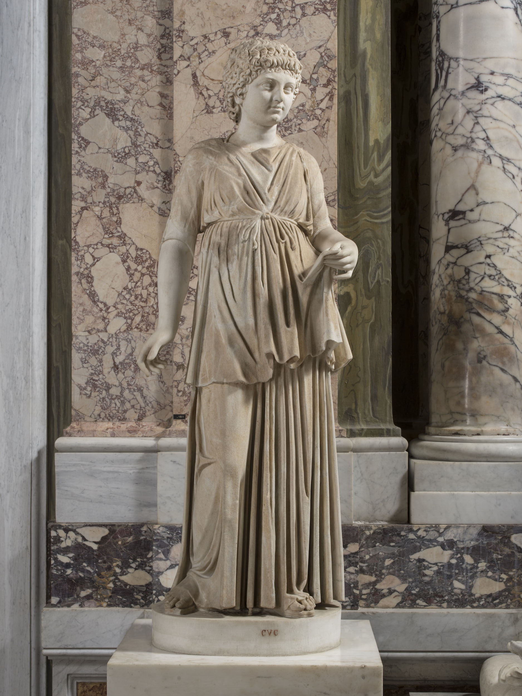

**这是什么 / 看点**：公元 1 世纪的年轻女孩肖像立像，彭忒利科大理石（产自雅典近郊的名贵石材）。与《着托加男孩》（CLXXXV）对看，能感受罗马家族如何为孩童立像纪念。顺路看。

### ➖ 可略过 古罗马艺术《勒达与天鹅》 / Roman art, _Leda and the Swan_

- **作者 / Artist**：古罗马艺术 / Roman art
- **作品 / Work**：《勒达与天鹅》 / _Leda and the Swan_
- **时间**：公元 2 世纪
- **材质**：白大理石
- **尺寸**：不含底座高 127 cm； 头高 20 cm
- **位置**：埃涅阿斯与安喀塞斯厅（第 6 室）
- **展陈提醒**：馆方藏品页标注 _Work not currently exhibited_
- **官网介绍页**：[官网介绍英文](https://www.collezionegalleriaborghese.it/en/opere/leda-and-the-swan)｜馆藏编号 CVIIC

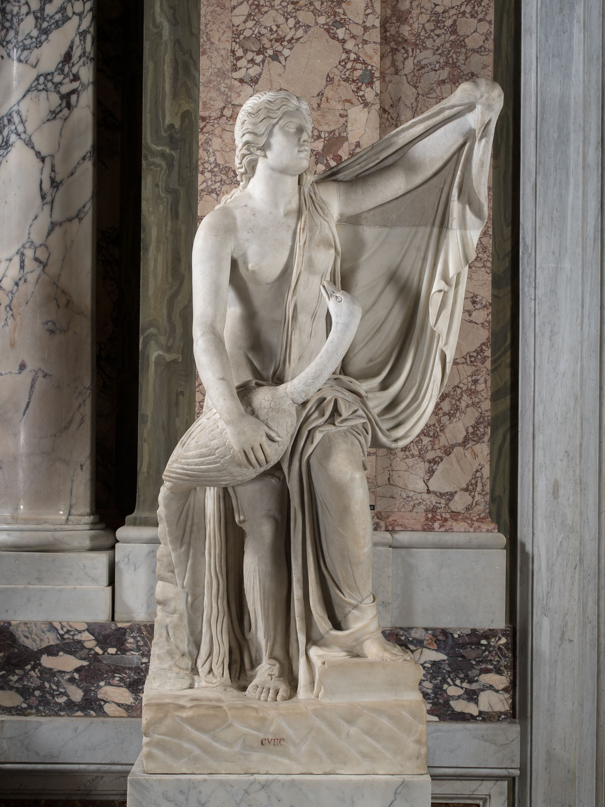

**这是什么 / 看点**：勒达（Leda）与化身天鹅的宙斯相会的神话题材，公元 2 世纪罗马作。**馆方标注此件当前未展出**，到场多半看不到，列此仅备查，可略过。

### ⭐ 顺路看 古罗马艺术《三身赫卡忒雕像》 / Roman art, _Statue of a Triple-Bodied Hecate_

- **作者 / Artist**：古罗马艺术 / Roman art
- **作品 / Work**：《三身赫卡忒雕像》 / _Statue of a Triple-Bodied Hecate_
- **时间**：公元 2 世纪
- **材质**：带蓝灰纹理的白大理石
- **尺寸**：高 196 cm
- **位置**：埃涅阿斯与安喀塞斯厅（第 6 室）
- **官网介绍页**：[官网介绍英文](https://www.collezionegalleriaborghese.it/en/opere/statue-of-a-triple-bodied-hecate)｜馆藏编号 CXC

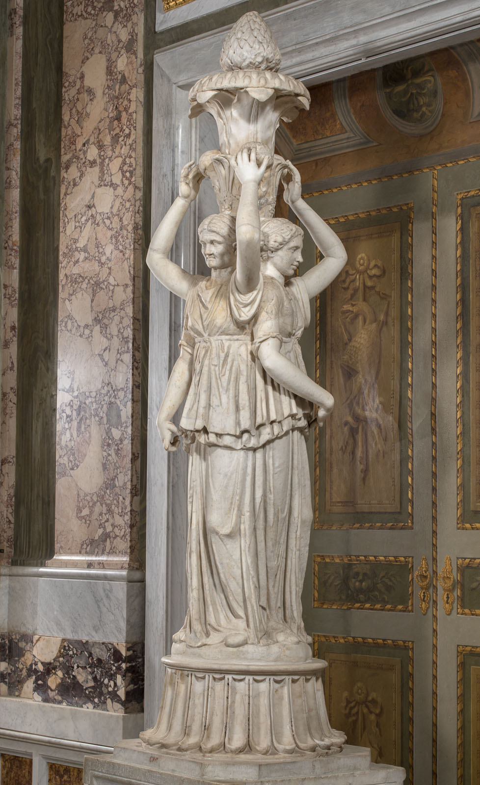

**这是什么 / 看点**：三身合一的赫卡忒（Hecate）像——这位掌管月亮、冥界与十字路口的女神常以「背靠背三个身体」呈现，立于路口三面皆可朝拜。公元 2 世纪罗马作，题材在古物里较少见，值得多看一眼。顺路看。

### ⭐ 顺路看 古罗马艺术《带翼胜利女神与献祭者浮雕》 / Roman art, _Reliefs with Winged Victory and Offerers_

- **作者 / Artist**：古罗马艺术 / Roman art
- **作品 / Work**：《带翼胜利女神与献祭者浮雕》 / _Reliefs with Winged Victory and Offerers_
- **时间**：公元 2 世纪
- **材质**：卢尼大理石
- **尺寸**：高 78 cm； 宽 57 cm； 含修复补配深 60 cm
- **位置**：埃涅阿斯与安喀塞斯厅（第 6 室）
- **官网介绍页**：[官网介绍英文](https://www.collezionegalleriaborghese.it/en/opere/reliefs-with-winged-victory-and-offerers)｜馆藏编号 CXCa

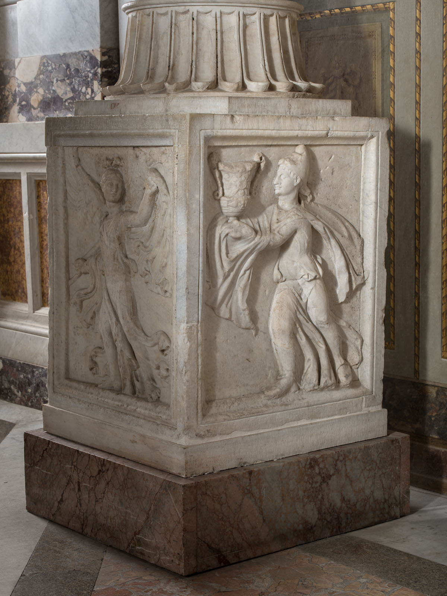

**这是什么 / 看点**：浮雕「带翼胜利女神（Victory）与献祭者」，公元 2 世纪。胜利女神持物降临、凡人捧供品——典型的罗马献祭/凯旋图式。尺寸记载注明「含修复补配深 60 cm」，说明经过后世修补。顺路看。

### ⭐ 顺路看 古罗马艺术，仿希腊化原作《被锁链束缚的厄洛斯》 / Roman art, copy after hellenistic original, _Eros in Chains_

- **作者 / Artist**：古罗马艺术，仿希腊化原作 / Roman art, copy after hellenistic original
- **作品 / Work**：《被锁链束缚的厄洛斯》 / _Eros in Chains_
- **时间**：公元 2 世纪
- **材质**：白卢尼大理石
- **尺寸**：不含底座高 72 cm； 头高 19 cm
- **位置**：埃涅阿斯与安喀塞斯厅（第 6 室）
- **官网介绍页**：[官网介绍英文](https://www.collezionegalleriaborghese.it/en/opere/eros-in-chains)｜馆藏编号 CXIII

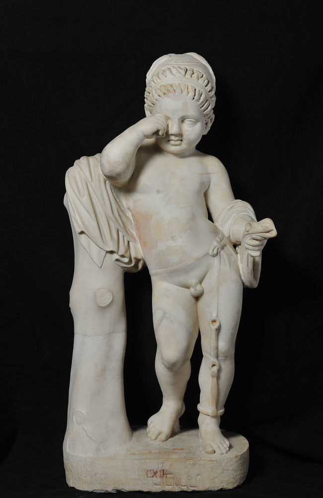

**这是什么 / 看点**：「被锁链束缚的厄洛斯（Eros）」——爱神被缚，是希腊化时期流行的「爱情受制」寓意母题；本件是公元 2 世纪罗马对希腊化原作的复制。与《持鸟男孩》（CXV）同属仿希腊化的小型雕像。顺路看。

### ⭐ 顺路看 古罗马艺术，仿希腊化原作《持鸟男孩》 / Roman art, copy after hellenistic original, _Little Boy with a Bird_

- **作者 / Artist**：古罗马艺术，仿希腊化原作 / Roman art, copy after hellenistic original
- **作品 / Work**：《持鸟男孩》 / _Little Boy with a Bird_
- **时间**：公元 2 世纪
- **材质**：细颗粒白大理石
- **尺寸**：不含底座高 73 cm； 头高 17 cm
- **位置**：埃涅阿斯与安喀塞斯厅（第 6 室）
- **官网介绍页**：[官网介绍英文](https://www.collezionegalleriaborghese.it/en/opere/little-boy-with-a-bird)｜馆藏编号 CXV

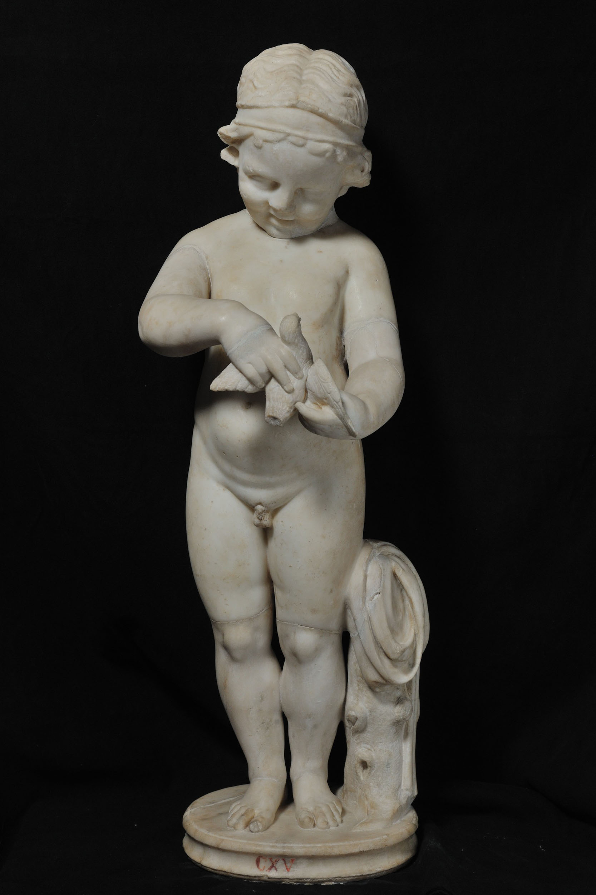

**这是什么 / 看点**：「持鸟男孩」——孩童逗弄小鸟，是希腊化雕塑钟爱的日常稚趣题材；本件为公元 2 世纪罗马复制。和《被锁链束缚的厄洛斯》（CXIII）成对看，都是仿希腊化的小品。顺路看。

### ⭐ 顺路看 乔瓦尼·巴蒂斯塔·马尔凯蒂《战利品与武器装饰》 / Giovanni Battista Marchetti, _Trophies and Arms Decoration_

- **作者 / Artist**：Giovanni Battista Marchetti（1730–1800） / Giovanni Battista Marchetti
- **作品 / Work**：《战利品与武器装饰》 / _Trophies and Arms Decoration_
- **时间**：18 世纪末房间装饰期
- **位置**：第 6 室

**这是什么 / 看点**：马尔凯蒂（Giovanni Battista Marchetti）在 18 世纪末本厅重装时所作的「战利品与武器」装饰，延续这间厅旧称「角斗士厅」的尚武主题。房间页另提到帕切蒂（Vincenzo Pacetti）设计、马佐尼（Costantino Mazzoni）执行的「持盔与盾起舞的科里班忒斯」灰泥浮雕。顺路扫看墙面与拱顶装饰即可。

## 资料来源 / Sources

- Galleria Borghese 官方房间页：[Room 6](https://galleriaborghese.cultura.gov.it/en/il-museo/la-villa/sala-6-sala-del-gladiatore/)
- Galleria Borghese 藏品筛选：[Painting, Room 6](https://www.collezionegalleriaborghese.it/en/collezione/pittura?sala=s6)
- Galleria Borghese 藏品筛选：[Modern Sculpture, Room 6](https://www.collezionegalleriaborghese.it/en/collezione/scultura?sala=s6)
- Galleria Borghese 藏品筛选：[Ancient Art, Room 6](https://www.collezionegalleriaborghese.it/en/collezione/arte-antica?sala=s6)
- Galleria Borghese 藏品筛选：[Furniture, Room 6](https://www.collezionegalleriaborghese.it/en/collezione/arredi?sala=s6)
