  **展厅官网介绍页**：[Room 7 - Egyptian Room](https://galleriaborghese.cultura.gov.it/en/il-museo/la-villa/sala-7-sala-egizia/)

**展厅简介**：第 7 室是别墅里唯一的「埃及主题」厅，孔卡的尼罗河天顶、四壁列柱间的神像与地面的海神马赛克，用「水」的母题把顶、墙、地三层统一起来；正中原置《骑海豚的萨堤尔》。本厅无 ⭐⭐⭐ 必看，以下为核心与天顶。

**必看与核心展品（核心 + 天顶画）**

| 推荐 | 展品 | 作者 | 一句话看点 |
|---|---|---|---|
| ⭐⭐ 推荐 | 《骑海豚的萨堤尔》 | 古罗马艺术 | 全厅圆心，用「海豚」把水主题收束到中央 |
| ⭐⭐ 推荐 | 天顶《尼罗河、孩子们与库柏勒》 | 托马索·马里亚·孔卡 | 新古典对古埃及的想象：河神+行星神+埃及艳后 |

## 核心展品

### ⭐⭐ 推荐 古罗马艺术《骑海豚的萨堤尔》 / Roman art, _Satyr Riding a Dolphin_

- **作者 / Artist**：古罗马艺术 / Roman art
- **作品 / Work**：《骑海豚的萨堤尔》 / _Satyr Riding a Dolphin_
- **时间**：核心为公元 1 世纪古件；16 世纪改作，19 世纪修复
- **材质**：白色大理石
- **位置**：埃及厅（第 7 室）正中
- **官网介绍页**：[骑海豚的萨堤尔 / Satiro su delfino｜Galleria Borghese 官方藏品库](https://www.collezionegalleriaborghese.it/opere/satiro-su-delfino)｜馆藏编号 CC

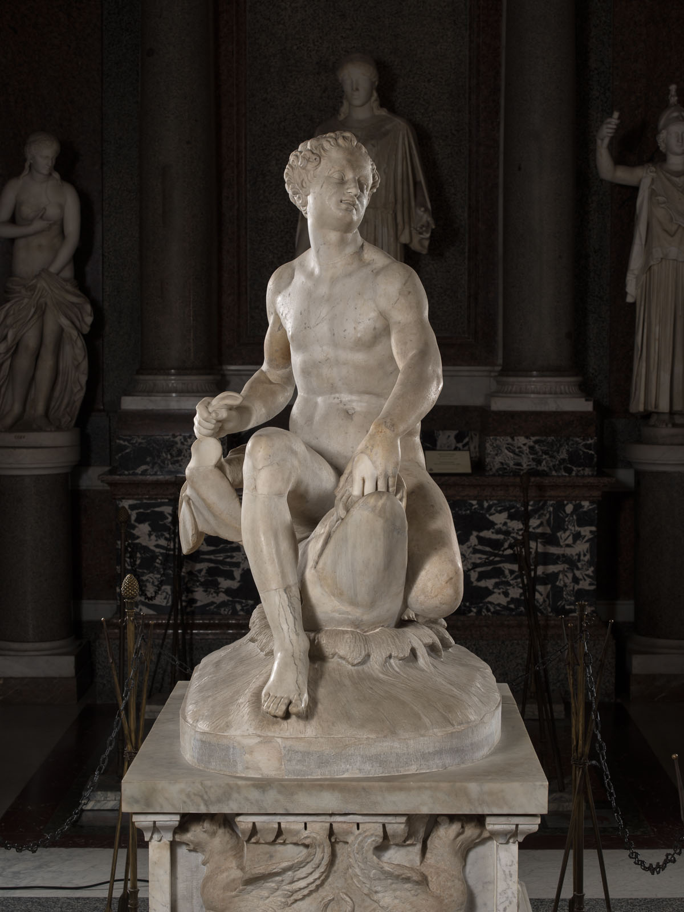

**内容（这是什么）**：一名年少的萨堤尔（satyr，希腊神话里酒神的随从、半人半羊的林野精灵）骑跨在一条腾跃的海豚背上。白色大理石，体量不大，原先就摆在埃及厅正中央，是整间房的视觉圆心。

**背景 / 来历**：它不是一件完整的古代原作，而是「古件＋后世改作＋近代修复」层层叠加的产物——核心是一件公元 1 世纪的古罗马大理石胸像，16 世纪被匠人重新加工、拼接改造成「骑海豚的萨堤尔」这一组合，19 世纪又做过一轮修复。据馆方房间介绍页，「萨堤尔骑海豚」这一母题在 16 世纪的艺术家中极受欢迎，本件正是那股风尚的产物。它被安置在厅的正中，与四壁列柱之间的神像、脚下的海神马赛克一起，把「水／海／尼罗河」的主题收束到房间中心。（提示：真正「替代了现藏卢浮宫朱诺（Juno）像」的，是本厅那尊改作成刻瑞斯（Ceres）的黑石伊西斯（Isis）——编号 CCIX，别和这件萨堤尔混淆。）

**看点**：海豚是把它和全厅水主题钩连起来的关键道具——天顶画的主角是泛滥的尼罗河，地面铺的是海神马赛克，正中这件又是骑海豚，「水」的母题自顶而下、再回到中心，一以贯之。它同时也是博尔盖塞馆「古代残件被后世重新拼装成新题材」这一收藏逻辑的缩影。

**现场站看**：

1. **先认「半人半羊」**——看萨堤尔的尖耳、顽皮面相和发式，确认骑手是酒神随从而非凡人或正神；这是辨认题材的第一步。
2. **找古今接缝**——萨堤尔身躯与海豚、底座的衔接处留意大理石色泽与雕工差别：核心古件只是一小段，海豚与组合关系多为 16 世纪改作、19 世纪补缀，是「古件＋后补」的现成案例。
3. **盯住海豚**——把它和抬头的天顶尼罗河、低头的地面海神连成一条线，体会布展人如何用「水」把顶、墙、地三层统一。
4. **站到房间正中回看**——这件原本是全厅的圆心，站在中央环视一圈，最能读懂阿斯普鲁奇（Antonio Asprucci）「中心摆水神、四壁列神像」的对称布局。

## 天顶画

### ⭐⭐ 推荐 托马索·马里亚·孔卡《尼罗河、孩子们与库柏勒》 / Tommaso Maria Conca, _The Nile River with Its Children and Cybele_

- **作者 / Artist**：托马索·马里亚·孔卡（1734–1822） / Tommaso Maria Conca
- **作品 / Work**：《尼罗河、孩子们与库柏勒》 / _The Nile River with Its Children and Cybele_
- **时间**：1779–1782 年（房间装饰工程期）
- **位置**：埃及厅天顶中央（第 7 室）
- **官网介绍页**：见本厅[房间介绍页](https://galleriaborghese.cultura.gov.it/en/il-museo/la-villa/sala-7-sala-egizia/)

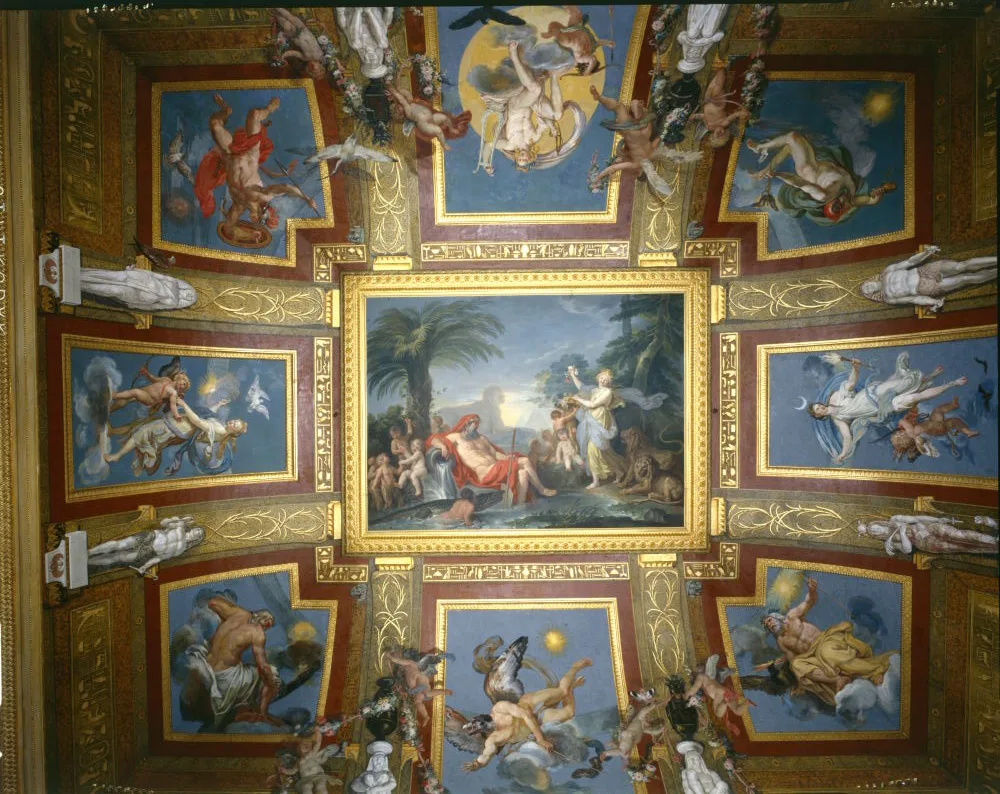

**内容（这是什么）**：天顶正中这幅大画，主角是被拟人化的尼罗河（Nile）——一位斜倚的河神，身边围着一群幼童，外加大地母神库柏勒（Cybele）。那群幼童是古代艺术里著名的「尼罗河之子」图式：传说尼罗河每年泛滥能涨「十六肘」，古人就用十六个攀爬的小孩象征理想的丰水高度，丰沛的洪水带来沃土与收成，因此整幅画讲的其实是「尼罗河泛滥＝富饶」这一古埃及／古罗马都崇奉的主题。

**背景 / 来历**：这是埃及厅 1779–1782 年整体装饰工程的核心，由画家托马索·马里亚·孔卡（Tommaso Maria Conca）绘制——本厅在文献里有时即以他命名。中央大画的四周，由乔瓦尼·巴蒂斯塔·马尔凯蒂（Giovanni Battista Marchetti）画的建筑错视框景里，安排了一圈「行星神」：月神卢娜（Luna）、朱庇特（Jupiter）、天神乌拉诺斯（Uranos，在这里被画成狗头的阿努比斯／Anubis）、萨图尔努斯（Saturn）、维纳斯（Venus）、马尔斯（Mars）、太阳神索尔（Sol）和墨丘利（Mercury）。再往下、紧贴天顶线脚的地方，还有孔卡画的八幅小画，连续讲述安东尼（Anthony）与克利奥帕特拉（Cleopatra）的故事——把埃及艳后的传奇接到尼罗河主题上。

**看点**：这是「新古典时代对古埃及的想象」最完整的一次落地——18 世纪的罗马人没去过埃及，他们用罗马式的河神拟人、希腊罗马的行星诸神，再点缀狗头阿努比斯这样的埃及符号，拼出一个想象中的「埃及」。看点不在考据准不准，而在这种混搭本身：尼罗河（古埃及）＋行星神（希腊罗马）＋埃及艳后（罗马史）＝一间新古典主义的「埃及厅」。

**逐幅分述**：天顶分三层——正中一幅大画、四周一圈「行星神」、紧贴线脚一圈叙事小画。

#### 中央大画：《尼罗河、孩子们与库柏勒》（孔卡）

天顶圆心，斜倚的尼罗河神＋象征泛滥水位的「尼罗河之子」群童＋大地母神库柏勒（Cybele）；主题是「尼罗河泛滥＝富饶」。

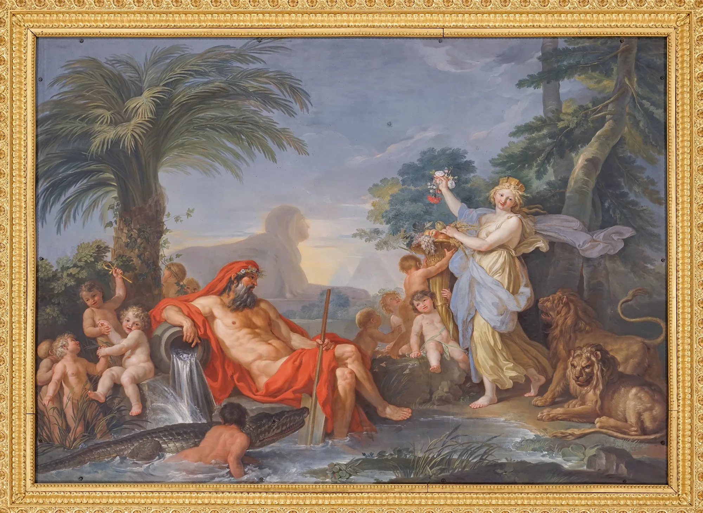

#### 一圈「行星神」（马尔凯蒂的建筑错视框景里、孔卡所画的八位神祇，多对应「古典七曜」）：

##### 太阳神索尔（Sol）

对应太阳，多以光芒头冠或驾日车的形象出现。

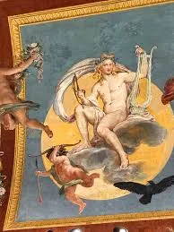

##### 月神卢娜（Luna）

对应月亮，标志是新月。

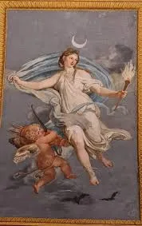

##### 朱庇特（Jupiter）

对应木星，标志是鹰与雷霆。

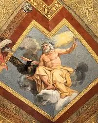

#####  萨图尔努斯（Saturn）

对应土星，常作持镰的老者（时间／农神）。

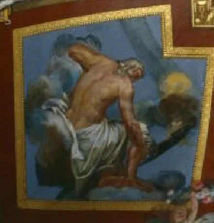

##### 马尔斯（Mars）

对应火星，标志是盔甲与兵器（战神）。

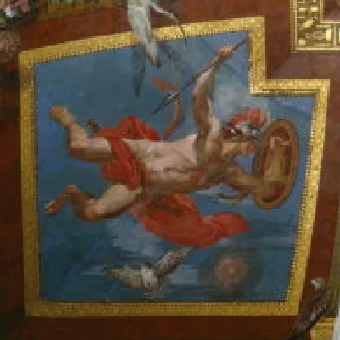

##### 维纳斯（Venus）

对应金星，常伴小爱神（爱与美之神）。

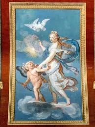

##### 墨丘利（Mercury）

对应水星，标志是飞翼帽与节杖（caduceus）。

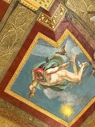

##### 乌拉诺斯／狗头阿努比斯（Uranos / Anubis）

这一位被画成狗头的阿努比斯，是全顶最明确的「埃及符号」，专门找出来；它把希腊罗马的行星诸神和埃及神祇拼到了一起。

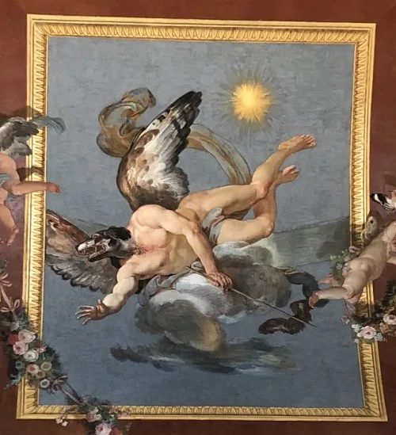

紧贴线脚的叙事小画带：

**八幅《安东尼与克利奥帕特拉故事》（孔卡）**——天顶最外圈、紧贴线脚的一圈连环小画，分八段讲罗马名将安东尼（Mark Antony）与埃及艳后克利奥帕特拉（Cleopatra）的传奇（相恋、共治、兵败、殉情）。它把一段「罗马—埃及」的历史接到尼罗河主题上，绕厅一周顺着看就是一条「埃及艳后」叙事带。

**现场站看**：

1. **先找正中的斜倚河神**——天顶最中心、身边围着一群小孩的那位就是尼罗河；认准他，整幅画的结构就理顺了。
2. **数一数「尼罗河之子」**——围着河神攀爬的幼童象征泛滥的水位（理想为十六肘），是「丰水＝丰收」的吉兆，不是单纯的装饰小天使。
3. **在四周框景里找狗头神**——一圈行星神中那位狗头的，是被当作天神乌拉诺斯的阿努比斯（Anubis），全画里最明确的「埃及符号」，值得专门找出来。
4. **沿天顶线脚看八幅小画**——紧贴顶边的连环小画讲安东尼与克利奥帕特拉，绕厅一周顺着看，相当于一条「埃及艳后」叙事带。
5. **顶、墙、地连起来看**——看完天顶的尼罗河，再低头看地面的海神马赛克、回看正中的骑海豚萨堤尔，体会全厅如何用「水」把三层统一。抬头至少看 30 秒。

### ⭐ 顺路看 乔瓦尼·巴蒂斯塔·马尔凯蒂《埃及风格建筑错视画》 / Giovanni Battista Marchetti, _Egyptianizing Architectural Trompe-l'oeil_

- **作者 / Artist**：乔瓦尼·巴蒂斯塔·马尔凯蒂（1730–1800） / Giovanni Battista Marchetti
- **作品 / Work**：《埃及风格建筑错视画》 / _Egyptianizing Architectural Trompe-l'oeil_
- **时间**：1779–1782 年
- **位置**：埃及厅天顶与墙面系统（第 7 室）

**内容 / 看点**：马尔凯蒂（Giovanni Battista Marchetti）负责的是天顶上那套「假建筑」——用透视错视（trompe-l'oeil／意大利人叫 quadratura）画出立体的建筑框格，把孔卡（Tommaso Maria Conca）画的一圈行星诸神嵌进这些框景里，让平的天顶看起来像有真实的檐口、壁龛和纵深。现场看法：盯住天顶画与「建筑构件」交界的地方，分辨哪些是真灰泥线脚、哪些是画上去的假立体——这正是这类装饰最好玩的地方。它和孔卡的尼罗河天顶是同一套工程的两半（整体程序见上一条孔卡天顶）。

## 雕塑

本节先列馆方 Modern Sculpture 藏品列表，共 9 件。

### ⭐ 顺路看 罗马学派《花岗岩椭圆盆》 / roman school, _Oval Basin in Granite_

- **作者 / Artist**：罗马学派 / roman school
- **作品 / Work**：《花岗岩椭圆盆》 / _Oval Basin in Granite_
- **时间**：1783–1786 年
- **材质**：东方花岗岩
- **尺寸**：直径 58 cm
- **馆藏编号**：CCIV
- **位置**：埃及厅（第 7 室）
- **官网介绍页**：[官网介绍英文](https://www.collezionegalleriaborghese.it/en/opere/oval-basin-in-granite)｜馆藏编号 CCIV

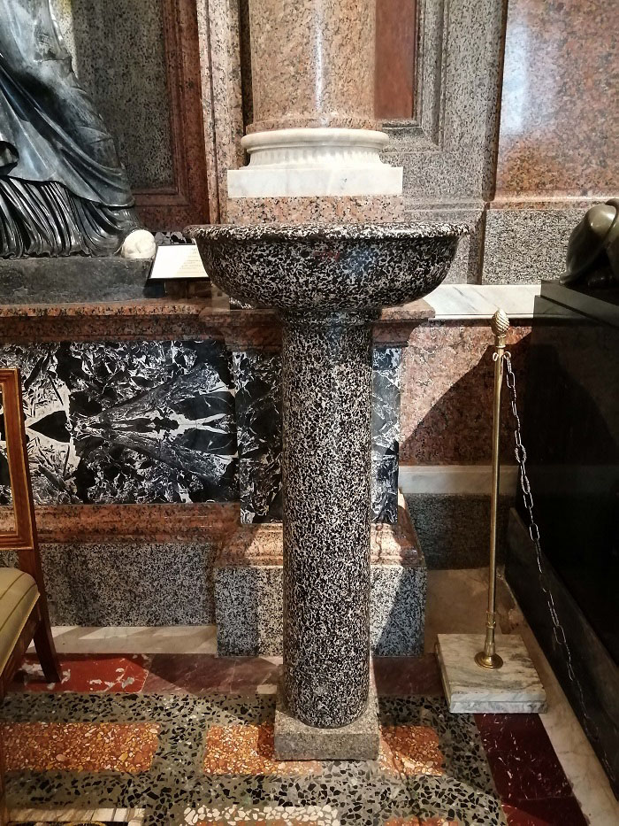

**内容 / 看点**：1783–1786 年为埃及厅特制的东方花岗岩椭圆盆，属于阿斯普鲁奇布置本厅时的近代陈设硬石器。看点在材质本身——整块东方花岗岩打磨成盆，硬石的色泽与纹理就是「异域与富贵」的语言，和厅内的柱身、瓮、碗呼应。与同厅另一只更早的花岗岩椭圆盆（CCXIV，1629 年前）并看，可比对前后两代工匠处理同类硬石的手法。

### ⭐ 顺路看 罗马学派《四件雪花石双耳瓶》 / roman school, _Four Amphorae in Alabaster_

- **作者 / Artist**：罗马学派 / roman school
- **作品 / Work**：《四件雪花石双耳瓶》 / _Four Amphorae in Alabaster_
- **时间**：1796 年前
- **材质**：雪花石膏
- **尺寸**：70 × 40 cm
- **馆藏编号**：CCV-CCXIII-CCXVIII-CCXXIV
- **位置**：埃及厅（第 7 室）
- **官网介绍页**：[官网介绍英文](https://www.collezionegalleriaborghese.it/en/opere/four-amphorae-in-alabaster)｜馆藏编号 CCV-CCXIII-CCXVIII-CCXXIV

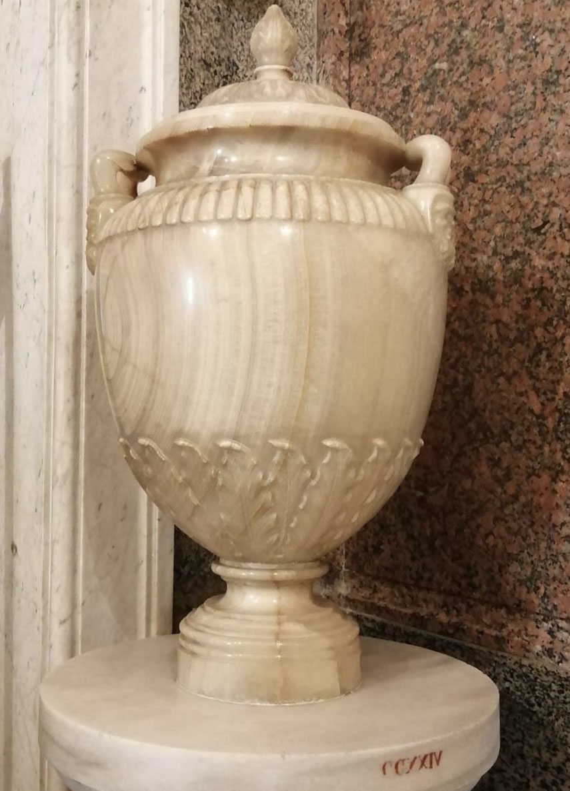

**内容 / 看点**：四只东方雪花石膏（alabaster）双耳瓶，1796 年前为本厅配置。房间介绍页特别点名「六只为埃及厅特制、约 1780 年完成的东方雪花石瓶配灰花岗岩座」是本厅陈设中最值得看的一组，这套半透明、带云状纹的雪花石瓶正属于那批陈设。现场重点看石材：迎光时雪花石微微透光、纹理如流云，是古代就被视为珍贵的装饰石。与 CCXX-CCXXII 那对雪花石瓶同类，可一并扫过。

### ⭐ 顺路看 路易吉·瓦拉迪耶《四根饰花彩与牛首的柱子》 / Valadier Luigi, _Four columns decorated with festoons and bucrania_

- **作者 / Artist**：路易吉·瓦拉迪耶 / Valadier Luigi
- **作品 / Work**：《四根饰花彩与牛首的柱子》 / _Four columns decorated with festoons and bucrania_
- **时间**：1780 年
- **材质**：花岗岩、白色大理石、鎏金青铜
- **尺寸**：高 83,5 cm
- **馆藏编号**：CCVa-CCXIIIa-CCLVIIa-CCLXIVa
- **位置**：埃及厅（第 7 室）
- **官网介绍页**：[官网介绍英文](https://www.collezionegalleriaborghese.it/en/opere/four-columns-decorated-with-festoons-and-bucrania)｜馆藏编号 CCVa-CCXIIIa-CCLVIIa-CCLXIVa

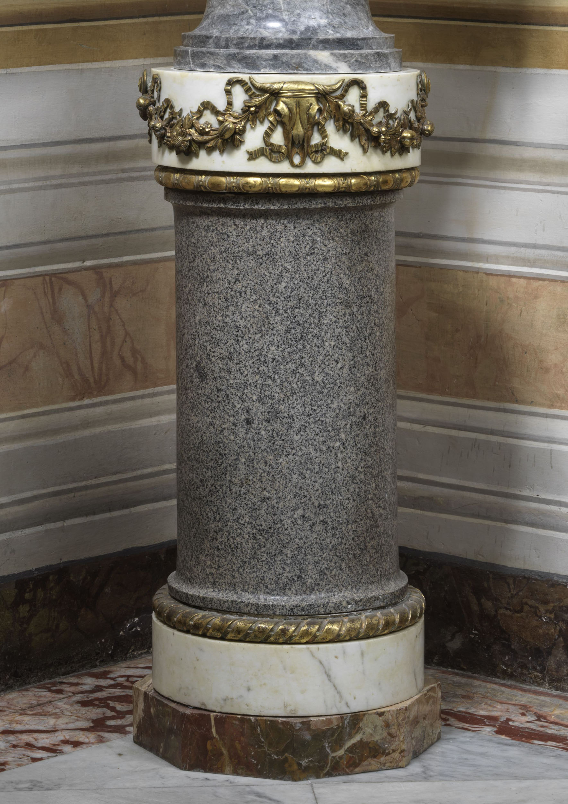

**内容 / 看点**：四根 1780 年的小柱，花岗岩柱身配白色大理石与鎏金青铜，柱头饰垂花彩（festoon）与牛头骨（bucranium，牛首）——牛首挂花环是古罗马祭坛、神庙常见的装饰母题，象征献祭与丰饶。作者瓦拉迪耶（Valadier Luigi）出自罗马著名的金银／青铜工艺世家，本件正显其鎏金青铜的细巧。看点在「多材质混作」：硬石、白石、鎏金三种材料拼一件，是新古典陈设的奢华做法。

### ⭐ 顺路看 罗马学派《东方花岗岩碗》 / roman school, _Bowl in Oriental Granite_

- **作者 / Artist**：罗马学派 / roman school
- **作品 / Work**：《东方花岗岩碗》 / _Bowl in Oriental Granite_
- **时间**：18 世纪末季
- **材质**：东方花岗岩
- **尺寸**：高 20 cm，直径 37 cm
- **馆藏编号**：CCVIII
- **位置**：埃及厅（第 7 室）
- **官网介绍页**：[官网介绍英文](https://www.collezionegalleriaborghese.it/en/opere/bowl-in-oriental-granite)｜馆藏编号 CCVIII

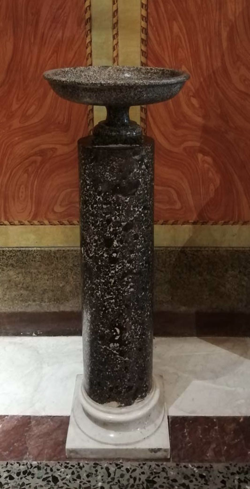

**内容 / 看点**：18 世纪末季的东方花岗岩碗，本厅近代陈设硬石器之一。看点仍是石材——整石琢碗，靠花岗岩的天然斑纹取胜。与 CCX 珊瑚角砾岩碗、CCXXI 红古大理石碗成一组「彩色硬石碗」，现场可比对不同石种的颜色与纹理。

### ⭐ 顺路看 罗马学派《珊瑚角砾岩帕特拉式碗》 / roman school, _Patera-shaped Bowl in Coral Breccia_

- **作者 / Artist**：罗马学派 / roman school
- **作品 / Work**：《珊瑚角砾岩帕特拉式碗》 / _Patera-shaped Bowl in Coral Breccia_
- **时间**：18 世纪末季
- **材质**：珊瑚角砾岩
- **尺寸**：15 × 36.5 cm
- **馆藏编号**：CCX
- **位置**：埃及厅（第 7 室）
- **官网介绍页**：[官网介绍英文](https://www.collezionegalleriaborghese.it/en/opere/patera-shaped-bowl-in-coral-breccia)｜馆藏编号 CCX

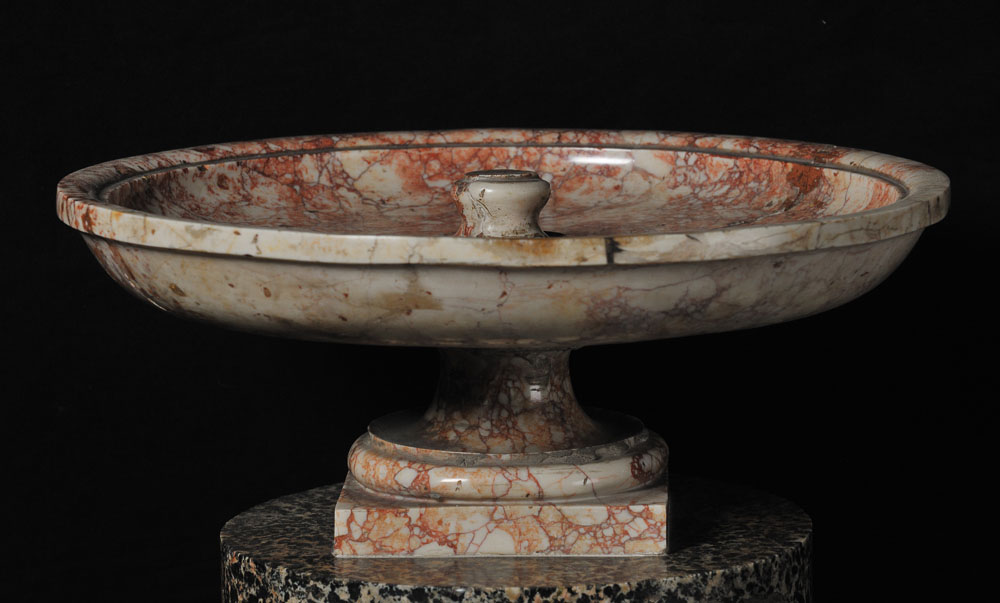

**内容 / 看点**：18 世纪末季的珊瑚角砾岩（coral breccia，一种带珊瑚红碎块的角砾岩）浅碗，做成古代「帕特拉」（patera，祭祀用浅盘）的样式。看点在石色——珊瑚红的碎块嵌在底色里，是本厅彩色硬石里最鲜艳的一件。与 CCVIII、CCXXI 两只碗并看，体会陈设者对石材配色的讲究。

### ⭐ 顺路看 路易吉·卡尼纳《斯芬克斯》 / Canina Luigi, _Sphinx_

- **作者 / Artist**：路易吉·卡尼纳 / Canina Luigi
- **作品 / Work**：《斯芬克斯》 / _Sphinx_
- **时间**：1832 年前
- **材质**：玄武岩
- **尺寸**：55 × 105 × 33.5 cm
- **馆藏编号**：CCXI
- **位置**：埃及厅（第 7 室）
- **官网介绍页**：[官网介绍英文](https://www.collezionegalleriaborghese.it/en/opere/sphinx)｜馆藏编号 CCXI

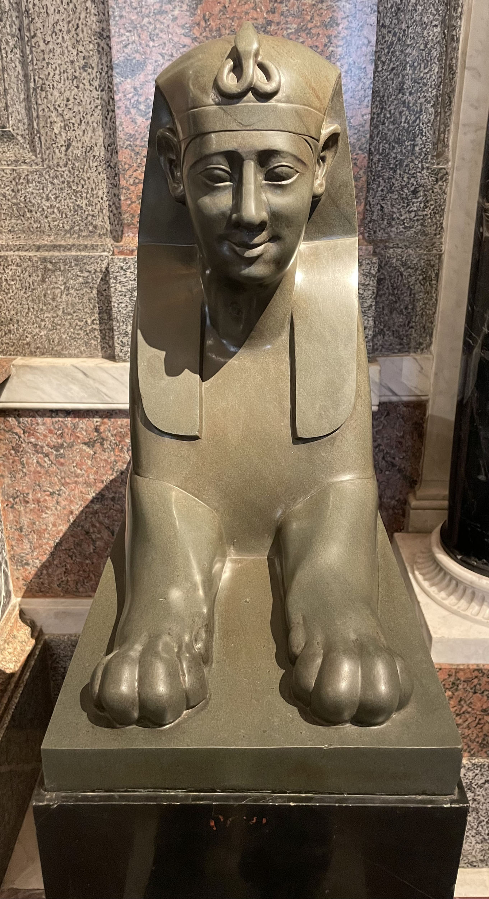

**内容 / 看点**：1832 年前由卡尼纳（Canina Luigi）制作的玄武岩斯芬克斯——人面狮身的埃及式守护兽。卡尼纳是 19 世纪著名的考古学家兼建筑师，本件是「新仿的埃及风」近代作品，用深色玄武岩刻意模仿古埃及石雕的质感。注意与本厅另一尊古代斯芬克斯（CCVII，公元 2 世纪碧玄岩）对照：一古一今，正好看出 19 世纪人如何想象与复刻埃及。

### ⭐ 顺路看 克里斯托福罗·斯塔蒂，称布拉恰诺的克里斯托法诺《花岗岩椭圆盆》 / Cristoforo Stati detto Cristofano da Bracciano, _Oval basin in granite_

- **作者 / Artist**：克里斯托福罗·斯塔蒂，称布拉恰诺的克里斯托法诺 / Cristoforo Stati detto Cristofano da Bracciano
- **作品 / Work**：《花岗岩椭圆盆》 / _Oval basin in granite_
- **时间**：1629 年前
- **材质**：东方花岗岩
- **尺寸**：直径 62 cm
- **馆藏编号**：CCXIV
- **位置**：埃及厅（第 7 室）
- **官网介绍页**：[官网介绍英文](https://www.collezionegalleriaborghese.it/en/opere/oval-basin-in-granite-2)｜馆藏编号 CCXIV

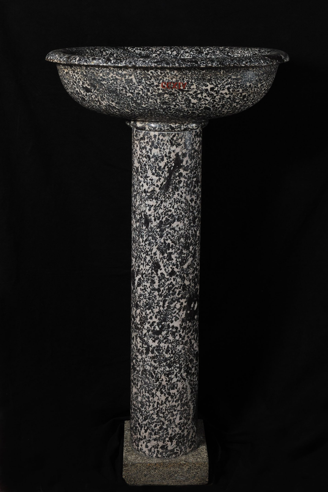

**内容 / 看点**：1629 年前由克里斯托福罗·斯塔蒂（Cristoforo Stati，人称布拉恰诺的克里斯托法诺）制作的东方花岗岩椭圆盆，是本厅硬石器里年代较早的一件（17 世纪初，早于 1780 年那批陈设近一个半世纪）。和 CCIV 那只 1783–1786 年的花岗岩盆并看，能比较巴洛克早期与新古典两代工匠处理同类硬石的差别。

### ⭐ 顺路看 罗马学派《一对雪花石瓶》 / roman school, _Pair of Vases in Alabaster_

- **作者 / Artist**：罗马学派 / roman school
- **作品 / Work**：《一对雪花石瓶》 / _Pair of Vases in Alabaster_
- **时间**：17 世纪上半叶
- **材质**：雪花石膏
- **尺寸**：81 × 40 cm
- **馆藏编号**：CCXX-CCXXII
- **位置**：埃及厅（第 7 室）
- **官网介绍页**：[官网介绍英文](https://www.collezionegalleriaborghese.it/en/opere/pair-of-vases-in-alabaster)｜馆藏编号 CCXX-CCXXII

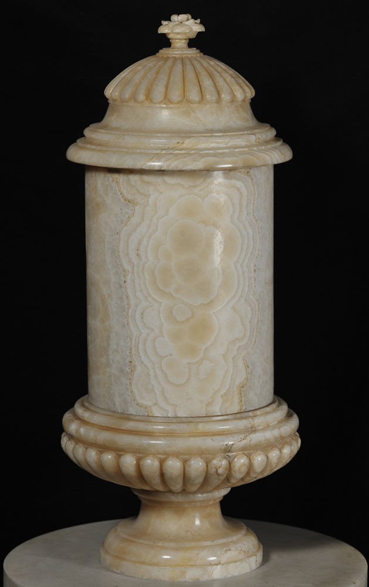

**内容 / 看点**：17 世纪上半叶的一对东方雪花石膏瓶，年代早于 CCV 那组（1796 年前），是博尔盖塞家族较早入藏的硬石陈设。看点同样在半透明的雪花石纹理；与 CCV-CCXIII-CCXVIII-CCXXIV 那四只雪花石瓶同类，可一并看「成对／成套陈设」如何给房间铺底色。

### ⭐ 顺路看 洛伦佐·卡尔代利《红古大理石碗，带交缠把手》 / Cardelli Lorenzo, _Bowl in Rosso Antico Marble with Intertwined Handles_

- **作者 / Artist**：洛伦佐·卡尔代利 / Cardelli Lorenzo
- **作品 / Work**：《红古大理石碗，带交缠把手》 / _Bowl in Rosso Antico Marble with Intertwined Handles_
- **时间**：1781–1782 年
- **材质**：大理石
- **尺寸**：27 × 48.5 cm
- **馆藏编号**：CCXXI
- **位置**：埃及厅（第 7 室）
- **官网介绍页**：[官网介绍英文](https://www.collezionegalleriaborghese.it/en/opere/bowlin-rosso-antico-marble-with-intertwined-handles)｜馆藏编号 CCXXI

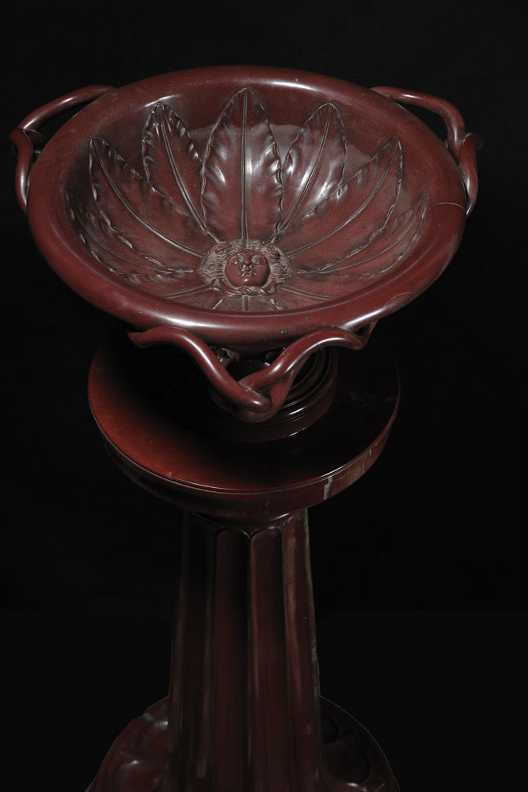

**内容 / 看点**：1781–1782 年卡尔代利（Cardelli Lorenzo）制作的碗，用红古大理石（rosso antico，古代就珍视的深红色大理石），两侧带交缠的把手。看点在石色与做工——深红的红古大理石是「帝王级」的名贵石材，交缠把手显新古典工匠的精细。与 CCVIII、CCX 两只碗同属本厅「彩色硬石碗」一组。

本节继续列馆方 Ancient Art 藏品列表，共 17 件。

### ⭐ 顺路看 古罗马艺术《三月寓意形象地面马赛克》 / Roman art, _Floor Mosaic with Allegorical Representation of the Month of March_

- **作者 / Artist**：古罗马艺术 / Roman art
- **作品 / Work**：《三月寓意形象地面马赛克》 / _Floor Mosaic with Allegorical Representation of the Month of March_
- **时间**：公元 2–3 世纪
- **材质**：大理石嵌片
- **尺寸**：91 cm
- **位置**：埃及厅（第 7 室）
- **官网介绍页**：[官网介绍英文](https://www.collezionegalleriaborghese.it/en/opere/floor-mosaic-with-allegorical-representation-of-the-month-of-march)｜馆藏编号 arc-004

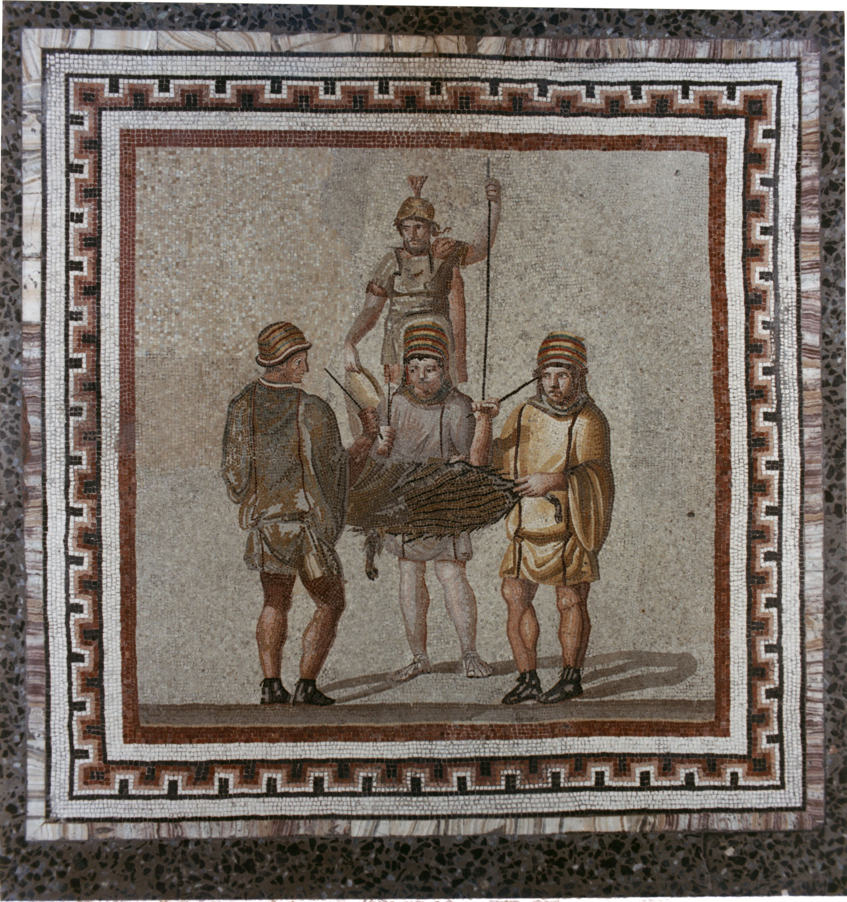

**内容 / 看点**：公元 2–3 世纪的地面马赛克残片，用大理石嵌片拼出寓意「三月」的形象，原属一套「月份历」马赛克（十二个月各一幅）。看点在它的「日历」性质——古罗马人把月份拟人化铺在地上，三月对应战神马尔斯（Mars）之月、春耕开端。现场禁踩，站在旁边俯看辨认人物与其象征物。与本厅另外三块海神主题马赛克（arc-006、arc-017、arc-018）同为三世纪古代地面残件。

### ⭐ 顺路看 古罗马艺术《女性海神拟人像地面马赛克》 / Roman art, _Floor Mosaic with Personification of a Female Sea Divinity_

- **作者 / Artist**：古罗马艺术 / Roman art
- **作品 / Work**：《女性海神拟人像地面马赛克》 / _Floor Mosaic with Personification of a Female Sea Divinity_
- **时间**：公元 3 世纪
- **材质**：大理石嵌片
- **尺寸**：105 × 105 cm；嵌片 0.5–6
- **位置**：埃及厅（第 7 室）
- **官网介绍页**：[官网介绍英文](https://www.collezionegalleriaborghese.it/en/opere/floor-mosaic-with-personification-of-a-female-sea-divinity)｜馆藏编号 arc-006

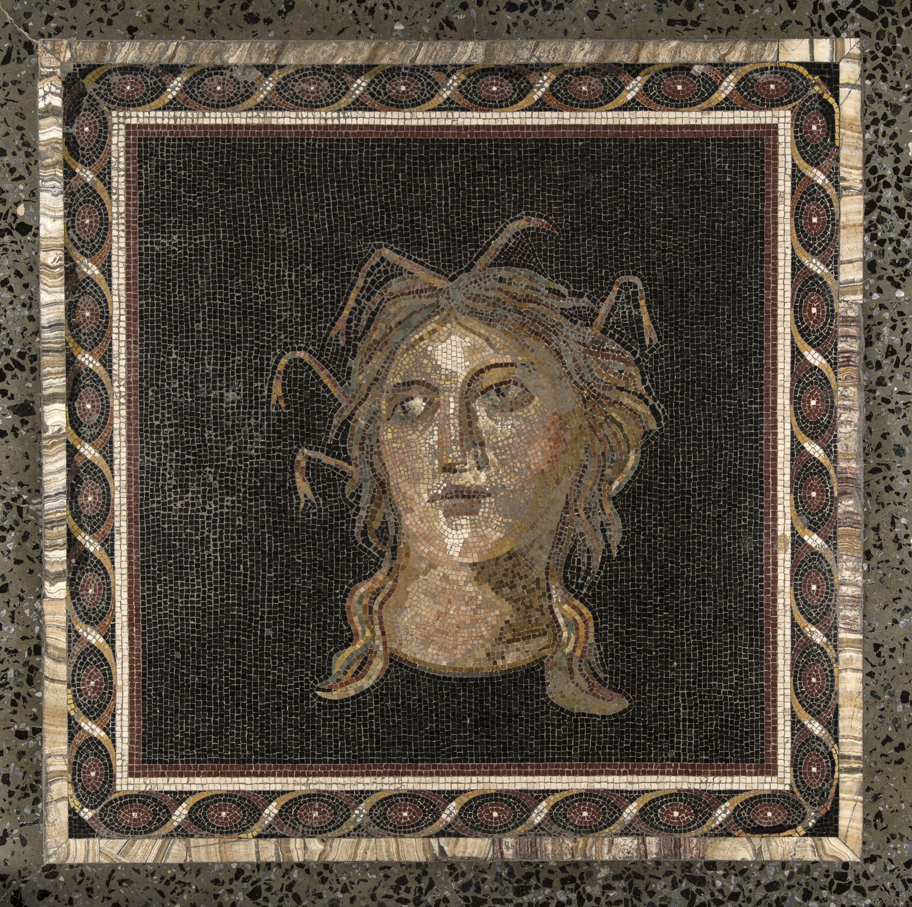

**内容 / 看点**：公元 3 世纪的地面马赛克，拼出一位女性海神的拟人头像。它和 arc-017（男性海神）、arc-018（有须男子面具／俄刻阿诺斯）原属同一套「海神」主题地面，105×105 cm 见方一块、按片分编号。看点在「水主题」——这几块海神马赛克铺在地上，正与天顶的尼罗河、中央的骑海豚萨堤尔上下呼应。现场禁踩，站旁俯看，三块连看才完整。

### ⭐ 顺路看 古罗马艺术《海神拟人像地面马赛克》 / Roman art, _Floor Mosaic with Personification of a Sea Divinity_

- **作者 / Artist**：古罗马艺术 / Roman art
- **作品 / Work**：《海神拟人像地面马赛克》 / _Floor Mosaic with Personification of a Sea Divinity_
- **时间**：公元 3 世纪
- **材质**：大理石嵌片
- **尺寸**：105 × 105 cm；嵌片 0.5–0.6
- **位置**：埃及厅（第 7 室）
- **官网介绍页**：[官网介绍英文](https://www.collezionegalleriaborghese.it/en/opere/floor-mosaic-with-personification-of-a-sea-divinity)｜馆藏编号 arc-017

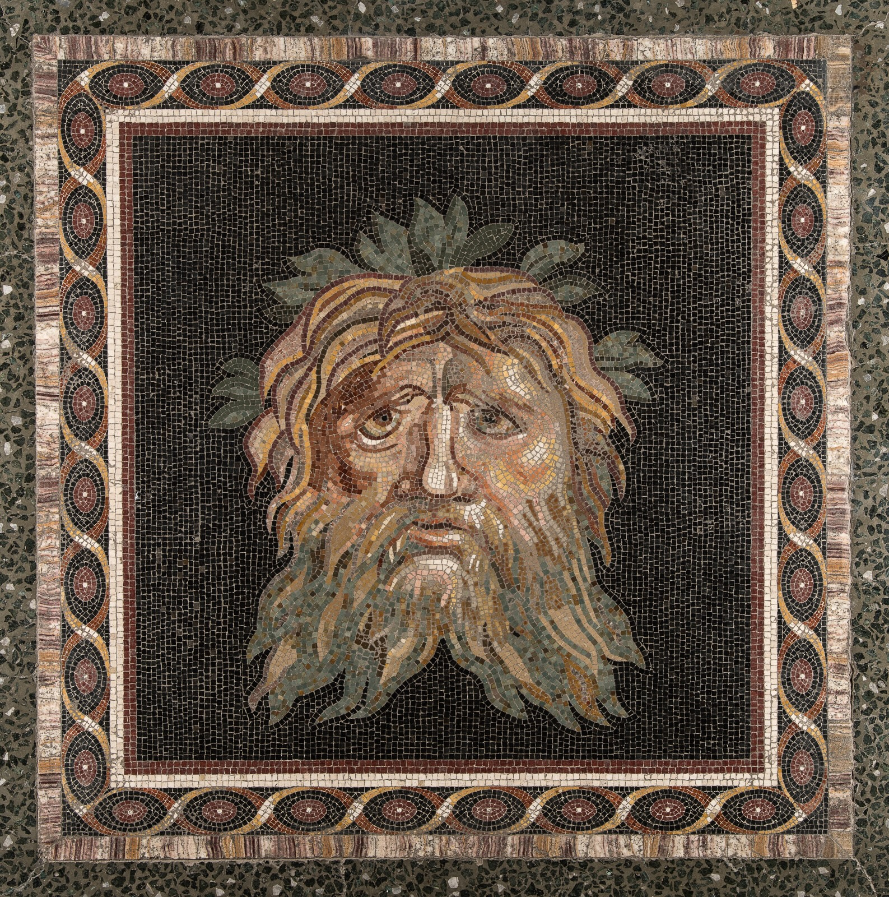

**内容 / 看点**：公元 3 世纪海神拟人像马赛克，与 arc-006、arc-018 同属一套三世纪「海神」地面（整组背景见 arc-006）。逐块绕看，留意海神发间的水草、海洋属性。

### ⭐ 顺路看 古罗马艺术《有须男子面具地面马赛克（俄刻阿诺斯？）》 / Roman art, _Floor Mosaic with Mask of Bearded Man (Oceanus?)_

- **作者 / Artist**：古罗马艺术 / Roman art
- **作品 / Work**：《有须男子面具地面马赛克（俄刻阿诺斯？）》 / _Floor Mosaic with Mask of Bearded Man (Oceanus?)_
- **时间**：公元 3 世纪
- **材质**：大理石嵌片
- **尺寸**：105 × 105 cm；嵌片 0.5–0.6
- **位置**：埃及厅（第 7 室）
- **官网介绍页**：[官网介绍英文](https://www.collezionegalleriaborghese.it/en/opere/floor-mosaic-with-mask-of-bearded-man-oceanus)｜馆藏编号 arc-018

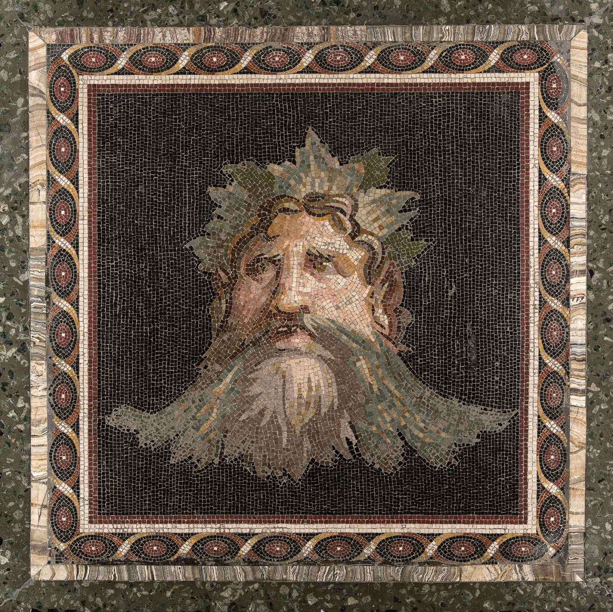

**内容 / 看点**：公元 3 世纪地面马赛克，一张有须男子的面具，学界推测是大洋之神俄刻阿诺斯（Oceanus）——古代常把环绕大地的大洋画成长须老者。与 arc-006、arc-017 同属本厅那套海神地面（整组背景见 arc-006）。现场找他须发间的海洋元素（常有蟹螯、海藻）来印证身份。

### ⭐ 顺路看 古罗马艺术《一对狮鹫桌足，四段残件接合于现代基座》 / Roman art, _Pair of Trapezophoron with Griffins, Four Sections Joined in a Modern Base_

- **作者 / Artist**：古罗马艺术 / Roman art
- **作品 / Work**：《一对狮鹫桌足，四段残件接合于现代基座》 / _Pair of Trapezophoron with Griffins, Four Sections Joined in a Modern Base_
- **时间**：公元 2 世纪
- **材质**：白色大理石
- **尺寸**：高 76 cm，宽 82/101 cm（基座）；高 36 cm，宽 57/60 cm（古代残段）
- **位置**：埃及厅（第 7 室）
- **官网介绍页**：[官网介绍英文](https://www.collezionegalleriaborghese.it/en/opere/pair-of-trapezophoron-with-griffins-four-sections-joined-in-a-modern-base)｜馆藏编号 CCa

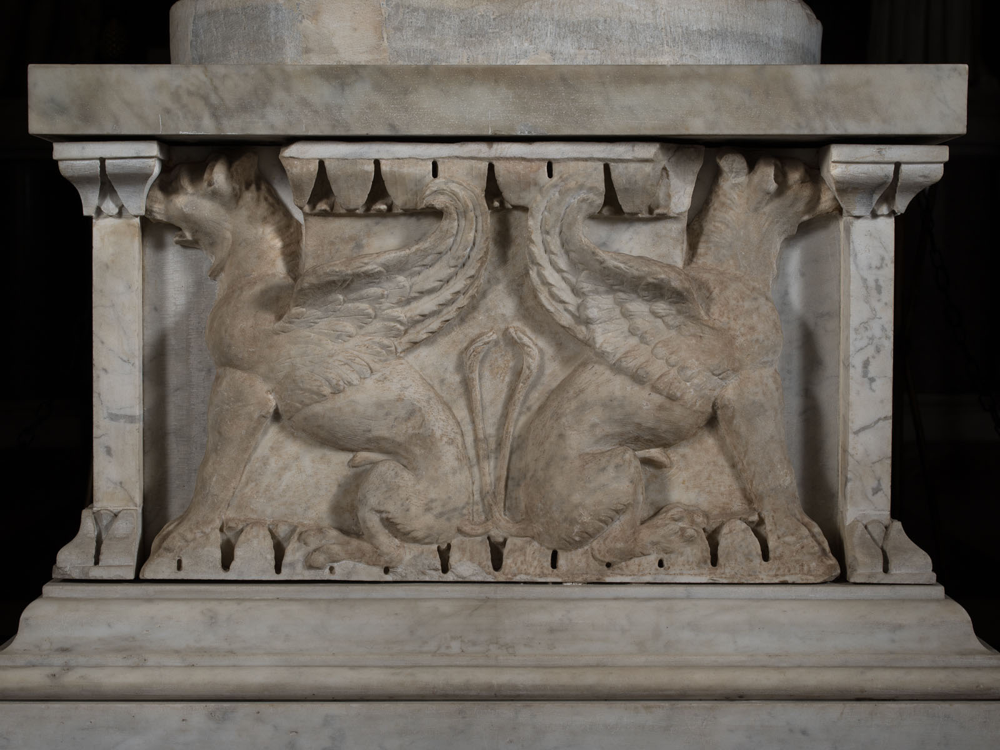

**内容 / 看点**：公元 2 世纪的一对桌腿（trapezophoron，古罗马大理石桌的雕花支架），雕成狮鹫（griffin，鹰首狮身的神兽）。注意它的身世：四段古代残件被拼接到一个现代基座上，是本厅「古件＋近代组合」的典型——现场可辨认古代残段（雕工较风化）与现代补配基座的色泽差。狮鹫常用于豪华家具的装饰。

### ⭐ 顺路看 古罗马艺术《迈那得雕像，配古代头像（非原配）》 / Roman art, _Statue of a Maenad with ancient head (not original)_

- **作者 / Artist**：古罗马艺术 / Roman art
- **作品 / Work**：《迈那得雕像，配古代头像（非原配）》 / _Statue of a Maenad with ancient head (not original)_
- **时间**：约公元 135 年（躯体）；约公元 120–130 年（头部）
- **材质**：白色大理石
- **尺寸**：不含底座高 116 cm；头高 18 cm
- **位置**：埃及厅（第 7 室）
- **官网介绍页**：[官网介绍英文](https://www.collezionegalleriaborghese.it/en/opere/statueofa-maenad-with-ancient-head-not-original)｜馆藏编号 CCI

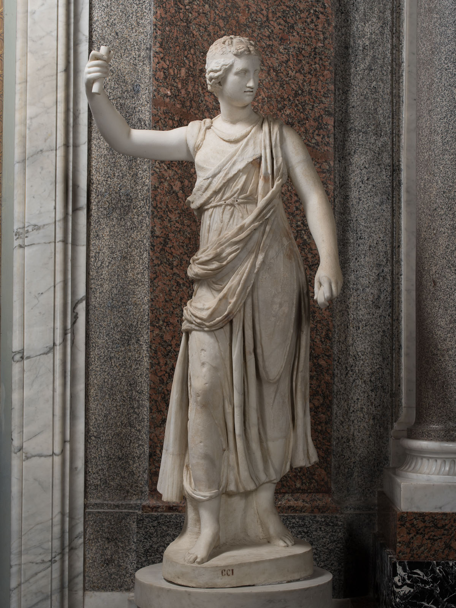

**内容 / 看点**：迈那得（Maenad，酒神狄俄倪索斯的女性信徒、狂女）雕像，躯体约公元 135 年。身世是看点：头部虽也是古代的（约公元 120–130 年），却并非这具身体的原配，是后人拼上去的——属本厅常见的「古头＋古身、但并非一体」组合。现场留意颈部接缝处头身的比例与风化差。

### ⭐ 顺路看 古罗马艺术《伊西斯女祭司》 / Roman art, _Priestess of Isis_

- **作者 / Artist**：古罗马艺术 / Roman art
- **作品 / Work**：《伊西斯女祭司》 / _Priestess of Isis_
- **时间**：公元前 1 世纪
- **材质**：白色大理石
- **尺寸**：不含底座高 183 cm；含底座高 195 cm
- **位置**：埃及厅（第 7 室）
- **官网介绍页**：[官网介绍英文](https://www.collezionegalleriaborghese.it/en/opere/priestess-of-isis)｜馆藏编号 CCII

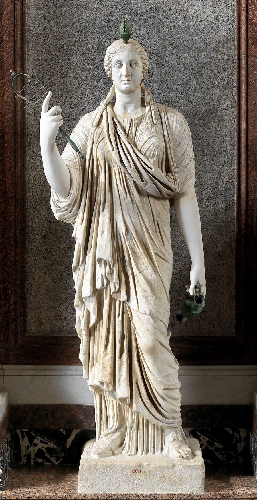

**内容 / 看点**：本厅「埃及女神」主题的核心古件之一。据馆方房间介绍页，这是一尊奥古斯都时代（公元前 1 世纪末）的女性像，着长基同（chiton）与带双重褶边的希玛蒂翁（himátion），后世为她加上莲花、叉铃（sistrum，伊西斯崇拜的乐器）和小水罐，把她「修复／改造」成伊西斯（Isis）女祭司。看点正在这些后加的道具——现场专门找莲花、叉铃、小罐，它们才是把一尊普通罗马女像「读成伊西斯」的钥匙。与黑石「伊西斯改作刻瑞斯」（CCIX）并看，是全厅伊西斯主题的两件主角。

### ⭐ 顺路看 古罗马艺术《帕里斯雕像》 / Roman art, _Statue of Paris_

- **作者 / Artist**：古罗马艺术 / Roman art
- **作品 / Work**：《帕里斯雕像》 / _Statue of Paris_
- **时间**：公元 1 世纪
- **材质**：白色大理石
- **尺寸**：不含底座高 135 cm；含弗里吉亚帽头高 19 cm
- **位置**：埃及厅（第 7 室）
- **官网介绍页**：[官网介绍英文](https://www.collezionegalleriaborghese.it/en/opere/statue-of-paris)｜馆藏编号 CCIII

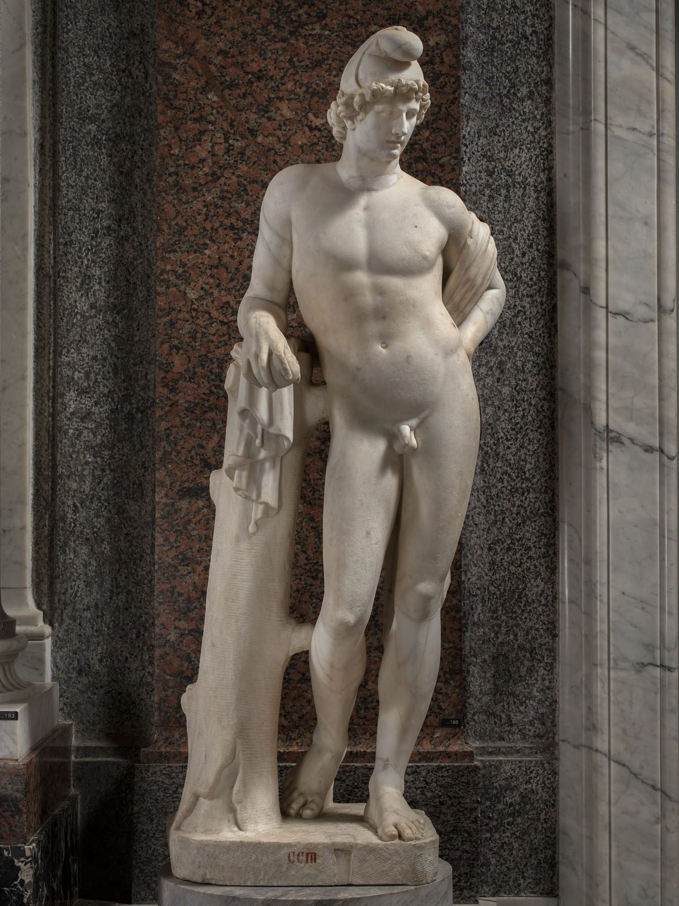

**内容 / 看点**：公元 1 世纪的帕里斯（Paris）雕像——特洛伊王子，「帕里斯的评判」里把金苹果判给维纳斯、从而引发特洛伊战争的那位。辨认靠头上的弗里吉亚帽（pileus，软尖帽，标志他来自东方）。现场看他的帽子即可对号；这也呼应博尔盖塞馆里反复出现的「帕里斯评判／维纳斯得胜」主题。

### ⭐ 顺路看 古罗马艺术《海上伊西斯，修复为刻瑞斯》 / Roman art, _Isis Pelagia, restored as Ceres_

- **作者 / Artist**：古罗马艺术 / Roman art
- **作品 / Work**：《海上伊西斯，修复为刻瑞斯》 / _Isis Pelagia, restored as Ceres_
- **时间**：公元 160–180 年
- **材质**：黑灰大理石（bigio morato）
- **尺寸**：高 183 cm；躯干 157 cm
- **位置**：埃及厅（第 7 室）
- **官网介绍页**：[官网介绍英文](https://www.collezionegalleriaborghese.it/en/opere/isis-pelagia-restored-as-ceres)｜馆藏编号 CCIX

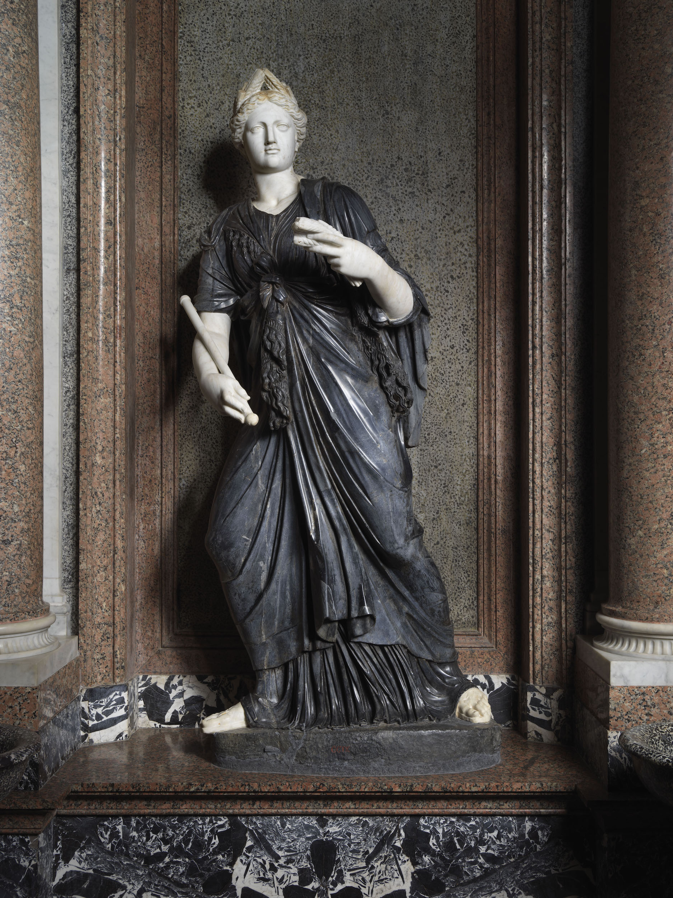

**内容 / 看点**：本厅最值得专门看的古代雕像之一，也是「古件被改换身份」的范例。它本是公元 160–180 年的黑灰大理石「海上伊西斯」（Isis Pelagia，航海者守护神伊西斯），17 世纪被加上脚、手和一个戴麦穗冠的头，改成奔走寻找丈夫奥西里斯（Osiris）尸体的刻瑞斯（Ceres，谷物女神）。据房间介绍页，正是这尊雕像替代了原先摆在此处、如今藏于卢浮宫的朱诺（Juno）像。看点在深色 bigio morato 石材本身的庄重，以及「同一尊像横跨伊西斯—刻瑞斯两个女神身份」的改作史。与 CCII 伊西斯女祭司、CCXII 改作刻瑞斯的女性头像可串看。

### ⭐ 顺路看 古罗马艺术《带普劳蒂拉式发型的女子肖像，置于现代胸像上》 / Roman art, _Portrait of a Woman with Plautilla-Type Hair, on Modern Bust_

- **作者 / Artist**：古罗马艺术 / Roman art
- **作品 / Work**：《带普劳蒂拉式发型的女子肖像，置于现代胸像上》 / _Portrait of a Woman with Plautilla-Type Hair, on Modern Bust_
- **时间**：公元 200–210 年
- **材质**：卢尼大理石
- **尺寸**：头高 30 cm
- **位置**：埃及厅（第 7 室）
- **官网介绍页**：[官网介绍英文](https://www.collezionegalleriaborghese.it/en/opere/portrait-of-a-woman-with-plautilla-type-hairon-modern-bust)｜馆藏编号 CCVI

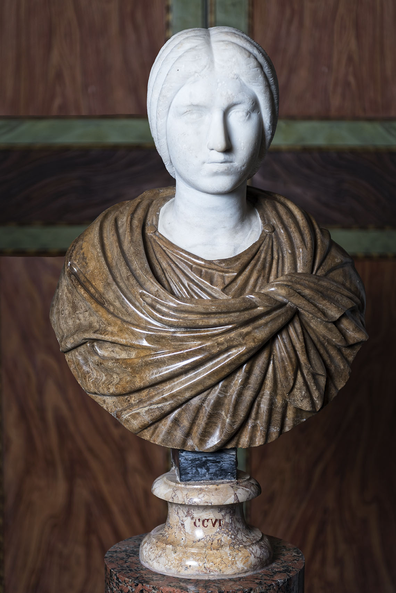

**内容 / 看点**：公元 200–210 年的女子肖像头部，卢尼大理石。看点在发型——它梳的是「普劳蒂拉式」（Plautilla，塞维鲁王朝皇后的发型），古罗马女性肖像常靠当朝皇后的时髦发式来断代，这颗头就是「以发型定年代」的好例子。注意它被安在一个现代胸像上，头古、胸新，属本厅常见的拼装。

### ⭐ 顺路看 古罗马艺术《斯芬克斯》 / Roman art, _Sphinx_

- **作者 / Artist**：古罗马艺术 / Roman art
- **作品 / Work**：《斯芬克斯》 / _Sphinx_
- **时间**：公元 2 世纪
- **材质**：碧玄岩（basanite）
- **尺寸**：高 41 cm；长 87 cm
- **位置**：埃及厅（第 7 室）
- **官网介绍页**：[官网介绍英文](https://www.collezionegalleriaborghese.it/en/opere/sphinx-2)｜馆藏编号 CCVII

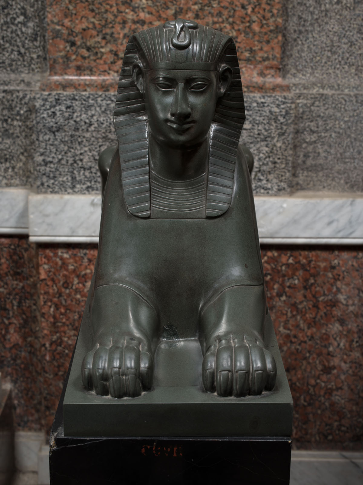

**内容 / 看点**：公元 2 世纪的古代斯芬克斯，用碧玄岩（basanite，古埃及偏爱的深色硬石）雕成，人面狮身。这是本厅真正的古代埃及风石雕，与卡尼纳 19 世纪那尊玄武岩斯芬克斯（CCXI）正好一古一今对照——并看能看出近代仿作如何模仿、又如何不同于古代原件。

### ⭐ 顺路看 古罗马艺术《女性头像，修复为刻瑞斯，置于现代胸像上》 / Roman art, _Female Head Restored as Ceres, on a Modern Bust_

- **作者 / Artist**：古罗马艺术 / Roman art
- **作品 / Work**：《女性头像，修复为刻瑞斯，置于现代胸像上》 / _Female Head Restored as Ceres, on a Modern Bust_
- **时间**：公元 2 世纪
- **材质**：白色大理石
- **尺寸**：至颈部断口高 30 cm
- **位置**：埃及厅（第 7 室）
- **官网介绍页**：[官网介绍英文](https://www.collezionegalleriaborghese.it/en/opere/female-head-restored-as-ceres-on-a-modern-bust)｜馆藏编号 CCXII

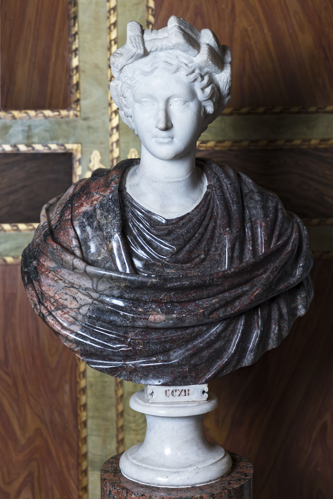

**内容 / 看点**：公元 2 世纪的古代女性头像，后世加麦穗等属性、安到现代胸像上，「修复」成谷物女神刻瑞斯（Ceres）。它和黑石 CCIX 一样走「改作刻瑞斯」的路子，可见 17–18 世纪修复者多么爱把古代女像统一收编成几位好认的女神。现场看颈部断口处古头与新胸的接合。

### ⭐ 顺路看 古罗马艺术《维纳斯雕像，兰多利纳型变体》 / Roman art, _Statue of Venus, Variation of the Landolina Type_

- **作者 / Artist**：古罗马艺术 / Roman art
- **作品 / Work**：《维纳斯雕像，兰多利纳型变体》 / _Statue of Venus, Variation of the Landolina Type_
- **时间**：公元 1 世纪
- **材质**：白色大理石
- **尺寸**：不含底座高 128.5 cm（头 18 cm）
- **位置**：埃及厅（第 7 室）
- **官网介绍页**：[官网介绍英文](https://www.collezionegalleriaborghese.it/en/opere/statue-of-venus-variation-of-the-landolina-type)｜馆藏编号 CCXV

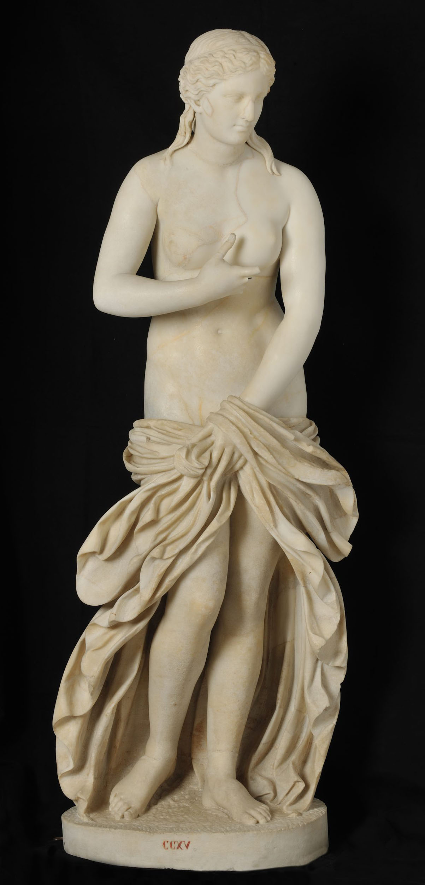

**内容 / 看点**：公元 1 世纪的维纳斯（Venus）雕像，属「兰多利纳型」（Landolina type，得名于西西里出土的著名同型维纳斯，又称叙拉古维纳斯）的一个变体——半裸、以衣物半遮下身的沐浴女神样式。看点在它是「按希腊名作类型复制」的罗马作品，可与馆内其他维纳斯像比对同主题的不同处理。

### ⭐ 顺路看 古罗马艺术《佩普洛斯女像》 / Roman art, _Peplophoros_

- **作者 / Artist**：古罗马艺术 / Roman art
- **作品 / Work**：《佩普洛斯女像》 / _Peplophoros_
- **时间**：公元 1 世纪
- **材质**：彭忒利科大理石
- **尺寸**：不含底座高 172 cm；古代方形基座 46 cm
- **位置**：埃及厅（第 7 室）
- **官网介绍页**：[官网介绍英文](https://www.collezionegalleriaborghese.it/en/opere/peplophoros)｜馆藏编号 CCXVI

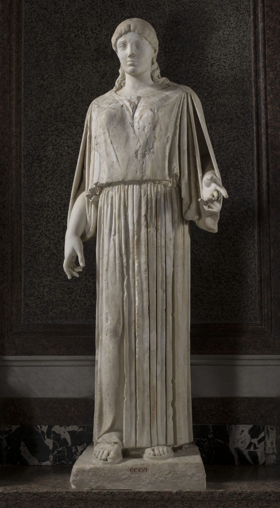

**内容 / 看点**：公元 1 世纪的佩普洛斯女像（Peplophoros，「穿佩普洛斯长袍的女子」），彭忒利科大理石（雅典名石）。看点在衣褶——佩普洛斯是希腊古风／古典式的厚重羊毛长袍，这类「着袍女像」是希腊原型经罗马复制的常见类型，现场看垂直如柱的衣纹与腰间的折叠。

### ⭐ 顺路看 古罗马艺术《谢尔谢尔-奥斯蒂亚雅典娜》 / Roman art, _Cherchell-Ostia Athena_

- **作者 / Artist**：古罗马艺术 / Roman art
- **作品 / Work**：《谢尔谢尔-奥斯蒂亚雅典娜》 / _Cherchell-Ostia Athena_
- **时间**：公元 140 年
- **材质**：帕罗斯大理石
- **尺寸**：公元 140 年
- **位置**：埃及厅（第 7 室）
- **官网介绍页**：[官网介绍英文](https://www.collezionegalleriaborghese.it/en/opere/cherchell-ostia-athena)｜馆藏编号 CCXVII

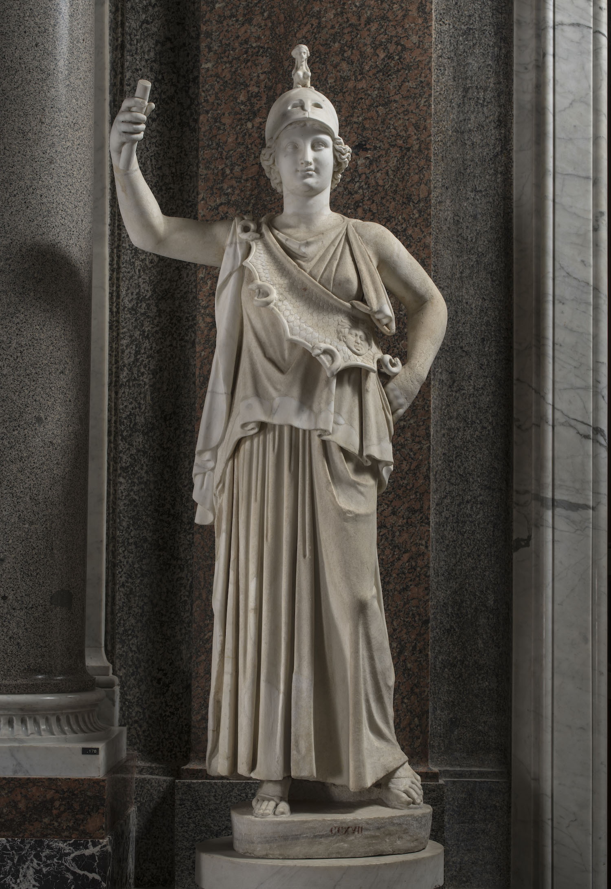

**内容 / 看点**：公元 140 年的雅典娜（Athena）像，属「谢尔谢尔—奥斯蒂亚型」（Cherchell-Ostia type，得名于阿尔及利亚谢尔谢尔与罗马港奥斯蒂亚出土的同型像），帕罗斯大理石。这是按希腊古典原型复制的罗马作品，辨认靠雅典娜的标志——头盔与披在胸前的埃癸斯（aegis，缀蛇与女妖头的护胸）。现场找她的头盔和胸甲即可对号。

### ⭐ 顺路看 古罗马艺术《阿提斯小像》 / Roman art, _Statuette of Attis_

- **作者 / Artist**：古罗马艺术 / Roman art
- **作品 / Work**：《阿提斯小像》 / _Statuette of Attis_
- **时间**：公元 2 世纪
- **材质**：弗里吉亚大理石
- **尺寸**：高 82 cm
- **位置**：埃及厅（第 7 室）
- **官网介绍页**：[官网介绍英文](https://www.collezionegalleriaborghese.it/en/opere/statuette-of-attis)｜馆藏编号 LIX

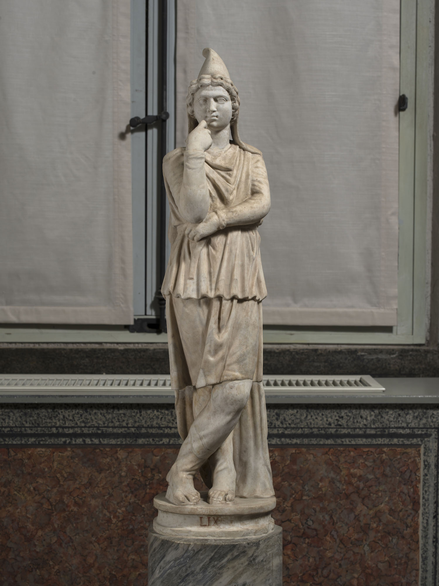

**内容 / 看点**：公元 2 世纪的阿提斯（Attis）小像，弗里吉亚大理石。阿提斯是大地母神库柏勒（Cybele）的年轻爱侣，来自小亚细亚的东方神祇——正与本厅天顶画里出现的库柏勒呼应。辨认靠他的弗里吉亚帽与东方式裤装。它把「东方神祇」这条线补进了埃及厅的神像阵容。
## 其他

### ⭐⭐ 推荐 安东尼奥·阿斯普鲁奇《埃及厅设计》 / Antonio Asprucci, _Design of the Egyptian Room_

- **作者 / Artist**：安东尼奥·阿斯普鲁奇（1723–1808） / Antonio Asprucci
- **作品 / Work**：《埃及厅设计》 / _Design of the Egyptian Room_
- **时间**：1779–1782 年
- **位置**：埃及厅（第 7 室）
- **官网介绍页**：见本厅[房间介绍页](https://galleriaborghese.cultura.gov.it/en/il-museo/la-villa/sala-7-sala-egizia/)

**内容（这是什么）**：埃及厅真正的「主角」不是某一件展品，而是整间房本身。它由建筑师安东尼奥·阿斯普鲁奇（Antonio Asprucci）在 1779–1782 年间专门构思设计，目的是给博尔盖塞收藏里那批「埃及相关」的雕像安一个统一的家。看这间厅，要把天顶画、墙面列柱、柱间神像、地面马赛克、阿拉巴斯特花瓶当成「一件作品」一起读。

**概念与时代语境**：18 世纪后期欧洲掀起一股「埃及热」（Egyptomania），贵族宅邸流行设「埃及房间」。本厅是这股风潮里相当早的范例之一，馆方自己的说法是「后来罗马宅邸中各埃及厅的样板」。但要清楚：阿斯普鲁奇和他的画师们没去过埃及，他们靠的是古罗马人对埃及的二手想象——于是这间「埃及厅」其实是「古罗马式的埃及」再加「新古典主义的包装」，三层叠在一起。

**空间布局（怎么读这间房）**：① 天顶——正中是孔卡（Tommaso Maria Conca）画的尼罗河泛滥与库柏勒（Cybele），四周马尔凯蒂（Giovanni Battista Marchetti）的建筑错视框景里排着一圈行星诸神，顶边还有八幅安东尼（Anthony）与克利奥帕特拉（Cleopatra）的连环小画。② 四壁——成对的列柱之间，立着埃及、东方和希腊的神像，其中最值得找的是「伊西斯女祭司」（CCII）和那尊改作成刻瑞斯（Ceres）的黑石伊西斯（Isis，CCIX）。③ 中心——原本摆「骑海豚的萨堤尔」（CC）。④ 地面——三世纪的海神与「三月」月份马赛克。⑤ 陈设——约 1780 年为本厅特制的六只东方阿拉巴斯特花瓶，配灰花岗岩座。

**看点**：这是一间能让你「读懂一种品味」的房间——18 世纪的人如何把古埃及、古罗马和新古典主义熔成一个室内整体。别只盯着单件名作，要看母题怎样从顶到地反复呼应：水（尼罗河／海神／海豚）、女神（库柏勒／伊西斯／刻瑞斯）、彩色硬石（花岗岩、玄武岩、斑岩、阿拉巴斯特）共同织出一套「埃及—神性—富贵」的语言。

**现场站看**：

1. **进门先别低头，先抬头**——天顶是整间房的纲领：认出正中的尼罗河河神，再扫一圈行星神和顶边的埃及艳后小画，先把「这间房在讲什么」搞清楚。
2. **找狗头的阿努比斯**——天顶行星神里那位狗头神（被当作天神乌拉诺斯）是全厅最明确的埃及符号，专门找出来。
3. **沿墙看「列柱＋神像」的节奏**——四壁是「成对柱子夹一尊神像」的重复韵律，正是阿斯普鲁奇定的秩序；边走边数，体会对称布局。
4. **重点认两尊伊西斯**——「伊西斯女祭司」（CCII，奥古斯都时代女像后世加莲花、叉铃改成伊西斯）和黑石「海上伊西斯改作刻瑞斯」（CCIX，17 世纪加头、手、脚改身份），是全厅「埃及女神」主题的两件核心，也是「古件被改换身份」的好案例。
5. **回到房间正中**——这里原是骑海豚萨堤尔的位置，站在圆心环视，最能读懂「中心摆水神、四壁列神像、头顶罩尼罗河」的整体设计。
6. **低头看地面马赛克**——三世纪的海神与「三月」月份马赛克是真正的古代地面残件，注意它和顶上想象的「埃及」是两种来源：地上是真古物，头顶是新古典的想象。
7. **数一数阿拉巴斯特花瓶与彩色硬石**——六只为本厅特制的东方阿拉巴斯特花瓶配灰花岗岩座，再加柱身、盆、瓮用的各色硬石，体会「彩色石材＝富贵与异域」的陈设逻辑。
8. **把它和隔壁的厅对比**——记住这是一间「主题先行、为藏品定制」的房间，而非随意陈列；带着这个意识再走进下一厅，会更敏感于博尔盖塞别墅各厅的不同设定。

## 资料来源 / Sources

- Galleria Borghese 官方房间页：[Room 7](https://galleriaborghese.cultura.gov.it/en/il-museo/la-villa/sala-7-sala-egizia/)
- Galleria Borghese 藏品筛选：[Painting, Room 7](https://www.collezionegalleriaborghese.it/en/collezione/pittura?sala=s7)
- Galleria Borghese 藏品筛选：[Modern Sculpture, Room 7](https://www.collezionegalleriaborghese.it/en/collezione/scultura?sala=s7)
- Galleria Borghese 藏品筛选：[Ancient Art, Room 7](https://www.collezionegalleriaborghese.it/en/collezione/arte-antica?sala=s7)
- Galleria Borghese 藏品筛选：[Furniture, Room 7](https://www.collezionegalleriaborghese.it/en/collezione/arredi?sala=s7)
