第 8 室（卡拉瓦乔厅／西勒诺斯厅）是全世界卡拉瓦乔藏品最密集的房间之一，一口气挂着六幅真迹，从早年的《病中的巴克斯》《捧果篮的男孩》到晚年的《大卫与歌利亚》《施洗者圣约翰》；天顶则是孔卡的酒神装饰（常被忽略，值得抬一次头）。

**必看与核心展品（⭐⭐⭐ 必看 + 核心）**

| 推荐 | 展品 | 作者 | 一句话看点 |
|---|---|---|---|
| ⭐⭐⭐ 必看 | 《大卫与歌利亚的头》 | 卡拉瓦乔 | 晚年之作，歌利亚的脸被认为是画家自画像 |
| ⭐⭐⭐ 必看 | 《书写中的圣杰罗姆》 | 卡拉瓦乔 | 强烈明暗下苦修的老圣徒，光打在书页与头骨 |
| ⭐⭐⭐ 必看 | 《圣母子与圣安妮（马夫会圣母）》 | 卡拉瓦乔 | 曾被教会退货的祭坛画，写实到「不体面」 |
| ⭐⭐⭐ 必看 | 《捧果篮的男孩》 | 卡拉瓦乔 | 早年名作，果篮静物逼真到能数出品种 |
| ⭐⭐⭐ 必看 | 《扮作巴克斯的自画像（病中的巴克斯）》 | 卡拉瓦乔 | 病容的酒神自画像，青涩而大胆的早年自塑 |
| ⭐⭐⭐ 必看 | 《施洗者圣约翰》 | 卡拉瓦乔 | 半裸少年与公羊，暧昧而新颖的圣像处理 |

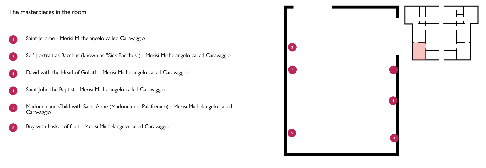

**展厅官网介绍页**：[西勒诺斯厅（第 8 室）｜Galleria Borghese 房间页](https://galleriaborghese.cultura.gov.it/en/il-museo/la-villa/sala-8-sala-del-sileno/)

## 核心展品

### ⭐⭐⭐ 必看 米开朗基罗·梅里西，称卡拉瓦乔《大卫与歌利亚的头》 / Michelangelo Merisi called Caravaggio, _David with the Head of Goliath_

- **作者 / Artist**：米开朗基罗·梅里西，称卡拉瓦乔（1571–1610） / Michelangelo Merisi called Caravaggio (1571–1610)
- **作品 / Work**：《大卫与歌利亚的头》 / _David with the Head of Goliath_
- **时间**：1606–1607 年 或 1609–1610 年
- **材质**：布面油画
- **尺寸**：125 × 101 cm
- **位置**：西勒诺斯厅（第 8 室）
- **官网介绍页**：[大卫与歌利亚的头 / David with the Head of Goliath｜Galleria Borghese 官方藏品库](https://www.collezionegalleriaborghese.it/opere/david-con-la-testa-di-golia)｜馆藏编号 455

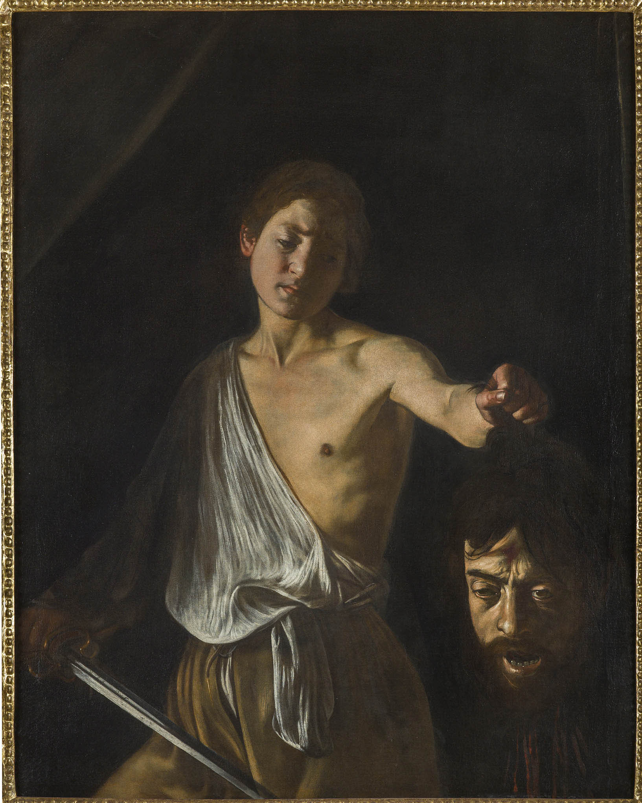

**这是什么**：年轻的牧羊少年大卫（David）一手提着被砍下的巨人歌利亚（Goliath）的头颅，一手握着剑。题材出自《旧约·撒母耳记》：非利士巨人歌利亚向以色列军队挑战，少年大卫以投石击中其额头将他击倒、再用他自己的剑割下首级。但卡拉瓦乔笔下的大卫毫无凯旋之色——他神情哀伤、近乎怜悯地凝视着手中那颗血淋淋的头。这是博尔盖塞最密集的卡拉瓦乔房间里，气氛最沉重的一件。

**双重自画像：被砍下的是画家自己**：自 1650 年导览作家马尼利（Iacomo Manilli）起，世人就指出歌利亚那张脸是卡拉瓦乔的自画像；后世学者（罗特根 Röttgen、罗西 Rossi 等）进一步认为大卫的脸用的也是画家身边那位「小卡拉瓦乔」少年模特，于是整幅画成了一种「自我审判」——画家把自己同时画成施刑的少年（惩罚的超我）与被斩的罪人（求罚的本我）。这与他晚年的处境直接相关：1606 年他在罗马斗殴杀人（拉努乔·托马索尼 Ranuccio Tommasoni），被判死刑、亡命那不勒斯。

**剑上的暗语与求赦**：大卫所持剑刃上隐约有刻字「H·AS O S」，学界（马里尼 Marini 等）释为奥古斯丁的箴言「H[umilit]AS O[ccidit] S[uperbiam]」——「谦卑战胜骄傲」。结合题材，许多学者（卡尔韦西 Calvesi 提出）推测这幅画是卡拉瓦乔托人送给红衣主教希皮奥内·博尔盖塞（Scipione Borghese）、再转呈教皇保罗五世（Paul V）的「赎罪之礼」：以一颗自己被砍下的头，恳求赦免、准其返回罗马。

**断代与诊断之争**：此画断代长期分歧，或定在 1606–1607 年罗马时期末、或定在 1609–1610 年第二次那不勒斯时期。支持晚期的依据是色彩压缩、用光与那不勒斯晚期作品相近，画面颜料层因多次修复而磨损单薄；而 2016 年的科学检测（卡尔迪纳利 Cardinali、德鲁杰里 De Ruggieri）发现画布上有起稿刻痕、底子又接近 1606–1607 年作品，于是又有学者主张提前。无论哪一年，它都被公认为卡拉瓦乔生命最后阶段的杰作。

**与博尔盖塞收藏的渊源**：1613 年此画已记录在希皮奥内·博尔盖塞的收藏里（同年他还付钱给细木匠为「大卫与巨人头之画」做画框）。它历经家族各版藏品清册，1902 年随整座别墅由意大利国家收购。

**现场站看**：

1. **看大卫的表情**——不是胜利的得意，而是哀伤与怜悯。这是全画的情感核心：刽子手在为被斩者动容，呼应「双重自画像」的自省主题。
2. **认出歌利亚就是卡拉瓦乔本人**——对照房间里《病中的巴克斯》中那张年轻的自画像脸，再看这颗衰老、扭曲、嘴半张的头：同一个人，跨越十余年，从自恋的酒神到自我处决的罪人。
3. **盯剑刃上的刻字**——凑近找「H·AS O S」几个字母，它把「谦卑胜骄傲」的箴言、以及向教皇求赦的潜台词，全压进这一道冷冷的剑光里。
4. **看光从哪来**——人物从近乎全黑的背景里被一束侧光「拽」出来；这就是卡拉瓦乔的暗调明暗法（tenebrism），戏剧性全靠光而非背景叙事。
5. **看歌利亚脖颈的血与肌理**——断口、滴血、衰老皮肤一丝不苟，却又用笔迅疾，体现晚期那种「写实而急促」的笔法。
6. **和同厅《施洗者圣约翰》并看**——两件都是晚期、都用同一类街头少年模特、都把人物从黑暗中托出，可一并体会卡拉瓦乔末年的减法美学。

### ⭐⭐⭐ 必看 米开朗基罗·梅里西，称卡拉瓦乔《书写中的圣杰罗姆》 / Merisi Michelangelo called Caravaggio, _Saint Jerome_

- **作者 / Artist**：米开朗基罗·梅里西，称卡拉瓦乔 / Merisi Michelangelo called Caravaggio
- **作品 / Work**：《书写中的圣杰罗姆》 / _Saint Jerome_
- **时间**：约 1606 年
- **材质**：布面油画
- **尺寸**：116 × 153 cm
- **位置**：西勒诺斯厅（第 8 室）
- **官网介绍页**：[书写中的圣杰罗姆 / Saint Jerome｜Galleria Borghese 官方藏品库](https://www.collezionegalleriaborghese.it/en/opere/saint-jerome)｜馆藏编号 056

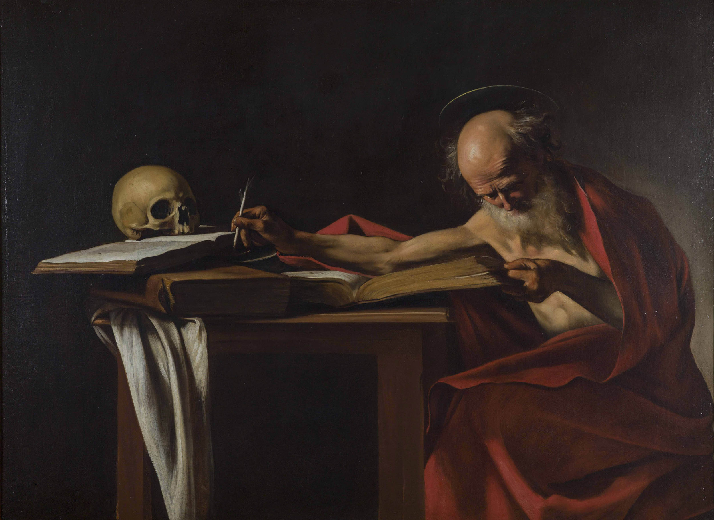

**这是什么**：圣杰罗姆（San Girolamo，又译圣热罗尼莫、圣耶柔米）是教会四大拉丁教父之一，传统上把《圣经》从希腊文译成拉丁文（《武加大本》）的功劳归于他，因此常被画成伏案苦读、书写的老学者。卡拉瓦乔正是抓住这一面：一位瘦削苍老的人文学者，俯身在书卷上，伸手把笔探向墨水瓶——那个伸臂的瞬间被定格下来。

**红与白、生与死的对照**：画面被切成冷暖两大色块。暖的一侧是圣人的肉体和身上那块紫红色斗篷；冷的一侧是摊开的书与压在书上的骷髅、以及白色布巾。卡拉瓦乔用这种对峙把「生命与死亡、当下与永恒」的象征摆在同一张桌面上——老学者一边写作（生命、知识），一边与死亡（骷髅）对坐。

**赞助与博尔盖塞渊源**：据传记作家贝洛里（Bellori, 1672）记载，这幅画是卡拉瓦乔直接为红衣主教希皮奥内·博尔盖塞（Scipione Borghese）画的——这位主教是当时最热衷搜罗卡拉瓦乔的大藏家。另有学者（卡尔韦西 Calvesi）推测画家是为了感谢主教在他屡次官司中的庇护而以画相赠，并特意把圣人画成红衣主教式的紫红斗篷，影射庇护者的身份。无论哪种，它都是「希皮奥内—卡拉瓦乔」这条收藏线索的核心物证，1902 年随别墅归国家所有。

**是否未完成**：因为胡须、斗篷等局部画得很简率，又能看出多处改笔（左手、右臂、脸、姿势都有修改痕迹），部分学者（马里尼 Marini）曾认为这幅画其实没画完；也有人（奇诺蒂 Cinotti）反驳。这种「快速、果断、留有改动」的笔触本身就是看点。

**现场站看**：

1. **顺着伸出的手臂看到笔尖与墨水瓶**——整幅画的动势就锁在这一个「蘸墨」的动作上，是它把静止的老人变成「正在工作的瞬间」。
2. **比较红布与白骨两端**——左暖右冷，刻意制造生/死、肉体/学问的对照；站远一点最能看清这条冷暖分界。
3. **盯书上的骷髅**——它压在摊开的书页上，提醒「学问再多终归一死」（memento mori），是这类书斋圣杰罗姆的固定道具。
4. **找简率与改笔**——看胡须、斗篷边缘那种几笔带过的处理，以及隐约的改动痕迹，体会卡拉瓦乔不打底稿、直接在布上「边看边改」的画法。
5. **看光打在秃顶与肩背上**——典型暗调明暗法：身体从黑暗中被一束光托出，背景几乎不交代环境。

### ⭐⭐⭐ 必看 米开朗基罗·梅里西，称卡拉瓦乔《圣母子与圣安妮（马夫会圣母）》 / Michelangelo Merisi called Caravaggio, _Madonna and Child with Saint Anne (Madonna dei Palafrenieri)_

- **作者 / Artist**：米开朗基罗·梅里西，称卡拉瓦乔 / Michelangelo Merisi called Caravaggio
- **作品 / Work**：《圣母子与圣安妮（马夫会圣母）》 / _Madonna and Child with Saint Anne (Madonna dei Palafrenieri)_
- **时间**：1605 年
- **材质**：布面油画
- **尺寸**：292 × 211 cm
- **位置**：西勒诺斯厅（第 8 室）
- **官网介绍页**：[圣母子与圣安妮 / Madonna and Child with Saint Anne (Madonna dei Palafrenieri)｜Galleria Borghese 官方藏品库](https://www.collezionegalleriaborghese.it/opere/la-madonna-dei-palafrenieri)｜馆藏编号 110

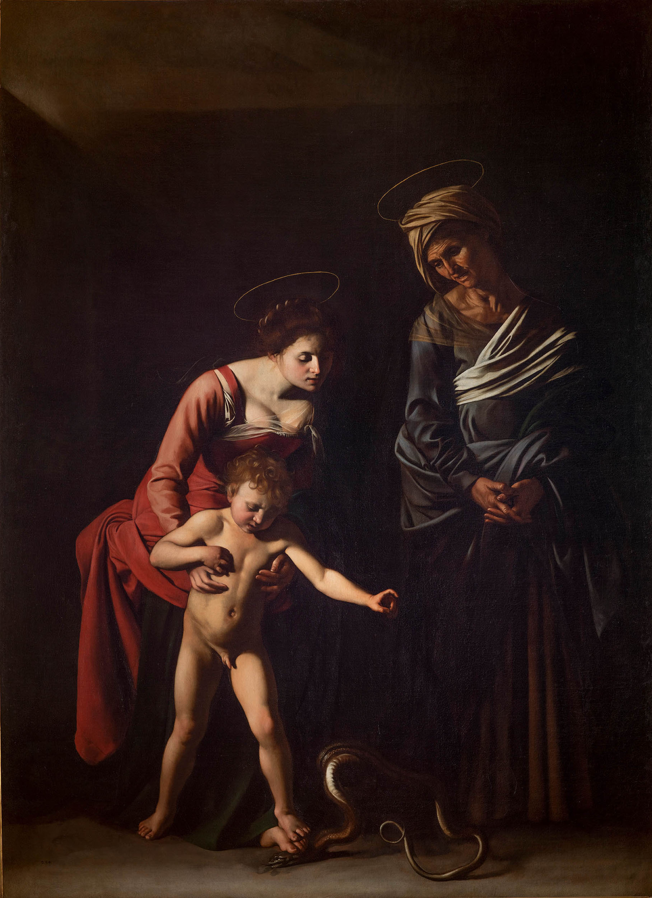

**这是什么**：圣母玛利亚（Maria）正用脚踩住一条蛇——象征罪恶与魔鬼——而赤身的小耶稣把脚叠在母亲脚上，一同踩蛇；旁边是玛利亚的母亲圣安妮（Sant'Anna），被画成一位满脸皱纹的老妇人，在一旁注视。题材出自《创世记》3:15「她（或他）要踏碎你的头」。这是一张近 3 米高的祭坛画。

**一桩著名的「退货」事件**：1605 年 10 月，势力很大的「教廷马夫兄弟会」（Arciconfraternita dei Palafrenieri）委托卡拉瓦乔为他们在圣彼得大教堂的小堂画这幅祭坛画（圣安妮是他们的主保）。画在 1606 年 4 月装上祭坛，几天后即被取下，转到附近的圣安妮教堂，很快又被红衣主教希皮奥内·博尔盖塞以 100 斯库多买走（比兄弟会付给画家的 75 斯库多还高）。撤画的真正原因众说纷纭：传统说法是「太世俗、不够神圣」（圣母低胸、圣婴已是个大孩子还全裸）；弗里德兰德（Friedländer）则考证是小堂尺寸装不下这张大画；也有人认为是受卡拉瓦乔另一幅被拒的《圣母之死》连累。

**踩蛇之争与新教/天主教神学**：圣母与圣婴「一起」踩蛇，恰好踩在天主教与新教争论的痛点上——拉丁文经文「ipsa（她）/ ipso（他）conteret caput tuum」一字之差：天主教读「她」（圣母代表教会战胜罪恶），新教读「他」（只有基督）。卡拉瓦乔让母子合力踩蛇，被敏感的教会人士视为立场不清。此外圣安妮被画成毫不理想化的乡村老妪、几乎被推到角落，也让人不安——有学者（塞蒂斯 Settis）把她的姿态联系到古代「沉思像」的图式。

**模特争议与卡拉瓦乔的写实**：有学者（马里尼 Marini）认为圣母用的是名妓莱娜（Lena，即玛达莱娜·安托涅蒂 Maddalena Antognetti）做模特，让人认得出真人来扮圣母，违反特伦特公会议的规定——这也可能是撤画原因之一。无论真相如何，希皮奥内·博尔盖塞都顺势把这件「被嫌弃」的杰作收入囊中，1902 年随别墅归国家。

**现场站看**：

1. **看两双脚叠在一起踩蛇**——这是全画的神学引爆点：母子合力踩碎象征罪恶的蛇，正卡在天主教「她」与新教「他」之争的字缝上。
2. **看圣安妮这张老脸**——满是皱纹、毫不美化、还被挤在右侧阴影里。卡拉瓦乔把圣徒画成市井老妇，正是当年「不够神圣」指控的来源。
3. **注意圣婴的尺寸与裸体**——他不是襁褓婴儿而是个站立的大男孩，全身赤裸。在反宗教改革的语境里，这种「过分写实」被认为有失体统。
4. **看圣母低胸的红裙与强光**——光把母子从黑暗中托出，圣母的世俗美感正是争议焦点之一。
5. **退到能看全 3 米画幅的距离**——这是为圣彼得大教堂小堂画的祭坛画，体会它原本要在多大的空间、多高的位置被仰望。

### ⭐⭐⭐ 必看 米开朗基罗·梅里西，称卡拉瓦乔《捧果篮的男孩》 / Michelangelo Merisi called Caravaggio, _Boy with Basket of Fruit_

- **作者 / Artist**：米开朗基罗·梅里西，称卡拉瓦乔 / Michelangelo Merisi called Caravaggio
- **作品 / Work**：《捧果篮的男孩》 / _Boy with Basket of Fruit_
- **时间**：约 1595 年
- **材质**：布面油画
- **尺寸**：70 × 67 cm
- **位置**：西勒诺斯厅（第 8 室）
- **官网介绍页**：[捧果篮的男孩 / Boy with basket of fruit｜Galleria Borghese 官方藏品库](https://www.collezionegalleriaborghese.it/opere/giovane-con-canestra-di-frutta)｜馆藏编号 136

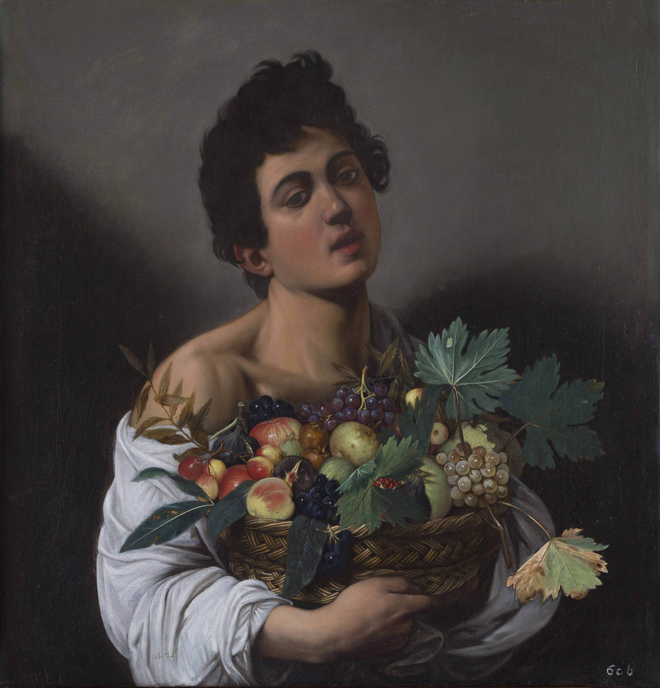

**这是什么**：一个少年侧身三分之四，捧着一只装满秋果与枝叶的果篮——苹果、葡萄，还有带斑点、虫蛀的叶子。这是卡拉瓦乔到罗马初期的作品，画里既有少年裸露的肩颈、又有那一篮逼真到能数清瑕疵的水果。

**早期与达尔皮诺作坊**：这件来自 1607 年那桩著名的「没收」——画家朱塞佩·切萨里（称骑士达尔皮诺 Cavalier d'Arpino）被保罗五世（Paul V）的官员以「非法持有火器」为由抄家，被迫把整批 107 幅藏画交给教廷，其中包括卡拉瓦乔早年在达尔皮诺作坊打工时画的两件——本幅与《病中的巴克斯》。教皇随即把这批画转赐侄子希皮奥内·博尔盖塞（Scipione Borghese）。卡拉瓦乔当年在作坊里正是专门负责画「花与果」的，本幅就是这段经历的成果。

**写实的巅峰预演**：这幅画最被推崇的是它对「真实」的逼视——光从少年背后打来，落在果篮上，把每一颗果实的不规则、每一片叶子的枯斑都照得纤毫毕现，没有任何美化或修饰。它被视为卡拉瓦乔不久后为博罗梅奥主教画的纯静物名作《水果篮》（米兰盎博罗削图书馆）的预演。2012 年的检测还在画布下发现了直接起稿的草图，印证古代文献所说卡拉瓦乔「对着实物画」的习惯。

**篮子里的寓意之争**：自阿尔甘（Argan）起就有人认为那些枯叶烂斑暗示「美之凋零、光阴易逝」（vanitas）；也有人把男孩解读为秋天、为韦尔图努斯（Vertumnus，果园之神）、为五官中的「味觉」，或读出情欲与「基督献身」的宗教寓意（卡尔韦西 Calvesi）。歧解众多，但现场最直接能体会的，还是那种「逼真到带瑕疵」的感官真实。

**现场站看**：

1. **数果篮里的瑕疵**——找带斑、卷边、虫蛀的叶子和不完美的果实。卡拉瓦乔故意保留这些「缺陷」，这正是他写实主义的宣言：照实画，不修饰。
2. **看光从少年背后打来**——光源在身后，却把果篮照亮在最前，制造出篮子「凸」到画外的体量感。
3. **比对皮肤、葡萄、织物三种质感**——少年的肉、葡萄的水润、衣料的厚薄，被同一束光区分开来，是青年卡拉瓦乔炫技的地方。
4. **和晚期《大卫与歌利亚的头》对照**——同一位画家，从这里的感官、青春、丰盈，走向晚期对死亡与罪的凝视；两件并看，就是卡拉瓦乔的一生缩影。

### ⭐⭐⭐ 必看 米开朗基罗·梅里西，称卡拉瓦乔《扮作巴克斯的自画像（病中的巴克斯）》 / Michelangelo Merisi called Caravaggio, _Self-portrait as Bacchus (known as Sick Bacchus)_

- **作者 / Artist**：米开朗基罗·梅里西，称卡拉瓦乔 / Michelangelo Merisi called Caravaggio
- **作品 / Work**：《扮作巴克斯的自画像（病中的巴克斯）》 / _Self-portrait as Bacchus (known as "Sick Bacchus")_
- **时间**：约 1593–1594 年
- **材质**：布面油画
- **尺寸**：67 × 53 cm
- **位置**：西勒诺斯厅（第 8 室）
- **官网介绍页**：[病中的巴克斯 / Self-portrait as Bacchus (known as "Sick Bacchus")｜Galleria Borghese 官方藏品库](https://www.collezionegalleriaborghese.it/opere/autoritratto-in-veste-di-bacco-bacchino-malato)｜馆藏编号 534

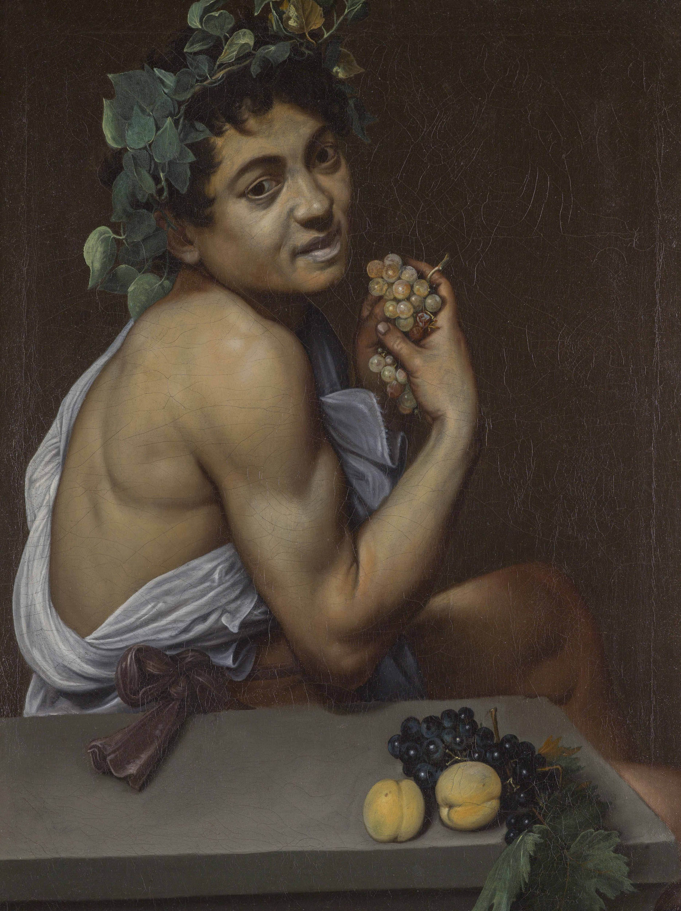

**这是什么**：一个头戴常春藤花冠的年轻人，侧身回望观者，手里举着一串白葡萄；可他的肤色发青、嘴唇灰暗，一副病容。常春藤、葡萄是酒神巴克斯（Bacco，希腊名狄俄尼索斯 Dionysus）的标志，所以人物以酒神面目出现，却偏偏「病恹恹」——这就是它俗名「病中的巴克斯」的由来。

**很可能是卡拉瓦乔最早的自画像**：传记作家巴廖内（Baglione, 1642）说卡拉瓦乔初到罗马时「对着镜子画了几幅小画，第一幅就是一个拿着各色葡萄的巴克斯」。罗伯特·隆吉（Longhi, 1927）据此把本幅定为画家「对镜自画」的自画像，并给了它「病中的巴克斯」这个名字。它被公认为现存卡拉瓦乔最早、或几乎最早的作品之一。至于那病态的肤色，隆吉联想到画家曾因不明原因住进罗马慰藉医院（Ospedale della Consolazione）的经历；2001 年的科学检测则排除了「只是旧修复变色」的说法，证明这青灰色是画家本意。

**来自达尔皮诺没收案**：与《捧果篮的男孩》一样，本幅出自 1607 年保罗五世（Paul V）查抄骑士达尔皮诺（Cavalier d'Arpino）藏画的那桩案子——107 幅画里有两幅卡拉瓦乔，被教皇转赐侄子希皮奥内·博尔盖塞（Scipione Borghese）。这也解释了它为何与《捧果篮的男孩》同属画家早年在达尔皮诺作坊的产物。

**多重解读与师承**：除「自画像」外，学界还把它读作五官中的「味觉」、忧郁的化身、酒神迷醉，乃至「持葡萄的基督」预表（卡尔韦西 Calvesi）。也有学者（莫雷尔 Morel）强调它是「诗人—画家」的自我标榜：常春藤冠象征灵感与荣耀，画家以一串逼真到能骗鸟的葡萄（暗用古希腊宙克西斯 Zeusi 骗鸟的典故）夸耀自己的写实功力。构图上则借用了他在米兰的老师佩特尔扎诺（Peterzano）的人物姿态，以及丢勒（Dürer）版画的影子。

**现场站看**：

1. **看脸色与嘴唇**——青灰、病态、毫不美化。把神明画成「病人」，在当时是惊世骇俗的反偶像之举，也是这幅画名字的来源。
2. **认出这就是卡拉瓦乔本人**——记住这张年轻的脸，再走到《大卫与歌利亚的头》前看歌利亚那颗被砍下的头：同一人，从自恋的酒神到自我处决的罪人。
3. **看举葡萄的手势**——有学者认为画的是酒神「正要捏葡萄、创造美酒」的瞬间；那串白葡萄也是炫技对象，逼真到「骗鸟」。
4. **找头上的常春藤冠**——酒神的固定标志，同时被解读为诗人/艺术家灵感的象征。
5. **和同厅另几件卡拉瓦乔比年代**——这是最早，《大卫》《施洗者圣约翰》是最晚；一间屋里就能走完他从青年到末年的全程。

### ⭐⭐⭐ 必看 米开朗基罗·梅里西，称卡拉瓦乔《施洗者圣约翰》 / Michelangelo Merisi called Caravaggio, _Saint John the Baptist_

- **作者 / Artist**：米开朗基罗·梅里西，称卡拉瓦乔 / Michelangelo Merisi called Caravaggio
- **作品 / Work**：《施洗者圣约翰》 / _Saint John the Baptist_
- **时间**：1609–1610 年
- **材质**：布面油画
- **尺寸**：152 × 125 cm
- **位置**：西勒诺斯厅（第 8 室）
- **官网介绍页**：[施洗者圣约翰 / Saint John the Baptist｜Galleria Borghese 官方藏品库](https://www.collezionegalleriaborghese.it/opere/san-giovanni-battista)｜馆藏编号 267

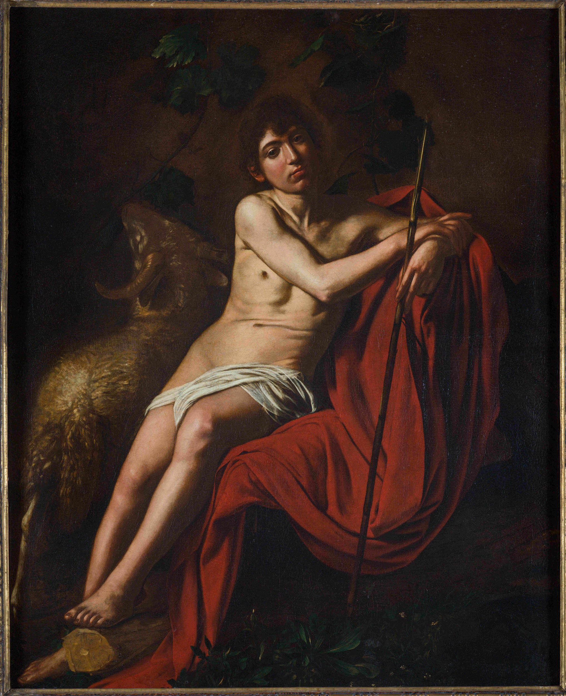

**这是什么**：施洗者圣约翰（San Giovanni Battista，耶稣的表兄）独自坐在幽暗的旷野里沉思，身旁是一头公绵羊（不是常见的羔羊），脚下铺着一大块红布。卡拉瓦乔几乎剥光了这个题材的所有惯用道具——没有水盆、没有写着「看哪神的羔羊」的十字杖——只剩一个沉思的青年、一只羊、一抹红，画面极简却异常有力。这是卡拉瓦乔生命最后阶段的作品。

**画家临终前的「赎罪礼」之一**：1610 年，已被判死刑、流亡多年的卡拉瓦乔抱着求赦的希望，带着几幅画从那不勒斯乘船返罗马，准备把它们送给红衣主教希皮奥内·博尔盖塞（Scipione Borghese，此前已拥有他的《马夫会圣母》《捧果篮的男孩》《病中的巴克斯》），以换取教皇赦免。但船到罗马以北的帕洛（Palo）附近，画家被误捕下狱，船却载着行李先开走了——卡拉瓦乔追到韦尔托港（Porto Ercole）一带病死沙滩，年仅 38。这批画几经周折，那不勒斯总督莱莫斯伯爵截下其中一幅圣约翰，另一幅（即本幅）经临摹后于 1611 年送达希皮奥内手中。这件画因此一直挂在博尔盖塞的城内宫邸、近两百年不在别墅，1902 年才随收藏归国家。

**红布、公羊与晚期减法**：红布象征圣约翰殉道时流的血；他左手扶着一根细芦苇，指向他在旷野苦修、悔罪的生活。身旁那头啃着葡萄叶的不是羔羊而是公羊（ariete），学者认为卡拉瓦乔在玩希腊词「arnion」（同时可指羔羊、绵羊、公羊）的双关，借公羊（亚伯拉罕代子献祭之物）暗指基督的牺牲与救赎。整幅画把叙事压到最低、把人物从近乎全黑的背景里托出，正是画家末年那种「越来越省、越来越内向」的风格——有学者（柯尼希 König）说他看上去更像林中歇息的牧人，而非福音书里呐喊的先知。

**断代如何定案**：此画年代曾长期争论（有人定 1602–1604、有人定罗马末期 1605–1606、有人定那不勒斯/西西里时期）。直到 1991 年帕切利（Pacelli）发现 1610–1611 年间教廷使节与希皮奥内之间的五封通信，才确证它是 1610 年的作品——即画家生命的最后一年。

**现场站看**：

1. **先数它「缺了什么」**——没有水盆、没有十字杖、没有「神的羔羊」横幅。卡拉瓦乔故意抽掉惯用道具，把圣约翰还原成一个孤独沉思的青年，是晚期减法的极致。
2. **认那头羊是公羊不是羔羊**——找它的犄角。用公羊替代羔羊，是画家埋的词义双关，仍指向基督的牺牲。
3. **看脚下与身上的红布**——大面积的红既是构图的视觉支点，也象征圣约翰殉道之血。
4. **看光如何把身体从黑暗里「拽」出**——背景几乎不交代环境，全靠一束侧光塑形，是典型的暗调明暗法（tenebrism）。
5. **留意他的神情**——不是布道者的激昂，而是近乎忧郁的内省，对应画家末年走投无路的处境。
6. **和同厅《大卫与歌利亚的头》并看**——同为 1610 年前后、同类街头少年模特、同样的黑底托光，两件一起看最能体会卡拉瓦乔的「最后笔触」。

## 天顶画

### ⭐ 顺路看 托马索·马里亚·孔卡《献祭西勒诺斯》 / Tommaso Maria Conca, _Sacrifice to Silenus_

- **作者 / Artist**：托马索·马里亚·孔卡（1734–1822） / Tommaso Maria Conca (1734–1822)
- **作品 / Work**：《献祭西勒诺斯》 / _Sacrifice to Silenus_
- **时间**：1775–1778 年
- **位置**：卡拉瓦乔厅天顶中央（第 8 室，又名「西勒诺斯厅」）
- **官网介绍页**：[第 8 室·西勒诺斯厅｜Galleria Borghese 房间页](https://galleriaborghese.cultura.gov.it/en/il-museo/la-villa/sala-8-sala-del-sileno/)

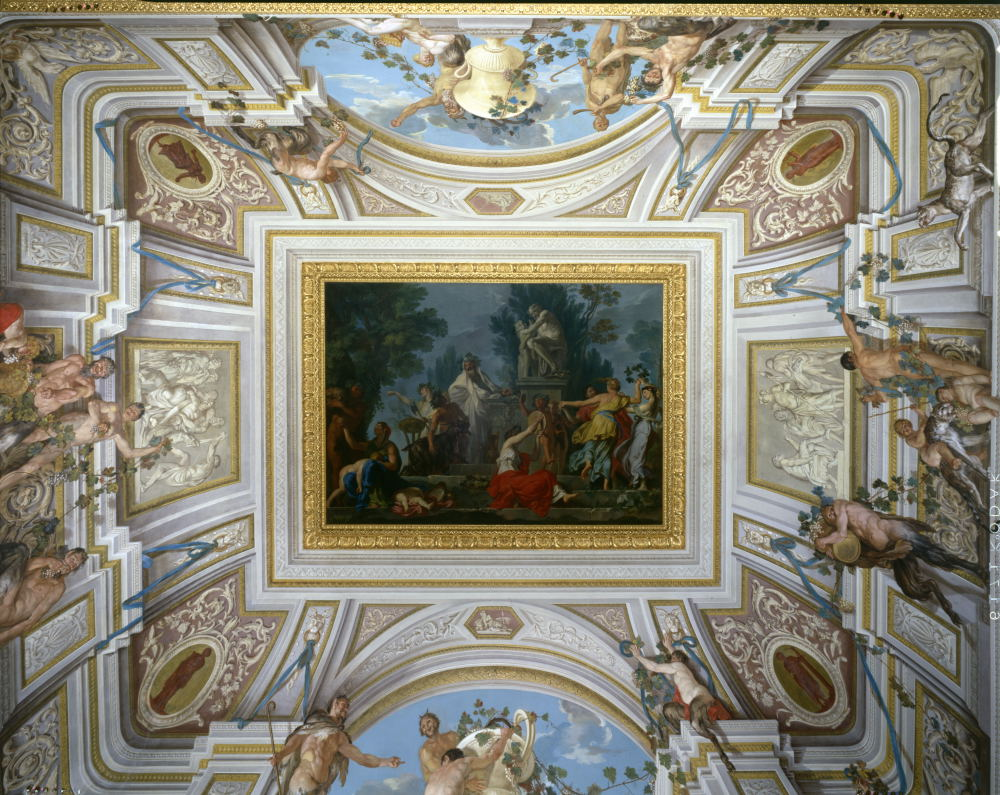

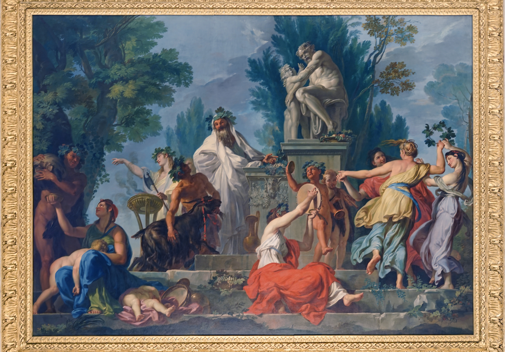

**内容（这是什么）**：天顶中央这幅画的是众人向西勒诺斯（Sileno / Silenus）献祭的场面。西勒诺斯是酒神巴克斯（Bacco / Bacchus）的老师与养父——一个总是醉醺醺、大腹便便、骑驴需人搀扶的胖老头，是酒神随从队伍里「喜剧角色」与「醉中吐真言的智慧老者」的混合体。画面是一群萨堤尔与酒神信徒围着他奉酒、献祭、欢闹，是一派酒神世界的丰饶与狂欢。本厅得名「西勒诺斯厅」正源于这套天顶主题。

**背景 / 来历**：天顶由画家托马索·马里亚·孔卡（Tommaso Maria Conca，1734–1822）于 1775–1778 年绘制——他正是 18 世纪末博尔盖塞别墅大改造里挑大梁的天顶画家（第 7 埃及厅的尼罗河天顶也出自他手）。中央彩色画的四周，配有他画的单色（仿石刻浮雕）酒神场景，再加上马尔凯蒂（Marchetti）画的建筑错视框景（quadratura），三者合成一套完整的「酒神随从」装饰系统。这是阿斯普鲁奇（Antonio Asprucci）主持的「一室一主题」改造的又一间——只是它有个尴尬命运：这间厅后来成了陈列六幅卡拉瓦乔（Caravaggio）的「卡拉瓦乔厅」，游客的注意力几乎全被墙上那些惊世名作吸走，头顶这套精致的酒神天顶反倒长期被忽略。

**看点**：它最大的看点恰恰是「几乎没人抬头看」——在一屋卡拉瓦乔的强光下，这套孔卡的酒神天顶成了被冷落的精品。值得花半分钟抬头，体会两种趣味的强烈反差：墙上是卡拉瓦乔粗粝、写实、明暗对决的革命性油画，头顶却是 18 世纪末轻盈、欢快、装饰性的新古典酒神狂欢。一间厅里同时装着「绘画史的地震」和「贵族天花板的甜点」，本身就很耐玩味。

**现场站看**：

1. **先认中央的西勒诺斯**——抬头找天顶正中那位被众人簇拥、醉态可掬的胖老头，他就是西勒诺斯；认准他，厅名（西勒诺斯厅）与天顶主题就对上了。
2. **找「酒神随从」的道具**——留意围着他的萨堤尔、酒器、葡萄藤蔓与欢闹人群，这些是「酒神世界」的标准班底，点明整套天顶的主题是丰饶与狂欢。
3. **分辨彩画、单色画与假建筑三层**——中央是孔卡的彩色画，四周是他画的单色「仿浮雕」酒神小景，外圈是马尔凯蒂画的建筑错视框格；盯着交界处看，分清哪些是画出来的立体、哪些是真灰泥。
4. **故意抬一次头**——这是本厅的小提醒：几乎所有人进来都盯着卡拉瓦乔，没人看天顶。特意抬头看完这套酒神装饰，再低头看卡拉瓦乔，两种画风的反差会让你对这间厅记得更深。

### ⭐ 顺路看 托马索·马里亚·孔卡《醉酒的西勒诺斯》 / Tommaso Maria Conca, _Silenus Inebriated_

- **作者 / Artist**：托马索·马里亚·孔卡 / Tommaso Maria Conca
- **作品 / Work**：《醉酒的西勒诺斯》 / _Silenus Inebriated_
- **时间**：1775–1778 年
- **位置**：天顶侧面单色画

**内容 / 看点**：天顶四周的单色（仿浮雕灰调）壁画之一，画醉倒的西勒诺斯——酒神养父烂醉如泥、需人搀扶的经典形象。它和中央的《献祭西勒诺斯》同属孔卡为本厅绘制的酒神主题装饰，用单色模仿石刻浮雕，给中央彩色天顶画当陪衬。顺路抬头扫一眼即可。

## 绘画

本节按馆方藏品列表补充本厅绘画与古代雕塑（核心的六幅卡拉瓦乔已在上文「核心展品」展开，此处不再重复）。其中古罗马雕塑多为「古代真件＋近代修复/组合」，整组背景写在第一件（馆藏编号 CCXXIX）上，其余各件可互相参看。

### ⭐ 顺路看 卢多维科·卡尔迪，称奇戈利《约瑟与波提乏之妻》 / Cardi Ludovico called Cigoli, _Joseph and Potiphar’s Wife_

- **作者 / Artist**：卢多维科·卡尔迪，称奇戈利 / Cardi Ludovico called Cigoli
- **作品 / Work**：《约瑟与波提乏之妻》 / _Joseph and Potiphar’s Wife_
- **时间**：1610 年
- **材质**：布面油画
- **尺寸**：220 × 150 cm
- **位置**：西勒诺斯厅（第 8 室）
- **官网介绍页**：[官网介绍（英文）](https://www.collezionegalleriaborghese.it/en/opere/joseph-and-potiphars-wife)｜馆藏编号 014

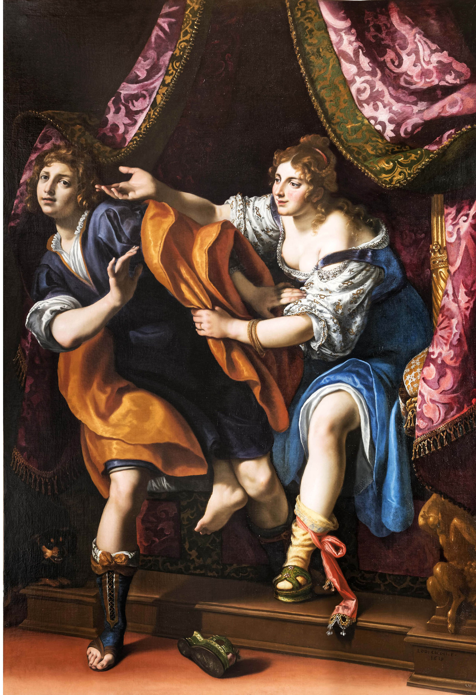

**内容（这是什么）**：题材出自《创世记》：被卖到埃及的约瑟（Giuseppe）做了官员波提乏（Putifarre）的管家，主人之妻多次引诱他，他逃走时被一把抓住衣袍。画面正是这个戏剧性的瞬间——半裸的女主人在床上拽住约瑟的衣服，约瑟挣脱回身。

**背景 / 看点**：作者奇戈利是佛罗伦萨画派后期的代表，本幅约 1610 年。它和本厅的卡拉瓦乔放在一起，正好对照两条路线：奇戈利保留了较「优雅、晚期手法主义」的趣味，而卡拉瓦乔走的是粗粝的写实。现场看「抓衣/逃离」这一拉扯动势，以及肉体与织物的对比即可。

### ⭐ 顺路看 乔瓦尼·巴廖内《犹滴与荷罗孚尼》 / Baglione Giovanni, _Judith and Holofernes_

- **作者 / Artist**：乔瓦尼·巴廖内 / Baglione Giovanni
- **作品 / Work**：《犹滴与荷罗孚尼》 / _Judith and Holofernes_
- **时间**：1608 年
- **材质**：布面油画
- **尺寸**：220 × 150 cm
- **位置**：西勒诺斯厅（第 8 室）
- **官网介绍页**：[官网介绍（英文）](https://www.collezionegalleriaborghese.it/en/opere/judith-and-holofernes)｜馆藏编号 015

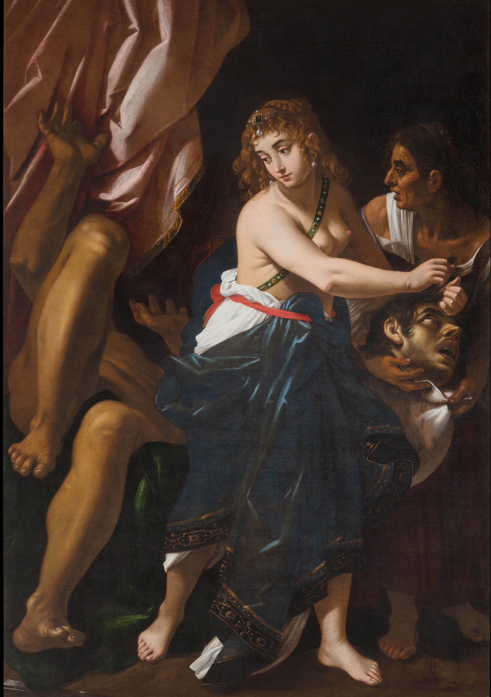

**内容（这是什么）**：犹滴（Giuditta）是《圣经·犹滴传》里的犹太女英雄：她潜入敌营，灌醉亚述统帅荷罗孚尼（Oloferne）后割下他的头，拯救了被围的城邦。画里犹滴提着剑与首级，是这一题材的常见处理。

**背景 / 看点**：作者巴廖内是卡拉瓦乔同时代的对头——两人曾激烈竞争，1603 年卡拉瓦乔等人因写讽刺诗诽谤巴廖内而被他告上法庭；巴廖内后来写的画家传记，也是卡拉瓦乔最重要（也最带个人恩怨）的早期史料之一。把他的画与卡拉瓦乔同室陈列，等于把这段「冤家」关系摆在一起。现场可看他如何吸收又「软化」卡拉瓦乔式的强烈明暗。

### ⭐ 顺路看 迪尔克·范·巴布伦《基督被捕》 / Baburen Dirk van, _The Betrayal of Christ_

- **作者 / Artist**：迪尔克·范·巴布伦 / Baburen Dirk van
- **作品 / Work**：《基督被捕》 / _The Betrayal of Christ_
- **时间**：约 1616–1619 年
- **材质**：布面油画
- **尺寸**：139 × 202 cm
- **位置**：西勒诺斯厅（第 8 室）
- **官网介绍页**：[官网介绍（英文）](https://www.collezionegalleriaborghese.it/en/opere/the-betrayal-of-christ)｜馆藏编号 028

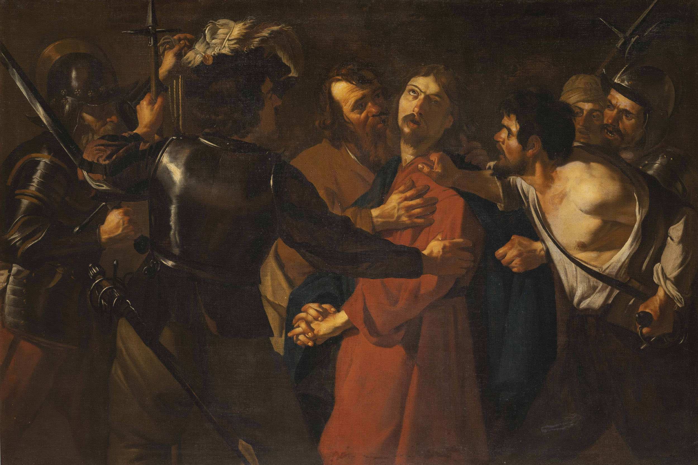

**内容（这是什么）**：客西马尼园里，犹大（Giuda）以一吻指认耶稣，士兵随即上前抓捕——这就是「犹大之吻、基督被捕」的场面。画面在火把/烛光的强烈明暗中挤满人头与兵器。

**背景 / 看点**：作者巴布伦是荷兰乌得勒支（Utrecht）的卡拉瓦乔追随者之一。这批北方画家亲赴罗马，把卡拉瓦乔的强光暗影带回尼德兰。本幅放在卡拉瓦乔厅里，正好说明卡拉瓦乔的影响如何越过阿尔卑斯山、形成「乌得勒支卡拉瓦乔派」。现场看夜景火光下半身人物的戏剧性打光。

### ⭐ 顺路看 胡塞佩·德·里贝拉，称小西班牙人《所罗门的审判》 / Ribera Jusepe de' called Spagnoletto, _The Judgment of Solomon_

- **作者 / Artist**：胡塞佩·德·里贝拉，称小西班牙人 / Ribera Jusepe de' called Spagnoletto
- **作品 / Work**：《所罗门的审判》 / _The Judgment of Solomon_
- **时间**：17 世纪 10 年代
- **材质**：布面油画
- **尺寸**：153 × 201 cm
- **位置**：西勒诺斯厅（第 8 室）
- **官网介绍页**：[官网介绍（英文）](https://www.collezionegalleriaborghese.it/en/opere/the-judgment-of-solomon)｜馆藏编号 033

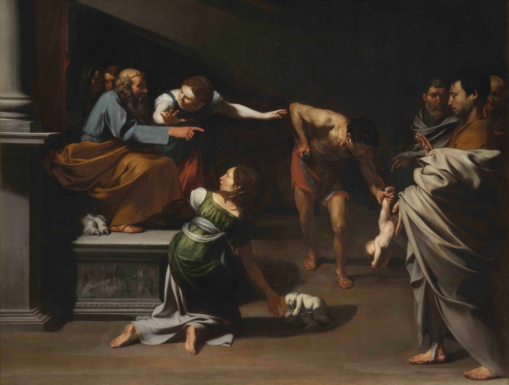

**内容（这是什么）**：两名女子争夺同一个婴儿，都自称是孩子的母亲。所罗门王（Salomone）佯称把孩子劈成两半各分一半，真母亲立刻情愿放弃以保孩子性命，所罗门由此判出真伪。画面正是王下令、士兵举刀、母亲扑救的紧张一刻。

**背景 / 看点**：作者里贝拉是活跃于那不勒斯的西班牙画家，绰号「小西班牙人」，是卡拉瓦乔之后最重要的「卡拉瓦乔派」之一。这件是他在罗马早期的作品，强烈明暗、粗粝写实，正见卡拉瓦乔的影响。现场看几个人物的强烈表情与剧场式打光，以及婴儿、母亲、刽子手三方的张力。

### ⭐ 顺路看 胡塞佩·德·里贝拉，称小西班牙人《乞丐》 / Ribera Jusepe de' called Spagnoletto, _A Beggar_

- **作者 / Artist**：胡塞佩·德·里贝拉，称小西班牙人 / Ribera Jusepe de' called Spagnoletto
- **作品 / Work**：《乞丐》 / _A Beggar_
- **时间**：约 1612 年
- **材质**：布面油画
- **尺寸**：110 × 78 cm
- **位置**：西勒诺斯厅（第 8 室）
- **官网介绍页**：[官网介绍（英文）](https://www.collezionegalleriaborghese.it/en/opere/a-beggar)｜馆藏编号 325

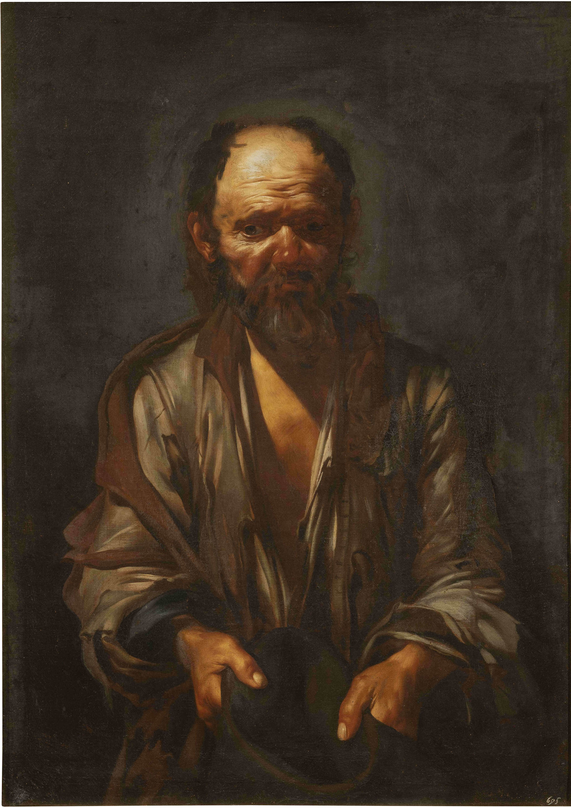

**内容 / 看点**：一个衣衫褴褛的乞丐（或哲人型流浪者）半身像，作者同样是那不勒斯的「小西班牙人」里贝拉。里贝拉擅长把社会底层人物画得逼真、有尊严，皮肤皱纹、破衣质感一丝不苟——这正是卡拉瓦乔「拿街头真人当模特」那条写实路线的延续。与本厅卡拉瓦乔的《捧果篮的男孩》《施洗者圣约翰》对照看，能体会同一种「以平民入画」的趣味。属顺路看。

### ⭐ 顺路看 朱塞佩·切萨里，称骑士达尔皮诺《基督被捕》 / Cesari Giuseppe called Cavalier d'Arpino, _Taking of Christ_

- **作者 / Artist**：朱塞佩·切萨里，称骑士达尔皮诺 / Cesari Giuseppe called Cavalier d'Arpino
- **作品 / Work**：《基督被捕》 / _Taking of Christ_
- **时间**：约 1598 年
- **材质**：铜版油画
- **尺寸**：79 × 58 cm
- **位置**：西勒诺斯厅（第 8 室）
- **官网介绍页**：[官网介绍（英文）](https://www.collezionegalleriaborghese.it/en/opere/taking-of-christ-2)｜馆藏编号 356

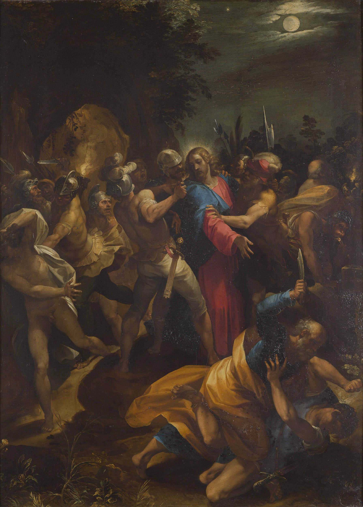

**内容（这是什么）**：又一幅「犹大之吻、基督被捕」，画在铜版上、尺幅较小、画面精细光滑——这是骑士达尔皮诺所属的晚期手法主义趣味，和卡拉瓦乔的粗粝写实正好相反。

**背景 / 看点**：作者达尔皮诺是卡拉瓦乔初到罗马时的雇主，年轻的卡拉瓦乔曾在他作坊里专画花果。讽刺的是，1607 年达尔皮诺被教皇查抄藏画，其中两幅卡拉瓦乔（《捧果篮的男孩》《病中的巴克斯》）正是这样进了博尔盖塞收藏——本厅就同时挂着这位「老板」和他「学徒」的画。现场可对照达尔皮诺光洁优雅的铜版小画与墙上卡拉瓦乔的强光巨作，看清两代审美的分野。

### ➖ 可略过 朱塞佩·切萨里，称骑士达尔皮诺《欧罗巴被劫》 / Cesari Giuseppe called Cavalier d'Arpino, _The Abduction of Europa_

- **作者 / Artist**：朱塞佩·切萨里，称骑士达尔皮诺 / Cesari Giuseppe called Cavalier d'Arpino
- **作品 / Work**：《欧罗巴被劫》 / _The Abduction of Europa_
- **时间**：约 1603–1606 年
- **材质**：木板油画
- **尺寸**：57 × 45 cm
- **位置**：西勒诺斯厅（第 8 室）
- **展陈提醒**：馆方藏品页标注「当前未展出」（Work not currently exhibited）
- **官网介绍页**：[官网介绍（英文）](https://www.collezionegalleriaborghese.it/en/opere/the-abduction-of-europa)｜馆藏编号 378

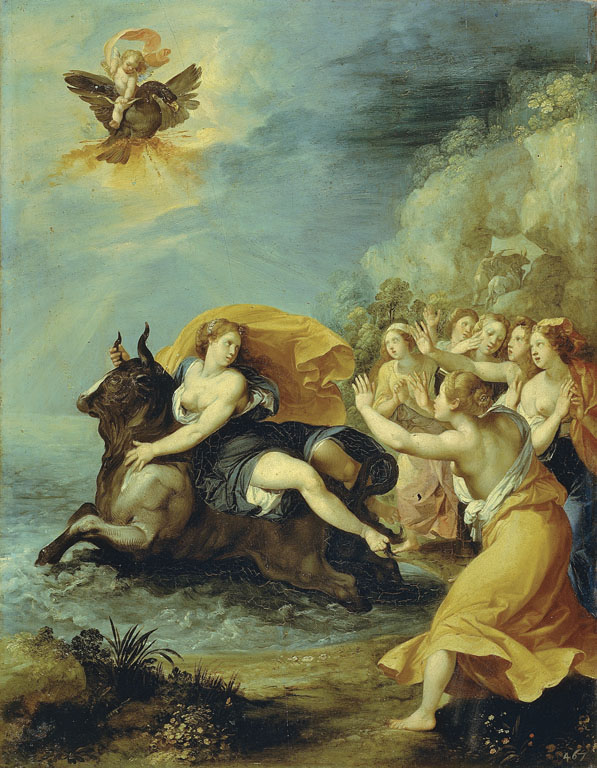

**内容 / 看点**：题材为宙斯（Giove）化身白牛把腓尼基公主欧罗巴（Europa）驮走渡海的神话，是达尔皮诺的一件木板小画。**馆方藏品页标注此件当前未展出**，现场多半看不到，编号在册仅作记录，可略过。

### ⭐ 顺路看 古罗马艺术《朱里奥-克劳狄王朝王子肖像，置于现代胸像上》 / Roman art, _Portrait of a Julio-Claudian Prince, on a Modern Bust_

- **作者 / Artist**：古罗马艺术 / Roman art
- **作品 / Work**：《朱里奥-克劳狄王朝王子肖像，置于现代胸像上》 / _Portrait of a Julio-Claudian Prince, on a Modern Bust_
- **时间**：约公元 40 年
- **材质**：白大理石
- **尺寸**：连胸像高 68 cm，头部 25 cm
- **位置**：西勒诺斯厅（第 8 室）
- **官网介绍页**：[官网介绍（英文）](https://www.collezionegalleriaborghese.it/en/opere/portrait-of-a-julio-claudian-prince-on-a-modern-bust)｜馆藏编号 CCXXIX

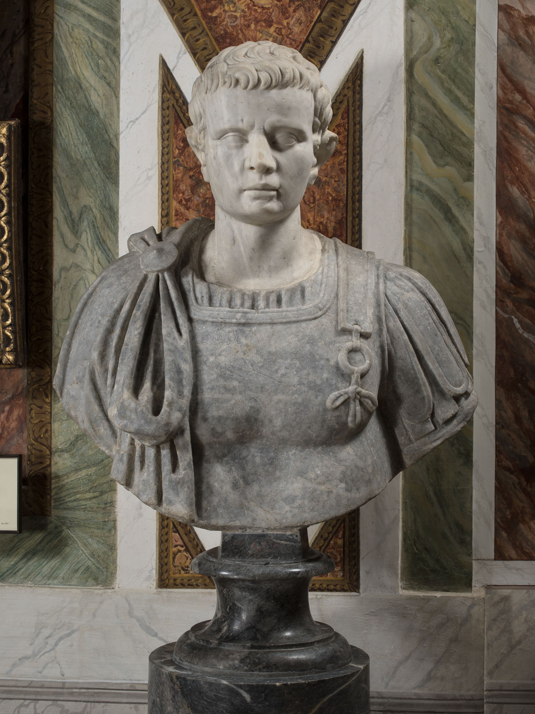

**这是什么（本厅古代雕塑一次看）**：墙面与角落里穿插陈列着一批古罗马大理石雕——帝王与贵族肖像、酒神随从的萨堤尔、古代石棺残段等。它们多是「古代真件＋近世修复/组合」的产物：古代留下的常常只是一颗头或一具身躯，文艺复兴至巴洛克时期再配上胸像、补上缺失部位，甚至改换身份。博尔盖塞把它们与卡拉瓦乔同室陈列，延续整座别墅「古今并置」的装饰传统。本件即一例：一颗约公元 40 年的朱里奥-克劳狄王朝（奥古斯都家族）少年王子古代头像，被安放在一具近代雕的胸像上。

**看点**：现场可重点看三件事——古头与近代胸像之间的接缝、大理石色泽差异、以及发式（朱里奥-克劳狄家族男性流行的整齐短刘海，是断代的依据）。本厅其余古罗马肖像、萨堤尔与石棺残件可参照这条「古件＋后配」的线索一并看（整组背景见此件）。

### ⭐ 顺路看 古罗马艺术《跳舞的萨堤尔》 / Roman art, _Dancing Satyr_

- **作者 / Artist**：古罗马艺术 / Roman art
- **作品 / Work**：《跳舞的萨堤尔》 / _Dancing Satyr_
- **时间**：公元 2 世纪
- **材质**：彭忒利科大理石
- **尺寸**：不含底座高 205 cm
- **位置**：西勒诺斯厅（第 8 室）
- **官网介绍页**：[官网介绍（英文）](https://www.collezionegalleriaborghese.it/en/opere/dancing-satyr)｜馆藏编号 CCXXV

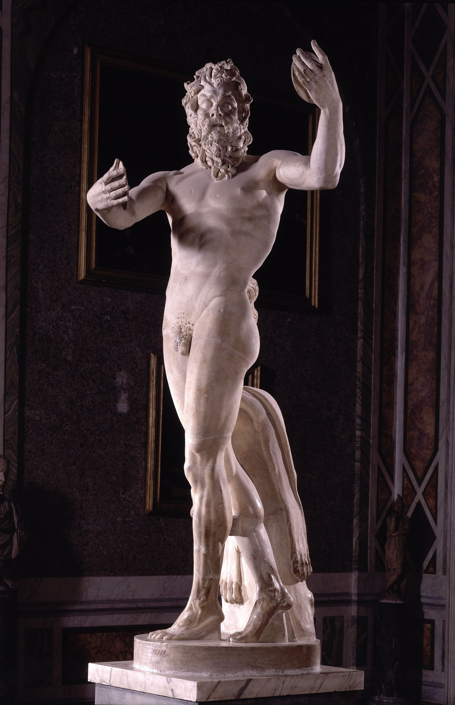

**内容 / 看点**：萨堤尔（Satiro）是酒神巴克斯随从中的半人半兽精灵，常被画成手舞足蹈、纵情享乐的形象。这件 2 米多高的「跳舞的萨堤尔」是公元 2 世纪罗马复制品，本是同类希腊化舞蹈萨堤尔题材的翻版。它与本厅天顶的西勒诺斯主题正好呼应——整间屋子从天顶到雕塑都在讲「酒神的世界」。现场看它扭转腾跃的舞姿动势。这类古件多经近代修复，参看本厅 CCXXIX 的整组背景。

### ⭐ 顺路看 古罗马艺术《坐姿皇帝像，修复为赫尔墨斯，配现代头像》 / Roman art, _Statue of Restored Seated Emperor as Hermes, with Modern Head_

- **作者 / Artist**：古罗马艺术 / Roman art
- **作品 / Work**：《坐姿皇帝像，修复为赫尔墨斯，配现代头像》 / _Statue of Restored Seated Emperor as Hermes, with Modern Head_
- **时间**：公元 1 世纪
- **材质**：白大理石
- **尺寸**：不含底座高 139 cm；头部 21 cm
- **位置**：西勒诺斯厅（第 8 室）
- **官网介绍页**：[官网介绍（英文）](https://www.collezionegalleriaborghese.it/en/opere/statueof-restored-seated-emperor-as-hermes-with-modern-head)｜馆藏编号 CCXXVII

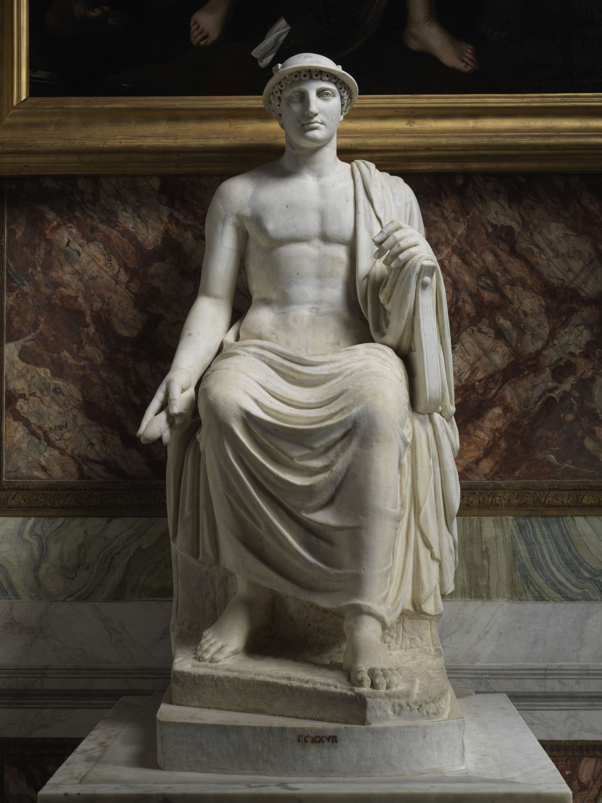

**内容 / 看点**：这是「身份被改换」的典型案例：古代原作是一尊坐姿罗马皇帝像，近世修复时被改造成信使神赫尔墨斯（Hermes），还配上了一颗近代雕的头。它正好示范本厅古代雕塑那条「古件＋近代补刻、甚至改名换姓」的线索（整组背景见 CCXXIX）。现场可比较坐像古代躯干与近代头部的大理石色差和雕工差异。

### ⭐ 顺路看 古罗马艺术《饰花彩及涅瑞伊得斯持阿喀琉斯武器的石棺；正面残段》 / Roman art, _Festooned Sarcophagus with Nereids Bearing the Arms of Achilles; Front Section_

- **作者 / Artist**：古罗马艺术 / Roman art
- **作品 / Work**：《饰花彩及涅瑞伊得斯持阿喀琉斯武器的石棺；正面残段》 / _Festooned Sarcophagus with Nereids Bearing the Arms of Achilles; Front Section_
- **时间**：公元 130–150 年
- **材质**：蓝纹白大理石
- **尺寸**：高 55 cm，宽 82 cm
- **位置**：西勒诺斯厅（第 8 室）
- **官网介绍页**：[官网介绍（英文）](https://www.collezionegalleriaborghese.it/en/opere/festooned-sarcophagus-with-nereids-bearing-the-arms-of-achilles-front-section)｜馆藏编号 CCXXVIIa

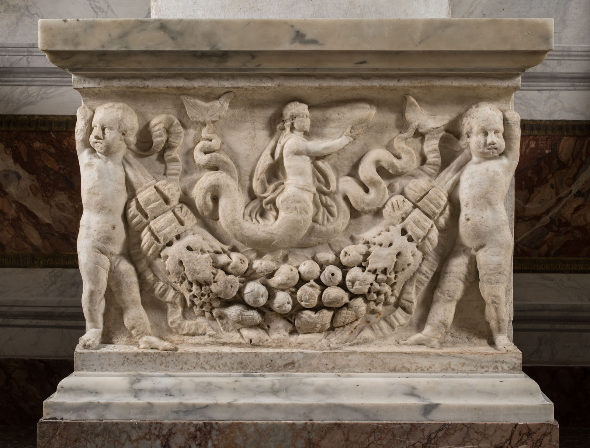

**内容（这是什么）**：一块公元 130–150 年罗马石棺的正面残段。题材是海中仙女涅瑞伊得斯（Nereidi）为英雄阿喀琉斯（Achille）运送神兵——他的母亲是海中女神忒提斯（Teti），曾请火神为儿子打造铠甲，由海仙女们护送。石棺上方饰有花彩（festoon），象征丰饶与生命循环，神话场景则寄托对逝者的英雄化想象。

**看点**：本厅还有同一具石棺的另一段正面残件（编号 CCXXXVIIa），两段可并看，拼出原棺的装饰逻辑。现场看花彩浮雕与海仙女托举铠甲的图式即可。

### ⭐ 顺路看 古罗马艺术《伪塞内卡头像》 / Roman art, _Head of the ‘Pseudo-Seneca’_

- **作者 / Artist**：古罗马艺术 / Roman art
- **作品 / Work**：《伪塞内卡头像》 / _Head of the ‘Pseudo-Seneca’_
- **时间**：公元 1 世纪
- **材质**：卢尼大理石
- **尺寸**：连胸像高 50 cm；头高 23 cm
- **位置**：西勒诺斯厅（第 8 室）
- **官网介绍页**：[官网介绍（英文）](https://www.collezionegalleriaborghese.it/en/opere/head-of-the-pseudo-seneca)｜馆藏编号 CCXXX

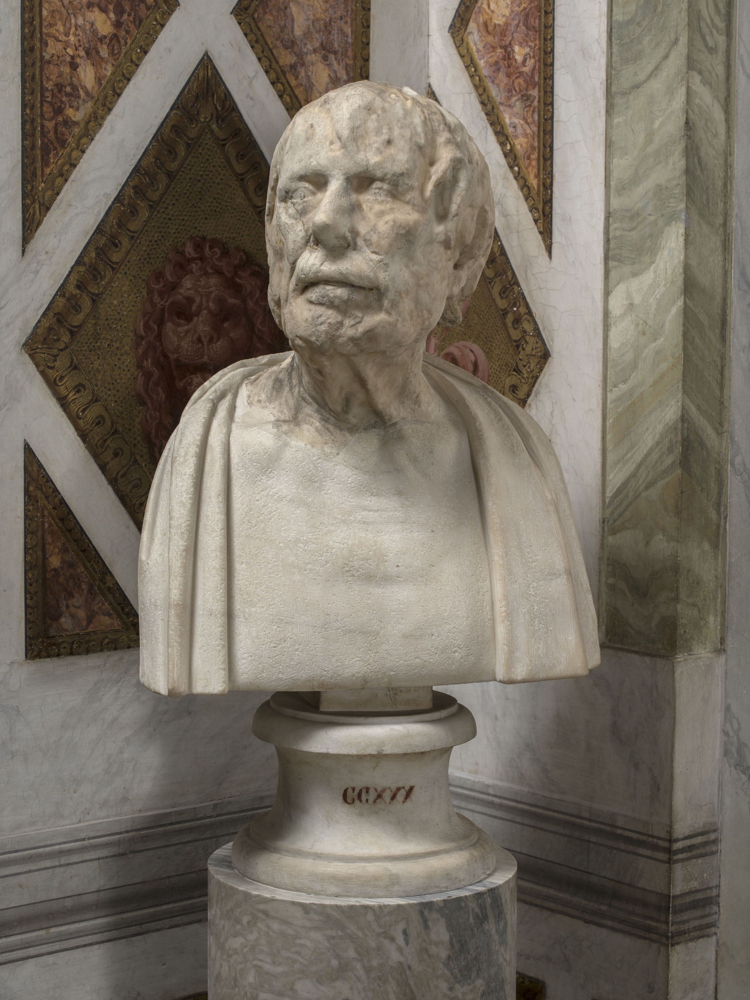

**内容 / 看点**：一颗清瘦、皱纹密布、眉头紧锁的老者头像。这是古代流传甚广的一种肖像类型，文艺复兴以来一直被当作斯多葛派哲学家塞内卡（Seneca）的像，故大量翻刻；后世学者发现身份其实并不可考，于是改称「伪塞内卡」（Pseudo-Seneca），今多认为可能是某位希腊诗人。现场看它刻意强调的衰老与「思想者」气质——这正是古人用来表现「哲人/文人」的程式（整组古代雕塑背景见 CCXXIX）。

### ⭐ 顺路看 古罗马艺术《休憩的萨堤尔》 / Roman art, _Resting Satyr_

- **作者 / Artist**：古罗马艺术 / Roman art
- **作品 / Work**：《休憩的萨堤尔》 / _Resting Satyr_
- **时间**：公元 2 世纪上半叶
- **材质**：白大理石
- **尺寸**：不含底座高 174 cm（头部 27 cm）
- **位置**：西勒诺斯厅（第 8 室）
- **官网介绍页**：[官网介绍（英文）](https://www.collezionegalleriaborghese.it/en/opere/resting-satyr)｜馆藏编号 CCXXXII

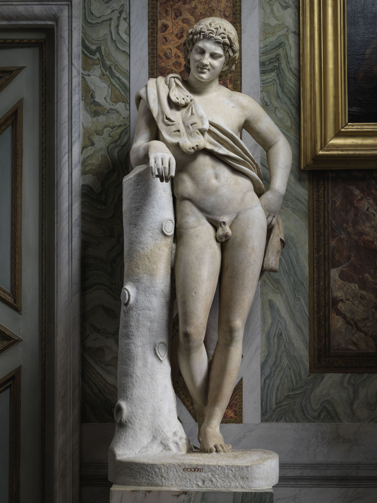

**内容 / 看点**：又一尊酒神随从萨堤尔（Satiro），这次是「倚树休憩」的姿态——慵懒地把重心靠在树干上，身体呈优美的 S 形。它是古希腊大师普拉克西特利斯（Prassitele）名作《休憩的萨堤尔》的罗马复制品，此型存世翻刻极多。与本厅那尊「跳舞的萨堤尔」（CCXXV）一动一静，正好成对，都呼应房间的酒神主题。现场看它松弛的倚靠动势（整组古代雕塑背景见 CCXXIX）。

### ⭐ 顺路看 古罗马艺术《英雄式裸体男性像》 / Roman art, _Male Figure in Heroic Nudity_

- **作者 / Artist**：古罗马艺术 / Roman art
- **作品 / Work**：《英雄式裸体男性像》 / _Male Figure in Heroic Nudity_
- **时间**：公元 2 世纪
- **材质**：大理石
- **尺寸**：不含底座高 145 cm；古代部分 110 cm
- **位置**：西勒诺斯厅（第 8 室）
- **官网介绍页**：[官网介绍（英文）](https://www.collezionegalleriaborghese.it/en/opere/male-figure-in-heroic-nudity)｜馆藏编号 CCXXXIV

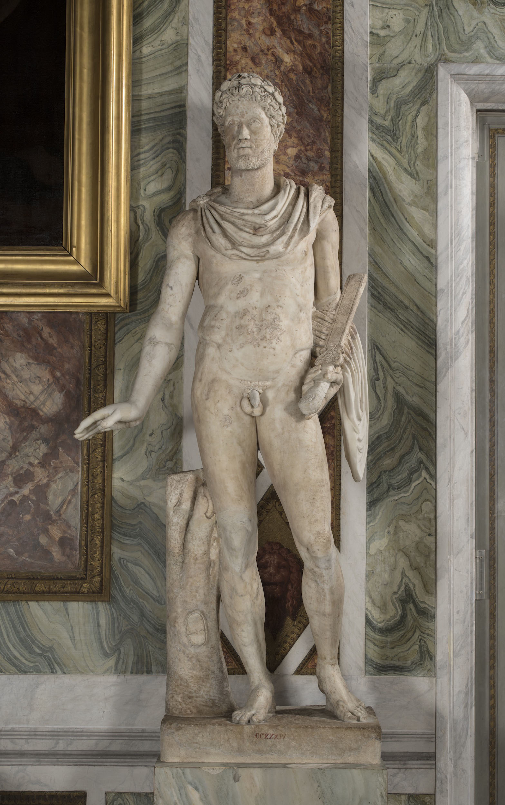

**内容 / 看点**：一尊「英雄式裸体」男性像——古希腊罗马用「全裸」这一程式来神化或英雄化人物（凡人、皇帝、神祇都可如此呈现）。馆方标注此件 145 cm 中仅 110 cm 为古代真件，其余为后世补配，是本厅「古件＋近代修复」线索的又一例（整组背景见 CCXXIX）。现场可留意古今部分的接缝与雕工差异。

### ⭐ 顺路看 古罗马艺术《朱里奥-克劳狄王朝王子肖像，置于现代胸像上（另一件）》 / Roman art, _Portrait of a Julio-Claudian Prince, on a modern bust_

- **作者 / Artist**：古罗马艺术 / Roman art
- **作品 / Work**：《朱里奥-克劳狄王朝王子肖像，置于现代胸像上（另一件）》 / _Portrait of a Julio-Claudian Prince, on a modern bust_
- **时间**：公元 1 世纪初
- **材质**：白大理石
- **尺寸**：连胸像高 65 cm；头高 28 cm
- **位置**：西勒诺斯厅（第 8 室）
- **官网介绍页**：[官网介绍（英文）](https://www.collezionegalleriaborghese.it/en/opere/portrait-of-a-julio-claudian-prince-on-a-modernbust)｜馆藏编号 CCXXXIX

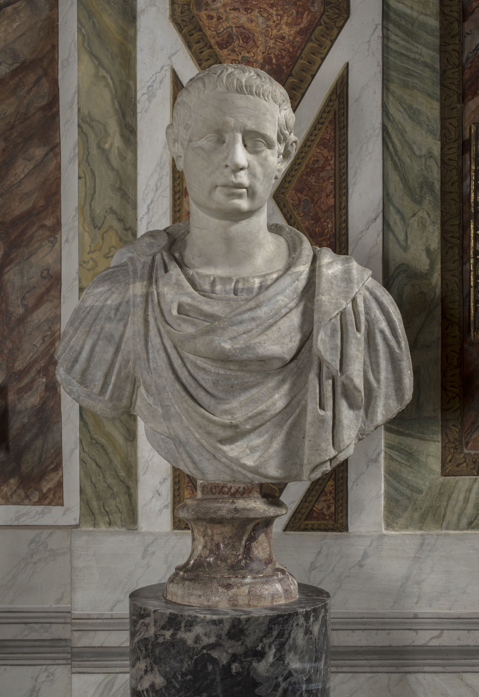

**内容 / 看点**：又一颗奥古斯都家族（朱里奥-克劳狄王朝）少年王子的古代头像，同样安在一具近代胸像上，与编号 CCXXIX 那件成对。本厅有好几件这类「古代头＋近代胸像」的帝王/贵族肖像，是当年贵族收藏古物、再补配陈列的常态（整组背景见 CCXXIX）。现场认其家族式整齐刘海、并留意头与胸像的接缝。

### ⭐ 顺路看 古罗马艺术《着斗篷女子雕像，小赫库兰尼姆女子型变体，配肖像头像》 / Roman art, _Statue of a Woman Wearing a Mantle, Variant of the ‘Piccola Ercolanese’ Type, with Portrait_

- **作者 / Artist**：古罗马艺术 / Roman art
- **作品 / Work**：《着斗篷女子雕像，小赫库兰尼姆女子型变体，配肖像头像》 / _Statue of a Woman Wearing a Mantle, Variant of the ‘Piccola Ercolanese’ Type, with Portrait_
- **时间**：雕像公元 2 世纪；头部公元 3 世纪
- **材质**：卢尼大理石
- **尺寸**：不含底座高 176 cm；头部 28 cm
- **位置**：西勒诺斯厅（第 8 室）
- **官网介绍页**：[官网介绍（英文）](https://www.collezionegalleriaborghese.it/en/opere/statue-of-a-woman-wearing-a-mantle-variant-of-the-piccola-ercolanese-1)｜馆藏编号 CCXXXVI

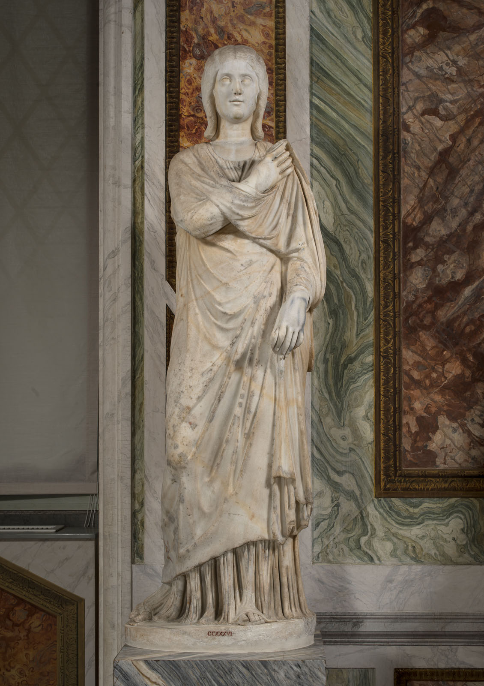

**内容 / 看点**：一尊裹着斗篷（pallium）的女子立像，属古代最流行的女性像范式之一「小赫库兰尼姆女子」（Piccola Ercolanese，因赫库兰尼姆出土的同型像得名）的变体——身体用通行的程式化身姿，头部则换成具体某位女子的肖像，用作她的纪念像。馆方标注身躯为公元 2 世纪、头部为公元 3 世纪，正是「古代躯体＋后配肖像头」的典型（整组背景见 CCXXIX）。现场看斗篷的衣褶处理与头身年代差。

### ⭐ 顺路看 古罗马艺术《文人肖像》 / Roman art, _Portrait of a Man of Letters_

- **作者 / Artist**：古罗马艺术 / Roman art
- **作品 / Work**：《文人肖像》 / _Portrait of a Man of Letters_
- **时间**：身躯公元 1 世纪，头部公元 2 世纪
- **材质**：身躯彭忒利科大理石；头部白大理石
- **尺寸**：不含底座高 119 cm；含非原配头部及底座高 159 cm
- **位置**：西勒诺斯厅（第 8 室）
- **官网介绍页**：[官网介绍（英文）](https://www.collezionegalleriaborghese.it/en/opere/portrait-of-a-man-of-letters)｜馆藏编号 CCXXXVII

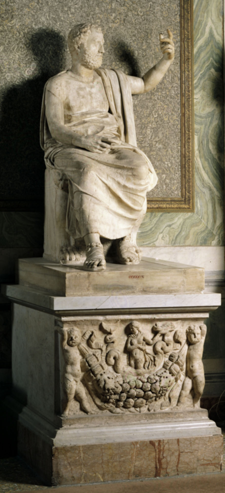

**内容 / 看点**：一尊「文人/学者」像——古人常用披裹希腊式外袍、若有所思的姿态来表现有学养的男子。馆方明确标注它是「拼配」之作：身躯为公元 1 世纪、头部为公元 2 世纪，且头部「与身躯并不原配」（non-pertinent head）——即近世把一颗别处的古代头安到了这具身躯上。这是本厅「古件＋后配、头身错配」线索里最直白的一例（整组背景见 CCXXIX）。现场看头与身的比例、年代是否「对得上」。

### ⭐ 顺路看 古罗马艺术《饰花彩及涅瑞伊得斯持阿喀琉斯武器的石棺；正面残段（另一段）》 / Roman art, _Festooned Sarcophagus with Nereids Bearing the Arms of Achilles; front section_

- **作者 / Artist**：古罗马艺术 / Roman art
- **作品 / Work**：《饰花彩及涅瑞伊得斯持阿喀琉斯武器的石棺；正面残段（另一段）》 / _Festooned Sarcophagus with Nereids Bearing the Arms of Achilles; front section_
- **时间**：公元 130–150 年
- **材质**：蓝纹白大理石
- **尺寸**：高 52 cm，宽 80 cm
- **位置**：西勒诺斯厅（第 8 室）
- **官网介绍页**：[官网介绍（英文）](https://www.collezionegalleriaborghese.it/en/opere/festooned-sarcophagus-with-nereids-bearing-the-arms-of-achilles-front-section-1)｜馆藏编号 CCXXXVIIa

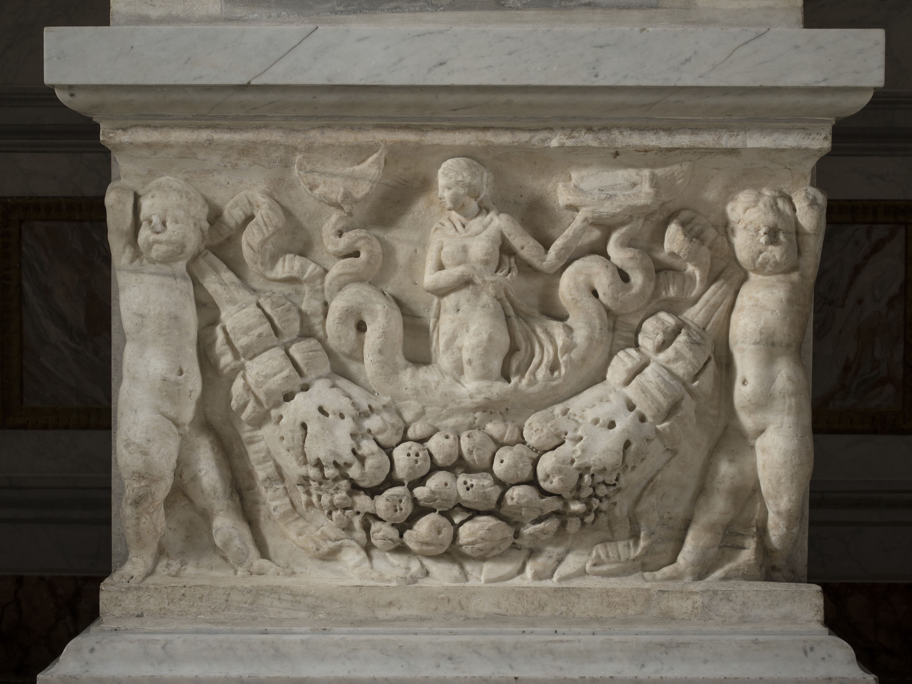

**内容 / 看点**：与编号 CCXXVIIa 同属一具石棺——这是它正面的另一段残件，题材同为「海仙女涅瑞伊得斯为阿喀琉斯运送神兵」、上方饰花彩。两段并看，能还原一具「花环式石棺」的完整装饰逻辑（题材与象征说明见 CCXXVIIa 那块）。现场逐段绕行，注意花彩与海仙女图式的连续。

### ⭐ 顺路看 古罗马艺术《着斗篷女子雕像，修复为缪斯，配非原配肖像头像》 / Roman art, _Statue of a Woman Wearing a Mantle Restored as a Muse with a Non-Original Portrait Head_

- **作者 / Artist**：古罗马艺术 / Roman art
- **作品 / Work**：《着斗篷女子雕像，修复为缪斯，配非原配肖像头像》 / _Statue of a Woman Wearing a Mantle Restored as a Muse with a Non-Original Portrait Head_
- **时间**：雕像公元 2 世纪；头部约公元 250 年
- **材质**：白大理石
- **尺寸**：不含底座高 177 cm
- **位置**：西勒诺斯厅（第 8 室）
- **官网介绍页**：[官网介绍（英文）](https://www.collezionegalleriaborghese.it/en/opere/statue-of-a-woman-wearing-a-mantle-restored-as-a-muse)｜馆藏编号 CCXXXVIII

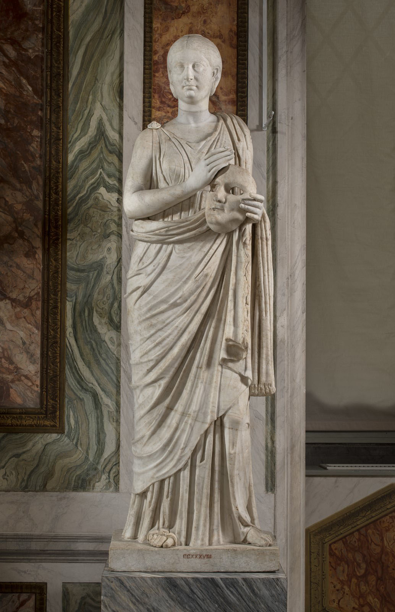

**内容 / 看点**：与 CCXXXVI 同为裹斗篷女子立像，但这一尊在近世修复时被「改造」成一位缪斯（Musa，文艺女神），还配上了一颗非原配的古代肖像头（约公元 250 年）。同样是「古代躯体＋后配头、并被重新指认身份」的产物，集合了本厅古代雕塑的两大看点——头身错配与身份改换（整组背景见 CCXXIX）。现场可与 CCXXXVI 并看，比较两尊斗篷女子的不同「改装」结果。

### ⭐ 顺路看 古罗马艺术《多米蒂娅·卢西拉肖像，置于现代胸像上》 / Roman art, _Portrait of Domitia Lucilla, on a modern bust_

- **作者 / Artist**：古罗马艺术 / Roman art
- **作品 / Work**：《多米蒂娅·卢西拉肖像，置于现代胸像上》 / _Portrait of Domitia Lucilla, on a modern bust_
- **时间**：约公元 2 世纪中叶
- **材质**：白大理石
- **尺寸**：高 40 cm
- **位置**：西勒诺斯厅（第 8 室）
- **官网介绍页**：[官网介绍（英文）](https://www.collezionegalleriaborghese.it/en/opere/portrait-of-domitia-lucilla-on-a-modern-bust)｜馆藏编号 CCXXXXIII

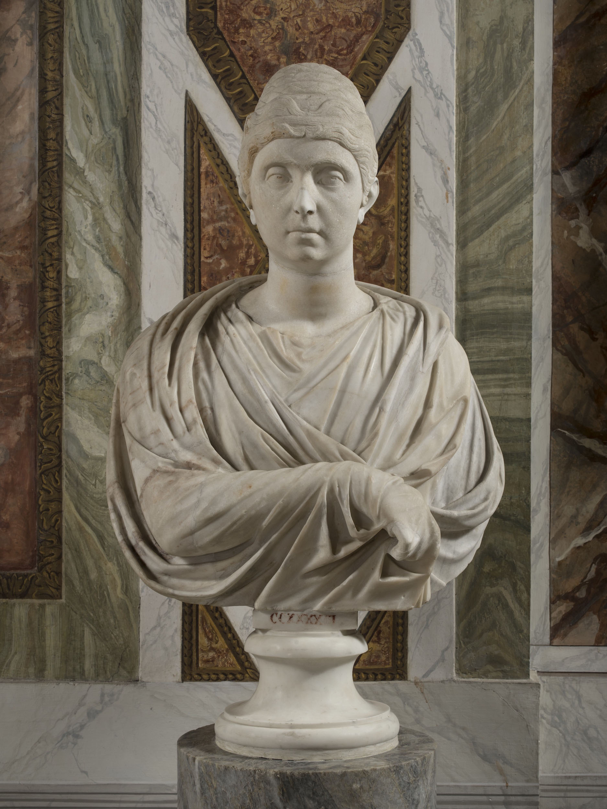

**内容 / 看点**：被认作多米蒂娅·卢西拉（Domitia Lucilla）的女性肖像头——她是哲学家皇帝马可·奥勒留（Marco Aurelio）的母亲。古代头像同样被安在一具近代胸像上。这类女性肖像断代常靠发式：公元 2 世纪中叶（安东尼王朝）流行高耸盘绕的发辫，可作认年的线索（整组背景见 CCXXIX）。现场看她的发型与面部刻画。

### ⭐ 顺路看 古罗马艺术《老福斯蒂娜肖像，置于现代胸像上》 / Roman art, _Portrait of Faustina the Elder on a Modern Bust_

- **作者 / Artist**：古罗马艺术 / Roman art
- **作品 / Work**：《老福斯蒂娜肖像，置于现代胸像上》 / _Portrait of Faustina the Elder on a Modern Bust_
- **时间**：公元 138–141 年
- **材质**：白大理石
- **尺寸**：古代部分高 42 cm
- **位置**：西勒诺斯厅（第 8 室）
- **官网介绍页**：[官网介绍（英文）](https://www.collezionegalleriaborghese.it/en/opere/portrait-of-faustina-the-elder-on-a-modern-bust)｜馆藏编号 CCXXXXIV

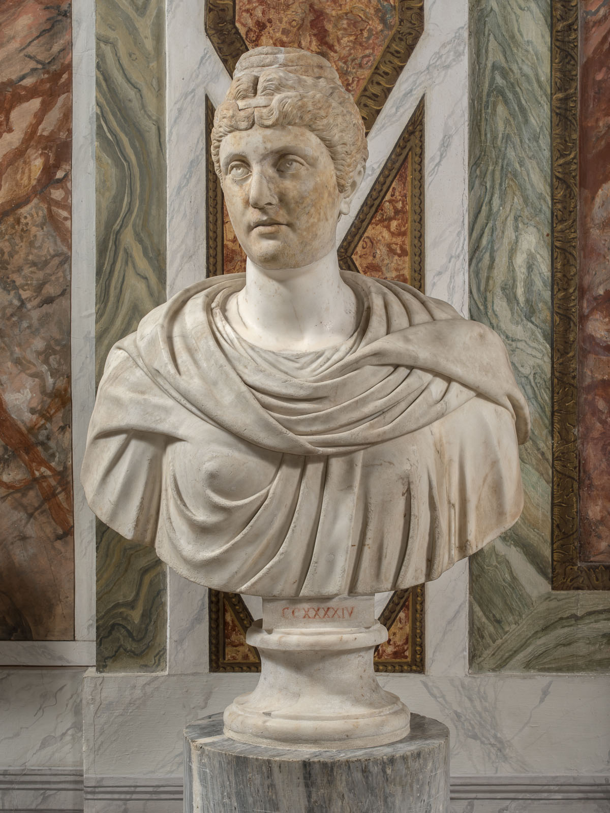

**内容 / 看点**：老福斯蒂娜（Faustina Maggiore）是皇帝安东尼·庇护（Antonino Pio）的皇后，公元 141 年去世后被尊为神。这颗古代肖像头作于公元 138–141 年间（即她在世末年至封神前后），后世配上近代胸像。她标志性的高盘发髻是安东尼王朝女性发式的范本。这是本厅一系列「古头＋近代胸像」帝室女性肖像之一（整组背景见 CCXXIX），现场认其盘发即可。

### ⭐ 顺路看 古罗马艺术《提比略肖像，置于现代胸像上》 / Roman art, _Portrait of Tiberius on a modern bust_

- **作者 / Artist**：古罗马艺术 / Roman art
- **作品 / Work**：《提比略肖像，置于现代胸像上》 / _Portrait of Tiberius on a modern bust_
- **时间**：公元 1 世纪初
- **材质**：白大理石
- **尺寸**：高 27 cm
- **位置**：西勒诺斯厅（第 8 室）
- **官网介绍页**：[官网介绍（英文）](https://www.collezionegalleriaborghese.it/en/opere/portrait-of-tiberius-on-a-modern-bust)｜馆藏编号 CLXXV

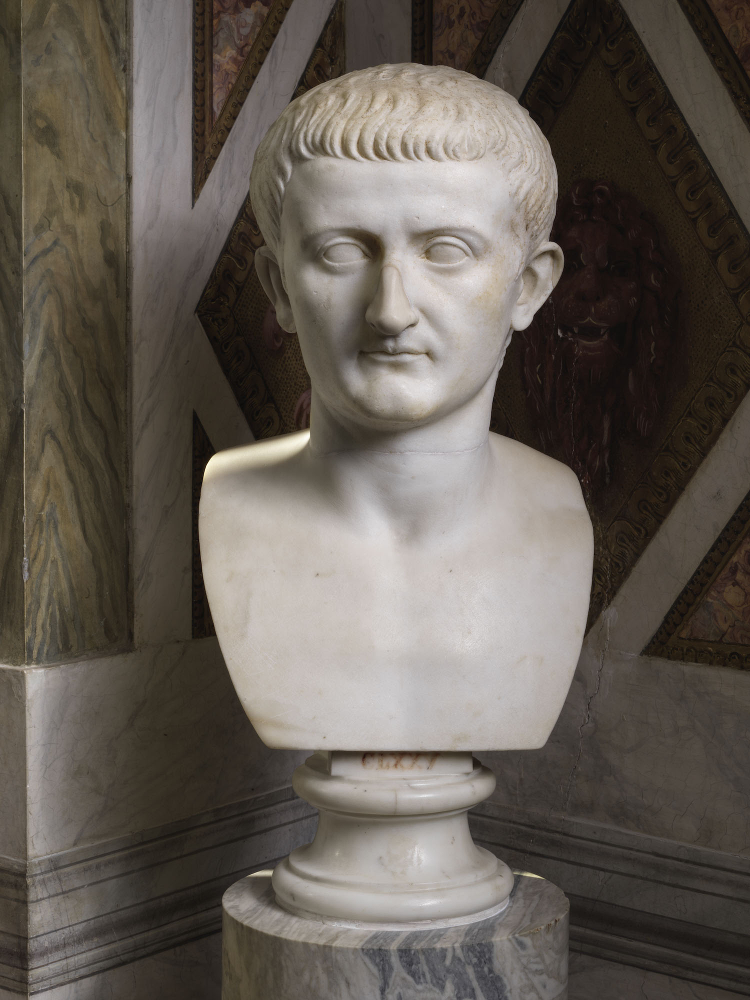

**内容 / 看点**：罗马第二位皇帝提比略（Tiberio，公元 14–37 在位，奥古斯都的继承人）的古代肖像头，后配近代胸像。他属朱里奥-克劳狄王朝，所以面相与发式延续奥古斯都家族的理想化、年轻化程式（即便他即位时已年长，肖像仍把他画得壮年）。这是本厅帝王肖像系列里能「叫得出名字」的一件（整组背景见 CCXXIX），可与同厅几位朱里奥-克劳狄王子像并看。

### ⭐ 顺路看 古罗马艺术《女性肖像，置于现代胸像上》 / Roman art, _Female Portrait on a modern bust_

- **作者 / Artist**：古罗马艺术 / Roman art
- **作品 / Work**：《女性肖像，置于现代胸像上》 / _Female Portrait on a modern bust_
- **时间**：公元 2 世纪末
- **材质**：白大理石
- **尺寸**：头颈高 39 cm
- **位置**：西勒诺斯厅（第 8 室）
- **官网介绍页**：[官网介绍（英文）](https://www.collezionegalleriaborghese.it/en/opere/female-portrait-on-a-modern-bust)｜馆藏编号 CXII

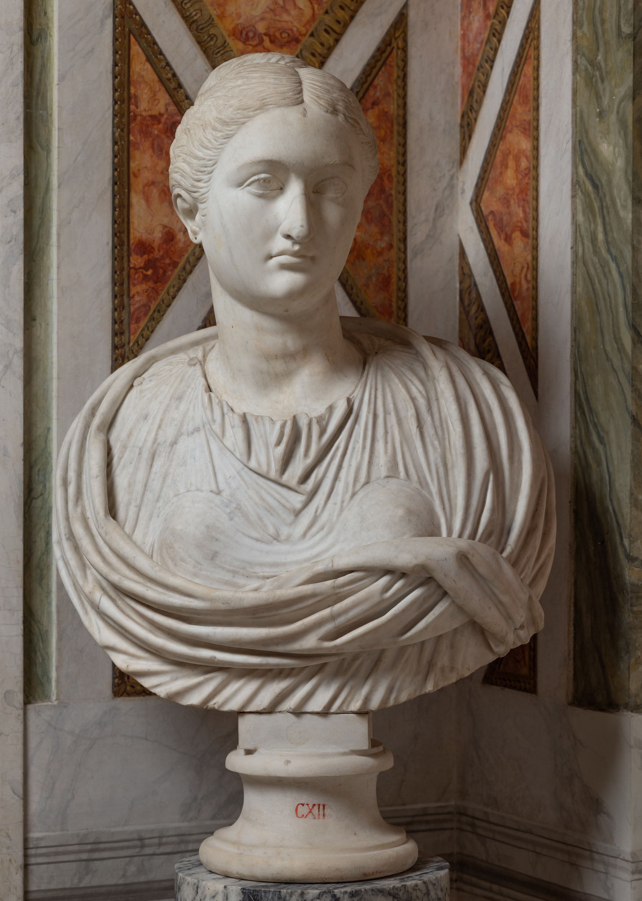

**内容 / 看点**：一位身份不明的罗马女子肖像头（公元 2 世纪末），同样配近代胸像。与同厅几位有名有姓的帝室女性（多米蒂娅·卢西拉、老福斯蒂娜）不同，这一位没留下名字，正提示我们：古代肖像里大量是叫不出名的私人纪念像。现场仍可靠发式断代——晚期安东尼/塞维鲁王朝的发型与前面几件略有不同（整组背景见 CCXXIX）。

### ⭐ 顺路看 古罗马艺术《带蛇的女性头像》 / Roman art, _Female Head with Serpents_

- **作者 / Artist**：古罗马艺术 / Roman art
- **作品 / Work**：《带蛇的女性头像》 / _Female Head with Serpents_
- **时间**：公元 1 世纪
- **材质**：彭忒利科大理石
- **尺寸**：连胸像高 60 cm（古代部分 32 cm）；头部 28 cm
- **位置**：西勒诺斯厅（第 8 室）
- **官网介绍页**：[官网介绍（英文）](https://www.collezionegalleriaborghese.it/en/opere/female-head-with-serpents)｜馆藏编号 LXXIII

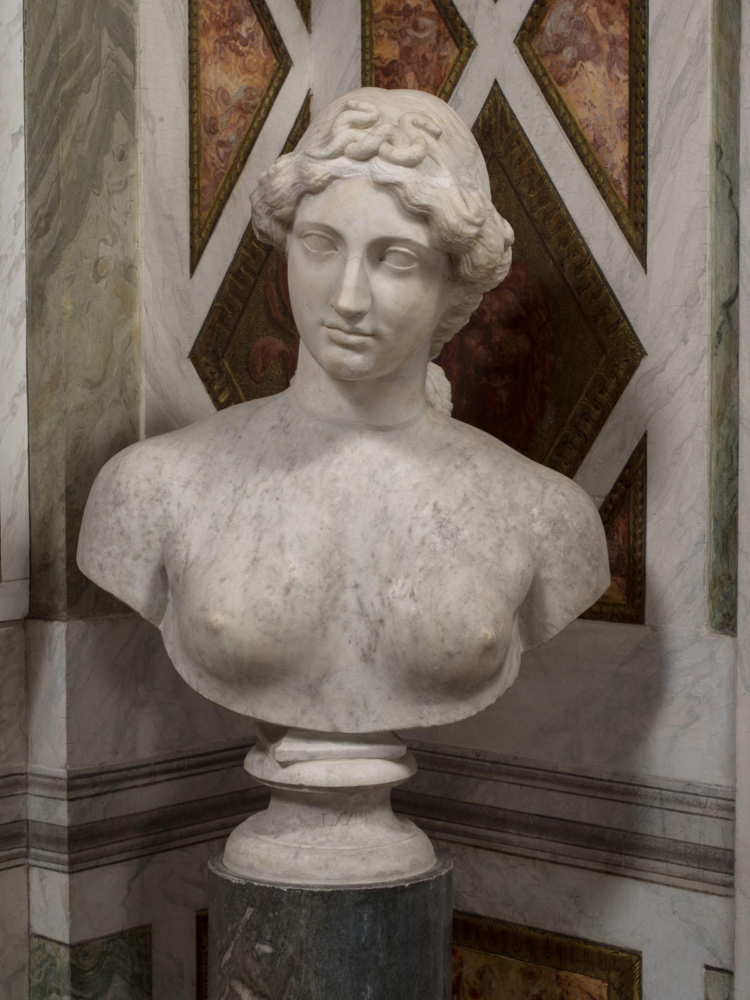

**内容 / 看点**：一颗发间盘绕着蛇的女性头像——蛇这一标志通常指向蛇发女妖美杜莎（Medusa），或与蛇相关的女神。它是本厅唯一带神话/怪诞色彩的肖像头，60 cm 中仅 32 cm 为古代真件，余为后世补配（整组背景见 CCXXIX）。现场找发间的蛇形——这正是认出题材身份的关键道具。
## 其他

### ⭐ 顺路看 乔瓦尼·巴蒂斯塔·马尔凯蒂《饰酒神女祭司、萨堤尔与西勒诺斯的错视框景》 / Giovanni Battista Marchetti, _Trompe-l'oeil Framework with Bacchantes, Satyrs, and Sileni_

- **作者 / Artist**：乔瓦尼·巴蒂斯塔·马尔凯蒂（1730–1800） / Giovanni Battista Marchetti (1730–1800)
- **作品 / Work**：《饰酒神女祭司、萨堤尔与西勒诺斯的错视框景》 / _Trompe-l'oeil Framework with Bacchantes, Satyrs, and Sileni_
- **时间**：1775–1778 年
- **位置**：第 8 室天顶

**内容 / 看点**：天顶四周那圈「以假乱真」的彩绘框架（trompe-l'oeil，错视画），点缀着酒神女祭司（Baccanti）、萨堤尔（Satiri）与西勒诺斯（Sileni）等酒神随从形象。马尔凯蒂的这套错视框景负责把中央孔卡的天顶画、侧面单色画和酒神主题整合成一间完整的「酒神之厅」装饰。现场抬头看四周框架——它用平面绘画假装出立体的建筑线脚与雕饰，是 18 世纪天顶装饰的常见手法。

## 资料来源 / Sources

- Galleria Borghese 官方房间页：[Room 8](https://galleriaborghese.cultura.gov.it/en/il-museo/la-villa/sala-8-sala-del-sileno/)
- Galleria Borghese 藏品筛选：[Painting, Room 8](https://www.collezionegalleriaborghese.it/en/collezione/pittura?sala=s8)
- Galleria Borghese 藏品筛选：[Modern Sculpture, Room 8](https://www.collezionegalleriaborghese.it/en/collezione/scultura?sala=s8)
- Galleria Borghese 藏品筛选：[Ancient Art, Room 8](https://www.collezionegalleriaborghese.it/en/collezione/arte-antica?sala=s8)
- Galleria Borghese 藏品筛选：[Furniture, Room 8](https://www.collezionegalleriaborghese.it/en/collezione/arredi?sala=s8)
