第 10 室（赫拉克勒斯厅）汇集了北方与意大利文艺复兴的爱情、神话名作（克拉纳赫、巴罗奇、科雷焦《达娜厄》）；天顶翁特贝格尔绘赫拉克勒斯「因爱而死、因死成神」的悲剧，与四壁的爱情题材合成「爱与英雄」的主题。

**必看与核心展品（⭐⭐⭐ 必看 + 核心）**

| 推荐 | 展品 | 作者 | 一句话看点 |
|---|---|---|---|
| ⭐⭐⭐ 必看 | 《维纳斯、丘比特与蜂巢》 | 老卢卡斯·克拉纳赫 | 北方「细长裸体」维纳斯，偷蜜被蜇的爱欲寓言 |
| ⭐⭐⭐ 必看 | 《埃涅阿斯逃离特洛伊》 | 费代里科·巴罗奇 | 巴罗奇罕见的世俗题材，色彩华美的背父逃亡 |
| ⭐⭐⭐ 必看 | 《达娜厄》 | 科雷焦 | 化作金雨的朱庇特，柔美情色的神话名作 |
| ⭐⭐ 推荐 | 《吉普赛女郎》 | 尼古拉·科尔迪耶 | 深色大理石配青铜的「多材质炫技」雕像 |
| ⭐⭐ 推荐 | 天顶《赫拉克勒斯功业片段》 | 克里斯托夫·翁特贝格尔 | 「劫妻→毒发→自焚→升天」的完整悲剧链 |

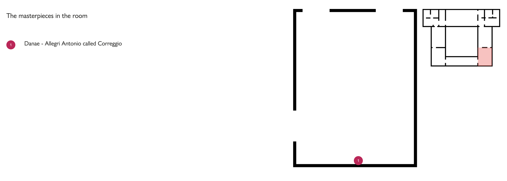

**展厅官网介绍页**：[Room 10 - Hercules Room](https://galleriaborghese.cultura.gov.it/en/il-museo/la-villa/sala-10-sala-di-ercole/)

## 核心展品

### ⭐⭐⭐ 必看 老卢卡斯·克拉纳赫《维纳斯、丘比特与蜂巢》 / Lucas Cranach the Elder, _Venus and Cupid with a Honeycomb_
- **作者 / Artist**：老卢卡斯·克拉纳赫 / Lucas Cranach the Elder
- **作品 / Work**：《维纳斯、丘比特与蜂巢》 / _Venus and Cupid with a Honeycomb_
- **时间**：约 1531 年
- **材质**：油彩木板
- **尺寸**：169 × 67 cm
- **位置**：赫拉克勒斯厅（第 10 室）
- **官网介绍页**：[维纳斯与手持蜂巢的丘比特｜Galleria Borghese 官方藏品库](https://www.collezionegalleriaborghese.it/opere/venere-e-amore-che-reca-il-favo-di-miele)｜馆藏编号 326

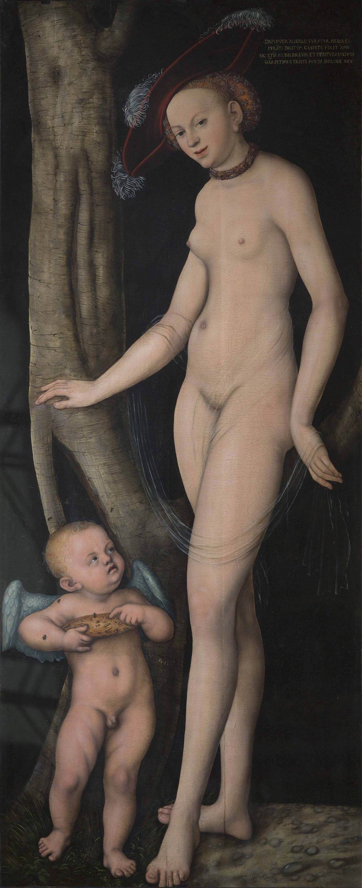

**内容（这是什么）**：北方文艺复兴大师老卢卡斯·克拉纳赫（Lucas Cranach the Elder）笔下的爱与美之神维纳斯（Venus）几乎全身裸立、身形修长妩媚；脚边的小爱神丘比特（Cupid）手里攥着刚从蜂窝偷来的蜜，却被蜜蜂蜇了手指，正皱眉向母亲哭诉。画面右上角的拉丁诗句点破寓意：偷蜜的孩子被蜂蜇，正如人追逐的爱欲之乐短暂易逝、随后只余刺痛与忧伤——这是希腊化诗人忒奥克里托斯（Theocritus）《田园诗》中「偷蜜贼丘比特」一段的图解。

**背景 / 来历**：此画约作于 1531 年，是克拉纳赫一生反复重画的招牌题材——同一「偷蜜的维纳斯」已知有约二十四个版本，本幅属其中。它诞生在德国北部小城维滕贝格（Wittenberg）：1517 年路德（Martin Luther）正是在这里贴出《九十五条论纲》，宗教改革后艺术家不得不为裸体画配上劝世的拉丁铭文，好让这类供博学藏家欣赏的世俗画「师出有名」。身为路德好友、又是萨克森选侯宫廷画师的克拉纳赫，因此画出在当时德语区罕见的大量女性裸体，却都裹着一层道德外衣。画中维纳斯并非纯然女神，而是一位萨克森宫廷贵妇的化身——她戴着当时时髦的插鹤羽红帽与金线发网，发网上绣着「W.A.F.I.」字样，可能暗指被画者的姓名。此画是最早进入红衣主教希皮奥内·博尔盖塞（Scipione Borghese）收藏的作品之一，1611 年已在册。

**看点**：克拉纳赫标志性的「细长裸体」——身材瘦削、肩窄腿长、肌肤冷白，与意大利文艺复兴丰腴温暖的维纳斯截然不同，一眼就能认出是北方手笔。构图被认为借鉴了丢勒（Dürer）的版画（维纳斯立于右侧全高、丘比特在左、其脚尖几乎触到画框下缘）。当年它与同厅布雷夏尼诺的《维纳斯与两个丘比特》(inv. 324) 配成一对悬挂，两幅都是窄长直立的裸体女神，南北画风对照鲜明。

**现场站看**：

1. **看右上角的拉丁铭文**——四行小字正是全画的「说明书」：偷蜜被蜇＝爱欲先甜后痛。看画前先认出这段字，才知道这幅裸体画其实是一则道德寓言，而非单纯的香艳之作。
2. **找丘比特被蜇的手与蜂窝**——画面左下，小爱神举着滴蜜的蜂窝、缩着被蜇的手指向母亲告状。这个「现行犯」细节是整个故事的题眼。
3. **看维纳斯的帽子与发网**——插鹤羽的时髦红帽、金线发网与宝石项链，把「女神」一把拉回 16 世纪萨克森宫廷；发网上的「W.A.F.I.」暗示她其实是一位真实贵妇的理想化肖像。
4. **量一量身材比例**——刻意拉长的躯干与细腿是克拉纳赫的「商标」。记住这个瘦长轮廓，再看同厅意大利画家笔下饱满的维纳斯，差别立刻显现。
5. **和旁边的成对画作连看**——本幅历史上与布雷夏尼诺《维纳斯与两个丘比特》(inv. 324) 成对，都是直立窄长的裸体女神；两幅并看，能体会同一题材在阿尔卑斯山南北的不同处理。

### ⭐⭐⭐ 必看 费代里科·巴罗奇《埃涅阿斯逃离特洛伊》 / Federico Barocci, _Aeneas Fleeing Troy_

- **作者 / Artist**：费代里科·巴罗奇 / Federico Barocci
- **作品 / Work**：《埃涅阿斯逃离特洛伊》 / _Aeneas Fleeing Troy_
- **时间**：1598 年（签名并纪年）
- **材质**：布面油画
- **尺寸**：179 × 253 cm
- **位置**：赫拉克勒斯厅（第 10 室）
- **官网介绍页**：[埃涅阿斯逃离特洛伊 / La fuga di Enea da Troia｜Galleria Borghese 官方藏品库](https://www.collezionegalleriaborghese.it/opere/la-fuga-di-enea-da-troia)｜馆藏编号 068

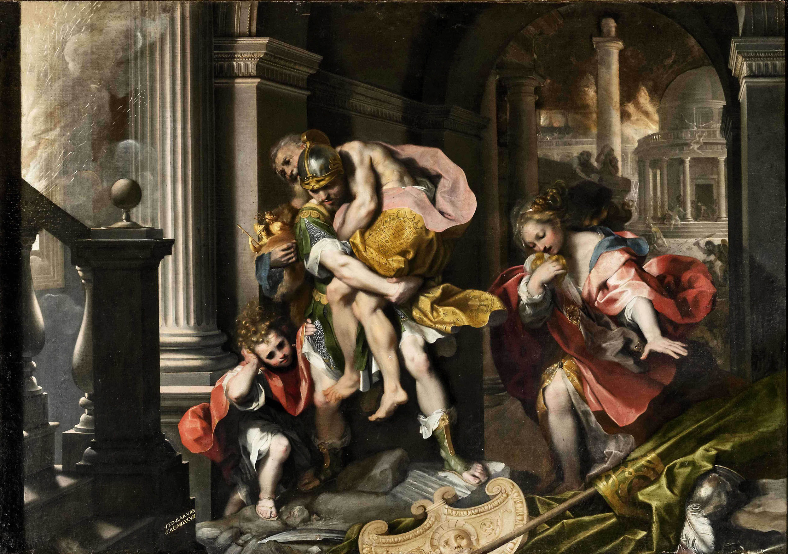

**内容（这是什么）**：维吉尔《埃涅阿斯纪》的开篇名场面——特洛伊城被希腊人攻破、火光冲天，特洛伊英雄埃涅阿斯（Aeneas）背起年迈的父亲安基塞斯（Anchises，怀里抱着家族守护神像），一手牵着幼子阿斯卡尼俄斯（Ascanius），妻子克瑞乌萨（Creusa）跟在身后，一家人仓皇逃出焚城。这一逃，最终把特洛伊血脉带到意大利、孕育出罗马的奠基传说。「背父逃亡」是西方艺术里「孝」与「虔敬」（拉丁语 pietas）的经典图像。

**背景 / 来历**：此画签名并纪年 1598，是巴罗奇（Federico Barocci，乌尔比诺人）整个生涯里几乎唯一的世俗题材作品——他一辈子画宗教故事，唯独这个题材是例外。它其实是「第二版」：第一版约 1586–1589 年应神圣罗马皇帝鲁道夫二世（Rudolf II）之命而作，皇帝特意要「不是宗教虔信、而是别种趣味」的画；那一版后来流落瑞典女王克里斯蒂娜、奥尔良公爵之手，最终在英国失传。约十年后巴罗奇重画了这第二版，受乌尔比诺的朱利亚诺·德拉·罗韦雷（Giuliano Della Rovere）委托，后者大概把它转赠给了红衣主教希皮奥内·博尔盖塞（Scipione Borghese），1613 年已见于其收藏，1902 年随博尔盖塞藏品归意大利国家。

**看点**：这是一幅承前启后的「原始巴洛克」（protobarocco）名作，站在一条清晰的艺术史链条上——背父逃亡的姿态直接借自拉斐尔（Raphael）梵蒂冈签字厅《波尔戈火灾》中同样的人物；而约二十年后，年轻的贝尼尼（Bernini）正是用同一题材为同一位希皮奥内·博尔盖塞雕出了名作《埃涅阿斯、安基塞斯与阿斯卡尼俄斯》（现陈列在本馆一楼第 6 室）。也就是说，拉斐尔→巴罗奇→贝尼尼三代人、同一个「背父逃亡」母题，在这座美术馆里能一并看到。此画当年因构图与惊人的色彩广受赞誉，1595 年阿戈斯蒂诺·卡拉奇（Agostino Carracci）还为它制作版画广为流传。

**现场站看**：

1. **看埃涅阿斯背父牵子的「三代同框」**——老父在肩、幼子在手、妻子在后，一柱构图里压进三代人。这正是「pietas（虔敬/孝）」的标准图像；认出三代人，就读懂了画的核心。
2. **看背景的圆形神庙**——画面深处那座圆庙取自布拉曼特（Bramante）的蒙托里奥圣彼得小堂（Tempietto），被巴罗奇改画成一座古代神庙，给逃亡场面铺了一层「古罗马」底色。
3. **看巴罗奇的色彩**——粉橘、湖蓝、亮黄的衣袍在火光里发光，是巴罗奇最被称道的「彩色魔法」，与同厅大量灰暗的 16 世纪板上画一比就跳出来。
4. **下楼后和贝尼尼的同题雕塑连看**——记住这个背父逃亡的姿势，到一楼第 6 室看贝尼尼《埃涅阿斯》群雕（同为希皮奥内·博尔盖塞而作），体会从拉斐尔到巴罗奇再到贝尼尼，同一母题如何从平面走向立体。

### ⭐⭐ 推荐 尼古拉·科尔迪耶《吉普赛女郎》 / Nicolas Cordier, _Gypsy Girl_

- **作者 / Artist**：尼古拉·科尔迪耶 / Nicolas Cordier
- **作品 / Work**：《吉普赛女郎》 / _Gypsy Girl_
- **时间**：约 1607–1612 年
- **材质**：彩色大理石与青铜
- **尺寸**：高 140 cm
- **位置**：赫拉克勒斯厅（第 10 室）
- **官网介绍页**：[吉普赛女郎 / La Zingara｜Galleria Borghese 官方藏品库](https://www.collezionegalleriaborghese.it/opere/la-zingara)｜馆藏编号 CCLXIII

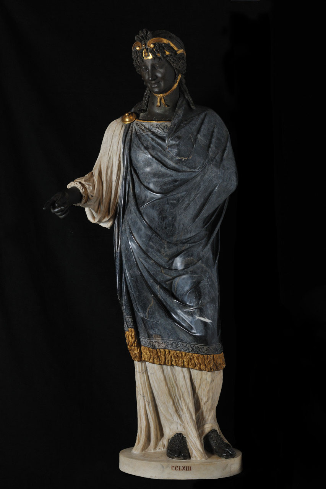

**内容（这是什么）**：一位身着异域服饰、亭亭而立的年轻吉普赛女子（La Zingara，「占卜算命的吉普赛女郎」是当时罗马很受欢迎的风俗题材）。她不是神话或宗教人物，而是一个被当作「异国风情」来欣赏的市井形象。

**背景 / 看点**：作者科尔迪耶（Nicolas Cordier）是来自洛林、活跃于罗马的法国雕塑家，最拿手的就是把**深色彩色大理石**做衣裙、用**青铜**做露出的头、手、脚，拼合出肤色与衣料的对比，营造异国、深肤色人物的效果——他另一件同类名作《摩尔人》（Il Moro）也是这套路数。这种「彩色＋多材质」的炫技雕塑，正迎合了 17 世纪初博尔盖塞家族对珍奇、华丽、与众不同藏品的偏好。看点就在材质本身：注意深色大理石衣袍与青铜肌肤的质感与色泽对比，这是全厅最有辨识度的一件雕塑，也是「材质即效果」的范例。

## 天顶画

### ⭐⭐ 推荐 克里斯托夫·翁特贝格尔《赫拉克勒斯功业片段》 / Christoph Unterberger, _Episodes from the Labours of Hercules_

- **作者 / Artist**：克里斯托夫·翁特贝格尔（1732–1798） / Christoph Unterberger
- **作品 / Work**：《赫拉克勒斯功业片段》 / _Episodes from the Labours of Hercules_
- **时间**：1784 年（平乔别墅新古典改造期）
- **位置**：赫拉克勒斯厅天顶（第 10 室）
- **官网介绍页**：[Room 10 - Hercules Room｜Galleria Borghese 官方房间页](https://galleriaborghese.cultura.gov.it/en/il-museo/la-villa/sala-10-sala-di-ercole/)

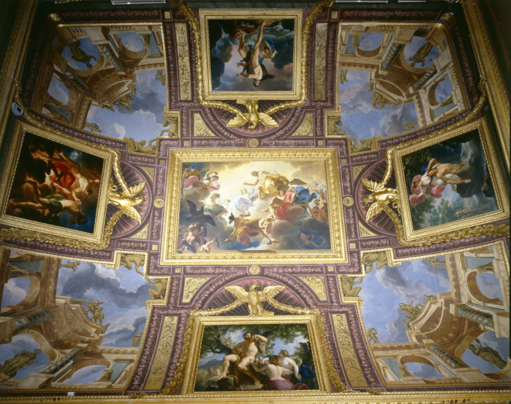

**内容（这是什么）**：本厅天顶的组画画的是大力神赫拉克勒斯（Hercules，希腊名赫剌克勒斯 Heracles）的几段故事，整间厅也因此得名「赫拉克勒斯厅」。1784 年完成，由蒂罗尔画家克里斯托夫·翁特贝格尔（Christoph Unterberger）绘制。正中是《赫拉克勒斯神化升天》（英雄死后被接纳进奥林匹斯、列入神班），四周环绕几段情节：与河神阿刻罗俄斯（Achelous）搏斗争夺妻子、半人马涅索斯（Nessus）劫掠其妻得伊阿尼拉（Deianira）、赫拉克勒斯怒掷侍从利卡斯（Lichas），以及赫拉克勒斯之死。这几幕并非随意拼凑，而是一条有因果的悲剧链。

**背景 / 来历**：这是 18 世纪末马尔坎托尼奥·博尔盖塞（Marcantonio IV Borghese）请建筑师安东尼奥·阿斯普鲁奇（Antonio Asprucci）主持别墅整体改造的产物——「一室一主题」：天顶、壁炉、灰泥装饰围绕同一神话展开，房间不再只是「挂画的墙」。本厅与众不同的是，天顶主题和墙上挂画真的扣在一起：四壁多是维纳斯与爱情题材的画，天顶则讲赫拉克勒斯「因爱而死、因死成神」的故事，全厅合起来谈的是「爱与英雄」——这是别墅里天顶与陈列呼应得最紧的房间之一。

**看点**：看点是天顶串起的一个**完整悲剧链**，而非孤立的几幅功业图。来龙去脉是：赫拉克勒斯为娶得伊阿尼拉，先打败了变形求婚的河神阿刻罗俄斯；婚后渡河时，半人马涅索斯企图劫走得伊阿尼拉，被赫拉克勒斯一箭射死；涅索斯临死设局，骗得伊阿尼拉收集自己的「毒血」，谎称它能保住丈夫的爱情。多年后得伊阿尼拉为挽回丈夫，把浸了毒血的衣袍送给赫拉克勒斯，结果毒发蚀骨、痛不欲生；英雄在盛怒中把送衣报信的侍从利卡斯掷向大海，最终自焚于柴堆，肉身焚尽、神性升天。读懂这条链，就明白为什么「劫妻」和「升天」会同处一顶——它们是一根因果线的两端。

**逐幅分述（中央升天 + 四幕情节）**：

1. **中央《赫拉克勒斯神化升天》/ _Apotheosis of Hercules_**——全顶的核心与终点，画英雄自焚后肉身焚尽、神性被诸神接上奥林匹斯、列入神班。它占天顶正中、最高最亮，是整组「因死成神」的结局。
	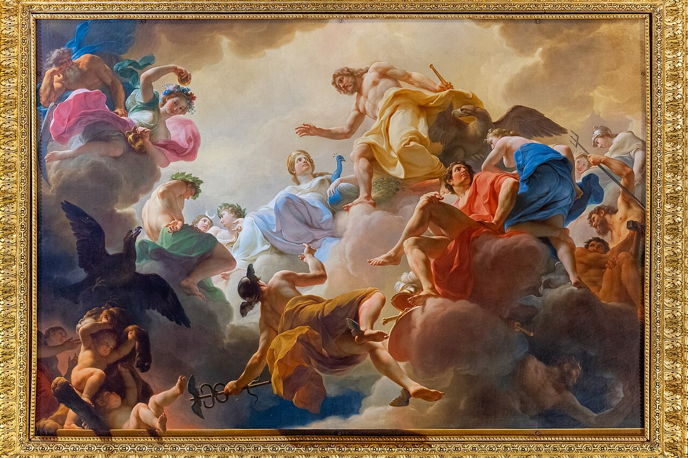

2. **《与河神阿刻罗俄斯搏斗》/ _Hercules and Achelous_**——故事起点：赫拉克勒斯为娶得伊阿尼拉（Deianira），与同来求婚、能变形的河神阿刻罗俄斯（Achelous）角力并取胜，赢得了妻子。
	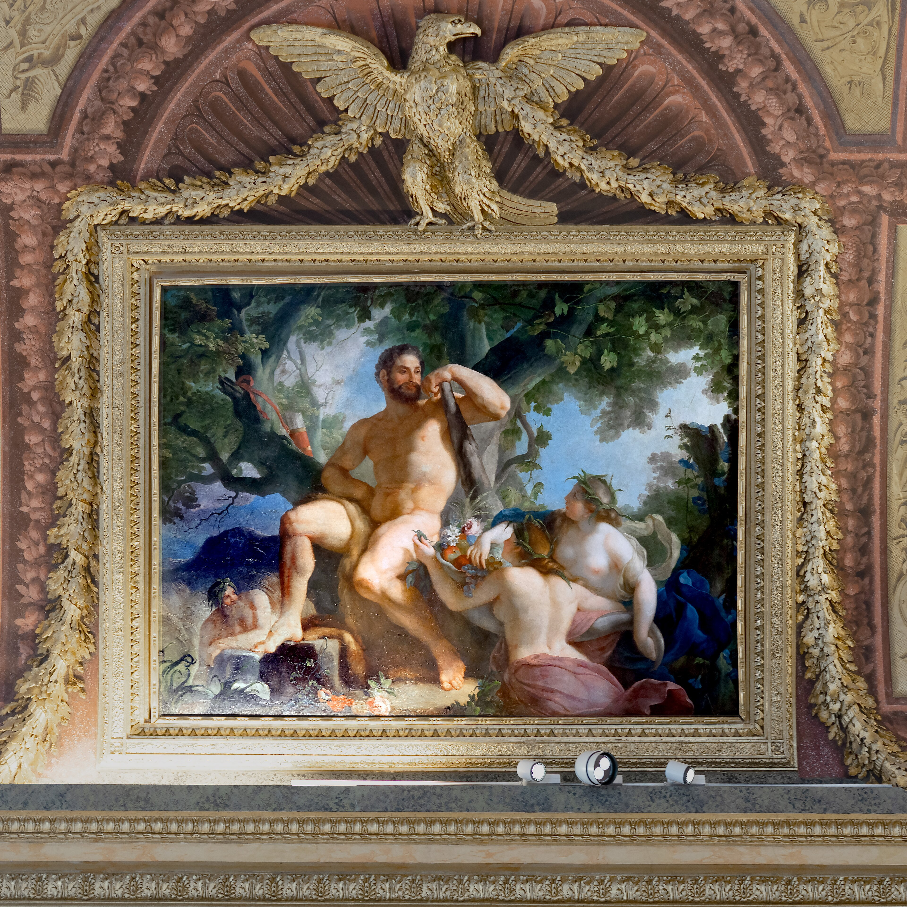

3. **《半人马涅索斯劫掠得伊阿尼拉》/ _Nessus Abducting Deianira_**——埋下祸根的一幕：婚后渡河时，半人马涅索斯（Nessus）企图劫走得伊阿尼拉，被赫拉克勒斯一箭射死；涅索斯临死设局，骗她收集自己的「毒血」当作保爱情的灵药。这看似配角，其实是整个悲剧的种子。
	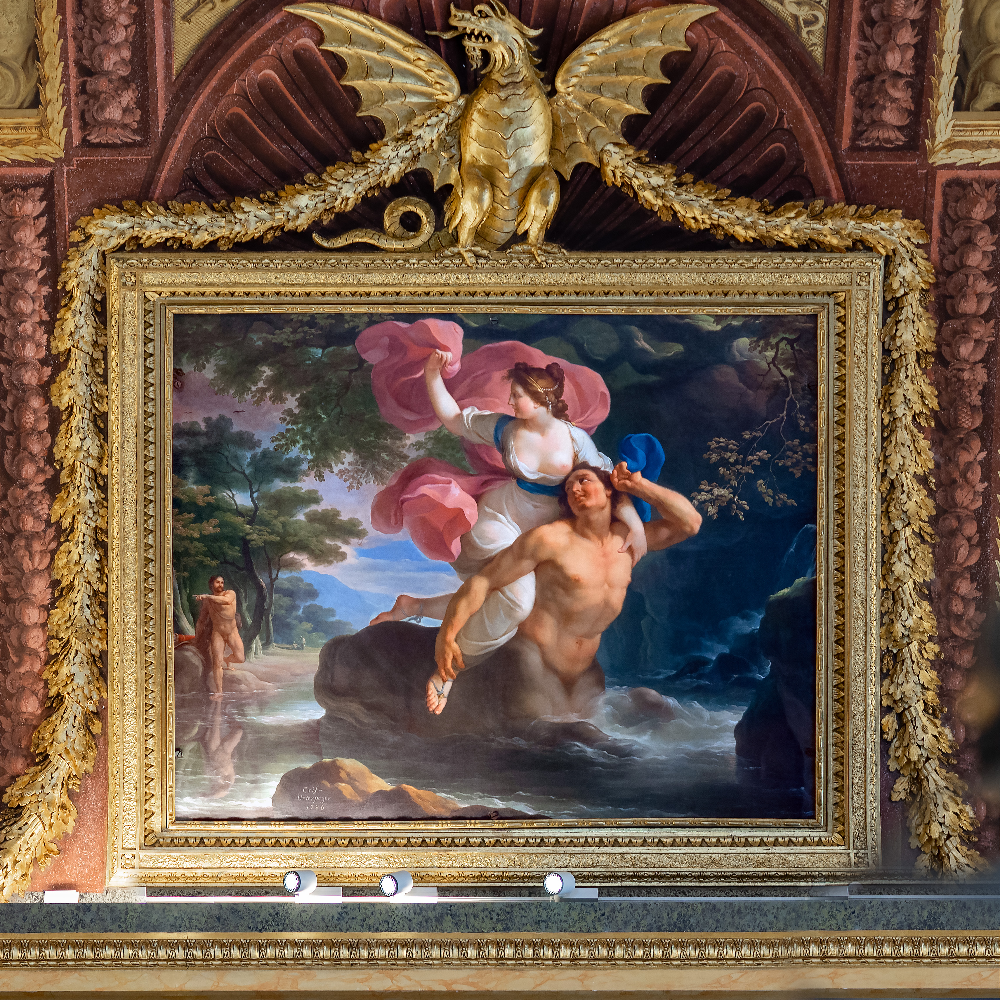

4. **《赫拉克勒斯怒掷利卡斯》/ _Hercules Hurling Lichas_**——爆发的一幕：多年后得伊阿尼拉把浸了毒血的衣袍送给丈夫，毒发蚀骨；英雄痛极盛怒，把送衣报信的侍从利卡斯（Lichas）抡起掷向大海。这是全顶动势最强、最具张力的瞬间。
	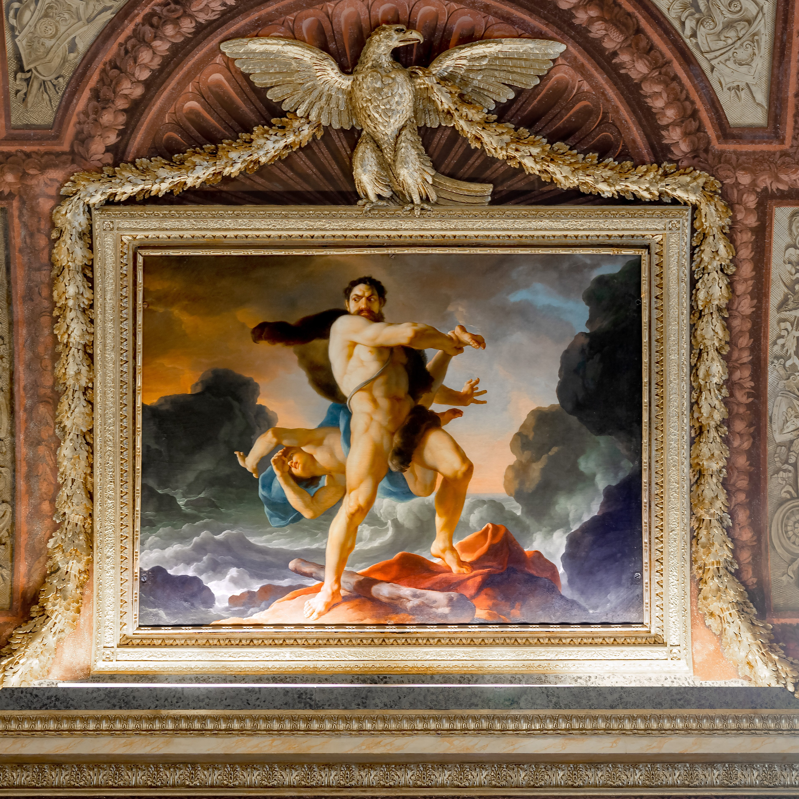

5. **《赫拉克勒斯之死》/ _Death of Hercules_**——悲剧落点：毒痛难忍的英雄登上柴堆自焚。它紧接中央的升天——肉身在此焚毁，神性在彼升天，一死一生正好衔接。
	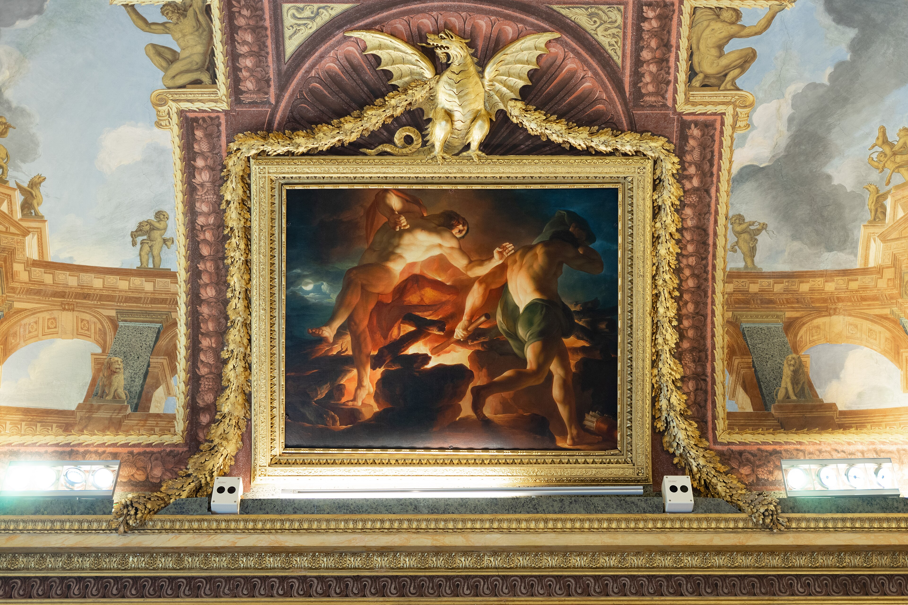

**现场站看**：

1. **先认中央的《升天》**——抬头找天顶正中、最高最亮的一格：赫拉克勒斯被诸神接上奥林匹斯。认准这个「结局」，四周情节的指向就清楚了。
2. **按因果链顺看四周**——绕厅按「搏斗河神阿刻罗俄斯（求婚）→ 半人马涅索斯劫妻（埋下祸根）→ 怒掷利卡斯（毒发盛怒）→ 赫拉克勒斯之死（自焚）」的顺序读，最后落回中央的升天，整条「因爱而死、因死而神」的悲剧就通了。
3. **找半人马涅索斯那一幕**——这是全剧的「机关」：涅索斯的毒血是日后悲剧的种子。留意画里半人半马的形象和被劫的得伊阿尼拉，这一幕看似是配角，其实是整个结局的起因。
4. **看「怒掷利卡斯」的爆发力**——赫拉克勒斯把人抡起掷出的动作，是天顶里最具张力的瞬间，表现英雄毒发后的痛苦与暴怒，和中央安详的升天形成强烈对比。
5. **抬头—低头连起来看**——看完天顶的「英雄之死」，再低头看四壁维纳斯与爱情主题的画，体会全厅「爱与英雄」的统一构思。这是阿斯普鲁奇改造里天顶与陈列呼应得最好的一间，抬头至少看 30 秒。

## 绘画

本节按馆方 Painting 藏品列表补充，共 22 件。核心展品如已在上文展开，这里仍保留官方清单条目，方便核对。

### ⭐ 顺路看 赫里特·范·洪特霍斯特，称「夜晚的杰拉尔多」《苏珊娜与长老》 / Honthorst Gerrit van called Gherardo delle notti, _Susannah and the Elders_

- **作者 / Artist**：赫里特·范·洪特霍斯特，称「夜晚的杰拉尔多」 / Honthorst Gerrit van called Gherardo delle notti
- **作品 / Work**：《苏珊娜与长老》 / _Susannah and the Elders_
- **时间**：1655 年
- **材质**：布面油画
- **尺寸**：157 × 213 cm
- **位置**：赫拉克勒斯厅（第 10 室）
- **官网介绍页**：[官网介绍英文](https://www.collezionegalleriaborghese.it/en/opere/susannah-and-the-elders)｜馆藏编号 027

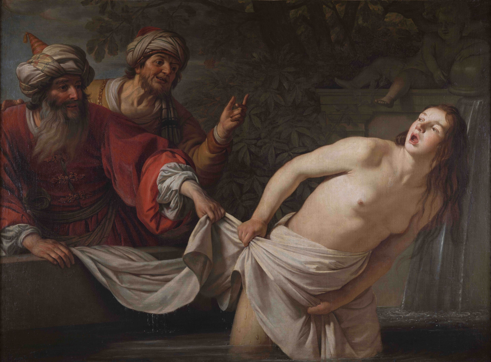

**这是什么 / 看点**：《旧约·但以理书》补篇的故事——贞洁的少妇苏珊娜（Susannah）在花园沐浴时被两个偷窥的老法官（长老）撞见，他们以诬告通奸相要挟逼她就范，她宁死不从，险被处死，幸得少年但以理（Daniel）盘问拆穿谎言而获救。作者洪特霍斯特（Gerrit van Honthorst）是荷兰乌得勒支的卡拉瓦乔派画家，在意大利专画烛光夜景，故得绰号「夜晚的杰拉尔多」（Gherardo delle notti）。看点是戏剧化的明暗对比与人物的张力：纯洁的裸体苏珊娜与两个猥琐逼视的老人构成善恶对峙，正是卡拉瓦乔式光影的典型用法。

### ⭐ 顺路看 亚历山德罗·蒂亚里尼《里纳尔多与阿尔米达》 / Tiarini Alessandro, _Rinaldo and Armida_

- **作者 / Artist**：亚历山德罗·蒂亚里尼 / Tiarini Alessandro
- **作品 / Work**：《里纳尔多与阿尔米达》 / _Rinaldo and Armida_
- **时间**：约 1620–1625 年
- **材质**：布面油画
- **尺寸**：127.5 × 188.5 cm
- **位置**：赫拉克勒斯厅（第 10 室）
- **官网介绍页**：[官网介绍英文](https://www.collezionegalleriaborghese.it/en/opere/rinaldo-and-armida)｜馆藏编号 036

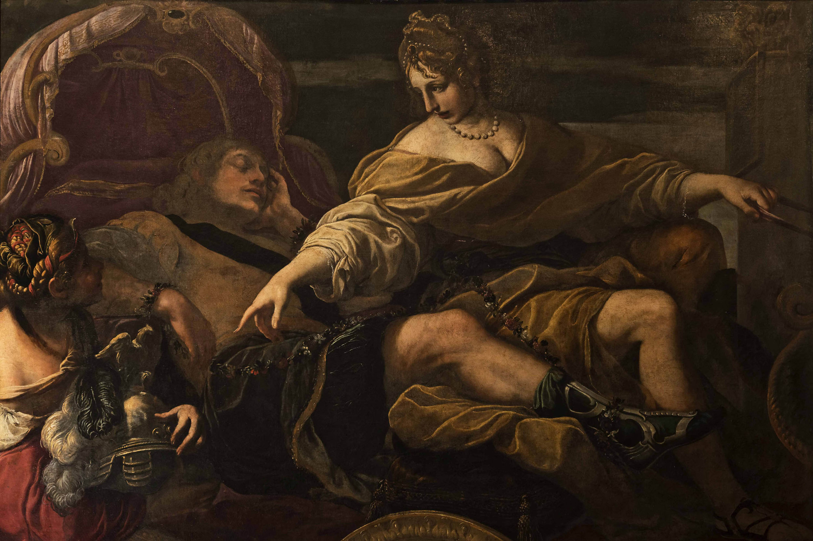

**这是什么 / 看点**：取材自塔索（Tasso）史诗《耶路撒冷的解放》——异教女巫阿尔米达（Armida）本受命去魅惑、谋害十字军骑士，却在魔法花园里对俊美的骑士里纳尔多（Rinaldo）动了真情，从仇敌变作恋人。画面多半描绘两人在花园中相依的缠绵一刻。作者蒂亚里尼（Alessandro Tiarini）是博洛尼亚画派的画家。看点在巴洛克式的情欲题材与柔和色调；它与本厅另一幅《埃涅阿斯逃离特洛伊》同属 17 世纪的「文学/史诗叙事画」，可一并体会博尔盖塞收藏对浪漫题材的偏好。

### ⭐ 顺路看 莱昂纳多·格拉齐亚，称「皮斯托亚的莱昂纳多」《卢克蕾提娅》 / Grazia Leonardo called Leonardo da Pistoia, _Lucretia_

- **作者 / Artist**：莱昂纳多·格拉齐亚，称「皮斯托亚的莱昂纳多」 / Grazia Leonardo called Leonardo da Pistoia
- **作品 / Work**：《卢克蕾提娅》 / _Lucretia_
- **时间**：约 1535 年
- **材质**：石板（板岩）油画
- **尺寸**：55 × 43 cm
- **位置**：赫拉克勒斯厅（第 10 室）
- **官网介绍页**：[官网介绍英文](https://www.collezionegalleriaborghese.it/en/opere/lucretia)｜馆藏编号 075

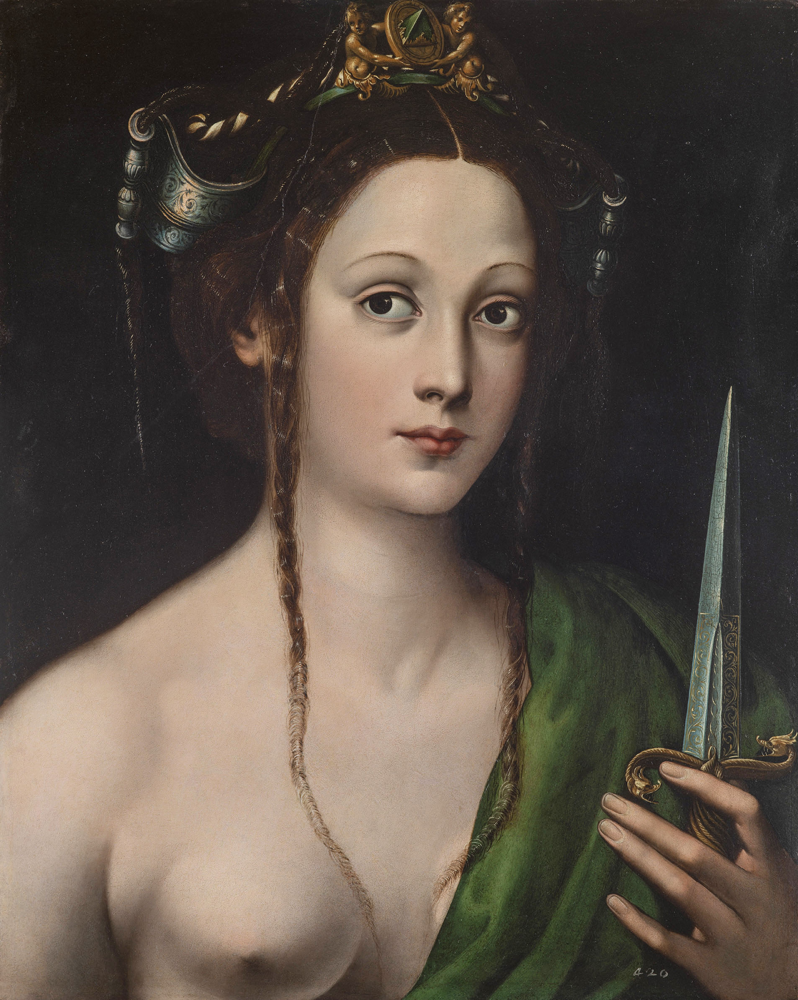

**这是什么 / 看点**：罗马传说中的贞妇卢克蕾提娅（Lucretia）——她被国王之子塔奎尼乌斯（Tarquinius）凌辱后，当众揭发暴行、随即拔刀自尽以全清白；这桩惨剧激起罗马人推翻王政、建立共和国。画面通常表现她将匕首刺向自己胸口的一刻，半身裸露、神情决绝。作者「皮斯托亚的莱昂纳多」（Leonardo Grazia）是受拉斐尔影响的样式主义画家，本厅藏有他多件「半身名女子」画板（另见同厅的《维纳斯》092、《克娄巴特拉》337）。看点是这类画的共同套路：以一位裸露上身、面带悲情的古代女性，把「贞洁殉节」的道德题材与官能美糅在一起，是 16 世纪书房收藏的典型品味。

### ⭐ 顺路看 莱昂纳多·格拉齐亚，称「皮斯托亚的莱昂纳多」《维纳斯》 / Grazia Leonardo called Leonardo da Pistoia, _Venus_

- **作者 / Artist**：莱昂纳多·格拉齐亚，称「皮斯托亚的莱昂纳多」 / Grazia Leonardo called Leonardo da Pistoia
- **作品 / Work**：《维纳斯》 / _Venus_
- **时间**：16 世纪 30 年代
- **材质**：木板蛋彩
- **尺寸**：97 × 75 cm
- **位置**：赫拉克勒斯厅（第 10 室）
- **官网介绍页**：[官网介绍英文](https://www.collezionegalleriaborghese.it/en/opere/venus)｜馆藏编号 092

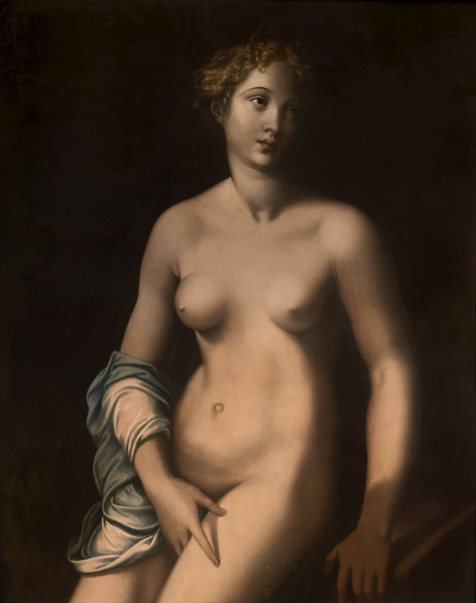

**这是什么 / 看点**：爱与美之神维纳斯（Venus）的半身/卧姿裸像，出自「皮斯托亚的莱昂纳多」之手，与同厅他画的《卢克蕾提娅》（075）、《克娄巴特拉》（337）同属一组样式主义「单人女性像」。看点是辨认这位画家受拉斐尔影响的优雅造型与冷静用色；三件并看，能体会 16 世纪把维纳斯、卢克蕾提娅、克娄巴特拉等「美丽女性」做成系列、装点书房的收藏风尚。

### ⭐ 顺路看 帕里斯·博尔多内《维纳斯、丘比特与萨堤尔》 / Bordone Paris, _Venus, Cupid and a Satyr_

- **作者 / Artist**：帕里斯·博尔多内 / Bordone Paris
- **作品 / Work**：《维纳斯、丘比特与萨堤尔》 / _Venus, Cupid and a Satyr_
- **时间**：约 1555–1565 年
- **材质**：布面油画
- **尺寸**：99 × 146 cm
- **位置**：赫拉克勒斯厅（第 10 室）
- **官网介绍页**：[官网介绍英文](https://www.collezionegalleriaborghese.it/en/opere/venus-cupid-and-a-satyr-2)｜馆藏编号 119

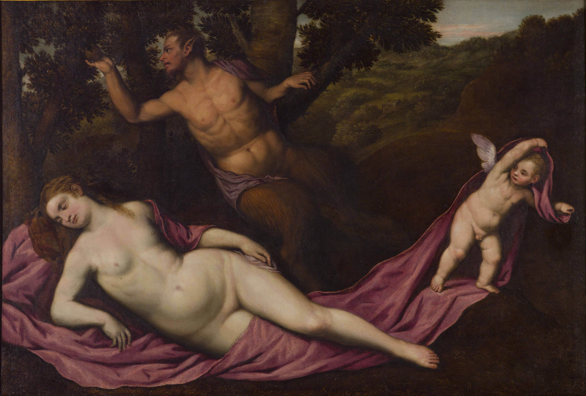

**这是什么 / 看点**：横幅的卧姿维纳斯（Venus），身旁有小爱神丘比特（Cupid）与一个半人半羊的森林之神萨堤尔（Satyr）——萨堤尔常被画成偷偷掀开纱帘、窥看沉睡裸女的角色，象征蠢动的欲望。作者博尔多内（Paris Bordone）是威尼斯画派、提香（Titian）的弟子。看点是威尼斯式的暖金色调与丰腴肉感的裸体，和本厅那些冷峻的托斯卡纳样式主义画板形成南北/地域画风对照；这也是全厅反复出现的「维纳斯＋丘比特＋萨堤尔」母题之一（另见 124）。

### ⭐ 顺路看 卢卡·坎比亚索《海上的维纳斯与丘比特》 / Cambiaso Luca, _Venus and Cupid at sea_

- **作者 / Artist**：卢卡·坎比亚索 / Cambiaso Luca
- **作品 / Work**：《海上的维纳斯与丘比特》 / _Venus and Cupid at sea_
- **时间**：约 1560–1565 年
- **材质**：布面油画
- **尺寸**：102.5 × 95 cm
- **位置**：赫拉克勒斯厅（第 10 室）
- **官网介绍页**：[官网介绍英文](https://www.collezionegalleriaborghese.it/en/opere/venus-and-cupid-at-sea)｜馆藏编号 123

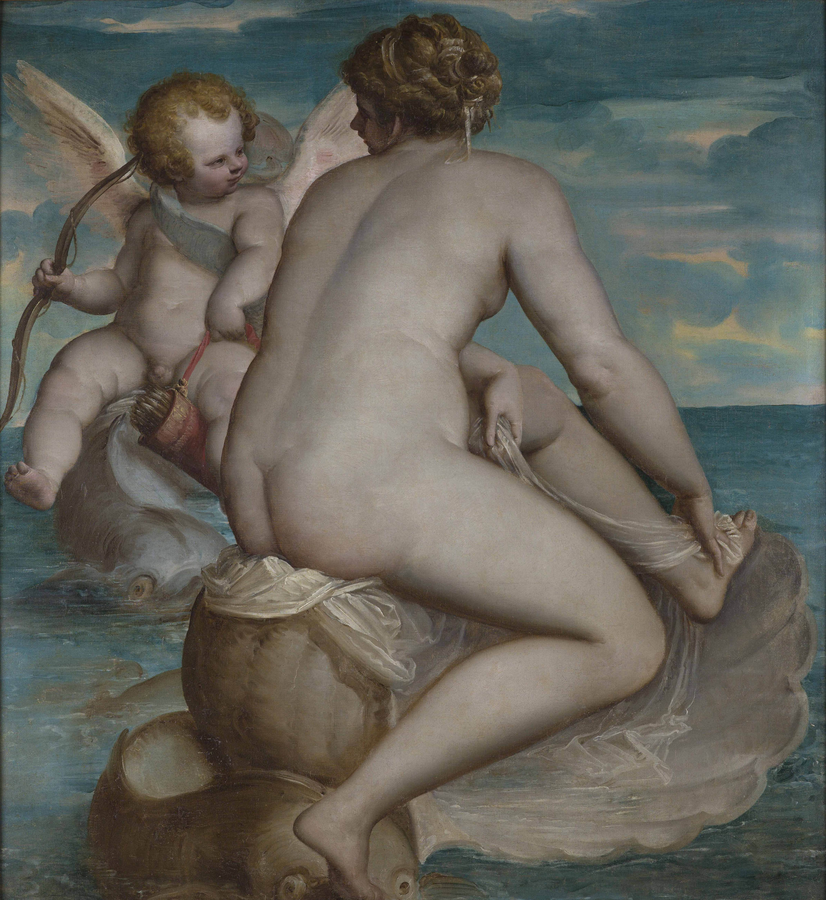

**这是什么 / 看点**：维纳斯（Venus）携小爱神丘比特（Cupid）现身海上——呼应她「自海中泡沫诞生」的出身。作者坎比亚索（Luca Cambiaso）是热那亚样式主义的代表画家，以流畅大胆的素描功底著称，常把人体概括成近乎几何的块面。本厅藏有他三件作品（另见《休憩的丘比特》191、《维纳斯与阿多尼斯》317），可一并辨认他这种简练有力的造型语言。

### ⭐ 顺路看 亚历山德罗·瓦罗塔里，称「帕多瓦尼诺」（存疑）《维纳斯、丘比特与萨堤尔》 / Alessandro Varotari, called Padovanino (?), _Venus, Cupid, and a satyr_

- **作者 / Artist**：亚历山德罗·瓦罗塔里，称「帕多瓦尼诺」（存疑） / Alessandro Varotari, called Padovanino (?)
- **作品 / Work**：《维纳斯、丘比特与萨堤尔》 / _Venus, Cupid, and a satyr_
- **时间**：17 世纪上半叶（存疑）
- **材质**：布面油画
- **尺寸**：117 × 110 cm
- **位置**：赫拉克勒斯厅（第 10 室）
- **官网介绍页**：[官网介绍英文](https://www.collezionegalleriaborghese.it/en/opere/venus-cupid-and-a-satyr)｜馆藏编号 124

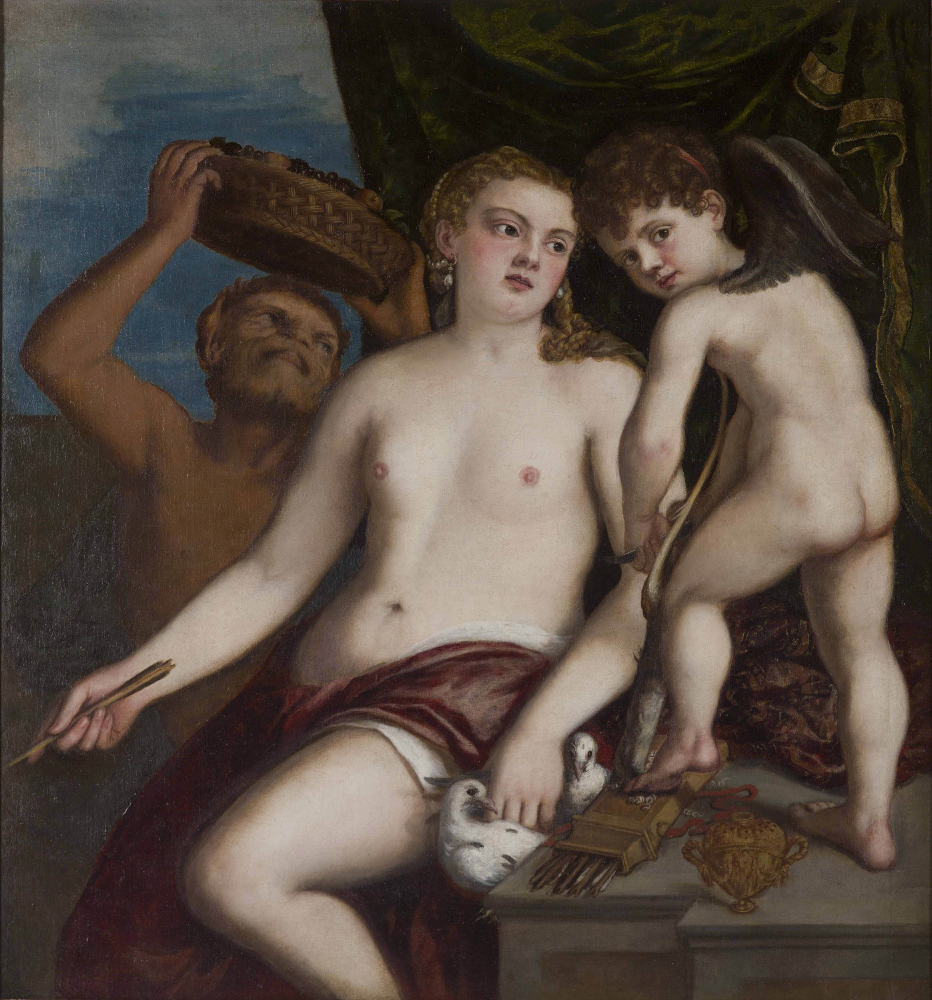

**这是什么 / 看点**：又一幅「维纳斯（Venus）＋丘比特（Cupid）＋萨堤尔（Satyr）」组合，萨堤尔窥视沉睡裸女的情欲母题（与同厅博尔多内的 119 同题可对照看）。作者被归到「帕多瓦尼诺」（Padovanino，本名 Alessandro Varotari）名下，但存疑——他是 17 世纪威尼斯刻意复兴提香（Titian）画风的画家。看点正是这种「新提香式」的暖调丰腴裸体，提醒你威尼斯传统在巴洛克时代仍被反复模仿。

### ⭐⭐⭐ 必看 安东尼奥·阿莱格里，称科雷焦《达娜厄》 / Allegri Antonio called Correggio, _Danae_

- **作者 / Artist**：安东尼奥·阿莱格里，称科雷焦 / Allegri Antonio called Correggio
- **作品 / Work**：《达娜厄》 / _Danae_
- **时间**：约 1530–1531 年
- **材质**：布面油画
- **尺寸**：158 × 189 cm
- **位置**：赫拉克勒斯厅（第 10 室）
- **展陈提醒**：本画是本厅（乃至全馆）级别的名作，但馆方藏品页标注「当前未展出」（可能在库房或外借）；到场先确认它是否真挂在墙上，再决定要不要按下面的站看细看。
- **官网介绍页**：[达娜厄 / Danae｜Galleria Borghese 官方藏品库](https://www.collezionegalleriaborghese.it/en/opere/danae)｜馆藏编号 125

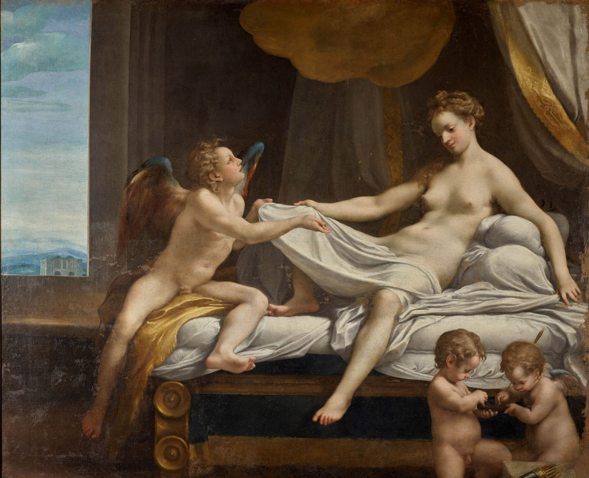

**内容（这是什么）**：帕尔马画派大师科雷焦（Correggio，本名安东尼奥·阿莱格里 Antonio Allegri）笔下的希腊神话《达娜厄》。阿尔戈斯国王阿克里西俄斯（Acrisius）听到神谕——女儿生下的外孙将杀死自己，于是把女儿达娜厄（Danaë）锁进高塔不让她接触男人。众神之王朱庇特（Jupiter）却化作一场金雨从天而降、穿过塔顶与她结合，由此生下英雄珀尔修斯（Perseus）；后来珀尔修斯果然在一次掷铁饼中误杀了外祖父，应验了神谕。画面定格的正是「金雨入塔」的一刻：达娜厄半卧床上、轻轻掀起腹前的白床单迎接她的神圣爱人，金色的雨点化作钱币洒落在她身上。

**故事的「读法」：把情色变成婚姻与圣爱**：科雷焦刻意淡化了这个题材天生的香艳。床上那位生着翅膀、容貌秀美的少年不是普通小爱神，而是婚姻之神许门（Hymen）——他出现在画面正中、低头端详掌心接到的第一滴金雨，等于给这场结合盖上「正当婚姻」的章；达娜厄掀起的白床单则被读作贞洁的面纱。画面右下角还有两个小爱神（厄洛斯 Eros 与他的同伴、可能是象征「反爱」的安忒洛斯 Anteros），正拿一支箭头和一枚金币在试金石上摩擦验金成色——这个动作一语双关：既验金子的真假，也验朱庇特这份爱情是不是「真金」。新柏拉图主义的读解里，他们一个代表天上的神圣之爱、一个代表地上的肉欲之爱，面对面构成对照，把整幅画从「偷情」抬升为「纯粹而无价的爱」。

**背景：「朱庇特的爱情」组画与查理五世**：此画约作于 1530–1531 年，是科雷焦为曼托瓦公爵费代里科二世·贡扎加（Federico II Gonzaga）所作「朱庇特的爱情」四联组画之一，另三幅是《勒达与天鹅》（今柏林）、《伽倪墨得斯被鹰掳走》和《朱庇特与伊俄》（两幅今藏维也纳）。组画借「化身求爱的众神之王」影射神圣罗马皇帝查理五世（Charles V）——朱庇特的标志是鹰，而鹰正是查理五世的纹徽。1530 年查理五世刚把费代里科从侯爵升为公爵，公爵投桃报李，把这套画献给了皇帝（一说还可能本是公爵为自己、为曼托瓦德泰宫「奥维德厅」所作，后才转赠）。

**身世：一幅流浪了三百年的名画**：从皇帝手中流出后，《达娜厄》经历了欧洲收藏史上最曲折的旅程之一——先后见于米兰雕塑家莱昂尼父子、布拉格鲁道夫二世的帝国珍藏；三十年战争末（1648）被瑞典军队掠至斯德哥尔摩，归了退位后定居罗马的瑞典女王克里斯蒂娜（Christina of Sweden）；此后辗转阿佐利尼、奥德斯卡尔基等罗马藏家，又被法国大收藏家皮埃尔·克罗扎（Pierre Crozat）和摄政王奥尔良公爵腓力（Philippe d'Orléans）收入，1780 年随奥尔良藏品散入伦敦艺术市场。1827 年，卡米洛·博尔盖塞（Camillo Borghese，保利娜的丈夫）以 285 英镑在巴黎买下它运回罗马——为躲教皇国高额进口税，经手人故意把画错标成不值钱的货物「蒙混过关」。1902 年随博尔盖塞收藏一并售予意大利国家。

**看点**：这是科雷焦极少数设在室内家居空间里的构图，也是他「柔到没有轮廓线」（sfumato 推到极致）画风的代表——皮肤、床单、羽翼、金光之间的过渡几乎看不见笔触，19 世纪大画家卡穆奇尼（Camuccini）一眼就认出是科雷焦的手，赞它「明暗块面的优雅、色彩的明亮通透、头发处理的柔润」。它和同题材的提香（Titian）《达娜厄》（藏那不勒斯、马德里等地）恰成对照：提香把重心放在肉体的官能美，科雷焦却用许门、试金、白纱层层把它「净化」成一则关于真爱的寓言。

**现场站看**（若在展出）：

1. **看达娜厄掀起白床单的那只手**——她不是被动承受，而是轻轻提起腹前的白单去「迎接」金雨。白单＝贞洁面纱，这个小动作就是科雷焦把情色改写成婚姻的关键，先认出它，整幅画的「正经化」用意就明白了。
2. **看正中少年掌心的金雨**——那位带翅少年是婚姻之神许门，低头端详掌心第一滴金雨。他被放在画面正中，目的是把你的视线顺着他的手引向达娜厄的腹部——这是构图刻意设计的「视线滑梯」。
3. **看右下角两个小爱神在试金石上验金**——一个拿箭头、一个拿金币在黑色试金石上摩擦验成色。这是全画最精彩的细节：既验金子真假，也验朱庇特爱情的「真金成色」，把神话读成「真爱无价」的寓言。
4. **比皮肤与床单的「无边界」过渡**——凑近看肌肤、白单、羽翼交界处几乎找不到一条硬轮廓线，全是柔润晕染。这是科雷焦的招牌，也是后来巴洛克柔光画法的源头之一。
5. **想想画里的鹰与皇帝**——这幅是「朱庇特的爱情」组画之一，化身求爱的朱庇特影射皇帝查理五世（鹰是两者共同的标志）。看的时候记得它原本是一份献给皇帝的「政治情书」。
6. **认出这是一幅「流浪三百年」的名画**——曼托瓦公爵→查理五世→布拉格→瑞典女王克里斯蒂娜→奥尔良公爵→伦敦→1827 年博尔盖塞买回罗马。站在它面前，等于站在半部欧洲收藏史前。

### ⭐ 顺路看 作者不详《阅读中的抹大拉的玛利亚》 / Unknown artist, _Mary Magdalene reading_

- **作者 / Artist**：作者不详 / Unknown artist
- **作品 / Work**：《阅读中的抹大拉的玛利亚》 / _Mary Magdalene reading_
- **时间**：17 世纪
- **材质**：铜板油画
- **尺寸**：29 × 39 cm
- **位置**：赫拉克勒斯厅（第 10 室）
- **官网介绍页**：[官网介绍英文](https://www.collezionegalleriaborghese.it/en/opere/mary-magdalene-reading)｜馆藏编号 126

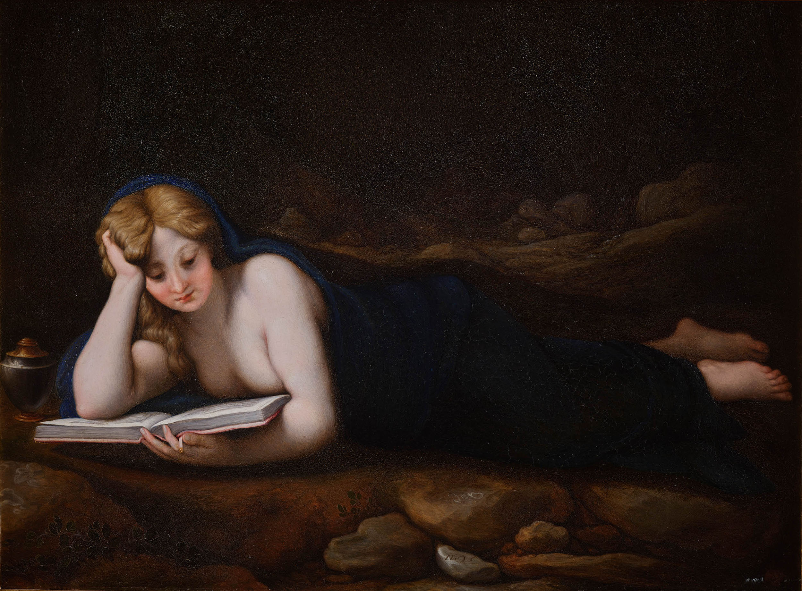

**这是什么 / 看点**：悔罪的抹大拉的玛利亚（Mary Magdalene）正在读书冥想——「读书的抹大拉」是反宗教改革时期极流行的题材，常配骷髅、香膏罐等象征忏悔与世事无常的道具，提醒信徒弃绝俗世、专注属灵。这是一幅画在铜板上的小画（铜板细腻、宜画精致小品）。在满室世俗的维纳斯与爱情题材中间，它是少有的宗教沉思之作，顺路对照即可。

### ⭐ 顺路看 朱塞佩·切萨里，称「骑士达尔皮诺」《丘比特为维纳斯加冕》 / Cesari Giuseppe called Cavalier d'Arpino, _Venus crowned by Cupid_

- **作者 / Artist**：朱塞佩·切萨里，称「骑士达尔皮诺」 / Cesari Giuseppe called Cavalier d'Arpino
- **作品 / Work**：《丘比特为维纳斯加冕》 / _Venus crowned by Cupid_
- **时间**：1607 年前
- **材质**：布面油画
- **尺寸**：82 × 112.5 cm
- **位置**：赫拉克勒斯厅（第 10 室）
- **官网介绍页**：[官网介绍英文](https://www.collezionegalleriaborghese.it/en/opere/venus-crowned-by-cupid)｜馆藏编号 138

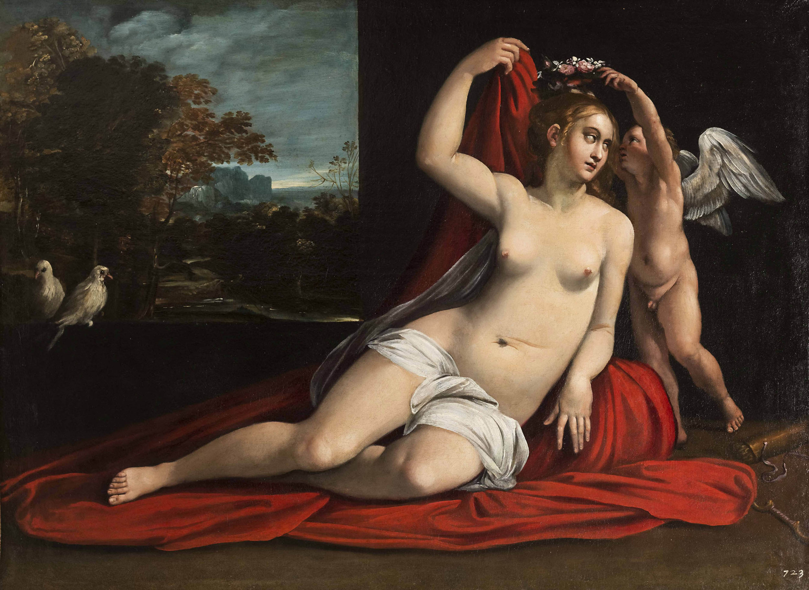

**这是什么 / 看点**：卧姿的维纳斯（Venus）被小爱神丘比特（Cupid）戴上花冠，是一幅典雅的爱神颂歌。作者「骑士达尔皮诺」（Cavalier d'Arpino，本名 Giuseppe Cesari）是 17 世纪初罗马最当红的晚期样式主义画家，年轻的卡拉瓦乔（Caravaggio）初到罗马时正是在他的作坊里打工。值得一提的是：1607 年教皇没收了达尔皮诺的大批画作，红衣主教希皮奥内·博尔盖塞（Scipione Borghese）借机收入囊中，本厅这幅多半就是这批「充公画」之一——它的「1607 年前」断代正与此呼应。看点是优美的色彩与造型，以及它背后那段博尔盖塞「趁火收藏」的轶事。

### ⭐ 顺路看 归属兰贝特·范·诺尔特《普绪刻被带往奥林匹斯》 / Attributed to Noort Lambert van, _Psyche Carried to Olympus_

- **作者 / Artist**：归属兰贝特·范·诺尔特 / Attributed to Noort Lambert van
- **作品 / Work**：《普绪刻被带往奥林匹斯》 / _Psyche Carried to Olympus_
- **时间**：约 1545–1549 年
- **材质**：木板油画
- **尺寸**：92 × 75 cm
- **位置**：赫拉克勒斯厅（第 10 室）
- **官网介绍页**：[官网介绍英文](https://www.collezionegalleriaborghese.it/en/opere/psyche-carried-to-olympus)｜馆藏编号 184

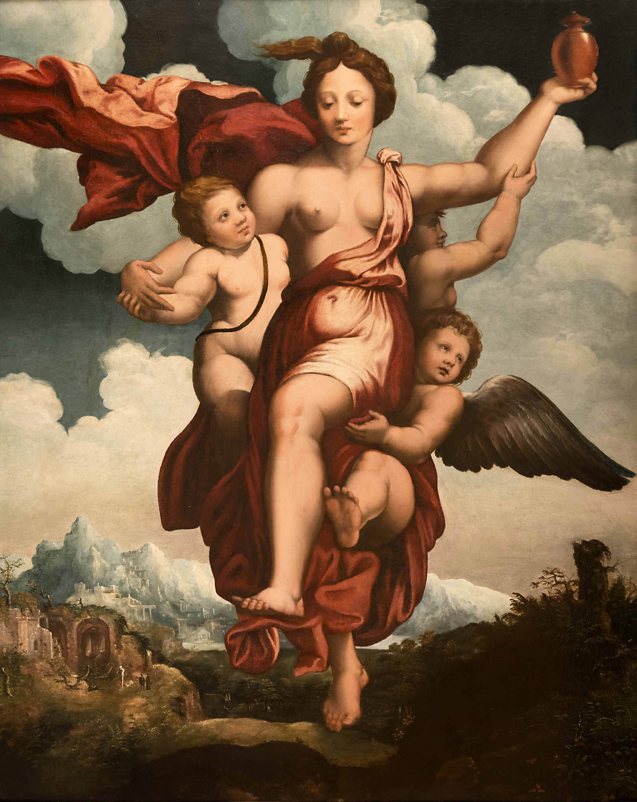

**这是什么 / 看点**：取自阿普列乌斯（Apuleius）《金驴记》中「丘比特与普绪刻」的大团圆结局——凡间公主普绪刻（Psyche）历尽磨难、终于得到诸神宽恕，被接引升上奥林匹斯山，与爱人丘比特（Cupid）结为神侣、获得永生。画面表现她被托举上天的一刻。作者被归为弗拉芒画家兰贝特·范·诺尔特（Lambert van Noort）。看点是北方画家笔下的神话题材，与本厅意大利画风并置，又一处南北对照。

### ⭐ 顺路看 卢卡·坎比亚索《休憩的丘比特》 / Cambiaso Luca, _Cupid at Rest_

- **作者 / Artist**：卢卡·坎比亚索 / Cambiaso Luca
- **作品 / Work**：《休憩的丘比特》 / _Cupid at Rest_
- **材质**：布面油画
- **尺寸**：90 × 78 cm
- **位置**：赫拉克勒斯厅（第 10 室）
- **官网介绍页**：[官网介绍英文](https://www.collezionegalleriaborghese.it/en/opere/cupid-at-rest)｜馆藏编号 191

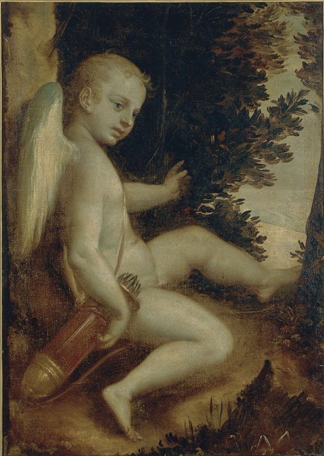

**这是什么 / 看点**：歇息中的小爱神丘比特（Cupid）——放下弓箭、暂时安静下来的爱神，常被读作「爱的休止」或对爱欲力量的沉思。又一件出自热那亚画家坎比亚索（Luca Cambiaso）之手的作品（同厅另见《海上的维纳斯与丘比特》123、《维纳斯与阿多尼斯》317）。看点是坎比亚索把人体概括成简练块面的本事，三件并看最能体会他的造型风格。

### ⭐ 顺路看 拉斐利诺·莫塔，称「雷焦的拉斐利诺」《多俾亚与天使》 / Motta Raffaellino called Raffaellino da Reggio, _Tobias and the Angel_

- **作者 / Artist**：拉斐利诺·莫塔，称「雷焦的拉斐利诺」 / Motta Raffaellino called Raffaellino da Reggio
- **作品 / Work**：《多俾亚与天使》 / _Tobias and the Angel_
- **时间**：约 1575 年
- **材质**：木板油画
- **尺寸**：107 × 69 cm
- **位置**：赫拉克勒斯厅（第 10 室）
- **官网介绍页**：[官网介绍英文](https://www.collezionegalleriaborghese.it/en/opere/tobias-and-the-angel-1)｜馆藏编号 298

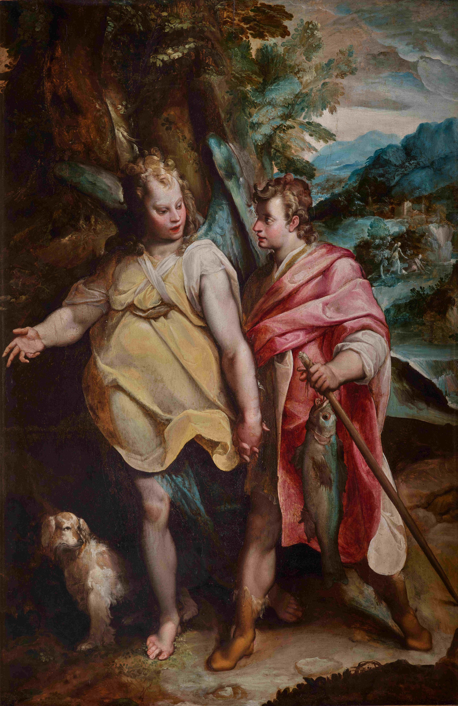

**这是什么 / 看点**：《旧约·多俾亚传》的故事——少年多俾亚（Tobias）外出远行，由乔装成旅伴的大天使拉斐尔（Raphael）一路护送、暗中指点；他在河边捕到一条大鱼，鱼的内脏后来治好了父亲的失明、驱走了缠扰未婚妻的恶魔。画面的标准图像是「天使牵着少年同行，少年提着鱼、脚边常有小狗」——认这三件道具就能认出题材。作者「雷焦的拉斐利诺」（Raffaellino da Reggio）是受拉斐尔传统熏陶的样式主义画家。看点是优雅流丽的人物造型与这则「守护天使」主题的温情。

### ⭐ 顺路看 卢卡·坎比亚索《维纳斯与阿多尼斯》 / Cambiaso Luca, _Venus and Adonis_

- **作者 / Artist**：卢卡·坎比亚索 / Cambiaso Luca
- **作品 / Work**：《维纳斯与阿多尼斯》 / _Venus and Adonis_
- **时间**：1565 年后
- **材质**：布面油画
- **尺寸**：141 × 93 cm
- **位置**：赫拉克勒斯厅（第 10 室）
- **官网介绍页**：[官网介绍英文](https://www.collezionegalleriaborghese.it/en/opere/venus-and-adonis-2)｜馆藏编号 317

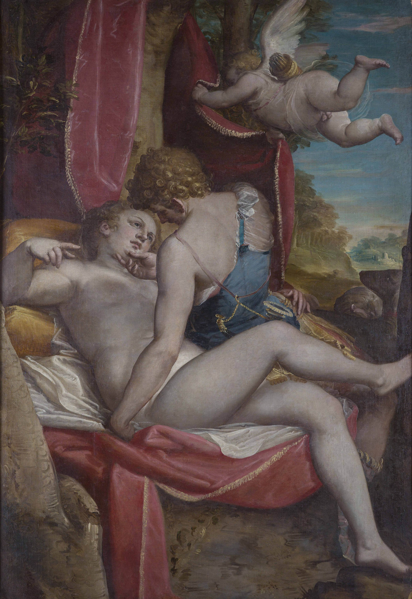

**这是什么 / 看点**：奥维德（Ovid）笔下的爱情悲剧——女神维纳斯（Venus）爱上俊美的猎人阿多尼斯（Adonis），苦劝他别去追逐猛兽，他不听，终被野猪獠牙刺死，鲜血化作秋牡丹（银莲花）。画面常表现维纳斯依依拉住执意出猎的阿多尼斯一刻。这是本厅第三件坎比亚索（Luca Cambiaso）作品（另见 123、191）。看点是这则「红颜留不住爱人」的题材，以及坎比亚索一贯简练有力的人体造型。

### ⭐ 顺路看 米凯莱·托西尼，称「里多尔福之子米凯莱·德尔·吉兰达约」《卢克蕾提娅》 / Tosini Michele called Michele di Ridolfo del Ghirlandaio, _Lucretia_

- **作者 / Artist**：米凯莱·托西尼，称「里多尔福之子米凯莱·德尔·吉兰达约」 / Tosini Michele called Michele di Ridolfo del Ghirlandaio
- **作品 / Work**：《卢克蕾提娅》 / _Lucretia_
- **时间**：约 1560–1570 年
- **材质**：木板油画
- **尺寸**：72 × 51 cm
- **位置**：赫拉克勒斯厅（第 10 室）
- **官网介绍页**：[官网介绍英文](https://www.collezionegalleriaborghese.it/en/opere/lucretia-4)｜馆藏编号 322

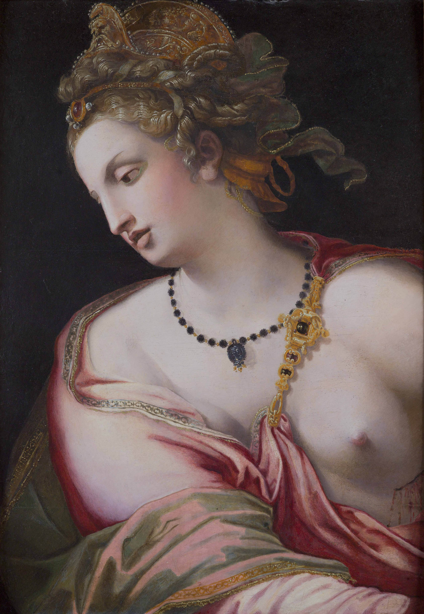

**这是什么 / 看点**：又一幅罗马贞妇卢克蕾提娅（Lucretia）拔刀自尽的半身像（故事见同厅 075 那条）。作者托西尼（Michele Tosini）是佛罗伦萨画家，师从里多尔福·德尔·吉兰达约、画风深受米开朗琪罗（Michelangelo）影响，本厅另藏其《勒达》（323）。看点是佛罗伦萨样式主义那种结实雕塑感的裸体，与同题的 075（皮斯托亚的莱昂纳多版）并看，可比较两位画家对同一「殉节贞妇」题材的不同处理。

### ➖ 可略过 米凯莱·托西尼，称「里多尔福之子米凯莱·德尔·吉兰达约」《勒达》 / Tosini Michele called Michele di Ridolfo del Ghirlandaio, _Leda_

- **作者 / Artist**：米凯莱·托西尼，称「里多尔福之子米凯莱·德尔·吉兰达约」 / Tosini Michele called Michele di Ridolfo del Ghirlandaio
- **作品 / Work**：《勒达》 / _Leda_
- **时间**：约 1560–1570 年
- **材质**：木板油画
- **尺寸**：78 × 51 cm
- **位置**：赫拉克勒斯厅（第 10 室）
- **展陈提醒**：馆方藏品页标注「当前未展出」，到场不一定能看到。
- **官网介绍页**：[官网介绍英文](https://www.collezionegalleriaborghese.it/en/opere/leda-2)｜馆藏编号 323

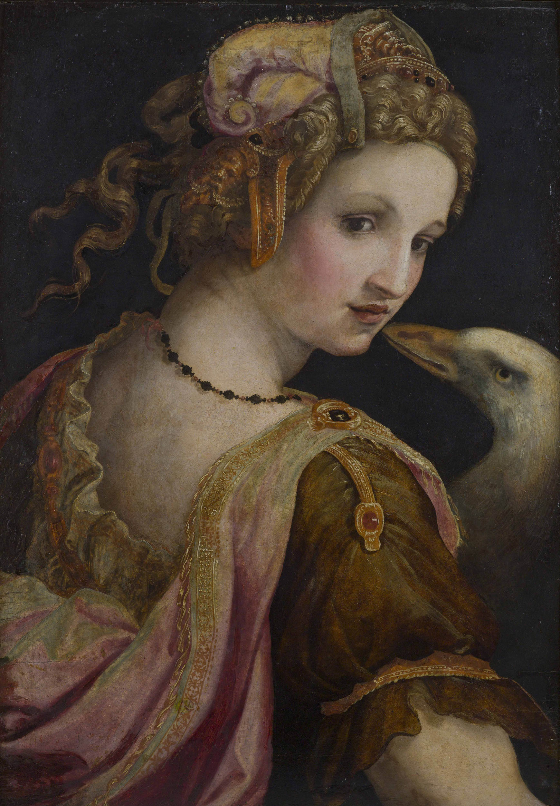

**这是什么 / 看点**：希腊神话「勒达与天鹅」——斯巴达王后勒达（Leda）被化身天鹅的朱庇特（Jupiter）所诱，由此生下海伦等子女。又一件托西尼（Michele Tosini，作者介绍见同厅 322）的佛罗伦萨样式主义裸体。此画当前未展出，知道它属于本厅这条「朱庇特化身求爱」的脉络（与镇厅《达娜厄》同一母题）即可，不必特意找。

### ⭐ 顺路看 安德烈亚·皮奇内利，称「布雷夏尼诺」《维纳斯与两个丘比特》 / Piccinelli Andrea called Andrea del Brescianino, _Venus and two Cupids_

- **作者 / Artist**：安德烈亚·皮奇内利，称「布雷夏尼诺」 / Piccinelli Andrea called Andrea del Brescianino
- **作品 / Work**：《维纳斯与两个丘比特》 / _Venus and two Cupids_
- **材质**：木板油画
- **尺寸**：149.5 × 66 cm
- **位置**：赫拉克勒斯厅（第 10 室）
- **官网介绍页**：[官网介绍英文](https://www.collezionegalleriaborghese.it/en/opere/venus-and-two-cupids)｜馆藏编号 324

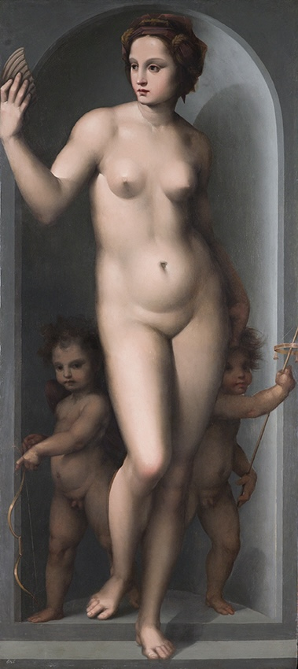

**这是什么 / 看点**：一幅窄长直立的全身维纳斯（Venus）裸像，身边伴两个小爱神丘比特（Cupid）。作者布雷夏尼诺（Andrea del Brescianino）是锡耶纳画家。最大的看点是它的「配对身份」：历史上这幅窄长裸女曾与本厅那件克拉纳赫（Cranach）《维纳斯、丘比特与蜂巢》（326）成对悬挂——两幅都是直立修长的裸体女神，一南一北。看克拉纳赫时务必把这件并到一起，对照阿尔卑斯山两侧画家处理同一题材的差别（详见 326 克拉纳赫那条的「现场站看」）。

### ⭐ 顺路看 莱昂纳多·格拉齐亚，称「皮斯托亚的莱昂纳多」《克娄巴特拉》 / Grazia Leonardo called Leonardo da Pistoia, _Cleopatra_

- **作者 / Artist**：莱昂纳多·格拉齐亚，称「皮斯托亚的莱昂纳多」 / Grazia Leonardo called Leonardo da Pistoia
- **作品 / Work**：《克娄巴特拉》 / _Cleopatra_
- **时间**：16 世纪 30 年代
- **材质**：石板（板岩）油画
- **尺寸**：81 × 56 cm
- **位置**：赫拉克勒斯厅（第 10 室）
- **官网介绍页**：[官网介绍英文](https://www.collezionegalleriaborghese.it/en/opere/cleopatra-2)｜馆藏编号 337

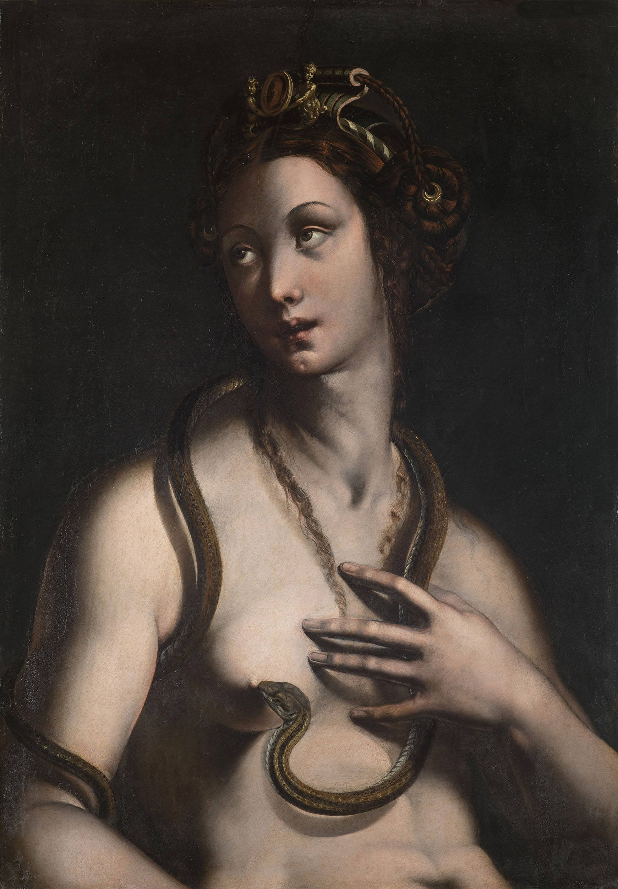

**这是什么 / 看点**：埃及艳后克娄巴特拉（Cleopatra）以毒蛇（asp，角蝰）自尽的一刻——兵败、爱人安东尼已死，她让毒蛇咬上自己以保尊严，不愿被俘游街。画面常表现她半身裸露、将蛇凑向胸口、神情凄美。这是「皮斯托亚的莱昂纳多」（Leonardo Grazia）的第三件半身名女子像（与同厅《卢克蕾提娅》075、《维纳斯》092 同组）。看点是「殉节女性」这一系列题材：卢克蕾提娅、克娄巴特拉都以「为尊严而死的美丽女子」被收进同一书房序列，把道德训诫与官能美一锅烩，是 16 世纪的典型趣味。

### ➖ 可略过 作者不详《勒达》 / Anonymous, _Leda_

- **作者 / Artist**：作者不详 / Anonymous
- **作品 / Work**：《勒达》 / _Leda_
- **时间**：1517 年前
- **材质**：木板蛋彩
- **尺寸**：115 × 86 cm
- **位置**：赫拉克勒斯厅（第 10 室）
- **展陈提醒**：馆方藏品页标注「当前未展出」，到场不一定能看到。
- **官网介绍页**：[官网介绍英文](https://www.collezionegalleriaborghese.it/en/opere/leda-3)｜馆藏编号 434

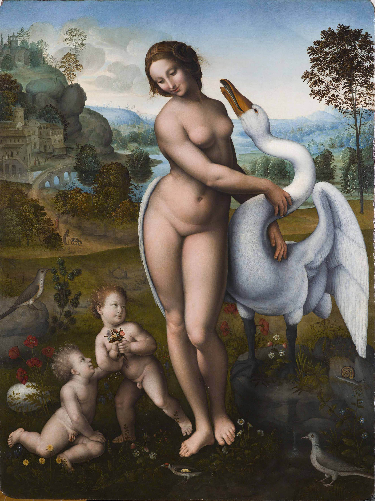

**这是什么 / 看点**：又一幅「勒达与天鹅」——化身天鹅的朱庇特（Jupiter）与斯巴达王后勒达（Leda）的神话（题材见同厅 323）。这件年代较早（1517 年前）、作者不详，当前未展出。它与镇厅《达娜厄》、《勒达》（323）同属本厅反复出现的「朱庇特化身求爱」主题；知道这条线索即可，不必特意寻找。

### ⭐ 顺路看 文图拉·萨林贝尼《三美神》 / Salimbeni Ventura, _The Three Graces_

- **作者 / Artist**：文图拉·萨林贝尼 / Salimbeni Ventura
- **作品 / Work**：《三美神》 / _The Three Graces_
- **材质**：布面油画
- **尺寸**：35 × 41 cm
- **位置**：赫拉克勒斯厅（第 10 室）
- **官网介绍页**：[官网介绍英文](https://www.collezionegalleriaborghese.it/en/opere/the-three-graces)｜馆藏编号 527

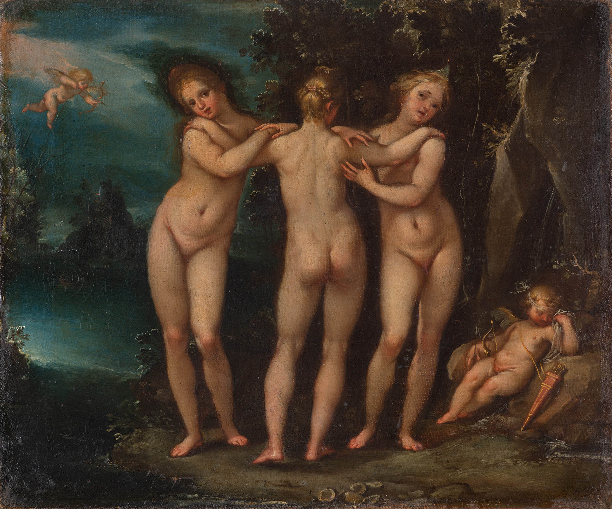

**这是什么 / 看点**：维纳斯（Venus）的三位侍女——三美神（the Three Graces），分别象征妩媚、美丽与欢愉，传统上画成相拥起舞、彼此牵连的三个裸女（常一正二背，让观者一次看到正反两面身姿）。作者萨林贝尼（Ventura Salimbeni）是锡耶纳晚期样式主义画家。这是一幅小尺幅作品，看点是经典「三连裸体」构图的优雅韵律，与本厅满室的爱情、维纳斯主题正好呼应。
## 雕塑

本节先列馆方 Modern Sculpture 藏品列表，共 1 件。

### ⭐ 顺路看 洛伦佐·卡尔代利与安东尼奥·德·罗西《壁炉》 / Cardelli Lorenzo / De Rossi Antonio, _Fireplace_

- **作者 / Artist**：洛伦佐·卡尔代利与安东尼奥·德·罗西 / Cardelli Lorenzo / De Rossi Antonio
- **作品 / Work**：《壁炉》 / _Fireplace_
- **时间**：1784–1786 年
- **材质**：白色大理石、红斑岩；贴饰镀金青铜
- **尺寸**：高 132 cm；宽 202 cm；深 62 cm
- **位置**：赫拉克勒斯厅（第 10 室）
- **官网介绍页**：[官网介绍英文](https://www.collezionegalleriaborghese.it/en/opere/fireplace-x)｜馆藏编号 camini-X

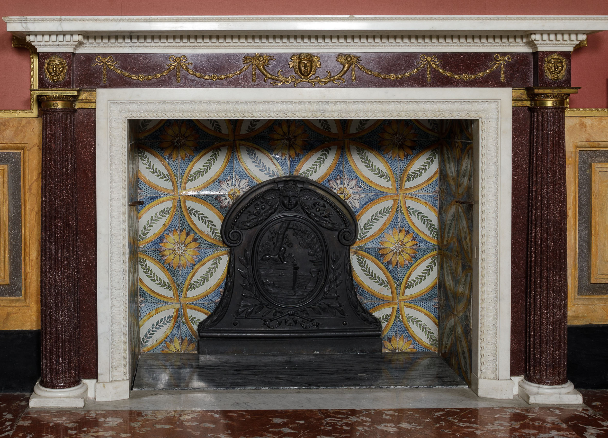

**这是什么 / 看点**：本厅的大理石壁炉，1784–1786 年制——正是阿斯普鲁奇（Asprucci）主持别墅整体新古典改造的同一时期作品，与天顶的赫拉克勒斯组画、墙面装饰配套。看点是名贵材质的搭配：白色大理石主体、嵌「帝王紫」红斑岩、再贴镀金青铜饰件，三种材料的色泽对比本身就是炫富与品味的展示。它不是「挂画的背景」，而是房间整体陈设的一部分——把它和天顶、墙面一起看，才能体会 18 世纪末博尔盖塞别墅「每间厅一个主题」的设计用意。

### ⭐ 顺路看 房间整体陈设 / Room Decoration

- **位置**：赫拉克勒斯厅（第 10 室）

**这是什么 / 看点**：二楼这间厅的天顶画、壁炉、怪诞纹（grotesque）和透视装饰是一个整体，共同构成观展体验，而不只是「挂画的墙」。关键在 18 世纪末安东尼奥·阿斯普鲁奇（Antonio Asprucci）主持的整体改造——他给每间厅定一个主题（本厅的主题就是大力神赫拉克勒斯），让天顶、壁炉、灰泥与墙上的画彼此呼应。进厅时别只盯着画，抬头看一眼天顶、扫一眼壁炉，就能体会这套「主题式房间」的设计巧思。

## 资料来源 / Sources

- Galleria Borghese 官方房间页：[Room 10](https://galleriaborghese.cultura.gov.it/en/il-museo/la-villa/sala-10-sala-di-ercole/)
- Galleria Borghese 藏品筛选：[Painting, Room 10](https://www.collezionegalleriaborghese.it/en/collezione/pittura?sala=s10)
- Galleria Borghese 藏品筛选：[Modern Sculpture, Room 10](https://www.collezionegalleriaborghese.it/en/collezione/scultura?sala=s10)
- Galleria Borghese 藏品筛选：[Ancient Art, Room 10](https://www.collezionegalleriaborghese.it/en/collezione/arte-antica?sala=s10)
- Galleria Borghese 藏品筛选：[Furniture, Room 10](https://www.collezionegalleriaborghese.it/en/collezione/arredi?sala=s10)
