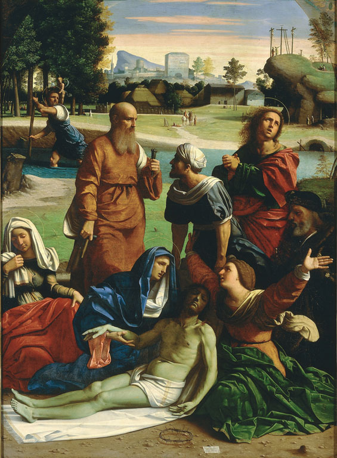
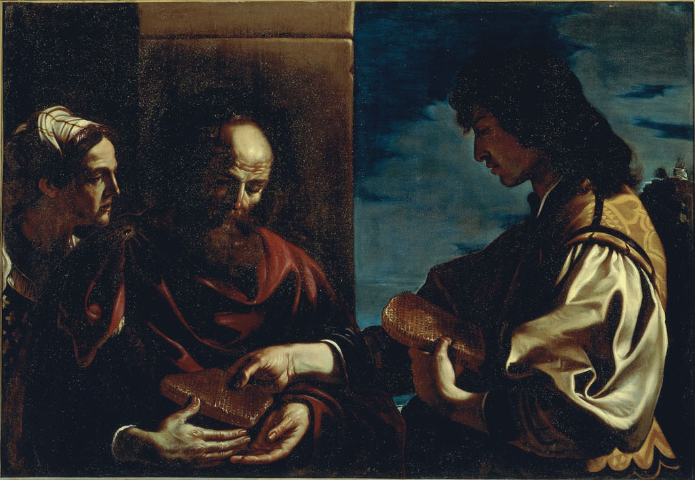
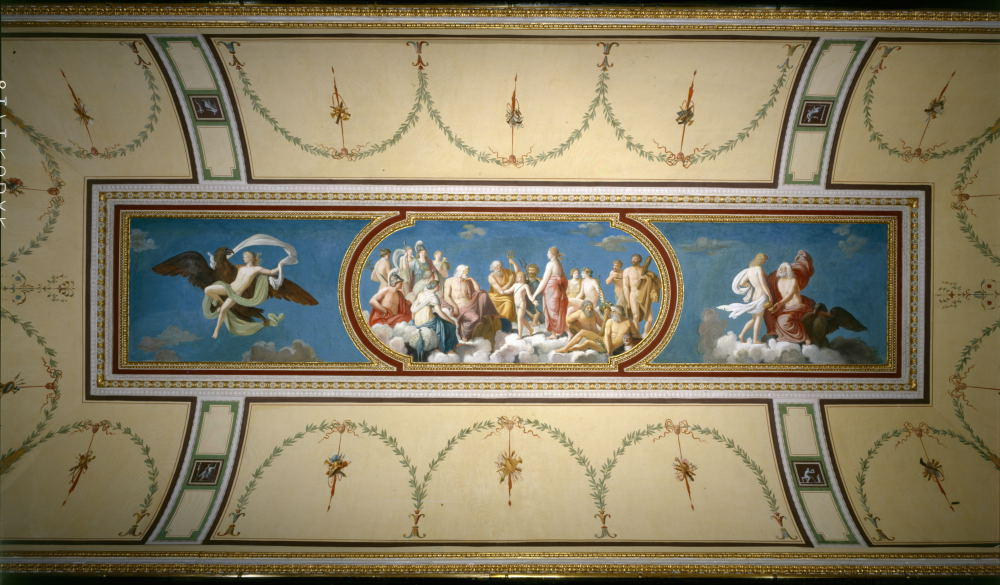
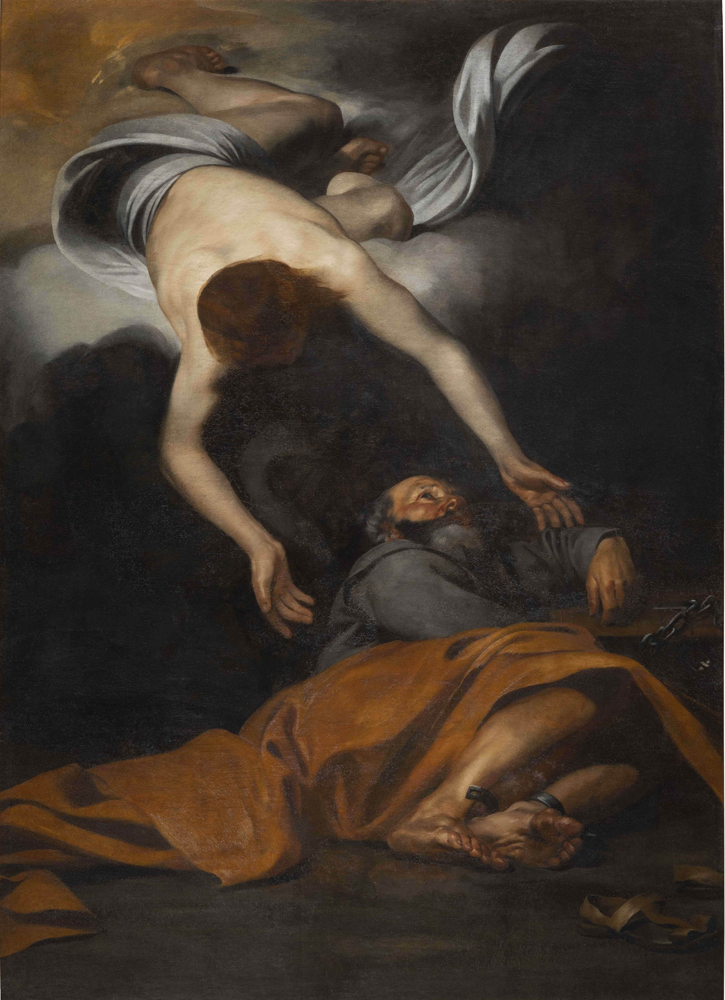
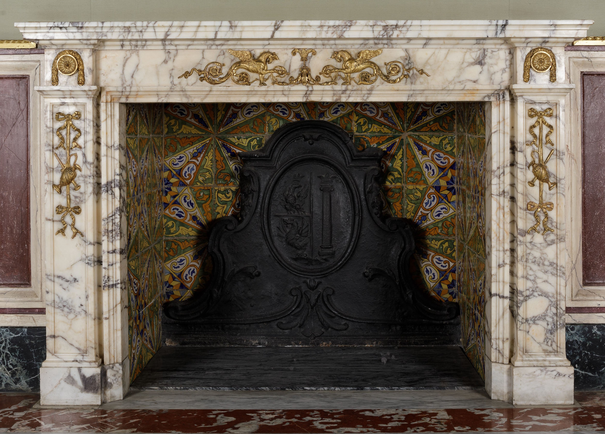

第 11 室（费拉拉绘画厅）专陈 16 世纪费拉拉画派作品（奥尔托拉诺、加罗法洛等），是一间小巧的「地方画派」专题厅；天顶贝雷蒂尼绘特洛伊美少年伽倪墨得斯被掳上天的故事。

**必看与核心展品（⭐⭐⭐ 必看 + 核心）**

| 推荐 | 展品 | 作者 | 一句话看点 |
|---|---|---|---|
| ⭐⭐⭐ 必看 | 《哀悼基督》 | 奥尔托拉诺 | 费拉拉画派的沉静哀恸，浓郁色彩与北方细节 |
| ⭐⭐ 推荐 | 《圣母子》 | 加罗法洛 | 「费拉拉的拉斐尔」，温润优雅的圣母像 |
| ⭐⭐ 推荐 | 天顶《伽倪墨得斯故事》 | 文琴佐·贝雷蒂尼 | 三分镜讲「凡间美少年被掳上天、封侍神」 |

**展厅官网介绍页**：[Room 11 - Room of Ferrarese Painting](https://galleriaborghese.cultura.gov.it/en/il-museo/la-villa/sala-11-sala-della-pittura-ferrarese/)

## 核心展品

### ⭐⭐⭐ 必看 乔瓦尼·巴蒂斯塔·本韦努蒂，称奥尔托拉诺《哀悼基督》 / Giovanni Battista Benvenuti called Ortolano, _The Lamentation_
- **作者 / Artist**：乔瓦尼·巴蒂斯塔·本韦努蒂，称奥尔托拉诺 / Giovanni Battista Benvenuti called Ortolano
- **作品 / Work**：《哀悼基督》 / _The Lamentation_
- **时间**：约 1515–1520 年
- **材质**：油彩木板（后转贴于铝板）
- **尺寸**：241 × 181.5 cm
- **位置**：费拉拉绘画厅（第 11 室）
- **官网介绍页**：[哀悼基督 / Compianto sul Cristo morto｜Galleria Borghese 官方藏品库](https://www.collezionegalleriaborghese.it/opere/compianto-sul-cristo-morto)｜馆藏编号 390

**内容（这是什么）**：一块高 2.4 米的祭坛大画，画的是「哀悼基督」——基督遗体从十字架卸下后，亲友围着尸身悲恸的一刻。前景是抱着、扶着基督的众人；远处的各各他（Golgotha）山上还立着两名强盗的十字架，中央那具属于基督的十字架已空，靠着一架梯子，旁边飘着写有「INRI」字样的旗幡，告诉你这是「卸架之后」。

**背景 / 来历**：作者奥尔托拉诺（Ortolano，本名乔瓦尼·巴蒂斯塔·本韦努蒂，费拉拉约 1487 年生、1527 年后卒）是 16 世纪费拉拉画派的代表之一。此画约作于 1515–1520 年，原是费拉拉一座俗称「小圣母堂（La Madonnina）」的祭坛画；1620 年被撤下（原位换上朱利奥·克罗梅尔 Giulio Cromer 的一件摹本），不久归入红衣主教希皮奥内·博尔盖塞（Scipione Borghese），1622 年由他出资装框入藏。17 世纪它曾与拉斐尔（Raffaello）的《基督下葬》等三件「基督受难」题材作品同挂一室——这正是希皮奥内爱把同题材名作并置一处的收藏趣味。

**画风与图像学**：奥尔托拉诺把费拉拉本地的精细传统（科斯梅·图拉 Cosmè Tura、曼特尼亚 Mantegna 式对衣纹丝带近乎錾刻的执着）和拉斐尔式的人物优雅揉在一起——希皮奥内当年正是看中这一点，才把它和拉斐尔的画对照悬挂。背景那座戒备森严的「耶路撒冷」城，其实照费拉拉自家的城防画成，把地平线推近、视线收拢，逼你聚焦到前景的悲恸。

**现场站看**：

1. **看基督脚边跪地祈祷的圣约翰（San Giovanni / St John）**——他是画面情绪的定调者，悲而不乱，先认出他就能读懂整组人的关系。
2. **看捧着十字架钉子的亚利马太的约瑟（Giuseppe d'Arimatea / Joseph of Arimathea）**——他像展示圣髑一样把钉子举给你看，是全画最「点题受难」的细节。
3. **看右侧玛利亚·抹大拉（Maria Maddalena / Mary Magdalene）张臂悲号**——典型的「剧场式」哀恸姿态，和左侧约翰的内敛正好成对照。
4. **看右侧阴影里那个面相硬朗、被「写实化」的男子**——研究者认为是建堂人、画作原属教堂的赞助人安东尼奥·科斯塔比利（Antonio Costabili），等于把出资人「藏」进了圣经场景。
5. **看左侧水边背着小耶稣过河的圣克里斯托弗（San Cristoforo / St Christopher）**——一个与主场景错时的小插段，是费拉拉画派爱把多段叙事并置一画的习惯。
6. **退后几步看整片风景**——低压的城墙与远山把地平线压近，让你无处可逃地盯住中央的各各他与遗体；这就是房间介绍强调的「风景参与人物情绪」。

### ⭐⭐ 推荐 本韦努托·蒂西，称加罗法洛《圣母子》 / Benvenuto Tisi called Garofalo, _Madonna and Child_
- **作者 / Artist**：本韦努托·蒂西，称加罗法洛 / Benvenuto Tisi called Garofalo
- **作品 / Work**：《圣母子》 / _Madonna and Child_
- **时间**：16 世纪上半叶
- **材质**：油画
- **尺寸**：馆方藏品库未单列具体尺寸
- **位置**：费拉拉绘画厅（第 11 室）

**内容（这是什么）**：一幅圣母子（Madonna and Child）小型供奉画——圣母玛利亚（Maria）抱着圣婴耶稣，是文艺复兴最常见的私人虔修题材。

**背景 / 看点**：加罗法洛（Garofalo，本名本韦努托·蒂西，约 1481—1559）是费拉拉画派后期的台柱，因深受拉斐尔影响、把罗马盛期风格带回费拉拉，被称作「费拉拉的拉斐尔」；他常以一朵「丁香花（garofano）」当签名暗号，绰号即由此而来。本厅把他与奥尔托拉诺、多索·多西（Dosso Dossi）一系并陈，正是希皮奥内·博尔盖塞（Scipione Borghese）在费拉拉于 1598 年归入教皇国后大举搜罗费拉拉绘画的成果。看点是把他柔和明丽的拉斐尔式圣母，和隔壁奥尔托拉诺更「费拉拉本地味」的精雕细密对照着看，能直观感到同一画派里的两种气质。

### ⭐ 顺路看 乔万·弗朗切斯科·巴尔别里，称圭尔奇诺《参孙向父母献上蜂巢》 / Giovanni Francesco Barbieri called Guercino, _Samson Offering His Parents a Honeycomb_
- **作者 / Artist**：乔万·弗朗切斯科·巴尔别里，称圭尔奇诺 / Giovanni Francesco Barbieri called Guercino
- **作品 / Work**：《参孙向父母献上蜂巢》 / _Samson Offering His Parents a Honeycomb_
- **时间**：1629 年之前
- **材质**：布面油画
- **尺寸**：112 × 146 cm
- **位置**：费拉拉绘画厅（第 11 室）
- **官网介绍页**：[参孙向父母献蜂巢 / Sansone porge ai genitori il favo di miele｜Galleria Borghese 官方藏品库](https://www.collezionegalleriaborghese.it/opere/sansone-porge-ai-genitori-il-favo-di-miele)｜馆藏编号 070

**内容（这是什么）**：取自《旧约·士师记》第 14 章的参孙（Sansone / Samson）故事。大力士参孙去见未婚妻的途中曾徒手撕死一头狮子；归途发现狮子尸体里筑了蜂巢、满是蜂蜜，他取了蜜，却没说来历地分给父母吃。画面定格在他把半块蜂巢递给两位年迈双亲的一刻。

**背景 / 看点**：1633 年前已入希皮奥内·博尔盖塞收藏。学界多认为这是圭尔奇诺（Guercino，本名乔万·弗朗切斯科·巴尔别里，1591—1666）工坊据其真迹（今藏美国诺福克 Chrysler 博物馆、原为巴尔贝里尼 Barberini 家族所作）画的一件「大草稿」式复本，也有学者认为出自大师亲笔。一个现成的辨认点：真迹版蜂巢上方飞着三只蜜蜂，影射巴尔贝里尼家族纹章上的三只蜂；本馆这件一只蜂也没有。看点是圭尔奇诺早年那种暖褐调、强明暗的叙事油画。

## 天顶画

### ⭐⭐ 推荐 文琴佐·贝雷蒂尼《伽倪墨得斯故事》 / Vincenzo Berrettini, _Tale of Ganymede_

- **作者 / Artist**：文琴佐·贝雷蒂尼（18 世纪） / Vincenzo Berrettini
- **作品 / Work**：《伽倪墨得斯故事》 / _Tale of Ganymede_
- **时间**：18 世纪末（平乔别墅新古典改造期）
- **位置**：费拉拉绘画厅天顶（第 11 室，旧称「小画廊／女子肖像廊」）

**内容（这是什么）**：天顶画的题材是特洛伊美少年伽倪墨得斯（Ganimede / Ganymede）的故事。神话里，伽倪墨得斯是特洛伊王族中最俊美的少年，主神朱庇特（Giove / Jupiter）惊艳于他的美貌，化作一只巨鹰把他从伊达山掳上奥林匹斯，封他做众神的斟酒童（cupbearer），从此长侍神宴、永葆青春。天顶用三个分镜讲这个故事：中央是「众神会议、伽倪墨得斯被引荐给朱庇特」，两侧分别是「朱庇特化作雄鹰劫走伽倪墨得斯」和「伽倪墨得斯为众神斟酒」。一句话概括，就是「凡间少年因美被掳上天、封为侍神」。

**背景 / 来历**：作者是文琴佐·贝雷蒂尼（Vincenzo Berrettini，18 世纪），绘于这间厅最后一轮装修期间——即马尔坎托尼奥·博尔盖塞（Marcantonio IV Borghese）主持、建筑师阿斯普鲁奇（Antonio Asprucci）统筹的别墅新古典大改造（「一室一主题」）。同一位贝雷蒂尼还画了第 18 室（朱庇特与安提俄佩厅）天顶四周的装饰，是这轮工程里常见的装饰画手。这间小厅历史上称「小画廊」「女子肖像廊」，体量不大，所以天顶选的是轻盈的神话叙事而非宏大幻觉穹顶。要注意：厅名「费拉拉绘画厅」来自墙上陈列的费拉拉画派作品（多索·多西等），与天顶的伽倪墨得斯主题并不同源——天顶是独立的一套装饰。

**看点**：在一间不大的厅里把一则神话拆成三幕画全，是看点所在——它让你能完整读出「被引荐→被劫持→当侍神」的叙事链。伽倪墨得斯（被掳上天的凡人）也和别墅其它厅反复出现的「朱庇特变形求欢／掳人」母题（如第 18 室的朱庇特化萨堤尔）遥相呼应，是博尔盖塞天顶里一再上演的「神与凡人」主题。

**现场站看**：

1. **先认中央的「引荐」场景**——抬头找天顶正中、最亮的一幕：众神会议上，伽倪墨得斯被引荐给朱庇特。认准它，三幕的次序就理顺了。
2. **向两侧找「化鹰劫持」一幕**——这是全故事最有戏的一幕：朱庇特化身巨鹰把少年掠向空中。留意那只鹰——它既是劫持的主角，也暗合博尔盖塞家徽上的鹰。
3. **找「斟酒童」一幕**——另一侧画伽倪墨得斯为众神斟酒，这是故事的结局（他从此长侍神宴）。三幕连起来，就是「被掳上天、封为侍神」的完整叙事。
4. **联系全馆的「神掳凡人」母题**——记住这个故事，到第 18 室看朱庇特化萨堤尔接近安提俄佩时会会心一笑：博尔盖塞的天顶反复在讲朱庇特如何变形、如何把凡人卷入神的世界。

## 绘画

本节按馆方 Painting 藏品列表补充，共 2 件。核心展品如已在上文展开，这里仍保留官方清单条目，方便核对。

### ⭐ 顺路看 胡塞佩·德·里贝拉，称小西班牙人《圣伯多禄出狱》 / Ribera Jusepe de' called Spagnoletto, _St. Peter released from prision_

- **作者 / Artist**：胡塞佩·德·里贝拉，称小西班牙人 / Ribera Jusepe de' called Spagnoletto
- **作品 / Work**：《圣伯多禄出狱》 / _St. Peter released from prision_
- **时间**：约 1613–1614 年
- **材质**：布面油画
- **尺寸**：193 × 143 cm
- **馆藏编号**：192
- **位置**：费拉拉绘画厅（第 11 室）
- **官网介绍页**：[官网介绍英文](https://www.collezionegalleriaborghese.it/en/opere/st-peter-released-from-prision)｜馆藏编号 192

**内容（这是什么）**：题材出自《使徒行传》第 12 章——使徒彼得（圣伯多禄，San Pietro / St Peter）被希律王下狱，夜里天使现身、镣铐自落，引他越过看守走出监牢。画里多半是半身的老彼得在幽暗牢中被光照亮的一刻。

**背景 / 看点**：里贝拉（Ribera，绰号「小西班牙人 Spagnoletto」，1591—1652）是西班牙裔、长居那不勒斯的卡拉瓦乔派大师；这件约 1613–1614 年的早期作品正是他罗马时期对卡拉瓦乔强明暗的吸收。看点是典型的「暗调写实」：粗粝的老者皮肤与骨节，被刀切般的光劈出戏剧性的明暗。它与早期费拉拉核心并非一路，但顺着同厅的绘画线索看一眼即可。

## 其他

本节按馆方 Furniture 藏品列表补充，共 1 件。

### ⭐ 顺路看 罗马学派《壁炉》 / roman school, _Fireplace_

- **作者 / Artist**：罗马学派 / roman school
- **作品 / Work**：《壁炉》 / _Fireplace_
- **时间**：1780 年之前
- **材质**：帕沃纳佐大理石（pavonazzo）；雕刻鎏金木质贴饰
- **尺寸**：高 112 cm；宽 166 cm；深 70 cm
- **馆藏编号**：camini-XI
- **位置**：费拉拉绘画厅（第 11 室）
- **官网介绍页**：[官网介绍英文](https://www.collezionegalleriaborghese.it/en/opere/fireplace-xi)｜馆藏编号 camini-XI

**内容 / 看点**：本厅的一座 18 世纪壁炉，用紫白纹的「帕沃纳佐大理石（pavonazzo）」配雕花鎏金木饰，是 18 世纪末阿斯普鲁奇（Antonio Asprucci）整体改造别墅时为各厅配置的固定陈设之一。它不算「展品」，而是房间装修的一部分；看点在于理解：这些小厅的天顶、壁炉、灰泥本属同一套统一设计，让每间房有自己的主题，而非单纯挂画的墙面。

### ⭐ 顺路看 房间装饰与壁炉 / Room Decoration and Fireplace

- **位置**：费拉拉绘画厅（第 11 室）

二楼房间的天顶、壁炉、怪诞纹（grottesche）和透视装饰共同构成参观体验。尤其是 18 世纪末安东尼奥·阿斯普鲁奇（Antonio Asprucci）主持的整体改造，让每间房间都有独立主题，而不只是挂画空间——本厅的主题正是「费拉拉绘画」。

## 资料来源 / Sources

- Galleria Borghese 官方房间页：[Room 11](https://galleriaborghese.cultura.gov.it/en/il-museo/la-villa/sala-11-sala-della-pittura-ferrarese/)
- Galleria Borghese 藏品筛选：[Painting, Room 11](https://www.collezionegalleriaborghese.it/en/collezione/pittura?sala=s11)
- Galleria Borghese 藏品筛选：[Modern Sculpture, Room 11](https://www.collezionegalleriaborghese.it/en/collezione/scultura?sala=s11)
- Galleria Borghese 藏品筛选：[Ancient Art, Room 11](https://www.collezionegalleriaborghese.it/en/collezione/arte-antica?sala=s11)
- Galleria Borghese 藏品筛选：[Furniture, Room 11](https://www.collezionegalleriaborghese.it/en/collezione/arredi?sala=s11)
