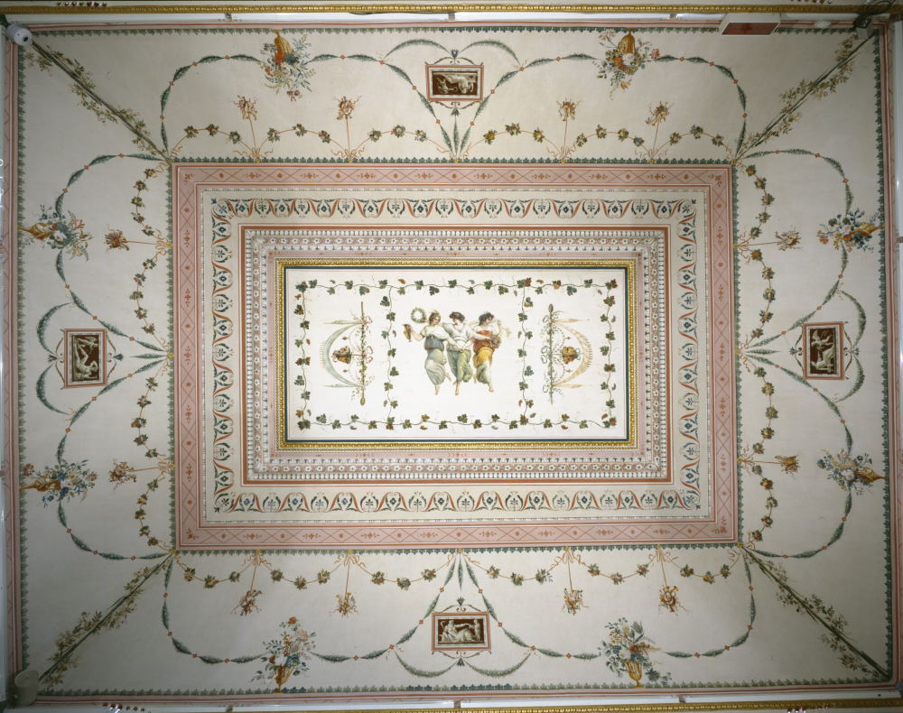

第 12 室（巴克坎特厅／酒神女祭司厅）是一间以天顶得名的小型装饰厅，贾尼把从金宫、哈德良别墅临摹来的古罗马「怪诞纹」装饰搬上天花板；本厅无 ⭐⭐⭐ 必看，亮点即天顶。

**必看与核心展品（天顶画为主）**

| 推荐 | 展品 | 作者 | 一句话看点 |
|---|---|---|---|
| ⭐⭐ 推荐 | 天顶《舞蹈的酒神女祭司》 | 费利切·贾尼 | 常春藤框里三女起舞，古罗马装饰语汇的再创作 |

**展厅官网介绍页**：[Room 12 - Room of the Bacchantes](https://galleriaborghese.cultura.gov.it/en/il-museo/la-villa/sala-12-sala-delle-baccanti/)

## 天顶画

### ⭐⭐ 推荐 费利切·贾尼《舞蹈的酒神女祭司》 / Felice Giani, _Dancing Bacchantes_

- **作者 / Artist**：费利切·贾尼（1758–1823） / Felice Giani
- **作品 / Work**：《舞蹈的酒神女祭司》 / _Dancing Bacchantes_
- **时间**：1782–1785 年（平乔别墅新古典改造期）
- **位置**：巴克坎特厅天顶（第 12 室）

**内容（这是什么）**：这间「巴克坎特厅（酒神女祭司厅）」正因天顶中央这幅画得名——常春藤框里三名女子翩翩起舞，四周环绕花饰、花环、绶带与乐器。巴克坎特（Bacchantes，又称迈那得斯 Maenads）是酒神巴克斯（Bacchus，希腊名狄俄尼索斯）的女信徒：她们在祭典上披头散发、手持酒神杖（thyrsus）、和着鼓笛狂舞，是古代艺术里「迷狂、欢愉、与自然合一」的象征。所以围着她们的常春藤（酒神的圣物）、乐器、花环都不是闲笔，而是「酒神世界」的标准道具——整片天顶就是一支凝固在天花板上的酒神之舞。

**背景 / 来历**：作者费利切·贾尼（Felice Giani，1758–1823），1782–1785 年间绘成；他同时装饰了相邻的第 11、13 室，三间相连的小厅是同一位画家的连作。贾尼是 18 世纪末罗马「仿古装饰」的代表人物，常去尼禄的「金宫（Domus Aurea）」和蒂沃利的哈德良别墅（Villa Adriana）实地临摹古罗马壁面——那些埋在地下的古代房间被重新发现后，墙顶上轻盈的「怪诞纹（grottesche）」、细密卷草、悬浮小人物让 18 世纪的画家如获至宝。这间天顶正是对那种「怪诞纹＋灰泥」古典装饰语汇的再创作：他没有画一幅「画穿屋顶」的宏大幻觉天顶，而是把古罗马别墅墙面的纤巧装饰整套搬上了天花板。这也是阿斯普鲁奇主持别墅「一室一主题」整体改造里的一间。

**看点**：它是别墅里「考古临摹如何变成室内装饰」最直接的一例——你抬头看到的不是叙事大画，而是一整套从金宫、哈德良别墅「拓」回来的古罗马装饰纹样，轻盈、对称、悬浮。主题与厅名严丝合缝：酒神女祭司之舞，配常春藤、乐器与花环，整间厅就是一支「酒神的舞会」。

**现场站看**：

1. **先认中央常春藤框里的三位舞女**——抬头找天顶正中、常春藤环框内翩翩起舞的三名女子，她们就是巴克坎特（酒神女祭司）；认准她们，厅名与主题就对上了。
2. **找「酒神道具」**——留意画里的常春藤（酒神圣物）、酒神杖、鼓与笛等乐器，这些不是装饰花边，而是辨认「这是酒神世界」的身份标志。
3. **扫看四周的怪诞纹与花环**——环看中央以外那些纤细的卷草、绶带、悬浮小人物和花环，这是贾尼从古罗马遗址临摹来的「grottesche」语汇，是全顶最有古意的部分。
4. **体会「不画穿屋顶」的装饰思路**——和别的厅那种强透视幻觉天顶不同，这间走的是平面化、纹样化的「墙面式」装饰；盯着看会发现它更像把一面古罗马彩绘墙铺到了头顶。
5. **三厅连起来看**——第 11、12、13 室是贾尼同一批连作，逛完可回想三间天顶一脉相承的轻盈仿古趣味。

## 资料来源 / Sources

- Galleria Borghese 官方房间页：[Room 12](https://galleriaborghese.cultura.gov.it/en/il-museo/la-villa/sala-12-sala-delle-baccanti/)
- Galleria Borghese 藏品筛选：[Painting, Room 12](https://www.collezionegalleriaborghese.it/en/collezione/pittura?sala=s12)
- Galleria Borghese 藏品筛选：[Modern Sculpture, Room 12](https://www.collezionegalleriaborghese.it/en/collezione/scultura?sala=s12)
- Galleria Borghese 藏品筛选：[Ancient Art, Room 12](https://www.collezionegalleriaborghese.it/en/collezione/arte-antica?sala=s12)
- Galleria Borghese 藏品筛选：[Furniture, Room 12](https://www.collezionegalleriaborghese.it/en/collezione/arredi?sala=s12)
