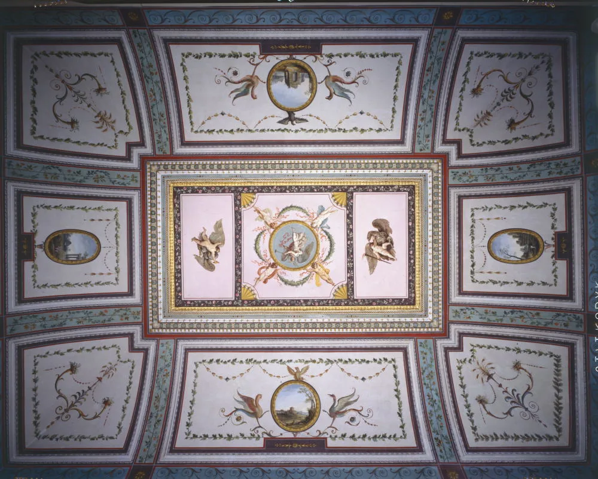

第 13 室（声望厅）是一间以天顶得名的小厅，贾尼 1790 年绘「声望女神＋博尔盖塞家徽之鹰」的寓意，呼应当时的庞贝考古热；墙上则挂着巴基亚卡的《约瑟故事》婚房组画。本厅无 ⭐⭐⭐ 必看。

**必看与核心展品（核心 + 天顶画）**

| 推荐 | 展品 | 作者 | 一句话看点 |
|---|---|---|---|
| ⭐⭐ 推荐 | 天顶《声望寓意画》 | 费利切·贾尼 | 声望女神＋持鹰小爱神（家徽），庞贝风仿古装饰 |
| ⭐⭐ 推荐 | 《约瑟故事》 | 巴基亚卡 | 佛罗伦萨名「婚房组画」流散的几块，连环叙事 |

**展厅官网介绍页**：[Room 13 - Fame Room](https://galleriaborghese.cultura.gov.it/en/il-museo/la-villa/sala-13-sala-della-fama/)

## 天顶画

### ⭐⭐ 推荐 费利切·贾尼《声望寓意画》 / Felice Giani, _Allegory of Fame_

- **作者 / Artist**：费利切·贾尼（1758–1823） / Felice Giani（废墟风景：乔万尼·坎波韦基奥 / Giovanni Campovecchio）
- **作品 / Work**：《声望寓意画》 / _Allegory of Fame_
- **时间**：1790 年（平乔别墅新古典改造期）
- **位置**：声望厅天顶（第 13 室）

**内容（这是什么）**：本厅得名于天顶中央的「声望寓意（Fame / Allegory of Fame）」——一位拟人化的「声望女神」居中（传统上她持长号角、振翅，象征声名远播），两侧各有一名抱着鹰的小爱神（putto）。这里的鹰不是随便的装饰：它正是博尔盖塞家族纹章上的标志（家徽为「鹰＋龙」），所以这片天顶其实是一句含蓄的家族宣言——把抽象的「声望／荣耀」与博尔盖塞之名扣在一起，让整间小厅成为家族声名的颂歌。

**背景 / 来历**：1790 年由费利切·贾尼（Felice Giani，1758–1823）受命装饰，他同时也做了相邻的第 11、12 室——这三间相连的小厅是同一位画家、同一种趣味的连作。天顶被几何框格和植物卷草（racemes）分区，顺着筒形拱顶（barrel vault）的弧面铺展；四面圆形与椭圆框里的「废墟风景」，很可能出自他的合作者乔万尼·坎波韦基奥（Giovanni Campovecchio，1754–1804）之手。整套装饰走的是一种精致的「仿古考据风」（antiquarian style）：它直接呼应着当时正被陆续发掘出土的庞贝（Pompeii）与赫库兰尼姆古罗马壁画——18 世纪末的罗马贵族圈正为「古代房屋到底怎么装饰」着迷，贾尼这类画家便把出土壁画里的怪诞纹、细密卷草、小幅风景框景搬上天花板。这也是阿斯普鲁奇主持别墅「一室一主题」整体改造的尾声房间之一。

**看点**：它是别墅里「考古热如何变成室内装饰」最直接的样本——你抬头看到的轻盈卷草与小景框格，本质上是 18 世纪末罗马人对刚出土的庞贝壁画的「再创作」。另一层看点是家族符号：中央寓意画用「声望女神＋博尔盖塞之鹰」把房间变成家族荣耀的隐喻。

**现场站看**：

1. **先认中央的声望女神**——抬头找天顶正中那位居中的拟人女性，她就是「声望（Fame）」；认准她，整片天顶的主题就立住了。
2. **找她两侧「抱鹰的小爱神」**——这对持鹰 putto 是关键：鹰是博尔盖塞家徽的标志，等于在天顶上盖了家族的「印章」。看出这层，就懂了为什么一间小厅要专门画「声望」。
3. **看四周框里的废墟小景**——圆形和椭圆框里的古迹废墟风景（可能出自坎波韦基奥），是这套「考据风」装饰的点睛；它们和中央寓意一起，把天顶分成「主题＋古风小品」的层次。
4. **盯卷草与几何框格的「仿古」细节**——注意那些细密的植物卷草、怪诞纹和分区框格，它们模仿的正是当时刚出土的庞贝／赫库兰尼姆古罗马壁画；这片天顶是 18 世纪末「庞贝热」的现场回声。
5. **三厅连起来看**——第 11、12、13 室是贾尼同一批装饰的连作，逛完可回想三间天顶的风格一脉相承，都是这股新古典「仿古」趣味的产物。

## 其他

### ⭐ 顺路看 房间装饰与壁炉 / Room Decoration and Fireplace

- **位置**：声望厅（第 13 室）

二楼房间的天顶、壁炉、怪诞纹（grottesche）和透视装饰共同构成参观体验。尤其是 18 世纪末安东尼奥·阿斯普鲁奇（Antonio Asprucci）主持的整体改造，让每间房间都有独立主题，而不只是挂画空间——本厅的主题正是天顶上的「声望」寓意。

 资料来源 / Sources

- Galleria Borghese 官方房间页：[Room 13](https://galleriaborghese.cultura.gov.it/en/il-museo/la-villa/sala-13-sala-della-fama/)
- Galleria Borghese 藏品筛选：[Painting, Room 13](https://www.collezionegalleriaborghese.it/en/collezione/pittura?sala=s13)
- Galleria Borghese 藏品筛选：[Modern Sculpture, Room 13](https://www.collezionegalleriaborghese.it/en/collezione/scultura?sala=s13)
- Galleria Borghese 藏品筛选：[Ancient Art, Room 13](https://www.collezionegalleriaborghese.it/en/collezione/arte-antica?sala=s13)
- Galleria Borghese 藏品筛选：[Furniture, Room 13](https://www.collezionegalleriaborghese.it/en/collezione/arredi?sala=s13)
