第 14 室（兰弗兰科凉廊）原是朝向「秘密花园」敞开的凉廊，为保护天顶才封成室内；这片兰弗兰科的《诸神会议》是别墅 17 世纪原装饰仅存的两块绘画之一，正中陈列贝尼尼的两版《希皮奥内·博尔盖塞胸像》。

**必看与核心展品（⭐⭐⭐ 必看 + 核心）**

| 推荐 | 展品 | 作者 | 一句话看点 |
|---|---|---|---|
| ⭐⭐⭐ 必看 | 《希皮奥内·博尔盖塞胸像》（两版） | 吉安·洛伦佐·贝尼尼 | 「会说话」的枢机像；第一版裂了，连夜赶出第二版 |
| ⭐⭐ 推荐 | 《维纳斯四季》（梳妆/锻炉/与阿多尼斯/狄安娜胜利） | 弗朗切斯科·阿尔巴尼 | 四幅圆形「四季维纳斯」组画，优雅田园 |
| ⭐⭐ 推荐 | 《音乐会（护身符被盗）》 | 赫里特·范·洪特霍斯特 | 卡拉瓦乔派的烛光夜景与窃贼细节 |
| ⭐⭐ 推荐 | 天顶《诸神会议》 | 乔瓦尼·兰弗兰科 | 别墅 17 世纪原装饰的「活化石」，为敞廊而画 |

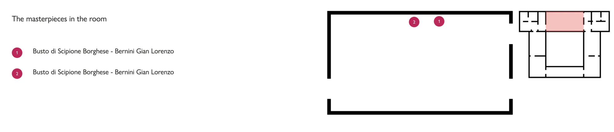

**展厅官网介绍页**：[Room 14 - Lanfranco Loggia](https://galleriaborghese.cultura.gov.it/en/il-museo/la-villa/sala-14-loggia-di-lanfranco/)

## 核心展品

### ⭐⭐⭐ 必看 吉安·洛伦佐·贝尼尼《希皮奥内·博尔盖塞胸像（两版）》 / Gian Lorenzo Bernini, _Bust of Scipione Borghese_
- **作者 / Artist**：吉安·洛伦佐·贝尼尼 / Gian Lorenzo Bernini
- **作品 / Work**：《希皮奥内·博尔盖塞胸像（两版）》 / _Bust of Scipione Borghese (two versions)_
- **时间**：1632 年
- **材质**：卡拉拉大理石
- **尺寸**：第一版高 77.2 cm；第二版高 78 cm
- **位置**：兰弗兰科凉廊（第 14 室）

- **官网介绍页**：[希皮奥内·博尔盖塞胸像（第一版，带裂纹）/ Busto di Scipione Borghese｜Galleria Borghese 官方藏品库](https://www.collezionegalleriaborghese.it/it/opere/busto-di-scipione-borghese-2)｜馆藏编号 CCLXV

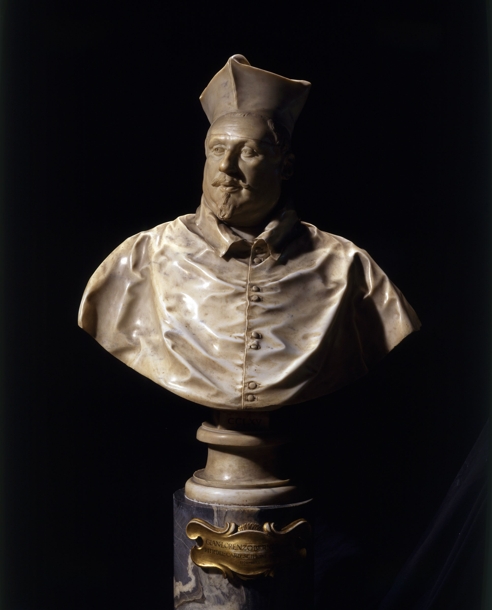

- **官网介绍页**：[希皮奥内·博尔盖塞胸像（第二版）/ Busto di Scipione Borghese｜Galleria Borghese 官方藏品库](https://www.collezionegalleriaborghese.it/it/opere/busto-di-scipione-borghese)｜馆藏编号 CCLXVI

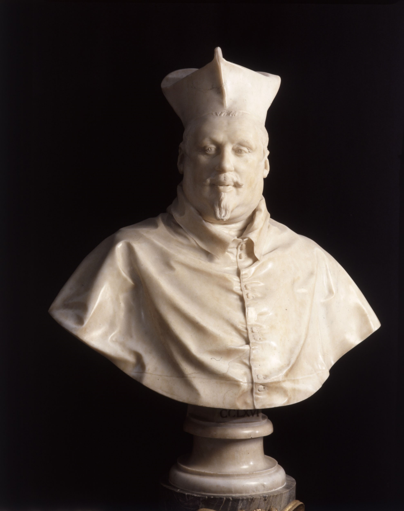

这是本厅当之无愧的镇厅之宝，也是巴洛克肖像雕塑史上的里程碑。本厅同时陈列着贝尼尼为同一人雕的两件几乎一样的胸像，背后藏着一个著名的「救场」故事。

**这是什么**：被雕的是红衣主教希皮奥内·博尔盖塞（Scipione Borghese），也就是这座别墅与整座收藏的缔造者——教皇保罗五世（Paolo V，本姓 Camillo Borghese）的外甥，年纪轻轻被舅舅收为养子、几乎包揽了教廷一切要职，是 17 世纪初罗马最有权势、也最热衷搜罗艺术的人。贝尼尼把他塑成「正被人打断谈话的一瞬」：头微微转向左侧，嘴唇半张，仿佛刚要开口回应。这种「抓住转瞬即逝的动态」正是它划时代的地方——它是贝尼尼第一件真正意义上的「会说话的肖像（ritratto parlante）」。

**背景 / 来历**：希皮奥内直到 1632 年才让人为自己造像，此时他的舅舅保罗五世已去世十年、家族权势大不如前。这件由当时的教皇乌尔班八世（Urbano VIII）出面向贝尼尼订制——贝尼尼那时正全职为圣彼得大教堂工作，教皇付了他 500 zecchini 外加一颗钻石。贝尼尼不像前辈那样亲挑石料、也不打磨看不见的背面，他把雕塑理解为「手艺、机巧与灵感」。最戏剧性的一幕是：胸像快完工时，主教额头位置的大理石裂开了一道至今仍清晰可见的裂纹（俗称「pelo」）。贝尼尼于是火速另刻一件几乎相同的替身——据传记作家巴尔迪努奇说是「十五个夜晚」，据贝尼尼之子多梅尼科说只用了「三天」。这桩轶事成了「贝尼尼神乎其技」传奇的基石之一。两版后来都被博尔盖塞家族收藏：希皮奥内把带裂纹的第一版摆进「皇帝厅」的凯撒胸像之间，把完美的第二版挂在画廊里——光这摆法就说明他自己更看重哪一件，也说明那道裂纹并不足以毁掉它的感染力。1892 年两版一同被意大利国家买下。

**看点**：贝尼尼坚信「相似」不靠一笔一画临摹静止的五官，而靠捕捉人在动态中的个性——所以他刻的是「正在转头、正要说话」的希皮奥内，而非一具僵硬的官样面孔。注意他怎样用刀法区分材质：脸上紧绷微汗的皮肤、脖子在硬领上挤出的褶皱、外披绸缎短披肩（mozzetta）随褶皱起伏、反射出绸面波光般的「水纹感」。这是把冷硬大理石「做出体温与质地」的极致示范。

**现场站看**：

1. **先到第一版额头找那道裂纹**——一道斜贯前额的细缝就是当年逼贝尼尼连夜重刻的「事故」。能亲眼验证这个传奇，是看这件的最大乐趣；再对照旁边毫无瑕疵的第二版，体会「同一双手、同一个人、刻两遍」。
2. **看半张的嘴和转向的头**——这正是「会说话的肖像」的发明点：他被定格在打断谈话、正要回话的瞬间，眼神有方向、像在跟你对视。和别处那些正襟危坐的官样胸像一比就懂它新在哪。
3. **盯绸披肩的褶皱**——不同朝向的褶面反射光线不一，制造出丝绸特有的「水纹（marezzatura）」光泽；这是贝尼尼「让大理石模拟织物」的看家本事。
4. **看脖子压在硬领上的肉褶**——皮肤的松软、衣领的浆硬，两种质感靠雕凿深浅一刀分出，是「marmi vivi（活的大理石）」一说的现场注脚。
5. **两版并看，做个对比**——它们几乎一模一样，却能逼你去找极细微的差别（眼神、披肩下缘的弧度）。这种「找不同」恰恰让你慢下来，真正看进贝尼尼的手艺。

### ⭐⭐ 推荐 弗朗切斯科·阿尔巴尼《维纳斯梳妆（春）、武尔坎锻炉中的维纳斯（夏）、维纳斯与阿多尼斯（秋）、狄安娜的胜利（冬）》 / Francesco Albani, _Toilette of Venus; Venus in Vulcan's Forge; Venus and Adonis; The Triumph of Diana_
- **作者 / Artist**：弗朗切斯科·阿尔巴尼 / Francesco Albani
- **作品 / Work**：《维纳斯梳妆（春）、武尔坎锻炉中的维纳斯（夏）、维纳斯与阿多尼斯（秋）、狄安娜的胜利（冬）》 / _Toilette of Venus; Venus in Vulcan's Forge; Venus and Adonis; The Triumph of Diana_
- **时间**：1616–1617 年
- **材质**：布面油画
- **尺寸**：每幅直径 154 cm
- **位置**：兰弗兰科凉廊（第 14 室）

- **官网介绍页**：[维纳斯的梳妆（春）/ Toeletta di Venere (La Primavera)｜Galleria Borghese 官方藏品库](https://www.collezionegalleriaborghese.it/it/opere/toletta-di-venere-la-primavera)｜馆藏编号 040

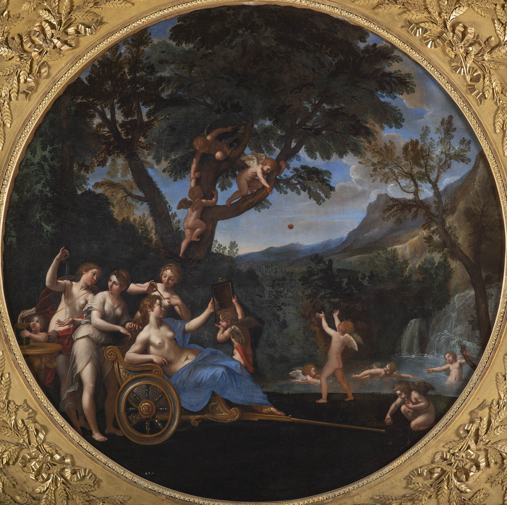

- **官网介绍页**：[火神维纳斯的锻炉（夏）/ Venere nella fucina di Vulcano (o l'Estate)｜Galleria Borghese 官方藏品库](https://www.collezionegalleriaborghese.it/it/opere/venere-nella-fucina-di-vulcano-lestate)｜馆藏编号 035

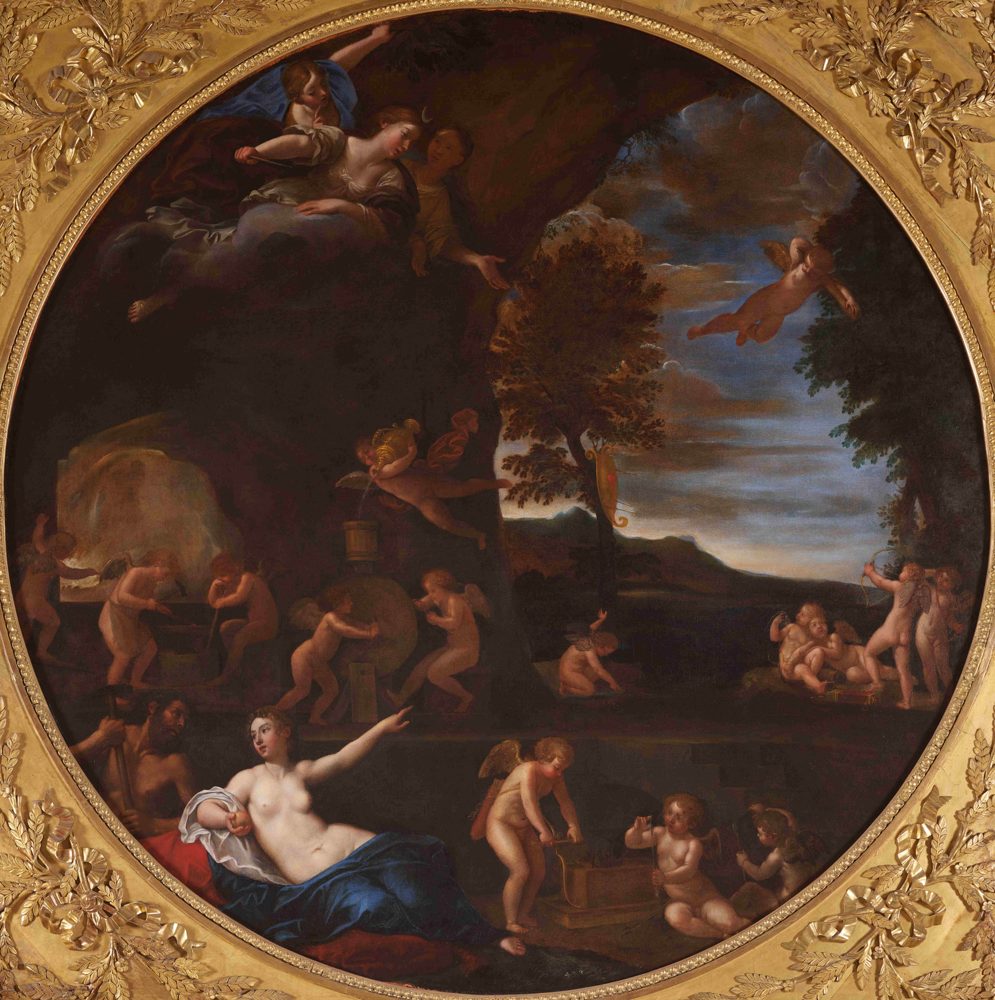

- **官网介绍页**：[维纳斯与阿多尼斯（秋）/ Venere e Adone (o l'Autunno)｜Galleria Borghese 官方藏品库](https://www.collezionegalleriaborghese.it/it/opere/venere-e-adone-o-l-autunno)｜馆藏编号 044

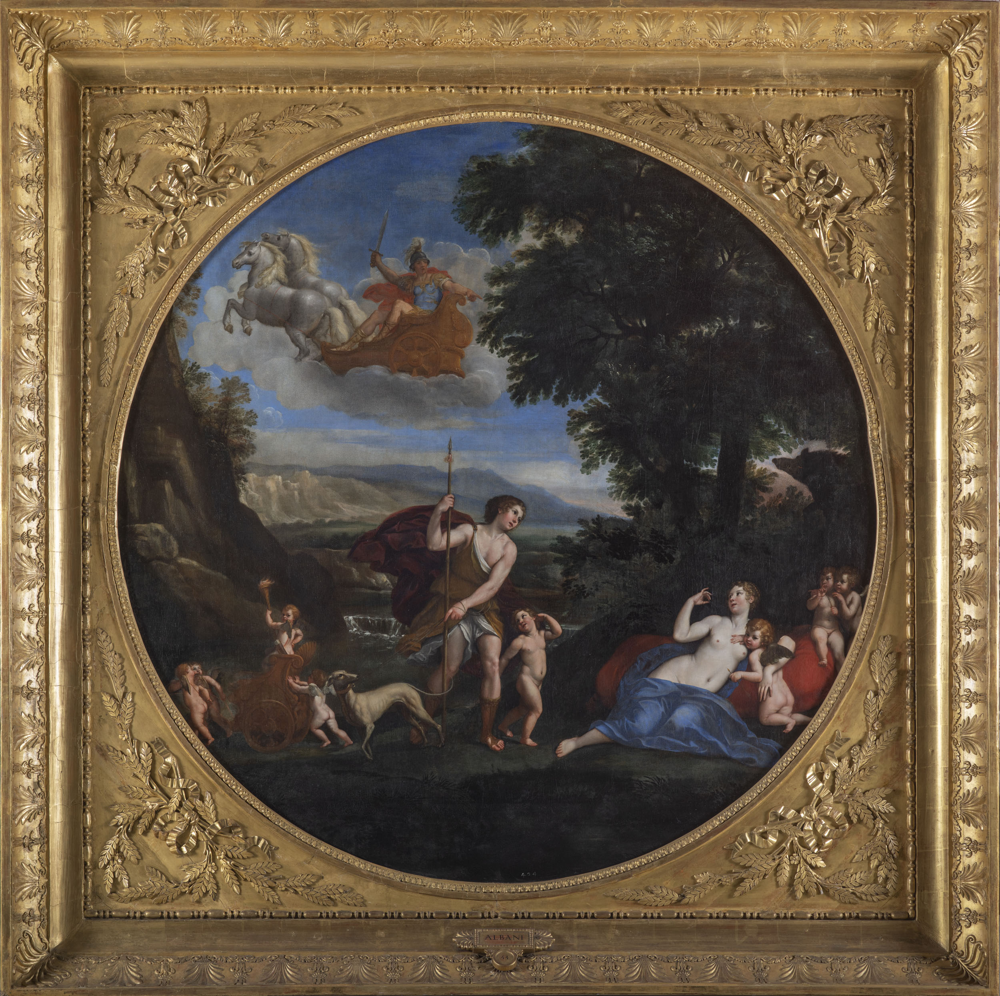

- **官网介绍页**：[狄安娜的凯旋（冬）/ Il trionfo di Diana (o Inverno)｜Galleria Borghese 官方藏品库](https://www.collezionegalleriaborghese.it/it/opere/il-trionfo-di-diana-linverno)｜馆藏编号 049

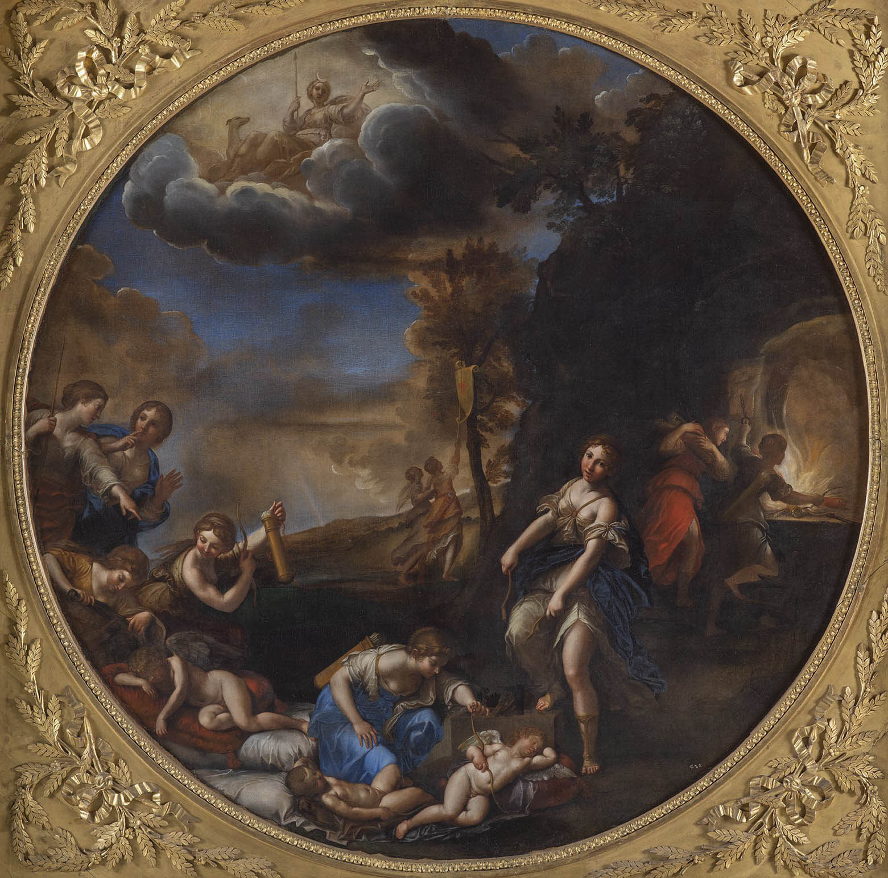

**这是什么（整组一次看）**：这是一套四幅成组的圆形画（tondo），以「春夏秋冬」四季配四段神话，每段都围绕爱与美的女神维纳斯（Venus）展开：春＝维纳斯梳妆（侍女与小爱神为她整理仪容）、夏＝维纳斯到火神武尔坎（Vulcan）的锻炉为爱子阿穆尔取箭、秋＝维纳斯与情人阿多尼斯（Adonis）的田园之爱、冬＝维纳斯的对头、贞洁女神狄安娜（Diana）狩猎凯旋。四幅合起来既是一年四季的循环，也是一篇关于爱欲的优雅寓言。

**背景 / 看点**：阿尔巴尼（Francesco Albani）是博洛尼亚卡拉奇画派（Carracci）的高足，以这类甜美明丽、构图均衡的神话圆画著称，人称「神话与维纳斯的画家」。它们正是本厅「卡拉奇古典主义」这一路的代表——与本厅另一路「卡拉瓦乔式强烈明暗的自然主义」（洪特霍斯特、圭尔奇诺、圭列里等）形成对照，本厅几乎就是一间「17 世纪初罗马两大画风的对照展」。看点：① 圆形构图里人物如何自然环抱、与圆框呼应；② 四幅按春→夏→秋→冬连看，找四季与四段爱情故事的对应；③ 把这套明亮典雅的神话圆画，与对墙那些黑底强光的宗教夜景并看，一眼读懂「古典主义 vs 自然主义」的分野。

### ⭐⭐ 推荐 赫里特·范·洪特霍斯特《音乐会（护身符被盗）》 / Gerrit van Honthorst, _Concert (Theft of the Amulet)_
- **作者 / Artist**：赫里特·范·洪特霍斯特 / Gerrit van Honthorst
- **作品 / Work**：《音乐会（护身符被盗）》 / _Concert (Theft of the Amulet)_
- **时间**：约 17 世纪 30 年代
- **材质**：布面油画
- **尺寸**：168 × 202 cm
- **位置**：兰弗兰科凉廊（第 14 室）

- **官网介绍页**：[音乐会（护身符失窃）/ Concerto (Il furto dell'amuleto)｜Galleria Borghese 官方藏品库](https://www.collezionegalleriaborghese.it/it/opere/concerto-il-furto-dellamuleto)｜馆藏编号 031

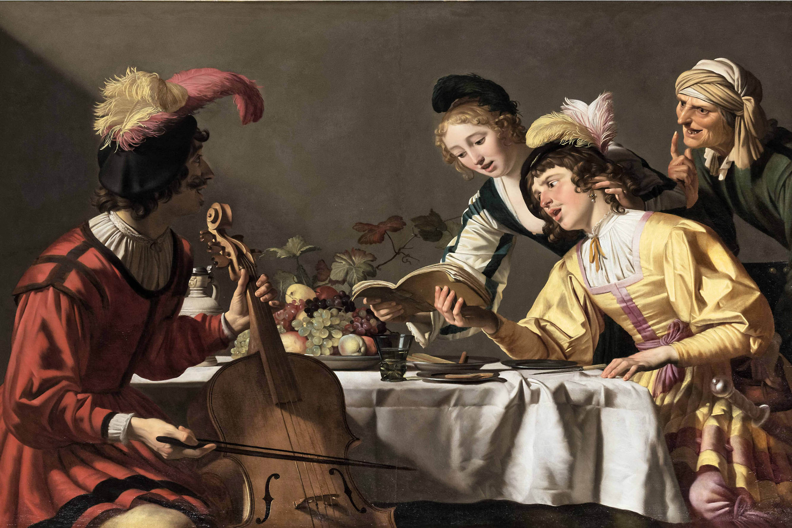

**这是什么**：一群半身人物围在烛光下奏乐欢饮，看似寻常的「音乐会」场景里却藏着一桩偷窃——一只手正趁众人沉醉于歌乐之际，悄悄解下一名女子的护身符（amulet）。这是 17 世纪很流行的「行乐图里藏教训」：声色犬马之中，骗局正在发生。

**背景 / 看点**：洪特霍斯特（Gerrit van Honthorst）是荷兰乌得勒支的画家，曾长期在罗马研习卡拉瓦乔（Caravaggio），擅画烛光夜景，意大利人干脆叫他「夜晚的杰拉尔多（Gherardo delle Notti）」。这件正是「卡拉瓦乔式自然主义」经由北方画家发扬的样本，也与本厅阿尔巴尼那套明亮的古典神话圆画形成鲜明对照。看点就在光与「局」：① 找那只正在行窃的手——叙事的题眼藏在欢乐表象之下；② 体会单一光源（烛光）如何把人物从黑暗里「雕」出来，制造戏剧性的明暗对比；③ 和同厅另一幅《音乐会》（斯帕达，馆藏编号 041）并看，对比两位卡拉瓦乔追随者处理同一题材的差别。

## 天顶画

### ⭐⭐ 推荐 乔瓦尼·兰弗兰科《诸神会议》 / Giovanni Lanfranco, _Council of the Gods_

- **位置**：兰弗兰科凉廊（第 14 室）天顶
- **时间**：1624–1625 年
- **官网介绍页**：[Room 14 - Lanfranco Loggia｜Galleria Borghese 房间页](https://galleriaborghese.cultura.gov.it/en/il-museo/la-villa/sala-14-loggia-di-lanfranco/)

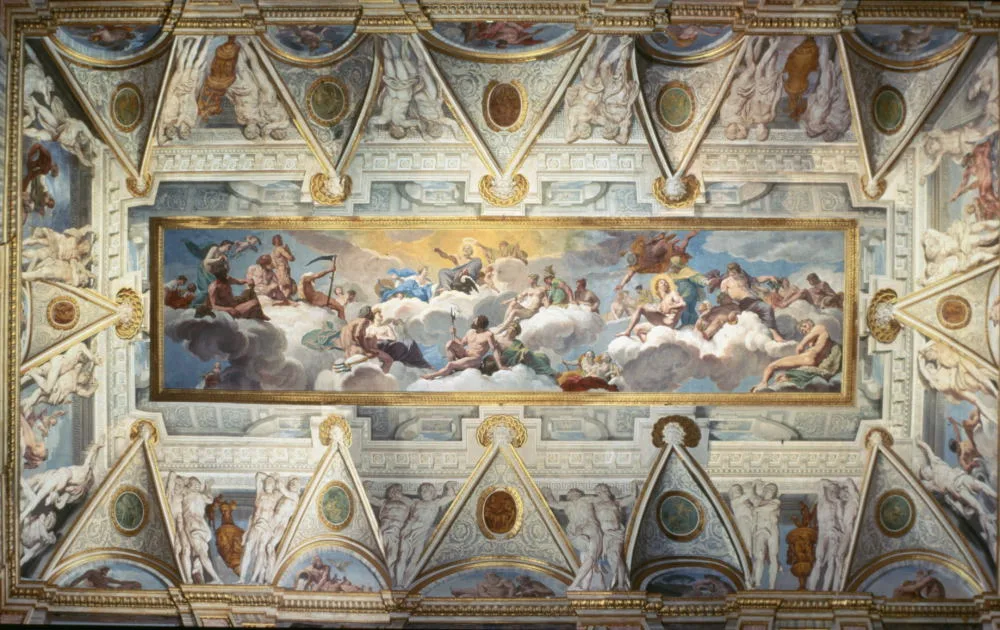

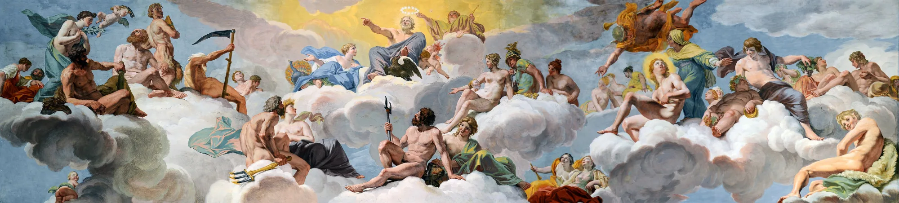

**这是什么**：占满拱顶的湿壁画《诸神会议》，画奥林匹斯众神聚会议事——朱庇特、维纳斯、马尔斯、墨丘利、阿波罗等悉数登场，云间罗列。本厅就以画家兰弗兰科（Giovanni Lanfranco，1582–1647）命名。

**背景 / 来历**：这间厅原本是一道朝向「秘密花园」敞开的凉廊（loggia），18 世纪下半叶为保护这片天顶画才被封闭成室内。它的分量在于「幸存」二字：这片天顶，连同底层小堂里克洛德·德吕埃（Claude Deruet）的《圣母升天》，是整座别墅 17 世纪原装饰里仅存的两块绘画残片——别墅其余房间在 18 世纪被马尔坎托尼奥四世·博尔盖塞（Marcantonio IV Borghese）彻底翻新过。也就是说，你抬头看到的，是这栋楼最初模样的「活化石」。学者还指出它有寓意：选「诸神会议」是在暗示博尔盖塞家族治下（保罗五世教皇任内）重返「黄金时代」。本厅那件归属贝尼尼的《阿玛尔忒亚山羊》当年也被纳入同一套「黄金时代」装饰方案里。

**看点 / 现场怎么看**：① 抬头先认中央的众神聚会，再环看四周辨认各路神祇的标志物（朱庇特的鹰与雷霆、维纳斯身边的小爱神、墨丘利的飞翼帽与节杖）；② 留意它仍带着「为敞开凉廊而画」的逻辑——画面是要让站在花园里仰望的人看的，所以构图偏向天空通透感；③ 记住它是「孤本残片」：环顾四壁满是 18 世纪的新装修，唯独这片顶是 1620 年代的原物，看的时候在脑中把整栋别墅「还原」成它最初的样子。抬头至少看 30 秒。

## 绘画

本节按馆方 Painting 藏品列表补充，共 31 件。核心展品如已在上文展开，这里仍保留官方清单条目，方便核对。

### ⭐ 顺路看 弗朗切斯科·阿尔巴尼《武尔坎锻炉中的维纳斯（夏）》 / Albani Francesco, _Venus in Vulcan’s Forge (Summer)_

- **作者 / Artist**：弗朗切斯科·阿尔巴尼 / Albani Francesco
- **作品 / Work**：《武尔坎锻炉中的维纳斯（夏）》 / _Venus in Vulcan’s Forge (Summer)_
- **时间**：1616–1617 年
- **材质**：布面油画
- **尺寸**：直径 154 cm
- **馆藏编号**：035
- **位置**：兰弗兰科凉廊（第 14 室）
- **官网介绍页**：[官网介绍英文](https://www.collezionegalleriaborghese.it/en/opere/venus-in-vulcans-forge-summer)｜馆藏编号 035

**这是什么 / 看点**：本厅开头核心条目里阿尔巴尼「四季」圆画中的「夏」——维纳斯到火神武尔坎的锻炉为爱子取箭。整组背景与看点见本页开头的阿尔巴尼《维纳斯梳妆（春）…》核心条目；此处为馆方绘画清单的对应单件，便于核对。

### ⭐ 顺路看 乔万·弗朗切斯科·格里马尔迪《帐篷下场景的风景画》 / Grimaldi Giovan Francesco, _Landscape with a Scene under a Tent_

- **作者 / Artist**：乔万·弗朗切斯科·格里马尔迪 / Grimaldi Giovan Francesco
- **作品 / Work**：《帐篷下场景的风景画》 / _Landscape with a Scene under a Tent_
- **时间**：约 1678 年
- **材质**：铜版油画
- **尺寸**：44 × 67 cm
- **馆藏编号**：038
- **位置**：兰弗兰科凉廊（第 14 室）
- **官网介绍页**：[官网介绍英文](https://www.collezionegalleriaborghese.it/en/opere/landscape-with-a-scene-under-a-tent)｜馆藏编号 038

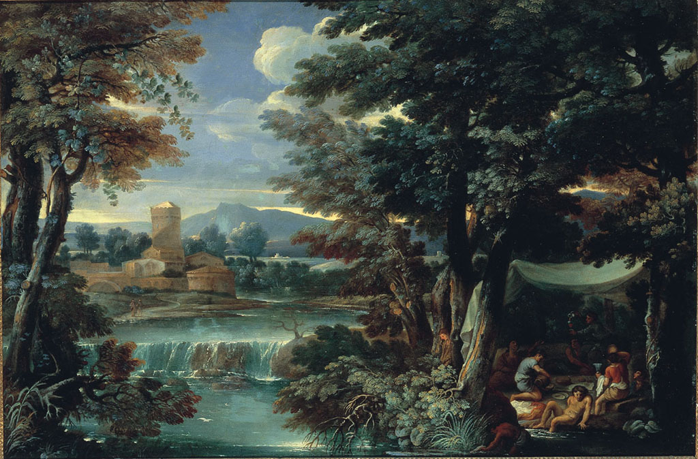

**这是什么（同组一次看）**：乔万·弗朗切斯科·格里马尔迪（Giovan Francesco Grimaldi）的铜版小风景。他是博洛尼亚出身、活跃于罗马的风景画家，画风承袭卡拉奇一脉的古典理想风景：平远的地平线、成簇的树丛、点缀其间的小小人物或圣经场景。本厅共有他四幅同类铜版风景（馆藏编号 038、047、296、299），可作一组连看，体会 17 世纪「理想风景」的固定配方。属顺路看。

### ⭐ 顺路看 利奥内洛·斯帕达《音乐会》 / Spada Lionello, _Concert_

- **作者 / Artist**：利奥内洛·斯帕达 / Spada Lionello
- **作品 / Work**：《音乐会》 / _Concert_
- **时间**：约 1615 年
- **材质**：布面油画
- **尺寸**：138 × 177 cm
- **馆藏编号**：041
- **位置**：兰弗兰科凉廊（第 14 室）
- **官网介绍页**：[官网介绍英文](https://www.collezionegalleriaborghese.it/en/opere/concert)｜馆藏编号 041

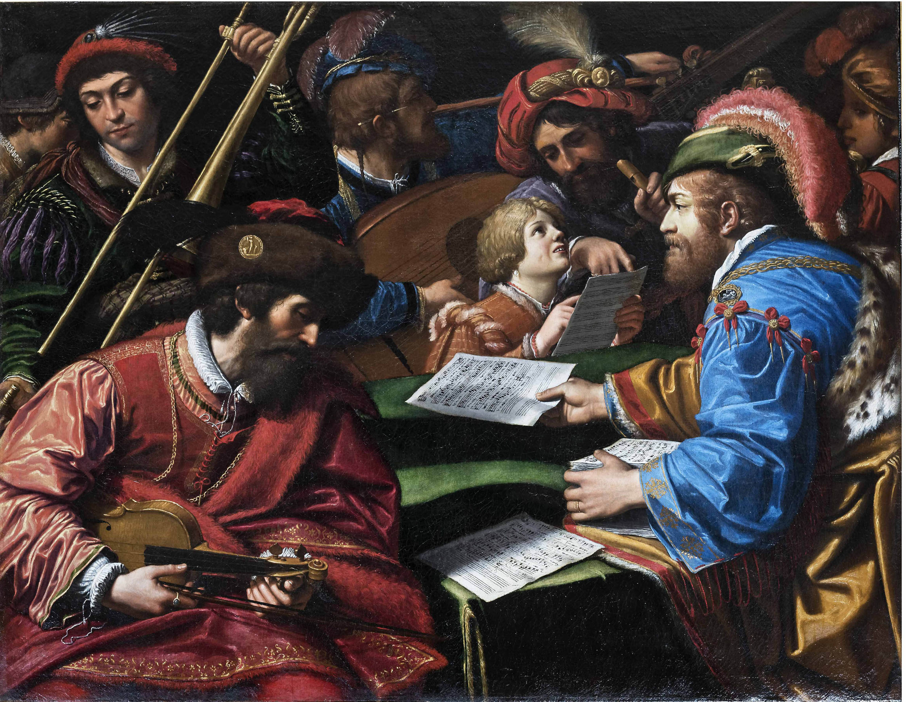

**这是什么 / 看点**：利奥内洛·斯帕达（Lionello Spada）的《音乐会》。斯帕达是博洛尼亚画家，早年追随卡拉瓦乔（甚至被戏称「卡拉瓦乔的猴子」）。把它和本厅洪特霍斯特的《音乐会（护身符被盗）》并看，是本厅最好的对照之一——同一「奏乐行乐」母题，两位卡拉瓦乔追随者各有处理。属顺路看。

### ⭐ 顺路看 乔万·弗朗切斯科·巴尔别里，称圭尔奇诺《浪子回头》 / Barbieri Giovan Francesco called Guercino, _The Return of the Prodigal Son_

- **作者 / Artist**：乔万·弗朗切斯科·巴尔别里，称圭尔奇诺 / Barbieri Giovan Francesco called Guercino
- **作品 / Work**：《浪子回头》 / _The Return of the Prodigal Son_
- **时间**：约 1627/1628 年
- **材质**：布面油画
- **尺寸**：125 × 163 cm
- **馆藏编号**：042
- **位置**：兰弗兰科凉廊（第 14 室）
- **官网介绍页**：[官网介绍英文](https://www.collezionegalleriaborghese.it/en/opere/the-return-of-the-prodigal-son)｜馆藏编号 042

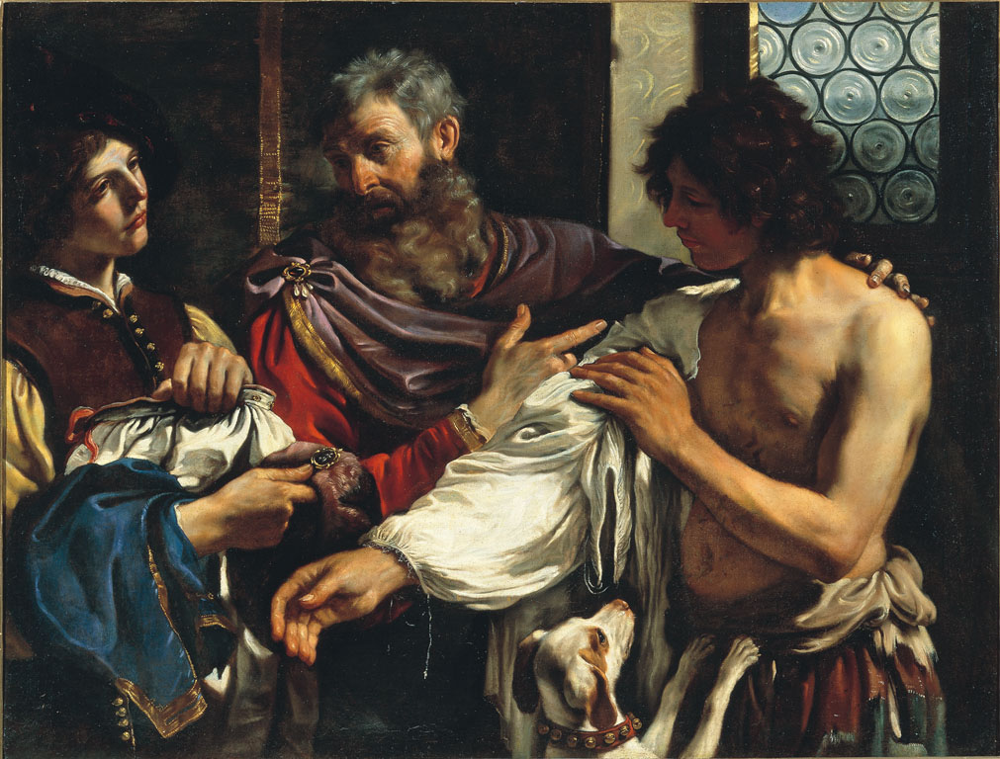

**这是什么 / 看点**：圭尔奇诺（Guercino，本名 Giovan Francesco Barbieri）的《浪子回头》，画福音书寓言里浪子归家、父亲为他披上新衣的一刻。圭尔奇诺是博洛尼亚画派后期大师，早年画风以浓烈明暗和厚重笔触著称。它是本厅「卡拉瓦乔式自然主义」一路的代表作之一，看点在强烈的光影与衣料质感。属顺路看。

### ⭐ 顺路看 弗朗切斯科·阿尔巴尼《维纳斯与阿多尼斯（秋）》 / Albani Francesco, _Venus and Adonis (Fall)_

- **作者 / Artist**：弗朗切斯科·阿尔巴尼 / Albani Francesco
- **作品 / Work**：《维纳斯与阿多尼斯（秋）》 / _Venus and Adonis (Fall)_
- **时间**：1616–1617 年
- **材质**：布面油画
- **尺寸**：直径 154 cm
- **馆藏编号**：044
- **位置**：兰弗兰科凉廊（第 14 室）
- **官网介绍页**：[官网介绍英文](https://www.collezionegalleriaborghese.it/en/opere/venus-and-adonis-fall)｜馆藏编号 044

**这是什么 / 看点**：阿尔巴尼「四季」圆画中的「秋」——维纳斯与情人阿多尼斯的田园之爱。整组背景与看点见本页开头的阿尔巴尼核心条目；此处为馆方清单的对应单件。

### ⭐ 顺路看 乔万·弗朗切斯科·圭列里《罗得与他的女儿们》 / Guerrieri Giovanni Francesco, _Lot and His Daughters_

- **作者 / Artist**：乔万·弗朗切斯科·圭列里 / Guerrieri Giovanni Francesco
- **作品 / Work**：《罗得与他的女儿们》 / _Lot and His Daughters_
- **时间**：1617 年
- **材质**：布面油画
- **尺寸**：142 × 166 cm
- **馆藏编号**：045
- **位置**：兰弗兰科凉廊（第 14 室）
- **官网介绍页**：[官网介绍英文](https://www.collezionegalleriaborghese.it/en/opere/lot-and-his-daughters)｜馆藏编号 045

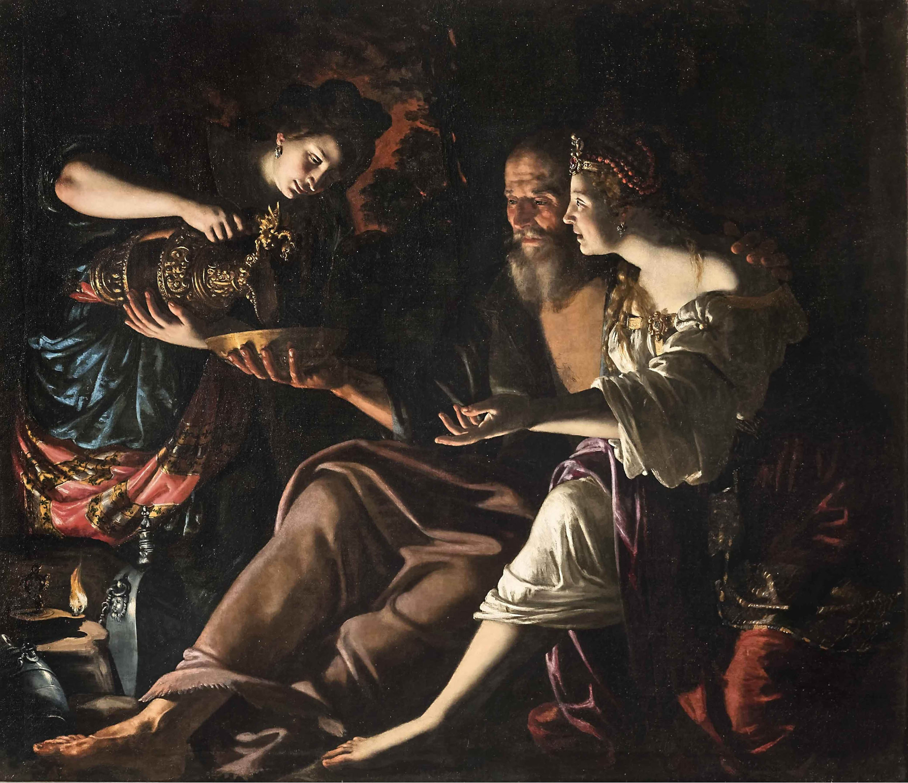

**这是什么 / 看点**：乔万·弗朗切斯科·圭列里（Giovan Francesco Guerrieri）的《罗得与女儿们》，取材《创世记》：所多玛毁灭后，罗得的两个女儿以为世间只剩父女三人，灌醉父亲与之同寝以延续后代。这是 17 世纪偏爱的「借圣经画情色」题材。画风是典型的卡拉瓦乔式强烈明暗，属本厅自然主义一路。属顺路看。

### ⭐ 顺路看 乔万·弗朗切斯科·格里马尔迪《有渔人的风景画》 / Grimaldi Giovan Francesco, _Landscape with Fishermen_

- **作者 / Artist**：乔万·弗朗切斯科·格里马尔迪 / Grimaldi Giovan Francesco
- **作品 / Work**：《有渔人的风景画》 / _Landscape with Fishermen_
- **时间**：约 1678 年
- **材质**：铜版油画
- **尺寸**：45.5 × 68.5 cm
- **馆藏编号**：047
- **位置**：兰弗兰科凉廊（第 14 室）
- **官网介绍页**：[官网介绍英文](https://www.collezionegalleriaborghese.it/en/opere/landscape-with-fishermen)｜馆藏编号 047

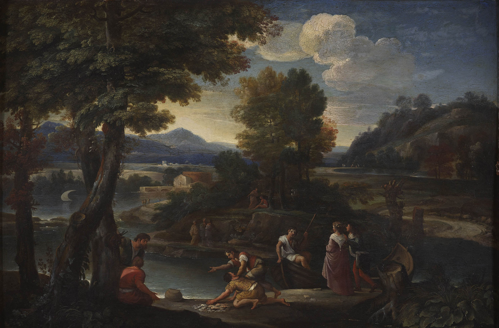

**这是什么 / 看点**：格里马尔迪的另一幅铜版风景，画渔人临水。同属他在本厅的四幅风景小组（整组背景见馆藏编号 038 那条）。属顺路看，作序列扫过即可。

### ⭐ 顺路看 弗朗切斯科·阿尔巴尼《狄安娜的胜利（冬）》 / Albani Francesco, _The Triumph of Diana (Winter)_

- **作者 / Artist**：弗朗切斯科·阿尔巴尼 / Albani Francesco
- **作品 / Work**：《狄安娜的胜利（冬）》 / _The Triumph of Diana (Winter)_
- **时间**：1616–1617 年
- **材质**：布面油画
- **尺寸**：直径 154 cm
- **馆藏编号**：049
- **位置**：兰弗兰科凉廊（第 14 室）
- **官网介绍页**：[官网介绍英文](https://www.collezionegalleriaborghese.it/en/opere/the-triumph-of-diana-winter)｜馆藏编号 049

**这是什么 / 看点**：阿尔巴尼「四季」圆画中的「冬」——贞洁女神狄安娜狩猎凯旋。整组背景与看点见本页开头的阿尔巴尼核心条目；此处为馆方清单的对应单件。

### ⭐ 顺路看 保罗·布里尔《基督受洗与施洗者圣约翰布道的风景画》 / Bril Paul, _Landscape with the Baptism of Christ and the preaching of Saint John the Baptist_

- **作者 / Artist**：保罗·布里尔 / Bril Paul
- **作品 / Work**：《基督受洗与施洗者圣约翰布道的风景画》 / _Landscape with the Baptism of Christ and the preaching of Saint John the Baptist_
- **时间**：约 1597 年
- **材质**：油彩木板
- **尺寸**：45 × 35 cm
- **馆藏编号**：258
- **位置**：兰弗兰科凉廊（第 14 室）
- **官网介绍页**：[官网介绍英文](https://www.collezionegalleriaborghese.it/en/opere/landscape-with-the-baptism-of-christ-and-the-preaching-of-saint-john-the-baptist)｜馆藏编号 258

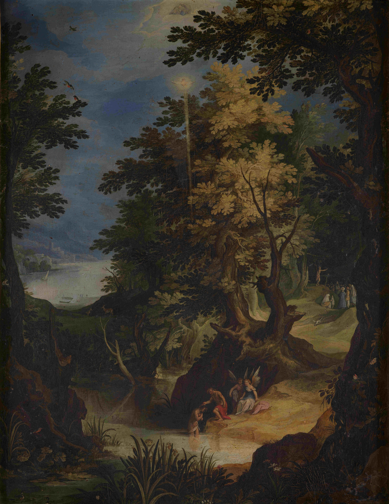

**这是什么（同组一次看）**：保罗·布里尔（Paul Bril）的木板小风景。布里尔是侨居罗马的佛兰德斯风景画家，把北方细密的风景画法带到意大利，画里的宗教情节往往退成小小点景，主角是连绵的山林水景。本厅有他两幅（馆藏编号 258 画基督受洗与圣约翰布道、263 画殉教者圣伯多禄遇害），可两幅并看。属顺路看。

### ⭐ 顺路看 雅克·斯泰拉《祈祷的犹滴》 / Stella Jacques, _Judith praying_

- **作者 / Artist**：雅克·斯泰拉 / Stella Jacques
- **作品 / Work**：《祈祷的犹滴》 / _Judith praying_
- **时间**：1631 年
- **材质**：黑大理石上施油彩与金
- **尺寸**：30 × 36 cm
- **馆藏编号**：261
- **位置**：兰弗兰科凉廊（第 14 室）
- **官网介绍页**：[官网介绍英文](https://www.collezionegalleriaborghese.it/en/opere/judith-praying)｜馆藏编号 261

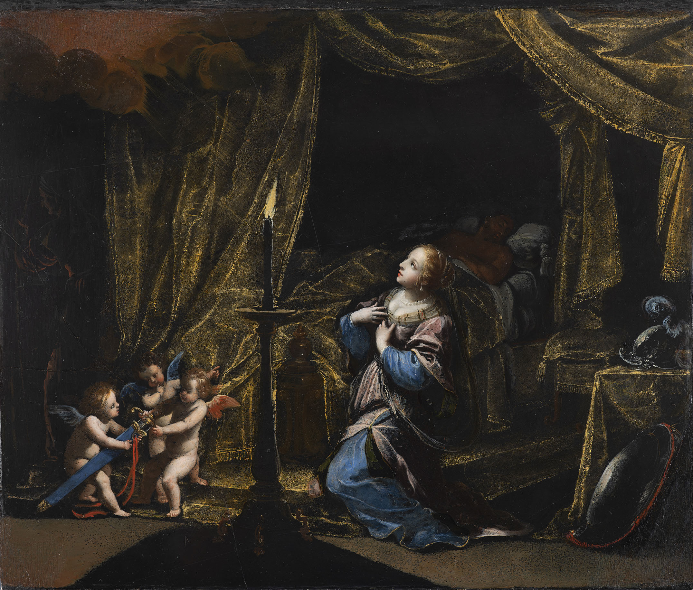

**这是什么 / 看点**：雅克·斯泰拉（Jacques Stella）的《祈祷的犹滴》，画旧约女英雄犹滴（Judith）斩杀敌将后的祈祷。最特别的是材质——在黑色大理石上用油彩加金作画，深色石面本身充当画底，制造珠宝般的华贵夜色感。这类「石上绘画」是 17 世纪初罗马的时髦小品。属顺路看，留意它的特殊材质。

### ⭐ 顺路看 保罗·布里尔《殉教者圣伯多禄遇害的风景画》 / Bril Paul, _Landscape with the Assassination of Saint Peter the Martyr_

- **作者 / Artist**：保罗·布里尔 / Bril Paul
- **作品 / Work**：《殉教者圣伯多禄遇害的风景画》 / _Landscape with the Assassination of Saint Peter the Martyr_
- **时间**：约 1597 年
- **材质**：油彩木板
- **尺寸**：48 × 32 cm
- **馆藏编号**：263
- **位置**：兰弗兰科凉廊（第 14 室）
- **官网介绍页**：[官网介绍英文](https://www.collezionegalleriaborghese.it/en/opere/landscapewiththe-assassinationof-saint-peterthe-martyr)｜馆藏编号 263

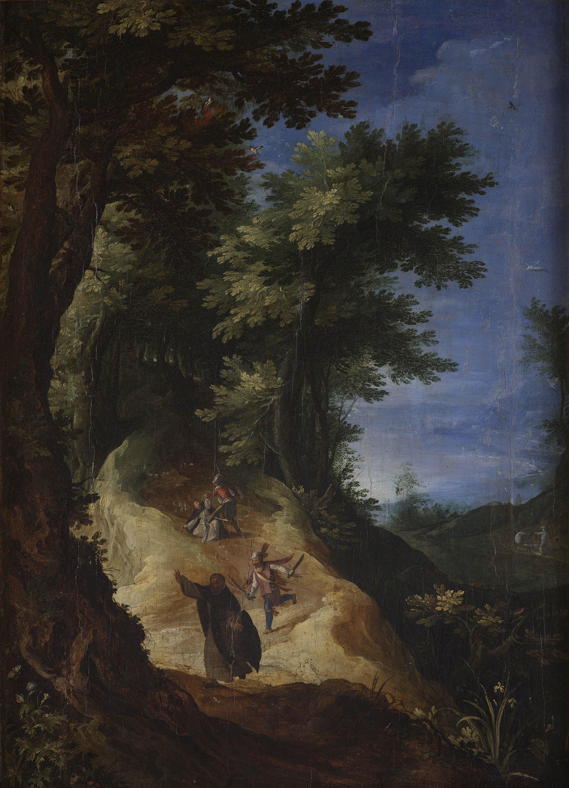

**这是什么 / 看点**：布里尔的另一幅木板小风景，远景里藏着殉教者圣伯多禄遇害的小情节。同属他在本厅的两幅风景（整组背景见馆藏编号 258）。属顺路看。

### ⭐ 顺路看 彼得罗·保罗·邦齐，称卡拉奇家的驼背人《基督与撒玛利亚妇人》 / Bonzi Pietro Paolo, detto il Gobbo dei Carracci, _Christ and the Samaritan Woman_

- **作者 / Artist**：彼得罗·保罗·邦齐，称卡拉奇家的驼背人 / Bonzi Pietro Paolo, detto il Gobbo dei Carracci
- **作品 / Work**：《基督与撒玛利亚妇人》 / _Christ and the Samaritan Woman_
- **时间**：17 世纪初
- **材质**：铜版油画
- **尺寸**：直径 25 cm
- **馆藏编号**：270
- **位置**：兰弗兰科凉廊（第 14 室）
- **官网介绍页**：[官网介绍英文](https://www.collezionegalleriaborghese.it/en/opere/christ-and-the-samaritan-woman-4)｜馆藏编号 270

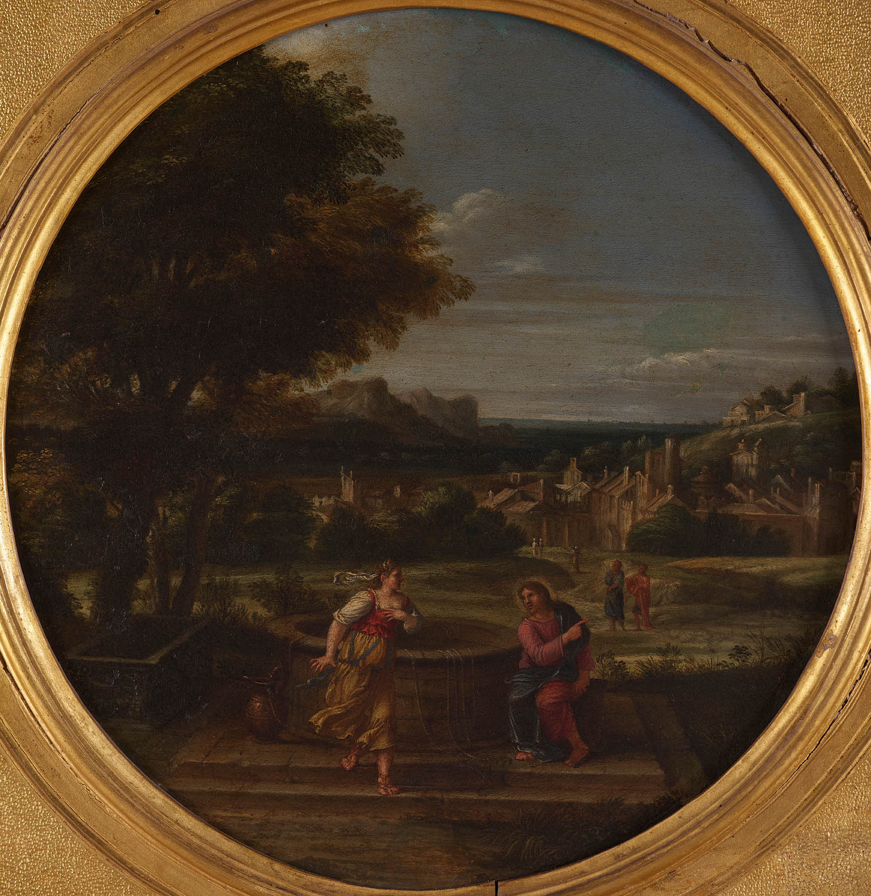

**这是什么（同组一次看）**：彼得罗·保罗·邦齐（Pietro Paolo Bonzi，绰号「卡拉奇家的驼背人」）的圆形铜版小画。本厅有他两件成对的福音故事圆画（馆藏编号 270 基督与撒玛利亚妇人在井边、276 耶稣履海），尺寸仅约直径 25 cm，是供近赏的精致小品。属顺路看，两件并看。

### ⭐ 顺路看 彼得罗·保罗·邦齐，称卡拉奇家的驼背人《耶稣履海》 / Bonzi Pietro Paolo, detto il Gobbo dei Carracci, _Jesus walking on water_

- **作者 / Artist**：彼得罗·保罗·邦齐，称卡拉奇家的驼背人 / Bonzi Pietro Paolo, detto il Gobbo dei Carracci
- **作品 / Work**：《耶稣履海》 / _Jesus walking on water_
- **时间**：17 世纪初
- **材质**：铜版油画
- **尺寸**：直径 25 cm
- **馆藏编号**：276
- **位置**：兰弗兰科凉廊（第 14 室）
- **官网介绍页**：[官网介绍英文](https://www.collezionegalleriaborghese.it/en/opere/jesus-walking-on-water)｜馆藏编号 276

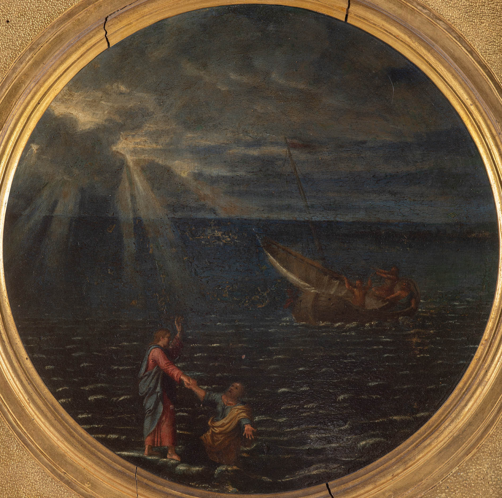

**这是什么 / 看点**：邦齐的另一件圆形铜版小画，画耶稣在海面行走、伸手扶起将沉的彼得。与馆藏编号 270 成对（整组背景见那条）。属顺路看。

### ⭐ 顺路看 雅各布·祖基《采珊瑚（或安菲特里忒的国度）》 / Zucchi Jacopo, _Coral Fishing (or The Realm of Amphitrite)_

- **作者 / Artist**：雅各布·祖基 / Zucchi Jacopo
- **作品 / Work**：《采珊瑚（或安菲特里忒的国度）》 / _Coral Fishing (or The Realm of Amphitrite)_
- **材质**：铜版油画
- **尺寸**：52 × 42.5 cm
- **馆藏编号**：292
- **位置**：兰弗兰科凉廊（第 14 室）
- **官网介绍页**：[官网介绍英文](https://www.collezionegalleriaborghese.it/en/opere/coral-fishing-or-the-realm-of-amphitrite)｜馆藏编号 292

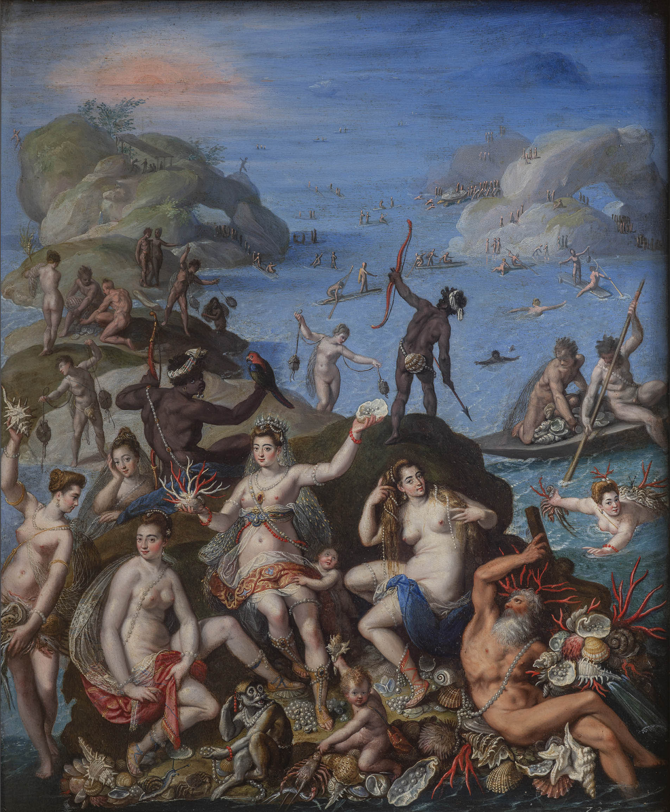

**这是什么（同组一次看）**：雅各布·祖基（Jacopo Zucchi）的铜版小画。祖基是 16 世纪末佛罗伦萨—罗马的矫饰主义（Mannerism）画家，画风精丽繁复、人物修长。本厅有他两件（馆藏编号 292《采珊瑚，又名安菲特里忒的国度》、293《创造寓意》），题材都带博物学与寓言色彩。292 这件画海中采珊瑚，暗喻海后安菲特里忒（Amphitrite）的水下国度。属顺路看。

### ⭐ 顺路看 雅各布·祖基《创造寓意》 / Zucchi Jacopo, _Allegory of the Creation_

- **作者 / Artist**：雅各布·祖基 / Zucchi Jacopo
- **作品 / Work**：《创造寓意》 / _Allegory of the Creation_
- **材质**：铜版油画
- **尺寸**：49 × 39 cm
- **馆藏编号**：293
- **位置**：兰弗兰科凉廊（第 14 室）
- **官网介绍页**：[官网介绍英文](https://www.collezionegalleriaborghese.it/en/opere/allegory-of-the-creation)｜馆藏编号 293

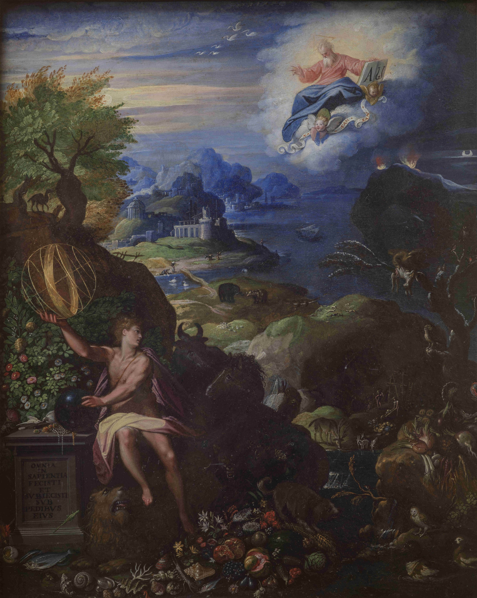

**这是什么 / 看点**：祖基的《创造寓意》，以矫饰主义的繁丽手法把「创世」化作一幅寓言。与馆藏编号 292 同组（整组背景见那条）。属顺路看。

### ⭐ 顺路看 乔万·弗朗切斯科·格里马尔迪《有瀑布的风景画》 / Grimaldi Giovan Francesco, _Landscape with a fall_

- **作者 / Artist**：乔万·弗朗切斯科·格里马尔迪 / Grimaldi Giovan Francesco
- **作品 / Work**：《有瀑布的风景画》 / _Landscape with a fall_
- **时间**：1678 年
- **材质**：铜版油画
- **尺寸**：45 × 67 cm
- **馆藏编号**：296
- **位置**：兰弗兰科凉廊（第 14 室）
- **官网介绍页**：[官网介绍英文](https://www.collezionegalleriaborghese.it/en/opere/landscape-with-a-fall)｜馆藏编号 296

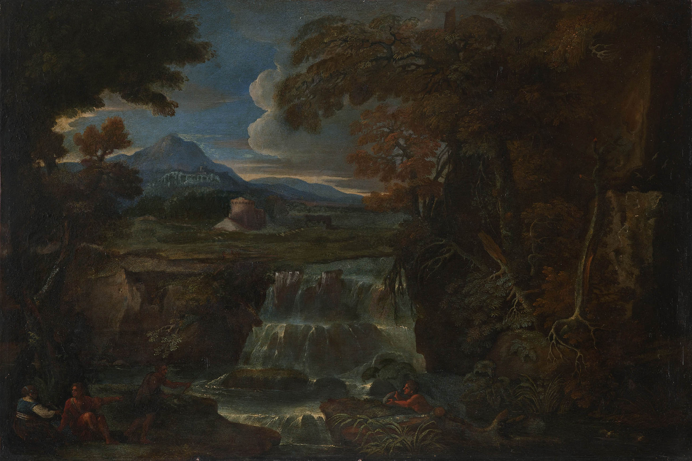

**这是什么 / 看点**：格里马尔迪的铜版风景，画带瀑布的山水。同属他在本厅的四幅风景小组（整组背景见馆藏编号 038）。属顺路看。

### ⭐ 顺路看 乔万·弗朗切斯科·格里马尔迪《施洗者圣约翰布道的风景画》 / Grimaldi Giovan Francesco, _Landscape with Saint John the Baptist preaching_

- **作者 / Artist**：乔万·弗朗切斯科·格里马尔迪 / Grimaldi Giovan Francesco
- **作品 / Work**：《施洗者圣约翰布道的风景画》 / _Landscape with Saint John the Baptist preaching_
- **时间**：1678 年
- **材质**：铜版油画
- **尺寸**：45 × 67 cm
- **馆藏编号**：299
- **位置**：兰弗兰科凉廊（第 14 室）
- **官网介绍页**：[官网介绍英文](https://www.collezionegalleriaborghese.it/en/opere/landscape-with-saint-john-the-baptist-preaching)｜馆藏编号 299

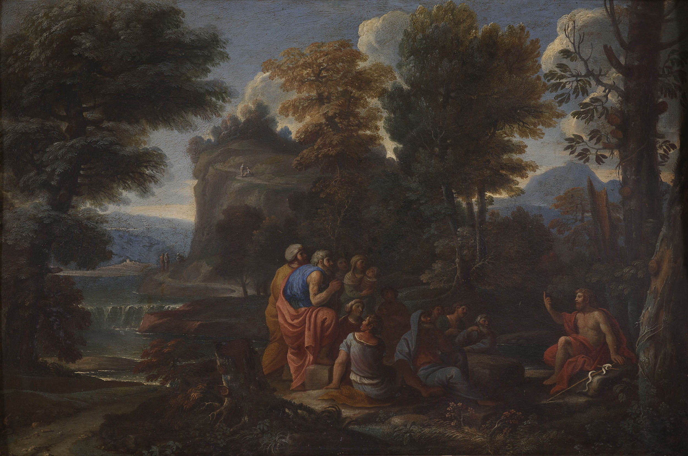

**这是什么 / 看点**：格里马尔迪的铜版风景，远景里点缀施洗者圣约翰布道的小场景——典型的「理想风景＋宗教小情节」配方。同属他的四幅风景小组（整组背景见馆藏编号 038）。属顺路看。

### ⭐ 顺路看 加斯帕雷·切利奥《福里乌斯·卡米卢斯之战》 / Celio Gaspare, _Battle of Furius Camillus_

- **作者 / Artist**：加斯帕雷·切利奥 / Celio Gaspare
- **作品 / Work**：《福里乌斯·卡米卢斯之战》 / _Battle of Furius Camillus_
- **时间**：1613 年后
- **材质**：油彩木板
- **尺寸**：56 × 140 cm
- **馆藏编号**：344
- **位置**：兰弗兰科凉廊（第 14 室）
- **官网介绍页**：[官网介绍英文](https://www.collezionegalleriaborghese.it/en/opere/battle-of-furius-camillus)｜馆藏编号 344

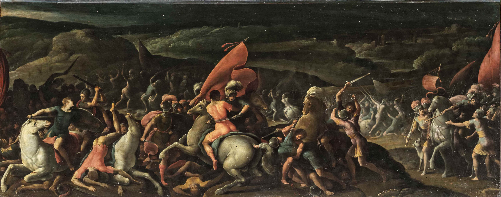

**这是什么 / 看点**：加斯帕雷·切利奥（Gaspare Celio）的《福里乌斯·卡米卢斯之战》，画传说中「再造罗马」的英雄卡米卢斯击退高卢人的战役（横幅构图，适合做门楣上方的装饰画）。属顺路看的历史题材小画。

### ⭐ 顺路看 萨尔瓦托雷·罗萨《战斗场景》 / Rosa Salvatore, _A Battle_

- **作者 / Artist**：萨尔瓦托雷·罗萨 / Rosa Salvatore
- **作品 / Work**：《战斗场景》 / _A Battle_
- **时间**：17 世纪中叶
- **材质**：布面油画
- **尺寸**：72 × 132.5 cm
- **馆藏编号**：353
- **位置**：兰弗兰科凉廊（第 14 室）
- **官网介绍页**：[官网介绍英文](https://www.collezionegalleriaborghese.it/en/opere/a-battle)｜馆藏编号 353

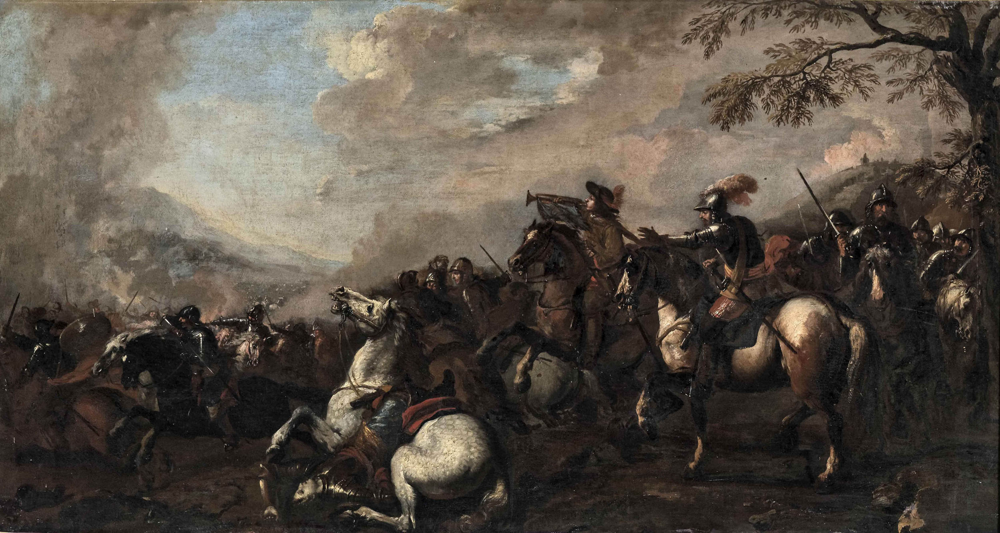

**这是什么 / 看点**：萨尔瓦托雷·罗萨（Salvatore Rosa）的《战斗场景》。罗萨是那不勒斯出身、性格狂放的画家，以阴郁的风景与混战场面著称，开创了一种「崇高而野性」的趣味。看点在那团人马厮杀的混乱动势与烟尘氛围。属顺路看。

### ⭐ 顺路看 彼得罗·贝雷蒂尼，称科尔托纳的彼得罗《马尔切洛·萨凯蒂肖像》 / Berrettini Pietro called Pietro da Cortona, _Portrait of Marcello Sacchetti_

- **作者 / Artist**：彼得罗·贝雷蒂尼，称科尔托纳的彼得罗 / Berrettini Pietro called Pietro da Cortona
- **作品 / Work**：《马尔切洛·萨凯蒂肖像》 / _Portrait of Marcello Sacchetti_
- **时间**：约 1626 年
- **材质**：布面油画
- **尺寸**：133 × 98 cm
- **馆藏编号**：364
- **位置**：兰弗兰科凉廊（第 14 室）
- **官网介绍页**：[官网介绍英文](https://www.collezionegalleriaborghese.it/en/opere/portrait-of-marcello-sacchetti)｜馆藏编号 364

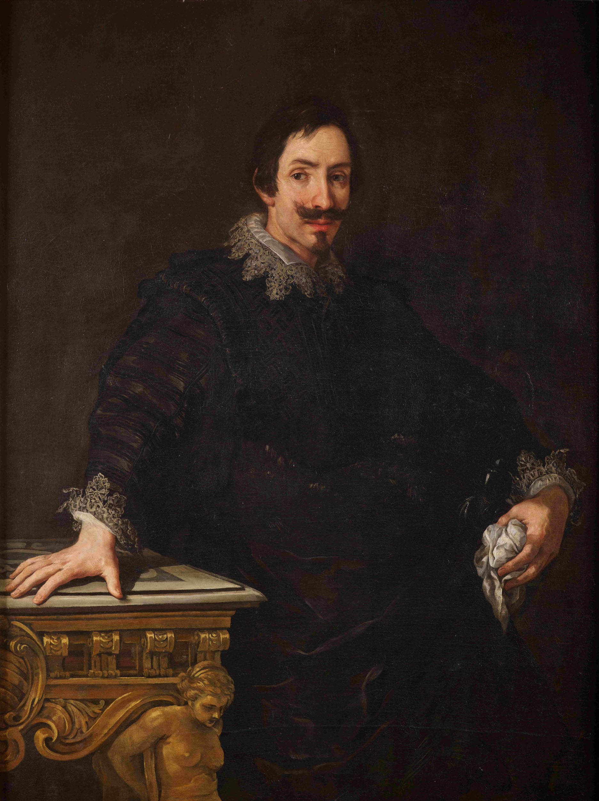

**这是什么（成对一次看）**：彼得罗·达·科尔托纳（Pietro da Cortona，本名 Pietro Berrettini）画的萨凯蒂家肖像。萨凯蒂兄弟（Marcello 与 Giulio Sacchetti）是科尔托纳早年的重要赞助人，把这位日后的巴洛克天顶画大师引荐进罗马上流圈。本厅有这一对兄弟肖像（馆藏编号 364 马尔切洛、608 朱利奥枢机），可并看，体会青年科尔托纳作为肖像画家的功力。364 这幅画的是马尔切洛·萨凯蒂。属顺路看。

### ⭐ 顺路看 马尔坎托尼奥·巴塞蒂《卸下圣体》 / Bassetti Marcantonio, _Deposition of Christ_

- **作者 / Artist**：马尔坎托尼奥·巴塞蒂 / Bassetti Marcantonio
- **作品 / Work**：《卸下圣体》 / _Deposition of Christ_
- **时间**：1613–1616 年
- **材质**：布面油画
- **尺寸**：48 × 39 cm
- **馆藏编号**：431
- **位置**：兰弗兰科凉廊（第 14 室）
- **官网介绍页**：[官网介绍英文](https://www.collezionegalleriaborghese.it/en/opere/deposition-of-christ)｜馆藏编号 431

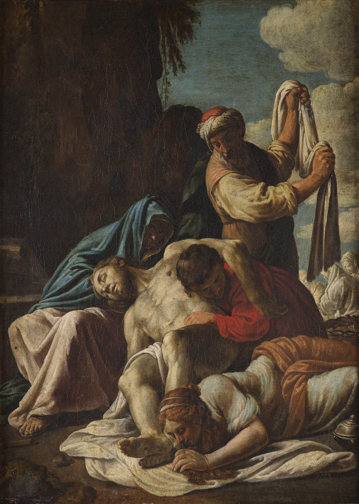

**这是什么 / 看点**：马尔坎托尼奥·巴塞蒂（Marcantonio Bassetti）的《卸下圣体》小画。巴塞蒂是维罗纳画家，曾在罗马受卡拉瓦乔影响、也吸收威尼斯的浓郁色彩。画基督遗体被卸下安放的悲悼场面，明暗深沉。属顺路看。

### ⭐ 顺路看 亚历山德罗·图尔基，称奥尔贝托《死去的基督、抹大拉的玛利亚与天使》 / Turchi Alessandro called Orbetto, _The Dead Christ with Mary Magdalene and Angels_

- **作者 / Artist**：亚历山德罗·图尔基，称奥尔贝托 / Turchi Alessandro called Orbetto
- **作品 / Work**：《死去的基督、抹大拉的玛利亚与天使》 / _The Dead Christ with Mary Magdalene and Angels_
- **时间**：约 1616–1617 年
- **材质**：石板油画
- **尺寸**：42 × 53 cm
- **馆藏编号**：499
- **位置**：兰弗兰科凉廊（第 14 室）
- **官网介绍页**：[官网介绍英文](https://www.collezionegalleriaborghese.it/en/opere/the-dead-christ-with-mary-magdalene-and-angels)｜馆藏编号 499

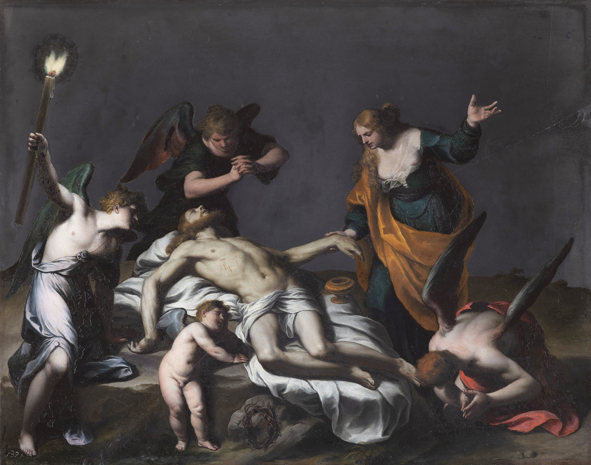

**这是什么（同作者一组看）**：亚历山德罗·图尔基（Alessandro Turchi，绰号「奥尔贝托 Orbetto」）的石板油画。图尔基是维罗纳画家，擅在深色石板（slate）上作画，让石面的暗色充当夜景背景。本厅有他两件（馆藏编号 499《死去的基督、抹大拉的玛利亚与天使》、506《拉匝禄复活》），可并看。499 这件画哀悼基督遗体的场面。属顺路看，留意石板作底的特殊材质。

### ⭐ 顺路看 亚历山德罗·图尔基，称奥尔贝托《拉匝禄复活》 / Turchi Alessandro called Orbetto, _Raising of Lazarus_

- **作者 / Artist**：亚历山德罗·图尔基，称奥尔贝托 / Turchi Alessandro called Orbetto
- **作品 / Work**：《拉匝禄复活》 / _Raising of Lazarus_
- **时间**：1617 年
- **材质**：石板油画
- **尺寸**：36 × 27 cm
- **馆藏编号**：506
- **位置**：兰弗兰科凉廊（第 14 室）
- **官网介绍页**：[官网介绍英文](https://www.collezionegalleriaborghese.it/en/opere/raising-of-lazarus-2)｜馆藏编号 506

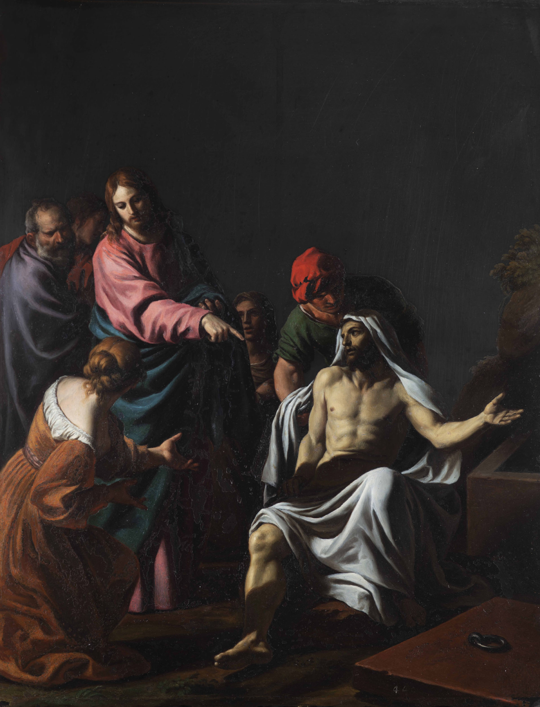

**这是什么 / 看点**：图尔基的另一件石板油画《拉匝禄复活》，画基督在墓前召唤死者拉匝禄复生。与同厅他的 499 成组（材质与背景见那条）。本厅另有奥蒂诺画的同题材（馆藏编号 507），可三件对照看维罗纳画家如何在石板上处理「复活」的戏剧光。属顺路看。

### ⭐ 顺路看 帕斯夸莱·奥蒂诺，称帕斯夸洛托《拉匝禄复活》 / Ottino Pasquale called Pasqualotto, _Raising of Lazarus_

- **作者 / Artist**：帕斯夸莱·奥蒂诺，称帕斯夸洛托 / Ottino Pasquale called Pasqualotto
- **作品 / Work**：《拉匝禄复活》 / _Raising of Lazarus_
- **时间**：约 1614 年
- **材质**：石板油画
- **尺寸**：46 × 36 cm
- **馆藏编号**：507
- **位置**：兰弗兰科凉廊（第 14 室）
- **官网介绍页**：[官网介绍英文](https://www.collezionegalleriaborghese.it/en/opere/raising-of-lazarus-3)｜馆藏编号 507

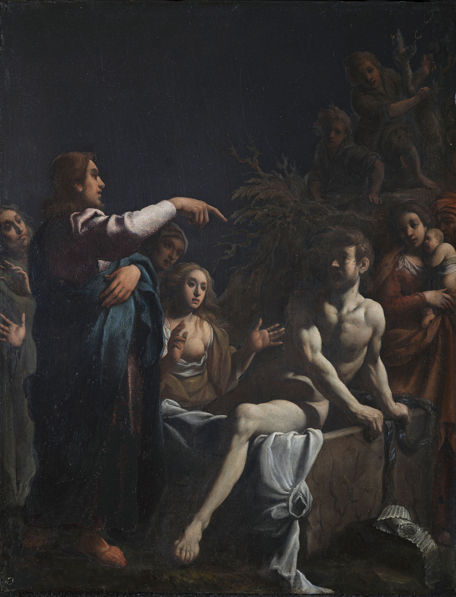

**这是什么 / 看点**：帕斯夸莱·奥蒂诺（Pasquale Ottino，绰号 Pasqualotto）的《拉匝禄复活》，同样是维罗纳画派的石板油画。把它和图尔基的同题材（馆藏编号 506）并看，能比较两位维罗纳同行处理「死者复生」的不同手法。属顺路看。

### ⭐ 顺路看 归属贾科莫·罗卡《祈祷中的圣耶柔米》 / Attributed to Rocca Giacomo, _Saint Jerome in prayer_

- **作者 / Artist**：归属贾科莫·罗卡 / Attributed to Rocca Giacomo
- **作品 / Work**：《祈祷中的圣耶柔米》 / _Saint Jerome in prayer_
- **时间**：17 世纪初
- **材质**：石板油画
- **尺寸**：44 × 36 cm
- **馆藏编号**：510
- **位置**：兰弗兰科凉廊（第 14 室）
- **官网介绍页**：[官网介绍英文](https://www.collezionegalleriaborghese.it/en/opere/saint-jerome-in-prayer-2)｜馆藏编号 510

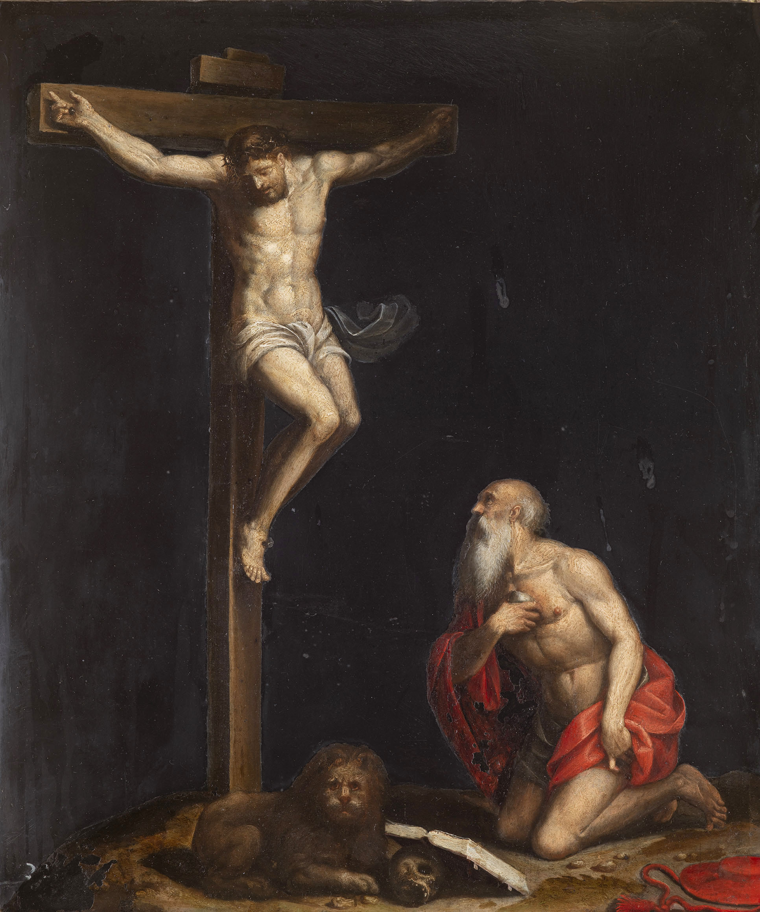

**这是什么 / 看点**：归于贾科莫·罗卡（Giacomo Rocca）的《祈祷中的圣耶柔米》，同为石板油画。圣耶柔米（San Girolamo）是把圣经译成拉丁文的教父，常被画成荒野中持石击胸苦修的隐士。本作归属尚不确定。属顺路看的小幅苦修像。

### ⭐⭐ 推荐 吉安·洛伦佐·贝尼尼《成熟时期自画像》 / Bernini Gian Lorenzo, _Self-portrait at a Mature Age_

- **作者 / Artist**：吉安·洛伦佐·贝尼尼 / Bernini Gian Lorenzo
- **作品 / Work**：《成熟时期自画像》 / _Self-portrait at a Mature Age_
- **时间**：约 1635–1640 年
- **材质**：布面油画
- **尺寸**：53 × 43 cm
- **馆藏编号**：545
- **位置**：兰弗兰科凉廊（第 14 室）
- **展陈提醒**：馆方藏品页标注「当前未展出」
- **官网介绍页**：[官网介绍英文](https://www.collezionegalleriaborghese.it/en/opere/self-portrait-at-a-mature-age)｜馆藏编号 545

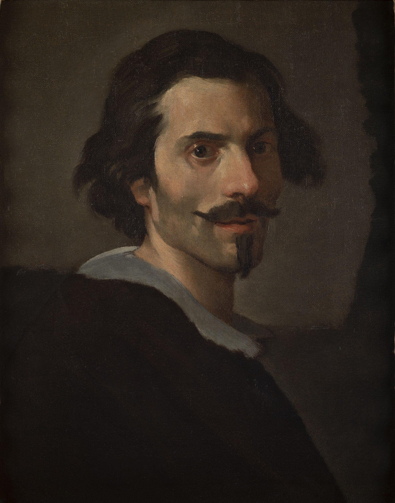

**这是什么**：贝尼尼约四十岁时的自画像，被公认为他最具代表性的一幅自我写照——半身，头转向观者而胸部侧转，目光沉静内敛。

**背景 / 来历**：1911 年由奥托·梅辛格男爵（Otto Messinger）捐赠入藏，男爵希望它「永远留在意大利」。它名气极大，一个原因是它曾被印在意大利 5 万里拉纸币上——不少意大利人对贝尼尼长相的印象就来自这张脸。学界对年代有争议（从 1625 到 1655 都有人主张），但多数据画中人约四十岁的样貌定在 1630 年代下半叶；还有学者推测它原本是一幅「双人肖像」的一半，与情人科斯坦扎·博纳雷利（Costanza Bonarelli）同框，后来（约 1681–1706 年间）被一分为二。官方藏品库标注此作「当前未展出」，能否现场看到以馆方布展为准。

**看点**：与同厅那幅咄咄逼人的青年自画像相比，这张脸明显见老——更清瘦、发际后退、眼下泛起暗影、夹着几缕白发，神情也从锐利转为审视、略带迟疑（有学者读作他在英诺森十世新朝一度失势、赋闲时期的心境）。注意他「头正对你、身侧转」的姿势，被认为是在致敬拉斐尔《宾多·阿尔托维蒂肖像》——一个雕塑家用画笔向文艺复兴大师致意。和青年自画像、隔壁《男孩肖像》三件并看，正好串起「贝尼尼也是画家」这条少有人知的线索。

### ⭐⭐ 推荐 吉安·洛伦佐·贝尼尼《青年时期自画像》 / Bernini Gian Lorenzo, _Self-portrait as a Young Man_

- **作者 / Artist**：吉安·洛伦佐·贝尼尼 / Bernini Gian Lorenzo
- **作品 / Work**：《青年时期自画像》 / _Self-portrait as a Young Man_
- **时间**：约 1623 年
- **材质**：布面油画
- **尺寸**：39 × 31 cm
- **馆藏编号**：554
- **位置**：兰弗兰科凉廊（第 14 室）
- **展陈提醒**：馆方藏品页标注「当前未展出」
- **官网介绍页**：[官网介绍英文](https://www.collezionegalleriaborghese.it/en/opere/self-portrait-as-a-young-man)｜馆藏编号 554

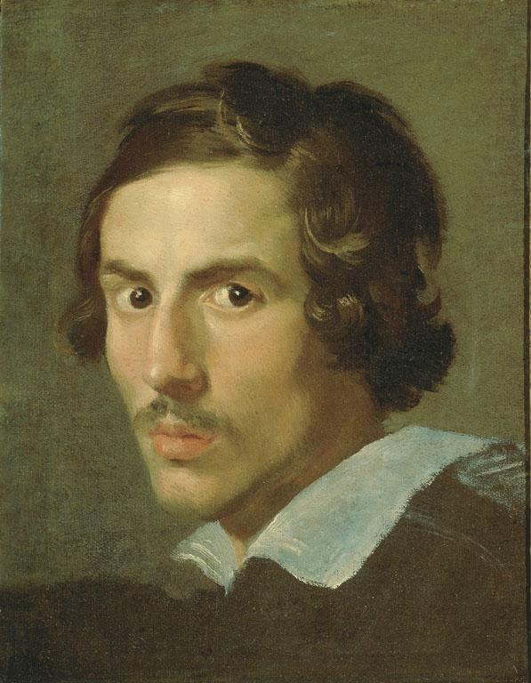

**这是什么**：贝尼尼约二十五岁时的自画像，被认为是他最早的绘画尝试之一——绿灰底色前，一张年轻、专注、近乎逼视的脸。

**背景 / 来历**：1919 年入藏时本被当作安德烈亚·萨基（Andrea Sacchi）的作品，后改定为贝尼尼亲笔。学者把它系于约 1623 年——正是他为希皮奥内·博尔盖塞雕《大卫》（本馆 II 厅镇厅之作）的时候。官方藏品库标注此作「当前未展出」，能否现场看到以馆方布展为准。

**看点**：最大看点是那道「紧张到近乎挑衅」的眼神。学者普遍认为，这是贝尼尼对着镜子研究自己表情、为《大卫》掷石前那张咬牙凝视的脸做的「真人实验」——传说《大卫》的脸就是贝尼尼本人。所以这张小画其实是一件雕塑名作的「表情草稿」。技法上用「色块直接塑形（a macchia）」，不画轮廓线、靠明暗色块堆出脸的体积感，透着雕塑家的立体直觉；下半身衣领肩部只草草带过，全部注意力都压在脸上。和成熟自画像并看，一眼看尽贝尼尼从锐利青年到沉静中年的二十年。

### ⭐⭐ 推荐 吉安·洛伦佐·贝尼尼《男孩肖像》 / Bernini Gian Lorenzo, _Portrait of a Young Boy_

- **作者 / Artist**：吉安·洛伦佐·贝尼尼 / Bernini Gian Lorenzo
- **作品 / Work**：《男孩肖像》 / _Portrait of a Young Boy_
- **时间**：约 1623–1625 年
- **材质**：布面油画
- **尺寸**：33 × 28 cm
- **馆藏编号**：555
- **位置**：兰弗兰科凉廊（第 14 室）
- **官网介绍页**：[官网介绍英文](https://www.collezionegalleriaborghese.it/en/opere/portrait-of-a-young-boy)｜馆藏编号 555

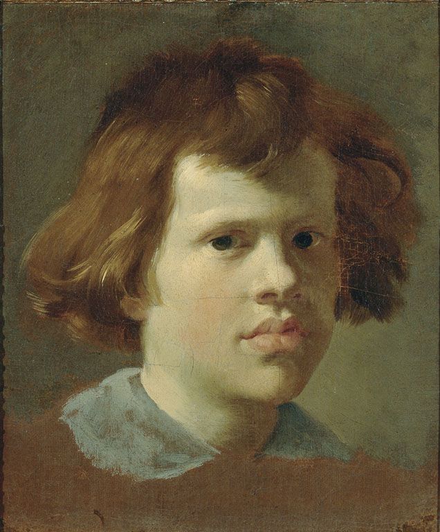

**这是什么 / 看点**：一幅小尺幅的男孩头像，与本厅两幅贝尼尼自画像同属「贝尼尼作为画家」的核心三件套。画风同样是不画轮廓、用色块直接塑形（a macchia），笔触松快、只重点经营面孔。看点在于把它和两幅自画像并看：它们一起证明这位以大理石名世的雕塑巨匠，私下也是个有真本事的肖像画家。建议本厅三件贝尼尼绘画一起看。

### ⭐ 顺路看 彼得罗·贝雷蒂尼，称科尔托纳的彼得罗《朱利奥·萨凯蒂肖像》 / Berrettini Pietro called Pietro da Cortona, _Portrait of Giulio Sacchetti_

- **作者 / Artist**：彼得罗·贝雷蒂尼，称科尔托纳的彼得罗 / Berrettini Pietro called Pietro da Cortona
- **作品 / Work**：《朱利奥·萨凯蒂肖像》 / _Portrait of Giulio Sacchetti_
- **时间**：约 1626 年
- **材质**：布面油画
- **尺寸**：133 × 98 cm
- **馆藏编号**：608
- **位置**：兰弗兰科凉廊（第 14 室）
- **官网介绍页**：[官网介绍英文](https://www.collezionegalleriaborghese.it/en/opere/portrait-of-giulio-sacchetti)｜馆藏编号 608

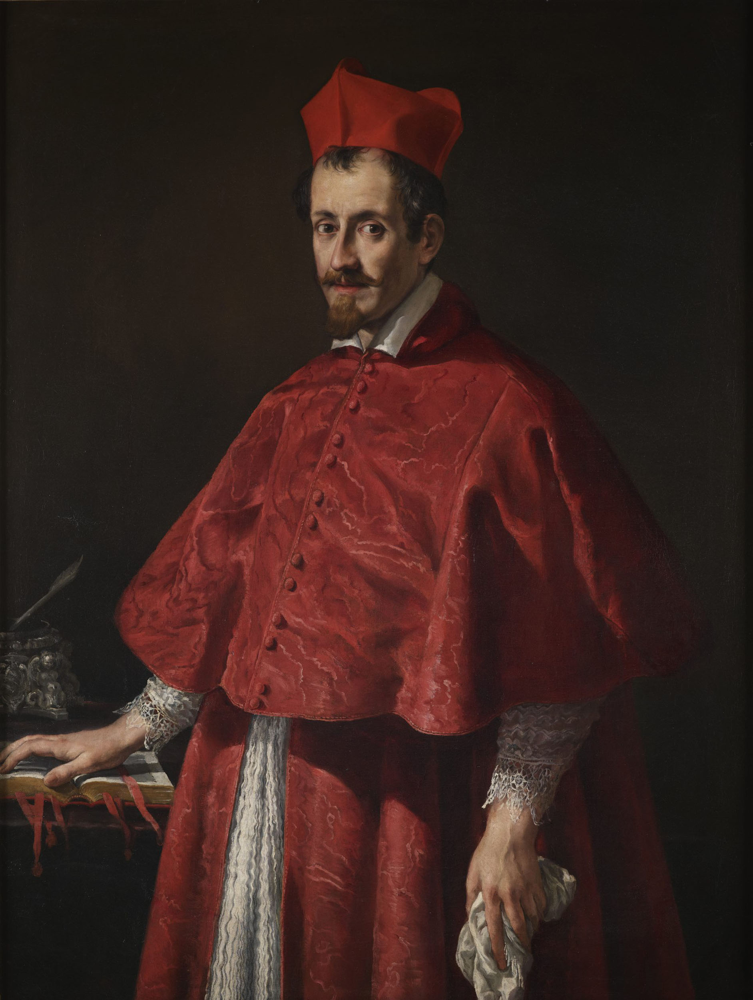

**这是什么 / 看点**：科尔托纳画的另一位萨凯蒂——枢机朱利奥·萨凯蒂（Giulio Sacchetti）。与馆藏编号 364 成对（整组背景见那条）。属顺路看。

### ⭐ 顺路看 罗马学派《非洲灰色大理石带盖瓶》 / roman school, _Vase with Lid in African Bigio Marble_

- **作者 / Artist**：罗马学派 / roman school
- **作品 / Work**：《非洲灰色大理石带盖瓶》 / _Vase with Lid in African Bigio Marble_
- **时间**：18 世纪最后四分之一
- **材质**：非洲灰大理石（bigio africano）
- **尺寸**：32 × 16 cm
- **馆藏编号**：CCLV
- **位置**：兰弗兰科凉廊（第 14 室）
- **官网介绍页**：[官网介绍英文](https://www.collezionegalleriaborghese.it/en/opere/vase-with-lid-in-african-bigio-marble)｜馆藏编号 CCLV

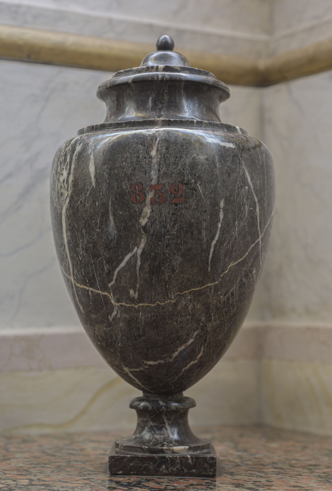

**这是什么 / 看点**：罗马工坊 18 世纪末制作的带盖石瓶，用「非洲灰大理石（bigio africano）」车琢而成。它属于阿斯普鲁奇（Antonio Asprucci）18 世纪末整体翻新别墅时为各厅配置的彩色大理石陈设——本身不是古物，而是「以名贵石材撑场面」的近代装饰。和同厅那件角砾岩双耳瓶（馆藏编号 CCLVI）成对，看点在石材的纹理与色泽。属顺路看。

### ⭐ 顺路看 罗马学派《角砾岩双耳瓶》 / roman school, _Amphora in Breccia_

- **作者 / Artist**：罗马学派 / roman school
- **作品 / Work**：《角砾岩双耳瓶》 / _Amphora in Breccia_
- **时间**：18 世纪最后四分之一
- **材质**：塞特巴西角砾岩（Settebassi breccia）
- **尺寸**：52 × 17 cm
- **馆藏编号**：CCLVI
- **位置**：兰弗兰科凉廊（第 14 室）
- **官网介绍页**：[官网介绍英文](https://www.collezionegalleriaborghese.it/en/opere/amphora-in-breccia)｜馆藏编号 CCLVI

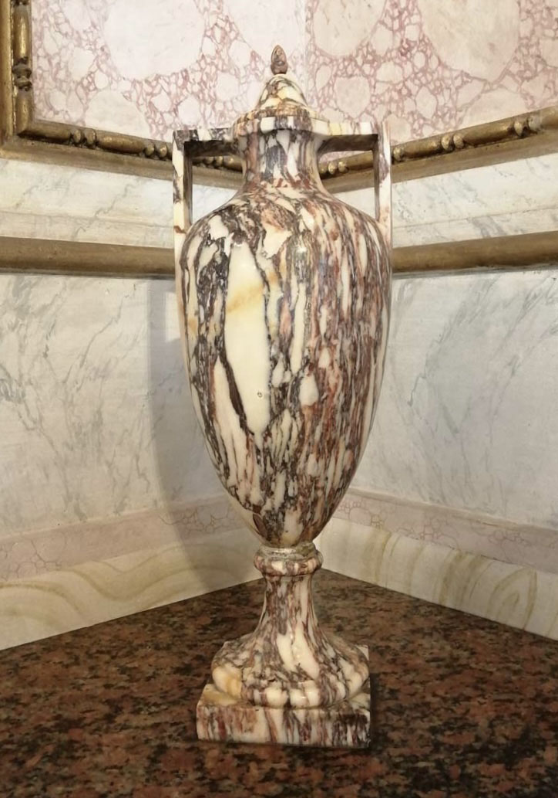

**这是什么 / 看点**：罗马工坊 18 世纪末制作的角砾岩（breccia，多色碎石胶结而成的花石）双耳瓶，与馆藏编号 CCLV 那件带盖瓶成对，同属阿斯普鲁奇时期的彩色大理石陈设。看点在「塞特巴西角砾岩」斑斓的石花。属顺路看。

### ⭐⭐ 推荐 吉安·洛伦佐·贝尼尼《法王路易十四骑马像模型》 / Bernini Gian Lorenzo, _Model for the Equestrian Statue of King Louis XIV_

- **作者 / Artist**：吉安·洛伦佐·贝尼尼 / Bernini Gian Lorenzo
- **作品 / Work**：《法王路易十四骑马像模型》 / _Model for the Equestrian Statue of King Louis XIV_
- **时间**：1669–1670 年
- **材质**：赤陶
- **尺寸**：高 76 cm
- **馆藏编号**：CCLXIX
- **位置**：兰弗兰科凉廊（第 14 室）
- **官网介绍页**：[官网介绍英文](https://www.collezionegalleriaborghese.it/en/opere/model-for-the-equestrian-statue-of-king-louis-xiv)｜馆藏编号 CCLXIX

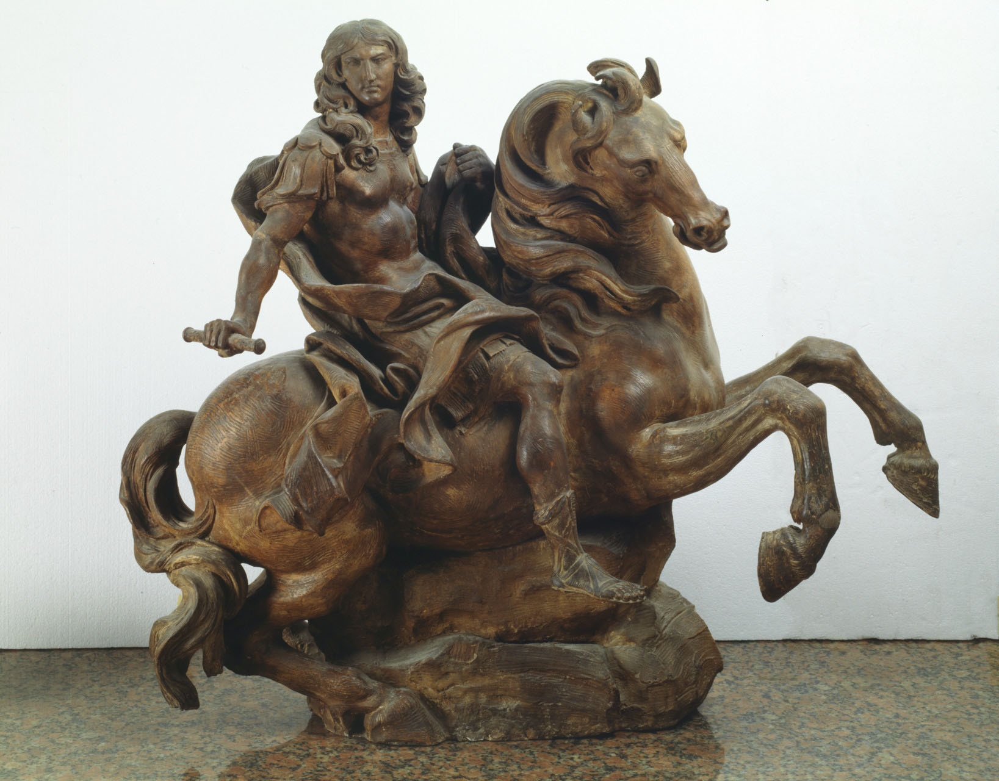

**这是什么 / 看点**：贝尼尼为法王路易十四骑马像所作的赤陶小稿（bozzetto）。年逾七十的贝尼尼应法国宫廷之邀设计这座骑马纪念碑，把国王塑成策马登上「美德之山」的英雄。看点有二：① 它是难得的「创作过程标本」——赤陶表面还留着手指捏塑、刮刀划过的痕迹，能直接看到大师构思时的手感，比成品大理石更鲜活；② 这件设计命运多舛：运到凡尔赛后路易十四不满意，下令把它改刻成古罗马英雄「穆基乌斯·斯凯沃拉」并打入冷宫。现场把它当贝尼尼的「思维草图」看，对照本厅那些完成度极高的胸像，别有意味。

### ⭐⭐⭐ 必看 吉安·洛伦佐·贝尼尼《希皮奥内·博尔盖塞胸像》 / Bernini Gian Lorenzo, _Bust of Scipione Borghese_

- **作者 / Artist**：吉安·洛伦佐·贝尼尼 / Bernini Gian Lorenzo
- **作品 / Work**：《希皮奥内·博尔盖塞胸像》 / _Bust of Scipione Borghese_
- **时间**：1632 年
- **材质**：大理石
- **尺寸**：高 78 cm
- **馆藏编号**：CCLXVI
- **位置**：兰弗兰科凉廊（第 14 室）
- **官网介绍页**：[官网介绍英文](https://www.collezionegalleriaborghese.it/en/opere/bust-of-scipione-borghese)｜馆藏编号 CCLXVI

**这是什么 / 看点**：这就是本厅开头「核心展品」里详述的贝尼尼《希皮奥内·博尔盖塞胸像》第二版（即额头裂开后连夜重刻的那一件）。完整故事、看点与现场站看，见本页开头的核心条目（馆藏编号 CCLXV／CCLXVI）。此处为馆方雕塑清单的对应条目，便于核对。

### ➖ 可略过 朱利亚诺·菲内利《多梅尼科·吉纳西枢机肖像》 / Finelli Giuliano, _Portrait of Cardinal Domenico Ginnasi_

- **作者 / Artist**：朱利亚诺·菲内利 / Finelli Giuliano
- **作品 / Work**：《肖像：Cardinal Domenico Ginnasi》 / _Portrait of Cardinal Domenico Ginnasi_
- **时间**：约 1630 年
- **材质**：大理石
- **尺寸**：高 68 cm
- **馆藏编号**：CCLXX
- **位置**：兰弗兰科凉廊（第 14 室）
- **展陈提醒**：馆方藏品页标注「当前未展出」
- **官网介绍页**：[官网介绍英文](https://www.collezionegalleriaborghese.it/en/opere/portrait-of-cardinal-domenico-ginnasi)｜馆藏编号 CCLXX

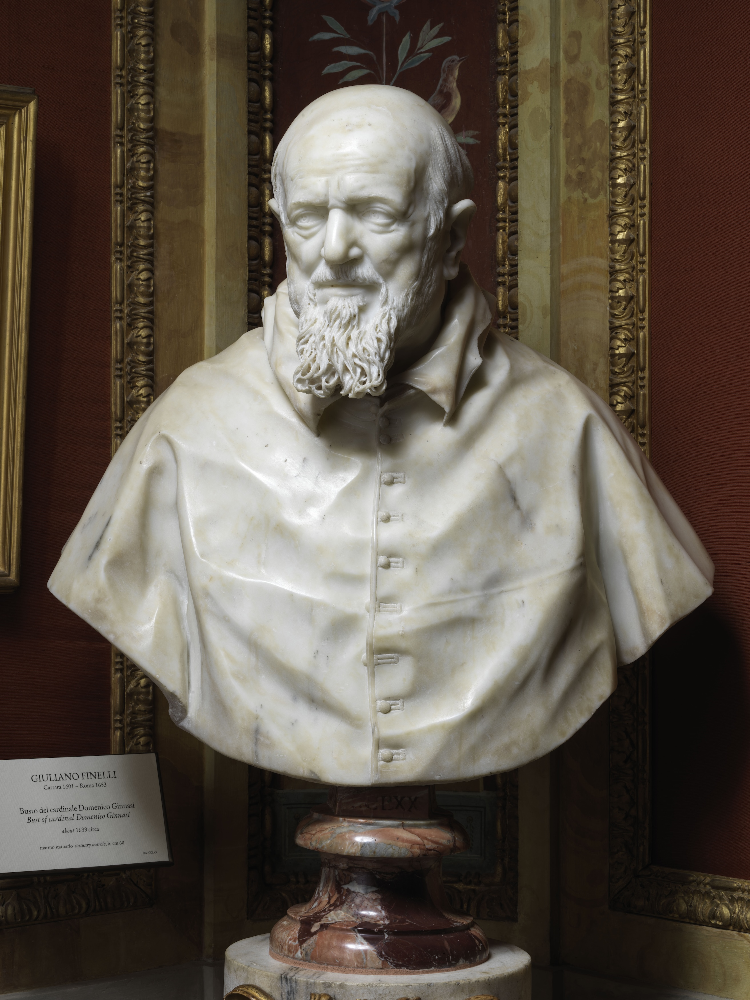

**这是什么 / 看点**：红衣主教多梅尼科·吉纳西（Domenico Ginnasi）的大理石胸像，作者朱利亚诺·菲内利（Giuliano Finelli）是贝尼尼工坊里最得力、也最擅长精雕蕾丝花边与发须细节的助手，后来与贝尼尼闹翻、自立门户。看点在于把它和同厅贝尼尼的胸像并看——菲内利以炫技式的镂雕（领圈、纽扣、卷须）见长，正好对照贝尼尼「重神态、舍细节」的取向。官方藏品库标注当前未展出，以现场为准。

### ⭐ 顺路看 作者不详，罗马学派《教宗克莱孟十二世胸像》 / Unknown sculptor, Roman school, _Bust of Pope Clement XII_

- **作者 / Artist**：作者不详，罗马学派 / Unknown sculptor, Roman school
- **作品 / Work**：《教宗克莱孟十二世胸像》 / _Bust of Pope Clement XII_
- **时间**：约 1730–1740 年
- **材质**：大理石
- **尺寸**：高 76 cm
- **馆藏编号**：CCLXXII
- **位置**：兰弗兰科凉廊（第 14 室）
- **官网介绍页**：[官网介绍英文](https://www.collezionegalleriaborghese.it/en/opere/bust-of-pope-clement-xii)｜馆藏编号 CCLXXII

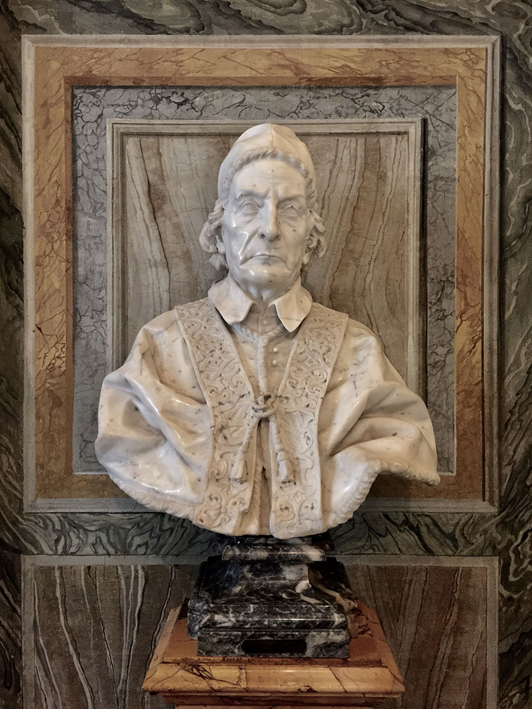

**这是什么 / 看点**：作者不详（罗马学派）的教宗克莱孟十二世（Clemente XII，1730–1740 在位）大理石胸像。这位教皇任内在罗马留下不少工程（特雷维喷泉的建造即由他启动）。把它和同厅贝尼尼的教皇／主教胸像并看，可对比百年后罗马肖像雕塑的程式化程度。属顺路看。

### ⭐⭐ 推荐 吉安·洛伦佐·贝尼尼《教宗保禄五世胸像》 / Bernini Gian Lorenzo, _Bust of Pope Paul V_

- **作者 / Artist**：吉安·洛伦佐·贝尼尼 / Bernini Gian Lorenzo
- **作品 / Work**：《教宗保禄五世胸像》 / _Bust of Pope Paul V_
- **时间**：1617–1618 年或 1622–1623 年
- **材质**：卡拉拉大理石
- **尺寸**：高 35 cm
- **馆藏编号**：CCXLVIII
- **位置**：兰弗兰科凉廊（第 14 室）
- **官网介绍页**：[官网介绍英文](https://www.collezionegalleriaborghese.it/en/opere/bust-of-pope-paul-v)｜馆藏编号 CCXLVIII

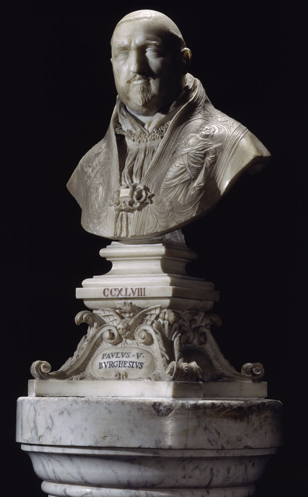

**这是什么**：教皇保罗五世（Paolo V，本姓 Camillo Borghese，希皮奥内的舅舅、博尔盖塞收藏的总后台）的小型胸像。他披着绣有圣彼得与圣保罗像、胸前以华贵别针扣合的教皇披风，内衬蕾丝法衣、颈围浆挺的领布——尺寸虽小，却是一副庄重的官方造像。

**背景 / 来历**：这是贝尼尼的早期作品。长期被认为作于 1617–1618 年、由希皮奥内向年仅二十岁的贝尼尼订制；近年有学者据付款文件改判为保罗五世去世后不久的 1622–1623 年，至今无定论。贝尼尼之子记下一则轶事：教皇生前一直把这件小胸像摆在书桌上。它的参照蓝本是科尔迪耶（Nicolas Cordier）画的一幅保罗五世肖像。

**看点**：① 注意它「小而官方」的反差——巴掌大却把法衣、领布、披风上的圣徒像一一刻全；② 看眼睛——眼球被处理成光滑无瞳孔，这是当时给「身后像」常用的手法，也把注意力推向脸部其余的表情（在此之前，贝尼尼只在《阿玛尔忒亚山羊》里留过没刻完的眼睛）；③ 看脖颈与衣褶——贝尼尼用衣料褶皱反衬出教皇粗短的脖子，皮肤与织物的不同质感几乎可触，是他「让大理石活起来」的早期练手。

### ➖ 可略过 作者不详《尼普顿》 / Anonymous, _Neptune_

- **作者 / Artist**：Anonymous / Anonymous
- **作品 / Work**：《尼普顿》 / _Neptune_
- **时间**：1622 年后
- **材质**：铸青铜
- **尺寸**：高 54 cm
- **馆藏编号**：Corsini-688
- **位置**：兰弗兰科凉廊（第 14 室）
- **展陈提醒**：馆方藏品页标注「当前未展出」
- **官网介绍页**：[官网介绍英文](https://www.collezionegalleriaborghese.it/en/opere/neptune)｜馆藏编号 Corsini-688

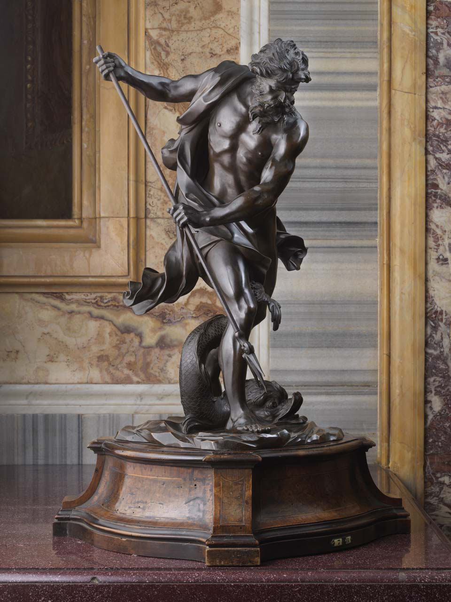

**这是什么 / 看点**：作者不详的小型铸青铜《尼普顿》，海神尼普顿（Neptune，即希腊的波塞冬）的立像，标志物是三叉戟。编号带「Corsini」前缀，说明它来自科尔西尼家族旧藏的并入。官方藏品库标注当前未展出。属顺路看的小铜像。

### ⭐⭐ 推荐 归属吉安·洛伦佐·贝尼尼《母山羊阿玛尔忒亚、幼年朱庇特与小牧神》 / Attributed to Bernini Gian Lorenzo, _The Goat Amalthea with the Infant Jupiter and a Faun_

- **作者 / Artist**：归属吉安·洛伦佐·贝尼尼 / Attributed to Bernini Gian Lorenzo
- **作品 / Work**：《母山羊阿玛尔忒亚、幼年朱庇特与小牧神》 / _The Goat Amalthea with the Infant Jupiter and a Faun_
- **时间**：1615 年前
- **材质**：大理石
- **尺寸**：高 45 cm
- **馆藏编号**：CXVIII
- **位置**：兰弗兰科凉廊（第 14 室）
- **展陈提醒**：馆方藏品页标注「当前未展出」
- **官网介绍页**：[官网介绍英文](https://www.collezionegalleriaborghese.it/en/opere/the-goat-amalthea-with-the-infant-jupiter-and-a-faun)｜馆藏编号 CXVIII

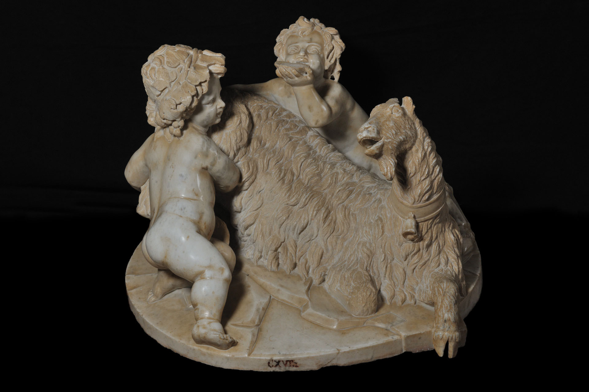

**这是什么**：神话群雕。母山羊阿玛尔忒亚（Amalthea）卧地、回头望向幼年的朱庇特（Jupiter）；头戴葡萄叶冠的小神正给山羊挤奶，喂自己也喂身后那个偷喝奶的小牧神（被认作潘 Pan）。题材出自希腊神话：克洛诺斯（Cronus）听信「子将弑父」的预言要吞掉新生的朱庇特，母亲瑞亚（Rhea）把婴儿藏到克里特岛，由山羊阿玛尔忒亚哺育长大——那只羊角后来化作取之不尽的「丰饶角（cornucopia）」。

**背景 / 来历**：这很可能是贝尼尼现存最早的作品（1615 年已在希皮奥内·博尔盖塞的收藏中，当年为它的底座付过钱），有学者认为是少年贝尼尼用来「亮本事」献给主教的样品；不过归属至今仍有争议，少数学者不认为出自他之手。1675 年桑德拉特（Sandrart）首次提出归于贝尼尼，1926 年隆吉（Roberto Longhi）加以确认。1624 年它被纳入凉廊那套「黄金时代」装饰方案，与头顶兰弗兰科的《诸神会议》遥相呼应。官方藏品库标注此作「当前未展出」，能否现场看到以馆方布展为准。

**看点**：① 它已显露贝尼尼一生的标志习惯——看不见的部位不打磨（这是他第一件这么做的雕塑）；② 还能看到少年人的「手生」处：羊角、羊尾、奶碗边缘当年没刻好，是用松香另粘补上去的；③ 题材暗藏「五感」寓言——相互对视＝视觉、山羊张嘴与颈铃＝听觉、小牧神咂奶的表情＝味觉、挤奶动作与羊皮质感＝触觉；④ 葡萄叶冠与偷喝奶的潘，又给天真的哺乳场面添了一层「朱庇特生性好色」的隐喻，这种「在熟题材里翻新意」的玩法，日后在《阿波罗与达芙妮》里再次出现。

### ⭐ 顺路看 古罗马艺术《鹿》 / Roman art, _Deer_

- **作者 / Artist**：古罗马艺术 / Roman art
- **作品 / Work**：《鹿》 / _Deer_
- **时间**：公元 2 世纪
- **材质**：卢尼大理石
- **尺寸**：高 60 cm
- **位置**：兰弗兰科凉廊（第 14 室）
- **官网介绍页**：[官网介绍英文](https://www.collezionegalleriaborghese.it/en/opere/deer)｜馆藏编号 CCLI

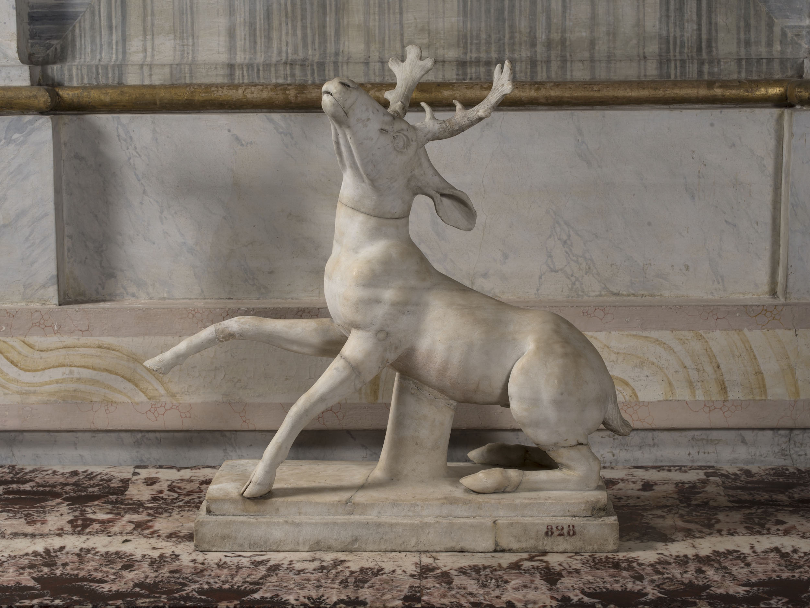

**这是什么 / 看点**：公元 2 世纪的古罗马大理石《鹿》，以卢尼大理石雕成。这类动物雕像在古罗马多用作花园或喷泉装饰。它属本厅的古代艺术陈列——此类古件常是「古代残件＋近代修复拼配」，现场可重点看大理石质感与可能的修复接痕。属顺路看。

### ⭐ 顺路看 古罗马艺术，仿希腊化原作《沉睡的厄洛斯》 / Roman art, copy after hellenistic original, _Sleeping Eros_

- **作者 / Artist**：古罗马艺术，仿希腊化原作 / Roman art, copy after hellenistic original
- **作品 / Work**：《沉睡的厄洛斯》 / _Sleeping Eros_
- **时间**：公元 2 世纪
- **材质**：白大理石
- **尺寸**：53 × 25 cm
- **位置**：兰弗兰科凉廊（第 14 室）
- **官网介绍页**：[官网介绍英文](https://www.collezionegalleriaborghese.it/en/opere/sleeping-eros)｜馆藏编号 CXCII

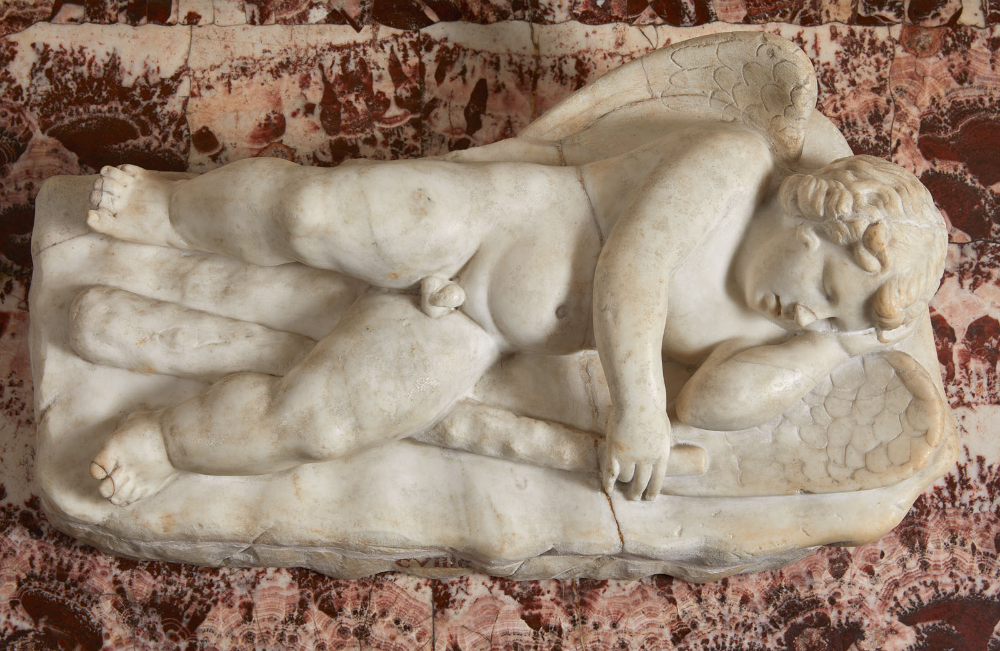

**这是什么 / 看点**：公元 2 世纪的古罗马《沉睡的厄洛斯》，仿希腊化时代原作的白大理石复制品。「沉睡的小爱神厄洛斯（Eros）」是希腊化艺术极受欢迎的母题，常见于墓葬或花园，寓意爱欲的暂歇或长眠。看点：① 认出小爱神的翅膀与放松熟睡的姿态；② 它是「罗马仿希腊原作」的典型，可留意是否带近代修复。属顺路看。

## 其他
### ⭐ 顺路看 房间装饰与壁炉 / Room Decoration and Fireplace

- **位置**：兰弗兰科凉廊（第 14 室）

**这是什么 / 看点**：这间厅本是一道朝花园敞开的凉廊（loggia），后来才封闭成室内，所以它的空间气质和别处不同——格外通透、与花园有呼应。天顶、壁炉、怪诞纹（grottesche）与透视幻觉装饰共同构成参观体验。尤其留意：18 世纪末由建筑师安东尼奥·阿斯普鲁奇（Antonio Asprucci）主持的整体改造，给每间房都定了独立主题，使别墅从「挂画的空房间」变成一座处处有叙事的整体艺术品——本厅头顶那片 1620 年代的兰弗兰科天顶，正是这场改造中被刻意保留下来的最老一块。属顺路看。

## 资料来源 / Sources

- Galleria Borghese 官方房间页：[Room 14](https://galleriaborghese.cultura.gov.it/en/il-museo/la-villa/sala-14-loggia-di-lanfranco/)
- Galleria Borghese 藏品筛选：[Painting, Room 14](https://www.collezionegalleriaborghese.it/en/collezione/pittura?sala=s14)
- Galleria Borghese 藏品筛选：[Modern Sculpture, Room 14](https://www.collezionegalleriaborghese.it/en/collezione/scultura?sala=s14)
- Galleria Borghese 藏品筛选：[Ancient Art, Room 14](https://www.collezionegalleriaborghese.it/en/collezione/arte-antica?sala=s14)
- Galleria Borghese 藏品筛选：[Furniture, Room 14](https://www.collezionegalleriaborghese.it/en/collezione/arredi?sala=s14)
