第 19 室（海伦与帕里斯厅）以汉密尔顿的同名天顶得名，整厅围绕「美的评判与争夺」布置（曾陈列卡诺瓦《保利娜》）；镇厅是多梅尼基诺的《狄安娜的狩猎》——一桩「红衣主教抢画、画家坐牢」的名作。

**必看与核心展品（⭐⭐⭐ 必看 + 核心）**

| 推荐 | 展品 | 作者 | 一句话看点 |
|---|---|---|---|
| ⭐⭐⭐ 必看 | 《狄安娜的狩猎》 | 多梅尼基诺 | 全女性射箭竞技，因「抢画坐牢」丑闻闻名 |
| ⭐⭐⭐ 必看 | 《密涅瓦更衣》 | 拉维尼娅·丰塔纳 | 女画家罕见的大幅神话裸像 |
| ⭐⭐⭐ 必看 | 《女先知》 | 多梅尼基诺 | 与《狄安娜》同被「打包抢」的优美女先知 |
| ⭐⭐⭐ 必看 | 天顶《海伦与帕里斯故事》 | 加文·汉密尔顿 | 中央帕里斯之死＋审判、献海伦等，房间命名由来 |
| ⭐⭐ 推荐 | 《苏珊娜与长老》 | 彼得·保罗·鲁本斯 | 偷窥与抗拒的张力，鲁本斯式肉感 |

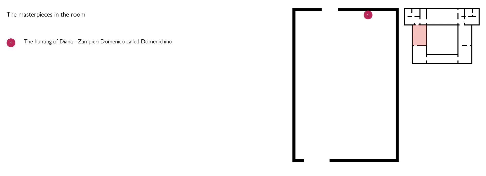

**展厅官网介绍页**：[海伦与帕里斯厅（第 19 室）｜博尔盖塞官方房间页](https://galleriaborghese.cultura.gov.it/en/il-museo/la-villa/sala-19-sala-di-elena-e-paride/)

## 核心展品

### ⭐⭐⭐ 必看 多梅尼基诺《狄安娜的狩猎》 / Domenichino, _The Hunting of Diana_
- **作者 / Artist**：多梅尼基诺 / Domenichino
- **作品 / Work**：《狄安娜的狩猎》 / _The Hunting of Diana_
- **时间**：1616–1617 年
- **材质**：布面油画
- **尺寸**：225 × 320 cm
- **位置**：海伦与帕里斯厅（第 19 室）
- **官网介绍页**：[狄安娜的狩猎 / La caccia di Diana｜博尔盖塞官方藏品库](https://www.collezionegalleriaborghese.it/opere/la-caccia-di-diana)｜馆藏编号 053

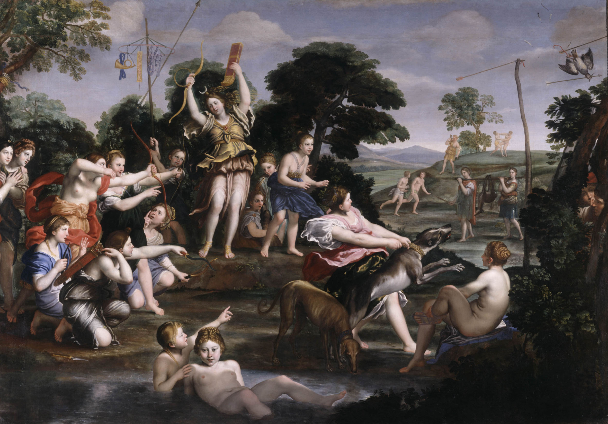

本厅的镇厅之作，也是多梅尼基诺（Domenico Zampieri，绰号 Domenichino）一生最负盛名的油画之一——既是一幅极美的古典神话画，又因一桩"红衣主教抢画、画家坐牢"的丑闻而出名。

**内容（这是什么）**：画的是月亮与狩猎女神狄安娜（Diana）带着众仙女在林中举行的一场射箭比赛。题材取自维吉尔（Virgil）《埃涅阿斯纪》第五卷的射箭竞技：三支箭依次射中木杆、系鸟的丝带、最后射中飞鸟——画面里你能看到高处绑着白鸽的杆子。多梅尼基诺把这场原本男性英雄的比赛改写成全女性的版本，让狄安娜立于正中、高举弓箭定格在比赛最高潮的一瞬。画面右端的灌木丛里藏着两个偷窥的男子，被一只猎犬发现、正要扑上去——这是对阿克泰翁（Actaeon）神话的暗示：那个偷看女神沐浴的猎人，最后被变成鹿、被自己的猎犬撕碎。

**身世：一桩抢画与坐牢的丑闻**：这幅画原本不是为博尔盖塞家画的。它是红衣主教彼得罗·阿尔多布兰迪尼（Pietro Aldobrandini）委托、准备挂进他在弗拉斯卡蒂（Frascati）别墅画廊的作品——那座画廊里收着贝利尼、提香、多索·多西的名作《酒神祭》系列，狄安娜题材正好与之呼应。但红衣主教希皮奥内·博尔盖塞（Scipione Borghese）听说了这幅佳作，强行索要；多梅尼基诺以"是替阿尔多布兰迪尼所作"为由婉拒。希皮奥内大怒，派人上门把画强抢走，还把画家关进监狱、扣押了好几天，逼他就范。1617 年 4 月，希皮奥内为《狄安娜的狩猎》与同厅的《女先知》（inv. 055）两幅画，只付给画家 150 斯库多——对这样一幅杰作而言低得离谱，研究者多认为这只是个尾款、并非真正画价。1902 年由意大利国家收购。

**技法与图像学**：多梅尼基诺在这里有意与提香的《酒神祭》较劲，同时追摹拉斐尔的清澈构图与柯雷乔的肉感。构图的两个支点是前景的两名仙女：一名身体沿对角线层层铺开（承自卡拉奇的造型法），另一名回头与观众对视，邀请你一同窥看女神——把"观看与被观看"的主题点了出来。女神与仙女的身姿，画家参考了大量古代雕塑（如卢多维西的阿佛洛狄忒），用色与光影则受著名古画《阿尔多布兰迪尼婚礼》的影响。

**影响与名声**：在 17–18 世纪的古典主义品味里，多梅尼基诺被奉为仅次于拉斐尔的大师，这幅《狄安娜的狩猎》正是被反复临摹、研究的范本（马德里圣费尔南多美术学院就藏有摹本与素描稿，温莎堡藏有画家亲笔草图）。英国皇家美术学院首任院长雷诺兹（Joshua Reynolds）对多梅尼基诺推崇备至，把他列为古典传统的典范——这幅画所代表的"理性、清晰、典雅"的古典叙事，正是后来学院派奉为圭臬的东西。

**现场站看**：

1. **先找正中的狄安娜**——她高举弓箭、站在画面中轴线最显眼处，是整幅画的视觉中心；认出她，整场比赛的"舞台调度"就理顺了。
2. **抬头看那根杆子上的白鸽**——画面上方绑在杆顶的鸟，是射箭比赛的靶子，点出这是维吉尔笔下"三箭射杆、射带、射鸟"的竞技场面。
3. **回看左前景那个与你对视的仙女**——她侧身回头、眼神带着邀约，是画家故意安排的"入口"，把你也拉进这个偷窥女神的位置。
4. **盯右端灌木丛**——藏着两个偷窥的男子和一只警觉的猎犬，这是对阿克泰翁神话的暗示，也给这幅唯美的画埋下一丝危险的伏笔。
5. **看仙女群像的对角线排布**——人物沿斜线层层退入纵深，这套"卡拉奇式"的舞台化构图，是博洛尼亚画派古典叙事的看家本领。
6. **和同厅另一幅多梅尼基诺《女先知》（inv. 055）一起看**——两幅是希皮奥内同一笔 150 斯库多"打包抢"来的，一动一静，正好对照画家的两副笔墨。

### ⭐⭐⭐ 必看 拉维尼娅·丰塔纳《密涅瓦更衣》 / Lavinia Fontana, _Minerva Dressing_
- **作者 / Artist**：拉维尼娅·丰塔纳 / Lavinia Fontana
- **作品 / Work**：《密涅瓦更衣》 / _Minerva Dressing_
- **时间**：1613 年
- **材质**：布面油画
- **尺寸**：258 × 190 cm
- **位置**：海伦与帕里斯厅（第 19 室）
- **官网介绍页**：[密涅瓦更衣 / Minerva in atto di abbigliarsi｜博尔盖塞官方藏品库](https://www.collezionegalleriaborghese.it/opere/minerva-in-atto-di-abbigliarsi)｜馆藏编号 007

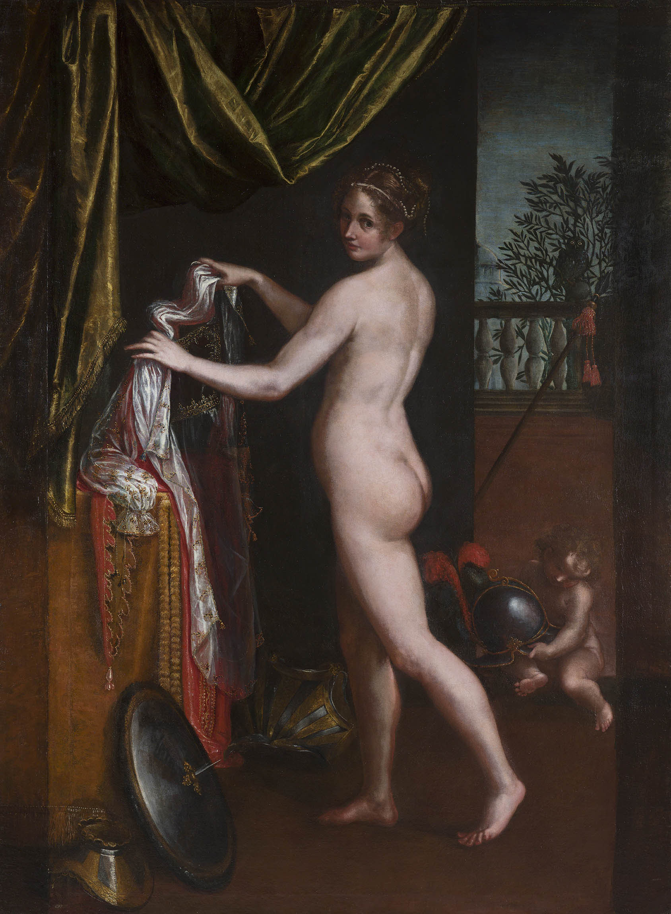

一幅在艺术史上分量很重的画——出自西方第一位真正以绘画为职业、独立经营画室的女画家拉维尼娅·丰塔纳（Lavinia Fontana），尺幅近 2.6 米，题材又是女性极少触碰的近裸神话像。

**内容（这是什么）**：画的是智慧与战争女神密涅瓦（Minerva，即希腊的雅典娜）刚刚卸下盔甲、正要换上华贵的女装。地上散着她的盾牌和铠甲，一个小爱神替她捧着头盔；窗台上立着她的标志——猫头鹰，旁边是橄榄枝，远处斜插着长矛。这些都是女神的传统标志物。一个"战神"放下武器、转而梳妆，是相当罕见的图像处理：密涅瓦也是纺织女工的守护神，画中那些华美织物正暗合此意。

**身世与赞助**：画上小爱神脚下签着"FACIEBAT MDCXIII"（作于 1613 年）。背景里露出圣彼得大教堂的穹顶，点明此画作于罗马。它由红衣主教希皮奥内·博尔盖塞（Scipione Borghese）购入或受赠——他收藏里本有多幅维纳斯题材，这幅密涅瓦正好与之相配。丰塔纳早在 1604–05 年就为阿尔特姆斯（Altemps）家画过一幅"裸体帕拉斯"，希皮奥内很可能见过那幅、才向她订了这件类似题材。后世一度把此画误归到帕多瓦尼诺等威尼斯画家名下，直到 1955 年才凭文献重新确认为丰塔纳真迹。

**为什么是必看：一位女画家的突破**：在 16–17 世纪，女性画家几乎被挡在"大型神话画"与"裸体"题材之外——那被认为不适合女性创作。丰塔纳偏偏画了多幅近裸的密涅瓦/帕拉斯，是极少数挑战这条界线的女画家之一。理解了这层语境，再看这幅近 2.6 米的大画，就不只是"一张漂亮的神话画"，而是一位职业女艺术家在男性垄断领域里的宣言。

**现场站看**：

1. **看密涅瓦"放下武器"的姿态**——她正从战甲转向华服，这个"卸甲梳妆"的瞬间是全画立意所在：战争女神也有柔软的一面。
2. **数齐她的标志物**——窗台的猫头鹰、橄榄枝，地上的盾与铠甲，小爱神手里的头盔，远处的长矛；认全了，就能确认她的身份，也看出画家对图像传统的讲究。
3. **找背景里的圣彼得穹顶**——它被一道暗墙半遮，既交代了"画于罗马"，又把亮部留给女神细腻的肌肤与面容。
4. **想想画它的人是谁**——这是一位女画家画的近裸大型神话像，在当时近乎禁区；带着这个背景看，画里的从容更显不易。

### ⭐⭐ 推荐 彼得·保罗·鲁本斯《苏珊娜与长老》 / Peter Paul Rubens, _Susanna and the Elders_
- **作者 / Artist**：彼得·保罗·鲁本斯 / Peter Paul Rubens
- **作品 / Work**：《苏珊娜与长老》 / _Susanna and the Elders_
- **时间**：约 1606–1607 年
- **材质**：布面油画
- **尺寸**：94 × 67 cm
- **位置**：海伦与帕里斯厅（第 19 室）
- **官网介绍页**：[苏珊娜与长老 / Susanna e i Vecchioni｜博尔盖塞官方藏品库](https://www.collezionegalleriaborghese.it/opere/susanna-e-i-vecchioni-2)｜馆藏编号 277

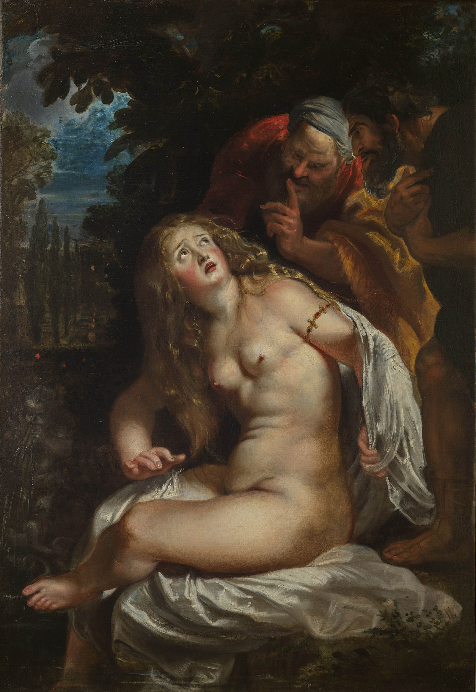

本厅唯一的鲁本斯，也是这位佛兰德大师一生多次重画的"苏珊娜"题材里最早的一幅，作于他第二次旅居罗马期间。

**内容（这是什么）**：题材出自《旧约·但以理书》第 13 章。富商约阿希姆之妻苏珊娜（Susanna）在自家花园沐浴时，被两个偷窥的老者撞见；老者威胁她，若不顺从就诬告她通奸。苏珊娜坚守贞洁、断然拒绝，结果被诬下狱、险些被处死，最后靠先知但以理（Daniel）拆穿谎言才获救——她因此成为"贞洁"与"凭天意得救"的象征。画里你能看到一个惊惶回头的裸体女子，和两个从暗处逼近的老人。

**背景与看点**：鲁本斯没按佛兰德传统把苏珊娜夹在两个老者中间，而是用意大利 16 世纪的做法——让她背朝侵犯者、扭头回望，用方向上的对立强化"清白对邪恶"的伦理张力，人体的丰满则明显取法委罗内塞、丁托列托等威尼斯画家。这幅画最值得记住的一点是它的"血缘关系"：苏珊娜的坐姿源自著名古代铜像《拔刺少年》（Spinario，今藏卡比托利欧），鲁本斯专门画过素描研究它；而苏珊娜那个惊惶扭身、回头张口的动势，又直接启发了贝尼尼（Gian Lorenzo Bernini）《劫掠普洛塞庇娜》里被拽入冥府的女主角——那座雕像正是希皮奥内·博尔盖塞（Scipione Borghese）委托、如今就陈列在本馆。希皮奥内一向赏识鲁本斯，还曾出面替他延长在罗马的居留。

**现场站看**：

1. **看苏珊娜扭身回头的动势**——背朝老者、惊惶回望，这个充满张力的转体是全画的灵魂，记住它，去本馆看贝尼尼《劫掠普洛塞庇娜》时就会发现普洛塞庇娜的姿态如出一辙。
2. **想想《拔刺少年》**——她蜷坐的下半身脱胎自那尊古代铜像，是鲁本斯"把古代雕塑化进油画"的现成例子。
3. **看光的用法**——前景一束强光打亮裸体、中段近乎全黑、远处微微透亮，这种戏剧性的明暗，既有卡拉瓦乔的影子，也有达·芬奇式的层次。

## 天顶画

### ⭐⭐⭐ 必看 加文·汉密尔顿《海伦与帕里斯故事》 / Gavin Hamilton, _Story of Helen and Paris_

- **位置**：海伦与帕里斯厅（第 19 室）天顶
- **时间**：1782–1784 年

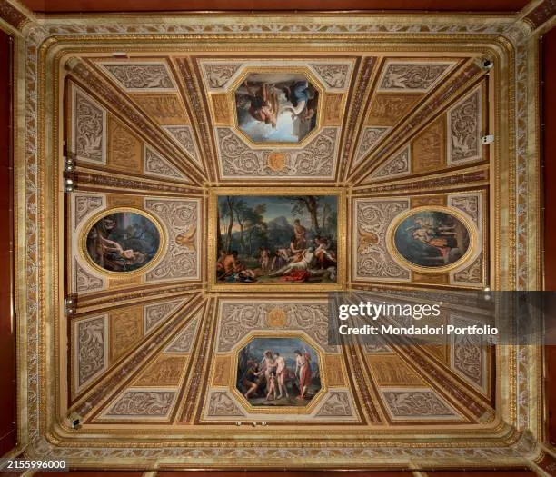

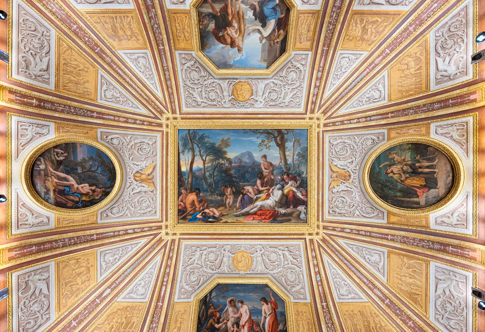

这间厅的名字就来自头顶这片天顶画——一进门务必抬头。它由苏格兰画家兼古物收藏家加文·汉密尔顿（Gavin Hamilton，1723–1798）于 1782–1784 年绘制，是 18 世纪末博尔盖塞别墅整体新古典主义改造中最成功的房间之一。

**内容（这是什么）**：整套天顶取材自荷马《伊利亚特》中特洛伊王子帕里斯（Paris）的故事。正中是《帕里斯之死》——他在萨蹄尔（satyr）与仙女之间死去；四周环绕《帕里斯的审判》（他把金苹果判给维纳斯，从而引发特洛伊战争）、《丘比特教帕里斯学音乐》《维纳斯把海伦献给帕里斯》等场景。其中原本还有《劫掠海伦》与《阿喀琉斯之死》两幅，后来被卡穆奇尼（Vincenzo Camuccini）和皮安卡斯泰利（Giovanni Piancastelli）的版本替换；汉密尔顿的两幅原作 1891 年移往博尔盖塞家族的城堡，今藏罗马博物馆（Museo di Roma）。天顶的装饰性图案由马尔凯蒂（Giovan Battista Marchetti）绘制。

**背景：曾经的"保利娜厅"**：这间厅在历史上最出名的时刻，是 1838 至 1881 年间——卡诺瓦（Antonio Canova）那尊《作为胜利维纳斯的保利娜·波拿巴》就陈列在这里，与天顶上"维纳斯把海伦献给帕里斯"的金苹果主题正好呼应（那尊雕像现已移到入口的保利娜厅）。明白这层渊源，就懂了为什么这间厅的装饰处处在讲"美的评判与争夺"。

#### 逐幅分述（中央 + 五段情节）：

##### 《帕里斯被交给牧人抚养》 / _Paris entrusted to shepherds_

婴儿帕里斯被带走或交给牧人，这是他早年被遗弃、后来在山野中长大的情节。

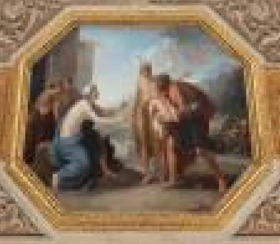

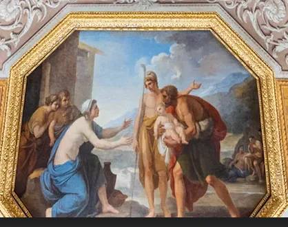

##### 《墨丘利带帕里斯前往裁判》 / _Mercury and Paris_

墨丘利出现，引导牧羊人身份的帕里斯去进行“三女神之争”的裁判。

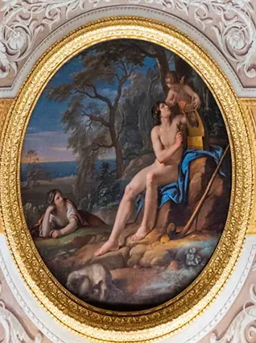

##### 《帕里斯的审判》/ _The Judgment of Paris_

全套最关键的一幕，也是这间"美之评判"厅的题眼：帕里斯被指定裁断"谁最美"，他把金苹果判给了维纳斯（而非朱诺或密涅瓦），换取人间最美的女子海伦——这一判直接点燃了特洛伊战争。

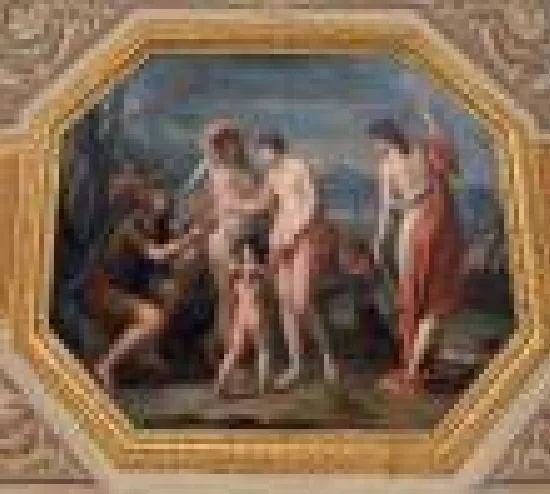

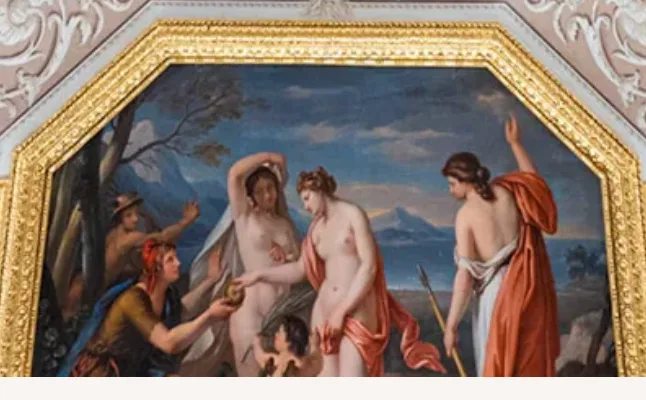

##### 《帕里斯与海伦》 / _Paris and Helen_
 
 帕里斯把海伦带离斯巴达、载回特洛伊的一幕。注意：汉密尔顿的原作已于 1891 年移往博尔盖塞家族城堡（今藏罗马博物馆 Museo di Roma），现挂的是卡穆奇尼（Vincenzo Camuccini）画的替换版。

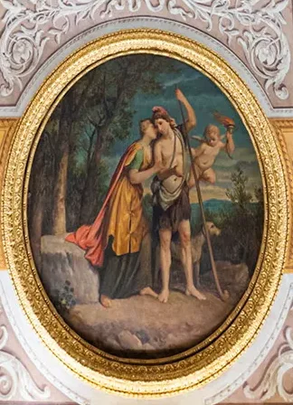

##### 中央《帕里斯之死》/ _Death of Paris_

全顶的核心，画特洛伊王子帕里斯在萨堤尔（satyr）与仙女之间死去（他在特洛伊战争尾声中被毒箭射伤而亡）。它占天顶正中、画幅最大，是整组叙事的收束。

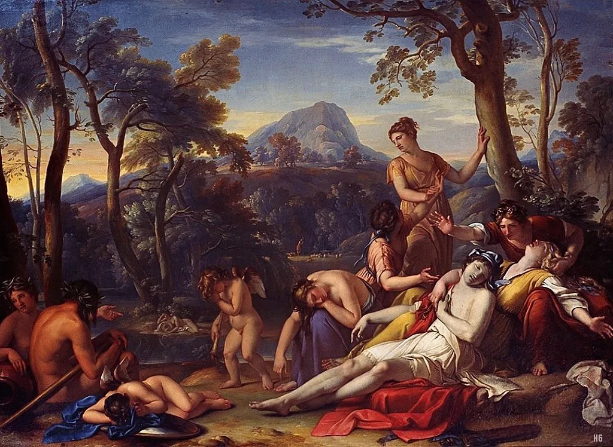

天顶四周的装饰性图案（框格、卷草等）由马尔凯蒂（Giovan Battista Marchetti）绘制。

**现场站看（专门找这几处）**：

1. **正中的《帕里斯之死》**——天顶中央、最大的一格，认准它，四周场景的叙事顺序就理顺了。
2. **找《帕里斯的审判》**——帕里斯把金苹果递给维纳斯的一刻，是整场特洛伊战争的导火索，也是这间厅"美之评判"主题的核心。
3. **看门楣上的四块黄色大理石浮雕**——分别是参与特洛伊战争的四位神祇（朱庇特、维纳斯、玛尔斯、阿波罗），由帕切蒂（Vincenzo Pacetti）用古典黄大理石（giallo antico）雕成，把天顶的神话延伸到墙面。
4. **抬头至少看 30 秒**——这是房间命名的由来，也是 18 世纪末罗马最早一批"复兴古风"的新古典室内装饰，值得慢慢看。

## 绘画

本节按馆方 Painting 藏品列表补充，共 19 件。核心展品如已在上文展开，这里仍保留官方清单条目，方便核对。

### ⭐ 顺路看 尼科洛·德拉巴特《贵妇与骑士的风景（猎鹿）》 / dell'Abate Niccolò, _Landscape with Ladies and Knights (The Deer Hunt)_

- **作者 / Artist**：尼科洛·德拉巴特 / dell'Abate Niccolò
- **作品 / Work**：《贵妇与骑士的风景（猎鹿）》 / _Landscape with Ladies and Knights (The Deer Hunt)_
- **时间**：约 1550 年
- **材质**：布面油画
- **尺寸**：116 × 159 cm
- **馆藏编号**：006
- **位置**：海伦与帕里斯厅（第 19 室）
- **官网介绍页**：[贵妇与骑士的风景｜博尔盖塞官方藏品库](https://www.collezionegalleriaborghese.it/en/opere/landscape-with-ladies-and-knights)｜馆藏编号 006

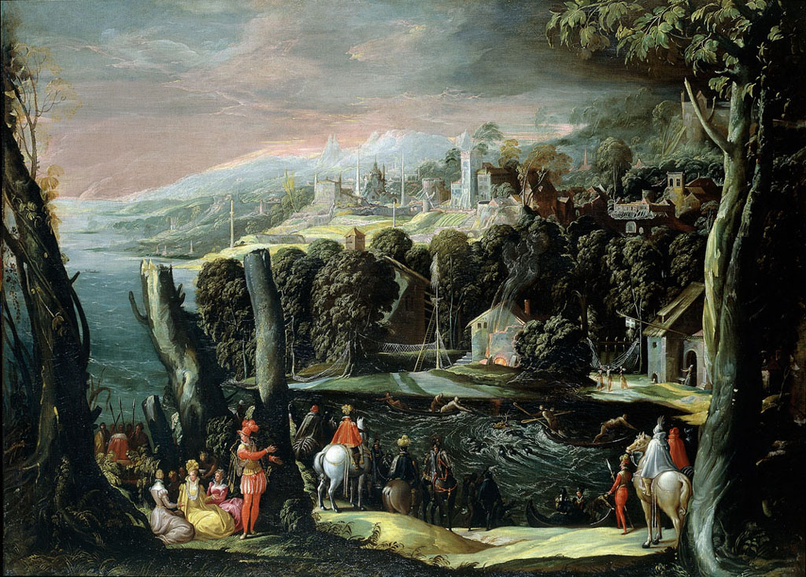

**内容/背景/看点**：一幅宽幅的宫廷狩猎风景，前景是衣着华丽的贵妇骑士在追猎鹿群，背后铺开辽阔的山川。作者尼科洛·德拉巴特（Niccolò dell'Abate）是 16 世纪艾米利亚的样式主义画家，后来去法国为枫丹白露宫服务，是"风景带人物"这一画种的重要先驱。看点正在于此：在风景还只是背景的年代，他已把山水与人物揉成一体，这条路后来由卡拉奇兄弟接力，最终长成法国古典风景画——本厅的雷尼《乡间舞蹈》、维奥拉《风景》都可与它对照着看。

### ⭐ 顺路看 加罗法洛（传）《魔法队列的风景》 / Tisi Benvenuto called Garofalo (?), _Landscape with Magical Procession_

- **作者 / Artist**：本韦努托·蒂西，绰号加罗法洛（传） / Tisi Benvenuto called Garofalo (?)
- **作品 / Work**：《魔法队列的风景》 / _Landscape with Magical Procession_
- **时间**：1528 年
- **材质**：布面油画
- **尺寸**：110 × 159 cm
- **馆藏编号**：008
- **位置**：海伦与帕里斯厅（第 19 室）
- **官网介绍页**：[魔法队列的风景｜博尔盖塞官方藏品库](https://www.collezionegalleriaborghese.it/en/opere/landscape-with-magical-procession)｜馆藏编号 008

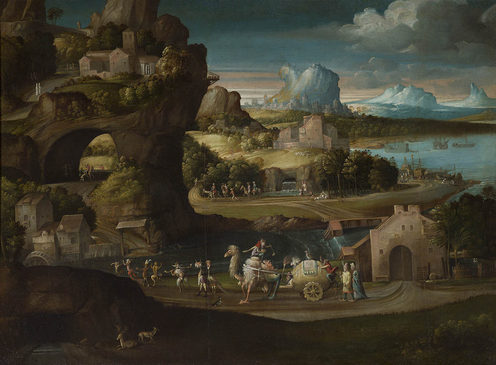

**内容/背景/看点**：一片开阔风景里行进着一队神秘人物，气氛带点魔幻、寓意已不易确解。作品传为加罗法洛（Garofalo，本名 Benvenuto Tisi）所作——他是 16 世纪上半叶的费拉拉画家，因受拉斐尔影响、被称作"费拉拉的小拉斐尔"。和旁边德拉巴特那幅一样，这也是早期"以风景为主、人物点缀其间"的尝试，年代（1528 年）更早，正好看费拉拉画派如何处理山水与队列叙事。

### ⭐⭐ 推荐 乔瓦尼·兰弗兰科《诺兰迪诺与卢奇娜受巨怪惊扰》 / Lanfranco Giovanni, _Norandino and Lucina Surprised by the Ogre_

- **作者 / Artist**：乔瓦尼·兰弗兰科 / Lanfranco Giovanni
- **作品 / Work**：《诺兰迪诺与卢奇娜受巨怪惊扰》 / _Norandino and Lucina Surprised by the Ogre_
- **时间**：1619–1621 年
- **材质**：布面油画
- **尺寸**：267 × 397 cm
- **馆藏编号**：016
- **位置**：海伦与帕里斯厅（第 19 室）
- **官网介绍页**：[诺兰迪诺与卢奇娜｜博尔盖塞官方藏品库](https://www.collezionegalleriaborghese.it/en/opere/norandino-and-lucina-surprised-by-the-ogre)｜馆藏编号 016

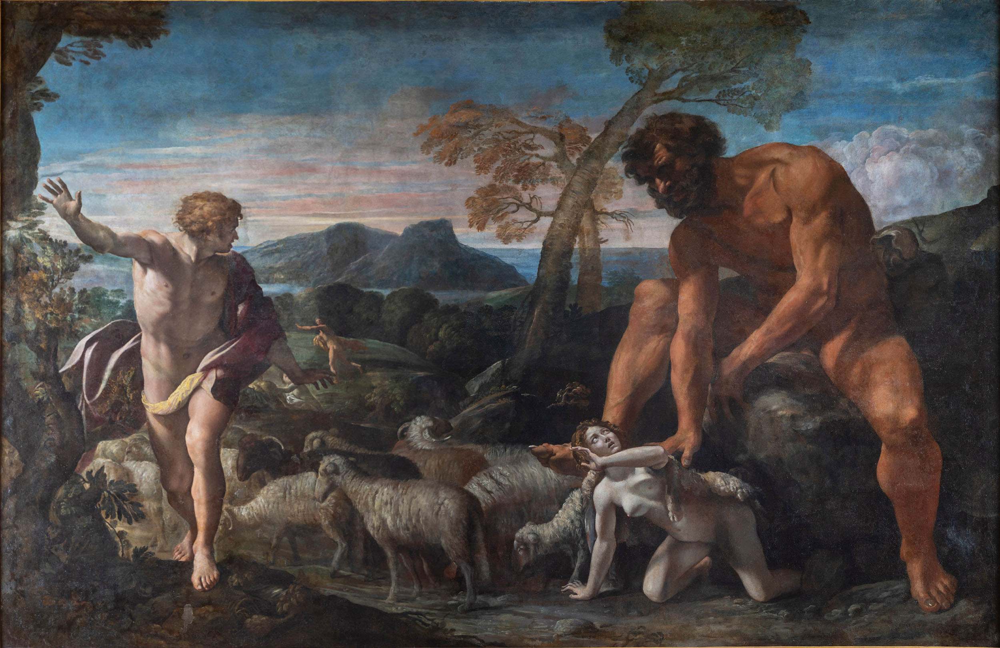

**内容/背景/看点**：近 4 米宽的大幅巴洛克画，题材取自阿里奥斯托（Ariosto）的骑士史诗《疯狂的奥兰多》：诺兰迪诺与卢奇娜躲避吃人巨怪（Ogre）的惊险一幕。作者乔瓦尼·兰弗兰科（Giovanni Lanfranco）是受卡拉奇画派熏陶、活跃于罗马的巴洛克大画家，以气势磅礴的动感构图见长。看点是它的尺度与戏剧张力——在这间以静谧古典画为主的厅里，它是少有的"动作大片"，本厅还另藏他一幅《约瑟与波提乏之妻》，可一并留意。

### ⭐ 顺路看 乔万·巴蒂斯塔·维奥拉《风景》 / Viola Giovan Battista, _Landscape_

- **作者 / Artist**：乔万·巴蒂斯塔·维奥拉 / Viola Giovan Battista
- **作品 / Work**：《风景》 / _Landscape_
- **时间**：1613 年
- **材质**：布面油画
- **尺寸**：69 × 87 cm
- **馆藏编号**：025
- **位置**：海伦与帕里斯厅（第 19 室）
- **官网介绍页**：[风景｜博尔盖塞官方藏品库](https://www.collezionegalleriaborghese.it/en/opere/landscape)｜馆藏编号 025

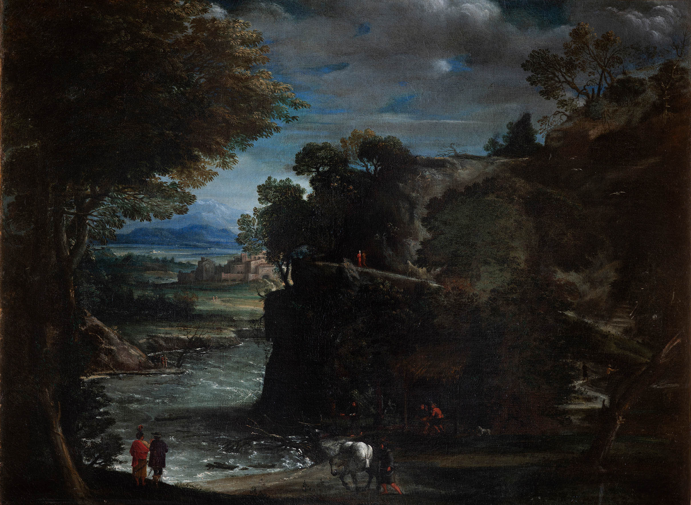

**内容/背景/看点**：一幅纯粹的理想化风景小品。作者乔万·巴蒂斯塔·维奥拉（Giovan Battista Viola）是博洛尼亚的风景画家、安尼巴莱·卡拉奇的追随者，专攻这类"古典理想风景"。和本厅德拉巴特、加罗法洛的早期风景对照看，能看清这条线索如何从"风景带人物"一步步走向 17 世纪初成熟的独立风景画。

### ⭐ 顺路看 乔万·弗朗切斯科·罗马内利《女先知》 / Romanelli Giovanni Francesco, _Sibyl_

- **作者 / Artist**：乔万·弗朗切斯科·罗马内利 / Romanelli Giovanni Francesco
- **作品 / Work**：《女先知》 / _Sibyl_
- **时间**：1640/1650 年
- **材质**：布面油画
- **尺寸**：68 × 56 cm
- **馆藏编号**：051
- **位置**：海伦与帕里斯厅（第 19 室）
- **官网介绍页**：[女先知｜博尔盖塞官方藏品库](https://www.collezionegalleriaborghese.it/en/opere/sibyl)｜馆藏编号 051

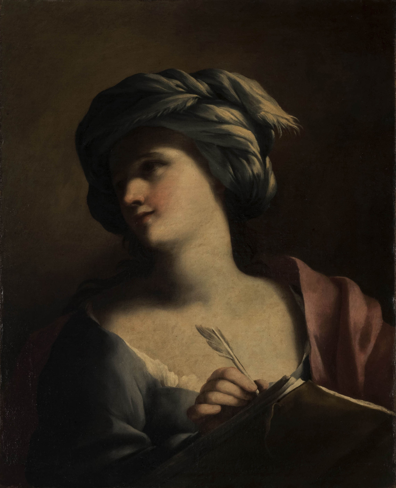

**内容/背景/看点**：又一幅女先知半身像。作者罗马内利（Giovanni Francesco Romanelli）是科尔托纳（Pietro da Cortona）的学生、罗马盛期巴洛克画家，后来还远赴法国为路易十四宫廷作画，画风柔和优雅。把它和本厅另两幅"女先知"——多梅尼基诺（inv. 055）和这幅——并排看，正好比较同一题材在不同画家笔下的处理：多梅尼基诺的内省克制，罗马内利的则更甜美装饰。

### ⭐⭐⭐ 必看 多梅尼基诺《女先知》 / Domenichino, _Sibyl_

- **作者 / Artist**：多梅尼基诺 / Domenichino
- **作品 / Work**：《女先知》 / _Sibyl_
- **时间**：1617 年
- **材质**：布面油画
- **尺寸**：123 × 89 cm
- **馆藏编号**：055
- **位置**：海伦与帕里斯厅（第 19 室）
- **官网介绍页**：[女先知 / Sibilla｜博尔盖塞官方藏品库](https://www.collezionegalleriaborghese.it/en/opere/sibyl-2)｜馆藏编号 055

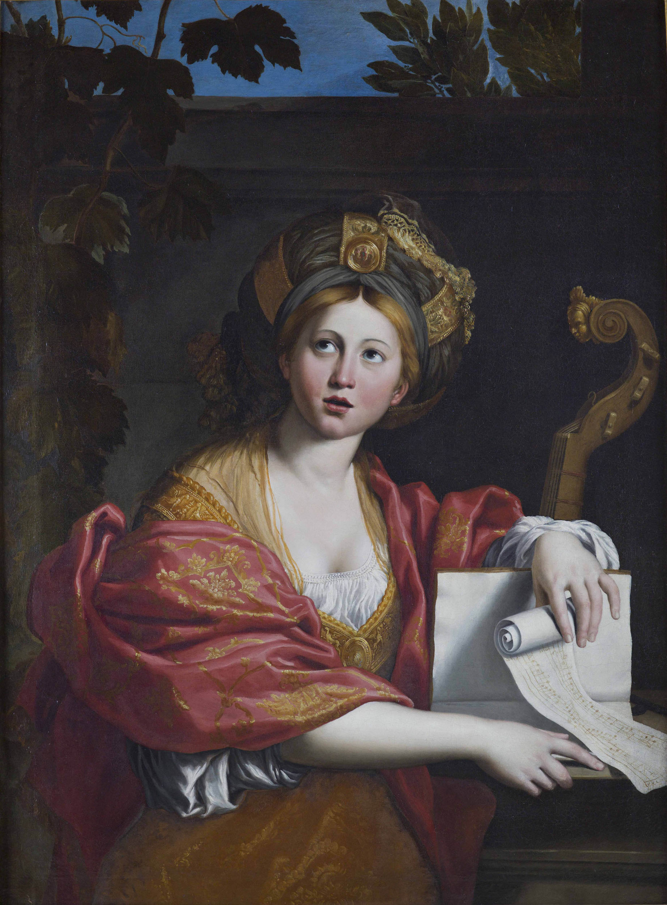

多梅尼基诺最受欢迎的单人像之一，也是博尔盖塞的另一件镇厅小品，常与《狄安娜的狩猎》并称——两幅正是希皮奥内·博尔盖塞（Scipione Borghese）1617 年用同一笔 150 斯库多"打包"从画家手里夺来的。

**内容（这是什么）**：画的是一位包着华丽头巾、半身近景的女先知（Sibyl，古代世界传达神谕的女祭司）。她一手按着一卷写有乐谱的纸、一手扶着一把维奥尔琴（古提琴）的琴颈，嘴唇微张，仿佛正伴着琴声吟唱神谕。传统上这幅画常被叫作"库迈的西比拉"，但馆方根据画中的桂树更倾向认为她是德尔斐的女先知——桂叶是阿波罗的圣物，德尔斐女祭司在发布预言前会咀嚼桂叶。

**看点：一幅"会唱歌"的女先知**：女先知通常只配书卷或卷轴，几乎不带乐器；多梅尼基诺却给她配了乐谱与维奥尔琴，这是相当罕见的图像处理。原因是画家本人精通音乐，且这幅画很可能由同样热衷音乐的希皮奥内出主意——他收藏过一部关于女先知的专著。乐谱、琴、背景里的葡萄藤（指向酒神与诗的灵感，也暗指基督）与桂树（阿波罗、艺术与音乐之神的圣树），合起来把"先知—诗—音乐—神启"几层意思叠在一起。

**风格**：她那张被金发与头巾环绕的脸、微微出神的眼神，明显带着博洛尼亚画派的味道，和圭多·雷尼（Guido Reni）笔下的女主角是同一种气质——温婉、理想化、目光上扬。正因如此，这幅画一问世就极受欢迎，产生了大量摹本（伦敦华莱士收藏、罗马卡比托利欧美术馆都有版本）。

**现场站看**：

1. **看她手里的乐谱和琴颈**——这是辨认此画"反常规"的关键：一般女先知不带乐器，这里却把音乐道具摆在最显眼处，点出画家的音乐修养与希皮奥内的趣味。
2. **看那张脸和上扬的眼神**——典型的博洛尼亚画派理想美，和雷尼的女主角如出一辙；记住这副表情，再去本厅看雷尼的画会更有体会。
3. **找背景里的桂树与葡萄藤**——别当成随手添的风景：桂树指向阿波罗（音乐之神），葡萄藤指向酒神与诗的灵感，是解读她"先知兼歌者"身份的钥匙。
4. **和《狄安娜的狩猎》连起来看**——两幅同出一人之手、同被一笔抢来，一为多人大场面、一为静谧单人像，正好看多梅尼基诺收放自如的两面。

### ⭐ 顺路看 阿戈斯蒂诺·卡拉奇工坊《锡耶纳的圣加大利纳神魂超拔》 / Workshop of Carracci Agostino, _Extasy of Saint Catherine of Siena_

- **作者 / Artist**：阿戈斯蒂诺·卡拉奇工坊 / Workshop of Carracci Agostino
- **作品 / Work**：《锡耶纳的圣加大利纳神魂超拔》 / _Extasy of Saint Catherine of Siena_
- **时间**：16世纪末至17世纪初
- **材质**：布面油画
- **尺寸**：90 × 69 cm
- **馆藏编号**：058
- **位置**：海伦与帕里斯厅（第 19 室）
- **官网介绍页**：[锡耶纳的圣加大利纳神魂超拔｜博尔盖塞官方藏品库](https://www.collezionegalleriaborghese.it/en/opere/extasy-of-saint-catherine-of-siena)｜馆藏编号 058

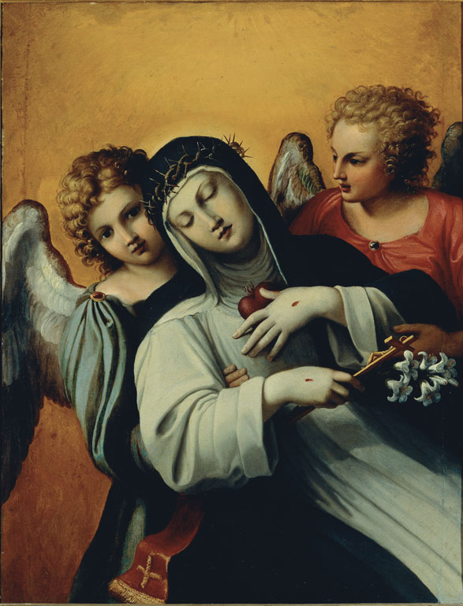

**内容/背景/看点**：画的是锡耶纳的圣加大利纳（Saint Catherine of Siena，14 世纪的多明我会神秘主义者、意大利主保圣人）在神魂超拔（出神入定与神交契）中的一刻。出自阿戈斯蒂诺·卡拉奇（Agostino Carracci）的工坊——他是安尼巴莱的兄长，是卡拉奇画派"博洛尼亚学院"的核心成员之一。看点在于它代表了本厅密集出现的卡拉奇圈子作品，可与归属安尼巴莱的《圣家》（inv. 064）、安尼巴莱的《大笑少年》对照，感受这一画派的家族风格。

### ⭐ 顺路看 安尼巴莱·卡拉奇（传）《圣家》 / Attributed to Carracci Annibale, _Holy Family_

- **作者 / Artist**：归属安尼巴莱·卡拉奇 / Attributed to Carracci Annibale
- **作品 / Work**：《圣家》 / _Holy Family_
- **时间**：1598/1600 年
- **材质**：布面油画
- **尺寸**：69 × 58 cm
- **馆藏编号**：064
- **位置**：海伦与帕里斯厅（第 19 室）
- **官网介绍页**：[圣家｜博尔盖塞官方藏品库](https://www.collezionegalleriaborghese.it/en/opere/holy-family)｜馆藏编号 064

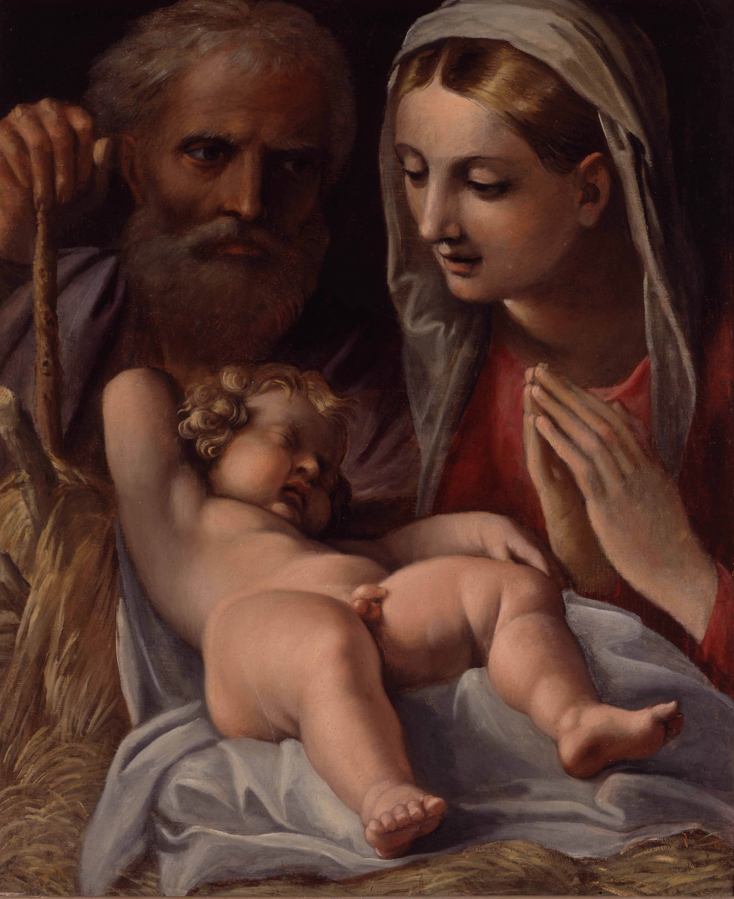

**内容/背景/看点**：一幅圣家题材小画（圣母、圣婴、圣约瑟），定为安尼巴莱·卡拉奇（Annibale Carracci）所作（归属，即尚有存疑）。年代约在 1598–1600 年，正是卡拉奇在罗马承接法尔内塞宫天顶大工程的盛期。看点是它与本厅其他卡拉奇圈作品（058 工坊画、083 大笑少年）一起，构成一个小型"卡拉奇专区"，适合连起来看这一画派的温润古典气质。

### ⭐ 顺路看 拉维尼娅·丰塔纳《青年肖像》 / Fontana Lavinia, _Portrait of a youth_

- **作者 / Artist**：拉维尼娅·丰塔纳 / Fontana Lavinia
- **作品 / Work**：《青年肖像》 / _Portrait of a youth_
- **时间**：1606 年
- **材质**：铅笔素描
- **尺寸**：47.5 × 35.5 cm
- **馆藏编号**：081
- **位置**：海伦与帕里斯厅（第 19 室）
- **官网介绍页**：[青年肖像｜博尔盖塞官方藏品库](https://www.collezionegalleriaborghese.it/en/opere/portrait-of-a-youth)｜馆藏编号 081

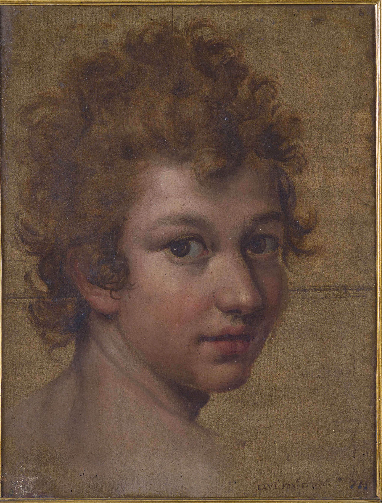

**内容/背景/看点**：一幅铅笔素描青年肖像，同样出自拉维尼娅·丰塔纳（Lavinia Fontana）之手。丰塔纳本以肖像画起家、在博洛尼亚极受贵族追捧。看点是它与本厅那幅她的大型油画《密涅瓦更衣》（inv. 007）形成有趣对照：一边是宏大的神话裸像，一边是私密的纸上素描，正好看这位职业女画家在不同体裁间的功力——记得留意她对面部神情与衣料的细腻刻画。

### ⭐⭐ 推荐 安尼巴莱·卡拉奇《大笑少年头像》 / Carracci Annibale, _Head of a laughing youth_

- **作者 / Artist**：安尼巴莱·卡拉奇 / Carracci Annibale
- **作品 / Work**：《大笑少年头像》 / _Head of a laughing youth_
- **时间**：约 1585 年
- **材质**：纸上油画，后裱于布面
- **尺寸**：44.5 × 29.5 cm
- **馆藏编号**：083
- **位置**：海伦与帕里斯厅（第 19 室）
- **展陈提醒**：馆方藏品页标注"目前未展出"，到场不一定能看到原作
- **官网介绍页**：[大笑少年头像 / Testa di giovane ridente｜博尔盖塞官方藏品库](https://www.collezionegalleriaborghese.it/en/opere/head-of-a-laughing-youth)｜馆藏编号 083

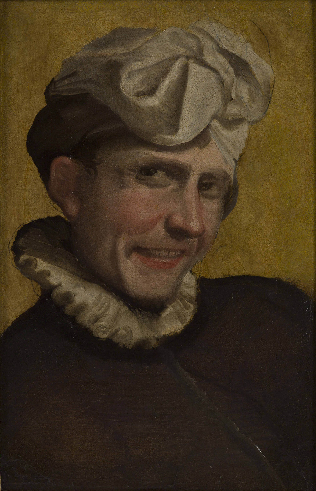

一张极生动的早期安尼巴莱·卡拉奇（Annibale Carracci）油画速写。注意：馆方标注此画目前未陈列，能否现场看到要看当日布展。

**内容（这是什么）**：一个咧嘴大笑的年轻人，头上裹着类似头巾的奇特包头。老清册里把他记作"大笑的小丑/弄臣"。这不是一幅完成的肖像，而是画家在纸上的一气呵成的速写——后来才裱到画布上。

**看点：一幅"没画完"反而更珍贵的画**：因为没有最终完成，画面上仍能看见底下的素描轮廓，再由流畅、厚实的笔触补色——等于让你看到卡拉奇"打草稿→上色"的中间状态，是研究他作画过程的难得标本。它和卡拉奇同期那批革命性的"风俗画"（如牛津的《肉铺》、罗马科隆纳宫的《吃豆人》）一脉相承：在 16 世纪末，认真去画普通市井人物的鲜活表情，本身就是对僵化样式主义的反叛，也为后来卡拉瓦乔式的写实埋下伏笔。

**身世小插曲**：这张画 1693 年起就在博尔盖塞收藏中；1790 年的清册一度把它当成卡拉瓦乔的手笔，直到 1833 年才改回卡拉奇名下，最终由罗伯托·隆吉（Roberto Longhi）确认为安尼巴莱青年期真迹。"被误认成卡拉瓦乔"这件事本身，正说明它那股直白、生猛的写实力道。

**看点提示**（若有幸展出）：凑近看那张笑脸——注意底层素描线条如何透过薄涂的油彩显形，以及画家怎样用寥寥几笔厚色就抓住一个转瞬即逝的笑。这种"抓活表情"的速写，是卡拉奇改革意大利绘画的起点之一。

### ⭐ 顺路看 吉内夫拉·坎托福利《贝勒尼基》 / Cantofoli Ginevra, _Berenice_

- **作者 / Artist**：吉内夫拉·坎托福利 / Cantofoli Ginevra
- **作品 / Work**：《贝勒尼基》 / _Berenice_
- **时间**：1660 年代
- **材质**：布面油画
- **尺寸**：76 × 59 cm
- **馆藏编号**：099
- **位置**：海伦与帕里斯厅（第 19 室）
- **官网介绍页**：[贝勒尼基｜博尔盖塞官方藏品库](https://www.collezionegalleriaborghese.it/en/opere/berenice)｜馆藏编号 099

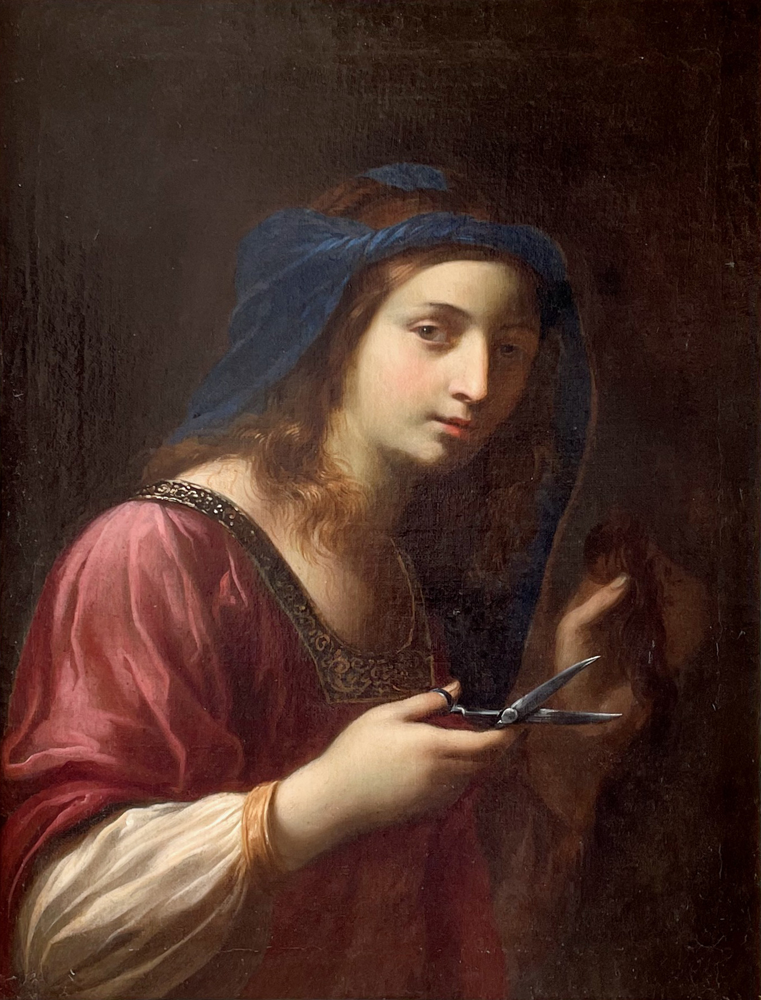

**内容/背景/看点**：画的是古埃及王后贝勒尼基（Berenice）——传说她为祈求出征丈夫平安，剪下自己的秀发献给神庙，那缕头发后来化为夜空中的"后发座"。作者吉内夫拉·坎托福利（Ginevra Cantofoli）是 17 世纪博洛尼亚的女画家。看点：这间厅难得地汇聚了多位女画家之作——丰塔纳、加利齐娅、坎托福利——在男性主导的画史里相当少见，可以把它们当成一条"女画家"暗线串起来看。

### ⭐⭐ 推荐 费德·加利齐娅《犹滴提着荷罗孚尼的头》 / Galizia Fede, _Judith with the Head of Holofernes_

- **作者 / Artist**：费德·加利齐娅 / Galizia Fede
- **作品 / Work**：《犹滴提着荷罗孚尼的头》 / _Judith with the Head of Holofernes_
- **时间**：1601 年
- **材质**：布面油画
- **尺寸**：141 × 108 cm
- **馆藏编号**：165
- **位置**：海伦与帕里斯厅（第 19 室）
- **官网介绍页**：[犹滴提着荷罗孚尼的头｜博尔盖塞官方藏品库](https://www.collezionegalleriaborghese.it/en/opere/judith-with-the-head-of-holofernes-2)｜馆藏编号 165

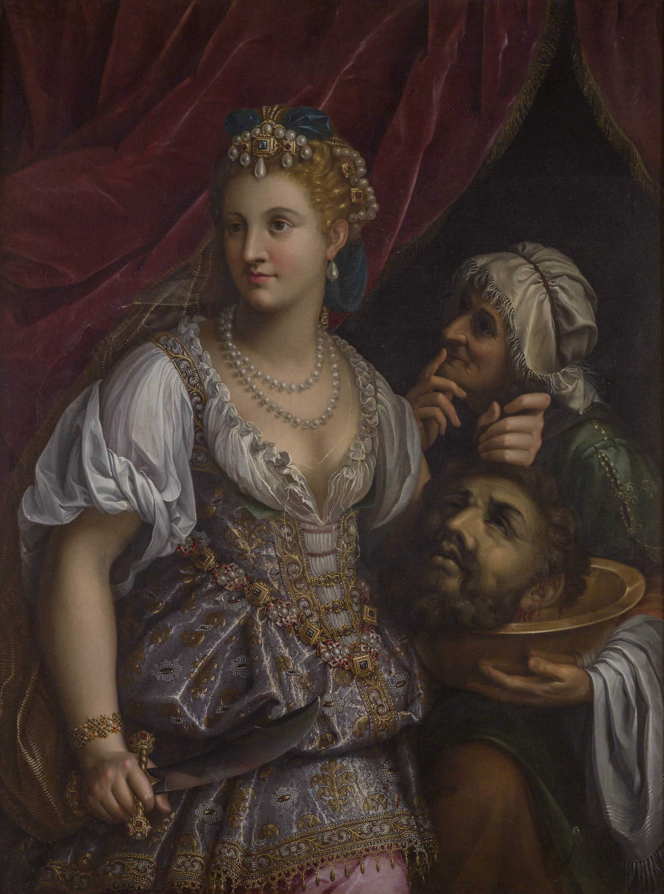

**内容/背景/看点**：题材出自《旧约·犹滴传》：犹太寡妇犹滴（Judith）潜入敌营、灌醉并斩下亚述统帅荷罗孚尼（Holofernes）的头，救了自己的城。画中她从容提着割下的头颅。作者费德·加利齐娅（Fede Galizia）是米兰的女画家，更以静物画闻名，是欧洲静物画的先驱之一。看点：这又是一件女画家之作（与本厅丰塔纳、坎托福利同列），且"犹滴"是 17 世纪女画家（如真蒂莱斯基）格外青睐的"女性力量"题材，值得带着这层意味去看她笔下犹滴的神情。

### ⭐⭐ 推荐 费代里科·巴罗奇《祈祷中的圣耶柔米》 / Barocci Federico, _Saint Jerome in Prayer_

- **作者 / Artist**：费代里科·巴罗奇 / Barocci Federico
- **作品 / Work**：《祈祷中的圣耶柔米》 / _Saint Jerome in Prayer_
- **时间**：1595–1600 年
- **材质**：布面油画
- **尺寸**：97 × 67 cm
- **馆藏编号**：403
- **位置**：海伦与帕里斯厅（第 19 室）
- **官网介绍页**：[祈祷中的圣耶柔米｜博尔盖塞官方藏品库](https://www.collezionegalleriaborghese.it/en/opere/saint-jerome-in-prayer)｜馆藏编号 403

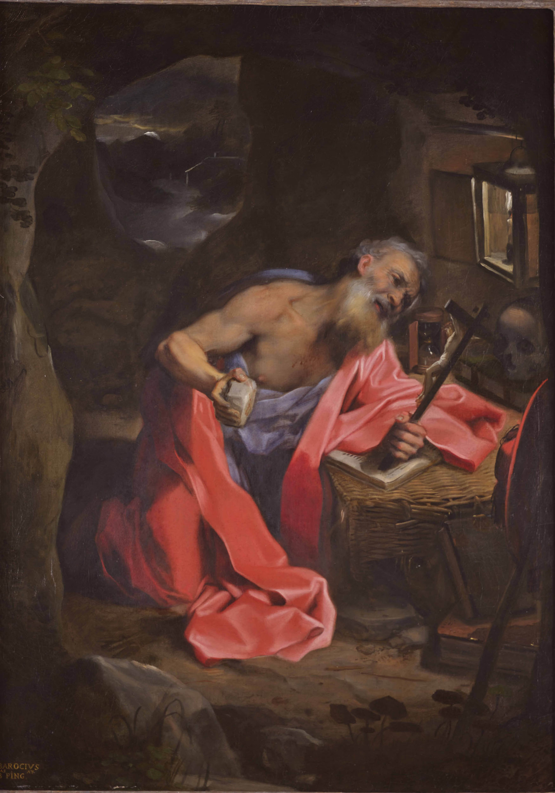

**内容/背景/看点**：画的是教会圣师圣耶柔米（Saint Jerome）在荒野中苦修祈祷——通常配有十字架、骷髅、狮子等隐修象征。作者费代里科·巴罗奇（Federico Barocci）来自乌尔比诺，是 16 世纪末"原型巴洛克"的关键人物，以柔润如烟的色彩与温情的虔敬感著称，深刻影响了后来的鲁本斯。看点正是他那标志性的柔光与粉调色彩——在这间多为博洛尼亚画派与风景画的厅里，巴罗奇的笔触自成一格，值得近看他如何用色彩营造情绪。本厅另藏他一幅《埃涅阿斯逃离特洛伊》。

### ⭐ 顺路看 安东尼奥·卡拉奇（传）《朱庇特与朱诺》 / Attributed to Carracci Antonio, _Jupiter and Juno_

- **作者 / Artist**：归属安东尼奥·卡拉奇 / Attributed to Carracci Antonio
- **作品 / Work**：《朱庇特与朱诺》 / _Jupiter and Juno_
- **时间**：约 1612 年
- **材质**：板上油画
- **尺寸**：34 × 38 cm
- **馆藏编号**：515
- **位置**：海伦与帕里斯厅（第 19 室）
- **官网介绍页**：[朱庇特与朱诺｜博尔盖塞官方藏品库](https://www.collezionegalleriaborghese.it/en/opere/jupiter-and-juno)｜馆藏编号 515

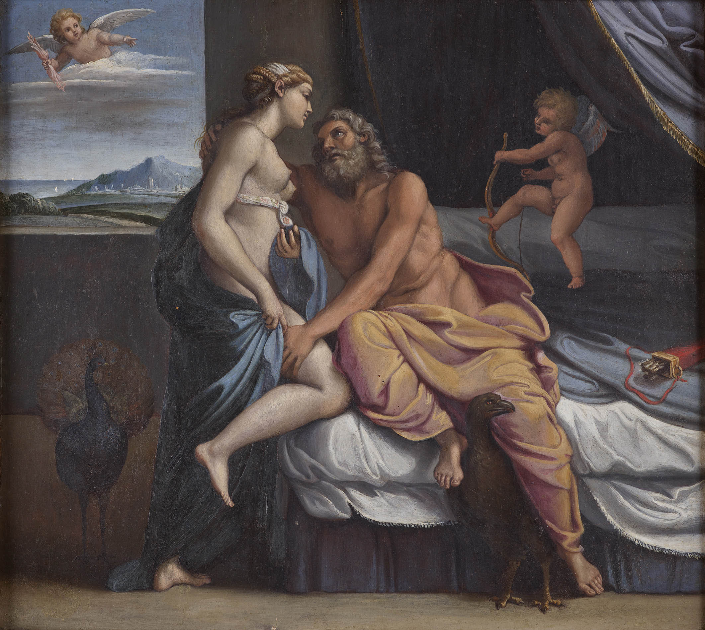

**内容/背景/看点**：一块尺寸很小的板上油画，画众神之王朱庇特（Jupiter）与他的妻子、天后朱诺（Juno）。定为安东尼奥·卡拉奇（Antonio Carracci，安尼巴莱的侄子、卡拉奇家族第三代）所作（归属）。看点：这是本厅"卡拉奇家族"小专区里又一笔——把它和阿戈斯蒂诺工坊（058）、安尼巴莱（064、083）的作品并看，能看到这个画派如何一代代延续；尺幅虽小，适合凑近欣赏。

### ⭐⭐ 推荐 安东尼奥·坦佩斯塔《珀耳修斯与安德洛墨达（正面）／维纳斯与阿多尼斯（背面）》 / Tempesta Antonio, _Perseus and Andromeda (recto); Venus and Adonis (verso)_

- **作者 / Artist**：安东尼奥·坦佩斯塔 / Tempesta Antonio
- **作品 / Work**：《珀耳修斯与安德洛墨达（正面）／维纳斯与阿多尼斯（背面）》 / _Perseus and Andromeda (recto); Venus and Adonis (verso)_
- **时间**：约 17 世纪第二个十年
- **材质**：青金石上蛋彩与油彩
- **尺寸**：23 × 17 × 0.2 cm
- **馆藏编号**：606
- **位置**：海伦与帕里斯厅（第 19 室）
- **官网介绍页**：[珀耳修斯与安德洛墨达／维纳斯与阿多尼斯｜博尔盖塞官方藏品库](https://www.collezionegalleriaborghese.it/en/opere/perseus-and-andromeda-recto-venus-and-adonis-verso)｜馆藏编号 606

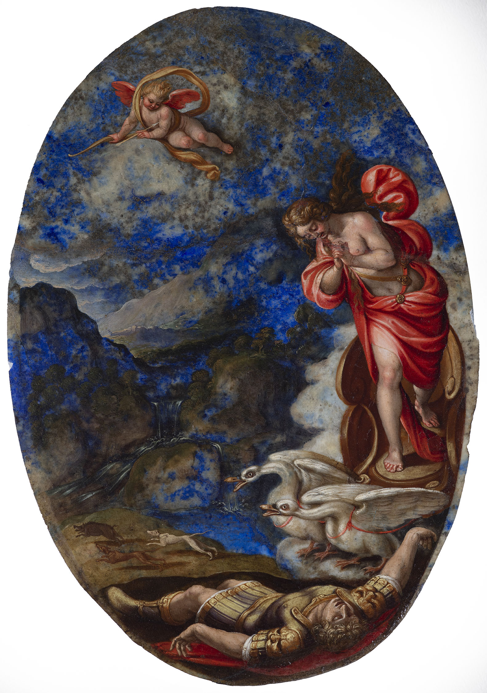

**内容/背景/看点**：一件双面绘制的小型珍玩——正面画英雄珀耳修斯（Perseus）骑飞马救出被锁在海边献祭的公主安德洛墨达（Andromeda），背面画维纳斯（Venus）与少年猎人阿多尼斯（Adonis）的爱情悲剧。最大看点在材质：它直接画在一片深蓝的青金石（lapis lazuli）薄板上，画家安东尼奥·坦佩斯塔（Antonio Tempesta）巧妙利用石头天然的蓝色纹理充当海面与天空。这类"在贵重宝石上作画"的奢侈小品，正是 17 世纪初罗马权贵书房里的收藏珍玩，值得凑近细看石纹与画面的融合。

### ⭐⭐ 推荐 圭多·雷尼《乡间舞蹈》 / Reni Guido, _Country dance_

- **作者 / Artist**：圭多·雷尼 / Reni Guido
- **作品 / Work**：《乡间舞蹈》 / _Country dance_
- **时间**：约 1601–1602 年
- **材质**：布面油画
- **尺寸**：81 × 99 cm
- **馆藏编号**：609
- **位置**：海伦与帕里斯厅（第 19 室）
- **展陈提醒**：馆方藏品页标注"目前未展出"，到场不一定能看到原作
- **官网介绍页**：[乡间舞蹈 / Danza campestre｜博尔盖塞官方藏品库](https://www.collezionegalleriaborghese.it/en/opere/country-dance)｜馆藏编号 609

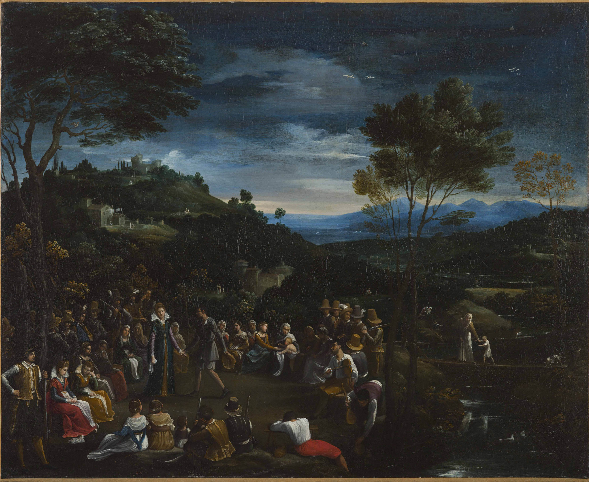

一幅有传奇身世的早期圭多·雷尼（Guido Reni）。注意：馆方标注此画目前未陈列，能否现场看到要看当日布展——但它的故事值得知道。

**内容（这是什么）**：一群农人在林间空地办露天舞会，由琉特琴和臂式维奥尔琴伴奏；几位扮成猎人的乡绅贵妇在旁含笑观看。画面正中，一个年轻村夫正邀请一位贵妇下场开舞。四周的人物姿态各异：有打瞌睡的醉汉、照看孩子的妇人、停下来去取河边冰镇酒壶的琴手；远处丘陵上点缀着城堡、农庄和小教堂，水面有点点风帆，暮色将尽。

**身世：一桩失而复得的"认领"奇案**：这幅画 2008 年在伦敦邦瀚斯（Bonham's）拍卖会上露面时，只被当作"某佚名博洛尼亚画家"之作；19 世纪它一度被定为"佛兰德画派"。凭着过硬的画质，学者们顺藤摸瓜，最终把它认定为圭多·雷尼亲笔，并查出它原属红衣主教希皮奥内·博尔盖塞（Scipione Borghese）旧藏——17 世纪初的博尔盖塞清册里就有它，一直留到 19 世纪末才被变卖流散。2020 年博尔盖塞美术馆从古董市场把它买回，等于给藏品史"补回"了失踪百余年的一件。这也提醒人：雷尼画风景带人物的一面，过去几乎不为人知，是近年才被重新发现的。

**看点：天上那两只苍蝇**：画家在天空里画了两只与真物等大的苍蝇，逼真得像落在画布表面、让人想伸手去赶——这是雷尼炫技的"错视"（trompe l'oeil）小把戏，也是在向古老的"画得乱真"传说致敬（老普林尼、瓦萨里都讲过类似故事，比如乔托在契马布埃的画上点一只苍蝇骗过老师）。刚到罗马的年轻雷尼，用这个细节向赞助人秀本事。希皮奥内一度想把雷尼收为自己的"宫廷画师"，视他为安尼巴莱·卡拉奇之后罗马画坛第一人。

**现场站看**（若有幸展出）：

1. **先在天空里找那两只苍蝇**——这是全画最妙的彩蛋，逼真到像停在画面上，体现雷尼的炫技与幽默。
2. **看正中的"邀舞"**——年轻村夫向贵妇伸手开舞，是整场乡村节庆的叙事核心。
3. **数一圈配角**——打盹的醉汉、空酒壶、照看孩子的妇人、去取冰酒的琴手，雷尼把一个个生活小动作藏在人群里，越看越多。
4. **看远景的暮色丘陵**——城堡、农庄、小教堂与点点风帆，这种"风景带人物"的处理承自安尼巴莱·卡拉奇，是雷尼少见的一面。
## 雕塑

本节先列馆方 Modern Sculpture 藏品列表，共 2 件。

### ⭐ 顺路看 洛伦佐·奥托尼（传）《老妇人肖像（文琴察·达内西？）》 / Attributed to Ottoni Lorenzo, _Portrait of an old lady (Vincenza Danesi?)_

- **作者 / Artist**：归属洛伦佐·奥托尼 / Attributed to Ottoni Lorenzo
- **作品 / Work**：《老妇人肖像（文琴察·达内西？）》 / _Portrait of an old lady (Vincenza Danesi?)_
- **时间**：1683 年前
- **材质**：大理石
- **尺寸**：高 60 cm
- **馆藏编号**：CCLXVII
- **位置**：海伦与帕里斯厅（第 19 室）
- **官网介绍页**：[老妇人肖像（文琴察·达内西？）｜博尔盖塞官方藏品库](https://www.collezionegalleriaborghese.it/en/opere/portrait-of-an-old-lady-vincenza-danesi)｜馆藏编号 CCLXVII

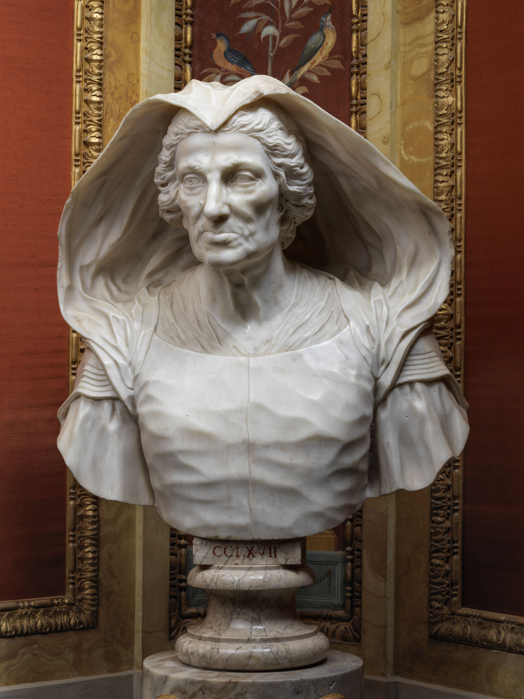

**内容/背景/看点**：一尊大理石老妇胸像，被认为可能是文琴察·达内西（Vincenza Danesi），传为巴洛克晚期罗马雕塑家洛伦佐·奥托尼（Lorenzo Ottoni）所作。看点是它写实、不加美化的"老年面孔"——皱纹、松弛的皮肉刻画得毫不回避，与厅内那些理想化的女神、女先知形成鲜明反差。顺路看一眼，体会巴洛克肖像对"真实容貌"的兴趣。

### ⭐ 顺路看 德拉·波尔塔工坊（旧传科尔迪耶）《年轻女子、男孩与狗》 / Attributed to Cordier Nicolas, _Young Woman with Boy and Dog_

- **作者 / Artist**：旧归属尼古拉·科尔迪耶（今多归德拉·波尔塔工坊） / Attributed to Cordier Nicolas
- **作品 / Work**：《年轻女子、男孩与狗》 / _Young Woman with Boy and Dog_
- **时间**：16世纪末至17世纪初
- **材质**：大理石（白与黑古典大理石及半宝石）
- **尺寸**：高 70 cm
- **馆藏编号**：LVII
- **位置**：海伦与帕里斯厅（第 19 室）
- **官网介绍页**：[年轻女子、男孩与狗｜博尔盖塞官方藏品库](https://www.collezionegalleriaborghese.it/en/opere/young-woman-with-boy-and-dog)｜馆藏编号 LVII

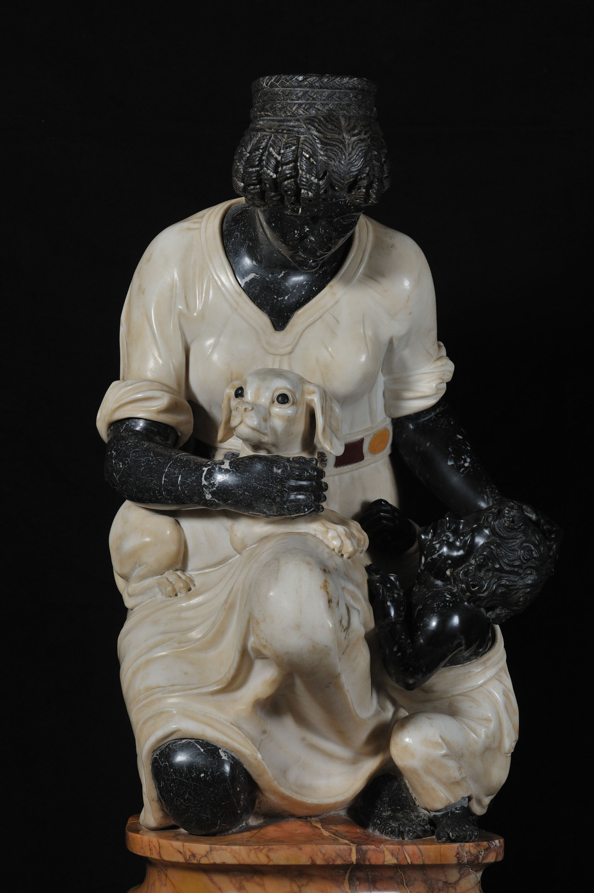

**内容/背景/看点**：摆在房间正中的这尊雕像，是一位带着男孩与小狗的年轻深发女子，用白与黑的古典大理石（bianco e nero antico）搭配半宝石拼镶而成——多色石料是它最大的看点，逐处辨认衣裙、肤色、底座用的不同石材，是 16–17 世纪罗马"彩色大理石"工艺的炫技之作。归属历来有争议：过去定为法国雕塑家尼古拉·科尔迪耶（Nicolas Cordier），馆方现更倾向归入德拉·波尔塔（Giovan Battista della Porta）工坊。它立在厅中央，正好作为整间房间陈设的视觉中心来看。
## 其他

本节按馆方 Furniture 藏品列表补充，共 1 件。

### ⭐ 顺路看 帕切蒂、卡尔代利与德·罗西《壁炉》 / Pacetti Vincenzo / Cardelli Lorenzo / De Rossi Antonio, _Fireplace_

- **作者 / Artist**：文琴佐·帕切蒂、洛伦佐·卡尔代利与安东尼奥·德·罗西 / Pacetti Vincenzo / Cardelli Lorenzo / De Rossi Antonio
- **作品 / Work**：《壁炉》 / _Fireplace_
- **时间**：1782–1784 年
- **材质**：卢尼大理石、古典黄大理石、磨光鎏金铜饰
- **尺寸**：高 134 cm；宽 202 cm；深 79 cm
- **馆藏编号**：camini-XIX
- **位置**：海伦与帕里斯厅（第 19 室）
- **官网介绍页**：[壁炉｜博尔盖塞官方藏品库](https://www.collezionegalleriaborghese.it/en/opere/fireplace-xix)｜馆藏编号 camini-XIX

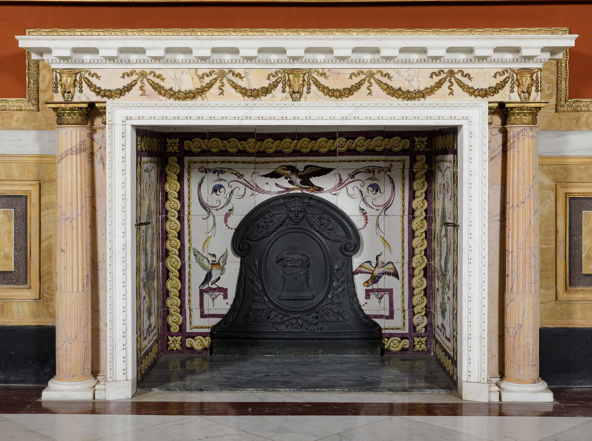

**内容/背景/看点**：这座壁炉与天顶、墙饰是同一场改造（1782–1784 年）的产物，由帕切蒂（Vincenzo Pacetti）用名贵的古典黄大理石（giallo antico）打造、配安东尼奥·德·罗西（Antonio de Rossi）的鎏金铜饰。它不是单纯的取暖设施，而是这间新古典主义房间整体设计的一部分。看点：注意它华美的黄大理石与门楣上四块同色的神祇浮雕（朱庇特、维纳斯、玛尔斯、阿波罗）相呼应——整间厅的天顶、墙面、壁炉用同一套材质与神话主题统一起来，是 18 世纪末"总体艺术"式室内设计的范例。

### ⭐ 顺路看 房间装饰与整体陈设 / Room Decoration and Fireplace

- **位置**：海伦与帕里斯厅（第 19 室）

**内容/背景/看点**：这间二楼房间的天顶画、壁炉、门楣浮雕、怪诞纹（grotteschi）与透视装饰，是一个统一设计的整体，而非单纯的"挂画的墙"。它出自 18 世纪末阿斯普鲁奇（Antonio Asprucci）主持的全馆大改造——他给每间房都定了一个独立主题，本厅的主题就是"海伦与帕里斯"（即特洛伊战争的起因"美之评判与争夺"）。看点：进门后先把天顶、壁炉、门楣浮雕当成一组来读，理解了主题，再看墙上挂的那些神话与女性题材绘画，就会发现布展处处呼应同一条线索。

## 资料来源 / Sources

- Galleria Borghese 官方房间页：[Room 19](https://galleriaborghese.cultura.gov.it/en/il-museo/la-villa/sala-19-sala-di-elena-e-paride/)
- Galleria Borghese 藏品筛选：[Painting, Room 19](https://www.collezionegalleriaborghese.it/en/collezione/pittura?sala=s19)
- Galleria Borghese 藏品筛选：[Modern Sculpture, Room 19](https://www.collezionegalleriaborghese.it/en/collezione/scultura?sala=s19)
- Galleria Borghese 藏品筛选：[Ancient Art, Room 19](https://www.collezionegalleriaborghese.it/en/collezione/arte-antica?sala=s19)
- Galleria Borghese 藏品筛选：[Furniture, Room 19](https://www.collezionegalleriaborghese.it/en/collezione/arredi?sala=s19)
