第 15 室（黎明女神厅）以科尔维的奥罗拉天顶得名，整厅贯穿「时间流逝」的主题（一天、十二月、四季、黄道）；墙上有鲁本斯的《哀悼死去的基督》等威尼斯—伦巴第名作。

**必看与核心展品（⭐⭐⭐ 必看 + 核心）**

| 推荐 | 展品 | 作者 | 一句话看点 |
|---|---|---|---|
| ⭐⭐⭐ 必看 | 《哀悼死去的基督》 | 彼得·保罗·鲁本斯 | 鲁本斯早年罗马时期的悲恸群像，肉感写实 |
| ⭐⭐ 推荐 | 《最后的晚餐》 | 雅各布·巴萨诺 | 威尼斯画派浓墨夜景，人物动势强烈 |
| ⭐⭐ 推荐 | 《圣科斯马与圣达弥盎》 | 多索·多西 | 费拉拉画派奇崛的色彩与光感 |
| ⭐⭐ 推荐 | 《睡眠寓意像》 | 亚历山德罗·阿尔加尔迪 | 黑色大理石的「睡眠」小像，呼应全厅时间主题 |
| ⭐⭐ 推荐 | 天顶《黎明女神奥罗拉与晨昏暮光》 | 多梅尼科·科尔维 | 中央奥罗拉＋破晓黄昏，四周黄道四季 |

**展厅官网介绍页**：[Room 15 - Aurora Room](https://galleriaborghese.cultura.gov.it/en/il-museo/la-villa/sala-15-sala-dellaurora/)

## 核心展品

### ⭐⭐⭐ 必看 彼得·保罗·鲁本斯《哀悼死去的基督》 / Peter Paul Rubens, _Lamentation over the Dead Christ_
- **作者 / Artist**：彼得·保罗·鲁本斯 / Peter Paul Rubens
- **作品 / Work**：《哀悼死去的基督》 / _Lamentation over the Dead Christ_
- **时间**：1601–1602 年
- **材质**：布面油画
- **尺寸**：180 × 136 cm
- **位置**：黎明女神厅（第 15 室）

- **官网介绍页**：[哀悼死去的基督 / Compianto su Cristo morto｜Galleria Borghese 官方藏品库](https://www.collezionegalleriaborghese.it/opere/compianto-su-cristo-morto)｜馆藏编号 411

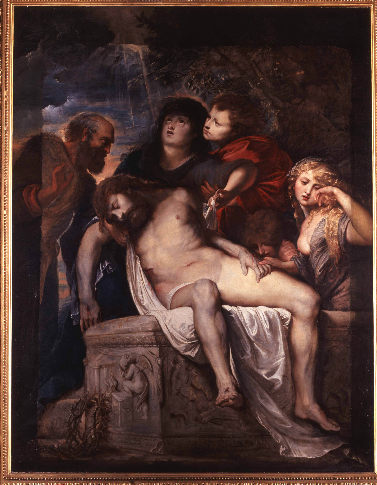

**内容（这是什么）**：《哀悼死去的基督》画的是基督从十字架卸下、入葬之前那一刻——圣母与众人围着横陈的耶稣（Cristo）遗体悲恸。与一般"哀悼"不同，鲁本斯（Peter Paul Rubens）没让基督平躺在圣母膝上，而是让遗体近乎直立、由圣母（Madonna）从背后托住，脚下是一具石棺。

**身世与断代**：这幅画长期被当作凡·戴克（Antoon van Dyck）之作——画布背面有 18–19 世纪题字"N. 9 di Vandich"，19 世纪的博尔盖塞清册也据此著录为"凡·戴克的卸下圣体"。直到 1916 年 Oldenbourg 才把它归到鲁本斯名下，今已成定论；断代定在 1601–1602 年、鲁本斯第一次旅居罗马期间（人物比例还留着其师奥托·凡·维恩 Otto van Veen 的痕迹）。它并非红衣主教斯基皮奥内（Scipione Borghese）的旧藏：新发现的文献证明，是 19 世纪初卡米洛·博尔盖塞（Camillo Borghese，1818 年后）购入，1902 年才归国家所有。画作可能与红衣主教佩雷蒂·蒙塔尔托（Peretti Montalto）的委托有关——鲁本斯初到罗马时正被托付给他。

**图像学与技法**：鲁本斯在这件早期作品里把北方与意大利两套传统揉到一起：用石棺代表墓穴是北方做法；而让基督由圣母从背后扶起的姿势，则来自科雷乔（Correggio）1524 年为帕尔马圣约翰教堂所画的《哀悼》（鲁本斯藏有一件摹本）。基督直立的身姿还参考了丁托列托（Tintoretto，威尼斯学院美术馆）与朱塞佩·波尔塔（Giuseppe Porta，德累斯顿）的同题之作。基督下垂的右臂是一句古典引文——出自卡比托利欧博物馆藏的《运送墨勒阿格洛斯遗体》浮雕，也呼应拉斐尔（Raphael）的《卸下圣体》（鲁本斯曾在佩鲁贾亲见，今亦藏本馆 inv. 369）。

**神学细节**：画里藏着一层献祭与救赎的寓意：石棺暗指圣体圣事的祭台；棺上方一个小天使看守着火焰，喻灵魂在死后不灭；公羊则与禧年、罪的赦免相关。

**现场站看**：

1. **看基督直立的身体**——别的"哀悼"多让基督平躺，这里遗体几乎竖起、由圣母从背后托住，正是鲁本斯把意大利构图（科雷乔）化入北方题材的关键一步。
2. **看下垂的右臂**——这条手臂直接引自古罗马《运送墨勒阿格洛斯》浮雕、也呼应拉斐尔《卸下圣体》（就在本馆 inv. 369，可两件对看），是"古典＋拉斐尔"的双重致敬。
3. **找脚下的石棺**——以棺代墓是北方传统；它同时暗指圣体祭台，把画面从单纯叙事提升为礼仪象征。
4. **看石棺上方的小天使与火焰、以及公羊**——容易被忽略的角落，分别喻灵魂不灭与禧年赦罪，是读懂这幅画神学层的钥匙。
5. **注意画面的仰视感与"下大上小"**——它像是为从下往上看而设计，暗示原属某座教堂；后来被加宽改尺寸、配上 19 世纪画框才进入博尔盖塞，原始比例已失。
6. **与满厅的费拉拉/威尼斯/伦巴第 16 世纪绘画对照**——这件 17 世纪初的北方巨匠之作是全厅"异类"，正好看出鲁本斯如何站在意大利前辈肩上又超越他们。

### ⭐⭐ 推荐 雅各布·巴萨诺《最后的晚餐》 / Jacopo Bassano, _Last Supper_
- **作者 / Artist**：雅各布·巴萨诺 / Jacopo Bassano
- **作品 / Work**：《最后的晚餐》 / _Last Supper_
- **时间**：16 世纪
- **材质**：布面油画
- **尺寸**：168 × 270 cm
- **位置**：黎明女神厅（第 15 室）

- **官网介绍页**：[最后的晚餐 / Ultima Cena｜Galleria Borghese 官方藏品库](https://www.collezionegalleriaborghese.it/opere/ultima-cena)｜馆藏编号 144

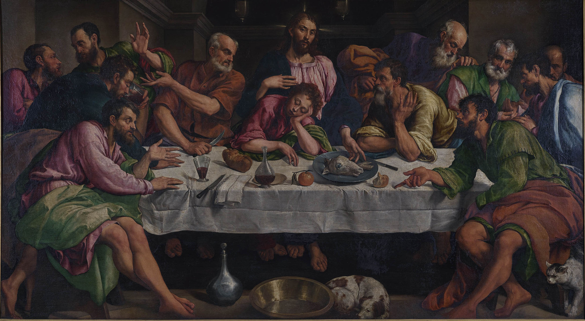

**内容（这是什么）**：雅各布·巴萨诺（Jacopo Bassano）的《最后的晚餐》画耶稣受难前夜与十二门徒共进逾越节晚餐、宣告"你们中有一人要卖我"的一刻。

**背景**：巴萨诺是威尼托巴萨诺·德尔格拉帕地区的画派宗师。本厅集中体现了斯基皮奥内·博尔盖塞对伦巴第与威尼托 16 世纪绘画的偏爱，巴萨诺一家多件作品都在这里（另见《牧羊人来拜》026、《绵羊与羔羊》120、《东方三博士来拜》150）。

**看点**：巴萨诺标志性的强烈明暗与世俗化处理——门徒被画得像真实的农人，桌下还散落猫狗与器物，把神圣场景拉进市井生活。这幅横幅大画的动势与光影，是他早期最有力的一件，也是本厅巴萨诺组的"主件"。

### ⭐⭐ 推荐 乔瓦尼·卢泰里，称多索·多西《圣科斯马与圣达弥盎》 / Giovanni Luteri called Dosso Dossi, _Sts Cosmas and Damian_
- **作者 / Artist**：乔瓦尼·卢泰里，称多索·多西 / Giovanni Luteri called Dosso Dossi
- **作品 / Work**：《圣科斯马与圣达弥盎》 / _Sts Cosmas and Damian_
- **时间**：约 1520–1522 年
- **材质**：布面油画
- **尺寸**：225 × 157 cm
- **位置**：黎明女神厅（第 15 室）

- **官网介绍页**：[圣科斯马与圣达弥盎 / Santi Cosma e Damiano｜Galleria Borghese 官方藏品库](https://www.collezionegalleriaborghese.it/opere/santi-cosma-e-damiano)｜馆藏编号 022

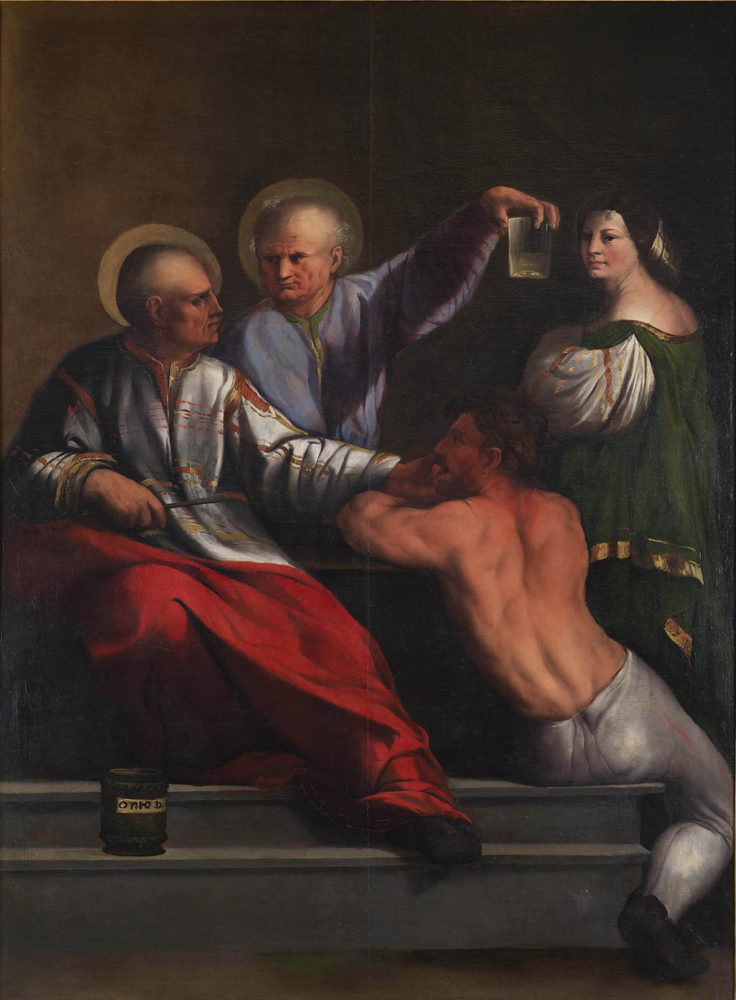

**内容（这是什么）**：多索·多西（Dosso Dossi，本名乔瓦尼·卢泰里 Giovanni Luteri）的《圣科斯马与圣达弥盎》画一对孪生医生圣徒——科斯马（Cosma）与达弥盎（Damiano）。早期基督教传说中，二人行医不取酬、后殉道，是医者与药剂师的主保圣人。

**背景**：多索·多西是费拉拉宫廷的首席画家。本厅聚集了他及其弟巴蒂斯塔（Battista）、子辈埃万杰利斯塔（Evangelista）的多件作品（多索本人之作就有五件），正反映斯基皮奥内对 16 世纪费拉拉画派的热衷。

**看点**：多索浓郁的色彩与诗意光线——费拉拉画派受乔尔乔内、提香影响，却自带一种梦幻而略带怪诞的气质。这是本厅多索家族一组作品的"组首"，可与 11 号厅的费拉拉传统串起来看。

### ⭐⭐ 推荐 亚历山德罗·阿尔加尔迪《睡眠寓意像》 / Alessandro Algardi, _Allegory of Sleep_
- **作者 / Artist**：亚历山德罗·阿尔加尔迪 / Alessandro Algardi
- **作品 / Work**：《睡眠寓意像》 / _Allegory of Sleep_
- **时间**：1635–1636 年
- **材质**：大理石
- **尺寸**：48 × 90 cm
- **位置**：黎明女神厅（第 15 室）

- **官网介绍页**：[睡眠寓意 / Allegoria del Sonno｜Galleria Borghese 官方藏品库](https://www.collezionegalleriaborghese.it/opere/allegoria-del-sonno)｜馆藏编号 CLX

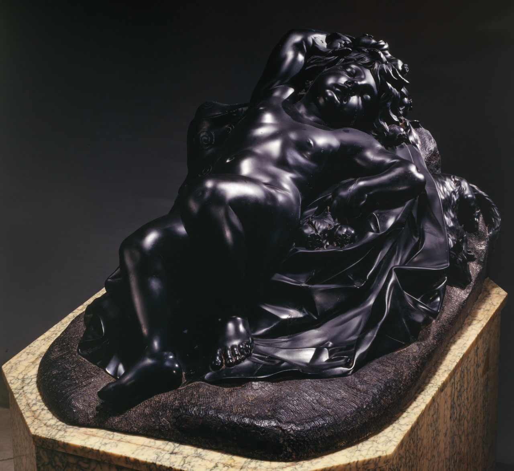

**内容（这是什么）**：亚历山德罗·阿尔加尔迪（Alessandro Algardi）用黑色古石（nero antico）雕的《睡眠寓意像》，原型是一件希腊化时期的"睡童"，摆在本厅正中。

**背景**：这是从 10 号厅（旧称"睡眠厅"）转来的关键雕塑。阿尔加尔迪是 17 世纪罗马与贝尼尼齐名的雕塑家，以古典克制著称。

**看点**：用深色 nero antico 表现"睡眠"，本身就是材质即主题——深沉、安静。它把希腊化"睡童"原型转译成巴洛克寓意像，又与天顶"晨昏/时间"主题暗暗呼应（睡眠＝夜，正对天顶的黎明）。本厅另一件阿尔加尔迪之作是《一对蛇形把手双耳瓶》CCXIX。

## 天顶画

### ⭐⭐ 推荐 多梅尼科·科尔维《黎明女神奥罗拉与晨昏暮光寓意画》 / Domenico Corvi, _Allegory of Aurora and the Twilights of Dawn and Dusk_

- **位置**：黎明女神厅（第 15 室）天顶

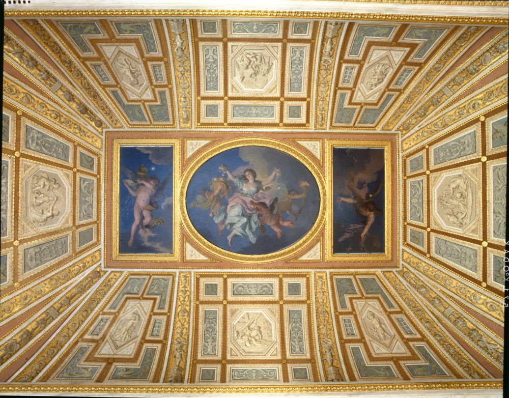

**内容（这是什么）**：整面天顶是多梅尼科·科尔维（Domenico Corvi，1721–1803）1782 年所作，中央三幅画分别表现黎明女神奥罗拉（Aurora）以及"破晓"与"黄昏"两段晨昏暮光的寓意，本厅"黎明女神厅"即由此得名。

**背景**：科尔维只画中央三幅；环绕的几何隔间——黄道十二宫圆章、哲学家胸像、表现四季的仿单色浮雕——由乔万·巴蒂斯塔·马尔凯蒂（Giovan Battista Marchetti，1730–1800）完成。四壁是金底怪诞纹（grottesche），嵌入月份、星座和 24 枚古代名人圆章。这是 18 世纪末阿斯普鲁奇（Asprucci）主持别墅整体改造、给每间厅一个独立主题的产物。整厅贯穿一个主题：时间的流逝——一天、十二月、四季、黄道，层层铺开。

**逐幅分述**：天顶分两部分——中央科尔维画的三幅寓意，四周马尔凯蒂画的几何隔间装饰。

#### 中央三幅（科尔维）：

##### **《黎明女神奥罗拉》/ _Aurora_**

天顶正中的主画，黎明女神奥罗拉（Aurora，罗马司晨女神）散花、驾临，宣告一天之始；本厅得名即源于她。

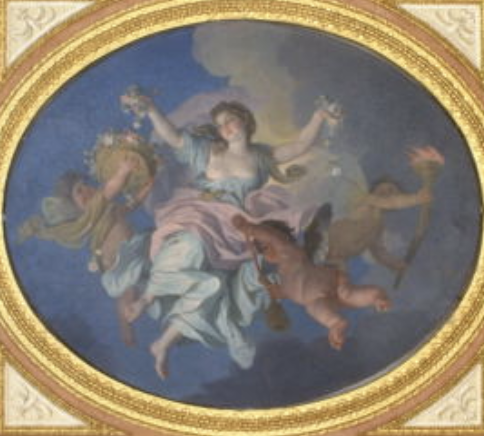

##### **《破晓》/ _Dawn

中央一侧，拟人化的"破晓"暮光，表现夜与昼之间、天色将明的一刻。

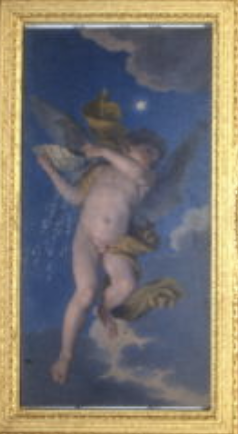

##### **《黄昏》/ _Dusk_**

中央另一侧，拟人化的"黄昏"暮光，与"破晓"相对，表现昼向夜过渡的一刻。三幅连起来就是"一天之始与昼夜交替"的寓意主轴。

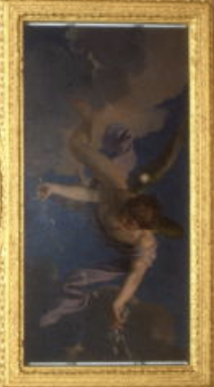

四周隔间装饰（马尔凯蒂）：

4. **黄道十二宫圆章**——一圈十二个圆章，画黄道十二星座，把"一年／天文之时"嵌进天顶。
5. **四季仿单色浮雕**——表现春夏秋冬的仿石刻单色画（trompe-l'œil 假浮雕），凑近看会发现"凸起"其实是平面绘成的错觉。
6. **哲学家胸像**——隔间里的一组古代哲人胸像式画饰，与星座、四季一道，烘托"时间与智慧"的氛围。

**现场站看**：

1. **先认中央三幅**——正中是散花/驾临的黎明女神奥罗拉，两侧是"破晓"与"黄昏"，三幅连起来就是一天之始的寓意，是天顶的主轴。
2. **沿隔间找黄道十二宫圆章与四季单色浮雕**——这些是马尔凯蒂画的"假浮雕"（trompe-l'œil），凑近看会发现是平面绘出的立体错觉。
3. **看四壁金底怪诞纹里的 24 枚古代名人圆章**——和天顶的星座、月份一起，把"时间"主题从天顶延伸到墙面。
4. **把天顶主题和厅内绘画连起来**——本厅画作偏威尼斯、伦巴第、费拉拉，与天顶"光与时间"的寓意形成全厅统一氛围，抬头看完再低头看画。

## 绘画

本厅绘画以伦巴第、威尼托、费拉拉地区 16 世纪上半叶作品为主，按馆方藏品列表逐件列出（核心件已在上文展开）。

### ⭐ 顺路看 雅各布·达蓬特，称雅各布·巴萨诺《牧羊人来拜》 / da Ponte Jacopo called Jacopo Bassano, _Adoration of the Shepherds_

- **作者 / Artist**：雅各布·达蓬特，称雅各布·巴萨诺 / da Ponte Jacopo called Jacopo Bassano
- **作品 / Work**：《牧羊人来拜》 / _Adoration of the Shepherds_
- **时间**：1553–1554 年
- **材质**：布面油画
- **尺寸**：76 × 94 cm
- **馆藏编号**：026
- **位置**：黎明女神厅（第 15 室）
- **官网介绍页**：[官网介绍英文](https://www.collezionegalleriaborghese.it/en/opere/adoration-of-the-shepherds)｜馆藏编号 026

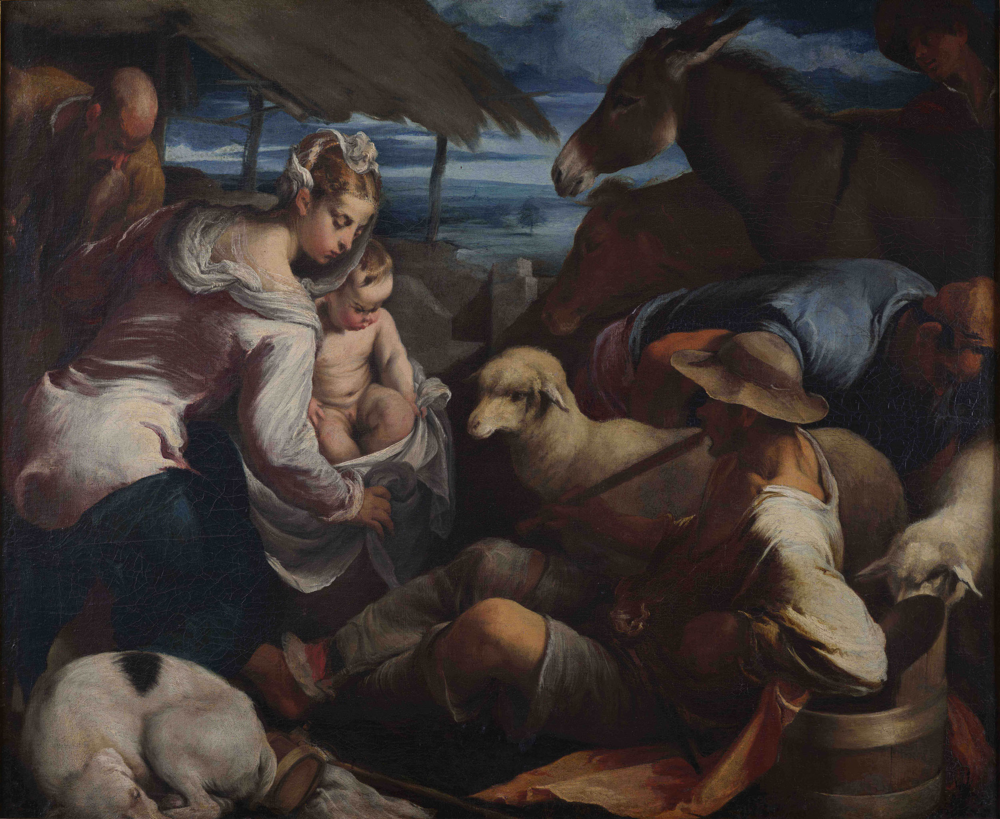

**这是什么 / 看点**：雅各布·达蓬特，称雅各布·巴萨诺（Jacopo Bassano）《牧羊人来拜》，画牧羊人闻天使报信后赶来朝拜马槽中的圣婴。属本厅巴萨诺一家作品之一（整组背景见《最后的晚餐》144）。看点是巴萨诺典型的夜景明暗与乡村牧人形象，把神圣降生处理成质朴的田园夜戏。

### ⭐ 顺路看 贝尔纳迪诺·利奇尼奥《其兄弟一家肖像》 / Licinio Bernardino, _Portrait of his brother’s family_

- **作者 / Artist**：贝尔纳迪诺·利奇尼奥 / Licinio Bernardino
- **作品 / Work**：《其兄弟一家肖像》 / _Portrait of his brother’s family_
- **时间**：约 1535 年
- **材质**：布面油画
- **尺寸**：107 × 163 cm
- **馆藏编号**：115
- **位置**：黎明女神厅（第 15 室）
- **官网介绍页**：[官网介绍英文](https://www.collezionegalleriaborghese.it/en/opere/portrait-of-his-brothers-family)｜馆藏编号 115

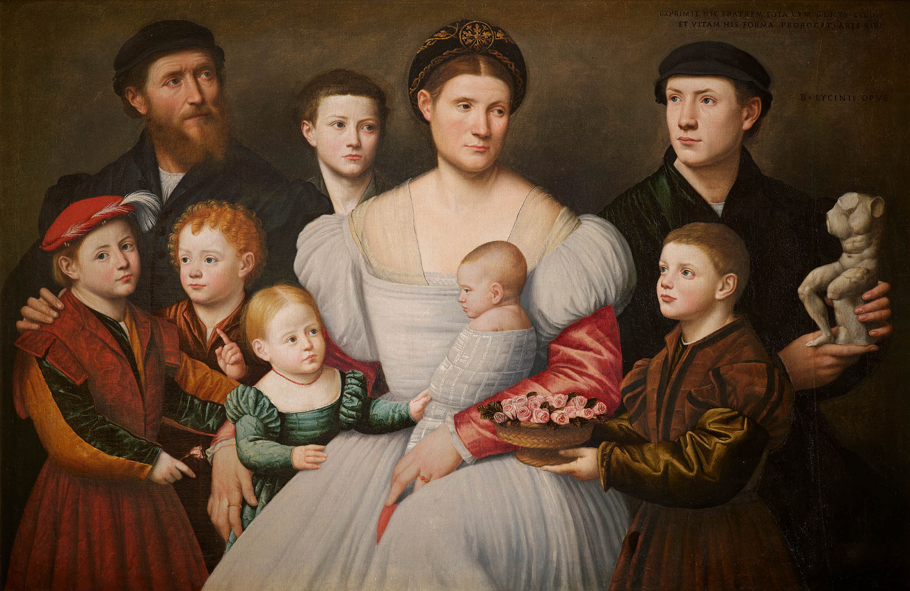

**这是什么 / 看点**：贝尔纳迪诺·利奇尼奥（Bernardino Licinio）《其兄弟一家肖像》，一幅威尼斯式群体肖像——画家自己兄弟一家围坐成"全家福"。看点正在这种 16 世纪威尼斯肖像少见的家庭合影格式：人物各自的姿态、目光与手势透露出彼此关系，朴实而亲切。

### ⭐ 顺路看 雅各布·达蓬特，称雅各布·巴萨诺《绵羊与羔羊》 / da Ponte Jacopo called Jacopo Bassano, _Sheep and lamb_

- **作者 / Artist**：雅各布·达蓬特，称雅各布·巴萨诺 / da Ponte Jacopo called Jacopo Bassano
- **作品 / Work**：《绵羊与羔羊》 / _Sheep and lamb_
- **时间**：约 1576 年
- **材质**：布面油画
- **尺寸**：30 × 51 cm
- **馆藏编号**：120
- **位置**：黎明女神厅（第 15 室）
- **官网介绍页**：[官网介绍英文](https://www.collezionegalleriaborghese.it/en/opere/sheep-and-lamb)｜馆藏编号 120

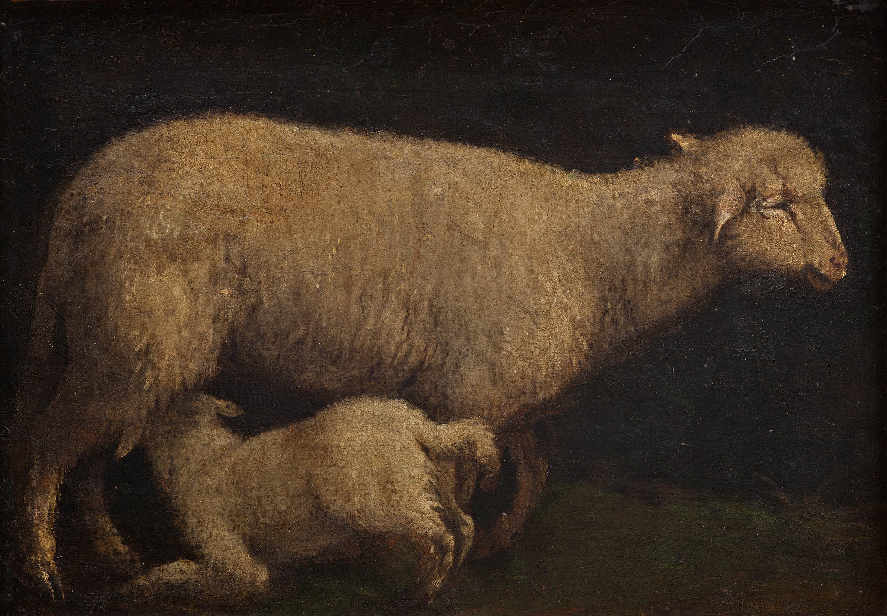

**这是什么 / 看点**：雅各布·巴萨诺《绵羊与羔羊》，一幅几乎纯画牲畜的小幅——这正是巴萨诺的开创之处：他率先把动物、农具这类"风俗-静物"元素当作独立题材入画。和同厅他的宗教画对看，能看出他对乡村生活的痴迷（整组见 144）。

### ⭐ 顺路看 乔瓦尼·吉罗拉莫·萨沃尔多《青年胸像》 / Savoldo Giovanni Girolamo, _Bust of a Youth_

- **作者 / Artist**：乔瓦尼·吉罗拉莫·萨沃尔多 / Savoldo Giovanni Girolamo
- **作品 / Work**：《青年胸像》 / _Bust of a Youth_
- **时间**：约 1527 年
- **材质**：布面油画
- **尺寸**：60 × 40 cm
- **馆藏编号**：139
- **位置**：黎明女神厅（第 15 室）
- **官网介绍页**：[官网介绍英文](https://www.collezionegalleriaborghese.it/en/opere/bust-of-a-youth)｜馆藏编号 139

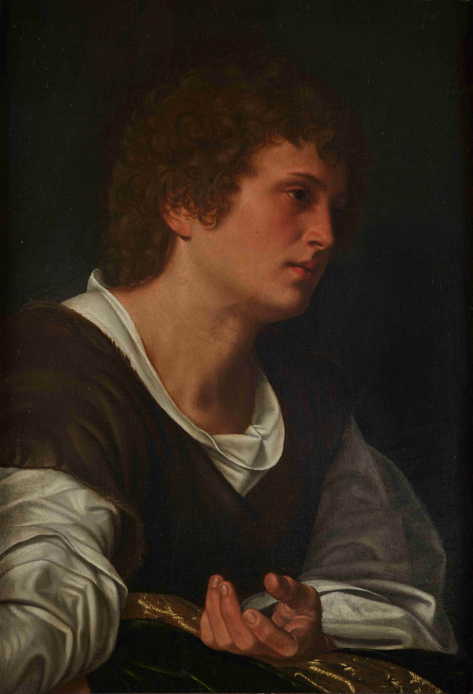

**这是什么 / 看点**：乔瓦尼·吉罗拉莫·萨沃尔多（Giovanni Girolamo Savoldo）《青年胸像》。萨沃尔多是布雷西亚画派画家，以细腻的银灰色调与柔和光线著称。看点是他对光影与质感的微妙处理，人物神情内省安静。本厅另有他的《多俾亚与天使》547，可一并看其光感功夫。

### ⭐ 顺路看 雅各布·达蓬特，称雅各布·巴萨诺《东方三博士来拜》 / da Ponte Jacopo called Jacopo Bassano, _Adoration of the Magi_

- **作者 / Artist**：雅各布·达蓬特，称雅各布·巴萨诺 / da Ponte Jacopo called Jacopo Bassano
- **作品 / Work**：《东方三博士来拜》 / _Adoration of the Magi_
- **时间**：约 1576 年
- **材质**：布面油画
- **尺寸**：126 × 140 cm
- **馆藏编号**：150
- **位置**：黎明女神厅（第 15 室）
- **官网介绍页**：[官网介绍英文](https://www.collezionegalleriaborghese.it/en/opere/adoration-of-the-magi)｜馆藏编号 150

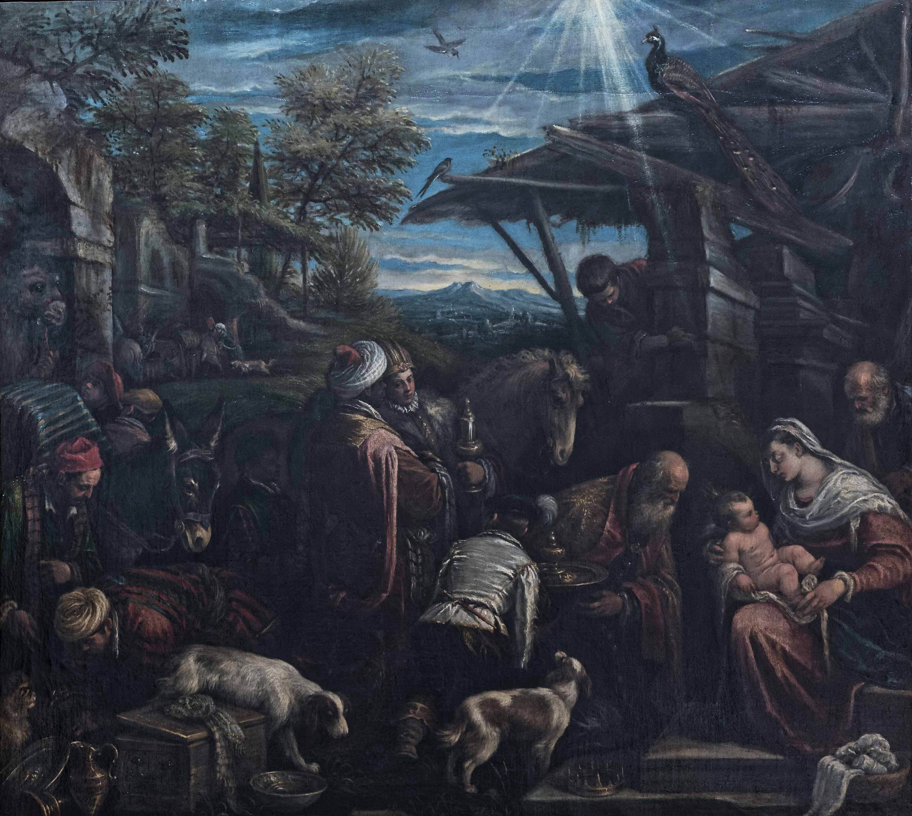

**这是什么 / 看点**：雅各布·巴萨诺《东方三博士来拜》，画三位东方贤士循星来到伯利恒、向圣婴献上黄金乳香没药。巴萨诺一家作品之一（整组见 144）。看点是华丽的随从队列与浓郁色彩——三博士题材给了他施展异域服饰与动物的舞台。

### ⭐ 顺路看 伊波利托·斯卡尔塞拉，称斯卡尔塞利诺《西满家中的晚餐》 / Scarsella Ippolito called Scarsellino, _Supper in the House of Simon_

- **作者 / Artist**：伊波利托·斯卡尔塞拉，称斯卡尔塞利诺 / Scarsella Ippolito called Scarsellino
- **作品 / Work**：《西满家中的晚餐》 / _Supper in the House of Simon_
- **时间**：约 1590 年
- **材质**：布面油画
- **尺寸**：81 × 140.5 cm
- **馆藏编号**：169
- **位置**：黎明女神厅（第 15 室）
- **官网介绍页**：[官网介绍英文](https://www.collezionegalleriaborghese.it/en/opere/supper-in-the-house-of-simon)｜馆藏编号 169

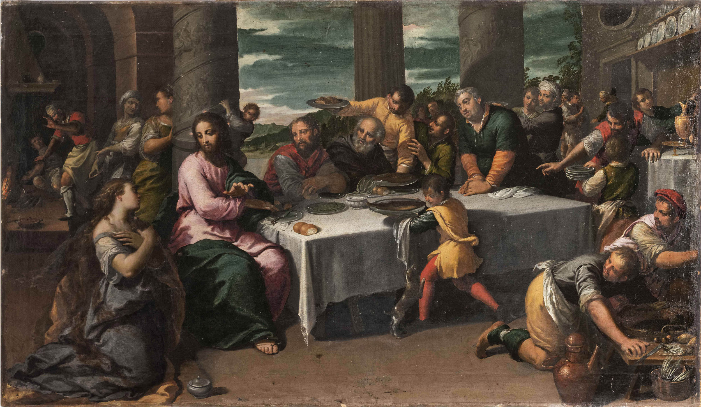

**这是什么 / 看点**：伊波利托·斯卡尔塞拉，称斯卡尔塞利诺（Scarsellino）《西满家中的晚餐》，画福音书里悔罪女子在法利赛人西满家宴上为耶稣抹油、以泪洗足的场景。斯卡尔塞利诺是费拉拉画派晚期代表，本厅另有他两件作品（《维纳斯发现死去的阿多尼斯》212、《前往以马忤斯》226）。看点是他把威尼斯式的丰盛色彩压进小尺幅叙事的"袖珍盛宴"。

### ⭐ 顺路看 乔瓦尼·卢泰里，称多索·多西《圣母子》 / Luteri Giovanni called Dosso Dossi, _Madonna and Child_

- **作者 / Artist**：乔瓦尼·卢泰里，称多索·多西 / Luteri Giovanni called Dosso Dossi
- **作品 / Work**：《圣母子》 / _Madonna and Child_
- **时间**：约 1517–1518 年
- **材质**：板面油画
- **尺寸**：32.5 × 29 cm
- **馆藏编号**：211
- **位置**：黎明女神厅（第 15 室）
- **官网介绍页**：[官网介绍英文](https://www.collezionegalleriaborghese.it/en/opere/madonna-and-child-3)｜馆藏编号 211

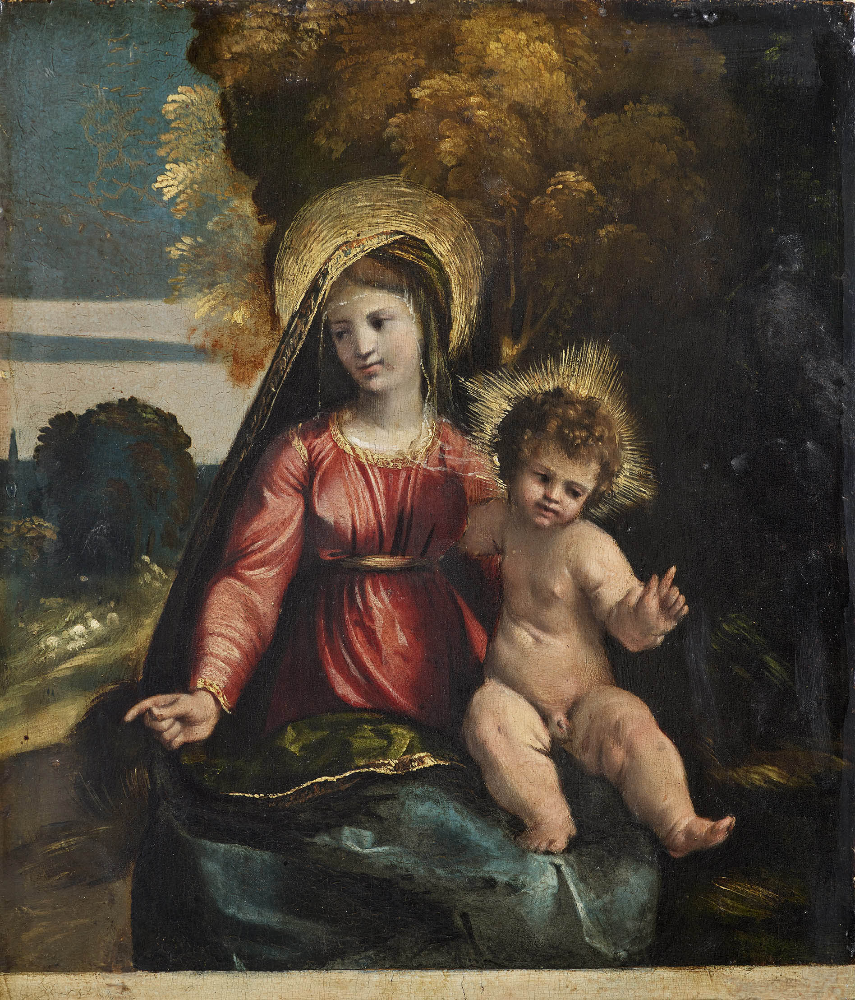

**这是什么 / 看点**：多索·多西《圣母子》小幅板画，圣母怀抱圣婴的亲密构图。本厅多索家族五件作品之一（整组背景见《圣科斯马与圣达弥盎》022）。看点是费拉拉画派浓郁的色彩与多索特有的柔润光线。

### ⭐ 顺路看 伊波利托·斯卡尔塞拉，称斯卡尔塞利诺《维纳斯发现死去的阿多尼斯》 / Scarsella Ippolito called Scarsellino, _Venus Discovering the Dead Adonis_

- **作者 / Artist**：伊波利托·斯卡尔塞拉，称斯卡尔塞利诺 / Scarsella Ippolito called Scarsellino
- **作品 / Work**：《维纳斯发现死去的阿多尼斯》 / _Venus Discovering the Dead Adonis_
- **时间**：约 1600 年
- **材质**：布面油画
- **尺寸**：97.5 × 118.5 cm
- **馆藏编号**：212
- **位置**：黎明女神厅（第 15 室）
- **官网介绍页**：[官网介绍英文](https://www.collezionegalleriaborghese.it/en/opere/venus-discovering-the-dead-adonis)｜馆藏编号 212

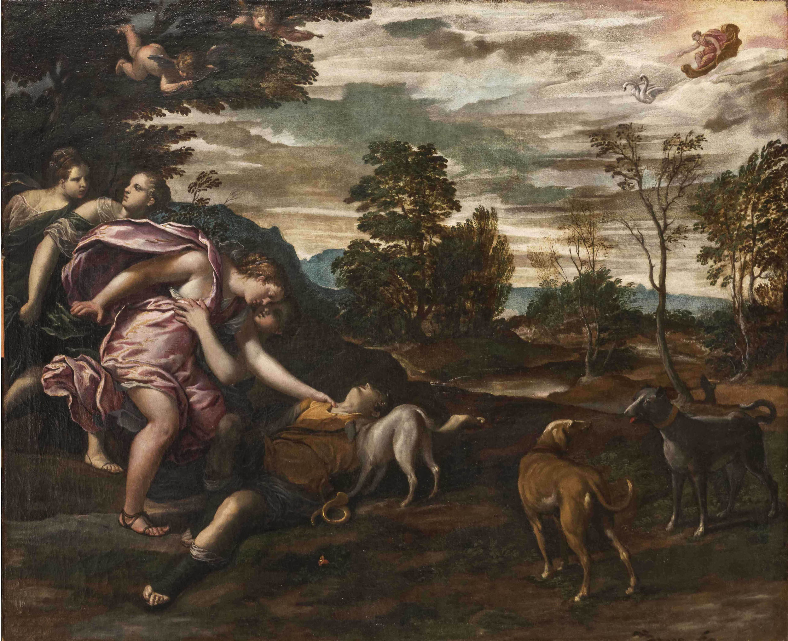

**这是什么 / 看点**：斯卡尔塞利诺《维纳斯发现死去的阿多尼斯》，取奥维德神话：维纳斯（Venere）的爱人、美少年阿多尼斯（Adone）狩猎时被野猪所杀，女神赶到只见爱人横尸。斯卡尔塞利诺作品之一（见 169）。看点是难得的神话题材，让这位费拉拉画家展露威尼斯式的肉感与风景抒情。

### ⭐ 顺路看 归属埃万杰利斯塔·多西，称多萨佐《基督降生》 / Attributed to Dossi Evangelista detto Dossazzo, _Nativity_

- **作者 / Artist**：归属埃万杰利斯塔·多西，称多萨佐 / Attributed to Dossi Evangelista detto Dossazzo
- **作品 / Work**：《基督降生》 / _Nativity_
- **时间**：约 16 世纪中叶
- **材质**：板面油画
- **尺寸**：44 × 30 cm
- **馆藏编号**：215
- **位置**：黎明女神厅（第 15 室）
- **官网介绍页**：[官网介绍英文](https://www.collezionegalleriaborghese.it/en/opere/nativity-2)｜馆藏编号 215

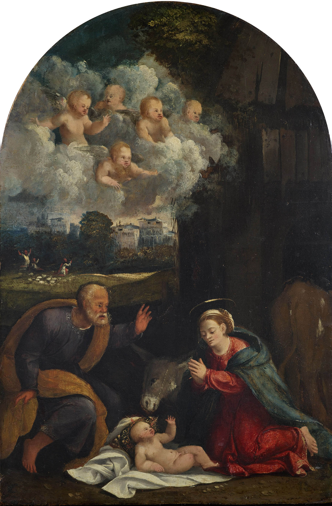

**这是什么 / 看点**：归属埃万杰利斯塔·多西，称多萨佐（Evangelista Dossi, detto Dossazzo）《基督降生》小幅板画。多萨佐是多索·多西的后辈，本厅多索家族作品之一（整组见 022）。看点是延续费拉拉家族风格的小幅夜景圣诞。

### ⭐ 顺路看 乔瓦尼·卢泰里，称多索·多西《朝拜圣婴基督》 / Luteri Giovanni called Dosso Dossi, _Adoration of the Christ Child_

- **作者 / Artist**：乔瓦尼·卢泰里，称多索·多西 / Luteri Giovanni called Dosso Dossi
- **作品 / Work**：《朝拜圣婴基督》 / _Adoration of the Christ Child_
- **时间**：约 1519 年
- **材质**：板面油画
- **尺寸**：49.2 × 32.5 cm
- **馆藏编号**：220
- **位置**：黎明女神厅（第 15 室）
- **官网介绍页**：[官网介绍英文](https://www.collezionegalleriaborghese.it/en/opere/adoration-of-the-christ-child-2)｜馆藏编号 220

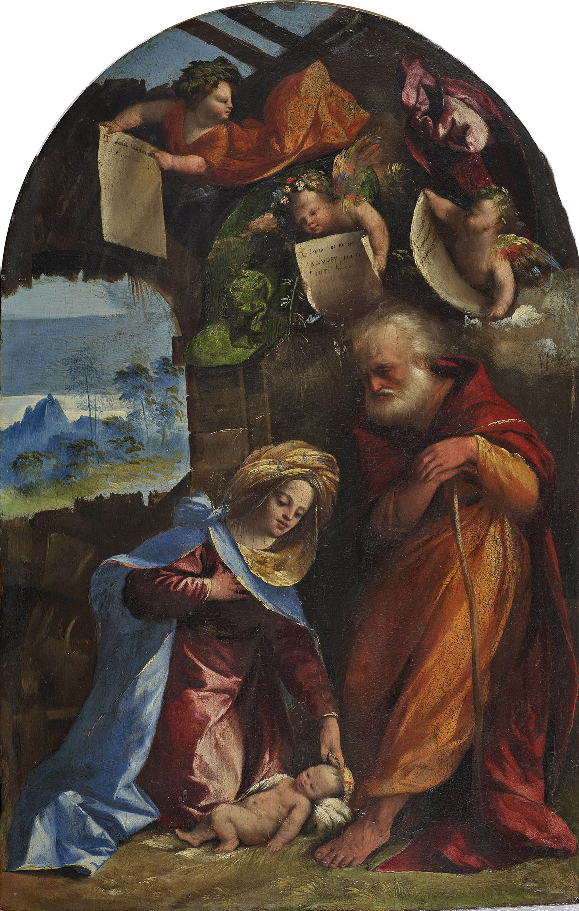

**这是什么 / 看点**：多索·多西《朝拜圣婴基督》小幅板画，圣母与众人俯身朝拜马槽中发光的圣婴（"夜景圣诞"传统）。多索作品之一（见 022）。看点是光从圣婴身上发出、照亮周围面孔的明暗处理。

### ⭐ 顺路看 乔瓦尼·卢泰里，称多索·多西《居吉斯、坎道列斯与罗多佩》 / Luteri Giovanni called Dosso Dossi, _Gyges, Candaules and Rhodope_

- **作者 / Artist**：乔瓦尼·卢泰里，称多索·多西 / Luteri Giovanni called Dosso Dossi
- **作品 / Work**：《居吉斯、坎道列斯与罗多佩》 / _Gyges, Candaules and Rhodope_
- **时间**：1508–1510 年
- **材质**：布面油画
- **尺寸**：41 × 56 cm
- **馆藏编号**：225
- **位置**：黎明女神厅（第 15 室）
- **官网介绍页**：[官网介绍英文](https://www.collezionegalleriaborghese.it/en/opere/gyges-candaules-and-rhodope)｜馆藏编号 225

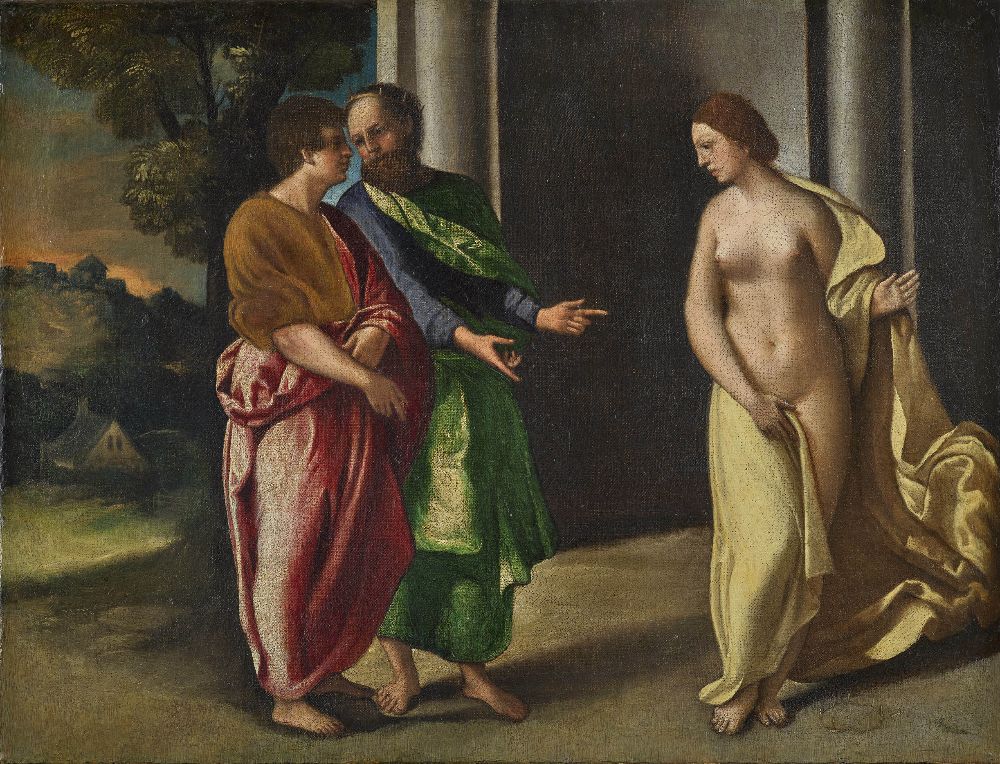

**这是什么 / 看点**：多索·多西《居吉斯、坎道列斯与罗多佩》，取希罗多德的故事：吕底亚王坎道列斯（Candaule）向侍卫居吉斯（Gige）炫耀王后罗多佩（Rodope）的美貌、让他偷窥王后裸体；事发后王后逼居吉斯弑君篡位。多索早期之作（见 022）。看点是罕见的世俗"偷窥"题材，属费拉拉宫廷那类带文学趣味的私密画。

### ⭐ 顺路看 伊波利托·斯卡尔塞拉，称斯卡尔塞利诺《基督与门徒前往以马忤斯》 / Scarsella Ippolito called Scarsellino, _Christ with the disciples walking to Emmaus_

- **作者 / Artist**：伊波利托·斯卡尔塞拉，称斯卡尔塞利诺 / Scarsella Ippolito called Scarsellino
- **作品 / Work**：《基督与门徒前往以马忤斯》 / _Christ with the disciples walking to Emmaus_
- **时间**：约 1590–1592 年
- **材质**：布面油画
- **尺寸**：98 × 117 cm
- **馆藏编号**：226
- **位置**：黎明女神厅（第 15 室）
- **官网介绍页**：[官网介绍英文](https://www.collezionegalleriaborghese.it/en/opere/walk-to-emmaus)｜馆藏编号 226

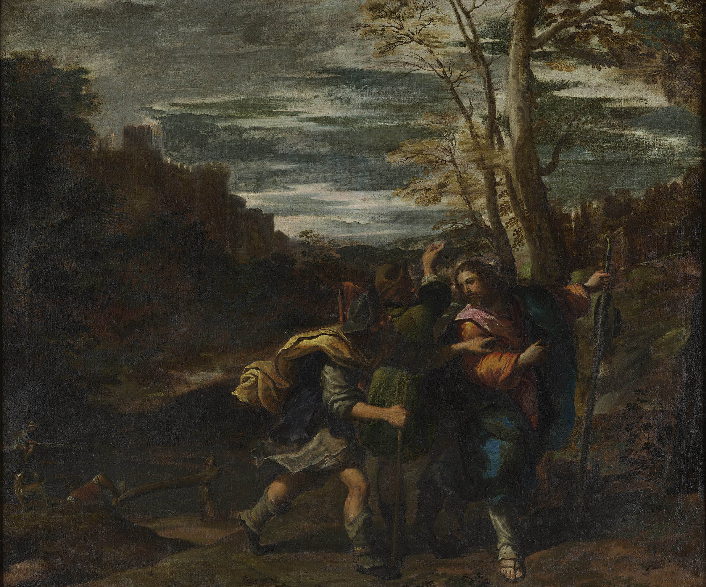

**这是什么 / 看点**：斯卡尔塞利诺《基督与门徒前往以马忤斯》，画复活后的耶稣化作旅人、与两位尚不识其身份的门徒同行往以马忤斯。斯卡尔塞利诺作品之一（见 169）。看点是黄昏旅途的氛围与三人交谈的动势。

### ➖ 可略过 巴蒂斯塔·卢泰里，称巴蒂斯塔·多西《圣家与年幼的施洗者圣约翰》 / Luteri Battista called Battista Dossi, _Holy Family with the Young St John the Baptist_

- **作者 / Artist**：巴蒂斯塔·卢泰里，称巴蒂斯塔·多西 / Luteri Battista called Battista Dossi
- **作品 / Work**：《圣家与年幼的施洗者圣约翰》 / _Holy Family with the Young St John the Baptist_
- **时间**：约 1535–1542 年
- **材质**：板面油画
- **尺寸**：46 × 52 cm
- **馆藏编号**：245
- **位置**：黎明女神厅（第 15 室）
- **展陈提醒**：馆方藏品页标注 _Work not currently exhibited_
- **官网介绍页**：[官网介绍英文](https://www.collezionegalleriaborghese.it/en/opere/holy-family-with-the-young-st-john-the-baptist)｜馆藏编号 245

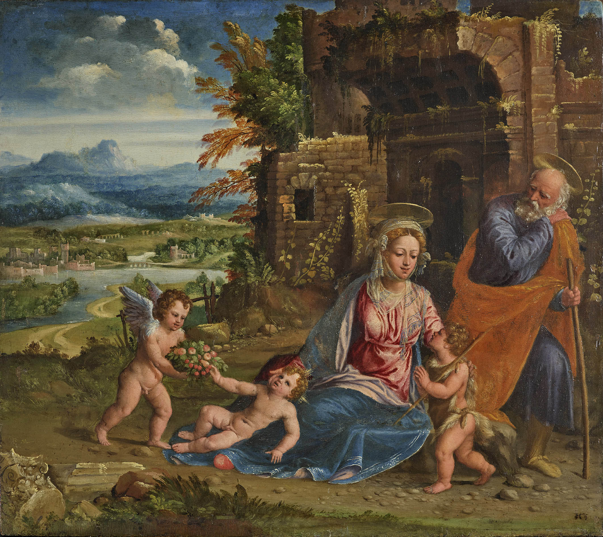

**这是什么 / 看点**：巴蒂斯塔·卢泰里，称巴蒂斯塔·多西（Battista Dossi，多索之弟）《圣家与年幼的施洗者圣约翰》。馆方标注此件目前不在展厅陈列，参观时多半看不到，仅作官方清单存档。属多索家族作品（整组见 022）。

### ⭐ 顺路看 乔瓦尼·吉罗拉莫·萨沃尔多《多俾亚与天使》 / Savoldo Giovanni Girolamo, _Tobias and the Angel_

- **作者 / Artist**：乔瓦尼·吉罗拉莫·萨沃尔多 / Savoldo Giovanni Girolamo
- **作品 / Work**：《多俾亚与天使》 / _Tobias and the Angel_
- **时间**：约 16 世纪 20 年代前半
- **材质**：布面油画
- **尺寸**：120 × 160 cm
- **馆藏编号**：547
- **位置**：黎明女神厅（第 15 室）
- **官网介绍页**：[官网介绍英文](https://www.collezionegalleriaborghese.it/en/opere/tobias-and-the-angel)｜馆藏编号 547

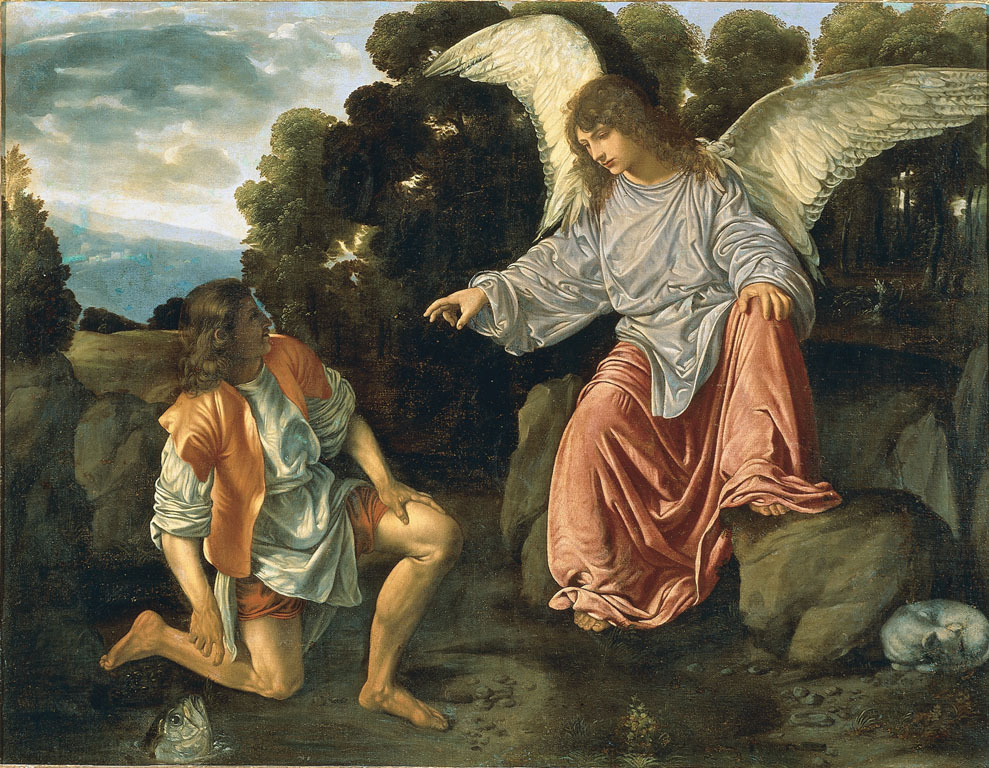

**这是什么 / 看点**：乔瓦尼·吉罗拉莫·萨沃尔多《多俾亚与天使》，取《旧约·托比传》：少年多俾亚（Tobia）在天使拉斐尔（Raffaele）引领下捕鱼、终以鱼胆治好父亲的盲眼。与《青年胸像》139 同为萨沃尔多之作。看点是他标志性的银灰光线，以及对衣料、河岸光感的细腻刻画。

## 雕塑

本厅近代雕塑藏品列表如下。

### ⭐ 顺路看 亚历山德罗·阿尔加尔迪与西尔维奥·卡尔奇《一对蛇形把手双耳瓶》 / Algardi Alessandro / Calci Silvio, _Pair of Amphorae with Serpentiform Handles_

- **作者 / Artist**：亚历山德罗·阿尔加尔迪与西尔维奥·卡尔奇 / Algardi Alessandro / Calci Silvio
- **作品 / Work**：《一对蛇形把手双耳瓶》 / _Pair of Amphorae with Serpentiform Handles_
- **时间**：约 17 世纪
- **材质**：比利时黑大理石
- **尺寸**：90 × 52 cm
- **馆藏编号**：CCXIX
- **位置**：黎明女神厅（第 15 室）
- **官网介绍页**：[官网介绍英文](https://www.collezionegalleriaborghese.it/en/opere/pair-of-amphorae-with-serpentiform-handles)｜馆藏编号 CCXIX

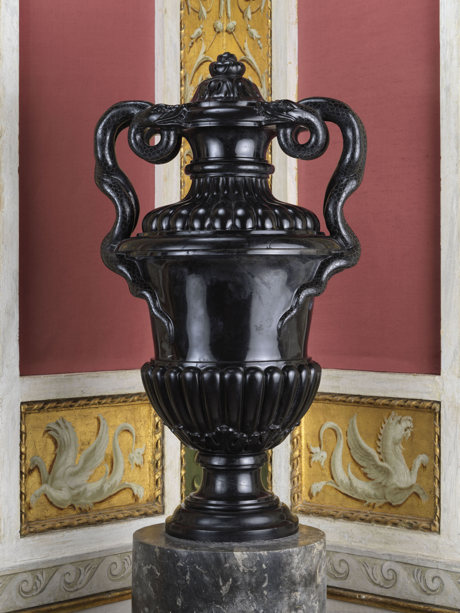

**这是什么 / 看点**：亚历山德罗·阿尔加尔迪与西尔维奥·卡尔奇（Silvio Calci）合作的《一对蛇形把手双耳瓶》，用比利时黑大理石制成，把手做成盘绕的蛇形，属博尔盖塞别墅的近代陈列装饰系统。看点是巴洛克对古典器形（古瓮 amphora）的华丽再造与名贵深色石材；它与厅内《睡眠寓意像》CLX 同出阿尔加尔迪之手，可一并看他在雕塑与器物两端的造诣。

### ⭐ 顺路看 本厅无官方 Furniture 藏品列表 / No Official Furniture List for 黎明女神厅（第 15 室）

- **位置**：黎明女神厅（第 15 室）

馆方藏品库没有为本厅返回 Furniture 类作品列表；房间装饰、天顶框景、壁面灰泥和陈列史仍按房间介绍页说明处理。

## 其他
### ⭐ 顺路看 房间装饰与壁炉 / Room Decoration and Fireplace

- **位置**：黎明女神厅（第 15 室）

二楼房间的天顶、壁炉、怪诞纹和透视装饰共同构成参观体验。尤其是 18 世纪末安东尼奥·阿斯普鲁奇（Antonio Asprucci）主持的整体改造，让每间房间都有独立主题，而不只是挂画空间。

## 资料来源 / Sources

- Galleria Borghese 官方房间页：[Room 15](https://galleriaborghese.cultura.gov.it/en/il-museo/la-villa/sala-15-sala-dellaurora/)
- Galleria Borghese 藏品筛选：[Painting, Room 15](https://www.collezionegalleriaborghese.it/en/collezione/pittura?sala=s15)
- Galleria Borghese 藏品筛选：[Modern Sculpture, Room 15](https://www.collezionegalleriaborghese.it/en/collezione/scultura?sala=s15)
- Galleria Borghese 藏品筛选：[Ancient Art, Room 15](https://www.collezionegalleriaborghese.it/en/collezione/arte-antica?sala=s15)
- Galleria Borghese 藏品筛选：[Furniture, Room 15](https://www.collezionegalleriaborghese.it/en/collezione/arredi?sala=s15)
