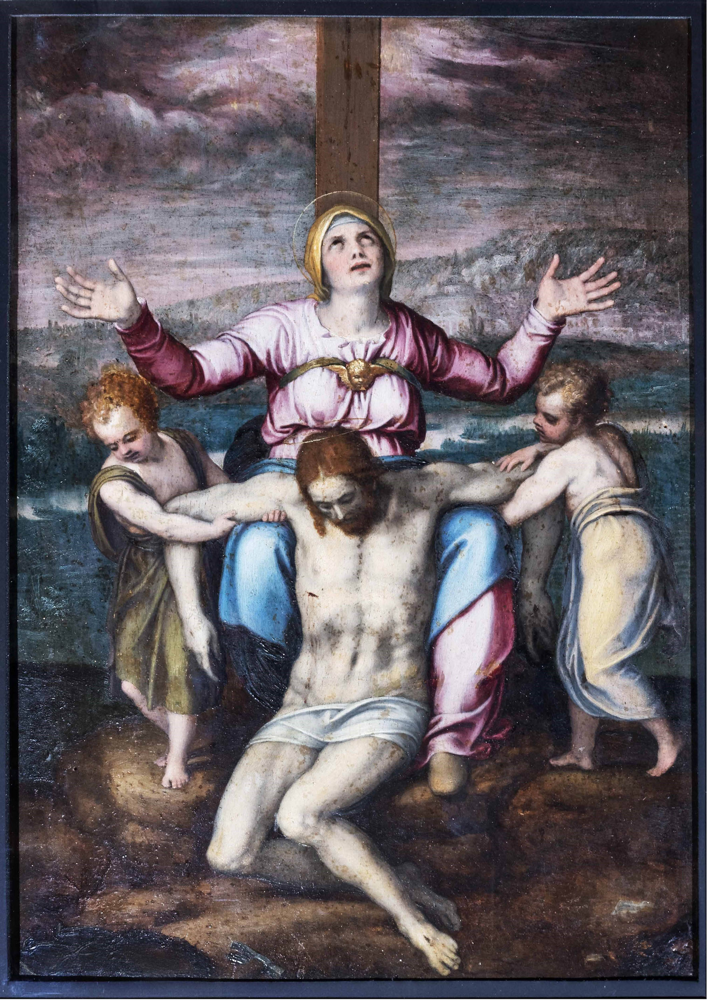
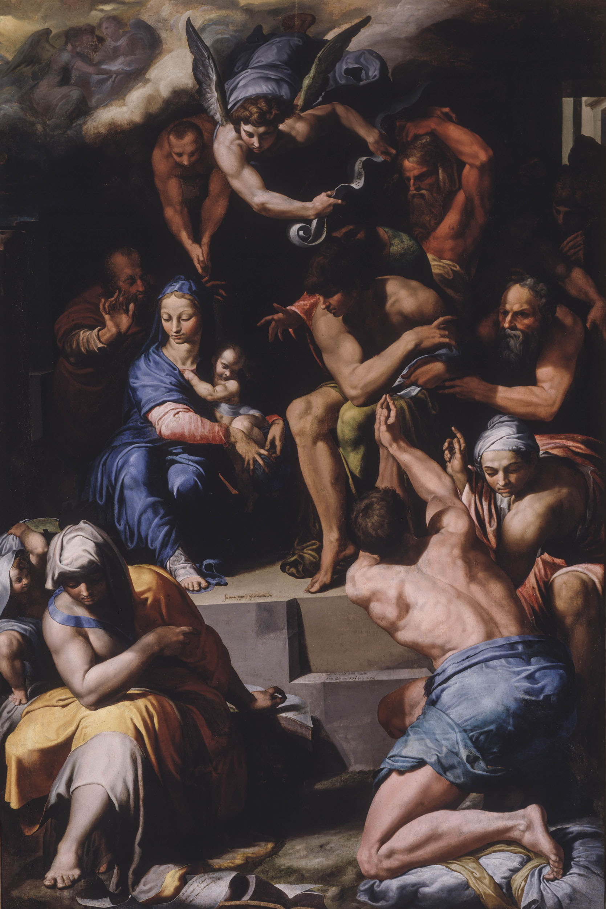
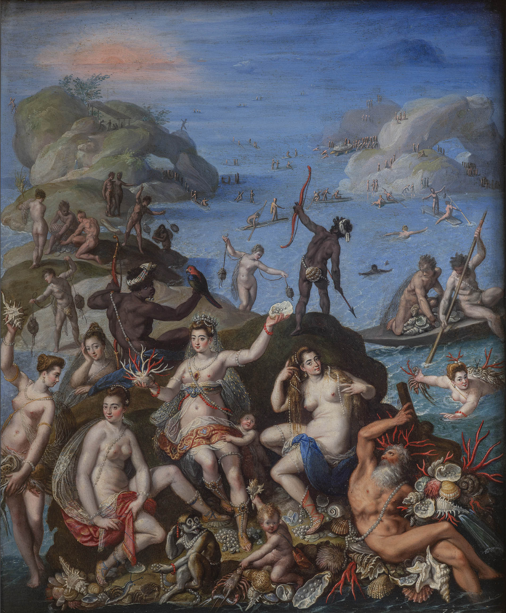
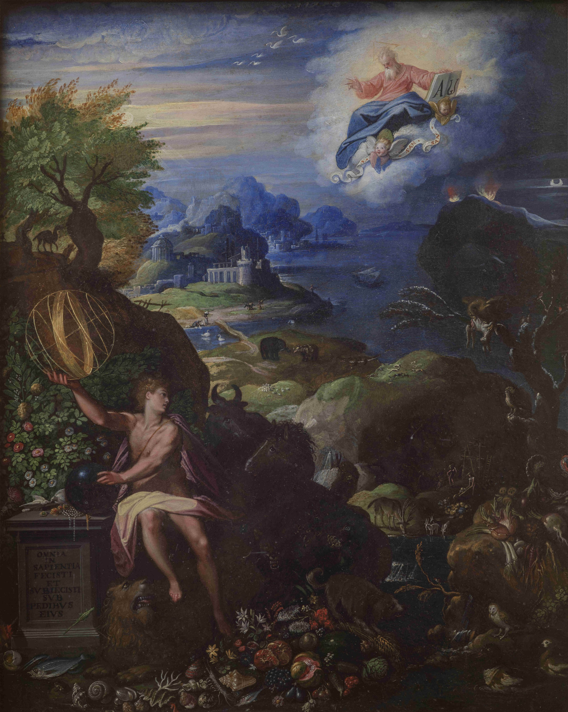
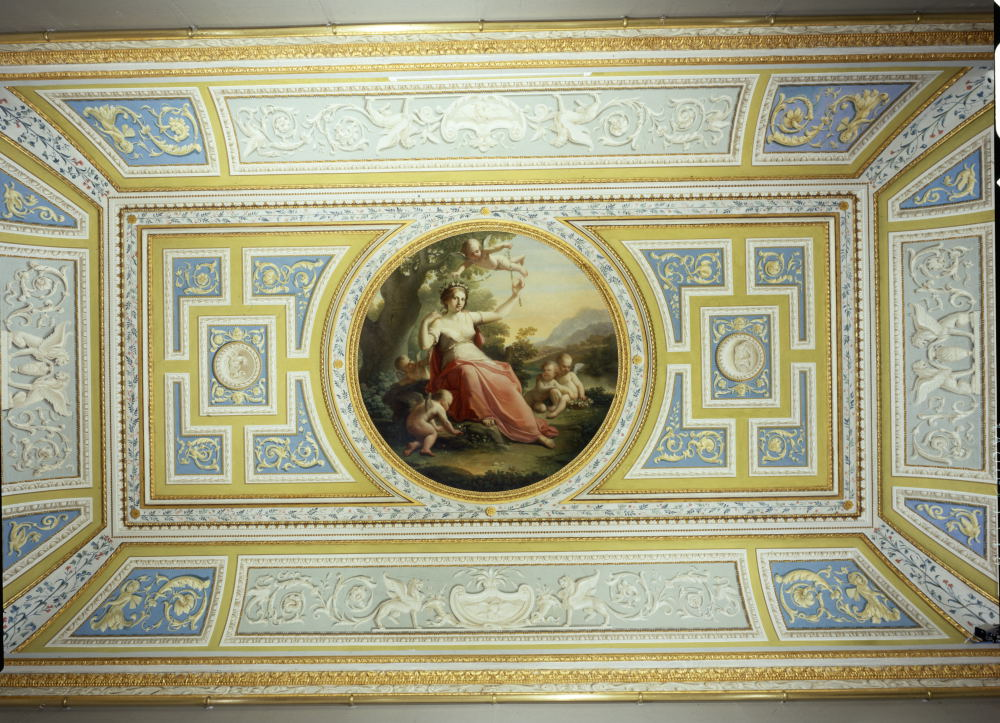
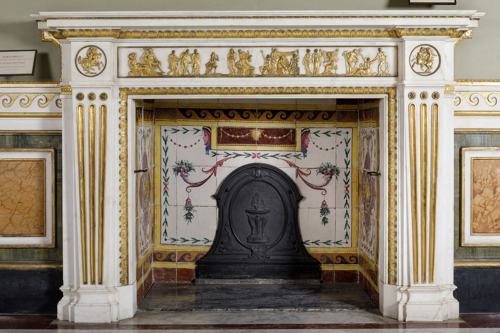

第 16 室（花神厅）以德·安杰利斯的花神芙洛拉天顶得名，是 18 世纪末「房间叙事化」的样本；墙上挂 16 世纪样式主义的宗教画。本厅无 ⭐⭐⭐ 必看。

**必看与核心展品（核心 + 天顶画）**

| 推荐 | 展品 | 作者 | 一句话看点 |
|---|---|---|---|
| ⭐⭐ 推荐 | 天顶《花神芙洛拉》 | 多梅尼科·德·安杰利斯 | 满室繁花拥着花神，「房间就是它的主人」 |
| ⭐⭐ 推荐 | 《基督卸下圣体、抹大拉的玛利亚与两位天使》 | 马尔切洛·韦努斯蒂 | 承米开朗基罗素描的精细小幅哀悼画 |
| ⭐⭐ 推荐 | 《朝拜圣婴》 | 佩莱格里诺·蒂巴尔迪 | 样式主义的雕塑感人体与戏剧光影 |

**展厅官网介绍页**：[Room 16 - Flora Room](https://galleriaborghese.cultura.gov.it/en/il-museo/la-villa/sala-16-sala-della-flora/)

## 核心展品

### ⭐⭐ 推荐 马尔切洛·韦努斯蒂《基督卸下圣体、抹大拉的玛利亚与两位天使》 / Marcello Venusti, _Christ Deposed with Mary Magdalene and Two Angels_
- **作者 / Artist**：马尔切洛·韦努斯蒂 / Marcello Venusti
- **作品 / Work**：《基督卸下圣体、抹大拉的玛利亚与两位天使》 / _Christ Deposed with Mary Magdalene and Two Angels_
- **时间**：16 世纪后半叶
- **材质**：绘画
- **尺寸**：房间介绍页点名作品
- **位置**：花神厅（第 16 室）
- **官网介绍页**：[基督下葬、抹大拉的马利亚与两位天使 / Cristo deposto con la Madonna e due angeli｜Galleria Borghese 官方藏品库](https://www.collezionegalleriaborghese.it/opere/cristo-deposto-con-la-madonna-e-due-angeli)｜馆藏编号 422

**内容（这是什么）**：画的是基督被从十字架上卸下后的一刻，僵直的躯体由人扶持，抹大拉的玛利亚（Maria Maddalena）伏在一旁，两名天使陪侍。这是文艺复兴晚期最常见的「哀悼基督 / 卸下圣体」题材，构图紧凑、人物贴近画面，便于近距离凝视基督受难之痛。

**背景 / 来历**：作者韦努斯蒂（Marcello Venusti，1512–1579）是米开朗基罗（Michelangelo）的密友与御用复制者——他临摹的西斯廷《最后的审判》小幅版是后人研究原作改动前面貌的关键证据。本厅一组画的共同主题，就是「米开朗基罗式风格（maniera）在 16 世纪后半叶如何影响各地画家」，这件正是其中的代表：人物的雕塑感肌体、压缩的空间都带着米开朗基罗的烙印。

**看点**：留意基督躯体那种近乎大理石雕像的体积感和明确的肌肉转折——这不是写实的尸体，而是把米开朗基罗素描里的「人体即雕塑」搬到了小幅油画上。

### ⭐⭐ 推荐 佩莱格里诺·蒂巴尔迪《朝拜圣婴》 / Pellegrino Tibaldi, _Adoration of the Child_
- **作者 / Artist**：佩莱格里诺·蒂巴尔迪 / Pellegrino Tibaldi
- **作品 / Work**：《朝拜圣婴》 / _Adoration of the Child_
- **时间**：16 世纪后半叶
- **材质**：绘画
- **尺寸**：房间介绍页点名作品
- **位置**：花神厅（第 16 室）
- **官网介绍页**：[圣婴朝拜 / Adorazione del Bambino｜Galleria Borghese 官方藏品库](https://www.collezionegalleriaborghese.it/opere/adorazione-del-bambino-4)｜馆藏编号 415

**内容（这是什么）**：圣母与陪侍者俯身朝拜刚降生的圣婴耶稣，是「圣诞朝拜」的标准场景。光从圣婴身上散发，照亮周围人物的脸。

**背景 / 来历**：作者蒂巴尔迪（Pellegrino Tibaldi，1527–1596）是 16 世纪后期最有力的米开朗基罗追随者之一，活跃于博洛尼亚、米兰乃至西班牙埃斯科里亚尔宫，以体格魁伟、动势夸张的人物著称。本厅把它和韦努斯蒂并列，正是用来说明米开朗基罗式 maniera 对不同地区画家的辐射。

**看点**：和旁边韦努斯蒂对照看——同样的「肌体如雕塑」追求，蒂巴尔迪的人物更壮硕、姿态更扭曲，能直观感到这股风格往北意大利去时被推得更夸张。

### ⭐ 顺路看 雅各布·祖基《两幅小寓意画》 / Jacopo Zucchi, _Two Small Allegories_
- **作者 / Artist**：雅各布·祖基 / Jacopo Zucchi
- **作品 / Work**：《两幅小寓意画》 / _Two Small Allegories_
- **时间**：16 世纪后半叶
- **材质**：铜板绘画
- **尺寸**：房间介绍页点名作品
- **位置**：花神厅（第 16 室）
- **官网介绍页**：[采珊瑚（安菲特里忒的国度） / La pesca del corallo (o Il regno di Anfitrite)｜Galleria Borghese 官方藏品库](https://www.collezionegalleriaborghese.it/opere/la-pesca-del-corallo-o-il-regno-di-anfitrite)｜馆藏编号 292

- **官网介绍页**：[造物寓意 / Allegoria del creato｜Galleria Borghese 官方藏品库](https://www.collezionegalleriaborghese.it/opere/allegoria-del-creato)｜馆藏编号 293

**内容（这是什么）**：一对画在铜板上的小幅寓意画，一幅《采珊瑚（安菲特里忒的国度）》、一幅《造物寓意》，用神话与拟人形象演绎海洋财富与天地创造的主题。铜板细密光滑，画面精巧如珠宝。

**背景 / 看点**：作者祖基（Jacopo Zucchi，约 1540–约 1596）是瓦萨里（Giorgio Vasari）的得意门生，长期在罗马为美第奇家族服务。房间介绍页指出这两件很可能来自费迪南多·德·美第奇（Ferdinando de' Medici）在罗马的私人书斋（studiolo）——这正是当时贵族「珍奇柜」的典型陈设：尺寸小、铜板亮、题材博学，专供近看把玩。现场凑近看金属底子上的细节，体会它和墙上那些大幅油画完全不同的「案头收藏品」气质。

## 天顶画

### ⭐⭐ 推荐 多梅尼科·德·安杰利斯《花神芙洛拉》 / Domenico De Angelis, _Flora_

- **位置**：花神厅天顶（第 16 室）

**内容（这是什么）**：天顶正中这幅画的是花神芙洛拉（Flora）——罗马神话里掌管花卉、春天与植物萌发的女神。整间厅就是因这幅画得名「花神厅」。

**背景 / 来历**：1785 年由多梅尼科·德·安杰利斯（Domenico De Angelis，1735–1804）绘制。芙洛拉被表现为「植物与花卉之母」，依据的是古罗马诗人奥维德（Ovidio）《岁时记》（_Fasti_）里关于花神节（Floralia）的图像传统：在这部讲解罗马历法节庆的诗里，芙洛拉自述如何让大地开花、赋予万物色彩。围绕中央画面的错视（trompe-l'oeil）建筑构件与卷草藤蔓，则出自焦万·巴蒂斯塔·马尔凯蒂（Giovan Battista Marchetti，1730–1800）之手。这套天顶是 18 世纪末安东尼奥·阿斯普鲁奇（Antonio Asprucci）主持别墅二层整体改造的一环——他给每间厅都定一个独立主题，让房间不只是挂画的空间。

**看点**：天顶把神话主角与满室的花卉装饰扣在一起，是新古典时期「房间叙事化」的好例子——你站在花神厅里，头顶就是这间厅的「主人」。

**现场站看**：

1. **先认中央的花神**——抬头找天顶正中那位被花环、花枝环绕的女性，她就是芙洛拉。认准她，整幅天顶的主题就立住了。
2. **看她周围撒落的花**——花卉不是背景点缀，而是她的「身份标志」：奥维德笔下她让大地开花，画家用满天繁花直接对应这个神话身份。
3. **分辨「真画」与「假建筑」**——中央人物场景是德·安杰利斯画的，外圈那些像浮雕、像檐口的建筑构件和卷草是马尔凯蒂画的错视。盯着边缘看，会发现「凸起的线脚」其实是平的颜料。
4. **联系整间厅的主题**——看完天顶再环视四壁：房间叫花神厅、天顶画花神、连壁炉装饰都是这套 18 世纪末统一改造的产物，这是阿斯普鲁奇「一室一主题」设计意图的现场样本。

## 其他

### ⭐ 顺路看 洛伦佐·卡尔代利、路易吉·瓦拉迪耶与朱塞佩·瓦拉迪耶《壁炉》 / Cardelli Lorenzo / Valadier Luigi / Valadier Giuseppe, _Fireplace_

- **作者 / Artist**：洛伦佐·卡尔代利、路易吉·瓦拉迪耶与朱塞佩·瓦拉迪耶 / Cardelli Lorenzo / Valadier Luigi / Valadier Giuseppe
- **作品 / Work**：《壁炉》 / _Fireplace_
- **时间**：约 1785–1786 年
- **材质**：白色大理石；鎏金铜镶饰
- **尺寸**：高 133 cm；宽 193 cm；深 77 cm
- **馆藏编号**：camini-XVI
- **位置**：花神厅（第 16 室）
- **官网介绍页**：[官网介绍英文](https://www.collezionegalleriaborghese.it/en/opere/fireplace-xvi)｜馆藏编号 camini-XVI

**内容 / 背景**：这是别墅二层六座壁炉中的最后一座，1786 年完工，出自路易吉·瓦拉迪耶（Luigi Valadier，1726–1785）与儿子朱塞佩·瓦拉迪耶（Giuseppe Valadier，1762–1839）的著名作坊——瓦拉迪耶父子是 18 世纪罗马最顶级的金银与装饰艺术世家。鎏金铜片由安东尼奥·德·罗西（Antonio De Rossi）制作，炉膛内壁的彩釉面砖由多梅尼科·恰尔迪（Domenico Cialdi）完成。

**看点**：白大理石主体配鎏金铜镶饰，是这套房间改造里「家具也按主题定制」的实证——它和天顶花神、墙上画作属于同一次设计，帮助理解房间作为整体陈设的样子。现场看炉口上方的鎏金铜装饰细节，对比另几间厅的壁炉，能感到瓦拉迪耶作坊的手艺水准。

### ⭐ 顺路看 房间装饰与壁炉 / Room Decoration and Fireplace

- **位置**：花神厅（第 16 室）

**内容 / 看点**：二层这些房间的天顶、壁炉、怪诞纹（grottesche）和透视装饰共同构成参观体验。尤其是 18 世纪末安东尼奥·阿斯普鲁奇主持的整体改造，让每间房间都有独立主题，而不只是挂画空间。进了花神厅，不妨把天顶、四壁装饰和壁炉当成一套来看——它们讲的是同一个「花与春」的主题。

## 资料来源 / Sources

- Galleria Borghese 官方房间页：[Room 16](https://galleriaborghese.cultura.gov.it/en/il-museo/la-villa/sala-16-sala-della-flora/)
- Galleria Borghese 藏品筛选：[Painting, Room 16](https://www.collezionegalleriaborghese.it/en/collezione/pittura?sala=s16)
- Galleria Borghese 藏品筛选：[Modern Sculpture, Room 16](https://www.collezionegalleriaborghese.it/en/collezione/scultura?sala=s16)
- Galleria Borghese 藏品筛选：[Ancient Art, Room 16](https://www.collezionegalleriaborghese.it/en/collezione/arte-antica?sala=s16)
- Galleria Borghese 藏品筛选：[Furniture, Room 16](https://www.collezionegalleriaborghese.it/en/collezione/arredi?sala=s16)
