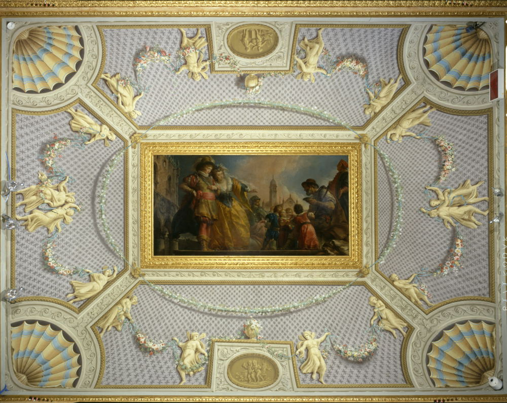
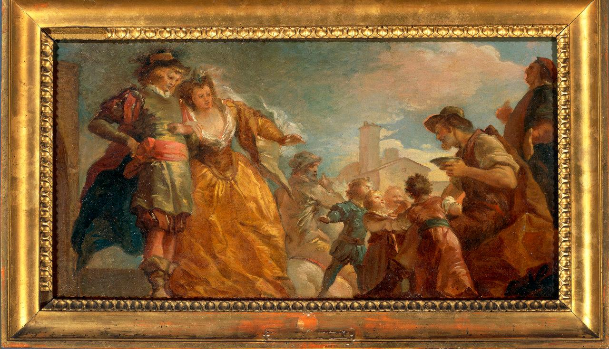

第 17 室（昂热伯爵厅）是一间以天顶得名的小厅，卡德斯用近乎「前浪漫主义」的情感，画《十日谈》里昂热伯爵「沉冤得雪、身份被认出」的故事；本厅无 ⭐⭐⭐ 必看，亮点即天顶。

**必看与核心展品（天顶画为主）**

| 推荐 | 展品 | 作者 | 一句话看点 |
|---|---|---|---|
| ⭐⭐ 推荐 | 天顶《昂热伯爵戈蒂耶被认出》 | 朱塞佩·卡德斯 | 《十日谈》故事的相认高潮，带浪漫主义情绪 |

**展厅官网介绍页**：[Room 17 - Count of Angers Room](https://galleriaborghese.cultura.gov.it/en/il-museo/la-villa/sala-17-sala-del-conte-di-angers/)

## 天顶画

### ⭐⭐ 推荐 朱塞佩·卡德斯《昂热伯爵戈蒂耶被认出》 / Giuseppe Cades, _The Recognition of Gaultier, Count of Angers_

- **位置**：昂热伯爵厅天顶（第 17 室）

**内容（这是什么）**：天顶主画讲的是一个「沉冤得雪、身份被认出」的故事。题材出自薄伽丘（Boccaccio）《十日谈》（_Decameron_）第二日第八个故事：昂热伯爵戈蒂耶（Gaultier，意大利文作 Gualtieri）遭诬陷而流亡，隐姓埋名、沦落多年，最终真相大白、身份与荣誉被重新认出。画家选的正是「被认出」的高潮一刻。整间小厅因这幅天顶画而得名「昂热伯爵厅」。

**背景 / 来历**：1787 年由朱塞佩·卡德斯（Giuseppe Cades，1750–1799）绘制。这个故事便于表现荣誉、忠诚与思乡的主题，而卡德斯以一种早熟的「前浪漫主义」（pre-Romantic）情感把它画了出来——这让他明显区别于当时别墅里其他在阿斯普鲁奇团队中作画的画家所共有的 18 世纪末趣味。环绕主画的椭圆形小画、起舞的人物以及单色调的花环饰带，则出自波兰画家塔德乌什·孔策（Tadeusz Kuntze，1733–1793）之手。

**看点**：这是一间很小的厅，天顶却讲了一个完整的传奇故事——抬头就能把「诬陷—流亡—相认」的叙事高潮看在眼里；而卡德斯那种带情绪、近乎浪漫主义的画法，在一屋新古典作品里显得格外特别。

**现场站看**：

1. **先找「相认」的核心动作**——天顶正中是故事高潮，留意人物之间指认、迎接、动容的姿态，那一刻就是「昂热伯爵被认出」。认准它，整幅天顶的叙事就理顺了。
2. **读人物的情绪**——卡德斯被官方称作有「前浪漫主义」的敏感，注意人物脸上和身姿里的激动、思乡、感伤，这种带强烈情感的表现和同时期别墅其他厅那种端庄克制的新古典画法不一样。
3. **分辨两位作者的分工**——中央大故事是卡德斯画的；外圈那些椭圆小画、起舞人物和单色花环是波兰画家孔策画的。盯着画面边缘看，会发现外圈装饰的笔触与中央叙事画明显是两手。
4. **联系厅名与故事**——看完天顶想一想：这间厅本身没有什么大牌镇厅展品，却用一个《十日谈》故事给整间小厅定了主题和名字，这正是 18 世纪末「一室一主题」装饰理念的体现。

## 资料来源 / Sources

- Galleria Borghese 官方房间页：[Room 17](https://galleriaborghese.cultura.gov.it/en/il-museo/la-villa/sala-17-sala-del-conte-di-angers/)
- Galleria Borghese 藏品筛选：[Painting, Room 17](https://www.collezionegalleriaborghese.it/en/collezione/pittura?sala=s17)
- Galleria Borghese 藏品筛选：[Modern Sculpture, Room 17](https://www.collezionegalleriaborghese.it/en/collezione/scultura?sala=s17)
- Galleria Borghese 藏品筛选：[Ancient Art, Room 17](https://www.collezionegalleriaborghese.it/en/collezione/arte-antica?sala=s17)
- Galleria Borghese 藏品筛选：[Furniture, Room 17](https://www.collezionegalleriaborghese.it/en/collezione/arredi?sala=s17)
