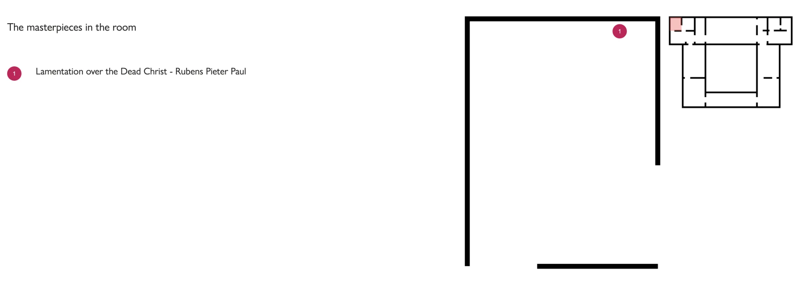
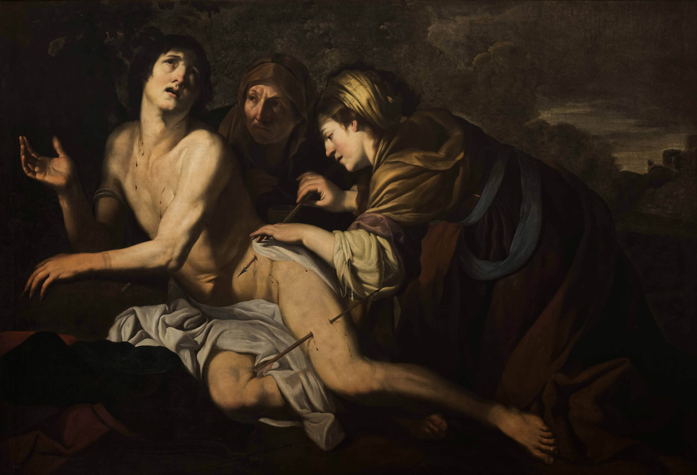
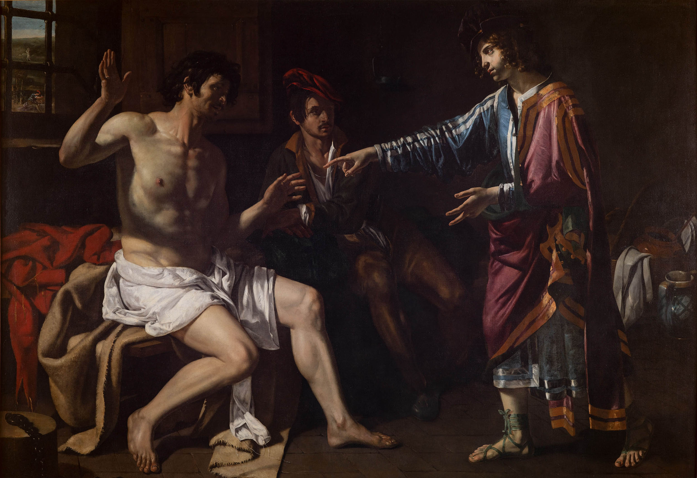
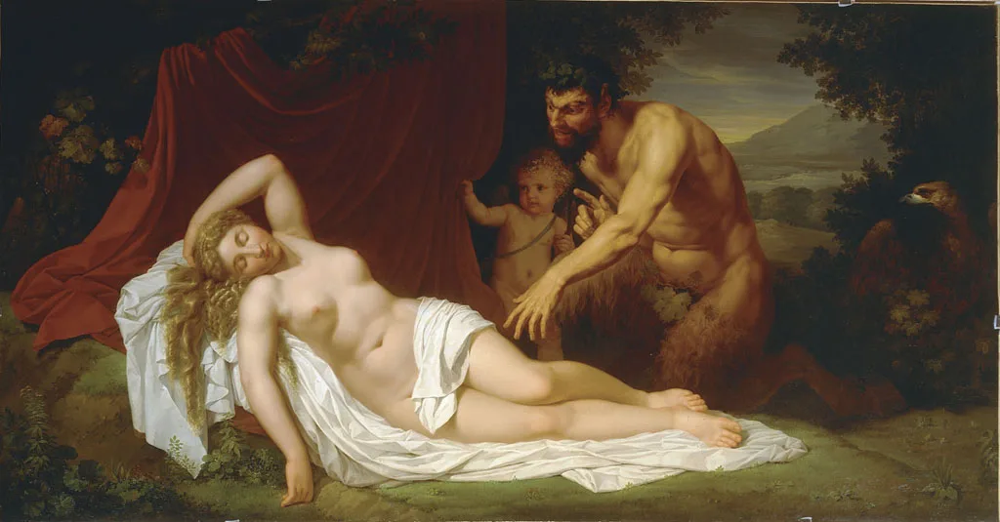

第 18 室（朱庇特与安提俄佩厅）由一间大屋隔成的三小厅之一，天顶加涅罗的《朱庇特与安提俄佩》在装上去前就作为独立画展出叫好；墙上有 17 世纪卡拉瓦乔派与圭列里的作品。本厅无 ⭐⭐⭐ 必看。

**必看与核心展品（核心 + 天顶画）**

| 推荐 | 展品 | 作者 | 一句话看点 |
|---|---|---|---|
| ⭐⭐ 推荐 | 天顶《朱庇特与安提俄佩》 | 贝尼涅·加涅罗 | 「先成名、再上天顶」的嵌入式画，朱庇特化萨堤尔 |
| ⭐⭐ 推荐 | 《虔诚妇女照料圣塞巴斯蒂安》 | 鲁斯蒂基诺 | 卡拉瓦乔派的烛光夜景与柔光肌肤 |
| ⭐⭐ 推荐 | 《约瑟为囚徒解梦》 | 圭列里 | 马尔凯地区卡拉瓦乔派的叙事画 |

**展厅官网介绍页**：[Room 18 - Jupiter and Antiope Room](https://galleriaborghese.cultura.gov.it/en/il-museo/la-villa/sala-18-sala-di-giove-e-antiope/)

## 核心展品

### ⭐⭐ 推荐 弗朗切斯科·鲁斯蒂奇（称鲁斯蒂基诺）《虔诚妇女照料圣塞巴斯蒂安》 / Francesco Rustici called Rustichino, _Saint Sebastian Tended by the Pious Women_
- **作者 / Artist**：弗朗切斯科·鲁斯蒂奇（称鲁斯蒂基诺）/ Francesco Rustici called Rustichino
- **作品 / Work**：《虔诚妇女照料圣塞巴斯蒂安》 / _Saint Sebastian Tended by the Pious Women_
- **时间**：17 世纪
- **材质**：布面油画
- **尺寸**：150 × 211 cm
- **位置**：朱庇特与安提俄佩厅（第 18 室）
- **官网介绍页**：[虔诚妇女照料圣塞巴斯蒂安 / San Sebastiano curato dalle pie donne｜Galleria Borghese 官方藏品库](https://www.collezionegalleriaborghese.it/opere/san-sebastiano-curato-dalle-pie-donne)｜馆藏编号 032

**内容（这是什么）**：画的不是常见的「圣塞巴斯蒂安中箭殉道」，而是后续一幕：圣塞巴斯蒂安（San Sebastiano）被乱箭射穿、弃为死尸后，圣伊雷妮（Irene）等虔诚妇女前来为他拔箭疗伤。半裸的圣徒瘫软在画中，女子们围拢照料——这是反宗教改革时期流行的「疗伤」版本，强调悲悯与慈善，而非殉道的惨烈。

**背景 / 来历**：作者鲁斯蒂基诺（本名 Francesco Rustici，约 1592–1626）是锡耶纳画家，以卡拉瓦乔式的夜景与烛光光影著称，画面常笼罩在幽暗里、只有局部被强光照亮。这件是本厅藏品库当前列出的两幅大画之一。

**看点**：盯住光打在圣徒裸露躯体和女子手臂上的方式——黑暗背景里的强光是鲁斯蒂基诺的招牌，这种「卡拉瓦乔式明暗」让疗伤的动作显得既私密又庄重。和本馆第 8 室卡拉瓦乔厅那批真迹对照看，能体会这股光影风格如何传到锡耶纳画家手里。

### ⭐⭐ 推荐 乔万·弗朗切斯科·圭列里《约瑟生平：约瑟为囚徒解梦》 / Giovanni Francesco Guerrieri, _Life of Joseph: Joseph Tells the Meaning of the Prisoners' Dreams_
- **作者 / Artist**：乔万·弗朗切斯科·圭列里 / Giovanni Francesco Guerrieri
- **作品 / Work**：《约瑟生平：约瑟为囚徒解梦》 / _Life of Joseph: Joseph Tells the Meaning of the Prisoners' Dreams_
- **时间**：1615–1617 年
- **材质**：布面油画
- **尺寸**：168.5 × 241 cm
- **位置**：朱庇特与安提俄佩厅（第 18 室）
- **官网介绍页**：[约瑟为囚徒解梦 / Giuseppe spiega i sogni dei prigionieri｜Galleria Borghese 官方藏品库](https://www.collezionegalleriaborghese.it/opere/giuseppe-spiega-i-sogni-dei-prigionieri)｜馆藏编号 148

**内容（这是什么）**：取自《创世记》约瑟的故事。约瑟（Giuseppe）被卖到埃及、含冤入狱，狱中两名囚徒——法老的司酒长和司膳长——各做了一个怪梦。约瑟为他们解梦：司酒长三日后官复原职，司膳长三日后被处死。画的正是约瑟在牢里为两人解梦的一刻。

**背景 / 看点**：作者圭列里（Giovanni Francesco Guerrieri，活跃于 17 世纪初的马尔凯地区）是卡拉瓦乔最坚定的追随者之一，曾为红衣主教希皮奥内·博尔盖塞（Scipione Borghese）作画——这正是本馆收藏的来源人。这件是本厅藏品库列出的另一幅大画，约 1615–1617 年所作。现场看人物在幽暗牢房里被强光打亮的脸和手势，注意约瑟解梦时的指点动作，以及两名囚徒一喜一忧的神情对比——这种戏剧化的明暗与紧张叙事，是卡拉瓦乔风格在博尔盖塞旧藏里的又一例证。

## 天顶画

### ⭐⭐ 推荐 贝尼涅·加涅罗《朱庇特与安提俄佩》 / Bénigne Gagneraux, _Jupiter and Antiope_

- **位置**：朱庇特与安提俄佩厅天顶（第 18 室）

**内容（这是什么）**：天顶正中这幅画的是奥维德（Ovidio）笔下的神话一幕：主神朱庇特（Giove）化作一个萨堤尔（satiro，半人半羊的林野精灵），偷偷接近熟睡的山林仙女安提俄佩（Antiope）。整间厅因这幅天顶画得名。在神话里，朱庇特借萨堤尔之形与安提俄佩结合，后来她生下双子安菲翁与泽托斯——这是宙斯/朱庇特众多「变形求欢」故事中的一则。

**背景 / 来历**：这是一幅「嵌入式天顶画」（quadro riportato，即画成可装裱的独立画面、再镶进天顶），1787 年由法国画家贝尼涅·加涅罗（Bénigne Gagneraux，1756–1795）绘制。它在装上天顶之前曾公开展出，一经亮相便大获好评。围绕中央画面的装饰——八个顶花篮的卡内福尔少女（canephores）与八幅暗示中央情节的椭圆小画——由文琴佐·贝雷蒂尼（Vincenzo Berrettini，18 世纪）绘制。值得一提的是，本厅连同相邻的第 17、第 16 两室原本是一整间大屋，是建筑师安东尼奥·阿斯普鲁奇（Antonio Asprucci）为让别墅两翼对称才把它隔成三间小厅的。

**看点**：这是一幅「先成名、再上天顶」的画——在 18 世纪末罗马，一幅天顶画能在装上去之前就被当作独立作品展出并叫好，本身就说明它的分量。题材是朱庇特变形求欢的经典神话，构图与厅名直接对应。

**现场站看**：

1. **先认中央两位主角**——抬头找天顶正中：一位熟睡或半倚的女性（安提俄佩）和一个靠近她的半人半羊形象（化身萨堤尔的朱庇特）。认准这对，整幅天顶的主题就立住了。
2. **看「神变成了什么」**——别把那个羊腿、尖耳的形象当成普通牧神，他其实是天神朱庇特的伪装。这正是奥维德神话里朱庇特反复使用的「变形接近凡人」套路，本作选的就是这一招。
3. **数一圈外围的卡内福尔少女**——主画四周有八个头顶花篮的少女形象（canephores），是贝雷蒂尼画的装饰；再找那八幅椭圆小画，它们都在暗示、呼应中央的情节。盯着画面边缘看，会发现外圈装饰和中央叙事画是两位画家、两种笔法。
4. **体会「画中画」的镶嵌感**——这是 quadro riportato，刻意画成一幅可独立成立的画再嵌进天顶，而不是把天花板「画穿」的错视穹顶。注意中央画面四边那种像有画框的处理，这正是新古典天顶偏爱的做法。
5. **联系三间厅的来历**——看完天顶不妨想想：你正站在一间「被隔出来」的小厅里，它和隔壁第 17、16 室原是一间大屋。三间厅各有天顶主题、各自命名，是阿斯普鲁奇 18 世纪末整体改造、追求对称与「一室一主题」的产物。

## 资料来源 / Sources

- Galleria Borghese 官方房间页：[Room 18](https://galleriaborghese.cultura.gov.it/en/il-museo/la-villa/sala-18-sala-di-giove-e-antiope/)
- Galleria Borghese 藏品筛选：[Painting, Room 18](https://www.collezionegalleriaborghese.it/en/collezione/pittura?sala=s18)
- Galleria Borghese 藏品筛选：[Modern Sculpture, Room 18](https://www.collezionegalleriaborghese.it/en/collezione/scultura?sala=s18)
- Galleria Borghese 藏品筛选：[Ancient Art, Room 18](https://www.collezionegalleriaborghese.it/en/collezione/arte-antica?sala=s18)
- Galleria Borghese 藏品筛选：[Furniture, Room 18](https://www.collezionegalleriaborghese.it/en/collezione/arredi?sala=s18)
