第 20 室（普绪刻厅）是别墅最重要的「爱」之厅，镇厅是提香的《圣爱与俗爱》，另有安托内洛、贝利尼、洛托等威尼斯名作；天顶诺韦利绘「丘比特与普绪刻」的爱情寓言，从天到墙都在谈爱。

**必看与核心展品（⭐⭐⭐ 必看 + 核心）**

| 推荐 | 展品 | 作者 | 一句话看点 |
|---|---|---|---|
| ⭐⭐⭐ 必看 | 《圣爱与俗爱》 | 提香 | 提香早年杰作，两个维纳斯的「圣俗之爱」之谜 |
| ⭐⭐⭐ 必看 | 《男子肖像》 | 安托内洛·达·梅西纳 | 把油画技法带入意大利的尼德兰式精微肖像 |
| ⭐⭐ 推荐 | 《圣母子》 | 乔瓦尼·贝利尼 | 威尼斯画派柔光圣母，色彩沉静 |
| ⭐⭐ 推荐 | 《男子肖像（梅尔库里奥·布阿？）》 | 洛伦佐·洛托 | 「现代心理肖像的先声」，眼神忧郁 |
| ⭐⭐ 推荐 | 天顶《丘比特与普绪刻故事》 | 彼得罗·安东尼奥·诺韦利 | 「灵魂历劫终与爱结合」的寓言，与提香呼应 |

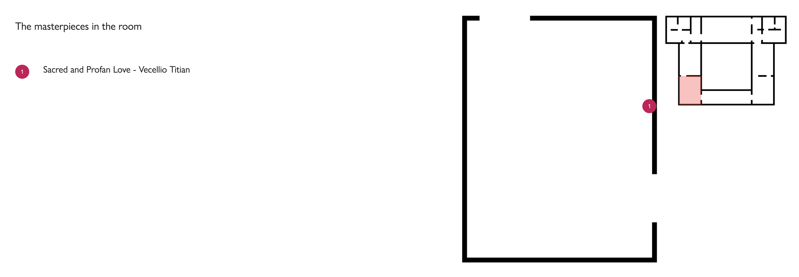

**展厅官网介绍页**：[Room 20 - Psyche Room](https://galleriaborghese.cultura.gov.it/en/il-museo/la-villa/sala-20-sala-di-psiche/)

## 核心展品

### ⭐⭐⭐ 必看 提香《圣爱与俗爱》 / Titian, _Sacred and Profane Love_

- **作者 / Artist**：提香（韦切利奥）/ Titian (Tiziano Vecellio)
- **作品 / Work**：《圣爱与俗爱（神圣与世俗之爱）》 / _Sacred and Profane Love_
- **时间**：1515–1516 年
- **材质**：布面油画
- **尺寸**：118 × 278 cm
- **位置**：普绪刻厅（第 20 室）
- **官网介绍页**：[圣爱与俗爱 / Amor Sacro e Amor Profano｜博尔盖塞官方藏品库](https://www.collezionegalleriaborghese.it/opere/amor-sacro-e-amor-profano)｜馆藏编号 147

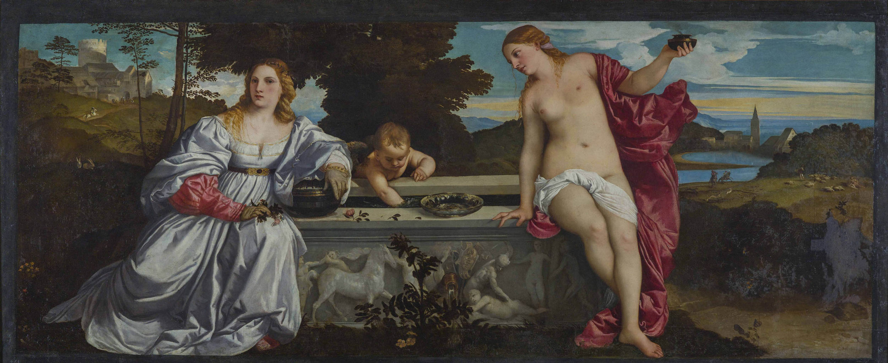

这是博尔盖塞二楼画廊的压轴之作，也是提香（Titian）传世最负盛名的油画之一、整个美术馆绘画藏品里地位最高的一件。值得在它面前站上几分钟，把画面、寓意、技法和它跌宕的身世一层层读开。

**内容（这是什么）**：一具古罗马石棺被改成了喷泉水盆，盆沿两端各坐一位容貌几乎相同的年轻女子。左侧的女子衣装华贵、头戴桃金娘花冠、目光转向观者，手边放着一只盖碗；右侧的女子几乎全裸，仅披一袭红袍，举起一盏点燃的油灯，转头注视着自己盛装的「分身」。中间，长翅膀的小爱神丘比特（Cupid）俯身把手探进盆里搅动池水。背景是典型的威尼斯式风景：左侧一座有塔楼的山城、右侧一处湖畔村落，黄昏的光把天空染成金红。两位女子并非「好女人 vs 坏女人」，而是同一种「爱」的两副面孔。

**标题与解读（这幅画到底在说什么）**：「圣爱与俗爱」这个标题是 18 世纪后人加的，画本身没有题名，几百年来一直是艺术史上著名的「解读之谜」。最有影响的读法来自图像学大家帕诺夫斯基（Erwin Panofsky，1939 年）——他借新柏拉图主义把两位女子读成两种维纳斯（Venus）：盛装者是尘世的、可见的爱（世俗之爱），裸体者反而是更高的「天上之爱」（神圣之爱），裸露恰恰象征纯粹、不加掩饰的真理；丘比特搅水则是连接天地两界的纽带。瓦尔堡学派（Aby Warburg 一脉）的图像志研究也长期围绕它展开；另有学者（温德，Edgar Wind）把盛装者读作「美」（Pulchritudo）、裸体者读作「欢愉」（Voluptas）。但当代馆方与多数学者更倾向一个更具体的答案：这其实是一幅**婚礼画**。它约 1515–1516 年为威尼斯十人议会秘书尼科洛·奥雷利奥（Niccolò Aurelio）与劳拉·巴加罗托（Laura Bagarotto）的婚姻而作——石棺正面的盾徽是奥雷利奥家族纹章，银盆底部则有巴加罗托家的标记，盛装女子的腰扣和桃金娘花冠都是婚姻之爱的象征。两位「维纳斯」于是成了「贤妻的一体两面」：既要在公众场合端庄盛装，又要在私密生活里为丈夫袒露真挚而炽热的爱。

**技法（提香盛年的色彩与光）**：此画作于提香三十岁前后、由乔尔乔内（Giorgione）风格走向个人成熟的转折期，是他青年时代的巅峰。看裸体女子身上那块红袍——提香用厚薄相间的油彩叠染出绸缎的反光与肌肤的温度，是后世「提香红」的早期范例。更要看背景：左右两半风景一冷一暖，光线从右上方斜照，给整片田园镀上落日的金色，把人物、石棺、远景统一在同一束温柔的光里——这种「用色彩和光气统摄全局」正是威尼斯画派区别于佛罗伦萨「素描至上」的看家本领。

**身世与那桩著名轶事**：此画约 1608 年由斯丰德拉蒂枢机（Cardinal Sfondrati）连同另外七十余幅一起卖给西皮奥内·博尔盖塞（Scipione Borghese），此后一直是博尔盖塞家族旧藏，1902 年随别墅与藏品一并被意大利国家收购。它最为人津津乐道的，是 1899 年的一桩轶事：罗斯柴尔德（Rothschild）家族曾出价想买下这一幅画，开价竟高于当时对整座别墅连同全部藏品的估值——博尔盖塞家族断然拒绝。正是这桩「一幅画贵过一座美术馆」的传闻，让它的名声更上一层楼，也间接促成了几年后国家把整批藏品收归公有。

**图像学影响**：「一着衣、一裸体、隔水盆相对的双维纳斯」这一图式，连同提香盛年的色彩，成了后世「双重维纳斯」「贤妻寓意」题材反复引用的母本；从矫饰主义到 19 世纪，无数解读、临仿与学术争论都从这块画布出发。它既是一幅婚礼贺礼，也是一座留给后世几个世纪的图像学迷宫。

**现场站看**：

1. **先比两张脸**——左右两位女子容貌几乎一模一样，先确认这一点，你才能明白她们是「同一个人/同一种爱的两面」，而不是两个对立的女人。这是看懂全画的钥匙。
2. **看裸女手里的油灯**——点燃的灯是维纳斯的属性、爱的炽烈之火。它在画面右侧最暗处亮着，是「神圣之爱」一侧的题眼。
3. **看盛装女子的桃金娘花冠与腰扣**——桃金娘是维纳斯的圣物、婚姻的象征；腰扣点明婚约。这两样小物件把「婚礼画」的身份坐实。
4. **俯看石棺正面的浮雕与盾徽**——水盆其实是改作喷泉的古罗马石棺，正面刻着古典浮雕，并嵌有奥雷利奥家族纹章；盆底银面上是新娘家的标记。这是「这是谁的婚礼」最直接的证据。
5. **看中间丘比特搅水的手**——小爱神俯身把手探进水里，按帕诺夫斯基的读法，他是连接「天上」与「尘世」两位维纳斯的纽带；现场注意他正好位于两人正中。
6. **退后看左右两半风景**——左侧冷调山城、右侧暖调湖村，一冷一暖呼应两种爱；再留意那束从右上斜下、把全画统一起来的落日金光，这是威尼斯画派「以光气统摄」的精髓。
7. **看红袍的质感**——盯着裸女身上那块红色织物与她肌肤的交界，体会提香怎么用油彩做出绸缎反光与「有体温」的皮肤——这是「提香红」的早期样板。
8. **想想那桩轶事**——站在这幅「贵过整座美术馆」的画前，再环顾本厅其余威尼斯名作，就能体会为什么它被放在上层画廊的压轴位置。

### ⭐⭐⭐ 必看 安托内洛·达·梅西纳《男子肖像》 / Antonello da Messina, _Portrait of a Man_

- **作者 / Artist**：安托内洛·达·梅西纳 / Antonello da Messina
- **作品 / Work**：《男子肖像》 / _Portrait of a Man_
- **时间**：约 1476 年
- **材质**：木板蛋彩与油彩
- **尺寸**：31 × 25.2 cm
- **位置**：普绪刻厅（第 20 室）
- **官网介绍页**：[男子肖像 / Ritratto d'uomo｜博尔盖塞官方藏品库](https://www.collezionegalleriaborghese.it/opere/ritratto-duomo)｜馆藏编号 396

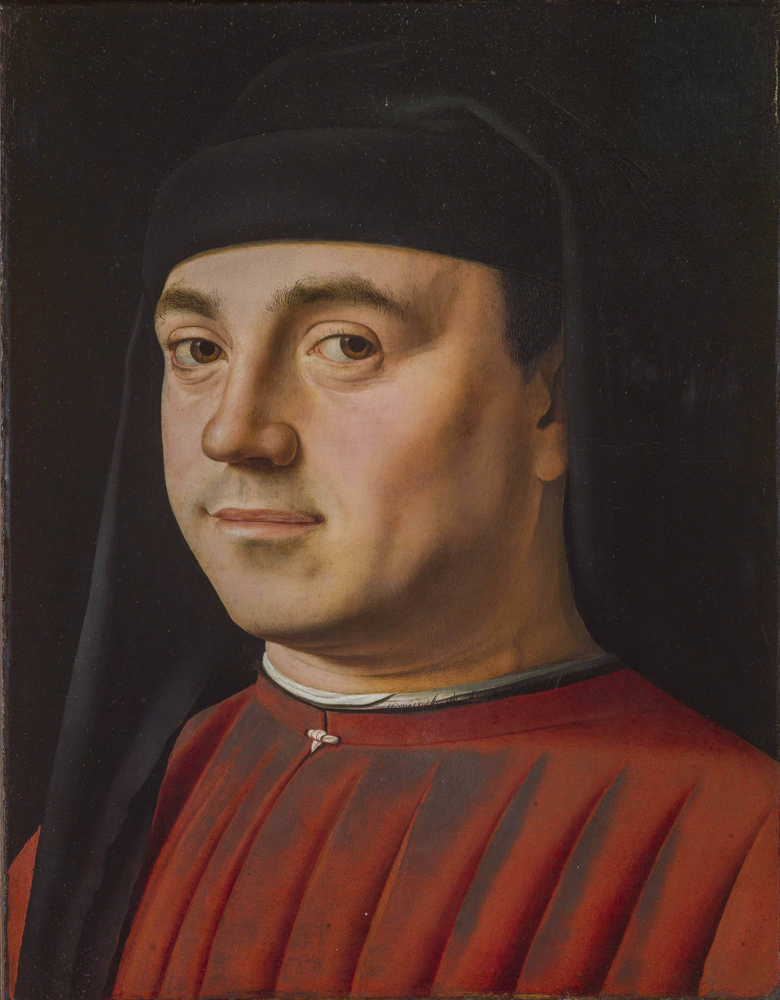

**内容（这是什么）**：一幅只有巴掌大的男子半身肖像。画中人按安托内洛·达·梅西纳（Antonello da Messina）惯用的方式取四分之三侧、半身、立于纯黑背景前，身穿红袍、头戴黑色软帽——这正是当年赏识并定制他作品的威尼斯贵族的典型装束。他微微转头、对着观者露出一丝近乎讥诮的浅笑，眼神极其鲜活。画中人身份至今不明；木板上没有签名，学者推测画家的署名小纸片（cartiglio）原本可能贴在画框上。

**背景 / 来历**：此画属安托内洛 1475–1476 年威尼斯之行期间所作的肖像，是他成熟期的代表作之一。安托内洛是把尼德兰（佛兰德斯）油画技法系统带进意大利、尤其带进威尼斯的关键人物——细腻的油彩罩染、对光与质感的精确刻画，经他之手深刻影响了乔万尼·贝利尼（Giovanni Bellini）一代威尼斯画家。这幅小板画 1790 年首次出现在博尔盖塞旧藏清单里时，曾被挂在贝利尼名下；直到 1869 年才由学者明德勒（Otto Mündler）重新认定为安托内洛真迹。画中人曾被猜成画家自画像、或威尼斯贵族米凯莱·维亚内洛（Michele Vianello），但都无确证。

**看点**：别被它的小尺寸骗了，这是全厅分量最重的几件之一。安托内洛把佛兰德斯式的微观写实「收」住，转向更流动、更温暖的笔法——嘴唇、鼻尖、眼下泪阜到眼袋的那几道光，几乎能让人摸到皮肤的温度与「脉搏」。它的妙处全在那一丝似笑非笑的表情与活生生的目光里：在 15 世纪，能把一个普通人的心理「在场感」画到这个程度，是革命性的。

**现场站看**：

1. **先凑近看那一丝笑**——嘴角与眼神配合出的「含讥的温和」，是安托内洛心理刻画的招牌；离近一点，小画才显威力。
2. **看眼下与鼻尖的高光**——泪阜、鼻尖、下唇上几处极小的亮点，是他用油彩「点」出肌肤的湿润与体温，体会佛兰德斯油画技法的精髓。
3. **注意纯黑背景**——没有风景、没有道具，全部注意力被逼到脸上；这种「黑底半身像」格式正是安托内洛带给威尼斯、再传遍欧洲的肖像范式。
4. **和本厅提香、贝利尼连起来看**——这幅画与同厅的贝利尼《圣母子》《圣爱与俗爱》同处一室，正好串出「安托内洛带来油画技法 → 贝利尼 → 提香」这条威尼斯画派的来龙去脉。

### ⭐⭐ 推荐 乔瓦尼·贝利尼《圣母子》 / Giovanni Bellini, _Virgin and Child_
- **作者 / Artist**：乔瓦尼·贝利尼 / Giovanni Bellini
- **作品 / Work**：《圣母子》 / _Virgin and Child_
- **时间**：约 1510 年，或 1502–1503 年
- **材质**：杨木板油画
- **尺寸**：50 × 41 cm
- **位置**：普绪刻厅（第 20 室）

- **官网介绍页**：[圣母子 / Madonna con Bambino｜Galleria Borghese 官方藏品库](https://www.collezionegalleriaborghese.it/opere/madonna-con-bambino-3)｜馆藏编号 176

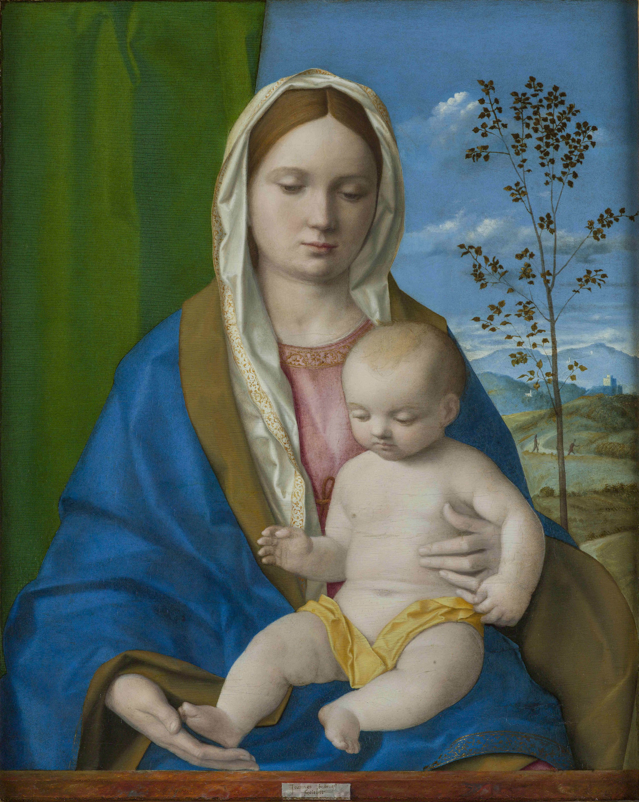

**内容（这是什么）**：半身《圣母子》。圣母端坐在一道浅色大理石矮栏之后，左膝托着圣婴，一只手扶住孩子腰侧、另一只手托着小耶稣的脚；母子都低垂着眼，神情沉静而微含忧郁。两人身后一道绿色帷幔拉到一半，露出层层退向天际、融入蔚蓝的丘陵远景，一条小路上走着两名行人，路尽头立着一株白杨。

**背景 / 来历**：乔瓦尼·贝利尼（Giovanni Bellini）是威尼斯文艺复兴绘画的奠基者，把安托内洛带来的油画技法与诗意风景结合成影响深远的「贝利尼式圣母」范式。矮栏上贴着写有「Joannes Bellinus faciebat」的签名小纸条（cartiglio）。此类家用祈祷小画由贝利尼作坊大量复制、版本众多，本幅曾长期被疑为学徒之作，但凭其柔润的肌肤、珐琅般的色泽与自然光感，今已公认是大师晚年（约 1510 年，一说更早至 1502–1503 年）的亲笔。本馆 1833 年首次著录，1902 年随别墅一并归国家。

**看点**：贝利尼的拿手好戏是让人物与风景在构图与象征上彼此呼应——远景那株颤动的白杨是古老的丧葬象征，预示基督受难，与母子若有所思的哀愁正相扣合。

**现场站看**：

1. **看矮栏上的签名纸条**——这是贝利尼亲笔的「身份证」，也点出此画曾经的真伪之争。
2. **看母子低垂的眼神**——不是欢愉，而是预知受难的沉静哀愁，这是贝利尼「圣母」一类的情感招牌。
3. **看远景的白杨与小路行人**——白杨＝丧葬与受难的隐喻；珐琅般的光把前景圣母与远山统一在同一片自然光里。
4. **和邻墙的提香、安托内洛对照**——同一间屋里看完三代人，威尼斯油画「安托内洛→贝利尼→提香」的传承一目了然。

### ⭐⭐ 推荐 洛伦佐·洛托《男子肖像（梅尔库里奥·布阿？）》 / Lorenzo Lotto, _Portrait of a Man (Mercurio Bua?)_
- **作者 / Artist**：洛伦佐·洛托 / Lorenzo Lotto
- **作品 / Work**：《男子肖像（梅尔库里奥·布阿？）》 / _Portrait of a Man (Mercurio Bua?)_
- **时间**：约 1530 年
- **材质**：布面油画
- **尺寸**：118 × 105 cm
- **位置**：普绪刻厅（第 20 室）

- **官网介绍页**：[男子肖像，可能为 Mercurio Bua / Ritratto di Uomo (Mercurio Bua ?)｜Galleria Borghese 官方藏品库](https://www.collezionegalleriaborghese.it/opere/ritratto-di-uomo-mercurio-bua)｜馆藏编号 185

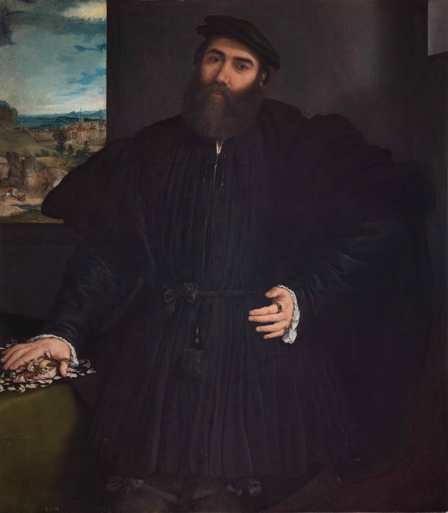

**内容（这是什么）**：一位身着黑衣的绅士半身像，立于室内，背墙开着一扇窗，窗外是城市轮廓与一幕骑士格斗（圣乔治屠龙）。他的双手格外醒目：一只手按在桌上一小堆玫瑰花瓣与茉莉之上，花间赫然立着一枚小骷髅；小指上戴着两枚婚戒。

**背景 / 来历**：洛伦佐·洛托（Lorenzo Lotto）是威尼斯画派中最善于刻画心理、也最「不安」的肖像大师。画中人长期被当作洛托自画像；据 1980 年代以来的研究，多认为是希腊裔的威尼斯雇佣兵统帅梅尔库里奥·布阿（Mercurio Bua）伯爵——他移居特雷维索，背景城景或即该城，他笃信武士圣徒圣乔治。黑衣、绿桌布、双婚戒与骷髅共同点出「丧悼」：布阿先后失去两位妻子与孩子。也有学者（如汉弗里）质疑此身份，认为画的是 1530 年代另一位军官。本馆 1693 年已著录（曾挂在波代诺内名下），1869 年由明德勒（Otto Mündler）改定为洛托。约 1530 年作。

**看点**：这是一幅把「忧郁」画进物件里的肖像——玫瑰与茉莉的易逝、小骷髅的「勿忘死」（memento mori）、小指上的寡居婚戒，每一件小物都在讲丧亲之痛。

**现场站看**：

1. **看桌上的花瓣与小骷髅**——凋落的玫瑰、茉莉＋骷髅＝「美与死」的对照，是全画的题眼。
2. **看小指上的两枚婚戒**——寡居的标记，把「丧妻」的身份坐实。
3. **看窗外的圣乔治屠龙**——点出画中人的希腊出身与对武士圣徒的崇拜。
4. **看那张忧郁的脸**——洛托被称作「现代心理肖像的先声」，离近体会眼神里的哀愁。

## 天顶画

### ⭐⭐ 推荐 彼得罗·安东尼奥·诺韦利《丘比特与普绪刻故事》 / Pietro Antonio Novelli, _Story of Cupid and Psyche_

- **作者 / Artist**：彼得罗·安东尼奥·诺韦利（1729–1804） / Pietro Antonio Novelli
- **作品 / Work**：《丘比特与普绪刻故事》 / _Story of Cupid and Psyche_
- **时间**：18 世纪末（平乔别墅新古典改造期）
- **位置**：普绪刻厅天顶（第 20 室）
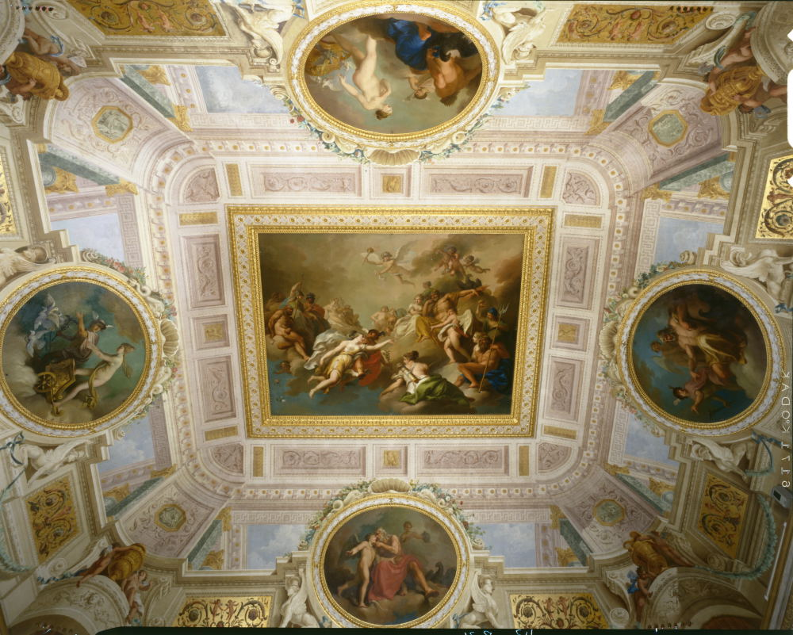

**内容（这是什么）**：本厅天顶以阿普列乌斯（Apuleius）《金驴记》（_Metamorphoses_，又名《变形记》）里「丘比特与普绪刻（Psyche）」的故事为题，房间也因此得名「普绪刻厅」。故事梗概：凡间公主普绪刻美得惊动天下，连维纳斯（Venus）都嫉妒，派儿子丘比特（Cupid）去害她，丘比特却自己爱上了她；他把普绪刻接到神秘宫殿、每夜相会却不许她看自己的脸。普绪刻经不住姐姐挑唆，深夜点灯偷看，惊见熟睡的爱神之美，却失手让灯油烫醒了他——丘比特负伤离去。普绪刻为找回爱人，被愤怒的维纳斯百般刁难，派她去完成分拣谷物、取金羊毛、甚至下冥界取魔盒等几乎不可能的苦役；她历尽磨难、终获原谅，最后被朱庇特赐饮神酒、升入奥林匹斯，与丘比特正式成婚。天顶正中即「普绪刻被迎入奥林匹斯、与丘比特成婚」的团圆高光，四周分段叙述她因好奇违禁、遭维纳斯刁难、历经试炼的情节。

**背景 / 来历**：作者是威尼斯画家彼得罗·安东尼奥·诺韦利（Pietro Antonio Novelli，1729–1804），绘于 18 世纪末马尔坎托尼奥·博尔盖塞（Marcantonio IV Borghese）请阿斯普鲁奇（Antonio Asprucci）统筹的别墅「一室一主题」大改造期间。这个题材的选择和本厅的陈列高度契合：第 20 室是别墅里最重要的「爱」之厅，墙上挂着提香（Titian）的《圣爱与俗爱》《为爱神蒙眼的维纳斯》——天顶选「丘比特与普绪刻」，正是要让整间厅从天到墙都在谈「爱」。普绪刻（Psyche）在希腊语里本义就是「灵魂」，所以这则神话历来被读作一则寓言：灵魂历经磨难、最终与爱（丘比特）结合而获得不朽。

**看点**：它是一则「灵魂历劫终与爱结合」的寓言铺满整顶，与本厅提香的爱情主题名作彼此呼应——天顶（神话之爱）与墙上（提香的圣俗之爱）合成一间完整的「爱之厅」。看点在于把这条「相爱→违禁偷看→失去→苦役试炼→团圆升天」的叙事链读通，再体会「Psyche＝灵魂」这层寓意：它讲的不只是爱情，更是灵魂经受考验走向不朽的过程。

#### 逐幅分述（中央 + 四周情节）
诺韦利把阿普列乌斯的故事分成中央团圆与四周分幕；中央正画与四周小画镶在马尔凯蒂画的「向天空敞开的错视凉廊」框架里。

##### 维纳斯命令丘比特惩罚普绪刻  

也就是你刚才这张：维纳斯坐在云车/战车上，下令让爱神去对付普绪刻。  
这是故事开头，因为普绪刻太美，激怒了维纳斯。

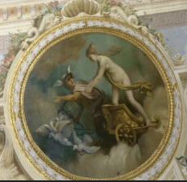

##### 普绪刻窥见沉睡的丘比特

普绪刻夜里偷看丈夫，发现他其实是爱神丘比特。  
这是两人秘密婚姻阶段的转折点。

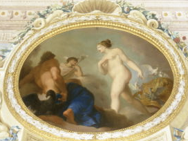

##### 丘比特恳求朱庇特

也就是“坐着的是男神朱庇特，旁边裸体有翅膀的是爱神”的那张。  
丘比特请求朱庇特帮助普绪刻，让他们能正式结合。

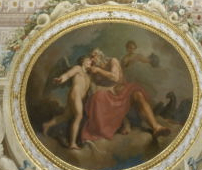

##### 朱庇特命令墨丘利寻找/带来普绪刻

也就是朱庇特坐在云端，旁边是墨丘利的那张。  
这是朱庇特介入后，让墨丘利执行神意，把普绪刻带入神界或召集众神。

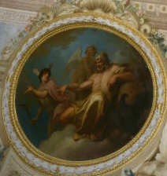

##### 中央《普绪刻被迎入奥林匹斯（与丘比特成婚）》/ _Psyche Welcomed into Olympus_

全顶的核心与团圆高光：历尽磨难的普绪刻被朱庇特赐饮神酒、升入奥林匹斯，与丘比特正式成婚。它占天顶正中，是整组「苦尽甘来」的结局。

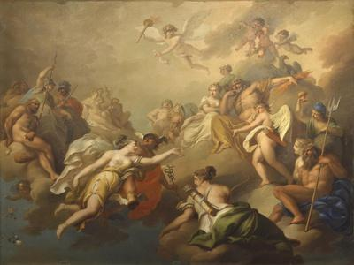

注：天顶的建筑式框架——一座「向天空敞开的错视凉廊」（trompe-l'œil）——由专擅假建筑的马尔凯蒂（Giovan Battista Marchetti，1730–1800）绘制，诺韦利的故事画即镶嵌其中。

**现场站看**：

1. **先认中央的「成婚／升天」**——抬头找天顶正中那幕最明亮的团圆：普绪刻被迎入奥林匹斯、与丘比特成婚。认准这个结局，四周的试炼情节就有了方向。
2. **找「点灯偷看」的转折一幕**——在四周情节里找普绪刻深夜持灯照向熟睡丘比特的场景，这是全故事的命门：因好奇违禁而失去爱人。它是叙事链的转折点。
3. **顺看维纳斯刁难的苦役**——留意分拣谷物、取金羊毛、下冥界取魔盒等试炼场景，这些是普绪刻赎罪重逢前必经的磨难，串起来就是「灵魂受考验」的全过程。
4. **抬头—低头连起来读「爱」**——看完天顶的神话之爱，低头看墙上提香的《圣爱与俗爱》《为爱神蒙眼的维纳斯》，体会全厅从天顶到陈列被「爱」这一主题统一起来的用意。
5. **记住「Psyche＝灵魂」这层寓意**——再看整顶时，把它当成「灵魂历劫成长、终与爱结合而不朽」的寓言来读，比单看一个爱情故事更有味。

## 绘画

本节按馆方 Painting 藏品列表补充，共 18 件；核心几件（提香《圣爱与俗爱》、安托内洛《男子肖像》、贝利尼《圣母子》、洛托《男子肖像》）已在上文「核心展品」展开。

### ⭐ 顺路看 乔瓦尼·安东尼奥·德·萨基斯，称波代诺内《犹滴》 / de Sacchis Giovanni Antonio called Pordenone, _Judith_

- **作者 / Artist**：乔瓦尼·安东尼奥·德·萨基斯，称波代诺内 / de Sacchis Giovanni Antonio called Pordenone
- **作品 / Work**：《犹滴》 / _Judith_
- **时间**：约 1516 年
- **材质**：布面油画
- **尺寸**：95 × 78 cm
- **位置**：普绪刻厅（第 20 室）
- **官网介绍页**：[博尔盖塞官方藏品库](https://www.collezionegalleriaborghese.it/en/opere/judith)｜馆藏编号 091

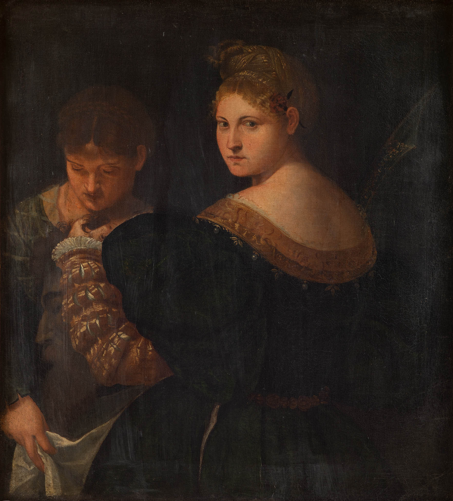

> 本厅（普绪刻厅）是博尔盖塞收藏威尼斯文艺复兴绘画的精华间——除提香、贝利尼、安托内洛、洛托、卡尔帕乔之外，还成组挂着乔尔乔内圈、委罗内塞、老帕尔马等威尼斯名家，可当作一间「威尼斯画派小史」来看。

**内容 / 看点**：乔瓦尼·安东尼奥·德·萨基斯（称波代诺内/Pordenone）的《犹滴》，画旧约女英雄犹滴提着刚砍下的敌将赫罗弗尼斯的首级。波代诺内是提香的劲敌，以雄健的动势著称，约 1516 年作。现场可与同厅老帕尔马《卢克蕾提娅》对看，都是「刚烈女性」题材。

### ⭐ 顺路看 保罗·卡利亚里，称保罗·委罗内塞《圣安多尼向鱼布道》 / Caliari Paolo called Paolo Veronese, _Saint Anthony Preaching to the Fish_

- **作者 / Artist**：保罗·卡利亚里，称保罗·委罗内塞 / Caliari Paolo called Paolo Veronese
- **作品 / Work**：《圣安多尼向鱼布道》 / _Saint Anthony Preaching to the Fish_
- **材质**：布面油画
- **尺寸**：104 × 150 cm
- **位置**：普绪刻厅（第 20 室）
- **官网介绍页**：[博尔盖塞官方藏品库](https://www.collezionegalleriaborghese.it/en/opere/saint-anthony-preaching-to-the-fish)｜馆藏编号 101

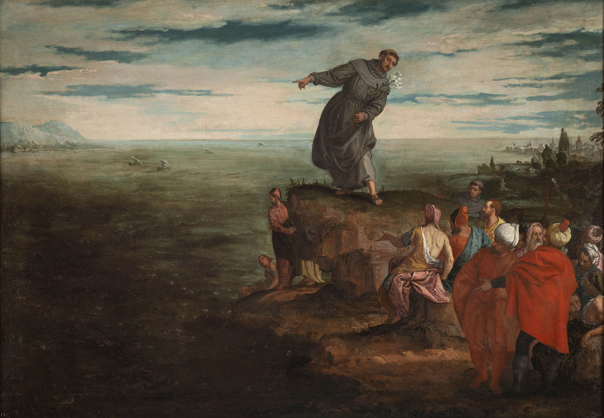

**内容 / 看点**：保罗·委罗内塞（Paolo Veronese）的《圣安多尼向鱼布道》，画的是传说中帕多瓦的圣安东尼因人们不肯听道、转而向河里的鱼讲道，群鱼竟探头聆听的奇迹。委罗内塞是威尼斯盛期三杰之一，以华丽色彩与宏大场面著称。属本厅威尼斯名家序列，顺路一看。

### ⭐ 顺路看 雅各布·内格雷蒂，称老帕尔马《卢克蕾提娅》 / Negretti Jacopo called Jacopo Palma the Elder, _Lucretia_

- **作者 / Artist**：雅各布·内格雷蒂，称老帕尔马 / Negretti Jacopo called Jacopo Palma the Elder
- **作品 / Work**：《卢克蕾提娅》 / _Lucretia_
- **时间**：约 1515 年
- **材质**：木板油画
- **尺寸**：71.5 × 59 cm
- **位置**：普绪刻厅（第 20 室）
- **官网介绍页**：[博尔盖塞官方藏品库](https://www.collezionegalleriaborghese.it/en/opere/lucretia-3)｜馆藏编号 106

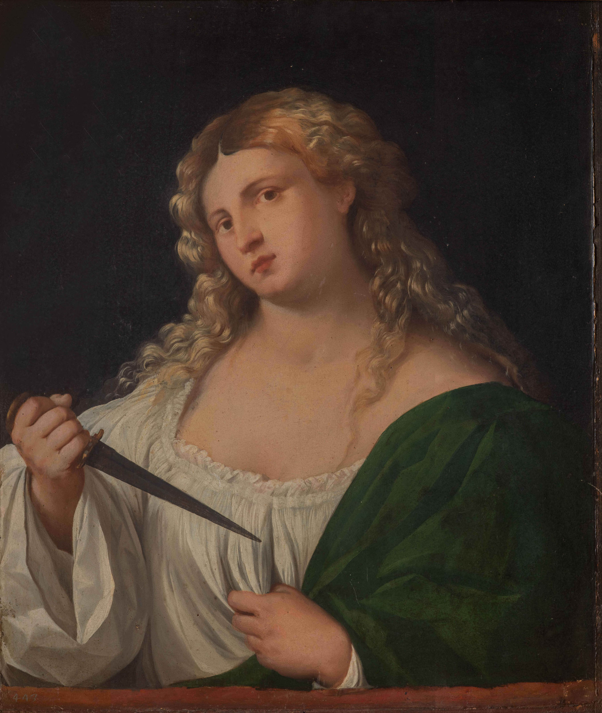

**内容 / 看点**：雅各布·内格雷蒂（称老帕尔马/Palma il Vecchio）的《卢克蕾提娅》，画古罗马贞妇卢克蕾提娅受辱后自刎明志的瞬间。老帕尔马擅画丰艳的金发女性，约 1515 年作。可与同厅波代诺内《犹滴》（编号 091）并看，都是「贞烈女性」主题。

### ⭐ 顺路看 马尔科·巴萨伊蒂《亚当》 / Basaiti Marco, _Adam_

- **作者 / Artist**：马尔科·巴萨伊蒂 / Basaiti Marco
- **作品 / Work**：《亚当》 / _Adam_
- **时间**：约 1507 年
- **材质**：木板油画
- **尺寸**：152 × 86 cm
- **位置**：普绪刻厅（第 20 室）
- **官网介绍页**：[博尔盖塞官方藏品库](https://www.collezionegalleriaborghese.it/en/opere/adam)｜馆藏编号 129

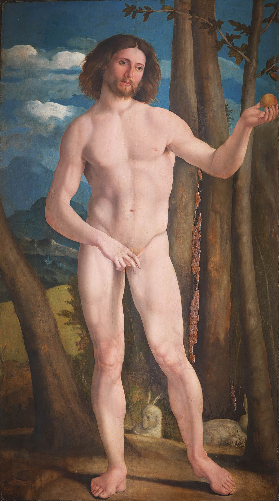

**内容 / 看点**：马尔科·巴萨伊蒂（Marco Basaiti）的《亚当》，与同厅的《夏娃》（编号 131）本是一对，约 1507 年作，画伊甸园中的人类始祖。巴萨伊蒂是贝利尼圈的威尼斯画家。现场把亚当、夏娃两幅并看，是一组完整的「原罪」对画。

### ⭐ 顺路看 威尼斯画派；归属乔尔乔内《长笛演奏者》 / Veneto school / Attributed to Giorgione, _Flute player_

- **作者 / Artist**：威尼斯画派；归属乔尔乔内 / Veneto school / Attributed to Giorgione
- **作品 / Work**：《长笛演奏者》 / _Flute player_
- **时间**：约 1507 年
- **材质**：布面油画
- **尺寸**：102.5 × 73 cm
- **位置**：普绪刻厅（第 20 室）
- **官网介绍页**：[博尔盖塞官方藏品库](https://www.collezionegalleriaborghese.it/en/opere/flute-player)｜馆藏编号 130

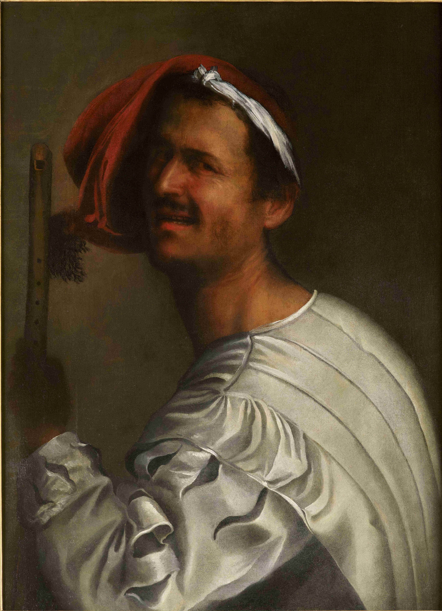

**内容 / 看点**：归属乔尔乔内（Giorgione）的《长笛演奏者》，约 1507 年，与同厅的《热情的歌手》（编号 132）成对，是威尼斯画派典型的「半身音乐人物」——以柔光、含蓄的情绪取胜，不靠情节。乔尔乔内是提香的同门师兄、威尼斯「诗意绘画」的开创者；这类作品的真伪历来多有争议。

### ⭐ 顺路看 马尔科·巴萨伊蒂《夏娃》 / Basaiti Marco, _Eve_

- **作者 / Artist**：马尔科·巴萨伊蒂 / Basaiti Marco
- **作品 / Work**：《夏娃》 / _Eve_
- **时间**：约 1507 年
- **材质**：木板油画
- **尺寸**：152 × 84 cm
- **位置**：普绪刻厅（第 20 室）
- **官网介绍页**：[博尔盖塞官方藏品库](https://www.collezionegalleriaborghese.it/en/opere/eve)｜馆藏编号 131

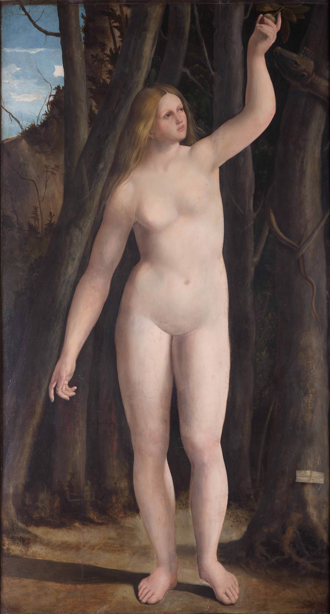

**内容 / 看点**：巴萨伊蒂的《夏娃》，是与《亚当》（编号 129）成对的另一半。两幅并看才完整——夏娃手持禁果，点出原罪主题。整组背景见编号 129。

### ⭐ 顺路看 威尼斯画派；归属乔尔乔内《热情的歌手》 / Veneto school / Attributed to Giorgione, _Passionate singer_

- **作者 / Artist**：威尼斯画派；归属乔尔乔内 / Veneto school / Attributed to Giorgione
- **作品 / Work**：《热情的歌手》 / _Passionate singer_
- **时间**：约 1507 年
- **材质**：布面油画
- **尺寸**：104 × 77 cm
- **位置**：普绪刻厅（第 20 室）
- **官网介绍页**：[博尔盖塞官方藏品库](https://www.collezionegalleriaborghese.it/en/opere/passionate-singer)｜馆藏编号 132

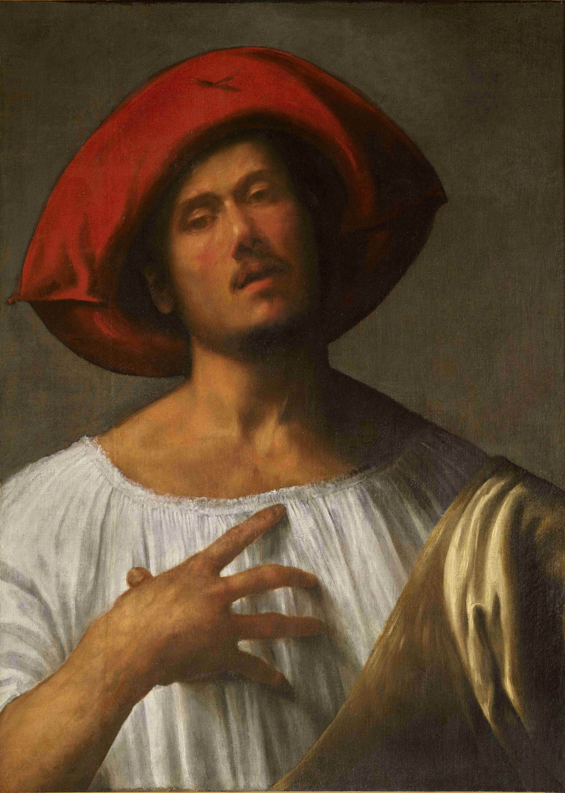

**内容 / 看点**：归属乔尔乔内的《热情的歌手》，是与《长笛演奏者》（编号 130）成对的另一半，同样是约 1507 年的威尼斯半身乐人。整组背景见编号 130；现场两幅并看，体会乔尔乔内式的柔润光气。

### ⭐ 顺路看 保罗·卡利亚里，称保罗·委罗内塞《施洗者布道》 / Caliari Paolo called Paolo Veronese, _The Baptist preaching_

- **作者 / Artist**：保罗·卡利亚里，称保罗·委罗内塞 / Caliari Paolo called Paolo Veronese
- **作品 / Work**：《施洗者布道》 / _The Baptist preaching_
- **时间**：约 1562 年
- **材质**：布面油画
- **尺寸**：205 × 169 cm
- **位置**：普绪刻厅（第 20 室）
- **官网介绍页**：[博尔盖塞官方藏品库](https://www.collezionegalleriaborghese.it/en/opere/the-baptist-preaching)｜馆藏编号 137

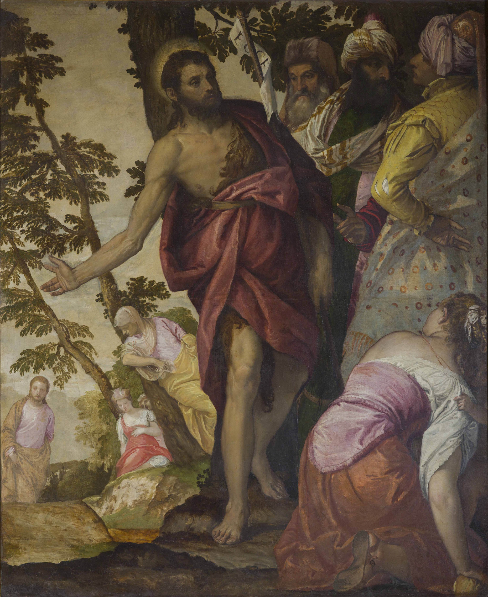

**内容 / 看点**：委罗内塞的《施洗者布道》，约 1562 年，画施洗约翰在旷野向众人传道。与同厅另一幅委罗内塞《圣安多尼向鱼布道》（编号 101）同为「布道」主题，可对看其华丽用色与人物群像的安排。

### ⭐ 顺路看 雅各布·内格雷蒂，称老帕尔马《圣母子、圣芭芭拉、圣克里斯蒂娜与两位捐赠者》 / Negretti Jacopo called Jacopo Palma the Elder, _Madonna and Child with Saint Barbara, Saint Christine and two Donors_

- **作者 / Artist**：雅各布·内格雷蒂，称老帕尔马 / Negretti Jacopo called Jacopo Palma the Elder
- **作品 / Work**：《圣母子、圣芭芭拉、圣克里斯蒂娜与两位捐赠者》 / _Madonna and Child with Saint Barbara, Saint Christine and two Donors_
- **时间**：1508–1509 年
- **材质**：布面油画
- **尺寸**：137.5 × 195.5 cm
- **位置**：普绪刻厅（第 20 室）
- **官网介绍页**：[博尔盖塞官方藏品库](https://www.collezionegalleriaborghese.it/en/opere/madonna-and-child-with-saint-barbara-saint-christine-and-two-donors)｜馆藏编号 157

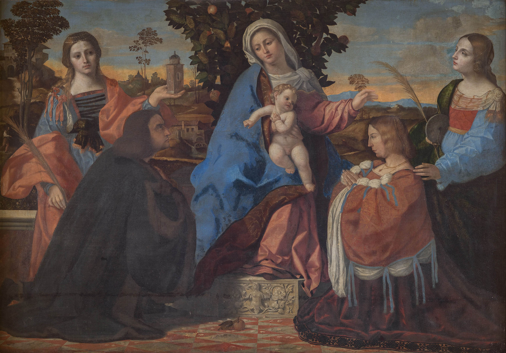

**内容 / 看点**：老帕尔马的《圣母子、圣芭芭拉、圣克里斯蒂娜与两位捐赠者》，1508–1509 年，是威尼斯流行的「神圣对话」（sacra conversazione）横幅——圣母子两侧立着圣徒，角落跪着出资的捐赠者夫妇。可留意捐赠者的世俗肖像与圣徒并置。

### ⭐ 顺路看 归属雅各布·内格雷蒂，称老帕尔马《圣母子、圣方济各、圣耶柔米与虔诚女子》 / Attributed to Negretti Jacopo called Jacopo Palma the Elder, _Madonna and Child with Saints Francis and Jerome and a Devout Woman_

- **作者 / Artist**：归属雅各布·内格雷蒂，称老帕尔马 / Attributed to Negretti Jacopo called Jacopo Palma the Elder
- **作品 / Work**：《圣母子、圣方济各、圣耶柔米与虔诚女子》 / _Madonna and Child with Saints Francis and Jerome and a Devout Woman_
- **时间**：1510–1515 年
- **材质**：木板油画
- **尺寸**：70 × 104.5 cm
- **位置**：普绪刻厅（第 20 室）
- **官网介绍页**：[博尔盖塞官方藏品库](https://www.collezionegalleriaborghese.it/en/opere/madonna-and-child-with-saints-francis-and-jerome-and-a-devout-woman)｜馆藏编号 163

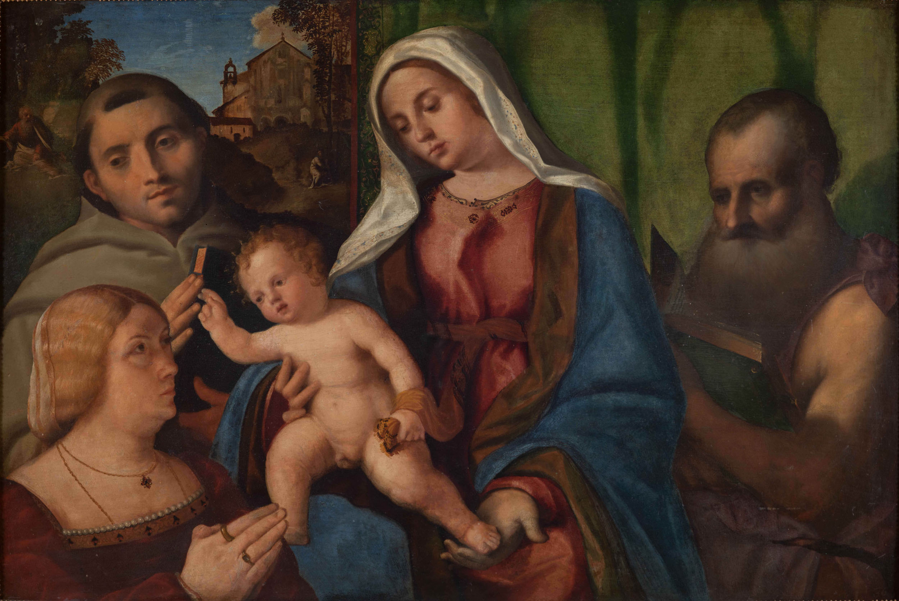

**内容 / 看点**：归属老帕尔马的《圣母子、圣方济各、圣耶柔米与虔诚女子》，1510–1515 年，又一幅「神圣对话」小幅。与编号 157 同为老帕尔马的圣母群像，可两幅并看其作坊面貌。

### ⭐ 顺路看 乔瓦尼·布西，称卡里亚尼《圣母子与圣伯多禄》 / Busi Giovanni called Cariani, _Madonna and Child with Saint Peter_

- **作者 / Artist**：乔瓦尼·布西，称卡里亚尼 / Busi Giovanni called Cariani
- **作品 / Work**：《圣母子与圣伯多禄》 / _Madonna and Child with Saint Peter_
- **时间**：1510–1515 年
- **材质**：布面油画
- **尺寸**：73 × 93 cm
- **位置**：普绪刻厅（第 20 室）
- **官网介绍页**：[博尔盖塞官方藏品库](https://www.collezionegalleriaborghese.it/en/opere/madonna-and-child-with-saint-peter)｜馆藏编号 164

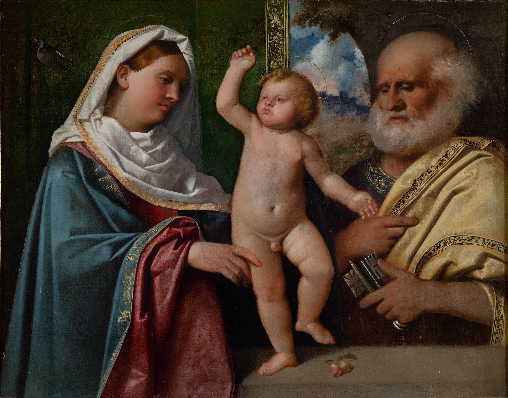

**内容 / 看点**：乔瓦尼·布西（称卡里亚尼/Cariani）的《圣母子与圣伯多禄》，1510–1515 年。卡里亚尼是贝尔加莫—威尼斯一带的画家、贝利尼与乔尔乔内的追随者，画风带乡野的浑厚。属本厅威尼斯圣母题材一组，顺路看。

### ⭐⭐ 推荐 提香·韦切利奥《维纳斯蒙住丘比特双眼》 / Vecellio Titian, _Venus Blindfolding Cupid_

- **作者 / Artist**：提香·韦切利奥 / Vecellio Titian
- **作品 / Work**：《维纳斯蒙住丘比特双眼》 / _Venus Blindfolding Cupid_
- **时间**：约 1560–1565 年
- **材质**：布面油画
- **尺寸**：116 × 184 cm
- **位置**：普绪刻厅（第 20 室）
- **官网介绍页**：[博尔盖塞官方藏品库](https://www.collezionegalleriaborghese.it/en/opere/venus-blindfolding-cupid)｜馆藏编号 170

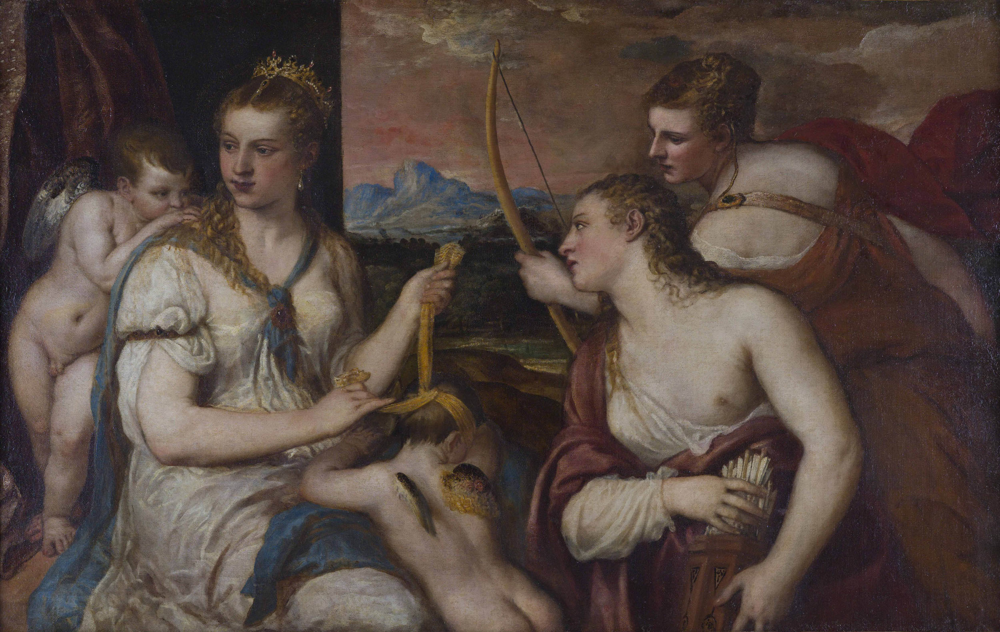

**内容（这是什么）**：画面左侧一位华美的女子（维纳斯/Venus）正果断地为膝上长翅膀的小爱神（丘比特/Cupid）蒙上眼睛，她身后另一个小爱神探着头专注地看着；右侧两名女子——多半是宁芙多里与阿尔米拉（Dori、Armilla）——捧着弓与箭袋走近。

**背景 / 来历**：提香（Titian）晚年（约 1560–1565 年）之作，约 1608 年由斯丰德拉蒂枢机赠予西皮奥内·博尔盖塞。题意数百年聚讼纷纭：有读作「惩罚爱神」（维纳斯没收爱神的武器），有按新柏拉图主义读作两种爱（厄洛斯与安特洛斯），图像学家帕诺夫斯基（Erwin Panofsky）则读作「夫妻之爱」的寓言；近来不少学者改题为《爱神的教育》——维纳斯蒙眼，是要让盲目的爱去随机射中凡人。1992–93 年的 X 光更揭出提香改过画：维纳斯原本的头部朝向不同，画里还删掉了第三个人物。

**看点**：这是提香「晚期诗性」的范例——没有人物占据正中，画面靠右侧那片落日豁口统驭全局；玫红与浅蓝在爱神的小翅、维纳斯的披风、持箭女子的绯红衣裙之间反复回响。轮廓被有意画「松」，留给观者的眼睛去补完，正是老提香把油画推到近乎「印象」的笔法。

**现场站看**：

1. **先看维纳斯蒙眼的手**——这是全画的动作核心，也是各种解读的出发点（蒙眼＝让爱盲目）。
2. **看右侧两位宁芙捧来的弓与箭袋**——她们到底是来「收走」还是「递上」爱神的武器，正是新旧解读的分歧所在。
3. **看维纳斯身后探头的第二个小爱神**——按一种读法他是「看得见真爱」的安特洛斯，神情忧虑而非得意。
4. **退后看右侧的落日豁口**——粉橙云霞下的青灰远山，是统一全画的光源；体会「无中心」的构图怎么靠光气立住。
5. **看轮廓的「松」**——盯着人物边缘，看提香晚年怎么用碎笔触把形「化开」，留给你的眼睛去合拢。

### ➖ 可略过 提香·韦切利奥《多明我会修士肖像（圣道明）》 / Vecellio Titian, _Portrait of Dominican friar (Saint Dominic)_

- **作者 / Artist**：提香·韦切利奥 / Vecellio Titian
- **作品 / Work**：《多明我会修士肖像（圣道明）》 / _Portrait of Dominican friar (Saint Dominic)_
- **时间**：约 1565–1569 年
- **材质**：布面油画
- **尺寸**：97 × 80 cm
- **位置**：普绪刻厅（第 20 室）
- **展陈提醒**：馆方藏品页标注此画当前未展出
- **官网介绍页**：[博尔盖塞官方藏品库](https://www.collezionegalleriaborghese.it/en/opere/portrait-of-dominican-friar-saint-dominic)｜馆藏编号 188

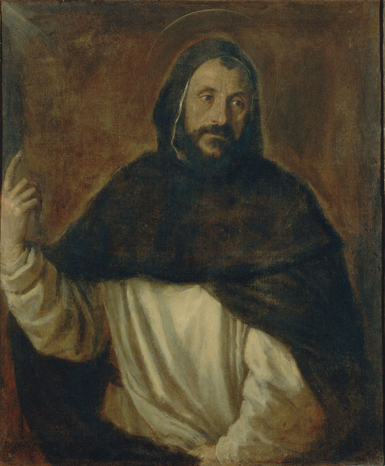

**内容（这是什么）**：一位多明我会修士的半身像（也被认作圣道明或圣文森特·费雷尔）。他身穿修会的白袍黑氅，一束光打在白袍上，照亮一只象征性地伸出的手；那张脸是提香（Titian）肖像功力的极品。

**背景 / 来历**：提香晚年（约 1565–1569 年）之作，来自贝尔内里奥枢机的罗马旧藏，1693 年已见于博尔盖塞清单。画中人身份历来在「圣道明／提香的多明我会忏悔神父／圣文森特·费雷尔」之间摇摆，但几乎无人怀疑提香的作者权。他晚年试验一种极简、近乎「印象派」的快速笔法：抹掉风景与背景，用一片红褐近单色去逼出一张写满信念的脸。

**看点**：这是老提香「做减法」的肖像——色域缩到黑、白与背景的暗赭，全部张力集中在那张被黑兜帽框住、自知其信仰的面孔。注意：馆方藏品页标注此画当前未展出，到场若不见可不必专门找。

### ⭐ 顺路看 洛伦佐·洛托《圣母子、安条克的圣依纳爵与圣奥诺弗里乌斯》 / Lotto Lorenzo, _Madonna and Child between Saints Ignatius of Antioch and Onuphrius_

- **作者 / Artist**：洛伦佐·洛托 / Lotto Lorenzo
- **作品 / Work**：《圣母子、安条克的圣依纳爵与圣奥诺弗里乌斯》 / _Madonna and Child between Saints Ignatius of Antioch and Onuphrius_
- **材质**：木板油画
- **尺寸**：53 x 67 cm
- **位置**：普绪刻厅（第 20 室）
- **官网介绍页**：[博尔盖塞官方藏品库](https://www.collezionegalleriaborghese.it/en/opere/madonna-and-child-between-saints-ignatius-of-antioch-and-onuphrius)｜馆藏编号 193

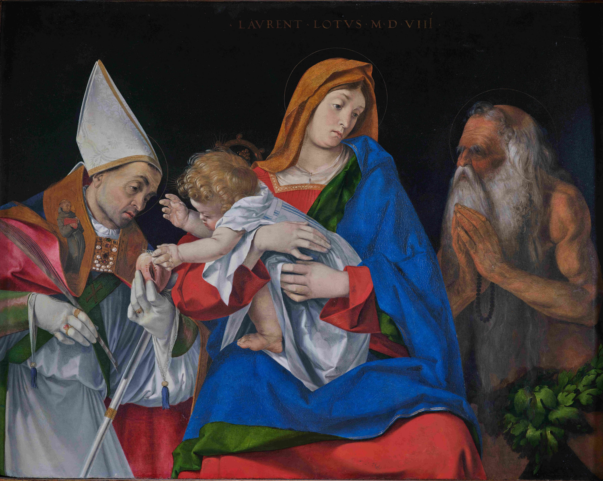

**内容 / 看点**：洛伦佐·洛托（Lorenzo Lotto）的《圣母子、安条克的圣依纳爵与圣奥诺弗里乌斯》，小幅「神圣对话」。与同厅洛托的名作《男子肖像（梅尔库里奥·布阿？）》（编号 185）出自同一位「不安的天才」之手，可对看他宗教画与肖像画的两面。

### ⭐⭐ 推荐 提香·韦切利奥《受鞭笞的基督》 / Vecellio Titian, _Scourged Christ_

- **作者 / Artist**：提香·韦切利奥 / Vecellio Titian
- **作品 / Work**：《受鞭笞的基督》 / _Scourged Christ_
- **时间**：约 1568 年
- **材质**：布面油画
- **尺寸**：87 × 62.5 cm
- **位置**：普绪刻厅（第 20 室）
- **官网介绍页**：[博尔盖塞官方藏品库](https://www.collezionegalleriaborghese.it/en/opere/scourged-christ)｜馆藏编号 194

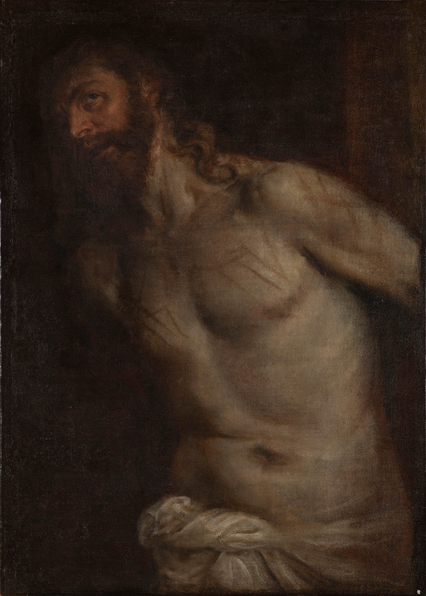

**内容（这是什么）**：受鞭之后的基督半身像，身上鞭痕清晰，却没有低头屈服，而是肌肉贲张、猛然扭头向上，像在对施刑者、甚至对自己的命运公然抗议。一束想象的光斜照着受伤的躯体，把视线引向半明半暗中浮出的脸。

**背景 / 来历**：提香（Titian）最后阶段（约 1568 年）之作，约 1633 年已在西皮奥内·博尔盖塞的藏品中。画在人字纹画布上，底层红色打底常被故意留露，造成提香晚年标志性的「未完成」效果，配以又快又厚的笔触。2002 与 2021 年的 X 光发现：颜料层下还藏着一张倒置的男子脸（一个背负十字架的基督），说明提香是在一块用过的画布上推翻初稿、重新构图。

**看点**：老提香从古代名作《观景楼躯干》（Belvedere Torso）汲取力量，把一个被凌辱的人画出了英雄气概——「被折磨却拒绝被羞辱」。这是他晚年「以经济与自由作画」、用破碎笔触发出强烈控诉的代表作。

**现场站看**：

1. **看那道斜光与扭头**——光把视线钉在从暗里浮起的脸上，那一记猛烈的回头是全画的情绪爆点。
2. **看身上留露的红色打底与碎笔触**——「未完成感」正是提香晚期的看家本领，离近看笔触如何「化」成血肉。
3. **想想 X 光下的那张倒脸**——这块画布被画过两次，提香晚年改画、毁稿重来的工作方式就藏在颜料底下。

### ⭐ 顺路看 巴托洛梅奥·蒙塔尼亚《年轻的基督》 / Montagna Bartolomeo, _The Young Christ_

- **作者 / Artist**：巴托洛梅奥·蒙塔尼亚 / Montagna Bartolomeo
- **作品 / Work**：《年轻的基督》 / _The Young Christ_
- **材质**：木板油画
- **尺寸**：24 × 20 cm
- **位置**：普绪刻厅（第 20 室）
- **官网介绍页**：[博尔盖塞官方藏品库](https://www.collezionegalleriaborghese.it/en/opere/the-young-christ)｜馆藏编号 430

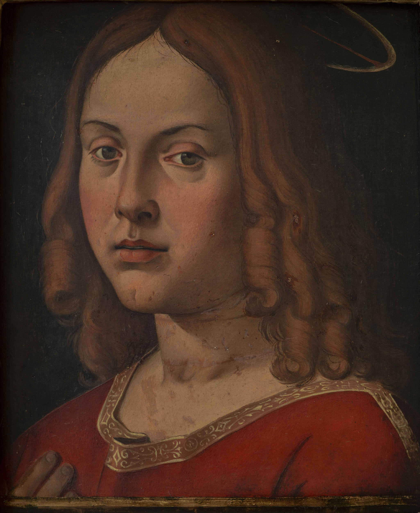

**内容 / 看点**：巴托洛梅奥·蒙塔尼亚（Bartolomeo Montagna）的《年轻的基督》，小幅木板，画少年基督半身。蒙塔尼亚是维琴察的画家、贝利尼圈成员，画风端严。尺幅虽小，顺路一看。

### ⭐ 顺路看 雅各布·内格雷蒂，称老帕尔马《青年男子肖像》 / Negretti Jacopo called Jacopo Palma the Elder, _Portrait of a Young Man_

- **作者 / Artist**：雅各布·内格雷蒂，称老帕尔马 / Negretti Jacopo called Jacopo Palma the Elder
- **作品 / Work**：《青年男子肖像》 / _Portrait of a Young Man_
- **材质**：木板油画
- **尺寸**：31.5 × 23.5 cm
- **位置**：普绪刻厅（第 20 室）
- **官网介绍页**：[博尔盖塞官方藏品库](https://www.collezionegalleriaborghese.it/en/opere/portrait-of-a-young-man-2)｜馆藏编号 445

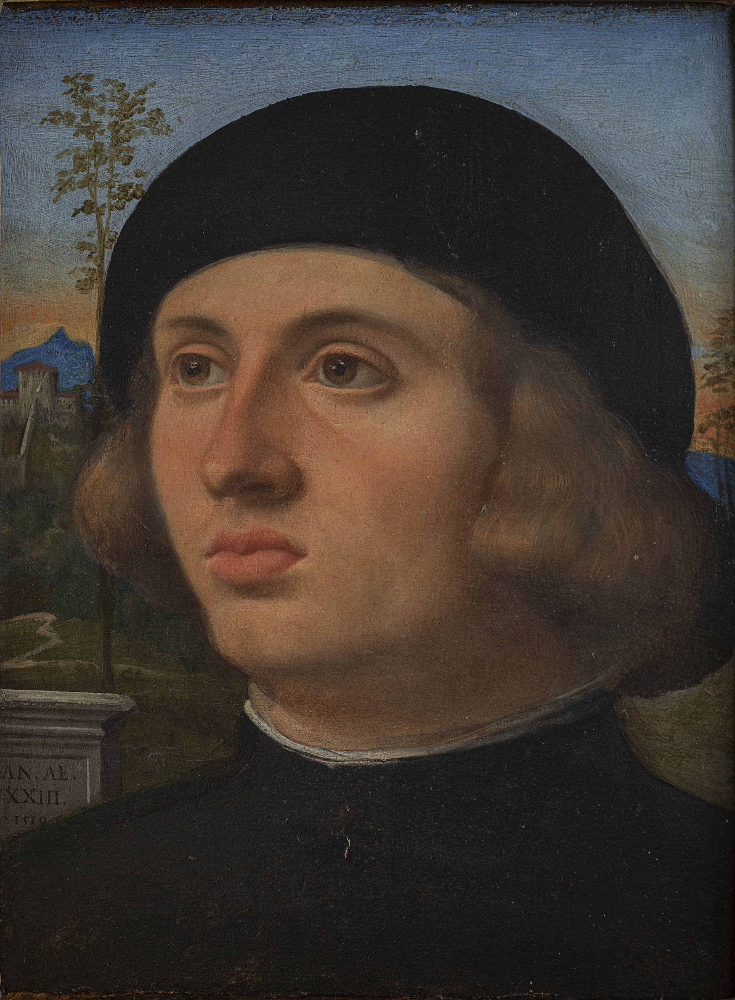

**内容 / 看点**：老帕尔马的《青年男子肖像》，小幅木板半身像。与本厅众多威尼斯肖像（安托内洛、洛托、卡尔帕乔）同处一室，可顺势比较各家的肖像手法。

### ⭐⭐ 推荐 归属维托雷·卡尔帕乔《女子肖像（卡珊德拉·费德莱？）》 / Attributed to Carpaccio Vittore, _Portrait of a Woman (Cassandra Fedele?)_

- **作者 / Artist**：归属维托雷·卡尔帕乔 / Attributed to Carpaccio Vittore
- **作品 / Work**：《女子肖像（卡珊德拉·费德莱？）》 / _Portrait of a Woman (Cassandra Fedele?)_
- **时间**：约 1499–1500 年
- **材质**：木板油画
- **尺寸**：28.5 × 24 cm
- **位置**：普绪刻厅（第 20 室）
- **官网介绍页**：[博尔盖塞官方藏品库](https://www.collezionegalleriaborghese.it/en/opere/portrait-of-a-woman-cassandra-fedele)｜馆藏编号 450

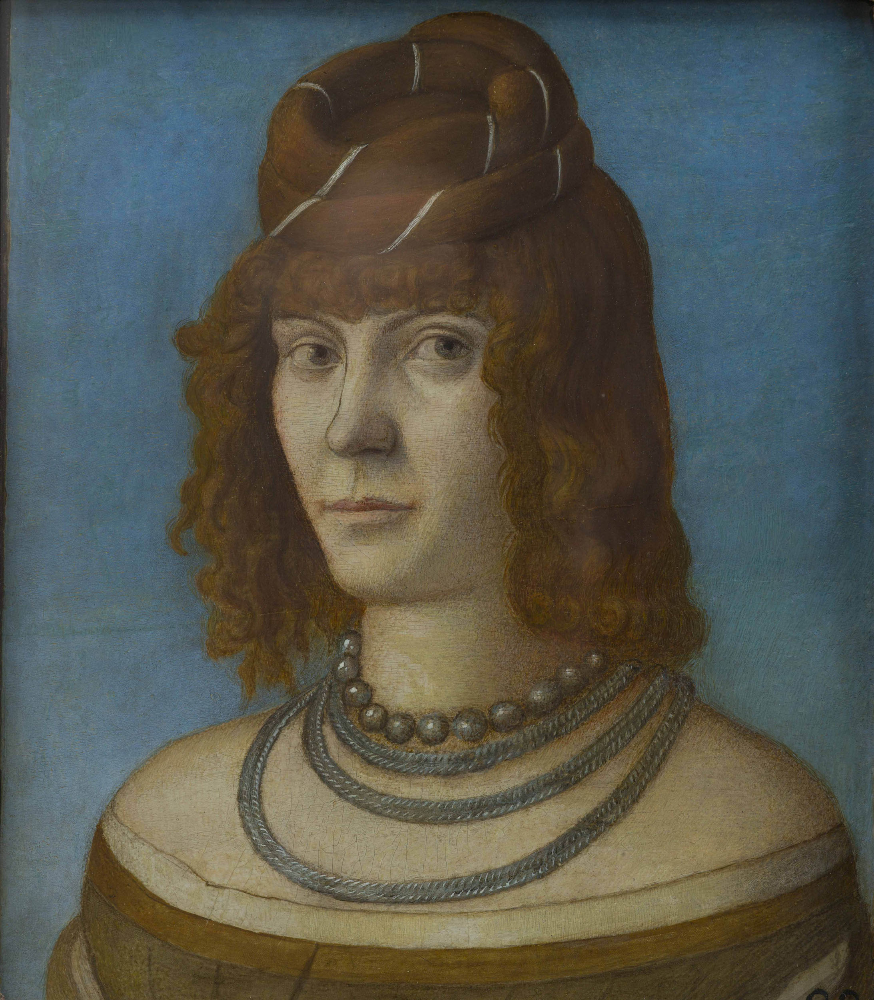

**内容（这是什么）**：一幅小幅木板女子肖像。曾被当作「圣女」，清除掉后世的重绘后才显露真容；近来被认作威尼斯女诗人卡珊德拉·费德莱（Cassandra Fedele）。她梳着仿罗马皇后福斯蒂娜（Faustina）的繁复发式，佩着珍珠项链与银链。

**背景 / 来历**：归于维托雷·卡尔帕乔（Vittore Carpaccio），约 1499–1500 年。本馆 1833 年才著录，1916 年清洗后由皮安卡斯泰利提出卡尔帕乔之名，1930 年代后获普遍接受。此板与威尼斯科雷尔博物馆那幅著名的《两位贵妇》（被罗斯金誉为「世上最美的画」）密切相关，可能原属同一块后被锯开的木板。

**看点**：这幅画的妙处是「破一个误会」——画中女子曾长期被当作交际花，但据威尼斯的禁奢令，珍珠（圣母贞洁的象征）只许贵族新妇佩戴、项链长度也有规定；凭这串珍珠与发式可断定她是新婚不久的贵族女子，而非交际花。

**现场站看**：

1. **看那串珍珠项链**——珍珠只准贵族新妇佩戴，这是判定她「贵妇而非交际花」的关键证据。
2. **看仿福斯蒂娜的发式**——借罗马「贤后」发型自比德行典范，是文艺复兴贞妇肖像的惯用语言。
3. **看下缘被切断的华服**——暗示此板原本更大、后被裁切，与科雷尔的《两位贵妇》本是一体。

## 雕塑

### ⭐ 顺路看 古罗马艺术《年轻男孩肖像雕像》 / Roman art, _Portrait Statue of a Young Boy_

- **作者 / Artist**：古罗马艺术 / Roman art
- **作品 / Work**：《年轻男孩肖像雕像》 / _Portrait Statue of a Young Boy_
- **时间**：公元 2 世纪
- **材质**：青铜
- **尺寸**：高 102 cm
- **位置**：普绪刻厅（第 20 室）
- **官网介绍页**：[博尔盖塞官方藏品库](https://www.collezionegalleriaborghese.it/en/opere/portrait-statue-of-a-young-boy)｜馆藏编号 CCLII

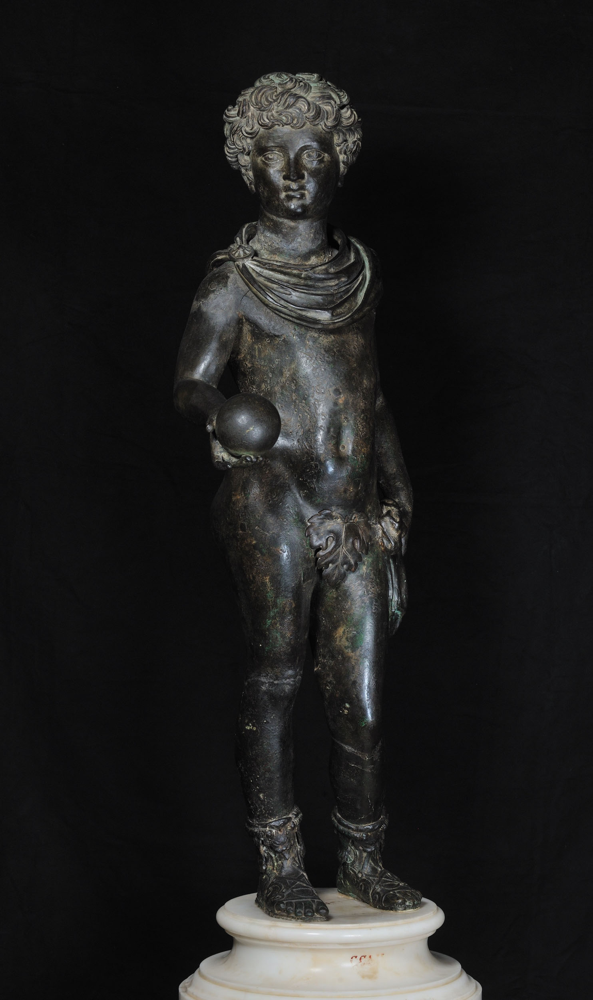

**内容 / 看点**：约公元 2 世纪的青铜《年轻男孩肖像雕像》，是一尊高逾一米的少年立像。罗马帝国时期的青铜人像存世稀少（多被熔毁），这件能保存下来已属难得。属本厅的古代艺术陈列，现场可重点看青铜材质与铸造，以及少年肖像的写实；古代铜像常涉后世修复，留意接合与补配。

### ⭐ 顺路看 古罗马艺术《年轻男孩胸像》 / Roman art, _Bust of a Young Boy_

- **作者 / Artist**：古罗马艺术 / Roman art
- **作品 / Work**：《年轻男孩胸像》 / _Bust of a Young Boy_
- **时间**：公元 1 世纪
- **材质**：白色大理石
- **尺寸**：连胸像高 29.5 cm；仅头部高 21.5 cm
- **位置**：普绪刻厅（第 20 室）
- **官网介绍页**：[博尔盖塞官方藏品库](https://www.collezionegalleriaborghese.it/en/opere/bust-of-a-young-boy)｜馆藏编号 CCLX

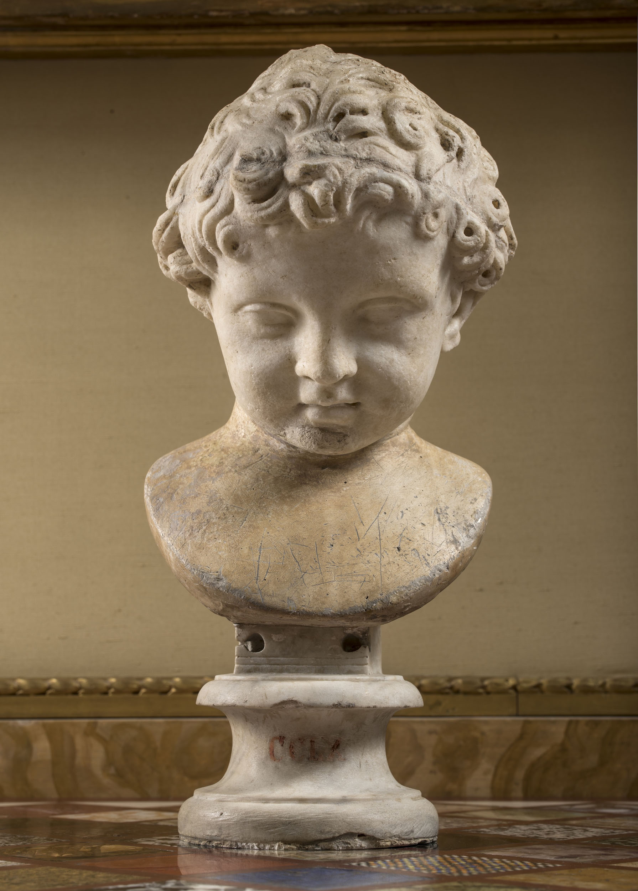

**内容 / 看点**：约公元 1 世纪的白色大理石《年轻男孩胸像》，仅头部约 21.5 cm。与同厅的青铜男孩立像（编号 CCLII）一道，构成本厅少量的古罗马「孩童肖像」。罗马人有为夭折或纪念孩童立像的传统，现场看其稚气面容的刻画。

## 其他

### ⭐ 顺路看 阿戈斯蒂诺·彭纳、洛伦佐·卡尔代利与安东尼奥·德·罗西《壁炉》 / Penna Agostino / Cardelli Lorenzo / De Rossi Antonio, _Fireplace_

- **作者 / Artist**：阿戈斯蒂诺·彭纳、洛伦佐·卡尔代利与安东尼奥·德·罗西 / Penna Agostino / Cardelli Lorenzo / De Rossi Antonio
- **作品 / Work**：《壁炉》 / _Fireplace_
- **时间**：约 1781–1782 年
- **材质**：雕像用大理石、古红大理石；鎏金铜贴饰
- **尺寸**：高 147 cm；宽 209 cm；深 78 cm
- **位置**：普绪刻厅（第 20 室）
- **官网介绍页**：[博尔盖塞官方藏品库](https://www.collezionegalleriaborghese.it/en/opere/fireplace-xx)｜馆藏编号 camini-XX

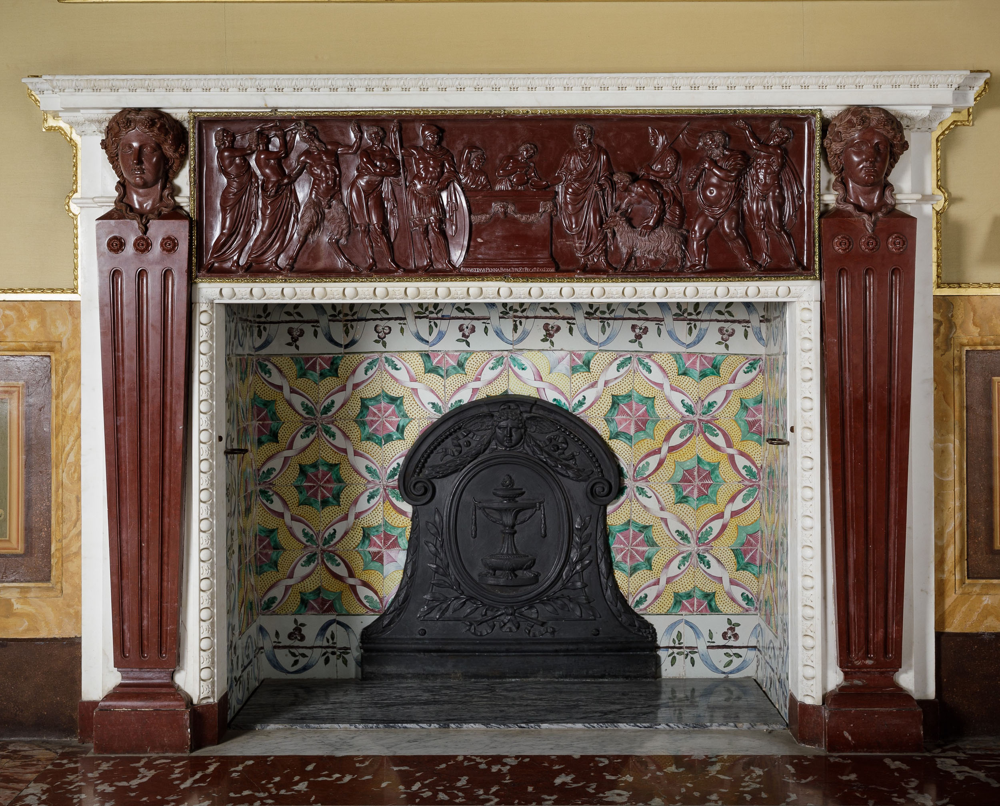

**内容 / 看点**：约 1781–1782 年由阿戈斯蒂诺·彭纳等三位工匠制作的大理石《壁炉》，用雕像用大理石与古红大理石、配以鎏金铜贴饰。它是 18 世纪末阿斯普鲁奇（Antonio Asprucci）主持别墅整体改造时为本厅定制的陈设之一，帮助理解这间房间作为「主题厅」、而非单纯挂画空间的整体设计。

### ⭐ 顺路看 房间装饰与壁炉 / Room Decoration and Fireplace

- **位置**：普绪刻厅（第 20 室）

二楼房间的天顶、壁炉、怪诞纹和透视装饰共同构成参观体验。尤其是 18 世纪末 Antonio Asprucci 主持的整体改造，让每间房间都有独立主题，而不只是挂画空间。

## 资料来源 / Sources

- Galleria Borghese 官方房间页：[Room 20](https://galleriaborghese.cultura.gov.it/en/il-museo/la-villa/sala-20-sala-di-psiche/)
- Galleria Borghese 藏品筛选：[Painting, Room 20](https://www.collezionegalleriaborghese.it/en/collezione/pittura?sala=s20)
- Galleria Borghese 藏品筛选：[Modern Sculpture, Room 20](https://www.collezionegalleriaborghese.it/en/collezione/scultura?sala=s20)
- Galleria Borghese 藏品筛选：[Ancient Art, Room 20](https://www.collezionegalleriaborghese.it/en/collezione/arte-antica?sala=s20)
- Galleria Borghese 藏品筛选：[Furniture, Room 20](https://www.collezionegalleriaborghese.it/en/collezione/arredi?sala=s20)
