从 2026 年 6 月 27 日到 7 月 12 日，我和老婆带着娃去了一趟意大利。从罗马出发，去了佛罗伦萨、米兰、威尼斯，再往南飞到那不勒斯，去了索伦托，最后回到罗马，绕了一圈，在意大利一共待了十四天。这一年娃十三岁。

## 一、出发前

意大利本来是去年就要去的。去年签证办晚了，等办下来已经 7 月中了，想着那时候太热，就没去，挪到了今年。结果今年又碰上了欧洲酷暑。出发前不久就知道了，可那时一切都订好了，已经没办法改。

行程大概是出发前三个月开始排的。每天去哪里、怎么走，买车票、订酒店、约门票、约导游，一件一件地弄，忙了好久才弄完。罗马的博尔盖塞美术馆和梵蒂冈，我还提前做了参观功课。做完的时候，觉得总算搞完了，就分两批发在了这个博客上，6 月 9 日一批，6 月 18 日一批（[博尔盖塞美术馆](/posts/borghese/overview/)、[梵蒂冈](/posts/vatican/overview/)）。

出发前的愿望很简单：好好享受整个行程，路上别出问题，别有意外。

## 二、路上十四天

我们这一趟的路线，画在地图上，正好绕了意大利一圈。

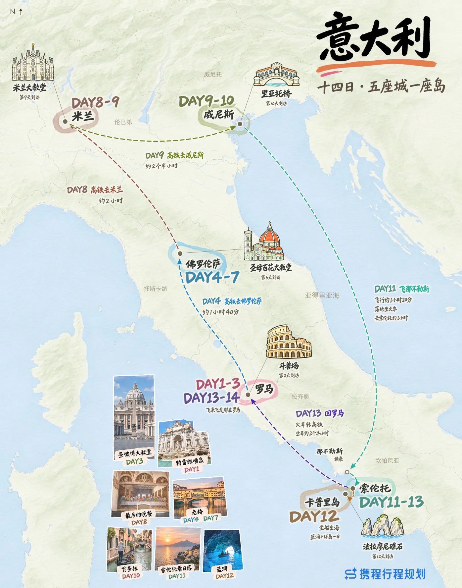

### 罗马：热，和没人的清晨

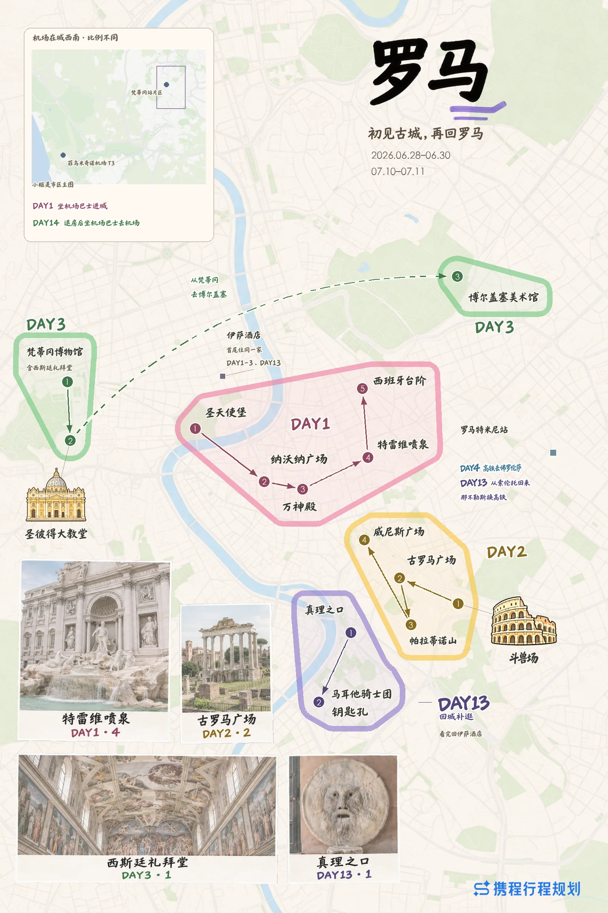

**6 月 28 日，第一天**。27 日晚上从上海出发，在成都转机，28 日早上七点落地罗马。坐大巴进城，在普拉蒂区的酒店放下行李，十一点多就出门了。娃一出门就念叨：坐了十三个小时飞机，下一站要去许愿池。

我们先过加富尔广场和司法宫，沿着台伯河走到圣天使堡。这座圆滚滚的城堡，最早是哈德良皇帝给自己修的陵墓，公元 139 年建成，后来才一层层改成了堡垒和教皇的要塞。“圣天使”这个名字来自 590 年的一个传说：罗马闹瘟疫，教皇格里高利一世带着游行队伍走到这里，看见大天使米迦勒站在墓顶上，把剑收回了鞘里，瘟疫就要过去了。所以今天堡顶上立着的，是一尊收剑的米迦勒铜像。

再穿过科罗纳里古董街。街边的画廊里，有位老画家正在画画。我给老婆拍照，让她看着首饰店的橱窗，别看我，自然一点。

走到街口，纳沃纳广场一下子就在眼前了。广场又长又窄、两头是圆的，因为脚下原本是公元 86 年图密善皇帝修的体育场，四周的房子是顺着当年看台的轮廓盖起来的。正中是贝尔尼尼的四河喷泉，四个河神代表四个大洲：多瑙河、恒河、尼罗河、拉普拉塔河。尼罗河神头上蒙着一块布，流传最广的说法是贝尔尼尼不想看对面死对头波罗米尼的教堂，其实是因为那时候欧洲人还不知道尼罗河的源头在哪儿。我们在广场边吃了冰激凌和炸饭团。


罗马-切块披萨.webp 罗马的切块披萨
罗马-中午的圣天使堡.webp 中午的圣天使堡
罗马-科罗纳里街的老画家.webp 科罗纳里街画廊里的老画家
罗马-纳沃纳广场.webp 纳沃纳广场上的我
罗马-纳沃纳的冰激凌.webp 纳沃纳广场吃冰激凌


罗马很热。白天在太阳底下热得受不了，走到阴凉的地方又会凉快一些；晚上九点太阳才下山。老婆跟在娃后面笑他：他肯定没想到罗马这么这么热。中午实在太热，我们回酒店歇了一阵，三点多又出门。热归热，总觉得不能躲在酒店里。

下午先去万神殿。它是哈德良皇帝在公元 2 世纪重建的，门廊上那行青铜大字，写的却是最早建它的阿格里帕的名字。站在圆厅中间仰头看那个天窗：穹顶直径 43.3 米，不用一根钢筋，至今还是世界上最大的无钢筋混凝土穹顶；正中的圆洞将近九米宽，殿里没有一扇窗，全靠它采光。拉斐尔就葬在这里，是他自己要求的。

又去了法国人圣路易堂。金色的拱顶底下，孔塔雷利礼拜堂里挂着卡拉瓦乔的《圣马太》组画，左中右三幅：《圣马太蒙召》《圣马太与天使》《圣马太殉道》。这是他接的第一个公共大单，那年他二十八岁。《蒙召》里一束光从右上方斜斜打进屋里，礼拜堂右上方正好有一扇真窗，画里画外是同一个方向的光；《殉道》左后方那个回头往外看的大胡子，是他给自己画的像。


罗马-万神殿外观.webp 万神殿外面
罗马-万神殿的天窗.webp 万神殿的天窗
罗马-圣路易堂的金色拱顶.webp 法国人圣路易堂的拱顶
罗马-卡拉瓦乔的圣马太.webp 卡拉瓦乔的《圣马太与天使》


去许愿池的路上，娃举着小风扇，先许起了自己的愿：想要一部 iPhone 17，还得是 2TB 的。

到了池边，娃双手合十。池子正中站着海洋之神，脚下两匹海马，一匹扬着前蹄，一匹低着头，一匹是汹涌的海，一匹是平静的海。池里的水，还是公元前 19 年阿格里帕修的“处女水道”送来的，两千年没断过。我背对着池子，把硬币从肩膀后面抛了进去。照规矩是右手拿硬币，从左肩上抛过去，扔一枚，是保佑以后还能再回罗马；池底的硬币会定期捞上来，交给教会的慈善组织去救济穷人。我许的是什么愿，现在已经想不起来了。

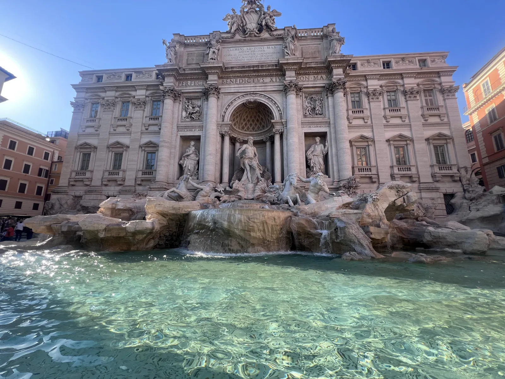


罗马-许愿池前双手合十的娃.webp 娃在许愿池前许愿


傍晚往西班牙广场那边走，路边有烤栗子的小摊。最后拐进了马古塔街。这条小街很早就是画家、雕塑家扎堆的地方，现在两边还是一家挨一家的画廊和工作室。《罗马假日》里派克演的那个记者，住的就是这条街的 51 号；再往北，110 号是导演费里尼的家，他和太太在这儿一直住到他去世。老婆在爬满常春藤的小街里留了影。


罗马-烤栗子摊.webp 西班牙广场边的烤栗子摊
罗马-马古塔街的常春藤.webp 马古塔街常春藤小巷里的老婆


**6 月 29 日，斗兽场和烟火**。罗马白天人很多，到处是游客。所以从这天起，我每天都起得很早，天刚亮就出门走走、拍照。这天早上去了圣天使堡和圣彼得大教堂：协和大道上没有人，尽头就是圣彼得；圣天使桥上，贝尔尼尼的天使像一尊一尊立在晨光里。桥上一共十尊天使，每尊手里拿着一件耶稣受难时的东西：鞭子、荆棘冠、钉子、长矛、海绵……整座桥的天使是贝尔尼尼晚年设计的，他亲手雕了其中两尊，教皇看了舍不得放到桥上，留了下来，现在在西班牙台阶附近的一座教堂里，桥上那两尊是照着做的复制品。

一是觉得没人真好，二是觉得很美。后来到了别的城市，我和老婆也都这样早起。

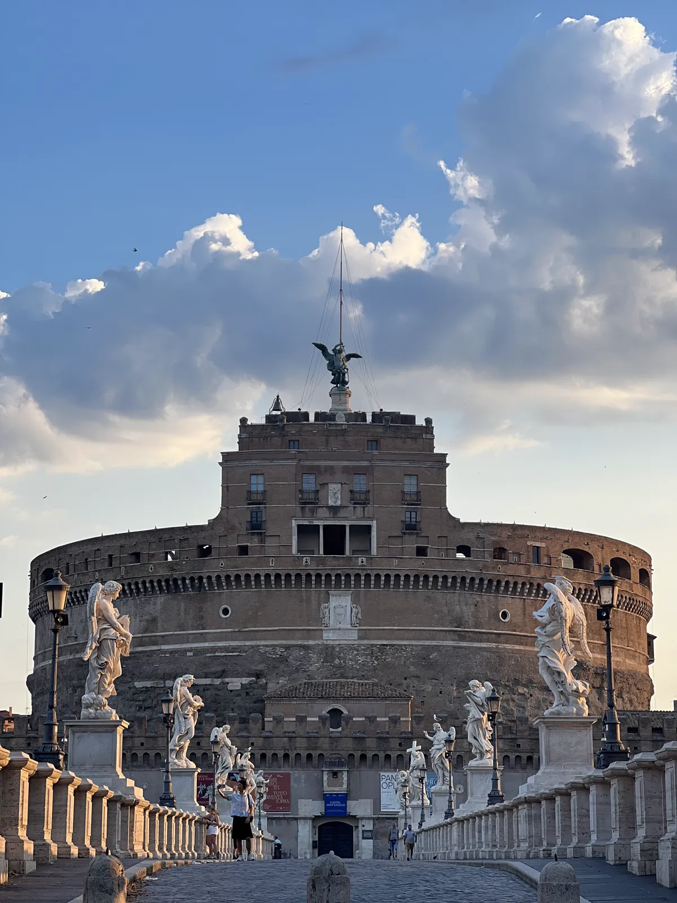


罗马-清晨的协和大道.webp 清晨空荡荡的协和大道


八点半坐地铁，一出站，第一眼就是斗兽场。老婆在斗兽场前比了个耶。裴导带着我们讲了两个半小时：先进斗兽场里面，看表演场地底下的那层地下结构。斗兽场是公元 80 年揭幕的，能坐五万来人；当年场地上铺着木板和沙子，底下是两层走道、兽笼和几十口升降井，野兽和角斗士用绞盘从地下升上去，一下子出现在观众眼前。

出来是君士坦丁凯旋门，我和娃在凯旋门前一起张开了胳膊。这是罗马现存最大的凯旋门，公元 315 年修的，可门上很多浮雕是从早一两百年的老纪念碑上拆来的，浮雕里旧皇帝的脸，都被改刻成了君士坦丁。

再经过提图斯凯旋门，它纪念的是公元 70 年攻破耶路撒冷，拱洞里的浮雕上，罗马士兵抬着从犹太圣殿抢来的七枝烛台，今天以色列国徽上的烛台，就是照着它画的。然后上帕拉蒂诺山，传说罗慕路斯就在这里建了罗马城，后来的皇帝都把宫殿修在山上，英文的 palace 就是从这座山的名字来的。从观景台往下看古罗马广场，那是古罗马的市中心，元老院、神庙、演讲台都在这片低地上，恺撒死后也是在这里火化的。


罗马-出地铁看到斗兽场.webp 出地铁第一眼的斗兽场
罗马-斗兽场前比耶的老婆.webp 老婆在斗兽场前比耶


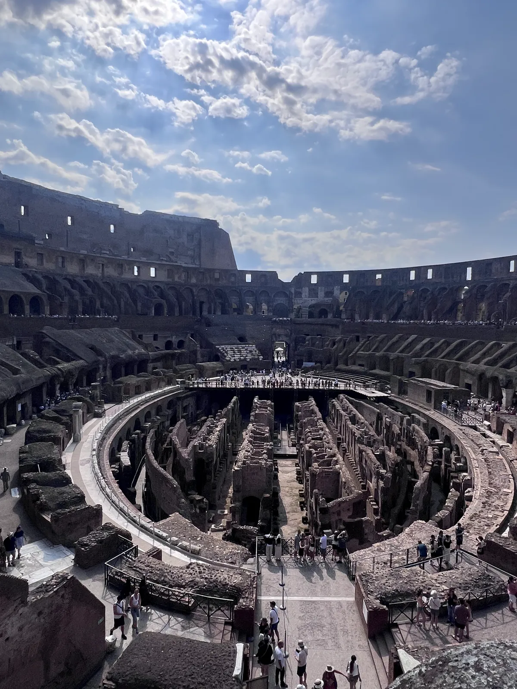


罗马-君士坦丁凯旋门前张开手臂.webp 我和娃在君士坦丁凯旋门前
罗马-提图斯凯旋门.webp 提图斯凯旋门


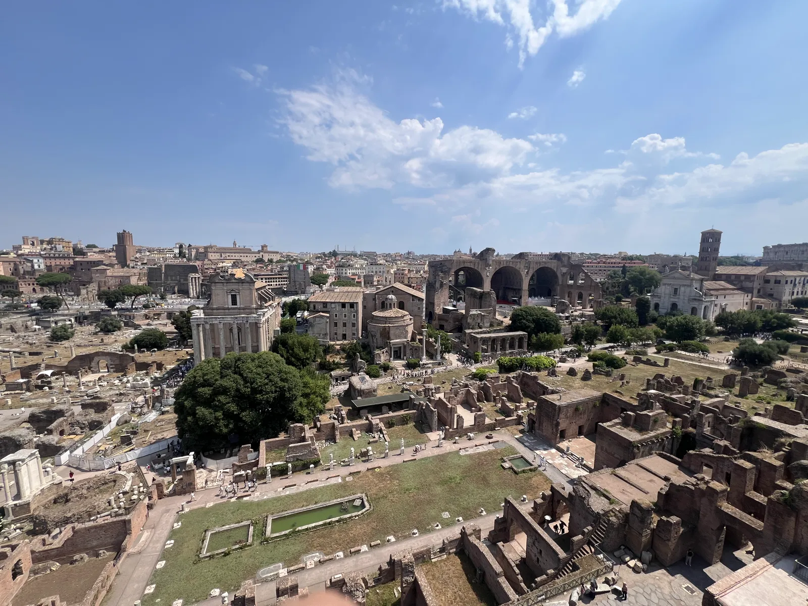

中午坐电梯上了维托里亚诺的顶，整个罗马都在脚下。这座白色大理石的大家伙，是为意大利统一后的第一位国王维克多·埃马努埃莱二世修的，1911 年落成；在一片米黄色的老城里它白得扎眼，罗马人管它叫“打字机”“婚礼蛋糕”。顶上的露台挨着两组青铜四马战车，往东南看，一条大道笔直通到斗兽场，上午走过的古罗马广场和帕拉蒂诺山就在大道旁边。娃脖子上挂着小风扇，热得够呛。

午饭在斗兽场附近吃的，意式方饺、披萨，最后是冰激凌。下午回酒店躲太阳，一直躲到傍晚。

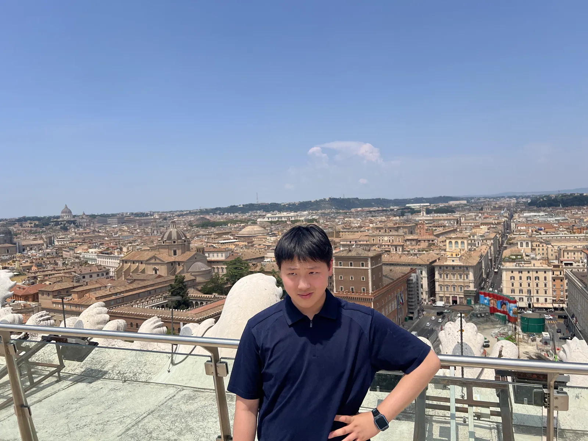


罗马-维托里亚诺上俯瞰罗马.webp 在维托里亚诺顶上看罗马
罗马-斗兽场边的意式方饺.webp 斗兽场边吃的意式方饺
罗马-斗兽场边的冰激凌.webp 午饭后的冰激凌


晚上有烟火，是裴导告诉我们的。那天是圣彼得和圣保罗节，我们事先并不知道。这两位使徒是罗马城的主保圣人，6 月 29 日是罗马自己的节日。太阳落山的时候，我们在台伯河边等着，圣天使堡上面的天烧成了橙红色；放烟火前下了一点小雨。九点半，圣天使堡上空的烟火一朵接一朵，我把相机架好，从头到尾录了二十二分钟。放完以后，大家都在狂欢。那天晚上我们都很高兴。

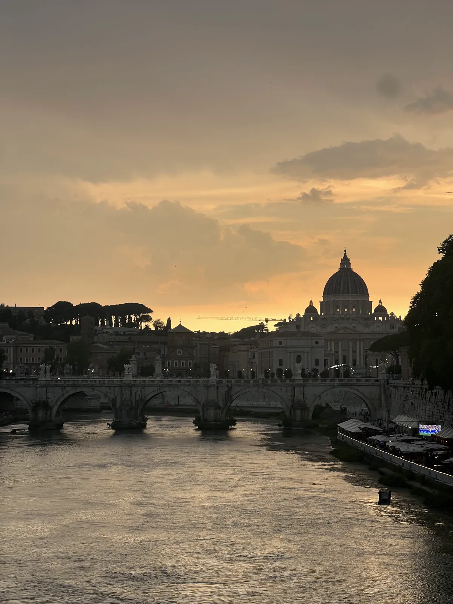


罗马-等烟火时的橙红天空.webp 等烟火时的橙红天空


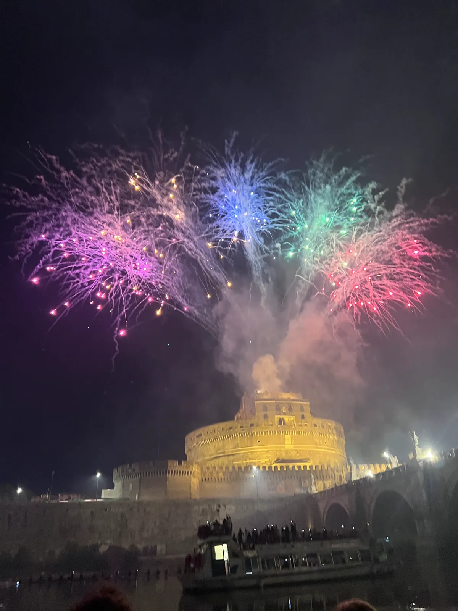

**6 月 30 日，梵蒂冈和博尔盖塞**。早上五点半，我和老婆又出门了。台伯河上是粉色的天。六点，第一缕阳光照到圣彼得大教堂的正面，整面墙变成了金色。广场上几乎没有人，协和大道上有一对新人在拍婚纱照，地上的一摊积水倒映着大教堂。太阳从台伯河上升起来，圣天使堡成了一个剪影。

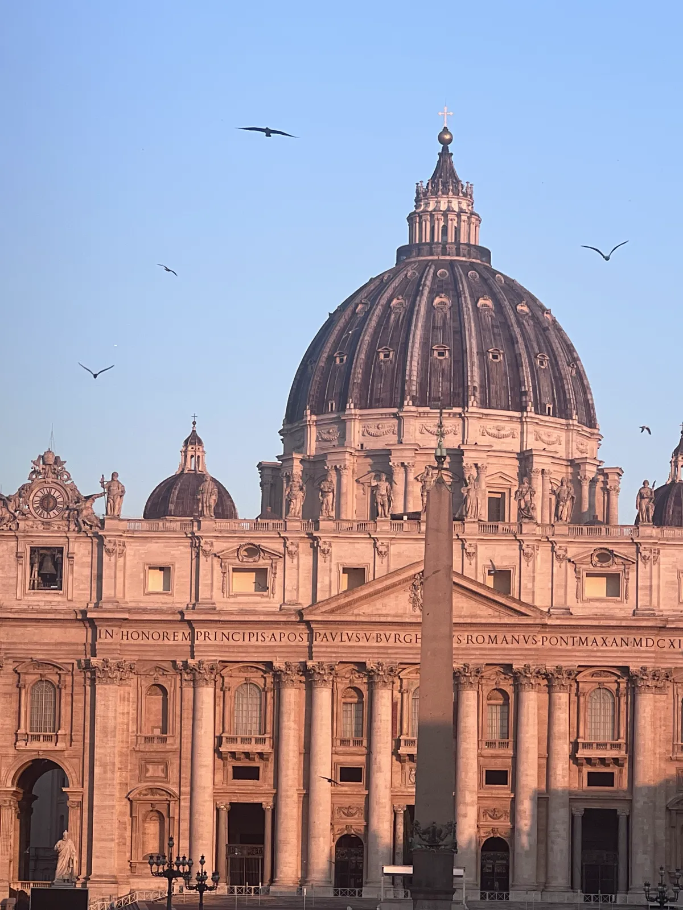


罗马-粉色黎明的台伯河.webp 粉色黎明里的台伯河
罗马-清晨空荡的圣彼得广场.webp 清晨几乎没人的圣彼得广场
罗马-协和大道拍婚纱的新人.webp 清晨协和大道上拍婚纱照的新人
罗马-台伯河日出与圣天使堡.webp 台伯河上日出，圣天使堡成了剪影


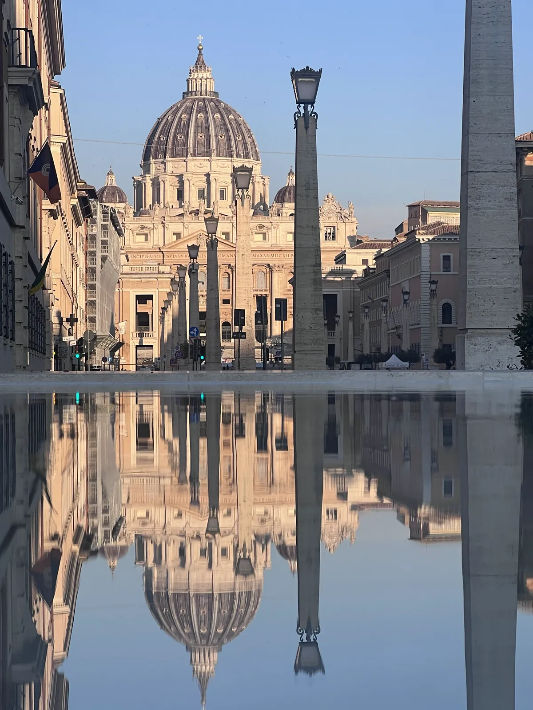

清晨六点多，我站在圣天使桥上，太阳刚从身后升起来，台伯河尽头，圣彼得灰蓝色的穹顶上，一道道白色的石肋被照亮了，一直收到顶上的采光亭。它其实很华丽，却华丽得一点不乱。那么大，却一点不张扬，端端正正地立在那儿，人站在它面前，自然就收了声。比起后来在佛罗伦萨看到的百花大教堂，我更喜欢它，它有一种气度。

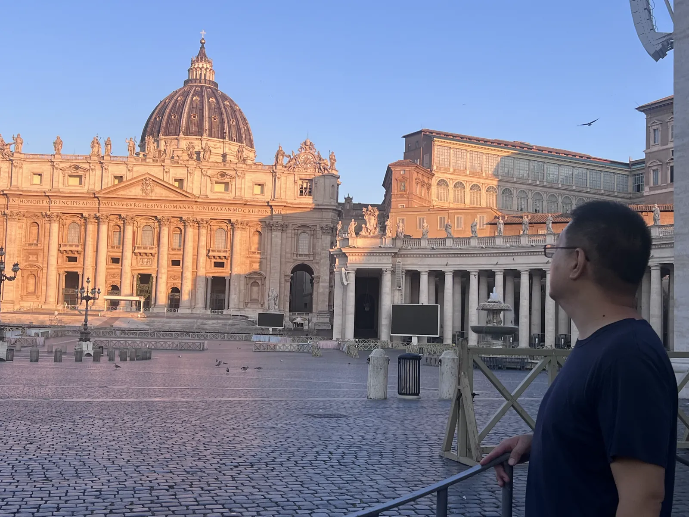

八点前，裴导带我们进了梵蒂冈博物馆。先看了螺旋楼梯，就是明信片上那道，1932 年修的，一圈一圈旋下去，像个蜗牛壳。然后是松果院，院子一头是巨大的青铜松果，将近四米高，原本是古罗马的一座喷泉，水从松果顶上渗出来；中间是一个金属大球，叫《球中球》，外壳裂开，露出里面齿轮一样的内球。

八角庭院里有拉奥孔，还有观景殿的阿波罗。拉奥孔是特洛伊的祭司，因为警告大家别把木马拉进城，和两个儿子一起被海里来的大蛇缠死。这尊像 1506 年在罗马挖出来时缺了右臂，米开朗基罗说原来那条胳膊应该是往回弯的，后人却补了一条伸直的；直到 1906 年，有人在附近找到了弯着的原臂，几十年后装了回去，米开朗基罗猜对了。观景殿的阿波罗刚刚射出一箭，左臂往前伸着，脸上平平静静，跟几步外满脸痛苦的拉奥孔正好相反。


罗马-梵蒂冈博物馆的螺旋楼梯.webp 梵蒂冈博物馆的螺旋楼梯
罗马-松果院的大松果.webp 松果院里的大松果
罗马-八角庭院的观景殿阿波罗.webp 八角庭院里的观景殿阿波罗


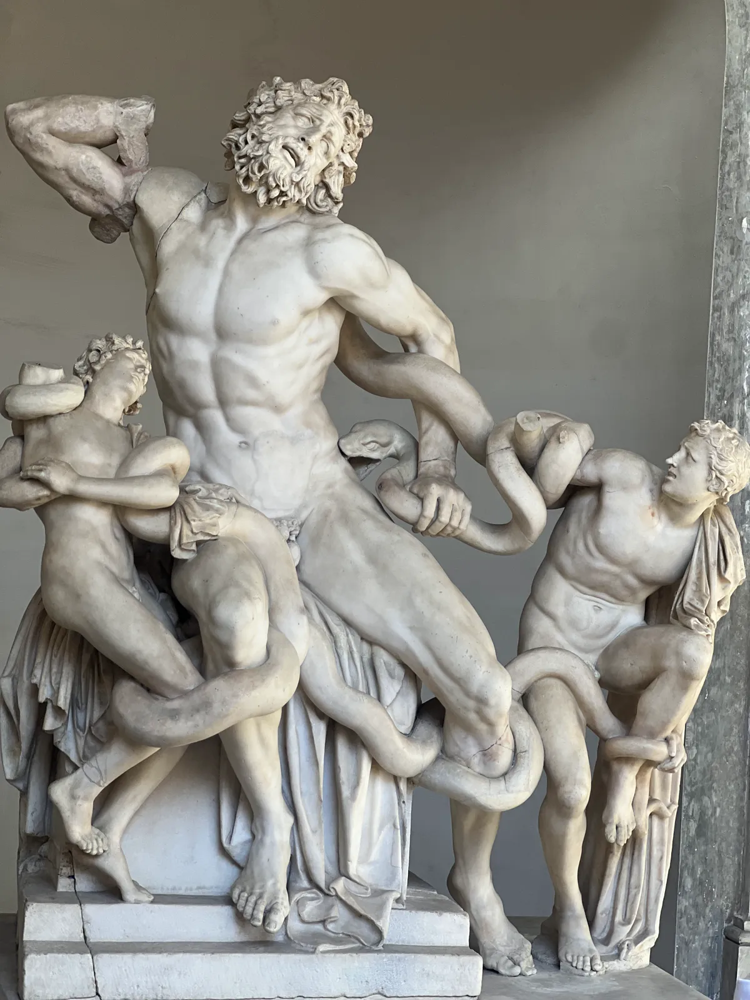

缪斯厅里，娃戴着绿色的讲解耳机，听得很认真。厅正中是一具没头没胳膊的大理石残像，叫《观景殿躯干》，米开朗基罗最崇拜它，西斯廷天顶上的那些人体，很多都有它的影子。

再往前是圆形厅，照着万神殿修的，正中摆着一个整块紫红斑岩凿成的大盆，周长十三米。然后是烛台廊、挂毯廊，然后是长长的地图廊：一百二十米长，两边墙上是四十幅 16 世纪画的意大利各地的地图，头顶是一整条镀金的拱顶。我们后面要去的托斯卡纳、威尼斯、那不勒斯湾，墙上都有。


罗马-缪斯厅的天顶.webp 缪斯厅的天顶
罗马-戴着耳机的娃.webp 梵蒂冈博物馆里戴着讲解耳机的娃
罗马-圆形厅的穹顶.webp 圆形厅的穹顶
罗马-烛台廊.webp 烛台廊


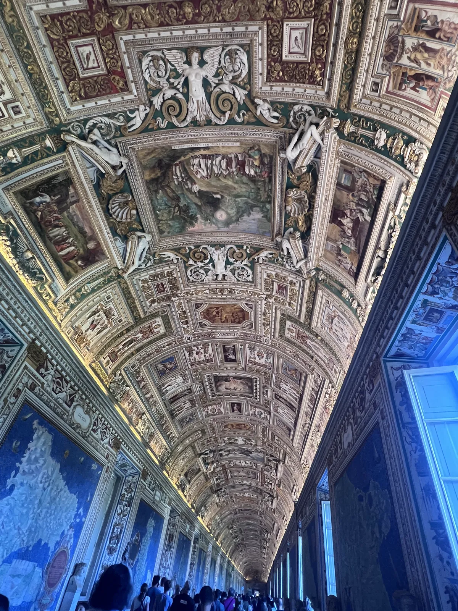

拉斐尔房间里有《雅典学院》，导游说，这幅画我们的教科书里都有。这几间屋子 1508 年交给了二十五岁的拉斐尔，同一时间，米开朗基罗正在隔壁画西斯廷的天顶。画正中，手指着天的是柏拉图，用的是达·芬奇的脸；手掌朝下的是亚里士多德。前面独自趴在石块上写字的赫拉克利特，用的是米开朗基罗的脸，底稿上原本没有他，是后来添的；最右边戴黑帽、看向画外的年轻人，是拉斐尔自己。

最后是西斯廷礼拜堂，选新教皇的地方。天顶是米开朗基罗站在脚手架上，仰着头画了四年才画完的，《创造亚当》就在上面；祭坛那面墙，是他二十多年后回来画的《最后的审判》。西斯廷里面不能拍照。

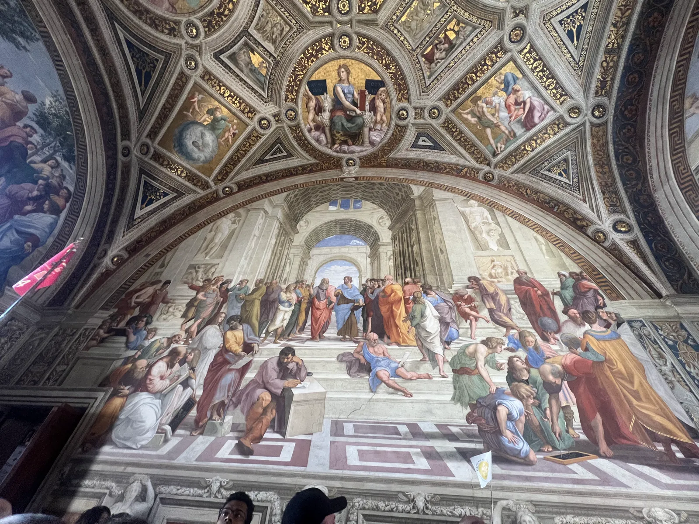


罗马-拉斐尔房间的圣礼之争.webp 拉斐尔房间的《圣礼之争》


十一点多从博物馆出来，直接进了圣彼得大教堂。进门右手边第一间小堂里，是米开朗基罗的《圣殇》，他二十四岁时雕的：圣母抱着刚从十字架上放下来的耶稣，脸比怀里的儿子还年轻。这是他唯一签了名的作品，名字刻在圣母胸前的带子上；1972 年有人拿锤子砸过它，从那以后它就一直待在防弹玻璃后面。

教堂正中是贝尔尼尼的青铜华盖，将近三十米高，四根扭着往上转的螺旋铜柱上爬满了蜜蜂，那是出钱的教皇乌尔班八世家的纹章；华盖正下方，就是圣彼得的墓。后殿的圣彼得宝座也是贝尔尼尼做的，四位教会圣师托着一把鎏金铜椅，上方是一扇金色的窗，窗心飞着一只鸽子。又站到大穹顶的正下方往上看，穹顶是米开朗基罗设计的，底下绕着一圈蓝底金字：“你是彼得，我要把我的教会建在这磐石上……”每个字母差不多有两米高。正好碰上一队穿红袍的神职人员走过。

中午吃的是炸饭团和切块披萨。


罗马-圣彼得大教堂的圣殇.webp 米开朗基罗的《圣殇》
罗马-贝尔尼尼的青铜华盖.webp 贝尔尼尼的青铜华盖
罗马-圣彼得大教堂的大穹顶.webp 抬头看圣彼得大教堂的大穹顶
罗马-圣彼得宝座.webp 圣彼得宝座
罗马-红衣神职人员列队.webp 红衣神职人员列队走过大殿
罗马-午饭的炸饭团.webp 午饭买的炸饭团


下午四点进博尔盖塞美术馆。这里原是红衣主教希皮奥内·博尔盖塞的别墅，贝尔尼尼二十来岁时的几件成名作，都是给他雕的。《劫掠普洛塞庇娜》里，冥王把少女抱离地面，手指掐进她的大腿，硬邦邦的大理石像肉一样陷了下去，少女的眼角还挂着一滴泪。《埃涅阿斯》是他二十岁出头的作品，埃涅阿斯背着老父亲逃出特洛伊，小儿子跟在腿边，孩子、壮年、老人三种不同的皮肤，出自同一块石头。《大卫》正要甩出投石索，紧咬着嘴唇，那张脸是贝尔尼尼照着镜子雕的自己。《阿波罗与达芙妮》里，阿波罗刚碰到达芙妮，她的手指已经抽出了月桂叶，脚趾扎进地里成了根；阿波罗的姿势，就是照着上午在梵蒂冈看到的观景殿阿波罗雕的。

卡诺瓦的《保琳娜》雕的是拿破仑的妹妹，她嫁进了博尔盖塞家，被雕成半躺着的维纳斯，手里托着一只金苹果，身下的床垫像是真被压出了凹陷。提香的《圣爱与俗爱》里，石棺改成的水池两边，坐着两个长得几乎一样的女子，一个穿得整整齐齐，一个几乎全裸，中间小爱神伸手搅着池水。

走了一整天，娃到这里已经累得扶着栏杆了，耳朵上还挂着讲解耳机。


罗马-博尔盖塞的劫掠普洛塞庇娜.webp 贝尔尼尼《劫掠普洛塞庇娜》
罗马-博尔盖塞的大卫.webp 贝尔尼尼的《大卫》
罗马-博尔盖塞的埃涅阿斯.webp 贝尔尼尼《埃涅阿斯、安喀塞斯和阿斯卡尼俄斯》


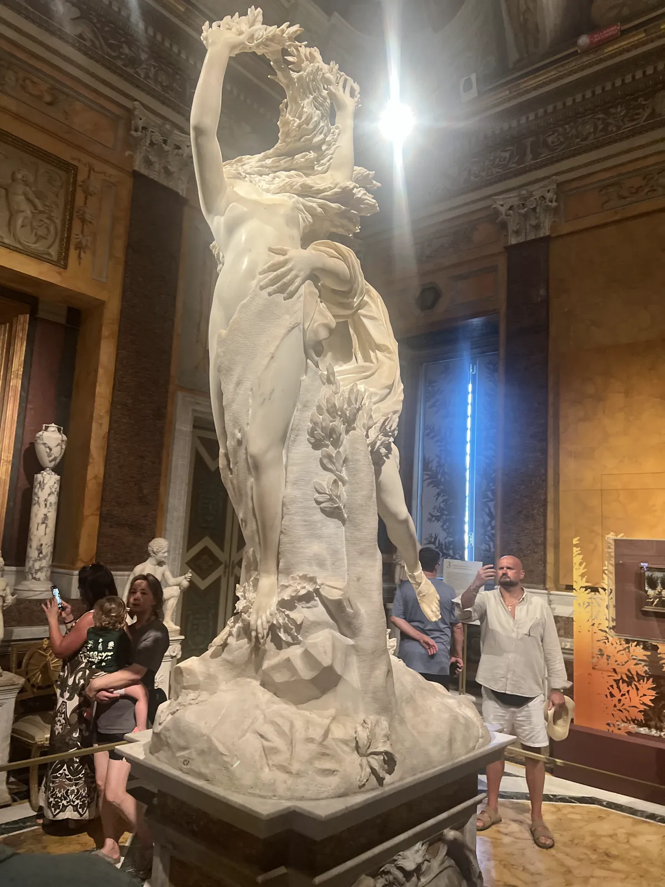


罗马-博尔盖塞的保琳娜.webp 卡诺瓦的《保琳娜》
罗马-圣爱与俗爱.webp 提香《圣爱与俗爱》
罗马-博尔盖塞的彩绘天顶.webp 博尔盖塞美术馆的彩绘天顶
罗马-扶着栏杆的娃.webp 博尔盖塞走累了，娃扶着栏杆


这些地方出发前我都做过功课，真站到跟前，最大的感受却是：人太多，时间太短。我希望能像清早在街上那样，独占这些作品，在它们下面静静地发呆，感受它们的时间和空间。可白天只能跟着人流往前走。

晚上九点多，我们又出去走了走。街上有骑警；圣天使堡亮着灯；有个街头艺人在弹一种发橙光的管子；路边的小摊卖瑞士近卫队的象棋，问了一下价，二百四十五欧。夜里的圣彼得广场，柱廊和方尖碑都亮着。这一天最后看到的，是砖墙下面一个在烛光里拉小提琴的少年。


罗马-街上的骑警.webp 街上的骑警
罗马-黄昏的台伯河与圣天使堡.webp 黄昏的台伯河和圣天使堡
罗马-夜里的圣彼得广场柱廊.webp 夜里的圣彼得广场柱廊
罗马-发橙光的街头艺人.webp 发橙光管子乐器的街头艺人
罗马-烛光里拉小提琴的少年.webp 砖墙下烛光里拉小提琴的少年


**7 月 1 日，离开罗马**。走之前，我和老婆又早起走了一圈。台伯河边是粉色的晨光，老婆举着手机拍远处的圣彼得穹顶；纳沃纳广场和四河喷泉空无一人；万神殿前，我们两个轮流给对方拍照。回到酒店吃早饭，喝了一杯卡布奇诺，然后退房去车站。

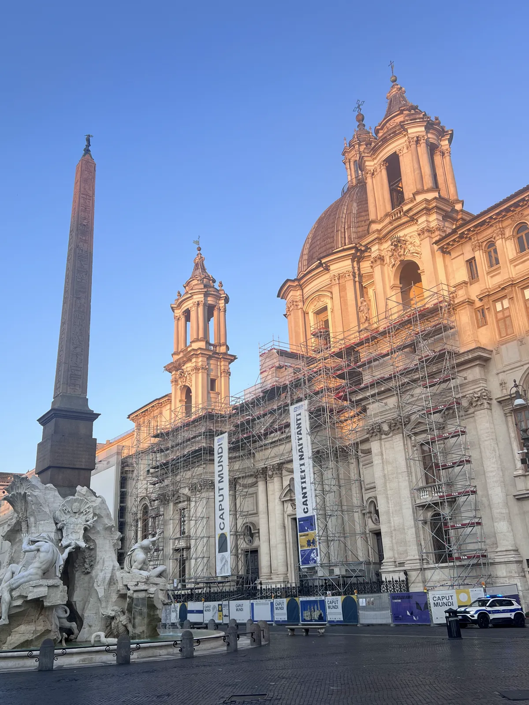


罗马-老婆举着手机拍圣彼得穹顶.webp 老婆举着手机拍粉色天空下的圣彼得穹顶
罗马-空荡荡的四河喷泉.webp 纳沃纳广场空荡荡的四河喷泉
罗马-万神殿前的我.webp 万神殿前，我坐在台阶上
罗马-万神殿前的老婆.webp 万神殿前，老婆张开双臂
罗马-酒店早餐的卡布奇诺.webp 酒店早餐的卡布奇诺


### 佛罗伦萨：像个露天的大 pub

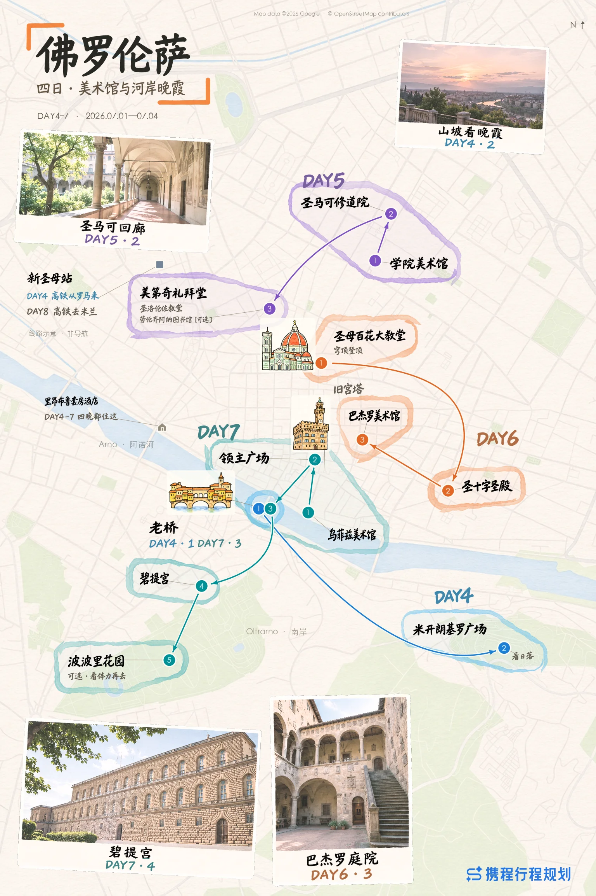

**7 月 1 日**上午坐高铁，中午到了佛罗伦萨，出站就是新圣母大殿。佛罗伦萨的火车站就是拿这座教堂起的名。教堂正面朝着前面的广场，是绿白两色大理石拼的几何花纹，上半截两边各有一个大涡卷，是十五世纪阿尔贝蒂加上去的。住处在阿诺河边，桌上放着一瓶基安蒂。

傍晚沿着阿诺河南岸走，穿过奥尔特拉诺高墙夹着的窄巷，出了城门上山，到了米开朗基罗广场。这个广场是 1869 年修的，那几年佛罗伦萨正当着意大利的首都，城里大改造，建筑师波吉把南岸这片山坡修成了一路往上的坡道和花园，广场在最高处，整个是献给米开朗基罗的。广场正中站着一尊青铜《大卫》，是复制品，1873 年用九对牛拉上山的；底座四角还有米开朗基罗给美第奇礼拜堂雕的《昼》《夜》《晨》《暮》，也是铜铸的复制品。

天阴着，乌云忽然裂开一道缝，光束正好落在老桥、旧宫和大教堂那一带。站在栏杆前，老城一眼就能认全：阿诺河上那座桥面盖满小房子的是老桥；那座细高、顶上带雉堞的方塔是旧宫；再远一点，红色的八角大穹顶就是大教堂，紧挨着它的方塔是乔托钟楼。娃穿着白 T 恤站在栏杆边；老婆戴着草帽，看着远处的穹顶。天黑前，她坐在石墙上，背后是穹顶、旧宫和一线粉色的晚霞。


佛罗伦萨-新圣母大殿.webp 到佛罗伦萨，出站先看到新圣母大殿
佛罗伦萨-基安蒂经典红酒.webp 住处桌上的一瓶基安蒂
佛罗伦萨-沿阿诺河南岸走.webp 沿阿诺河南岸往米开朗基罗广场走


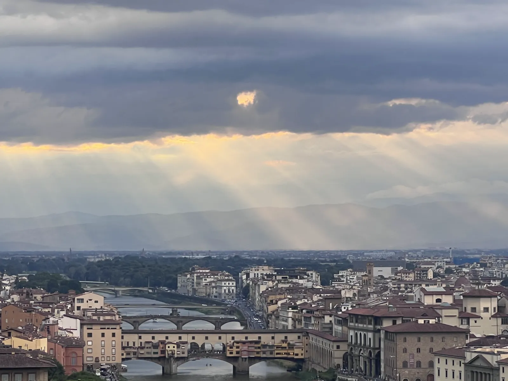


佛罗伦萨-米开朗基罗广场的娃.webp 娃穿白T恤站在米开朗基罗广场的栏杆边
佛罗伦萨-老婆望着大教堂.webp 老婆戴着草帽望向大教堂穹顶
佛罗伦萨-石墙上的老婆.webp 老婆坐在石墙上，背后是穹顶和粉色暮光


佛罗伦萨和罗马味道不同。罗马有很多宏伟的建筑；佛罗伦萨的老城更市井，也更老旧。但都很美。这里每天晚上都像一个露天的大 pub，很多人在街上唱歌、跳舞，一直到半夜才停。第一天晚上，老桥上有一支街头乐队，整条街的人都举着手机跟着合唱，唱完，歌手说了一声“Thank you!”。老桥是阿诺河上最老的一座桥，桥面两边挤满了金店：1593 年美第奇大公下了一道命令，桥上只许开金店和珠宝店，一直到今天都是这样。1944 年德军撤退，把阿诺河上的桥都炸了，只留下了它。圣三一桥上，也有人抱着吉他在唱。圣三一桥在老桥下游，站在桥上往上游看，老桥的整个侧面都在眼前，金店的后屋一间间悬在河面上。

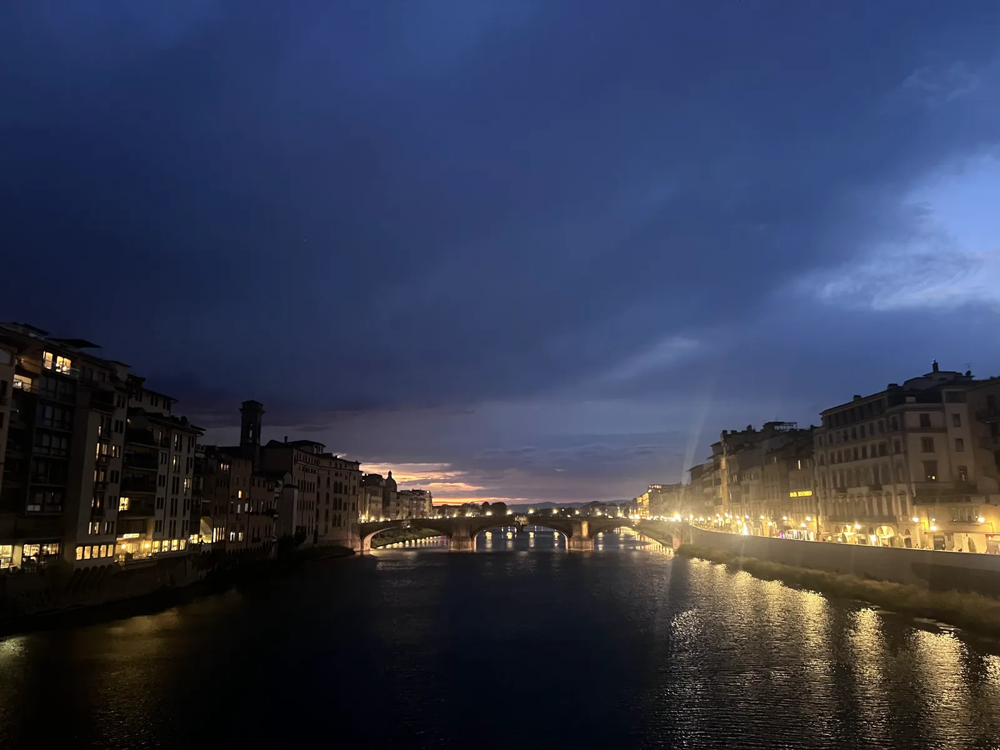


佛罗伦萨-老桥上的街头乐队.webp 老桥上的街头乐队，围了一圈人


**7 月 2 日，《大卫》和美第奇**。早上八点，先从大教堂正门前过。正面那层白、绿、粉三色大理石看着像中世纪的，其实是十九世纪才补上的。八点半进学院美术馆，王导带着讲。先看了《掠夺萨宾妇女》原大的石膏模型，是詹博洛尼亚按一比一做的，照着它刻出来的大理石原作，就立在领主广场的兰齐凉廊里。三个人从下往上拧成一股，没有正面，得绕着走一圈才看得全。

然后走过一排没雕完的囚徒像。这几尊本来是给教皇尤利乌斯二世的陵墓雕的，后来陵墓一再缩水，就没再雕下去：有一尊的头还整个埋在石头里，有的身子已经挣出来一大半，像是人正从石块里往外钻。尽头就是米开朗基罗的《大卫》。五米多高，一整块大理石，米开朗基罗二十六岁动手，二十九岁雕完。它本来是要放到大教堂高处的，所以头和右手都故意做得偏大，从底下仰着看才合比例。1504 年它立到了旧宫门口，1873 年才搬进这里，现在领主广场上那尊是复制品。又一路绕到大卫的背后，投石带从他左肩搭下来，顺着后背一直垂到右手边。娃在《大卫》前面留了一张。


佛罗伦萨-清晨的大教堂正门.webp 清晨的大教堂正门
佛罗伦萨-掠夺萨宾妇女石膏模型.webp 学院美术馆里《掠夺萨宾妇女》的原大石膏模型


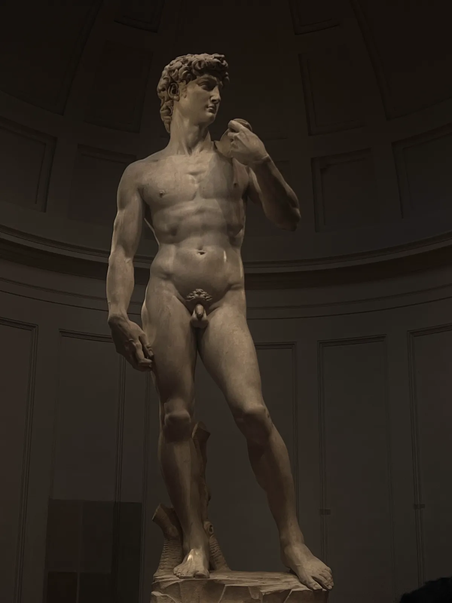

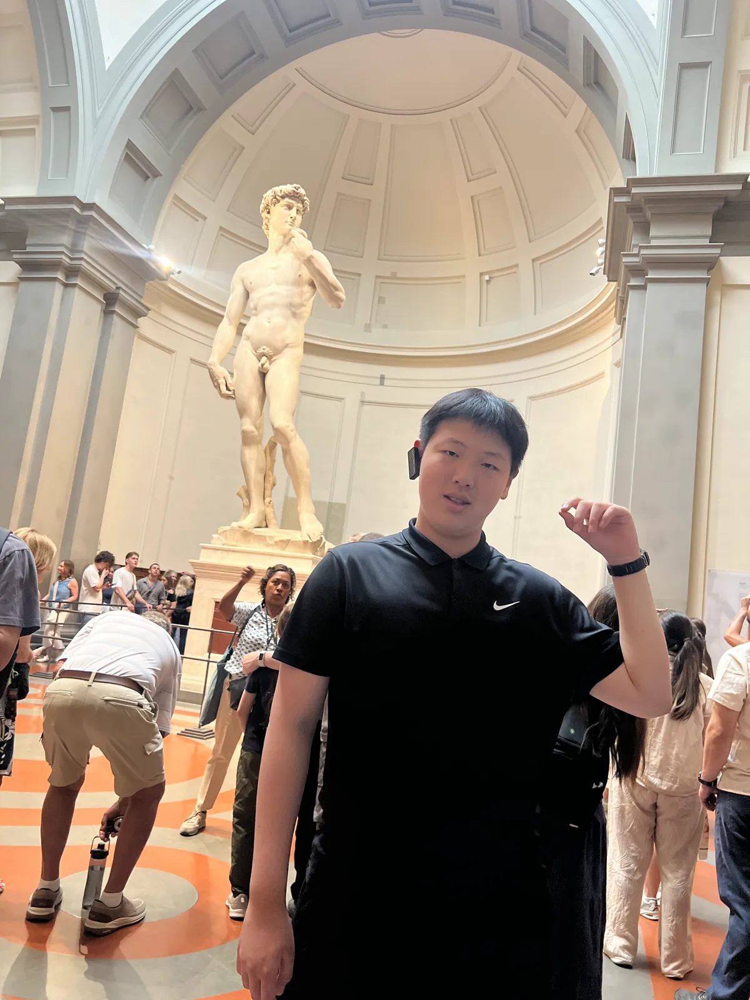

后面是一间摆满石膏模型的陈列馆。这些是十九世纪雕塑家巴托利尼和他学生留下的石膏头像和人像，墙上、架子上一排一排的。凑近看，石膏表面钉着一个个小黑点，那是往大理石上转刻用的定位点，工匠照着这些点，把模型一点一点搬到石头上。我问王导，铜像是怎么雕的，铜不是金属吗？王导说，先做模子，用失蜡法，中国的青铜器其实也是用失蜡法。


佛罗伦萨-大卫的背影.webp 大卫的背影和头顶的玻璃天窗
佛罗伦萨-巴托利尼石膏模型厅.webp 石膏模型陈列馆里排满胸像的墙


然后去了圣马可修道院。这座修道院是老科西莫·德·美第奇出钱，请米开洛佐从 1437 年开始重修的；安杰利科就是住在这里的修士，他带着徒弟，把修道院里的墙画了个遍。娃在回廊的长凳上歇了一会儿。楼梯尽头是安杰利科的《天使报喜》：天使从左边弯着腰过来，玛利亚坐在右边，两只手交叉在胸前；他们头顶的拱廊，画的就是这座修道院自己的回廊。画脚有一行拉丁文，大意是：路过这位童贞女的像，别忘了说一声“万福”。修士们每天上楼回房间，迎面就是它。

楼上是修士们住过的一间间小单间，每间墙上都有一幅壁画。一共四十多间，一间一幅，是给住在里面的修士对着默想用的，颜色都很淡。图书馆里还摆着大本的泥金圣歌集。图书馆也是米开洛佐造的，两排细细的柱子把长厅分成三条，常被叫作文艺复兴第一座公共图书馆。


佛罗伦萨-圣马可修道院的回廊.webp 圣马可修道院的回廊
佛罗伦萨-安杰利科的天使报喜.webp 楼梯尽头安杰利科的《天使报喜》
佛罗伦萨-修士单间里的壁画.webp 修士单间里的壁画
佛罗伦萨-泥金装饰的圣歌集.webp 图书馆里泥金装饰的圣歌集


再去圣洛伦佐。这是美第奇家族的教区教堂，正面到现在还是光秃秃的砖墙，米开朗基罗给它设计过大理石立面，最后没有建。

劳伦齐阿纳图书馆的楼梯是米开朗基罗设计的，王导特意让我们看光照在台阶上的效果。前厅十米见方，却有十四米多高，楼梯差不多把整间屋子填满了，最下面三级是椭圆的，一级一级往外涌。米开朗基罗后来去了罗马，楼梯是阿曼纳蒂照他留下的模型，在 1559 年建成的。楼上是阅览室，两排斜面的木长椅也是米开朗基罗设计的，当年手抄本就用链子锁在长椅上。教堂里还有老圣器室，是布鲁内莱斯基设计的：一个正方体的房间，上面扣一个半球形的穹顶，祭坛上方那个小穹顶里画着一片星空。

最后是美第奇礼拜堂：王公礼拜堂高高的穹顶，和米开朗基罗做的新圣器室。王公礼拜堂是个八角形的大厅，四面墙全是碧玉、青金石、玛瑙这些彩色石头一片片拼出来的，断断续续做了近三百年；穹顶五十多米高，在城里仅次于大教堂那座。新圣器室从房子到雕塑，都出自米开朗基罗一个人之手，两座公爵墓的石棺盖上斜躺着《昼》《夜》《晨》《暮》四尊像，头一天在米开朗基罗广场看到的那几尊铜像，原作就是它们。

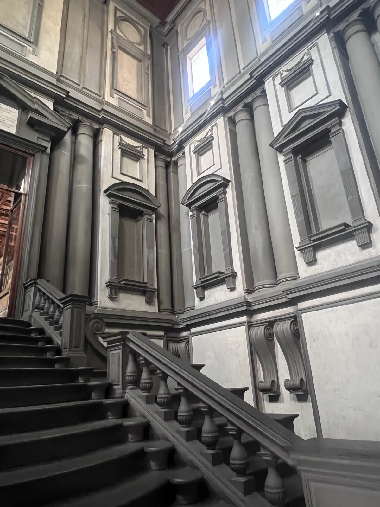


佛罗伦萨-圣洛伦佐教堂中殿.webp 圣洛伦佐教堂的中殿
佛罗伦萨-劳伦齐阿纳阅览室.webp 劳伦齐阿纳图书馆的阅览室
佛罗伦萨-老圣器室的穹顶.webp 老圣器室的穹顶
佛罗伦萨-王公礼拜堂.webp 王公礼拜堂的穹顶和大理石墙面
佛罗伦萨-新圣器室的美第奇墓.webp 新圣器室米开朗基罗的美第奇墓


下午回去歇了一阵。傍晚出来，圣三一教堂门口有人在唱歌剧。我们又走到共和广场和奥尔圣米凯莱。奥尔圣米凯莱外墙一圈壁龛里，站着城里各个行会请人雕的守护圣人，多纳泰罗的《圣乔治》原来也站在这里，现在原作搬进了巴杰罗，龛里的是复制品。


佛罗伦萨-新市场凉廊.webp 下午的新市场凉廊
佛罗伦萨-圣三一教堂前的街头歌剧.webp 圣三一教堂门口唱歌剧的人
佛罗伦萨-共和广场的拱门.webp 共和广场的大拱门


九点多，我们在圣三一桥上看晚霞。这座桥是三个扁扁的石拱，1944 年也被德军炸断过，现在这座是战后照原样重建的。老婆举着手机拍晚霞，我在后面拍她。过了几分钟，她把手机里刚拍下的我举到我的相机前。这一幕当时我根本没注意到，是回来剪片子的时候才看见的。

看完晚霞，我们去糖果店买了棉花糖和软糖，又在领主广场看了夜景，切利尼的《珀耳修斯》在灯下举着美杜莎的头。这尊青铜像是科西莫一世请切利尼铸的，1554 年立在兰齐凉廊里：珀耳修斯右手提着弯刀，左手把美杜莎的头举得高高的，脚下踩着她没了头的身子。据说切利尼把自己的脸藏在了珀耳修斯头盔的后脑勺上。凉廊另一头，就是早上在学院美术馆看过模型的那座《掠夺萨宾妇女》，这一座是大理石的。最后绕到夜里的大教堂，沿着阿诺河走回去。

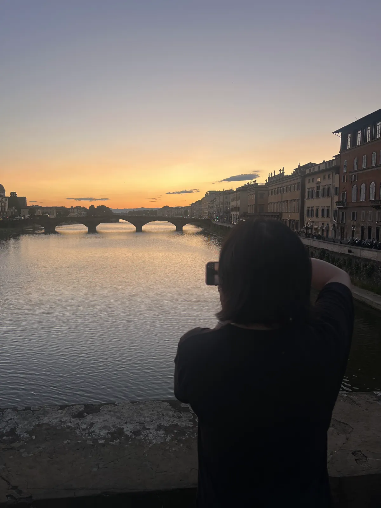


佛罗伦萨-糖果店的糖堆.webp 糖果店里堆成小山的糖
佛罗伦萨-夜里的珀耳修斯.webp 夜里领主广场凉廊下的切利尼《珀耳修斯》
佛罗伦萨-夜里的大教堂.webp 夜里的大教堂


**7 月 3 日，爬穹顶**。一早八点，我们排队爬百花大教堂的穹顶。穹顶是布鲁内莱斯基造的，1420 年动工，1436 年合龙。底下那个八角形的洞口直径四十多米，照当时的做法，得先从地上搭起一整套木架子才能砌，这么大的跨度根本搭不起来。他的办法是砌内外两层壳，砖按人字形交错着一圈圈往上砌，边砌边自己撑住，不用整体的脚手架。从底下到顶上一共 463 级台阶。

我们在两层穹壳中间的窄楼梯里一圈圈往上走，中途经过穹顶内侧那幅巨大的《最后的审判》。这是瓦萨里和祖卡里在 1570 年代画的，三千六百平方米，走到穹顶底下那圈环廊，就是贴着画在走：上面是基督和圣母，越往下人越挤，最底下一层是地狱，魔鬼和受罚的人看得一清二楚。最后几级台阶几乎贴着脸，钻出来，整座城的红屋顶都在脚下。老婆在顶上冲我挥手，娃也在顶上拍了一张。


佛罗伦萨-穹顶两层壳之间的台阶.webp 穹顶两层壳之间的台阶，娃走在前面
佛罗伦萨-穹顶内的最后的审判.webp 穹顶内环廊看《最后的审判》


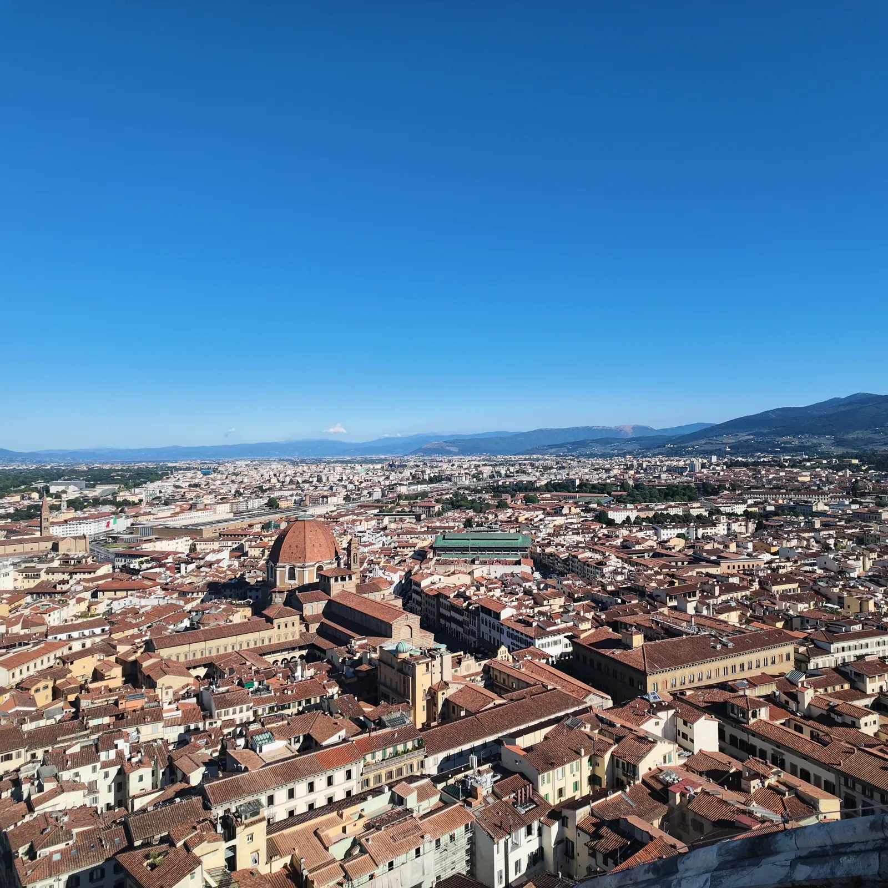

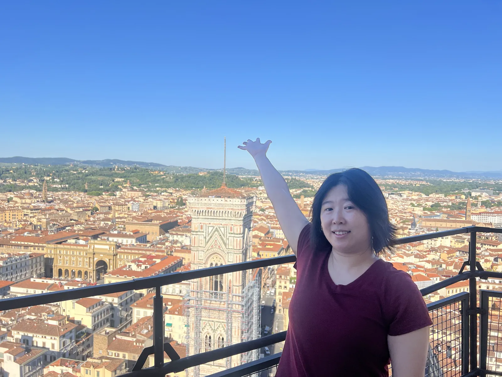


佛罗伦萨-穹顶上的娃.webp 穹顶上的娃


下来以后，去了一下洗礼堂。洗礼堂就在大教堂正对面，八角形，外墙是白绿两色的大理石，比大教堂还老，但丁就是在这里受的洗。朝着大教堂的那扇镀金铜门是吉贝尔蒂做的，米开朗基罗说它配得上做天堂的门，“天堂之门”的名字就是这么来的；门上现在是复制品，原件收在主教座堂博物馆里。

又去主教座堂博物馆，看了银祭坛、多纳泰罗的《抹大拉》，和米开朗基罗晚年雕给自己的《班迪尼圣殇》。银祭坛原来是洗礼堂里的，一格一格讲的是施洗约翰的故事。《抹大拉》是一尊和真人一样高的木雕：她在荒野里苦修了很多年，头发长得盖住了身子，脸颊凹下去，两只手举在胸前，快合上了还没合上。《班迪尼圣殇》是米开朗基罗七十多岁时雕的，本来想放在自己墓上，后来不满意，拿锤子把它砸了，基督的左腿到现在还缺着；扶着基督、戴兜帽的那个老人，脸就是米开朗基罗自己。娃戴着讲解耳机，和老婆一起站在银祭坛前。


佛罗伦萨-洗礼堂的金色穹顶.webp 洗礼堂里的金色马赛克
佛罗伦萨-主教座堂博物馆的银祭坛.webp 主教座堂博物馆里的银祭坛
佛罗伦萨-班迪尼圣殇.webp 米开朗基罗的《班迪尼圣殇》


下午去圣十字圣殿。米开朗基罗、伽利略、马基雅维利都葬在这里，还有但丁的衣冠冢。米开朗基罗死在罗马，遗体是运回佛罗伦萨来的；他的墓是瓦萨里设计的，石棺前坐着三个女人，代表绘画、雕塑和建筑。伽利略 1642 年去世时，宗教裁判所的判决还压着他，不许给他立墓，过了快一百年才迁进现在这座大墓。但丁的墓是空的，他死在流放地拉文纳，遗体一直没能接回来。

地上铺着很多墓板，走路难免踩到，我说：“没关系的，他不介意的，有人来瞻仰他。”我说的“他”，是脚下那块墓板的主人吉贝尔蒂，就是早上那扇天堂之门的作者。我们还看了契马布埃那个被洪水泡坏的十字架：1966 年阿诺河发大水，它泡在泥水里，颜料掉了一大半，基督的脸几乎没了，修复的时候也没有硬把空白补上。还有后面的帕齐礼拜堂，在回廊的尽头，也是布鲁内莱斯基设计的：正方形的房间，上面一个圆顶，灰色的石条在白墙上勾出线来，和前一天圣洛伦佐的老圣器室几乎是一对。


佛罗伦萨-圣十字中殿.webp 圣十字教堂的中殿
佛罗伦萨-米开朗基罗墓.webp 米开朗基罗的墓
佛罗伦萨-伽利略墓.webp 伽利略的墓
佛罗伦萨-但丁衣冠冢.webp 但丁的衣冠冢
佛罗伦萨-马基雅维利墓.webp 马基雅维利的墓
佛罗伦萨-契马布埃的受损十字架.webp 契马布埃受洪水损毁的十字架
佛罗伦萨-帕齐礼拜堂.webp 第一回廊尽头的帕齐礼拜堂


再去巴杰罗美术馆。这座楼 1255 年就开始建了，比旧宫还老，方塔、雉堞，像座堡垒，以前当过市政长官的官邸，后来又做了很久的监狱。看了中庭，那里从前是处决犯人的地方。多纳泰罗厅里有三尊大卫：两尊是多纳泰罗的，一尊大理石，是他二十出头时雕的，穿着衣服；一尊青铜，戴着牧童帽、光着身子，脚踩歌利亚的头，是古罗马以后西方第一尊独立的、真人大小的裸体青铜像；另一尊青铜的是韦罗基奥的，一手叉腰，带着点笑。还有詹博洛尼亚的《飞翔的墨丘利》，只用一只脚尖点在风神吹出来的一股气上，整个人往上冲，一根手指指着天。

巴杰罗还有 1401 年洗礼堂大门竞赛的两块浮雕。题目都是《以撒献祭》，框都是一样的四叶形，两块并排挂在一面墙上：吉贝尔蒂那块，人物排得从容；布鲁内莱斯基那块，亚伯拉罕的手已经掐住了以撒的脖子，天使从旁边冲进来，一把抓住他的胳膊。导游讲，当时评委觉得两件作品难分高下，提议两个人一起做，其中一个不愿意，就退出了。退出的那个人叫布鲁内莱斯基，后来他造了我们早上爬的那座穹顶。


佛罗伦萨-巴杰罗美术馆中庭.webp 巴杰罗美术馆的中庭和外楼梯
佛罗伦萨-多纳泰罗的青铜大卫.webp 多纳泰罗的青铜《大卫》
佛罗伦萨-飞翔的墨丘利.webp 詹博洛尼亚的《飞翔的墨丘利》
佛罗伦萨-1401年竞赛浮雕吉贝尔蒂.webp 1401 年洗礼堂大门竞赛：吉贝尔蒂的《以撒献祭》
佛罗伦萨-1401年竞赛浮雕布鲁内莱斯基.webp 布鲁内莱斯基落选的《以撒献祭》


**7 月 4 日，乌菲兹和钟楼**。早上八点多路过领主广场，兰齐凉廊里站着《珀耳修斯》。八点半进乌菲兹美术馆。这栋楼本来是瓦萨里给科西莫一世盖的办公楼，“uffizi”就是“办公室”的意思，后来美第奇家把收藏一件件搬进了顶层的长廊。东边长廊的天顶画满了彩绘，两边一路排着古罗马的雕像和胸像，墙上高处还挂着一排小幅的名人肖像。

看了波提切利的《维纳斯的诞生》和《春》，两幅现在挂在一间屋里，可以对着看。《维纳斯的诞生》里，维纳斯站在一只大扇贝上漂到岸边，左边的西风神鼓着腮帮子把她往岸上吹，右边一个女神拿着披风等着给她披上；她的脖子长得有点过分，肩膀也往下溜，这是波提切利故意画的。《春》要从右往左看：最右边的西风神抓住一个仙女，仙女嘴里吐出花来，变成了旁边浑身是花的花神；中间是维纳斯，头顶一个蒙着眼的小丘比特正在拉弓。我举着手机拍《春》；从南边长廊的窗子望出去，就是老桥，桥上那一排连着的小窗，是瓦萨里给美第奇家修的空中走廊，从这边一直通到河对岸的碧提宫。


佛罗伦萨-兰齐凉廊的珀耳修斯.webp 清晨兰齐凉廊里的《珀耳修斯》
佛罗伦萨-乌菲兹东长廊.webp 乌菲兹东长廊和彩绘天顶


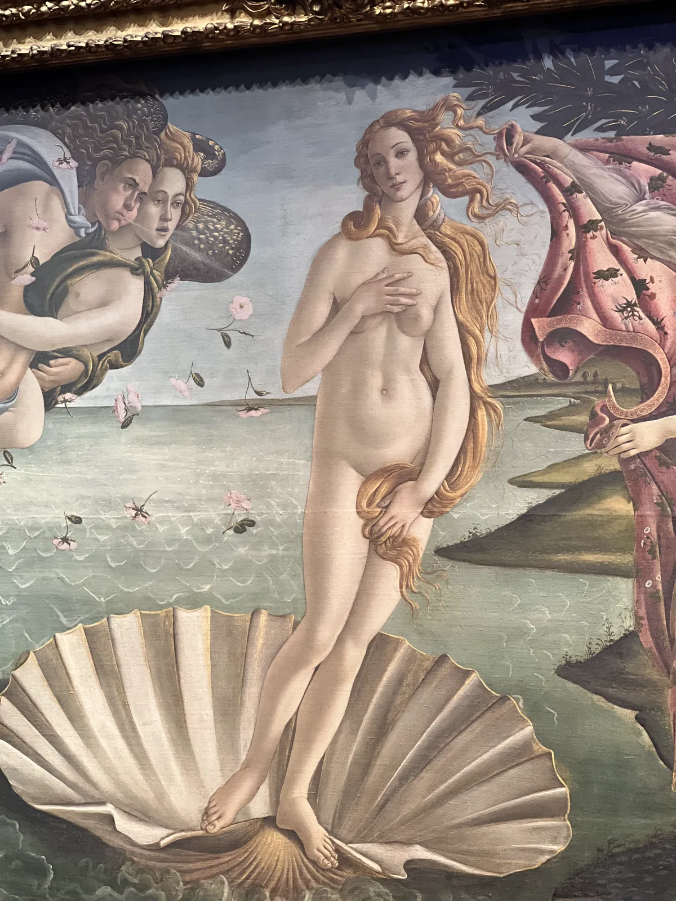


佛罗伦萨-波提切利的春.webp 波提切利的《春》
佛罗伦萨-乌菲兹南廊窗外的老桥.webp 乌菲兹南廊窗外的老桥


然后去碧提宫。碧提宫原本是银行家卢卡·皮蒂盖来跟美第奇比气派的，后来反倒归了美第奇家。里面的帕拉蒂纳美术馆还照十七世纪大公在时的样子挂画，一面墙上下挂好几层，一直挂到天花板底下，得仰着头找。我们看了拉斐尔的《华盖圣母》，是他还在佛罗伦萨时画的大祭坛画，圣母头顶两个天使拉开华盖的帘子，他去罗马的时候这幅画还没画完。鲁本斯的《战争的后果》是三十年战争那几年画的：中间的战神披着红袍往前冲，维纳斯拉着他，拉不住；最左边穿黑衣、举着两只手哭喊的女人，代表欧洲。卡诺瓦的《意大利维纳斯》摆在天顶画着维纳斯的那间厅里，当年拿破仑把乌菲兹的《美第奇维纳斯》搬去了巴黎，这尊是雕来补那个空的。

又在后面的波波里花园高处看城。这片山坡是美第奇家的私家花园，一层层的台地，笔直的轴线，到处是雕像和喷泉，后来欧洲的宫廷花园很多都照着它学。老婆和娃在那儿自拍了一张。中午在 Guicciardini 街上吃了一份开心果甜点。


佛罗伦萨-拉斐尔的华盖圣母.webp 碧提宫里拉斐尔的《华盖圣母》
佛罗伦萨-鲁本斯的战争的后果.webp 鲁本斯的《战争的后果》
佛罗伦萨-卡诺瓦的意大利维纳斯.webp 碧提宫里卡诺瓦的《意大利维纳斯》
佛罗伦萨-波波里花园俯瞰全城.webp 波波里花园高处看城区
佛罗伦萨-波波里花园的母子自拍.webp 老婆和娃在波波里花园自拍
佛罗伦萨-开心果冰激凌.webp Via de' Guicciardini 上的开心果冰激凌


傍晚上了大教堂旁边的乔托钟楼，从侧面看那个穹顶。钟楼是画家乔托 1334 年开始设计的，三年后他就去世了，那时才盖到第一层，后面又换了两个人才盖完。整座塔从下到上贴着白、绿、粉三色大理石，八十多米高，414 级台阶，没有电梯。前一天爬穹顶是在穹顶里面，到了钟楼顶上，才看到穹顶连同顶上那座采光亭的全貌。下来以后在乌菲兹广场听了一会儿街头吉他，又沿着阿诺河走，八点多再上米开朗基罗广场。

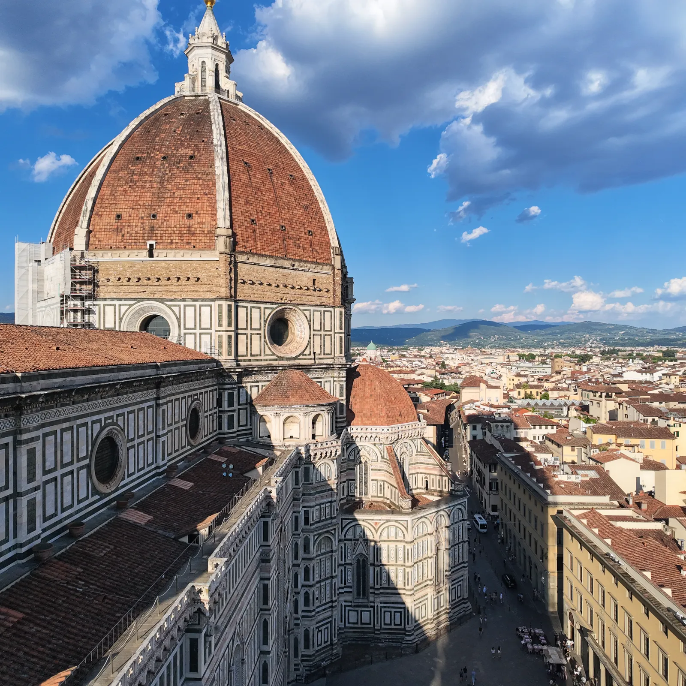


佛罗伦萨-钟楼顶看广场.webp 乔托钟楼顶往下看的街区和广场


在米开朗基罗广场，我们碰到了拍婚纱照的中国人，就跟着他们，人家在哪儿取景，我们就在哪儿拍，拍出来真的都非常出片。中间我们还往山上走到了圣米尼亚托大殿。那是广场再往上的一座罗马式老教堂，1018 年开始建，正面是绿白两色的大理石，上半截嵌着一块金色的马赛克；传说圣米尼亚托在城里被砍了头，自己捧着头过了河，一直走到这座山上才倒下。后来发现，那个摄影团队竟然是汤池映像。我们当年结婚的时候，婚纱照也是他们给拍的，那时候他们还没有红，后来越做越高端。那天晚上我们一共碰到三队拍婚纱照的，都是中国人。我觉得，中国人现在真的富强了。


佛罗伦萨-夕阳下栏杆边的老婆.webp 栏杆边的老婆，背后是大教堂
佛罗伦萨-夕阳下栏杆边的我.webp 栏杆边的我
佛罗伦萨-广场上举起双手的老婆.webp 广场上举起双手的老婆，身后坐满了看日落的人
佛罗伦萨-大卫像底座边的老婆.webp 大卫像底座边，太阳正落下去
佛罗伦萨-圣救世主教堂台阶上的老婆.webp 山上圣救世主教堂的台阶
佛罗伦萨-山上看全城的老婆.webp 山上，背后是全城和大教堂
佛罗伦萨-石栏杆边的我们.webp 石栏杆边的我们两个
佛罗伦萨-山上的圣米尼亚托.webp 山上的圣米尼亚托大殿，我和老婆
佛罗伦萨-树影里的老婆和城里的灯.webp 天黑了，树影里的老婆，城里的灯亮了


天快黑的时候，老婆在人群前面拍晚霞，我在后面喊她回头，她转过来，笑着冲我挥手。我们俩凑在一起自拍，都在笑，老婆说：“我们的佛罗伦萨结束了。”城里的灯一盏盏亮了起来。


佛罗伦萨-米开朗基罗广场的日落灯火.webp 米开朗基罗广场看日落和亮起灯的城
佛罗伦萨-栏杆边拍夜景的我.webp 我在栏杆边举着手机拍城里的灯


**7 月 5 日，最后一个清晨**。六点四十，我推开住处的大木门，晨光一下子涌了进来。我和老婆在佛罗伦萨走了最后一圈：先过卡拉亚桥，再到圣三一桥，我们在桥上各留了一张，身后就是老桥；七点多，乌菲兹的庭院里空荡荡的，老婆在远处只是一个小小的人影；然后是领主广场、大教堂和洗礼堂，再从 Via dello Studio 和 Tornabuoni 街绕回去。前前后后两个小时。


佛罗伦萨-清晨卡拉亚桥边.webp 清晨阿诺河边的老婆
佛罗伦萨-圣三一桥上的老婆.webp 圣三一桥上的老婆，背后是老桥
佛罗伦萨-圣三一桥上的我.webp 圣三一桥上的我，背后是老桥
佛罗伦萨-空荡荡的乌菲兹庭院.webp 空荡荡的乌菲兹庭院，远处是老婆
佛罗伦萨-清晨的领主广场.webp 清晨的领主广场
佛罗伦萨-清晨的大教堂.webp 清晨大教堂前的老婆
佛罗伦萨-斯图迪奥街的老婆.webp Via dello Studio，尽头是穹顶
佛罗伦萨-清晨空空的托纳博尼街.webp 清晨空空的 Tornabuoni 街


2011 年，我和老婆来过一次佛罗伦萨。十五年后的这天早上，我们找到当年拍照的几个地方，照着当年的样子又拍了一遍：我站在领主广场的骑马像前，又站到海神喷泉前；老婆站在兰齐凉廊的柱子下，又站到大教堂门口。当年在大教堂前，还有一位交警陪她合了影。


佛罗伦萨-对比-领主广场-以前.webp 领主广场，2011 年
佛罗伦萨-对比-领主广场-现在.webp 领主广场，2026 年



佛罗伦萨-对比-海神喷泉-以前.webp 海神喷泉，2011 年
佛罗伦萨-对比-海神喷泉-现在.webp 海神喷泉，2026 年



佛罗伦萨-对比-兰齐凉廊-以前.webp 兰齐凉廊，2011 年
佛罗伦萨-对比-兰齐凉廊-现在.webp 兰齐凉廊，2026 年



佛罗伦萨-对比-大教堂-以前.webp 大教堂门口，2011 年
佛罗伦萨-对比-大教堂-现在.webp 大教堂门口，2026 年


### 米兰：不能求事事完美

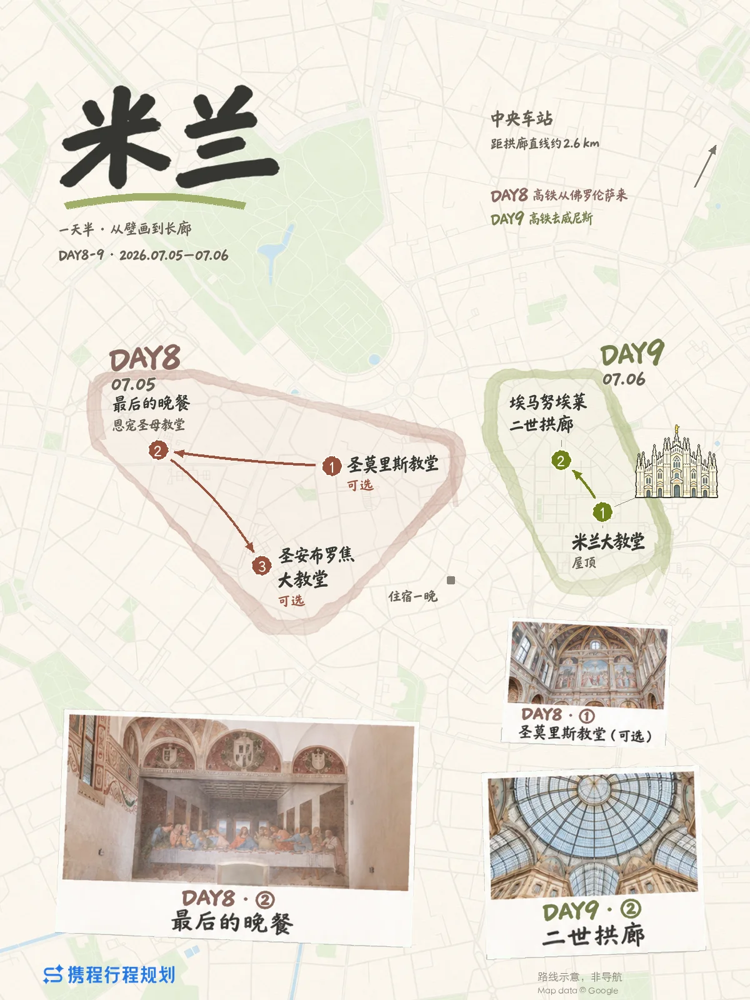

**7 月 5 日**。走完最后一圈，坐高铁去米兰。下午一点半到米兰中央车站，先在科尔杜西奥广场和但丁大街一带转了转，娃进了 AC 米兰的专卖店。这一天唯一定死的安排是看《最后的晚餐》，结果没看成。

《最后的晚餐》的票很难抢。普通票每三个月放一批，大约提前三个月开卖，5 月到 8 月的票，3 月 24 日中午就开卖了。我们去的 7 月 5 日，正好是那个月的第一个星期天，意大利国立博物馆免费开放，不用买票，但要在网上抢预约名额，名额在前一个星期三的中午十二点放出来。为了稳妥，我先拿 6 月那次免费开放日练了一次手，真被我抢到了。结果到了正式抢 7 月这一次，系统提示一段时间之内只能约一次，名额在练手的时候已经用掉了。就这样没抢到，也就没去成。也还行，不能求事事完美，下次再来吧。


米兰-中央车站大厅.webp 米兰中央车站的大厅
米兰-但丁大街上的娃.webp AC 米兰专卖店里的娃


五点多到了米兰大教堂。这座教堂从 1386 年开始盖，断断续续盖了将近六百年，整座都是粉白色的大理石。

先上屋顶，在尖塔林里转。屋顶上有一百三十多座尖塔，每个塔尖上都站着一尊雕像，人就在这些石塔中间穿来穿去。最高处站着金色的圣母像，米兰人叫她“小圣母”，四米多高，立在一百多米高的主尖塔顶上。米兰有个老规矩，新盖的楼不能比她高，后来盖摩天楼，就在楼顶也放一尊小圣母。

下来再进教堂，看中殿的巨柱和彩色玻璃窗。五十多根大柱子一排排撑着拱顶，两边一扇扇彩窗讲的都是圣经故事。娃一直仰着头往上看。

傍晚在斯卡拉广场，娃在达·芬奇像前拍了一张。雕像底座四周站着达·芬奇的四个学生，广场一边就是斯卡拉歌剧院。


米兰-大教堂正面.webp 米兰大教堂的正面
米兰-屋顶的尖塔林.webp 大教堂屋顶上的尖塔林


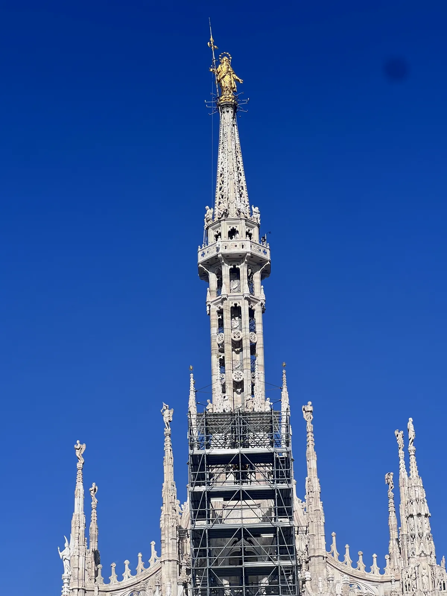


米兰-中殿巨柱与彩窗.webp 中殿的巨柱和彩色玻璃窗
米兰-斯卡拉广场的娃.webp 斯卡拉广场上的娃


**7 月 6 日**。清晨，大教堂广场上还没几个人，长廊里也几乎没人。这条长廊叫维托里奥·埃马努埃莱二世长廊，十字形，一头连着大教堂广场，一头通到斯卡拉广场，1865 年到 1877 年建的，整条街顶上都是铁架子撑起来的玻璃。十字交叉的地方是个八角厅，头顶的玻璃穹顶直径三十七米多。设计它的建筑师门戈尼，在揭幕前夕从脚手架上摔下来死了。

老婆来了兴致，在长廊里给自己拍起了 vlog。先彩排了一遍，然后正式开始：“好的，开始！”她一边走一边解说，走过一排奢侈品店，看见一个穿西装的人经过，就说他是坐地铁来上班的。这些店里，Prada 的第一家店 1913 年就开在这条长廊里。

八角厅的地上镶着四块城徽马赛克：都灵的公牛、罗马的母狼、佛罗伦萨的百合、米兰的红十字。这里的老规矩是把脚后跟踩在公牛的要害上，原地转三圈，说是能带来好运，公牛那块已经被踩出了一个坑。我站在长廊地面的圆形马赛克上，原地转了一圈。


米兰-清晨的大教堂广场.webp 清晨空荡荡的大教堂广场


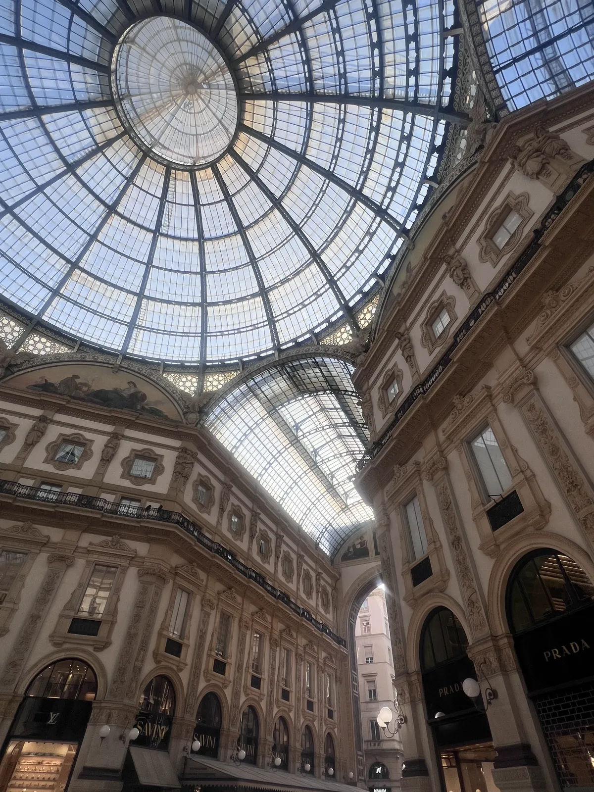


米兰-拱廊的马赛克地面.webp 拱廊地面上的马赛克


走完长廊，又去看了斯卡拉广场、金匠街上的老电车和斯福尔扎城堡。米兰街上到现在还跑着上世纪二十年代末造的老电车，车厢里是木头座椅，照样载客。斯福尔扎城堡是十五世纪斯福尔扎家族重建的，红砖墙，正门上顶着一座高塔，里面的博物馆收着米开朗基罗最后一件作品《隆达尼尼圣殇》。

中午在中央车站等去威尼斯的火车。那时候娃正放暑假，学校在假期里开网课，老师给全班同学一起上。那天的课有好几节，要上好几个小时。等车的时候，娃就戴着耳机在车站里上课。老婆在旁边拿他开玩笑：“虽然人在米兰，但是得上课啊，是不是？”娃冲她扮了个鬼脸。上了火车，他大部分时间也还在上课。


米兰-金匠街的老电车.webp 金匠街上的老电车
米兰-老婆和老电车.webp 老婆和老电车
米兰-斯福尔扎城堡.webp 斯福尔扎城堡前的老婆
米兰-中央车站的娃.webp 在中央车站等车、上网课的娃


### 威尼斯：新贵

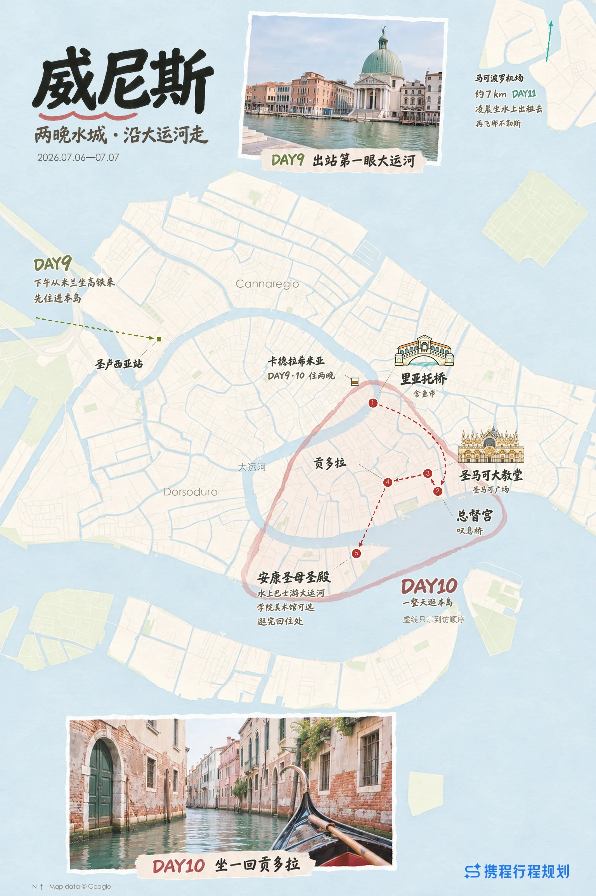

**7 月 6 日**下午，火车开上潟湖中间的长桥，进了威尼斯。车上，娃抢过老婆的草帽遮住自己的脸，又扣回她头上。

出了圣卢西亚车站，我们坐水上巴士沿大运河去住处。大运河是一个倒过来的 S，将近四公里长，把威尼斯一分为二，是这座城没有汽车的主街，整条河上只有四座桥。路过里亚托的鱼市，鱼市那栋带尖拱廊的楼看着像中世纪的，其实是 1907 年才盖的。两岸的老房子直接泡在水里。这些老宅子最讲究的一面都朝着运河，以前客人都是坐船来，临水的那道门才是正门。


威尼斯-圣卢西亚车站.webp 圣卢西亚车站，老婆和娃


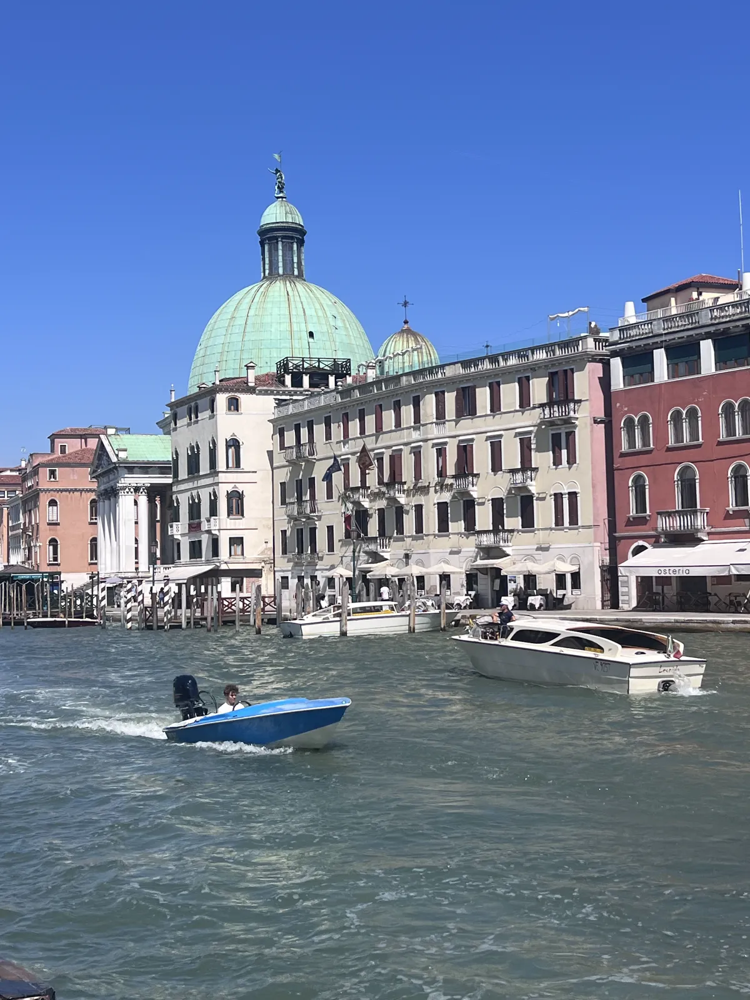


威尼斯-里亚托鱼市.webp 水上巴士上看里亚托鱼市


晚上先在里亚托桥一带的小运河边走了走，然后去圣马可湾边看蓝调时分，叹息桥亮着灯，对岸是圣乔治岛。叹息桥是一座封死的白色石桥，1600 年前后建的，一头连着总督宫里的审判厅，一头连着河对面的新监狱。说是犯人判完刑从桥上押回牢房，隔着小窗最后看一眼外面，叹一口气，这个名字是十九世纪拜伦写进诗里以后才叫开的。对岸圣乔治岛上那座白色教堂是帕拉第奥设计的，旁边也有一座钟楼，正好隔着水和圣马可广场的钟楼对着。

娃拍照很有主意，先跟我们商量拿哪边当背景给他拍，又反过来教老婆摆姿势：抬起头，要笑，眼睛睁大。他蹲在地上给老婆拍照，两个人头碰头地看刚拍的照片。也是那天晚上，娃拿老婆的手机，拍下了我和老婆的背影：一张一起看潟湖，一张手牵着手往前走。


威尼斯-夜里的小运河.webp 傍晚的小运河和贡多拉
威尼斯-亮灯的叹息桥.webp 亮灯的叹息桥


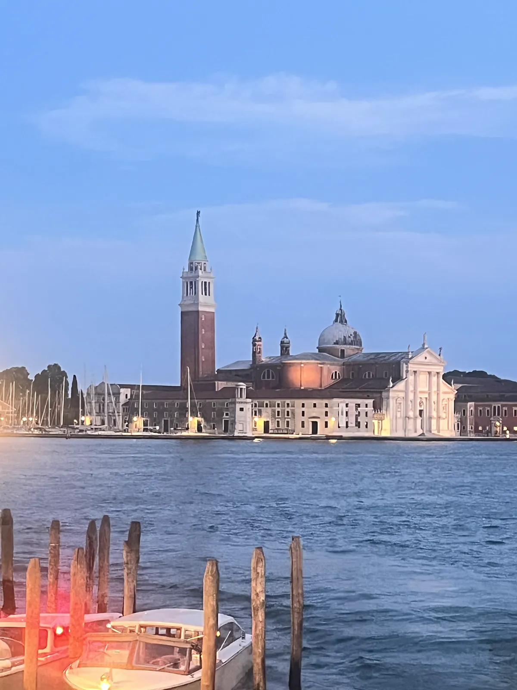


威尼斯-娃给老婆拍照.webp 娃在给老婆拍照


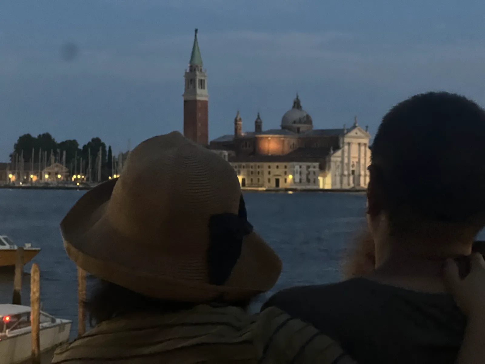

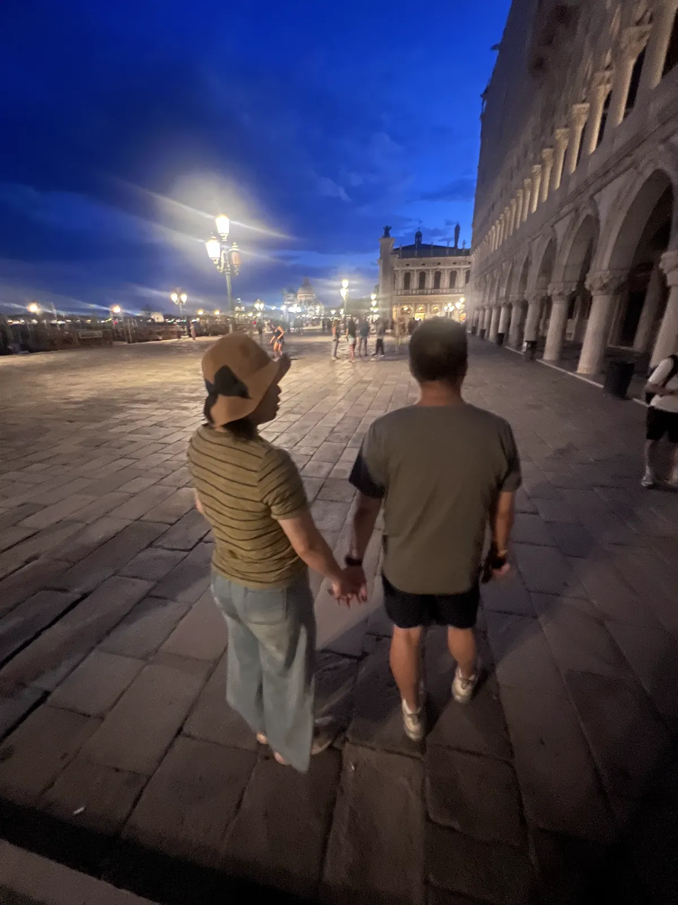

**7 月 7 日，总督宫和圣马可**。早上坐水上巴士到里亚托，娃戴着耳机站在船头看两岸，船从里亚托桥底下穿过去，他回头冲我们笑了一下。里亚托桥是大运河上最老的桥，十六世纪末从木桥改成石桥。据说当年征集设计，帕拉第奥、米开朗基罗都交过方案，最后选中的是名气小得多的达·蓬特，只用一个单拱就跨过了运河。

上岸以后穿过小巷，走到圣马可广场。九点进总督宫。威尼斯共和国的政府、法院和监狱，全在这一栋楼里。庭院里正对着巨人阶梯，台阶顶上站着战神马尔斯和海神尼普顿，四米多高，以前新总督就是在这两尊像中间戴上总督帽的。我们从庭院走上黄金阶梯，拱顶是白色的灰泥浮雕，贴着金箔，以前外国使节来，就是从这道楼梯走上去的。

又走进叹息桥，就是前一天晚上在外面看到亮着灯的那座。桥里面是两条隔开的窄通道，一条去审判厅，一条回监狱。隔着石格窗往外看，下面是小河和贡多拉。

出来以后，在里亚托市场买了点吃的。这个市场从十一世纪就有了，到现在还是威尼斯本地人买菜买鱼的地方。


威尼斯-水上巴士上的娃.webp 水上巴士上的娃
威尼斯-清晨的圣马可广场.webp 清晨空荡荡的圣马可广场
威尼斯-总督宫庭院.webp 总督宫的庭院


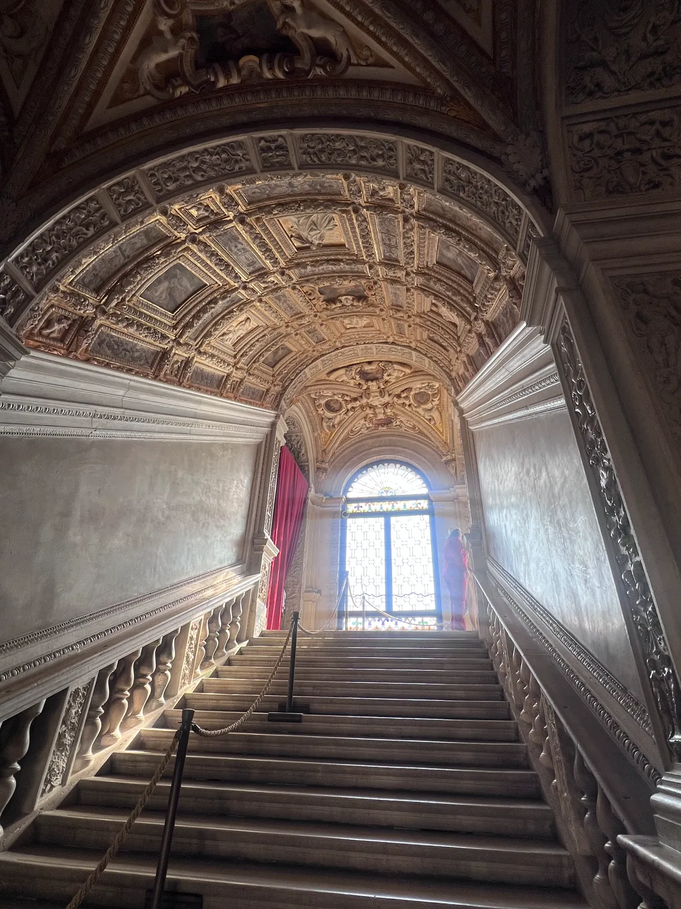


威尼斯-叹息桥的石格窗.webp 叹息桥里的石格窗
威尼斯-里亚托市场的海鲜.webp 里亚托市场的海鲜


下午一点进圣马可大教堂，满眼都是金色的马赛克。墙上、拱顶上和五个穹顶里的马赛克加起来有八千多平方米，每一小块都是把金箔夹在两层玻璃中间烧出来的，所以这座教堂又叫“黄金教堂”。还有黄金祭坛屏，在主祭坛后面，三米多宽，上面嵌着二百五十来块珐琅小画，镶着将近两千颗宝石和珍珠。

然后上了正面的露台，从上面往下看，整个圣马可广场都在脚下。露台上那四匹铜马是复制品，真的那四匹收在楼上的博物馆里。原来这四匹马立在君士坦丁堡的竞技场，1204 年十字军攻下君士坦丁堡，威尼斯把它们搬了回来；后来拿破仑又把它们运到巴黎，1815 年才还回来。娃坐在铜马旁边，看我在拍他，干脆凑了过来，一张大脸怼到了我面前。

广场柱廊下的咖啡馆里有乐队在演奏，钢琴、低音提琴、小提琴，我们听完了一整段。广场南北两边的柱廊下各有一家开了几百年的老咖啡馆，弗洛里安和夸德里，夏天两边各请一支小乐队，轮流演奏。

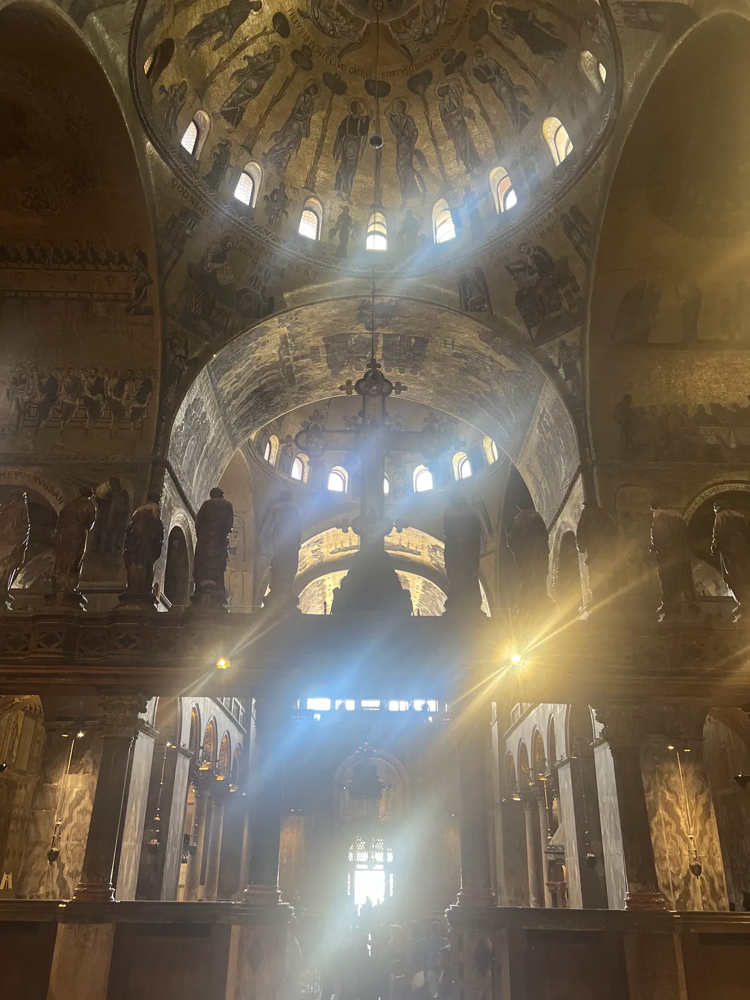


威尼斯-黄金祭坛屏.webp 圣马可大教堂的黄金祭坛屏
威尼斯-耶西之树.webp 金底马赛克《耶西之树》


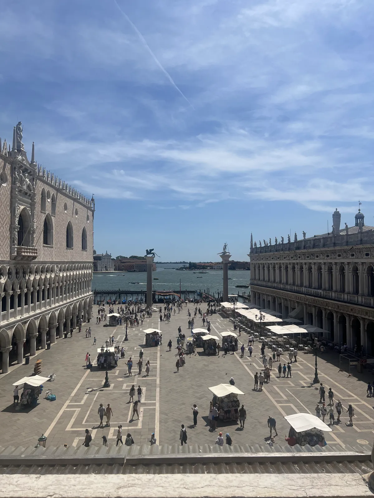


威尼斯-娃和铜马.webp 娃和圣马可的铜马
威尼斯-柱廊下的咖啡馆乐队.webp 柱廊下咖啡馆的钢琴手


从广场坐船去多尔索杜罗，船上挤满了人，老婆戴着草帽和墨镜，托着腮看水。到了那边，在小运河边吃了冰激凌。

傍晚坐船沿大运河，从学院桥底下穿过去。学院桥是大运河上唯一的木桥，1933 年本来是临时搭的，威尼斯人喜欢它的样子，就一直修修补补用到现在。过了桥看见安康圣母大殿，白色的大圆顶，底下一圈大涡卷撑着。1630 年威尼斯闹黑死病，死了将近三分之一的人，共和国向圣母许愿，瘟疫过去就给她盖一座教堂，这座教堂就是这么来的，前后盖了五十年，光地基就打了大约一百万根木桩。一直开到圣马可湾，对面就是圣乔治岛。


威尼斯-吃冰激凌的娃.webp 吃冰激凌的娃
威尼斯-学院桥.webp 船上看学院桥
威尼斯-圣乔治马焦雷岛.webp 水上看圣乔治马焦雷岛


威尼斯的城市面貌和前面几座完全不同。城里的建筑、博物馆和展品没有佛罗伦萨、罗马那么多，但圣马可广场那一块也很美，不管是外面的建筑，还是教堂里面。我有一种感觉：罗马是官方，佛罗伦萨是老钱，威尼斯是新贵，还没有前两个积累得那么多、那么厚。

在威尼斯住的地方有炉子、炊具和油。我们去超市买了菜，我自己炒了几个，还烧了个鸡腿汤。出来这么多天，中国人还是需要多吃点素菜。


威尼斯-我在住处做饭.webp 我在住处炒菜


小红书上很多人在圣马可广场模仿周杰伦《十一月的萧邦》的封面拍照，我们也没有免俗。

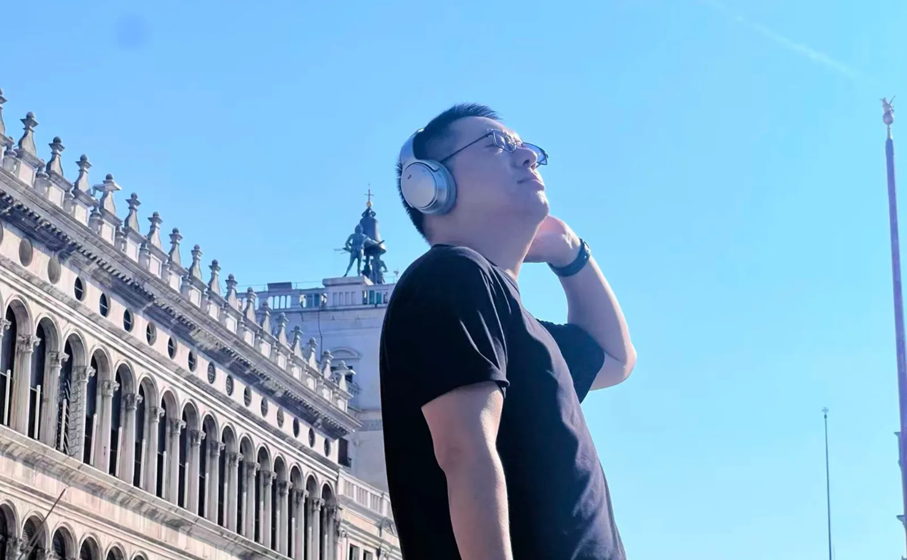

**7 月 8 日，凌晨离开**。从威尼斯去索伦托，最早是打算坐火车的。可那几天佛罗伦萨那一段铁路要施工，威尼斯到那不勒斯的火车票一直不开卖。我担心到时候走不了，就改成了飞机：瑞安航空，早上七点五十从威尼斯飞那不勒斯。我们对意大利的国内航班不熟，看了很多建议，都说要提前两个多小时到机场，那就得五点多到。怎么去机场又成了个大问题。算了一下，坐水上出租车可以起得最晚，四点多起来就行，别的走法可能三点多就得起。最后还是选了水上出租车，一百七十五欧，贵是有点贵，不过也算是难得一次的体验。其实威尼斯的酒店前台一般都可以帮忙订水上出租车。

四点四十，天还黑着，水上出租车载着我们穿过运河，开进潟湖去机场。天边一点点红起来。我举起相机自拍，娃挤了进来，老婆也凑了进来。后来剪片子才发现，十四天里三个人都在、都在笑的，只有这一个镜头。到了机场，娃琢磨起来：威尼斯怎么不修桥呢？要是在中国，早就造一座跨海大桥了。想了想，他又自己找到了答案：人家又不是基建狂魔，坐船更方便。

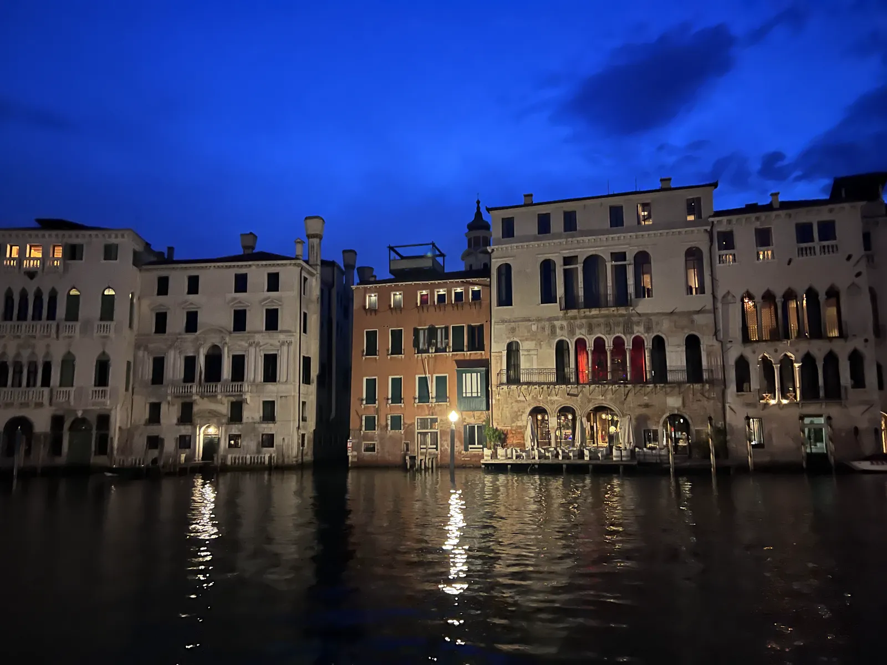


威尼斯-凌晨水上出租车里的潟湖.webp 凌晨坐水上出租车离开威尼斯，天还黑着


### 索伦托和卡普里：地中海

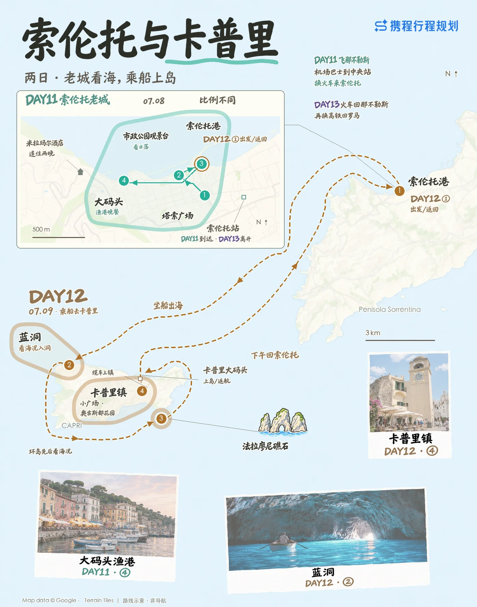

**7 月 8 日**从威尼斯飞到那不勒斯，再坐火车到索伦托，中午到了酒店。推开窗，是海、悬崖上的小城，还有海湾对面的维苏威火山。索伦托老城建在一块高出海面几十米的火山凝灰岩台地上，三面是海或者深谷，两千多年前希腊人就在这儿建了城。对面的维苏威，就是公元 79 年喷发、把庞贝埋掉的那座火山。风格完全变了，从文艺复兴一下子换成了地中海度假。知道旅行快到尾声了，但也很期待接下来在南意的这几天。


索伦托-酒店窗外的海和维苏威.webp 到酒店第一眼，海和对岸的维苏威
索伦托-悬崖上的小城.webp 悬崖上的索伦托


傍晚去市政公园的观景台，吃了柠檬冰沙。这个公园原来是隔壁圣方济各修道院的园子。园子尽头就是悬崖边的栏杆，下面五十多米是 Marina Piccola 码头，第二天去卡普里的船就从那儿开；往远看是整片那不勒斯湾，湾那头就是维苏威。索伦托到处种柠檬，柠檬酒、柠檬糖满街都是。老婆说，来到了美丽的索伦托，看到了美丽的大海，明天就要出海了。

又从 Via Capo 的高处看了一会儿老渔港。老渔港叫 Marina Grande，是索伦托最老的渔村，窝在两边的悬崖中间，一排刷成黄色、粉色的渔民房子。名字叫“大港”，其实是索伦托两个港里更小、更安静的那个。


索伦托-市政公园的柠檬冰沙.webp 市政公园观景台上的柠檬冰沙
索伦托-ViaCapo俯瞰老渔港.webp 在 Via Capo 高处俯瞰老渔港


回到酒店，我们在阳台上看夕阳，看了好久。两杯红酒在太阳落下去之前碰了一下。对面屋顶的最高处站着一只海鸥，老婆说它像个国王。她算了算来了几天，说：“不想走啊，觉得现在才刚刚打开我的休假模式。再休假就要晒化了。我宁可晒化，也不想到办公室被冻化。”娃举着相机，拍海上的日落。

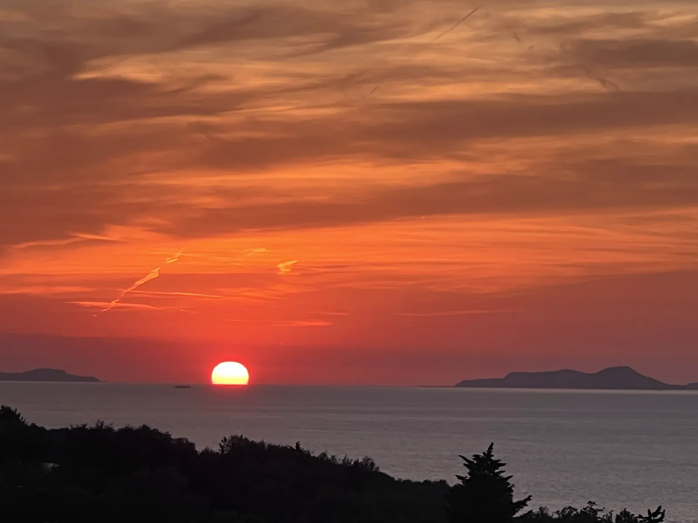


索伦托-落日前碰杯的两杯红酒.webp 落日前，两杯红酒碰杯
索伦托-露台上拿相机拍日落的娃.webp 娃在露台上举着相机拍日落


**7 月 9 日，卡普里**。早上七点多，在索伦托的小码头上了快艇，娃兴奋得又说又笑。到了蓝洞外面，排队换小划艇。蓝洞的洞口只有两米来宽，低潮的时候也就一米来高，海浪稍微大一点就进不去。人要躺平在船里，船夫拉着铁链把船拽进低矮的洞口，眼前一黑，再亮起来就是一片荧光蓝。

这片蓝不是从头顶那道洞口照进来的。洞口正下方的水里还有一个大得多的开口，阳光从那里穿过海水，红光黄光都被水吸掉了，只剩蓝光透上来，把整个洞照亮。洞里有六十来米长，古罗马的提比略皇帝住在卡普里的时候，把这里当成了自己的海上神殿。


卡普里-索伦托小码头出海.webp 一早在索伦托小码头，快艇要出海
卡普里-蓝洞外等候的小划艇.webp 蓝洞外，小划艇在等着进洞


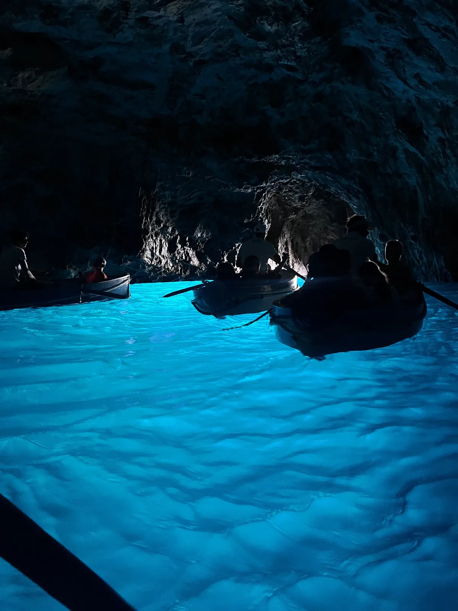

出洞以后，船绕着岛开。先是灯塔，在岛的最西头，叫 Punta Carena，1867 年点亮，是意大利仅次于热那亚的一座大灯塔。然后是南边的峭壁和海蚀洞，卡普里整座岛是石灰岩，海浪一点点把崖壁掏空，沿岸到处是大大小小的洞。然后是绿洞，船长说这里的水不到十米深，所以是绿的。


卡普里-PuntaCarena灯塔.webp Punta Carena 灯塔
卡普里-南岸峭壁和海蚀洞.webp 南岸的峭壁和海蚀洞
卡普里-绿洞的绿色海水.webp 绿洞的海水是绿的


再往前是法拉廖尼三礁，三根一百米上下的石柱立在海里。它们本来是和岛连着的一道石灰岩岬角，软的地方被海浪冲掉了，就剩下这三段。最靠岸的那座到现在还连着岛，中间那座底下被掏出一个拱门，最外面那座上住着一种蓝色的蜥蜴，全世界只有这块礁石上有。我们在船头拍照，老婆张开了双臂。

又经过马拉帕尔泰别墅、天然拱门和白洞。马拉帕尔泰别墅是意大利作家马拉帕尔泰的房子，红色的一长条趴在海角的岩石上，屋顶就是一道越往上越宽的大台阶，戈达尔的电影《蔑视》在这儿拍过。天然拱门在东边的山崖高处，原来是一个大海蚀洞，洞顶塌了，剩下这道拱。白洞看的不是水的颜色，是洞壁上那层白色的钙华和洞顶挂下来的白钟乳石。

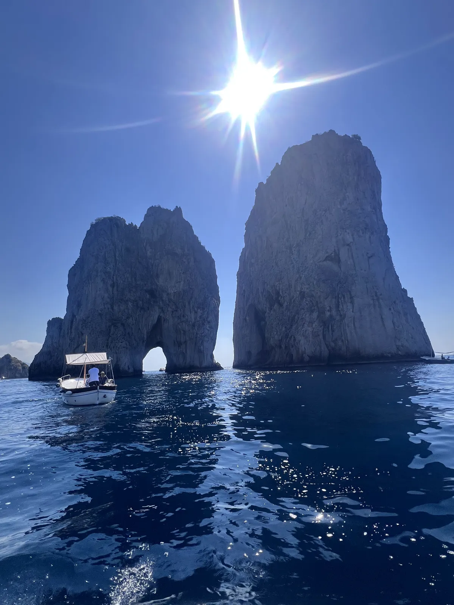

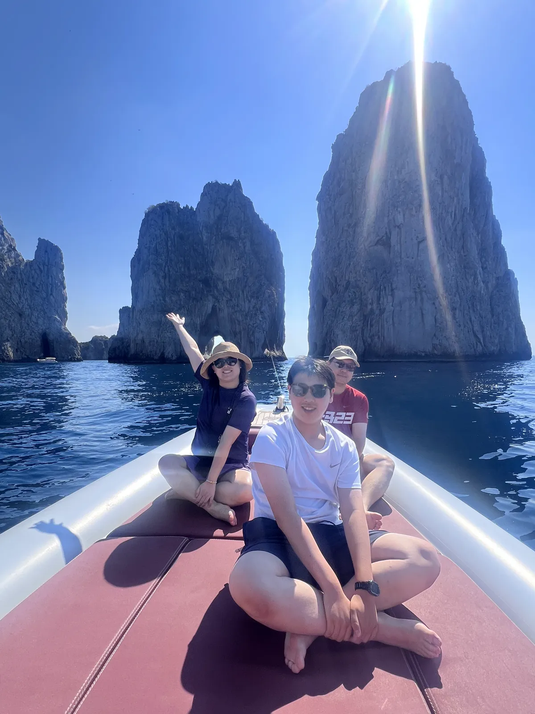


卡普里-船头张开双臂的老婆.webp 老婆在船头张开双臂
卡普里-马拉帕尔泰别墅.webp 红色的马拉帕尔泰别墅立在崖角
卡普里-白洞.webp 白洞


娃跳进白色崖壁下的海里游泳，穿着黑色的长袖泳衣，抱着浮力棒，喝了一口海水：“太咸了。”中午在卡普里的海边吃了卡普里蛋糕和提拉米苏。下午又出了一趟海，白色岩洞口有一排人在游泳，老婆拿着手机问我要不要跳下去。回程，娃坐在船头，张开双臂吹海风。


卡普里-崖下游泳的娃.webp 娃在白色崖壁下游泳
卡普里-海边的提拉米苏.webp 卡普里海边的提拉米苏
卡普里-卡普里蛋糕.webp 卡普里蛋糕
卡普里-白色岩洞前游泳的人.webp 白色岩洞前，一群人在游泳
卡普里-船头吹海风的娃.webp 回程时娃坐在船头吹海风


晚上回到索伦托，娃坐在阳台上，一边吃薯片一边看太阳落进海里，后面的云烧成了一片。


索伦托-酒店看海上火烧云.webp 从酒店看海上的火烧云
索伦托-露台上吃薯片看日落的娃.webp 娃在露台上一边吃薯片一边看日落


### 回到罗马：再看一眼

**7 月 10 日**。清晨，我和老婆在索伦托走了最后一圈：从酒店远眺维苏威，再走到塔索广场和主教座堂。然后坐火车回罗马。


索伦托-清晨酒店望维苏威.webp 清晨在酒店看维苏威
索伦托-主教座堂钟楼.webp 索伦托主教座堂的钟楼


下午在罗马又转了一圈：先去了第一次没去成的真理之口，在希腊圣母堂的门廊里，我把手伸了进去。真理之口是一块直径一米七多的大理石圆盘，上面一张大胡子的脸，眼睛、鼻孔和嘴都是通的，据说原本是古罗马的一块井盖。传说说谎的人把手伸进它嘴里，手就会被咬掉；《罗马假日》里，派克把手伸进去装作被咬，事先没跟赫本说，她那一声尖叫是真被吓到了。

又去了一次许愿池；在 Via Sistina 买了点东西；傍晚看了一眼斗兽场，又走过马戏团大竞技场。这是古罗马最大的赛车场，就在帕拉蒂诺山脚下，六百多米长，据说能坐十几万人，现在是一大片长条形的草地。


罗马-真理之口全家.webp 真理之口前的我们三个
罗马-希腊圣母堂.webp 希腊圣母堂的钟楼
罗马-ViaSistina购物.webp Via Sistina上提着购物袋的我
罗马-傍晚的斗兽场.webp 傍晚的斗兽场
罗马-大竞技场.webp 马戏团大竞技场边上看帕拉蒂诺山


天快黑的时候，我们爬上阿文提诺山，这也是罗马七丘之一。山顶有个马耳他骑士团广场，是 18 世纪的皮拉内西设计的，旁边就是骑士团的修道院。马耳他骑士团的大门上有一个钥匙孔，从里面望出去，树篱甬道的尽头正好是圣彼得大教堂的穹顶。据说从这个钥匙孔里能一眼看到三个“国家”：门里是骑士团的地盘，中间是意大利，尽头是梵蒂冈。我们和老外一起排了好久的队，整个过程里，好像只有我们是中国人。那里在一个高坡上，周围像是高档住宅区，很安静，不像景点。轮到我们，娃先走到绿色的大门前，弯腰凑近钥匙孔；我也贴着门，举着手机往里拍。

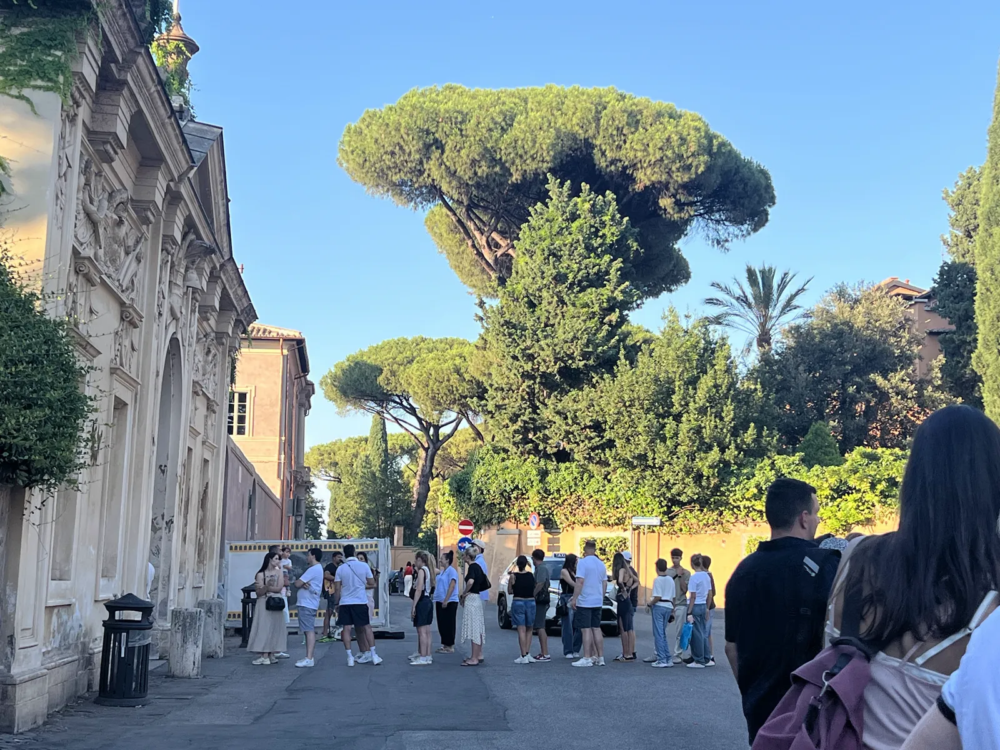


罗马-钥匙孔门前排队.webp 马耳他骑士团广场钥匙孔门口排队的人
罗马-凑近钥匙孔的娃.webp 娃凑近钥匙孔偷看


**7 月 11 日，回国**。天刚亮，我和老婆又出门走了最后一圈：圣天使堡，台伯河里的倒影，协和大道，空无一人的圣彼得广场。老婆在广场中间举起了双臂。想最后再看一眼这些地方，有些不舍。

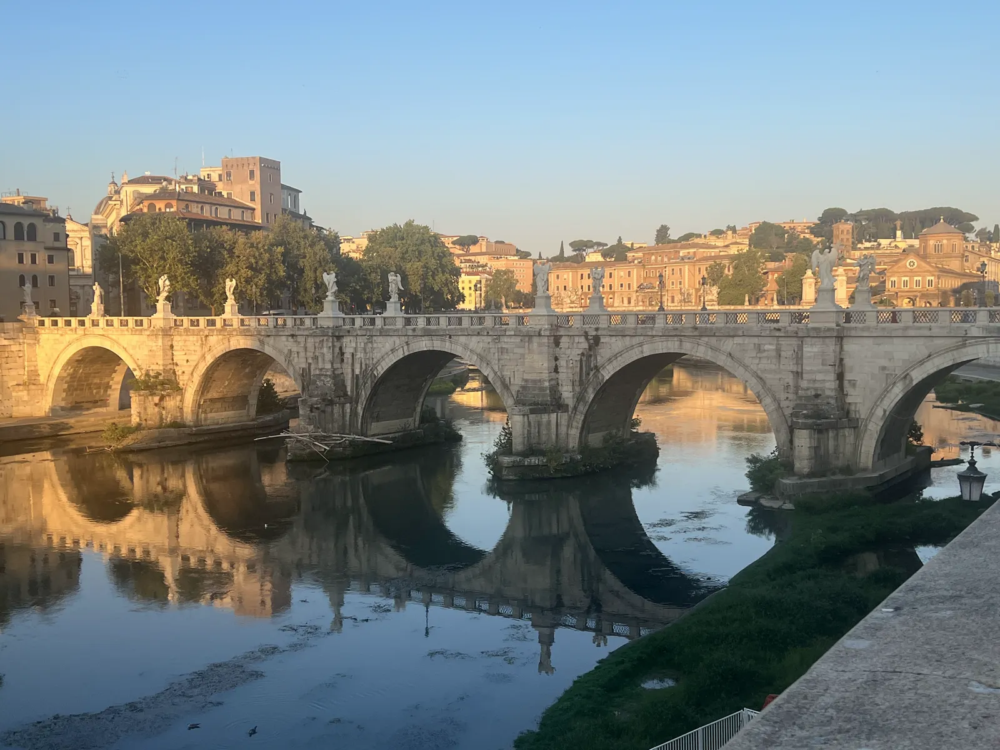


罗马-台伯河里的天使桥倒影.webp 回国那天清晨，台伯河里的倒影
罗马-协和大道的红裙.webp 回国那天清晨，协和大道上有人在拍照


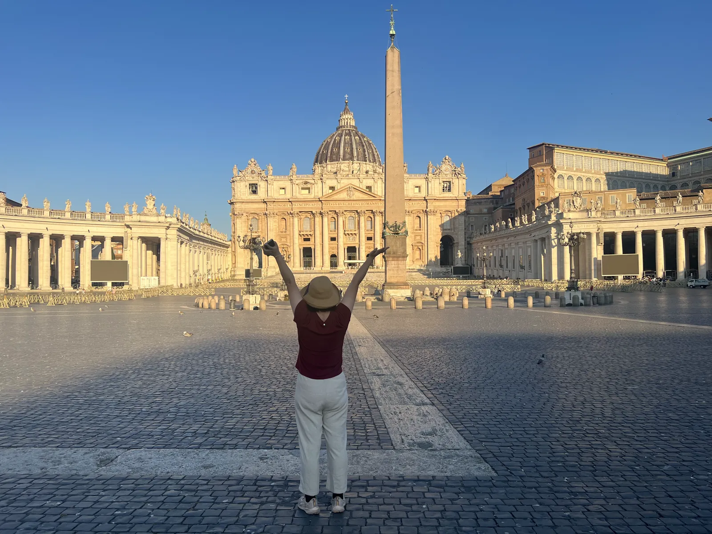

中午的飞机，经成都，12 日上午回到上海。

## 三、回来以后

回来休了一天，7 月 14 日就上班了。

要做的第一件事，其实是整理照片。几部手机加一台口袋相机，拍了一万多张，这已经超过了我的人力范围，于是让 AI 帮忙一起弄：一张张评级、打标签，认出照片里是哪座教堂、哪幅画、哪个人，最后挑出了三千多张五星照片。

照片之后才是视频：743 条，七个半小时。我拍了很多素材，但不知道怎么用，也不知道怎么用好；同时也想看看 AI 到底能做到什么程度。结果发现 AI 做得不错，就想把这些素材的潜力榨干。从分析素材、想剧本、拆分镜、写台词，到最后输出成片，连配音都能做，基本它全干了，我只需要在一些小地方提醒一下。

10 月先做了一部十几分钟的主片，按天的顺序剪。娃还给米开朗基罗和贝尔尼尼各当了一回讲解员，录了两部艺术片的解说。11 月 10 日那天，又定稿了五部专题片：

**《拿相机的人》**，3 分 12 秒。这一趟的视频大多是我拍的，所以画面里几乎没有我。片子把我偶尔露面的那几秒找了出来，转折就是圣三一桥上，老婆把刚拍的我举到我的镜头前。

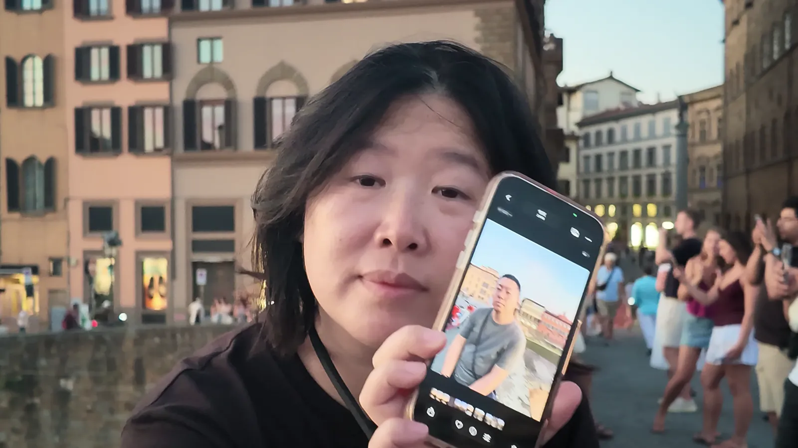

**《妈妈开播了》**，3 分 54 秒。老婆一路都在对着镜头说话，剪出来就是她自己的一部 vlog，从米兰长廊里的“好的，开始！”，到最后一句“好了，我停了”。

**《十三岁的意大利》**，4 分 33 秒。从娃的视角讲：“一路上，他们一直在拍我；那天晚上，我拍了他们。”里面的卡通小剧场是在自己电脑上用 AI 生成的，旁白用的是 AI 复刻的娃的声音。

**《抬头》**，2 分 58 秒。意大利最好看的东西都在头顶上，从万神殿的天窗，到百花大教堂的穹顶，一首合唱到底。

**《在路上》**，2 分 13 秒。跟着地图上那条线绕意大利一圈，看我们拖着箱子、坐高铁、坐船的样子。

片子里几乎没有我。全家同框的镜头，七个半小时里只有凌晨潟湖上的那一个。没关系，我就是为大家服务的，大家开心就好。

娃在威尼斯拍的那两张照片，后来放在了《十三岁的意大利》的结尾。看到它们，我觉得：一家人，感情很好，很幸福。

意大利是先拍完，回来再让 AI 去剪。下一趟去日本，我打算反过来：先让 AI 出拍摄建议，甚至先出样片和分镜，我到了那里照着拍。

## 尾声

现在回头看，从开始规划时做的那么多行程安排，到路上，到那些美景，再到回来以后整理照片、出片子，整个过程都很值得纪念。当然，最值得纪念的，还是在意大利的那十四天。
