《波斯王子 2：暗影与火焰》（Prince of Persia 2: The Shadow and the Flame）是 Jordan Mechner 做的一代正统续作，Broderbund 1993 年发行，这里按 DOS v1.1 版。

故事接着一代：王子和公主成婚才十一天，一个和王子长得一模一样的人出现在王座厅，顺手把他的身份也夺了去 —— 那是被王子杀死的巫师贾法尔留下的暗影。没人认得真王子，卫兵当他是刺客，他只能跳窗逃走，从码头栈桥一路亡命，渡海、穿过沙漠与洞窟、爬上悬崖上的古城废墟、直到山顶的神庙，去夺回自己的名字、救回公主。

全程 6 关 14 个场景，一路都在和时间赛跑：公主的命随时间流逝，游戏用一棵不断掉叶子的生命树来表示，拖得越久，叶子掉得越多。

## 操作键

| 键 | 作用 |
| --- | --- |
| Esc | 暂停 |
| Shift | 出剑 / 捡东西 |
| Alt-A | 重打这个场景 |
| Alt-G / Alt-L | 存档 / 读档 |
| Alt-S / Alt-M | 开关音效 / 音乐 |
| Alt-R | 回标题画面 |
| Alt-Q 或 Ctrl-Q | 退出 |

进游戏前有认符号、翻说明书的复制保护，场景 2 之后还会再查一次（说明书第 19 页）；说明书 PDF 在游戏目录的 `MANUAL/` 下，符号—数字的对照表见“手册查验”。

## 关与场景

游戏分成**六关**，每关若干**场景**。场景号就是游戏内部的那 14 份关卡数据，存档、选关和地图都按场景号算。

| 关 | 场景 |
| --- | --- |
| 第一关　码头栈桥 | 1 |
| 第二关　沙漠海滩 | 2 |
| 第三关　洞窟 | 3、4、5 |
| 第四关　悬崖废墟 | 6、7、8、9 |
| 第五关　山顶神庙 | 10、11、12、13 |
| 第六关　终局 | 14 |

## 开场

### 过场：开场·前情

*播放时机：开机：标题之前*

开场第一部分：用插画讲一代的故事——王子与公主相恋、打败贾法尔、成婚。

<video controls preload="metadata" playsinline src="pop2-nis-nis7-zh.mp4"></video>

### 过场：标题

*播放时机：开机*

游戏标题《Prince Of Persia 2 / The Shadow And The Flame》在云间浮现。

<video controls preload="metadata" playsinline src="pop2-nis-nis4.mp4"></video>

### 过场：开场·王座厅

*播放时机：开机：标题之后，进场景 1 前*

开场第二部分：王子走进王座厅，却发现“另一个自己”坐在公主身边；公主和苏丹都不认得他，卫兵上前捉拿，王子破窗跳出——游戏从场景 1 的屋顶逃亡开始。

<video controls preload="metadata" playsinline src="pop2-nis-nis8-zh.mp4"></video>

## 第一关　码头栈桥

王子被当成刺客赶出王宫，从码头的木栈桥上开始亡命。（场景 1）

### 场景 1

码头栈桥上的追逃关：一路往左跑，别被卫兵围住，也别掉进海里。这个场景没有任何机关，出口是栈桥尽头那条船。

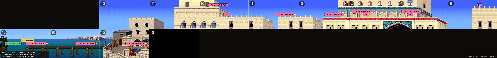

- **起点**：4 号房第 3 格（面向左），共 12 间房。
- **出口**：没有出口门 —— 走到 19 号房栈桥的左端朝船按跳，王子会自己跳上停在那里的船，动画演完就过关。
- **敌人**：卫兵 ×4；另有会刷出来的卫兵 22 只

> **这个场景的机制**
>
> 这个场景的出口是 19 号房栈桥尽头停着的那条船：走到栈桥左端、朝着船按跳，游戏就接管，播一段王子跳上船的动画，演完直接过关 —— 没有门，也没有开关。起跳点太靠右就够不着，会直接掉进海里。栈桥上没有任何机关，威胁只有卫兵；15 号房往右跑过头也会掉海里淹死。

### 过场：离开波斯

*播放时机：场景 1 后*

王子搭商船偷渡离开波斯。船舱里，他梦见一位蒙面女子召唤他（“到我这里来！”）；海上风暴中天空浮现贾法尔的脸，闪电劈中商船——王子被冲上海滩，进入场景 2。

<video controls preload="metadata" playsinline src="pop2-nis-nis9-zh.mp4"></video>

## 第二关　沙漠海滩

商船在风暴里沉了，王子被冲上一片沙漠海滩。（场景 2）

### 场景 2

沙漠海滩。1 号房沙子上会浮起板子，踩的顺序就是谜题；走到 1 号房最左边就过关。

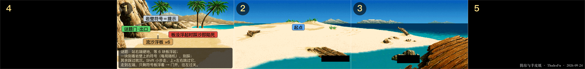

- **起点**：2 号房第 16 格（面向左），共 5 间房。
- **出口**：没有出口门 —— 走到 1 号房最左边就算过关。
- **敌人**：无

> **这个场景的机制**
>
> 1 号房是流沙谜题：沙面下埋着 6 块浮板，进房时都沉着，王子进房后它们各自按自己的节奏浮上来；板没浮起时踩进沙地会直接陷死。其中一块刻着符号，和左边岩壁上刻的那个一样（骷髅或蛇形），是哪一块、刻的哪个符号每局随机。王子从一块板上离开，那块就沉下去、不再浮起。解法：先站在右端硬地上等板全部浮起，用 Shift+方向小步走、上+左右跳，**绕过带符号的那块**，把其余 5 块都踩沉，再走到左端硬地站定；只剩符号板浮着、王子又不在上面，这样保持一小会儿（期间有两声提示音），岩壁里的门就开，往左走出房间即进入下一个场景。

### 过场：手册查验

*播放时机：场景 2 后（防拷贝，不是剧情）*

不是剧情：场景 2 结束后的防拷贝查验，要求选出手册第 19 页上的符号。

<video controls preload="metadata" playsinline src="pop2-nis-nis100.mp4"></video>

屏幕上给出一个符号，要在说明书第 19 页的表里找到它对应的两位数并输进去。符号—数字对照表（从实机逐个截下来的）：

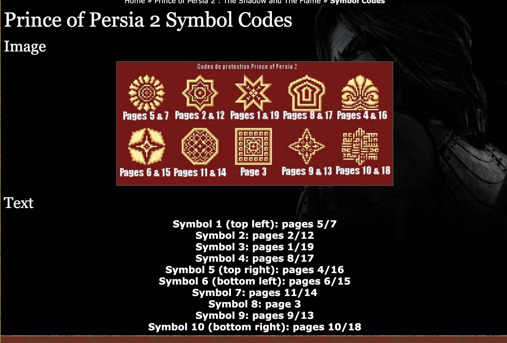

说明书 PDF 就在游戏目录的 `MANUAL/` 下（`POPCE_MANUAL.PDF`、`POPCE_COPY_PROTECTION.PDF`）。答错会被送回场景 1。

## 第三关　洞窟

海滩尽头的洞窟，里面是打散了还会重组的骷髅；尽头有一张飞毯。（场景 3、4、5）

### 场景 3

洞窟。**两个出口（13 号房、30 号房）没有区别** —— 走哪扇门，接下来的过场和场景 4 的起点都一样。骷髅打散了还会重组，别硬拼。

- **起点**：1 号房第 15 格（面向右），共 32 间房。
- **出口**：13 号房（第 1 行第 5 列），由 13 号房第 2 行第 8 列的开关 打开；从起点过去的房间顺序：1 → 5 → 6 → 13。
- **出口**：30 号房（第 2 行第 4 列），由 30 号房第 0 行第 8 列的开关 打开；从起点过去的房间顺序：1 → 4 → 16 → 3 → 2 → 14 → 15 → 17 → 19 → 22 → 30。
- **要小心的**：尖刺 3 处（11 号房第 2 行第 2 列、14 号房第 2 行第 0 列、21 号房第 2 行第 4 列）；暗器 9 处（4 号房第 2 行第 4 列、5 号房第 2 行第 5 列、9 号房第 2 行第 1 列、13 号房第 2 行第 1 列… ）；松动地板 15 处（1 号房第 0 行第 7 列、5 号房第 1 行第 2 列、5 号房第 1 行第 3 列、7 号房第 0 行第 5 列… ）
- **敌人**：骷髅 ×7、卫兵 ×1
- **药水**：回血 5 瓶、加命 2 瓶

### 过场：与此同时

*播放时机：场景 3 后*

与此同时的波斯王宫：苏丹出征，冒牌“王子”夺权；公主写信求父亲回来，冒牌王子（贾法尔）发现后，公主突然病倒，全国戒严。

<video controls preload="metadata" playsinline src="pop2-nis-nis10-zh.mp4"></video>

### 场景 4

洞窟。路线绕，注意尖刺和会射东西的压板。

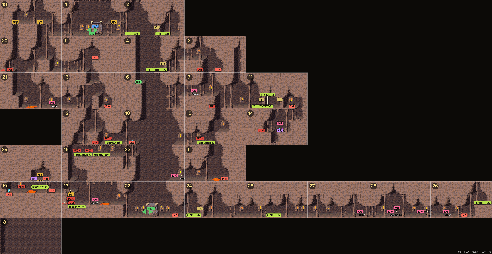

- **起点**：1 号房第 26 格（面向右），共 29 间房。
- **出口**：22 号房（第 2 行第 3 列），由 26 号房第 1 行第 8 列的开关 打开；从起点过去的房间顺序：1 → 2 → 4 → 6 → 10 → 23 → 22。
- **要小心的**：尖刺 6 处（3 号房第 2 行第 2 列、7 号房第 2 行第 4 列、12 号房第 2 行第 5 列、14 号房第 1 行第 2 列… ）；暗器 6 处（12 号房第 2 行第 7 列、15 号房第 2 行第 2 列、16 号房第 0 行第 2 列、16 号房第 0 行第 4 列… ）；松动地板 5 处（1 号房第 1 行第 8 列、17 号房第 0 行第 1 列、18 号房第 1 行第 2 列、18 号房第 1 行第 6 列… ）
- **敌人**：骷髅 ×10
- **药水**：回血 10 瓶、毒药 2 瓶、缓降 1 瓶、加命 1 瓶

### 过场：生命树·初见

*播放时机：场景 4 后（第一次换场景时的生命树）*

第一次在换场景时出现：宫中花园里象征公主生命的树，一个声音呼唤王子。

<video controls preload="metadata" playsinline src="pop2-nis-tree1-zh.mp4"></video>

### 场景 5

洞窟。出口不是门：3 号房的飞毯——站到毯子正中间蹲下就起飞，起飞前要先开好房顶的活板。

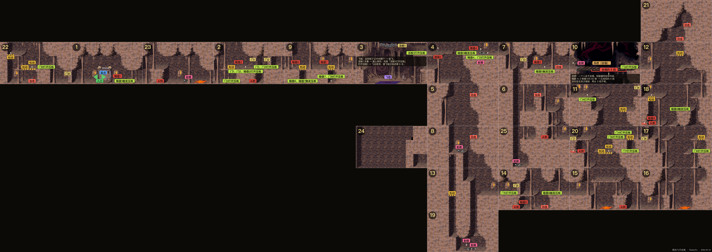

- **起点**：1 号房第 25 格（面向右），共 25 间房。
- **出口**：没有出口门 —— 坐 3 号房的飞毯飞出房顶。
- **要小心的**：尖刺 7 处（2 号房第 2 行第 5 列、14 号房第 2 行第 2 列、15 号房第 2 行第 7 列、18 号房第 2 行第 0 列… ）；暗器 9 处（1 号房第 2 行第 6 列、2 号房第 1 行第 3 列、4 号房第 0 行第 1 列、4 号房第 0 行第 6 列… ）；松动地板 14 处（2 号房第 1 行第 2 列、9 号房第 1 行第 2 列、9 号房第 1 行第 6 列、11 号房第 1 行第 7 列… ）
- **敌人**：骷髅 ×7
- **药水**：回血 6 瓶、加命 2 瓶

> **这个场景的机制**
>
> 3 号房是飞毯房：地上那块看着像绞肉机的东西在洞窟里是**飞毯**，房顶有一块活板，房里的压板打开它。王子站到毯子正中间蹲下，飞毯就载着他上升；活板没开会撞上摔死，开了就飞出房顶，接“飞毯”过场——这就是这个场景的出口。10 号房是吊桥：桥面中间下垂，王子和骷髅同时在桥上、相距 3 格以内、两人都在桥中段并且这样待够一会儿，桥中间的 5 段就从右往左一段段塌下去，两头各 3 段不塌；一个人走过去不会塌。

### 过场：飞毯

*播放时机：场景 5 后*

王子乘飞毯越过大海和云层，降落在悬崖上的古城废墟前——进入废墟关（场景 6 起）。

<video controls preload="metadata" playsinline src="pop2-nis-nis1.mp4"></video>

## 第四关　悬崖废墟

飞毯把王子送到悬崖上的古城废墟，人头和蛇的地盘。（场景 6、7、8、9）

### 场景 6

废墟。真正的出口在 16 号房的两扇压板门，走左门或右门会决定场景 7 从哪进。17 号房的剑要靠 18 号房左墙的暗道（贴墙蹲下）。

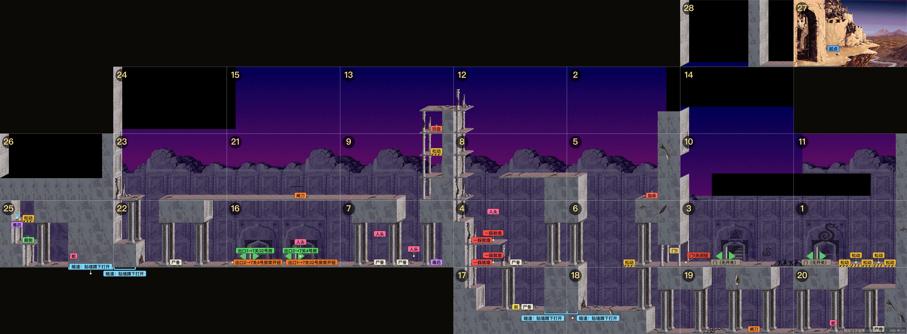

- **起点**：27 号房第 24 格（面向右），共 28 间房。
- **出口**：16 号房（第 2 行第 1 列），由 16 号房第 2 行第 7 列的开关 打开；从起点过去的房间顺序：27 → 28 → 14 → 2 → 12 → 13 → 15 → 21 → 16。
- **出口**：16 号房（第 2 行第 5 列），由 16 号房第 2 行第 0 列的开关 打开；从起点过去的房间顺序：27 → 28 → 14 → 2 → 12 → 13 → 15 → 21 → 16。
- **要小心的**：闸刀 2 处（19 号房第 2 行第 6 列、21 号房第 2 行第 6 列）；松动地板 8 处（1 号房第 2 行第 4 列、1 号房第 2 行第 5 列、1 号房第 2 行第 6 列、1 号房第 2 行第 7 列… ）；一踩就塌 4 处（4 号房第 1 行第 2 列、4 号房第 1 行第 3 列、4 号房第 2 行第 2 列、4 号房第 2 行第 3 列）
- **敌人**：人头（长发） ×4、蛇 ×2
- **药水**：毒药 2 瓶、加命 1 瓶、回血 1 瓶、颠倒 1 瓶

> **这个场景的机制**
>
> 出口在 16 号房：房里两块压板各开一扇门，左边那块开右门、右边那块开左门；走左门和走右门只是下个场景从不同房间进，两条都能过。1 号房的蛇纹门、3 号房那扇开着的门没有任何开关能动，实机按“上”都进不去，不是出口。17 号房（放着剑）四面封死，唯一的进法是 18 号房左侧的暗道：贴着那面墙蹲下，墙上就开出爬行通道。6 号房左下角本来就没有地板，那是通往 18 号房的洞口。

### 过场：生命树

*播放时机：场景 4 之后第一次出现，之后每次换场景都可能再放*

公主的生命树按剩余时间一片片掉叶子：第一次出现时带字幕，之后每少大约 9 分钟换下一张（第 k+1 张，`k = (1 − 剩余分钟) / 9 + 7`，只有比上次更靠后才会放）；时间用完就是最后那棵枯树，游戏结束。

<video controls preload="metadata" playsinline src="pop2-nis-tree1-zh.mp4"></video>

九张依次是：

|   |   |   |
| --- | --- | --- |
| 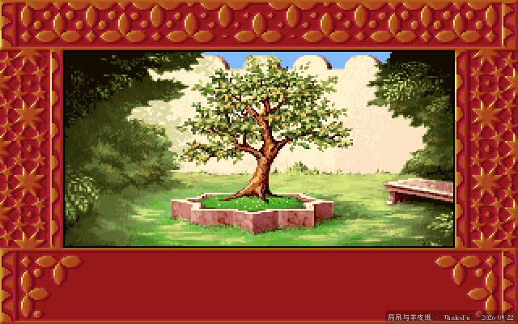 | 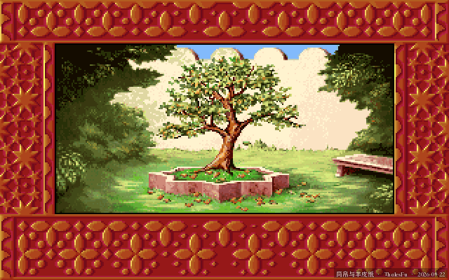 | 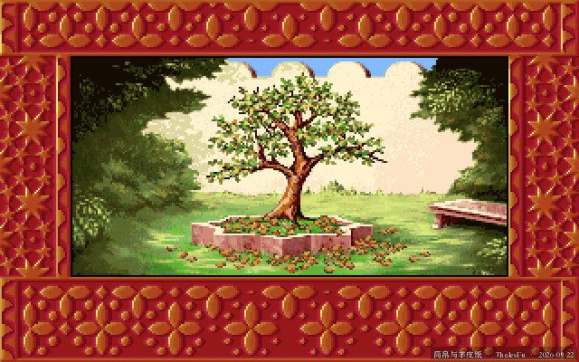 |
| 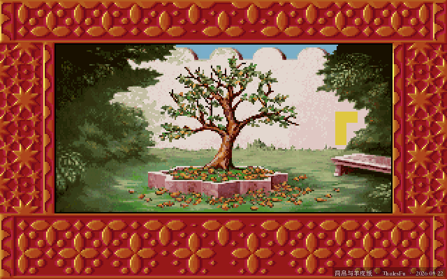 | 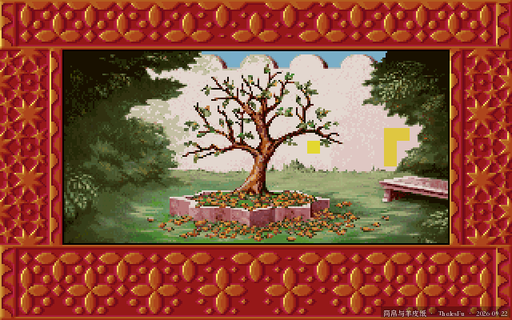 |  |
| 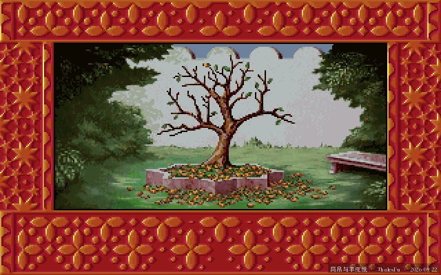 |  | 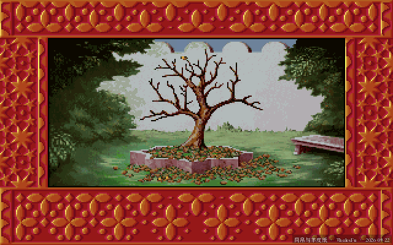 |

### 场景 7

废墟。人头和蛇都多，路上有不少一踩就塌的板。

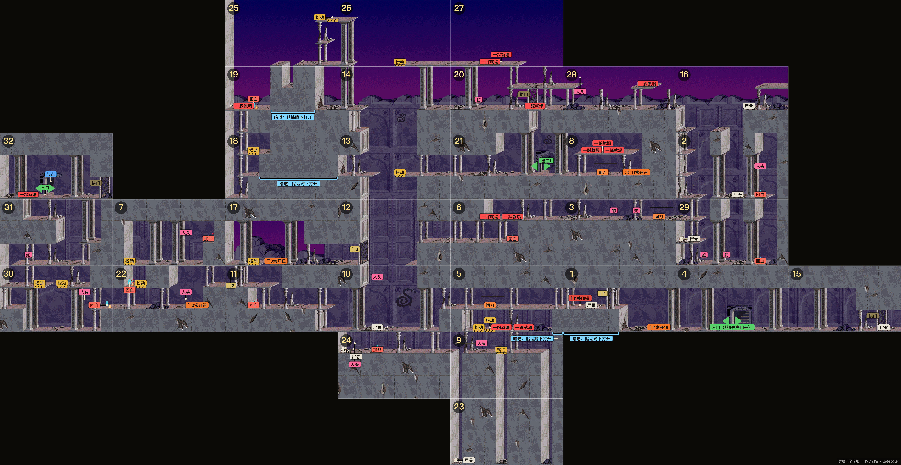

- **起点**：32 号房第 25 格（面向右），共 32 间房。
- **出口**：21 号房（第 1 行第 7 列），由 8 号房第 1 行第 6 列的开关 打开；从起点过去的房间顺序：32 → 31 → 7 → 17 → 12 → 6 → 21。
- **要小心的**：闸刀 3 处（3 号房第 0 行第 8 列、5 号房第 1 行第 3 列、8 号房第 1 行第 3 列）；松动地板 12 处（5 号房第 2 行第 2 列、5 号房第 2 行第 3 列、7 号房第 2 行第 1 列、9 号房第 0 行第 4 列… ）；一踩就塌 13 处（5 号房第 2 行第 4 列、5 号房第 2 行第 6 列、6 号房第 0 行第 3 列、6 号房第 0 行第 5 列… ）
- **敌人**：蛇 ×6、人头（长发） ×6、人头（短发） ×2
- **药水**：回血 7 瓶、加命 2 瓶

### 过场：生命树

*播放时机：换场景时（不在固定过场的位置）*

又一张生命树：按剩余时间选第几张，只有比上次更靠后才会换。

### 场景 8

废墟。人头最密的场景（19 只），一踩就塌的板也有。

- **起点**：16 号房第 16 格（面向左），共 26 间房。
- **出口**：23 号房（第 2 行第 1 列），由 23 号房第 2 行第 9 列的开关 打开；从起点过去的房间顺序：16 → 13 → 7 → 5 → 10 → 19 → 21 → 9 → 1 → 24 → 23。
- **要小心的**：闸刀 4 处（3 号房第 1 行第 8 列、5 号房第 2 行第 7 列、17 号房第 2 行第 7 列、22 号房第 2 行第 6 列）；松动地板 4 处（4 号房第 1 行第 5 列、8 号房第 1 行第 2 列、10 号房第 0 行第 9 列、17 号房第 0 行第 2 列）；一踩就塌 3 处（3 号房第 2 行第 3 列、12 号房第 1 行第 6 列、12 号房第 1 行第 7 列）
- **敌人**：人头（短发） ×17、蛇 ×5、人头（长发） ×2
- **药水**：回血 3 瓶、加命 1 瓶、毒药 1 瓶

### 过场：生命树

*播放时机：换场景时（不在固定过场的位置）*

又一张生命树：按剩余时间选第几张，只有比上次更靠后才会换。

### 场景 9

废墟。过关靠 8 号房最上层朝左跳出去，落到 2 号房的马上。

- **起点**：10 号房第 17 格（面向左），共 23 间房。
- **出口**：没有出口门 —— 从 8 号房最上层朝左跳出去，落到 2 号房的马上。
- **要小心的**：闸刀 3 处（6 号房第 2 行第 6 列、17 号房第 0 行第 3 列、19 号房第 0 行第 3 列）；松动地板 18 处（1 号房第 0 行第 2 列、1 号房第 0 行第 3 列、1 号房第 0 行第 4 列、1 号房第 0 行第 5 列… ）；一踩就塌 1 处（10 号房第 1 行第 8 列）
- **敌人**：蛇 ×6、人头（长发） ×6
- **药水**：回血 6 瓶、加命 1 瓶

> **这个场景的机制**
>
> 这个场景的出口不是门，是**从 8 号房最上面一层朝左跳出去**，落到 2 号房那匹马上。判定很严：必须在 8 号房、站在最上面那一层、用跳跃的动作跨出房间左边缘，三条都对才算过关；从下面两层跳出去、或者不是跳跃动作，都只当普通掉落处理。8 号房最上层有两块松动地板，跑过去时会塌。

### 过场：母亲的鬼魂

*播放时机：第四关（场景 6–9）中触发，触发点还没查到*

废墟宫殿中，王子母亲的鬼魂现身，讲出王子的身世，交给他父亲的剑。

<video controls preload="metadata" playsinline src="pop2-nis-nis6-zh.mp4"></video>

### 过场：奔向神庙

*播放时机：场景 9 后*

王子骑白马从废墟奔出，穿过荒原，奔向山顶的神庙——进入神庙关（场景 10 起）。

<video controls preload="metadata" playsinline src="pop2-nis-nis2.mp4"></video>

## 第五关　山顶神庙

骑马奔向山顶的神庙：鸟人、会动的墙、翻板，还有一场必须“死一次”的剧情。（场景 10、11、12、13）

### 场景 10

神庙。开始出现鸟人和会动的墙，地上还有翻板。

- **起点**：22 号房第 26 格（面向左），共 32 间房。
- **出口**：19 号房（第 1 行第 4 列），由 19 号房第 2 行第 1 列的开关 打开；从起点过去的房间顺序：22 → 11 → 8 → 14 → 12 → 19。
- **要小心的**：尖刺 5 处（13 号房第 2 行第 6 列、14 号房第 2 行第 2 列、16 号房第 2 行第 0 列、18 号房第 2 行第 0 列… ）；闸刀 6 处（2 号房第 2 行第 8 列、3 号房第 2 行第 6 列、21 号房第 0 行第 5 列、21 号房第 2 行第 5 列… ）；松动地板 10 处（8 号房第 1 行第 3 列、12 号房第 2 行第 1 列、14 号房第 2 行第 5 列、20 号房第 0 行第 3 列… ）；翻板 3 处（8 号房第 2 行第 5 列、12 号房第 2 行第 7 列、25 号房第 2 行第 1 列）；活墙 2 处（28 号房第 1 行第 6 列、28 号房第 2 行第 9 列）
- **敌人**：鸟人 ×5；另有会刷出来的鸟人 12 只
- **药水**：回血 7 瓶、加命 1 瓶

### 过场：生命树

*播放时机：换场景时（不在固定过场的位置）*

又一张生命树：按剩余时间选第几张，只有比上次更靠后才会换。

### 场景 11

神庙。闸门和活墙多，按钮要按顺序。

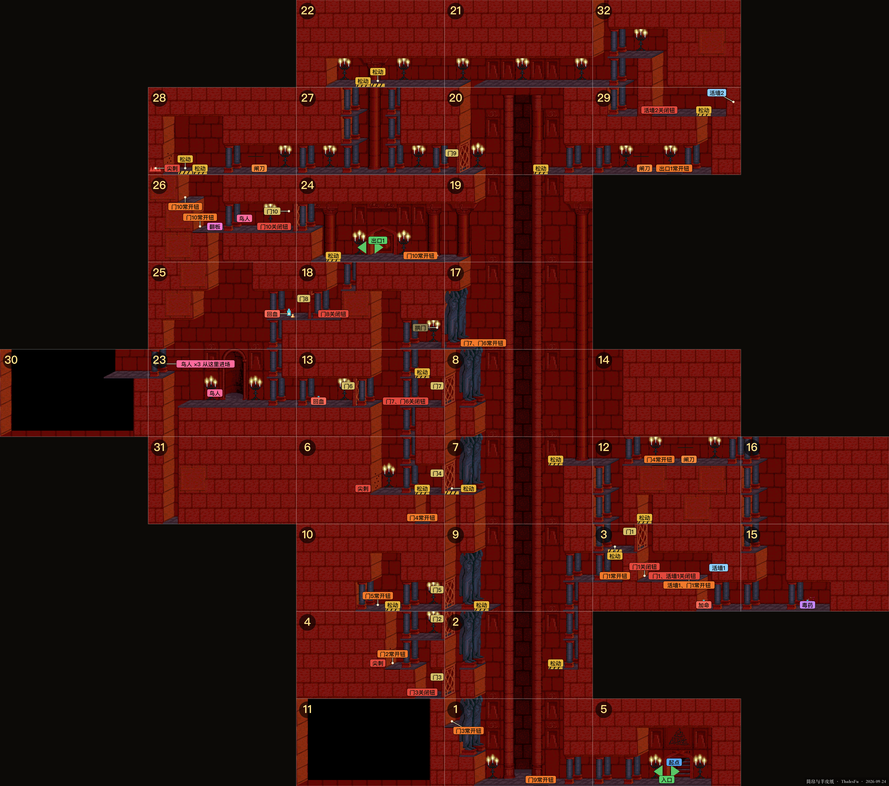

- **起点**：5 号房第 26 格（面向左），共 32 间房。
- **出口**：24 号房（第 2 行第 4 列），由 29 号房第 2 行第 5 列的开关 打开；从起点过去的房间顺序：5 → 1 → 11 → 4 → 10 → 6 → 13 → 18 → 24。
- **要小心的**：尖刺 3 处（4 号房第 1 行第 5 列、6 号房第 1 行第 4 列、28 号房第 2 行第 0 列）；闸刀 3 处（12 号房第 0 行第 6 列、28 号房第 2 行第 7 列、29 号房第 2 行第 3 列）；松动地板 16 处（2 号房第 1 行第 7 列、3 号房第 0 行第 1 列、6 号房第 1 行第 8 列、7 号房第 0 行第 7 列… ）；翻板 1 处（26 号房第 1 行第 4 列）；活墙 2 处（3 号房第 1 行第 8 列、29 号房第 0 行第 9 列）
- **敌人**：鸟人 ×2；另有会刷出来的鸟人 3 只
- **药水**：回血 2 瓶、加命 1 瓶、毒药 1 瓶

### 过场：生命树

*播放时机：换场景时（不在固定过场的位置）*

又一张生命树：按剩余时间选第几张，只有比上次更靠后才会换。

### 场景 12

神庙。出口是 7 号房那扇只有右半边的门（地图上标出来了）。1、10、21 号房各有一块翻板。

- **起点**：19 号房第 23 格（面向左），共 26 间房。
- **出口**：7 号房（第 2 行第 3 列），由 14 号房第 0 行第 8 列的开关、24 号房第 2 行第 3 列的开关 打开；从起点过去的房间顺序：19 → 7。
- **要小心的**：尖刺 6 处（5 号房第 1 行第 2 列、10 号房第 0 行第 9 列、11 号房第 2 行第 0 列、12 号房第 1 行第 2 列… ）；闸刀 3 处（6 号房第 2 行第 2 列、6 号房第 2 行第 7 列、14 号房第 2 行第 7 列）；松动地板 13 处（1 号房第 2 行第 6 列、2 号房第 1 行第 2 列、3 号房第 0 行第 3 列、3 号房第 2 行第 0 列… ）；翻板 3 处（1 号房第 0 行第 1 列、10 号房第 2 行第 1 列、21 号房第 2 行第 3 列）；活墙 5 处（1 号房第 2 行第 3 列、6 号房第 0 行第 3 列、6 号房第 0 行第 4 列、6 号房第 0 行第 5 列… ）
- **敌人**：鸟人 ×3、剑 ×1；另有会刷出来的鸟人 1 只
- **药水**：回血 4 瓶、毒药 3 瓶、加命 1 瓶、特殊 1 瓶

### 过场：生命树

*播放时机：换场景时（不在固定过场的位置）*

又一张生命树：按剩余时间选第几张，只有比上次更靠后才会换。

### 场景 13

神庙。剧情关：要在 4 号房被杀，灵魂回到身体后鸟人才停手、门才开（房内那块压板一次开三扇出口）。

- **起点**：3 号房第 15 格（面向左），共 29 间房。
- **出口**：28 号房（第 1 行第 5 列），由 4 号房第 1 行第 2 列的开关 打开；从起点过去的房间顺序：3 → 20 → 9 → 10 → 11 → 19 → 32 → 2 → 28。
- **出口**：32 号房（第 1 行第 1 列），由 4 号房第 1 行第 2 列的开关 打开；从起点过去的房间顺序：3 → 20 → 9 → 10 → 11 → 19 → 32。
- **出口**：32 号房（第 1 行第 5 列），由 4 号房第 1 行第 2 列的开关 打开；从起点过去的房间顺序：3 → 20 → 9 → 10 → 11 → 19 → 32。
- **要小心的**：尖刺 1 处（1 号房第 1 行第 4 列）；闸刀 2 处（7 号房第 1 行第 7 列、20 号房第 1 行第 4 列）；松动地板 7 处（3 号房第 1 行第 7 列、7 号房第 0 行第 3 列、11 号房第 1 行第 4 列、13 号房第 1 行第 5 列… ）；翻板 3 处（1 号房第 0 行第 5 列、17 号房第 2 行第 1 列、20 号房第 0 行第 3 列）；活墙 2 处（5 号房第 1 行第 9 列、16 号房第 1 行第 9 列）
- **敌人**：鸟人 ×3；另有会刷出来的鸟人 33 只
- **药水**：回血 4 瓶、缓降 1 瓶、加命 1 瓶

> **这个场景的机制**
>
> 4 号房是剧情房：在这里被鸟人杀死之后，一个灵魂会跳过来钻回王子的身体，鸟人就停手、改成跪拜，房里那块压紧压板这时一次打开**三扇出口门**（32 号房两扇 + 28 号房一扇）。这段只会发生一次。房间上层靠火盆那一侧是必死区：走过去会被一下打空血，快到的时候先响一声提示。

### 过场：飞马

*播放时机：场景 13 后*

王子骑飞马越过云端，落在高塔顶上——进入最后一关。

<video controls preload="metadata" playsinline src="pop2-nis-nis3.mp4"></video>

## 第六关　终局

飞马把王子送上高塔，在棋盘与巨虫的房间里和影子做最后了结。（场景 14）

### 场景 14

最终关。棋盘和巨虫的房间里，地板全藏在美术里——看地图上的绿色横条找落脚点。4 号房柱子后面反复转身可以让灵魂脱离身体。最后在 7–8 号房用蓄力的能量波打中影子就通关。

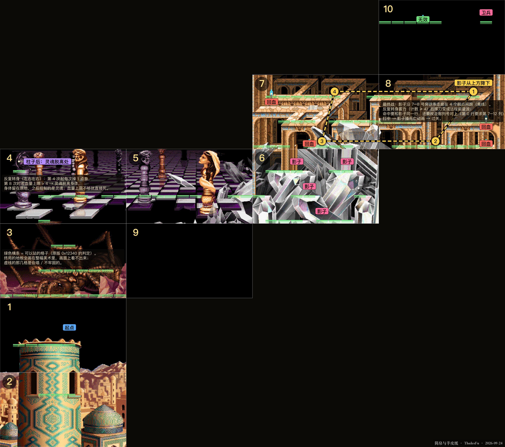

- **起点**：1 号房第 16 格（面向左），共 10 间房。
- **出口**：没有出口门 —— 在 7–8 号房用蓄力的能量波打中影子，它的死亡动画播完即通关。
- **敌人**：假王子 ×4、卫兵 ×1
- **药水**：回血 4 瓶、无效 1 瓶

> **这个场景的机制**
>
> 这个场景的地板全画在整幅背景美术里，所以地图上用**绿色横条**标出可以站的格子，虚线表示踩上去会塌。4 号房柱子后面那处是**灵魂脱离**：站在那里反复转身，从第 4 次起每转一次扣 1 点血（第 4 次会响一声提示），转到第 8 次时，如果血量上限大于 4，王子的身体就留在原地、玩家接着控制脱出来的灵魂；血量上限不到 5 的话，这一下把血扣光、死在原地。

### 过场：结局

*播放时机：场景 14 后*

结局：贾法尔死后咒语解除，公主认出王子；王子与公主骑马远去。最后画面里一个老巫婆在水晶球中看着他们——为续作埋下伏笔。

<video controls preload="metadata" playsinline src="pop2-nis-nis11-zh.mp4"></video>

## 结束

结局过场之后回标题。名人堂里记的是通关用掉的时间 —— 生命树的张数就是按剩余时间选的，所以走得越快，公主的树掉的叶子越少。
