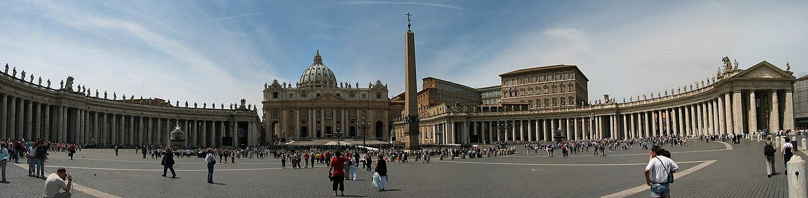
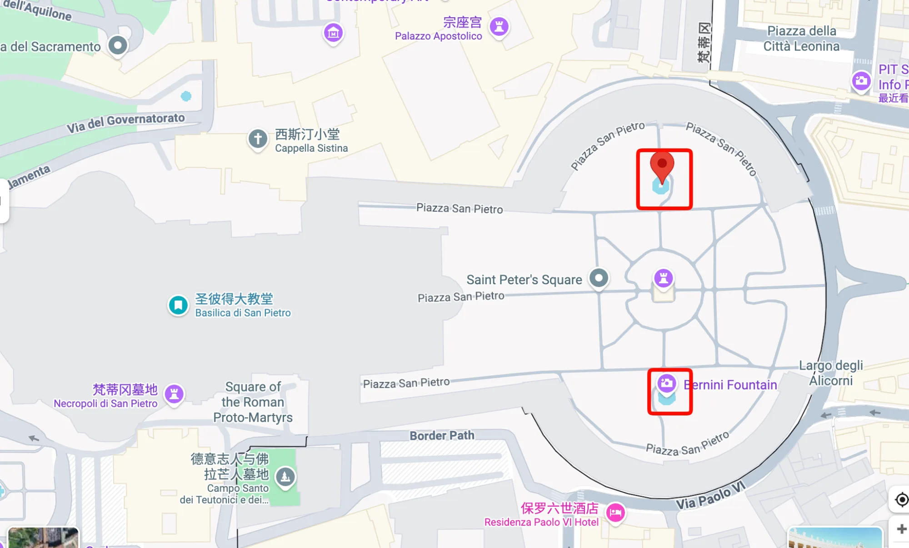
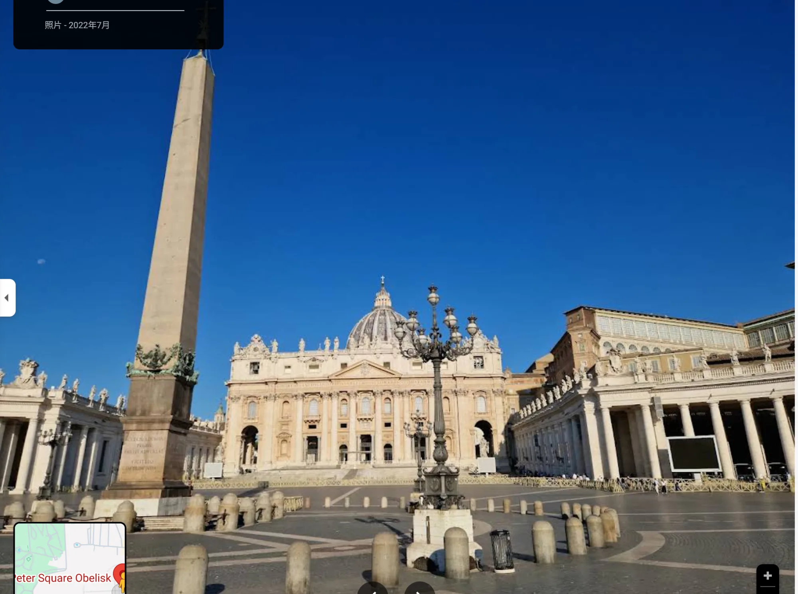
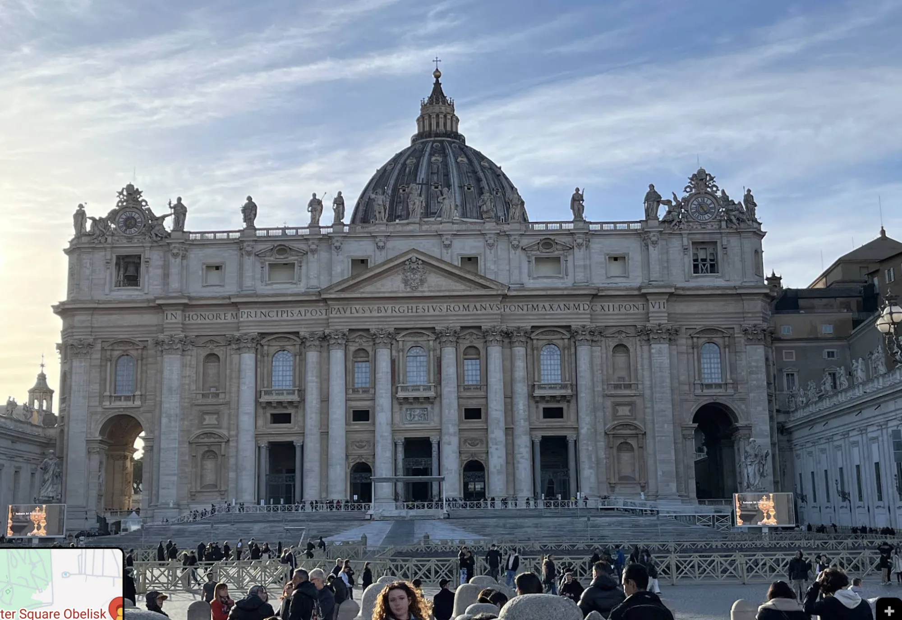

⭐⭐⭐ 持 Hosted Entry 从西斯廷专用门直通进来（11:25 左右）。本文讲**建筑本身**——它是天主教世界第一大堂、文艺复兴与巴洛克众巨匠接力 120 年的结晶；内部名作见 [B - 11 圣彼得大教堂 · 内部必看（圣殇 + 华盖 + 宝座 + 穹顶内部）](../b11-interior/)，登顶见 [B - 12 圣彼得大教堂 · 登顶穹顶攻略（台阶 + 票价 + 排队 + 值不值）](../b12-dome-climb/)。

🔗 官方：[圣彼得大教堂官网](https://www.basilicasanpietro.va/en) ｜ [官方虚拟游览](https://virtual.basilicasanpietro.va/en)

### 一句话定位

圣彼得大教堂（Basilica di San Pietro）建在**使徒圣彼得（第一任教皇）的墓**之上，是天主教最重要的圣地、教皇主持大典之处，也是**世界最大的教堂**（内部面积约 1.5 万㎡、纵深 187 m，可容数万人）。它不是主教座堂（罗马的主教座堂是拉特朗圣若望），但论地位与规模，它是基督教世界的"第一堂"。

**一句经文撑起一座建筑**：《马太福音》16:18–19，耶稣对渔夫西门说——"**你是彼得（Petrus，磐石），我要把我的教会建在这磐石上……我要把天国的钥匙给你。**"希腊文里"彼得"（Petros）与"磐石"（petra）本是同一个词的双关。天主教把这句话读作教皇制的"授权书"：彼得是第一任教皇，历任教皇是他的继承人。而这座教堂把这句双关**字面化成了建筑**——教会真的"建在彼得（的墓）上"：祭坛正下方是他的墓，墓上方 29 m 是贝尼尼华盖，再上方约 117 m 是穹顶，而穹顶基座一圈 2 m 高的金色大字写的正是这句经文。整座建筑就是一条从墓到天光的垂直轴线（内部详见 [B - 11 圣彼得大教堂 · 内部必看（圣殇 + 华盖 + 宝座 + 穹顶内部）](../b11-interior/)）。

**为什么是这块地**：按早期教会传统（最早见于公元 2–3 世纪的教会作家），圣彼得约公元 64–67 年尼禄（Nero）迫害基督徒期间，在梵蒂冈山坡的尼禄竞技场殉道——自认不配与耶稣同样受刑、**要求倒钉十字架**；信徒把他就近葬在竞技场旁大路边的墓地里。广场中央那根方尖碑当年就立在竞技场中轴上，可算"殉道现场的目击者"。君士坦丁（Constantine）4 世纪在墓上建起第一座大教堂，此后 1700 年，祭坛从未离开过那个点（墓址的 1940 年代考古发掘故事，见 B-11 华盖一节）。

### 建筑史：120 年、一串顶级名字接力

理解这座堂，关键是知道它**不是一个人设计的，而是文艺复兴到巴洛克最顶尖的建筑师一棒接一棒**：

- **老圣彼得大教堂**：公元 4 世纪 20 年代起，君士坦丁皇帝在圣彼得墓上建的五廊巴西利卡——为了让祭坛正压墓上，硬是把梵蒂冈山坡削平了一块。它矗立 1100 多年（公元 800 年圣诞节查理曼 Charlemagne 在此加冕称帝），到 15 世纪已墙体倾斜、破败不堪。
- **1506 起重建**：教皇尤利乌斯二世（Julius II）下决心拆旧建新，1506-04-18 奠基。**布拉曼特（Bramante）** 设计希腊十字（等臂十字）+ 中央大穹顶的方案，奠定基调；他拆老教堂下手太狠，同代人送他绰号"**毁灭大师（Maestro Ruinante）**"。
- **一个副作用改变了世界**：重建经费是天文数字，教皇利奥十世（Leo X）靠**贩卖赎罪券**筹款；1517 年马丁·路德（Martin Luther）贴出《九十五条论纲》，矛头直指"为修圣彼得堂而卖的赎罪券"——**宗教改革的导火索之一，就是眼前这座楼的工程款**。新旧交替的 120 年里（1506–1626），老教堂是一段段拆、新堂一段段盖的，有几十年时间信徒就在半拆的老中殿与半起的新穹顶之间做弥撒。
- **米开朗基罗（Michelangelo）** ——中间经拉斐尔（Raphael）、小桑加罗（Antonio da Sangallo il Giovane）等几任接手进展寥寥；1547 年 72 岁的米开朗基罗被教皇强令接管，据载他拒领薪水、自称"为了天主与圣彼得"义务效力。他砍掉小桑加罗的繁琐方案、回归布拉曼特的集中式，**设计了那座举世闻名的大穹顶**——1564 年他去世时只建到鼓座，穹顶由贾科莫·德拉·波尔塔（Giacomo della Porta）与多梅尼科·丰塔纳（Domenico Fontana）1588–1590 年按他的木模型完成（轮廓略拔高）。穹顶是他一生最后的杰作，登顶时你爬的就是他的结构。
- **马德尔诺（Carlo Maderno）** ——1607 年起把教堂从希腊十字加长成**拉丁十字（前面接出长长的中殿）**——既为容纳大型游行礼仪，也为把老教堂覆盖过的圣地全包进新堂——并建了今天的**正立面**。1626-11-18 乌尔班八世（Urban VIII）为新堂祝圣，距奠基整整 120 年。
- **贝尼尼（Gian Lorenzo Bernini）** ——巴洛克总导演，此后半个世纪陆续打造**广场大柱廊**、内部的**青铜华盖**与**圣彼得宝座**（见 B-11），把整座建筑变成一台宗教剧场。

> **看点一句话**：站在堂前，你同时看着布拉曼特的平面、米开朗基罗的穹顶、马德尔诺的立面、贝尼尼的广场——**一座建筑装下了整部 16–17 世纪建筑史**。

### 圣彼得广场 + 贝尼尼柱廊（Piazza San Pietro） ⭐⭐⭐

- **作者**：贝尼尼（Bernini），1656–1667
- **官网介绍页**：[Wikipedia · St. Peter's Square](https://en.wikipedia.org/wiki/St._Peter%27s_Square)

*图源：[Wikimedia Commons](https://commons.wikimedia.org/wiki/File:Vatican_StPeter_Square.jpg)*

**内容（这是什么）**：教堂前那个巨大的**椭圆形广场**（长轴约 240 m），两侧由 **284 根多立克柱、4 列纵深的半圆柱廊**环抱（外加 88 根壁柱），顶上立着 140 尊圣人雕像（贝尼尼工坊历时数十年雕成）。贝尼尼自己解释，这两道弧形柱廊是**"教会母亲张开的双臂"**，把走向教堂的信徒拥入怀中——这是他对空间叙事的巅峰构思。

**背景 / 来历**：1656–1667 年，贝尼尼受教皇亚历山大七世（Alexander VII）之命设计，任务书很实际："让尽可能多的人看到教皇祝福"——无论他出现在立面正中的阳台，还是宫殿的窗口。柱子刻意采用最朴素的多立克/托斯卡纳柱式、通体不施雕饰，就是为了不抢马德尔诺立面的戏，但用到这种巨人尺度，朴素本身就成了震撼。靠教堂一侧是收窄的梯形前庭、外侧是大椭圆，两种几何咬出一只"钥匙孔"的平面（呼应彼得的天国钥匙，从穹顶俯瞰最清楚，见 [B - 12 圣彼得大教堂 · 登顶穹顶攻略（台阶 + 票价 + 排队 + 值不值）](../b12-dome-climb/)）。原本从台伯河方向要穿过一片中世纪窄巷，出巷口猛然撞进大广场——那是贝尼尼安排的"巴洛克惊喜"；1936 年起墨索里尼（Mussolini）拆出笔直的协和大道（Via della Conciliazione），惊喜没了，换来一条从圣天使堡直望穹顶的轴线。

**现场站看**：

1. **找广场上两块圆形石板（焦点石 _centro del colonnato_）**——分别在方尖碑与两座喷泉之间。**站到石板上，朝近侧柱廊望去，四排柱子会神奇地叠成一排、只剩最外一根**——石板正是那侧柱廊弧线的圆心（石上刻着 _CENTRO DEL COLONNATO_），所有柱子都排在从这点放射出去的半径上。贝尼尼用精密几何制造的错视，是广场上最好玩的打卡点，一定要试。

2. **看中央的方尖碑**——红色花岗岩、通体无铭文，碑身高 25.5 m（连基座与顶上十字共 41 m），原立于埃及赫利奥波利斯（Heliopolis）；公元 37 年皇帝卡利古拉（Caligula）把它海运到罗马、立在尼禄竞技场的中轴上——**圣彼得殉道时它就站在一旁，是广场上唯一的"目击证人"**。1586 年教皇西斯笃五世（Sixtus V）命工程师多梅尼科·丰塔纳（Domenico Fontana）把它平移 250 余米到广场中央：按丰塔纳本人的工程记录，动用约 900 名工人、140 匹马、40 余台绞盘，"放倒—平移—竖起"分三步干了几个月；竖碑当天广场戒严，违令出声者处死。流传最广的"给绳子浇水（Acqua alle funi）"故事——绳索过热将断之际，圣雷莫船长布雷沙（Bresca）冒死喊出这句救了工程、获赐为棕枝主日供应棕榈枝的家族特权——**是后世传说，当代史料并无记载**。它也是罗马十几根方尖碑里唯一自古从未倒下过的；中世纪传说顶上铜球装着凯撒（Julius Caesar）的骨灰，丰塔纳取下旧球（现存罗马博物馆）查验——只有尘土。脚下那圈风玫瑰与黄道十二宫石板（1817 年加设）让它兼任一座巨型日晷的晷针。

3. **看柱廊顶上的 140 尊圣像**与"母亲双臂"的弧形——退到广场边缘回望，体会贝尼尼怎么用建筑把人"收拢"向教堂；柱廊檐口正中的大盾徽是亚历山大七世的基吉（Chigi）家族纹章（六座小山 + 八角星），方尖碑顶端的铜饰也换成了同款——贝尼尼给金主的落款。
4. **看两座孪生喷泉**——右手（北）那座是马德尔诺 1613 年所作；贝尼尼 1675 年（去世前五年）在南侧照样复制了一座配对。它们差不多正落在椭圆的两个焦点上，与焦点石、方尖碑一起把整套几何钉死在地面上。
5. **想体验原版"巴洛克惊喜"**——离开时别走协和大道正面，从广场南侧钻进圣神堂街（Borgo Santo Spirito）的窄巷再回头：从逼仄到豁然的那个瞬间，就是 1936 年以前所有朝圣者的"第一眼"。
6. **着装/安检提示**：进堂安检在**广场南侧（左手）柱廊下**排队，**遮肩盖膝是硬性要求**（无袖、短裤、超短裙会被拦），随身大包不能带（见 2026-06-30 周二 罗马 D3 详情）。

### 正立面（Facade） ⭐⭐

- **作者**：马德尔诺（Carlo Maderno），1607–1614

**内容（这是什么）**：宽 ~115 m、高 ~45 m 的巨幅立面。檐口的巨字铭文其实是出资人的"冠名"：**IN HONOREM PRINCIPIS APOST(OLORUM) PAVLVS V BVRGHESIVS ROMANVS PONT(IFEX) MAX(IMUS)**——"为使徒之长的荣耀，罗马人保罗五世·博尔盖塞、最高祭司（建此）"。教皇把自家姓氏 BVRGHESIVS 刻得比任何提到彼得的字都大，当年就有人腹诽。

**现场站看**：

1. **数顶上的 13 尊雕像**——正中是手持十字架的基督，两侧是施洗约翰（John the Baptist）与 11 位使徒，每尊高近 6 m。**唯独没有彼得**：他不在屋顶凑数，而是与保罗（Paul）一起化作台阶两侧的巨像（19 世纪作），一持钥匙一持剑，把守自己教堂的大门——下台阶时记得回头认一认。
2. **找正中的"祝福阳台"（Loggia delle Benedizioni）**——新教皇选出后在此被引见给世界（"Habemus Papam——我们有教皇了"），每年圣诞、复活节教皇也在此颁"致全城与全球（Urbi et Orbi）"祝福。仰头把新闻画面对上实景：白烟从西斯廷烟囱冒出后，万众的目光就聚在这扇窗。
3. **看立面两端的一对大钟**——瓦拉迪耶（Giuseppe Valadier）18 世纪末加装；左钟上方藏着全堂最大的钟"Campanone"（约 9 吨），新教皇当选时它与白烟一起报喜。
4. **想想"消失的钟楼"**——立面最两端那两跨本是钟楼基座：贝尼尼 1641 年真把南钟楼建了起来，结果地基下有暗泉、立面开裂，1646 年钟楼被勒令拆除，成了他一生最大的耻辱，也是立面显得"太宽太扁"的原因之一——你看到的不是失误的比例，而是一段没建完的野心。

> 立面常被诟病"太宽挡住了穹顶"——站在广场近处确实看不全米开朗基罗的圆顶，**想拍到完整穹顶，要退到广场最外缘、甚至 Via della Conciliazione 大道上回望**。

### 怎么逛 · 现场须知

- **入场免费**，但安检排队可能长；你们持 Hosted Entry 走西斯廷直通，**省掉广场重新安检排队**是核心福利（见 2026-06-30 周二 罗马 D3 详情）。
- 教堂内是**活的宗教场所**：保持安静、脱帽、着装遮肩盖膝；祭坛区可能因弥撒临时封闭。
- 动线建议：进堂 → 右手第一间小堂看《圣殇》→ 沿中殿走到中央**华盖与穹顶**下 → 后殿**圣彼得宝座** → 有体力再**登顶**（见 B-11、B-12）。
- 出堂后到广场补拍柱廊错视与方尖碑，再去午餐（Borgo Pio 老街就在广场北侧步行 5 分钟）。
