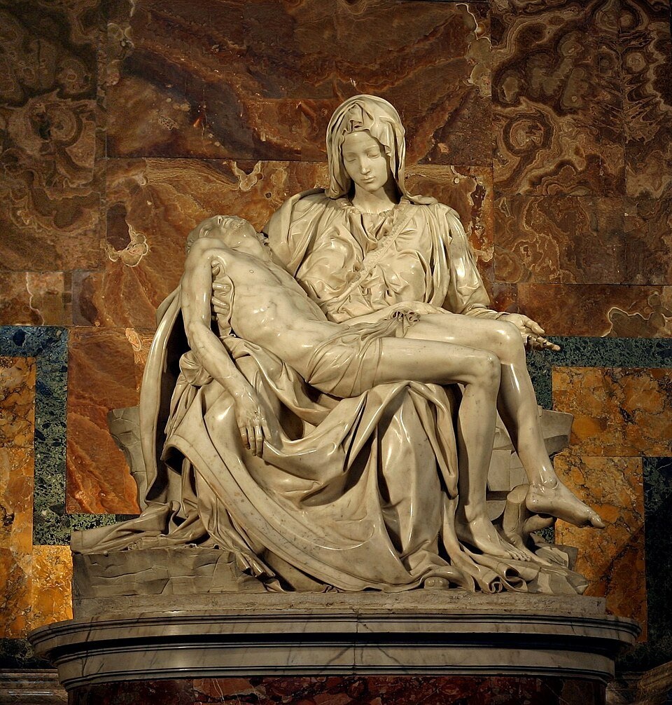
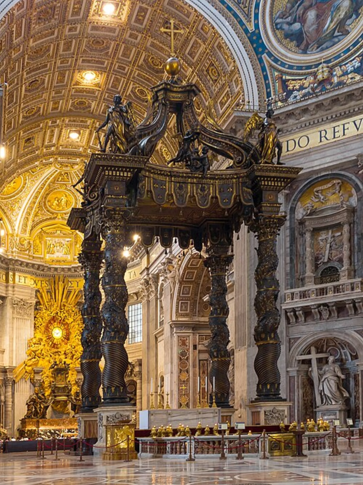
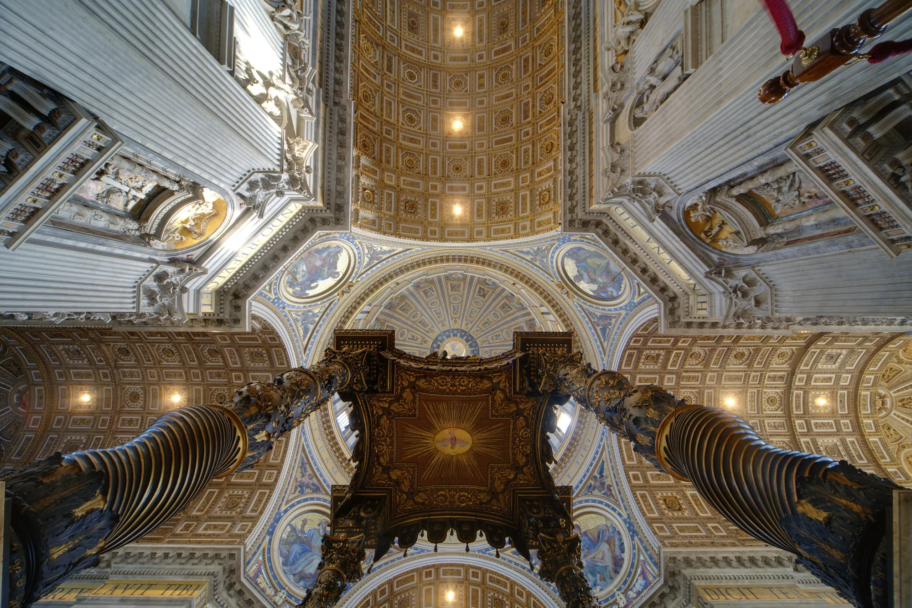
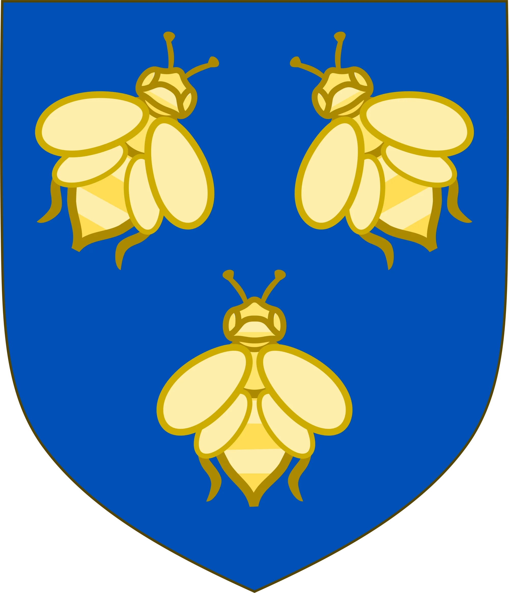
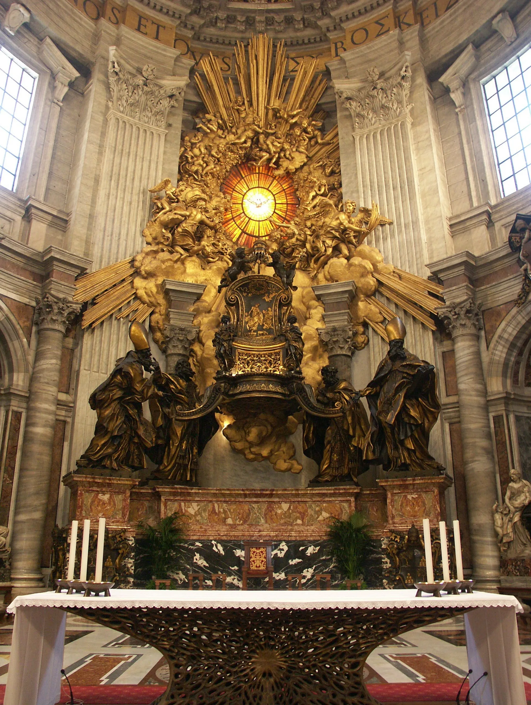

> ⭐⭐⭐ 进堂后按"右手《圣殇》→ 中央华盖 + 穹顶 → 后殿宝座"的动线看，约 1 小时（裴导讲解，见 2026-06-30 周二 罗马 D3 详情）。建筑与广场见 [B - 10 圣彼得大教堂 · 建筑史 + 外立面 + 广场柱廊](../b10-architecture-square/)，登顶见 [B - 12 圣彼得大教堂 · 登顶穹顶攻略（台阶 + 票价 + 排队 + 值不值）](../b12-dome-climb/)。
>
> 🔗 官方：[圣彼得大教堂官网](https://www.basilicasanpietro.va/en)

---

### 米开朗基罗《圣殇 / 哀悼基督》/ Michelangelo, _Pietà_ ⭐⭐⭐

- **作者**：米开朗基罗·博那罗蒂（Michelangelo Buonarroti），时年 **24 岁**
- **作品**：《圣殇》/ _Pietà_
- **时间**：1498–1499
- **材质**：卡拉拉大理石（单块整石雕成）
- **尺寸**：高约 174 cm
- **位置**：**进堂后右手第一间小堂**（玻璃防护后）
- **官网介绍页**：[Wikipedia · Pietà (Michelangelo)](https://en.wikipedia.org/wiki/Piet%C3%A0_(Michelangelo))

*图源：[Wikimedia Commons](https://commons.wikimedia.org/wiki/File:Michelangelo's_Pieta_5450_cropncleaned_edit.jpg)*

**内容（这是什么）**：圣母玛利亚（Virgin Mary）抱着刚从十字架上卸下、死去的基督。要紧的一点：**福音书里并没有这一幕**——经文只写了卸下圣体与约瑟（Joseph of Arimathea）收殓安葬，"母亲怀抱亡子"是中世纪虔修传统补出来的画面：14 世纪起德语区流行一种叫 **Vesperbild（"晚祷像"）** 的小型雕像，供信徒在受难日晚祷时对着默想圣母之痛（天主教"圣母七苦"中的第六苦）。阿尔卑斯山以北的版本大多刻意惨烈——基督僵直变形、伤口夸张、圣母枯槁嚎哭；米开朗基罗接过这个北方题材，却把它处理成**前所未有的宁静与优美**：没有血腥与撕心裂肺，只有母亲低头凝视爱子遗体的无声哀恸。基督的钉痕与肋伤小到几乎看不见、脸上没有任何痛苦——这是有意的神学表达：死亡在这里不是酷刑的终点，而是平静的"成了"。

**背景 / 来历**：订件人是法国红衣主教让·比莱尔·德·拉格罗拉斯（Jean Bilhères de Lagraulas）——法王驻罗马大使，要为自己在老圣彼得堂圣佩特罗妮拉（Santa Petronilla）圆堂内的墓室小堂订一件祭坛雕像。1498 年 8 月签约，银行家雅各布·加利（Jacopo Galli）作保，合同里写下了艺术史上最大胆的担保：这将是"**当今罗马最美的大理石作品，在世的大师无人能做得更好**"。23 岁的米开朗基罗亲赴卡拉拉花数月挑出一块完美整石，一年多后交出此作、一举震动罗马；红衣主教在完工前后去世，这件作品成了他最好的墓志铭。老教堂拆除时它被保下来、几经迁移，18 世纪才定位于现在这间小堂。

**签名轶事（考辨）**：圣母胸前的绶带上刻着 **MICHAELANGELVS BONAROTVS FLORENTINVS FACIEBAT**——"佛罗伦萨人米开朗基罗·博那罗蒂作"。瓦萨里（Giorgio Vasari）讲的版本流传最广：米开朗基罗听到一群伦巴第访客把它说成米兰雕塑家克里斯托福罗·索拉里（Cristoforo Solari）的手笔，气得当夜提灯进堂刻下名字，事后又懊悔虚荣，发誓从此不再署名。故事很可能经过润色——那行字刻得太工整、位置太显眼，不像深夜赌气的急就章，学者多认为签名早有预谋；但两个事实是硬的：这确实是他**唯一签名的作品**，而且他选了未完成时态 **FACIEBAT（"正在做"而非"做完了"）**——效仿古希腊大师阿佩莱斯（Apelles）的谦辞：作品永远还可以更好。1972 年修复时，人们还在圣母左掌心发现了一个隐刻的"M"。

**1972 锤击案与防弹玻璃**：1972-05-21（五旬节主日），匈牙利裔澳大利亚地质学家拉斯洛·托特（László Tóth）高喊"我是基督，我从死里复活了！"翻过栏杆，用地质锤连击 15 下：圣母左臂自肘部断落、鼻子削掉一块、眼睑破损。围观者把飞溅的碎块捡走不少没再归还，鼻子最后只能从她背部不显眼处取料重雕。修复历时十个月，此后雕像**永久退到防弹玻璃之后**（2024 年 11 月为 2025 禧年换上了更通透的新玻璃）——所以你只能隔着玻璃、有几米距离地看。两条余话：圣母左手的四根手指 1736 年就曾断落、由利里奥尼（Giuseppe Lirioni）补刻，你看到的那只手已修复过两轮；1964 年它曾远渡纽约世博会展出（观众站上传送带列队掠过），运回后教皇保禄六世（Paul VI）下令"**永不再出行**"。

**现场站看**：

1. **先站正面中线看"金字塔"**——全作是一个稳定的三角形：顶点是圣母低垂的头，底边铺开到基座的各各他岩石。再想一个被构图骗过的事实：**如果圣母站起来，她会比基督高出一大截**——为了让一个成年男子自然地躺进女性膝头，米开朗基罗悄悄放大了圣母的身躯，再用巨大的衣袍把"作弊"全部藏住。
2. **看圣母的脸——她太年轻了**，看上去比怀里 33 岁的儿子还年轻。米氏对传记作者孔迪维（Ascanio Condivi）解释：贞洁的女子不易衰老，何况无染尘欲的圣母——**用"违反常理的年轻"象征贞洁与神圣**。学者还指出他烂熟于心的但丁（Dante）《天堂篇》正有一句"贞女母亲，你儿子的女儿"——母与子、受造者与造物主的悖论，是这张脸最好的注脚。
3. **看衣褶**——圣母身上层层叠叠、深陷的袍褶，是用大理石"织"出来的布料，光影极其丰富。把这座庞大的"衣山"与基督光裸柔软的身体并置，一繁一简，更显遗体的脆弱。
4. **看基督垂落的右臂**——被圣母手指压出的腋下皮肉、松弛的肌肉、"已经没有生命"的下坠重量，被一块硬石头表现得令人心碎；臂上还凸着尚未冷却的血管。这条手臂是全作雕工的试金石。
5. **找伤口——几乎找不到**：右手背的钉痕、肋下的伤口都小而克制，脸像睡着。对照北方 Vesperbild 的血腥传统，才看懂米开朗基罗在做什么：把恐怖换成怜悯。
6. **看圣母摊开的左手**——微微外翻，像在向你"呈献"儿子，把私人哀恸变成普世的献祭；这也正是 1736 年补过手指的那只手，修复者是否"加戏"让手势更夸张，学界至今有争论。
7. **找胸前绶带上的签名**（隔玻璃较难，可用手机变焦）——认出最后那个词 FACIEBAT，再想签名轶事与 24 岁的年纪，分量不同。
8. **位置与站位提醒**：它在**进门右手第一间**，很多人一进堂直奔中央华盖会错过，**先右拐看它**。人最多，耐心挤到玻璃护栏正面；看完正面稍向左移半步，最能看清基督后仰的面容；堂内灯光自上方打下，正面偏侧看衣褶光影最佳。

---

### 贝尼尼《青铜华盖》/ Bernini, _Baldacchino_ ⭐⭐⭐

- **作者**：贝尼尼（Gian Lorenzo Bernini），1623–1634
- **材质**：青铜鎏金（"万神殿铜料"风波见下文「铜料争议」——讽语有名，账目却另有说法）
- **尺寸**：高约 29 m（近 10 层楼）
- **位置**：教堂正中央、主祭坛之上、大穹顶正下方
- **官网介绍页**：[Wikipedia · St. Peter's Baldachin](https://en.wikipedia.org/wiki/St._Peter%27s_Baldachin)

**内容（这是什么）**：覆盖在教皇祭坛（只有教皇能在此主祭）上方的巨型青铜华盖。"Baldacchino" 原指游行时撑在教皇头顶的织物华盖——看檐边垂下的青铜"流苏帷幔"：贝尼尼把一块布永久浇铸成了金属。四根**螺旋扭转的巨柱（所罗门柱式）**各高 20 m，托起总高近 29 m（约 10 层楼）的顶盖，柱身爬满月桂与蜜蜂——赞助人教皇乌尔班八世（Urban VIII，本名马费奥·巴贝里尼 Maffeo Barberini）的家族纹章。它正立在**圣彼得墓的正上方**，在 1.5 万㎡ 的超人空间里"标记"出整座教堂的圣核，也在巨构与祭坛前真人尺度的仪式之间充当中介。

**为什么这里是"圣核"：彼得之墓**：按早期教会传统，圣彼得约公元 64–67 年在一旁的尼禄（Nero）竞技场殉道——自认不配与主同刑、**倒钉十字架**（这出自奥利金等早期作家的记载，福音书并无此节），信徒把他葬在竞技场旁的路边墓地。约公元 200 年教士盖乌斯（Gaius）已写下名句："我可以指给你看使徒的纪念冢，就在梵蒂冈。"君士坦丁（Constantine）建老教堂时把祭坛正压墓上。**而现代考古真的找到了它**：1939 年为安葬教皇庇护十一世（Pius XI）挖墓时意外挖穿地下古罗马墓群，庇护十二世（Pius XII）下令秘密发掘十年（1940s），在祭坛正下方找到约公元 160 年的小型纪念龛（aedicula）与刻满朝圣涂鸦的墙体——其中一段希腊文涂鸦被释读为"**ΠΕΤΡ(ΟΣ) ΕΝΙ，彼得在此**"。一批曾被管理人卡斯（Ludwig Kaas）私自移存、后被铭文学家瓜尔杜奇（Margherita Guarducci）追回的骸骨，经检验属于一位 60–70 岁、体格健壮的男性；1968 年保禄六世（Paul VI）宣布"以令人信服的方式"认定为圣彼得遗骨。学界并未全体买账（主持发掘的考古学家费鲁阿 Antonio Ferrua 终生存疑），但"此地自 2 世纪起就被当作彼得之墓持续敬拜"，考古证据是扎实的。

**铜料争议（考辨）**：1625 年乌尔班八世确实下令拆走万神殿门廊的古罗马青铜梁，罗马的"会说话的雕像"帕斯奎诺（Pasquino）上随即贴出史上最毒的讽语：**"Quod non fecerunt barbari, fecerunt Barberini——蛮族没干的事，巴贝里尼干了。"**但据乌尔班的账册研究，万神殿铜料约九成被铸成了圣天使堡的大炮，华盖用铜主要购自威尼斯——讽语朗朗上口流传四百年，板子却多半打错了地方：拆万神殿是真，"熔了铸华盖"大抵是冤。

**背景 / 来历**：1623 年巴贝里尼当选教皇当年即点将，贝尼尼时年 25 岁；工程 1624–1634 年，是他第一件把雕塑与建筑合为一体的作品，巴洛克"总体艺术"的开端。日后与他斗了一辈子的博罗米尼（Francesco Borromini）此时还是合作者——绘制了大量图纸、可能参与设计（顶部反曲的涡卷常被归到他名下）；贝尼尼的父亲彼得罗·贝尼尼（Pietro Bernini）、雕天使的杜凯努瓦（François Duquesnoy）等一班好手都上了工地。螺旋柱式直接放大自老教堂祭坛屏的 12 根古代大理石螺旋柱——君士坦丁运来、中世纪相信出自耶路撒冷所罗门圣殿，故名"所罗门柱"。

**现场站看**：

1. **站到华盖正前仰头**——看四根柱子怎么把视线一路旋转着送上 29 m 高的顶盖、再接进 117 m 的穹顶。贝尼尼用它解决了一个空间难题：在超大体量里给祭坛一个谁都不会错过的焦点。
2. **看顶盖底面（华盖的"天花板"）**——正中是一轮放射状金色太阳（也是巴贝里尼纹章），正悬在教皇主祭时头顶的位置；四角立着真人两倍高的天使。
3. **数柱身上的蜜蜂**——巴贝里尼家的三只蜜蜂爬满枝蔓；古柱原型缠的是葡萄藤，贝尼尼特意换成月桂——暗捧乌尔班八世引以为傲的拉丁诗才。
4. **绕四个大理石柱础一圈，看"分娩连环画"**——八面盾徽乍看相同，从左前那面起逐一看盾上方的女人脸：表情由平静到痉挛、头发渐渐散乱、张口尖叫，盾面随之鼓胀，到第八面孩子降生——女人脸换成了微笑的小天使。通行解释是"教会如产妇般辛劳孕育信众"的寓意，民间另有乌尔班八世为侄媳难产还愿的传说（皆属推测）；电影导演爱森斯坦（Sergei Eisenstein）盛赞这是"八个蒙太奇镜头"。这是华盖最容易错过的彩蛋。
5. **抬头找四座巨墩上层壁龛里的 8 根古柱**——环绕华盖的四座大墩（底层立着持矛朗基努斯等四尊巨像）二层阳台两侧，各嵌一对老教堂传下的"所罗门柱"原件。原件与放大十倍的青铜复刻同框，全世界只有这里。
6. **退到中殿中线看"画框"效果**——从纵深处望去，四根扭柱恰好框住后殿金光中的圣彼得宝座：华盖与宝座是贝尼尼相隔三十年的一对设计，前者标记彼得的**墓**、后者标记彼得的**权座**，一条轴线讲完"彼得在此、彼得仍在执政"。
7. **看华盖前下沉的告解龛**——栏杆围着一圈长明灯，正下方就是那座 2 世纪纪念龛与墓本体（见下文「告解龛」）。

### 大穹顶内部（Cupola interior） ⭐⭐⭐

- **设计**：米开朗基罗（穹顶结构），内壁马赛克 16–17 世纪完成

**内容 / 背景**：米开朗基罗生前只建到鼓座，穹壳由贾科莫·德拉·波尔塔（Giacomo della Porta）与多梅尼科·丰塔纳（Domenico Fontana）1588–1590 年按他的木模型完成（轮廓比原案略拔尖，更利于受力）。内径 41.5 m——比万神殿（43.3 m）刻意小一圈；地面到穹顶内壳最高点约 117 m，是**世界最高的砖石穹顶**。内壁马赛克按画家骑士达尔皮诺（Cavalier d'Arpino）的图样 17 世纪初铺成，16 条肋把六层图像一路收向顶心采光亭。

**现场站看**（站在华盖斜前方、祭坛围栏外抬头）：

1. **读穹顶基座一圈的拉丁文金字**：`TV ES PETRVS ET SVPER HANC PETRAM AEDIFICABO ECCLESIAM MEAM ET TIBI DABO CLAVES REGNI CAELORVM`——"你是彼得，我要把我的教会建在这磐石上……我要把天国的钥匙交给你"（《马太福音》16:18–19）。**每个字母高约 2 m**，蓝底金字。这是整座教堂的"立堂宣言"：你脚下正是彼得的墓，头顶是这句授权——教皇权柄的全部法理依据，被做成了一圈建筑装饰，悬在墓的正上方。
2. **用四角的圆盘校准尺度感**——穹顶四个帆拱上是四福音书作者的马赛克圆像，每幅直径约 8.5 m；圣马可（Mark）手里那支笔据测长 1.5 m。远看只是"几幅画"，知道真实尺寸后再环顾四周，整个空间会猛地"变大"——这座教堂处处用完美比例骗你觉得它不大，这里是拆穿它的最好位置。
3. **顺 16 条肋向上"爬"一遍**——一层层是教皇胸像、基督圣母与使徒、天使序列，最后收进采光亭里俯视的天父像；光从最高处洒下，正落在华盖与圣彼得墓的轴线上——从墓到天父，一条垂直的神学线，这就是"教会建在磐石上"的剖面图。
4. **分辨"米开朗基罗的部分"**——鼓座（带成对柱子与花环窗的那一圈）基本是他生前完成的，其上的穹壳是德拉·波尔塔按模型续建的。知道分界线在哪，等于在看两代人交接力棒。
5. **留意这里全是马赛克**——大堂里几乎没有真正的"油画"，所有"画"都是马赛克镶嵌（不褪色、不怕烛烟潮气）。穹顶离你 100 多米仍色彩饱满，靠的就是这个。
6. **想近看这些马赛克**：登顶通道恰好先经过穹顶内侧环廊，可以贴着金字与镶嵌块走半圈再上顶看罗马全景——见 [B - 12 圣彼得大教堂 · 登顶穹顶攻略（台阶 + 票价 + 排队 + 值不值）](../b12-dome-climb/)。

### 贝尼尼《圣彼得宝座》/ Cathedra Petri ⭐⭐

- **作者**：贝尼尼，1657–1666（亚历山大七世任内，1666 年 1 月「圣彼得宗座节」前后揭幕；部分资料记作 1647–1653），位于教堂最深处后殿（apse）
- **官网介绍页**：[Wikipedia · Chair of Saint Peter](https://en.wikipedia.org/wiki/Chair_of_Saint_Peter)

**内容（这是什么）**：后殿尽头的巨型鎏金青铜祭坛装置，核心是一件圣物：一把相传属于圣彼得的木椅。**Cathedra（宗座）就是主教的"教席"**——主教坐着训导，座位本身即是权柄的象征（"主教座堂 cathedral"、教皇"以宗座权威 ex cathedra 宣布"，都从这个词来）。所以这件作品供奉的与其说是一个人，不如说是一个**职位**：彼得的教席传承两千年，今天坐在上面的人叫教皇。贝尼尼按中世纪圣髑匣"外形随圣物"的老规矩，把木椅"包"进一把悬空的青铜大椅；椅背浮雕正是**"喂养我的羊"**——复活的基督把羊群托付彼得（《约翰福音》21 章）。它与穹顶金字的"你是彼得"一上一下、一墓一座，凑齐了教皇权柄的两句经文授权。

**那把木椅是谁的（考辨）**：龛内圣物是一把镶象牙饰板、布满虫蛀的橡木椅。传统视为彼得本人坐过的座椅；1968–1974 年开龛科学检测的结论是——它实为 **875 年西法兰克皇帝秃头查理（Charles the Bald）献给教皇若望八世（John VIII）的加洛林王座**，最老的部件也不早于 6 世纪。教会如今的态度很坦然：椅子是后世的，"彼得教席"这个职位是真的——本笃十六世（Benedict XVI）称它是"彼得及其继承人牧养基督羊群之特殊使命的象征"。（2024 年大修后，木椅本尊曾罕见公开展出数周，是 1867 年以来头一次。）

**四位教会博士**：托举宝座的四尊巨像是一组精心配平的"东西合璧"——**外侧两位戴主教冠的是拉丁（西方）教父：盎博罗削（Ambrose）与奥古斯丁（Augustine）；内侧两位免冠的是希腊（东方）教父：亚大纳削（Athanasius）与金口若望（John Chrysostom）**。用意露骨而漂亮：无论希腊还是拉丁、东方还是西方，整个教会的智识传统共同托起彼得的教席。上方檐带的题词也是拉丁文、希腊文各刻一遍（"教会的牧人啊，你牧放基督的羔羊与群羊"）。再细看：四位其实没在用力——指尖只虚搭着垂下的缎带，宝座像自己悬浮在云中。**权柄不靠人抬、自天而来**，是贝尼尼藏在铸铜里的神学。

**现场站看**：

1. **先退到华盖后方、正对后殿**——让四根扭柱框住整片金光看一眼（这是贝尼尼设计好的"官方机位"），再走近细看。
2. **看光**：透光窗朝西，下午阳光直射时整片"荣耀"（Gloria）会真的烧起来；你们中午前后到，光线柔和但金色依然成立——多停一会儿，看光芒、云朵与天使一层层涌出墙面，石头建筑像被"圣灵降临"溶穿了一个洞。这是巴洛克总体艺术（建筑+雕塑+自然光）的极致。
3. **看鸽子的尺寸**——窗心象征圣灵的鸽子翼展约 1.75 m、比人还宽，远看却只是"一只小鸟"：又一次尺度欺骗。窗面被金色光芒分成 12 格——十二使徒环绕圣灵。
4. **认四位博士**——戴冠 / 免冠对应拉丁 / 希腊；认完再看他们的指尖与缎带，确认"宝座没人抬"。
5. **看空椅子**——青铜坐垫鼓胀写实，上面却空无一人（圣物封在龛内）：空座本身就是宣言——**这个位子永远有主**。
6. **顺看两侧教皇墓**——宝座右侧是贝尼尼晚年杰作乌尔班八世墓（青铜死神正在簿子上写他的名字），左侧是古列尔莫·德拉·波尔塔（Guglielmo della Porta）的保罗三世墓，一对隔空相望、相差一百年的名作。

### 圣彼得青铜坐像 + 圣彼得墓（Confessio） ⭐

#### 青铜圣彼得像

中殿最后一对柱墩的右侧（近华盖处），一尊青铜圣彼得坐像：右手两指作祝福状，左手攥着**天国的钥匙**——正是"我要把天国的钥匙交给你"的图解。长期被当作古代早期基督教作品，现在多归于 13 世纪末的阿诺尔福·迪·坎比奥（Arnolfo di Cambio，佛罗伦萨圣母百花大教堂的首任建筑师）。

**摸脚传统**：七百年来朝圣者排队抚摸或亲吻它伸出的右脚祈福，**脚趾已被磨得锃亮、几乎熔成一片平板**。现场对比一下两只脚：左脚脚趾还根根分明，右脚已成光滑的"鳍"——把青铜磨平的不是岁月，是几百年里上亿次的触碰，这是教堂里最动人的"时间痕迹"。每年 6 月 29 日圣彼得圣保禄瞻礼，这尊像会被披上红色锦袍、戴上三重冕"盛装过节"——你们 6/30 到访正是次日，若盛装尚未撤下，还能赶上它一年中最隆重的样子。

#### 告解龛（Confessio）

华盖前那圈下沉的半圆栏杆（马德尔诺设计），围着近百盏长明灯。下方平台正对一座镀金小龛——**披带龛（Niche of the Pallia）**，银盒里存放着待授予各地新任都主教的羊毛披带；龛再往下，就是 2 世纪的纪念龛与**圣彼得的墓**——整座教堂的存在理由（发掘故事见上文华盖一节）。站到栏杆前向下看一眼：你与这座教堂的"原点"之间只隔几米。想真正走进地下墓街（Scavi 考古区）须提前数月向发掘办公室申请、小团进入且**不收 15 岁以下儿童**——本次带娃行程不安排，看这一眼即可。

### 怎么逛 · 现场须知

- 着装遮肩盖膝、保持安静、脱帽；祭坛区可能因仪式临时封闭。
- 动线：**右手《圣殇》→ 中央华盖/穹顶/圣彼得墓 → 后殿宝座 → 摸圣彼得铜脚**，再决定是否登顶。
- 《圣殇》隔防弹玻璃、人最多，**一进门先右拐看它**最从容。

### 配图（维基公有领域，Obsidian 可自动本地化）

- 圣殇：（[来源](https://commons.wikimedia.org/wiki/Special:FilePath/Michelangelo's Pieta 5450 cropncleaned edit.jpg)）
- 华盖/宝座/穹顶内部：见各自 Wikipedia 条目

---

← 返回 2026-06-30 周二 罗马 D3 详情 · 建筑与广场：[B - 10 圣彼得大教堂 · 建筑史 + 外立面 + 广场柱廊](../b10-architecture-square/) · 登顶：[B - 12 圣彼得大教堂 · 登顶穹顶攻略（台阶 + 票价 + 排队 + 值不值）](../b12-dome-climb/) · 总览：[00 总览](../overview/)
