**8:00 第一波进馆是全天最好的拍照窗口**——长廊和庭院人最少，前 1 小时多拍，后面越走越挤。
配合 [00 总览](../overview/) 的参观顺序使用。
**标注**：🧍 = 拍人（单人人像）｜👪 = 适合合影｜🏛 = 拍景（展品/建筑/天顶）｜双标/三标 = 都值得

### 拍照规则速查（2026-06 核实）

- **博物馆全程可拍（禁闪光）**，仅限个人用途；禁三脚架、支架、无人机和专业设备
- **西斯廷礼拜堂绝对禁拍**——不是"禁闪光"而是"禁相机"，守卫会要求当面删照片。**别试**，用眼睛看，回来用[官方虚拟游览](https://virtual.basilicasanpietro.va/en)回味
- **圣彼得大教堂与广场可拍**，教堂内注意着装（遮肩膝），弥撒区域勿闯
- ⚠️ **Momo 螺旋楼梯（明信片上那个）在博物馆正出口**——若走 Hosted Entry 从西斯廷直通大教堂，**不会经过它**。要拍就得放弃直通通道重新出馆，得失自己权衡

### 手机通用参数

- 长廊 / 天顶：0.5x 超广角，**贴中轴线**拍一点透视，点测金顶降一档曝光
- 雕塑：1x–2x 对焦面部；庭院露天雕塑上午是顺光，放心拍
- 大教堂内：光比极大，对着光束拍要**狠降曝光**（-1 至 -2 档），暗部后期再提

### 博物馆段机位（按参观顺序）

#### 1 ⭐ 松果院 Cortile della Pigna 🧍👪🏛

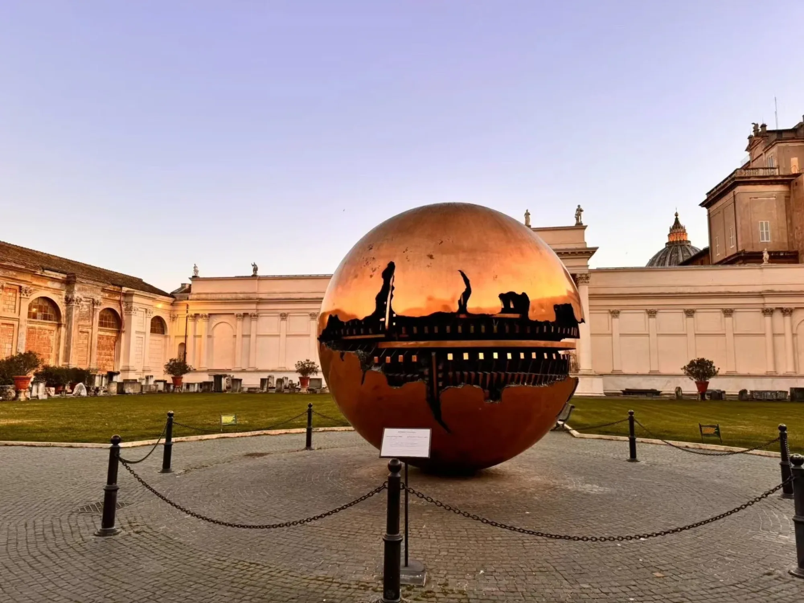

- **金球《球中球 Sfera con Sfera》**：人像站球前 2–3 m，球面反射庭院全景；上午顺光
- **巨松果壁龛**：正面中轴竖幅，合影站台阶下
- **回头看**：从庭院能看到**圣彼得穹顶探出屋顶**——穹顶 + 庭院同框，很多人错过

#### 2 ⭐ 八角庭院 · 拉奥孔 🏛

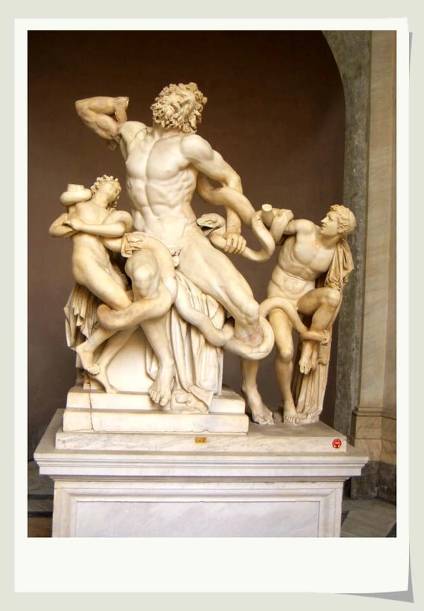

- **正面偏左 30°** 是公认最佳角度（蛇、父子三人的对角线全展开）
- 细节：2x 拍拉奥孔的脸——西斯廷看完米开朗基罗再回想这张脸
- 8:15 前后这里人还少，**这是全天拍拉奥孔的唯一空场窗口**，别省时间

#### 3 圆形厅 Sala Rotonda 🧍🏛

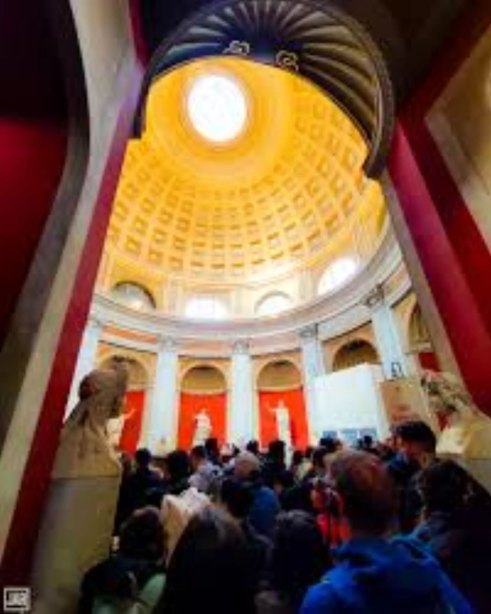

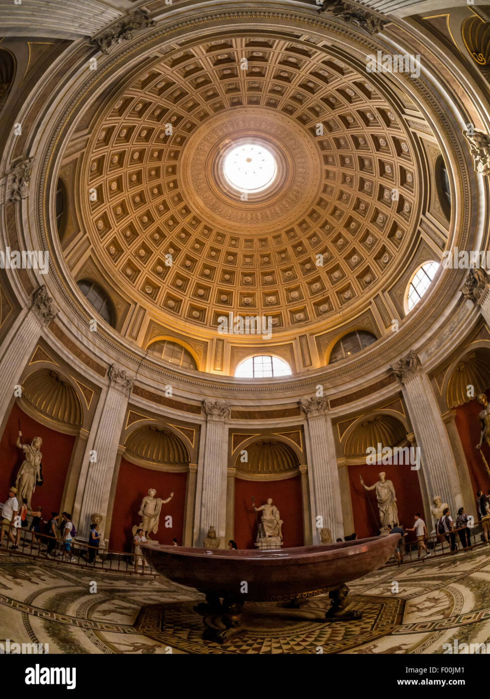

- 0.5x 仰拍**仿万神殿穹顶 + 金色马赛克地面**；人像站斑岩大盆前，广角把穹顶收进上半幅

#### 4 ⭐⭐ 地图廊 Galleria delle Carte Geografiche 🧍👪🏛

- **全馆最出片**：站正中轴线，0.5x 竖幅拍 120 m 金顶纵深——**进廊第一时间拍**，越往后人越多
- 人像：让人站中轴线上回头，拍摄者蹲低一点，金顶占画面 2/3
- 窗外左侧可瞥见梵蒂冈花园，顺手一张

#### 5 拉斐尔房间 · 签字厅 🏛

- 《雅典学院》全幅：**斜 30° 站位**避开人群头顶 + 画面反光；细节 2x：台阶上沉思的赫拉克利特（米开朗基罗肖像）、最右侧拉斐尔自画像回望镜头
- 这里禁不了人多，拍纪录为主，别恋战

#### 6 西斯廷礼拜堂 🚫

- **禁拍，收手机**。把这 45 分钟全给眼睛——这是全天唯一"零照片"段落，提前跟同伴说好

### 圣彼得大教堂段机位

#### 7 圣殇 Pietà 🏛

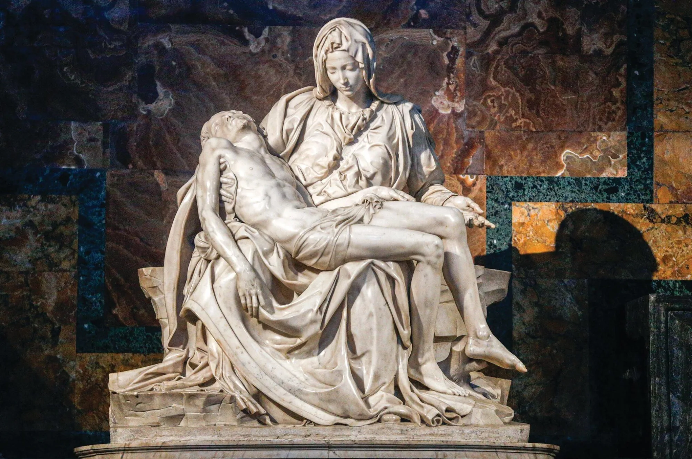

- 防弹玻璃后约 5 m：**3x 长焦 + 斜 15–20° 角**避开玻璃正面反光；人多时举高手机过头顶拍
- 进门**右手第一个礼拜堂**，进堂直奔这里，旅行团到达前最空

#### 8 ⭐⭐ 华盖 + 穹顶光束 🏛

- **接近正午正是穹顶光束打下来的最佳时段**：站华盖斜前方，把**光柱 + 青铜螺旋柱**同框，狠降曝光拍丁达尔光
- 穹顶内部：站华盖正下方 0.5x 垂直仰拍藻井 + 采光环

#### 9 中殿全景 🏛（顺手 🧍 纪实）

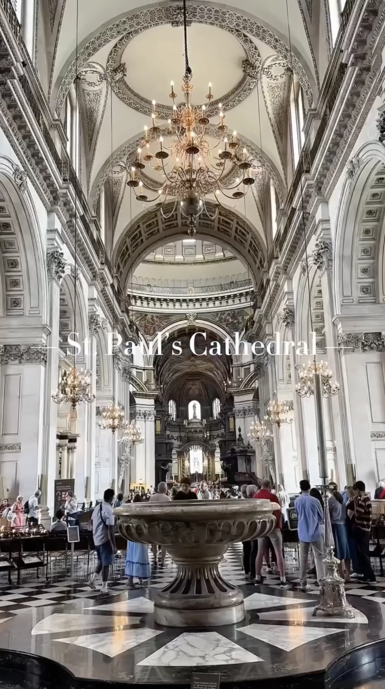

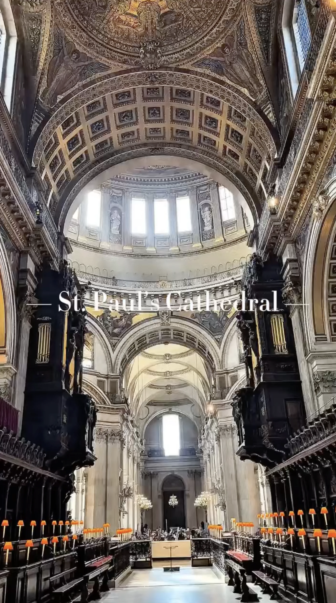

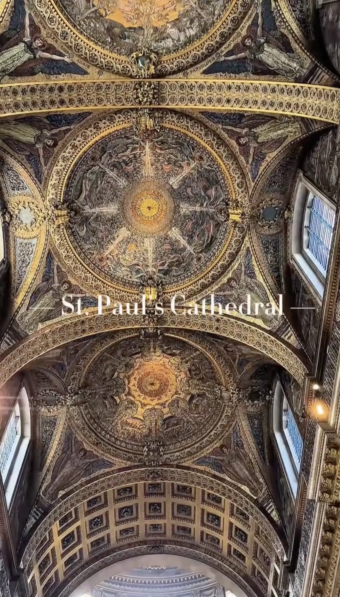

- 进门处（出门前回头拍）：0.5x 拍 187 m 中殿纵深；地面有各大教堂长度的铜线刻度，可拍同伴低头找的纪实一张

#### 10 登顶（B-12 可选，若去）🏛（顶部平台可 👪）

- 穹顶内部回廊：**俯瞰华盖与中殿地面**，全堂最震撼的非常规视角
- 顶部平台：⭐ 俯瞰**广场钥匙孔形柱廊 + 协和大道直通台伯河**，全罗马最高机位；另一侧拍梵蒂冈花园

### 广场与外景机位

#### 11 ⭐ 柱廊焦点石（错视彩蛋）🧍👪

- 方尖碑与两侧喷泉之间各有一块 **"Centro del Colonnato" 圆形石板**：站上去看柱廊，**四排柱合成一排**——一人站石上指柱廊、一人拍，是最好的"科普合影"
- 出堂后顺手 10 分钟搞定

#### 12 广场正面与全景 👪🏛

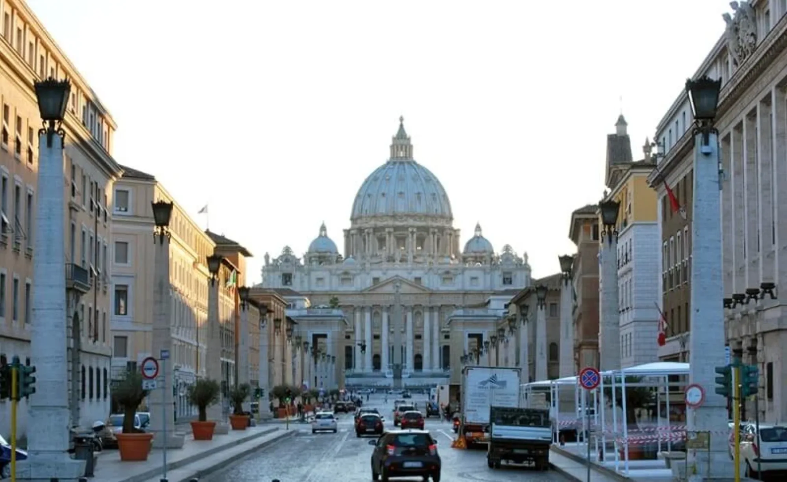

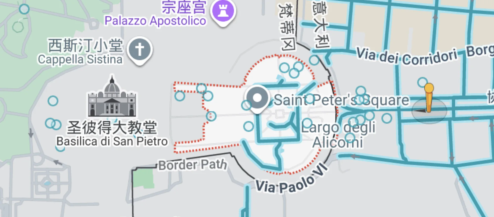

- **台阶前合影**：大教堂正立面背景，正午顶光略硬，人物可背对立面用 0.5x 略仰
- **协和大道 Via della Conciliazione 中轴**：往河边走 200–300 m 回头拍大教堂全景——穹顶在这个距离才完整露出（贴近广场时穹顶会被立面挡住）
- 顺路彩蛋：晚上若经过**圣天使桥**，桥上看穹顶剪影是罗马经典夜景位

### 合影机位优先级

1. 地图廊中轴线（8:30 前，全天唯一空场）
2. 柱廊焦点石（错视梗，老少都喜欢）
3. 协和大道回望大教堂全景（穹顶完整）

### 时间预算提醒

上午动线本就紧，拍照原则：**长廊和庭院多拍（人少光好），拉斐尔房间少拍，西斯廷不拍，大教堂拍光束**。

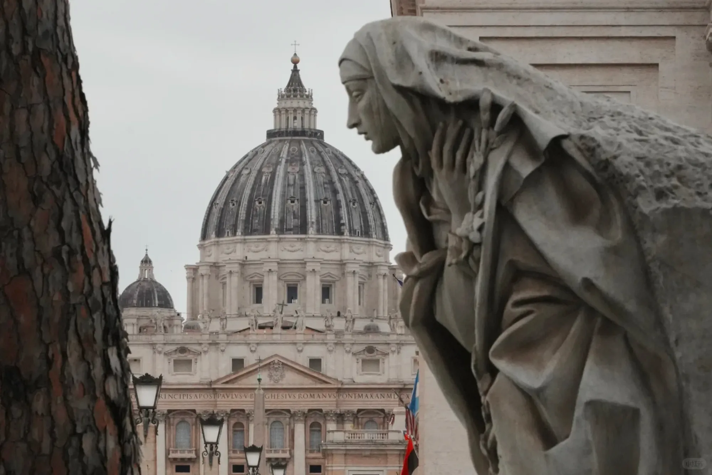

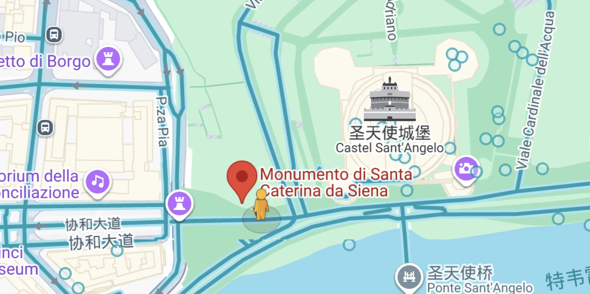

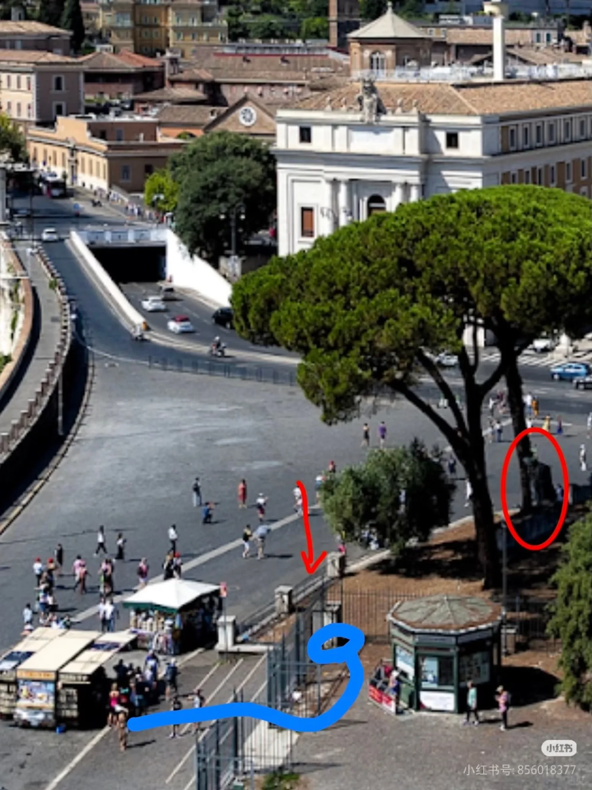

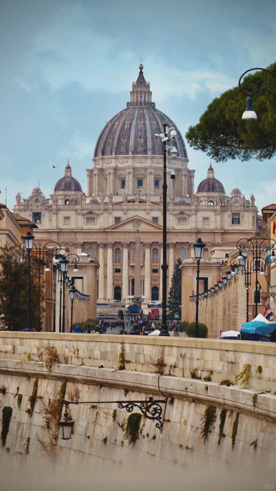
