> ⭐⭐ 进拉斐尔房间通常按 **君士坦丁厅 → 赫利奥多罗斯厅 → 签字厅 → 火灾厅** 的顺序走。本文是**第一间**；下一间见 [R - 06 拉斐尔房间 · 赫利奥多罗斯厅](../r06-stanza-di-eliodoro/)，核心的签字厅见 [R - 07 拉斐尔房间 · 签字厅《雅典学院》《圣礼之争》](../r07-stanza-della-segnatura/)。**可拍照，禁闪光。**
>
> 🔗 官方：[梵蒂冈博物馆 · 拉斐尔房间](https://www.museivaticani.va/content/museivaticani/en/collezioni/musei/stanze-di-raffaello.html)

---

### 这间屋子是什么 / 为什么重要

君士坦丁厅（Sala di Costantino，又名"教皇厅" Sala dei Pontefici）是拉斐尔四间房里**最大的一间**（约 10×15 米），用作教皇接见与典礼的大厅。主题是**罗马第一位皈依基督教的皇帝君士坦丁（Constantine，306–337 在位）**——四面墙画成四幅"挂在墙上的巨型挂毯"，把"帝国权力归向教会"讲成一部完整的政治神话，是前两间（赫利奥多罗斯厅、签字厅）思路的收束与高潮。

⚠️ **身世提示**：利奥十世 1517 年把这间交给拉斐尔，但他 1520 年 37 岁猝逝时**只来得及画好草图**。绝大部分由他的工作室——**朱利奥·罗马诺（Giulio Romano）、詹弗朗切斯科·彭尼（Gianfrancesco Penni）、拉法埃利诺·德尔·科莱（Raffaellino del Colle）**——按草图用湿壁画完成（约 1520–1524，最终在克雷芒七世任内收尾，所以画里的教皇西尔维斯特一世都长着克雷芒七世的脸）。这间是"拉斐尔设计、弟子执笔"，气质比签字厅更宏大、更戏剧化，但少了亲笔的细腻。

✨ **唯一的拉斐尔亲笔——2020 年才确认**：一场历时五年的修复查明，大画两侧的两尊寓意女像，是**拉斐尔本人生前用油画技法直接画在墙上的真迹**，而且画在全厅其他壁画**之前**（1520 年他去世前已完成）：

- **《温顺》（Comitas / Mansuetudine，身边一只羔羊）**——在《十字架异象》一侧；
- **《正义》（Iustitia，手持双盘天平）**——在《米尔维奥桥之战》一侧。

依据：两像的晕染、神情、明暗与细节精度都和他同期的《披纱的少女》（La Fornarina）等女性像一脉相承；技法上虽是壁画却用了油彩；像下还发现钉子——拉斐尔用它把加热的沥青底料固定在墙面上。**这是全厅含金量最高的两小块，逛的时候专门找一下。**

### 主题线：君士坦丁归信的四幕

四面墙不是按墙序看，而是按君士坦丁一生的四个关键节点连成一条故事线——**见异象 → 打胜仗 → 受洗 → 献土**：

| 幕 | 壁画 | 讲什么 |
| --- | --- | --- |
| ① 见异象 | 《十字架异象》 | 战前天空显十字"凭此得胜" |
| ② 打胜仗 | ⭐⭐《米尔维奥桥之战》 | 312 年决战，基督教合法化的转折 |
| ③ 受洗 | 《君士坦丁受洗》 | 皇帝跪受教皇施洗，皇权被驯服 |
| ④ 献土 | 《罗马的捐赠》 | 把罗马献给教皇，教皇国的"依据" |

天顶的劳雷蒂《基督教战胜异教》则在更高处把全厅"帝国归向教会"的主题收束成一句话：**异教倒、基督立**。

---

### 天顶——劳雷蒂的《基督教战胜异教》 ⭐⭐

> 🔗 官方：[Triumph of Christianity over Paganism · Musei Vaticani](https://www.museivaticani.va/content/museivaticani/en/collezioni/musei/stanze-di-raffaello/sala-di-costantino/trionfo-cristianesimo-sul-paganesimo.html)

**抬头看的这方天顶，和四面墙完全不是一个年代、一个班底。** 这间原本是**木梁平顶**；1582 年格里高利十三世把它拆掉、改成湿壁画拱顶，请西西里画家**托马索·劳雷蒂（Tommaso Laureti）** 主持，1582 年动笔、1585 年在西斯都五世任内完成——已是拉斐尔死后六十多年。所以天顶与下方壁画"对不上时代"，是它后来居上的结果。

整个天顶全貌——中央长方形即主画，四周是四角与帆拱（官网大图）：

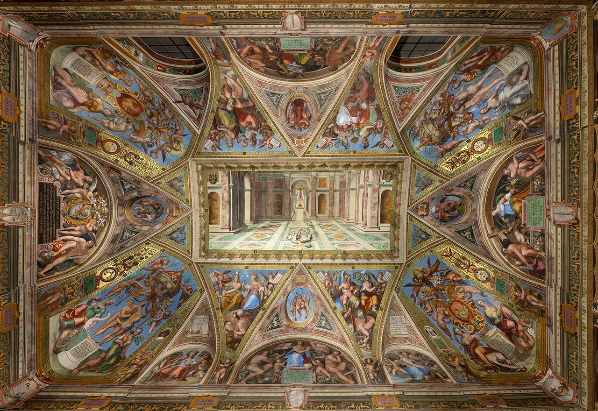

*图源：[梵蒂冈博物馆官网](https://www.museivaticani.va/content/museivaticani/en/collezioni/musei/stanze-di-raffaello/sala-di-costantino/trionfo-cristianesimo-sul-paganesimo.html)*

#### 中央大画《基督教战胜异教》——碎神像与十字架

中央这幅呼应君士坦丁"诏令全帝国捣毁异教偶像、代之以基督形象"的主题：**一座异教神像被砸碎倒在地座上，前方立着一座十字架受难像**——异教倒、基督立，一立一碎就是全厅的点题句。劳雷蒂用极强的**单点透视**把彩色大理石的虚拟建筑画得像真的凿穿了天花板一层，是早期"错觉透视天顶"的名作。

中央画细节（官网大图）：

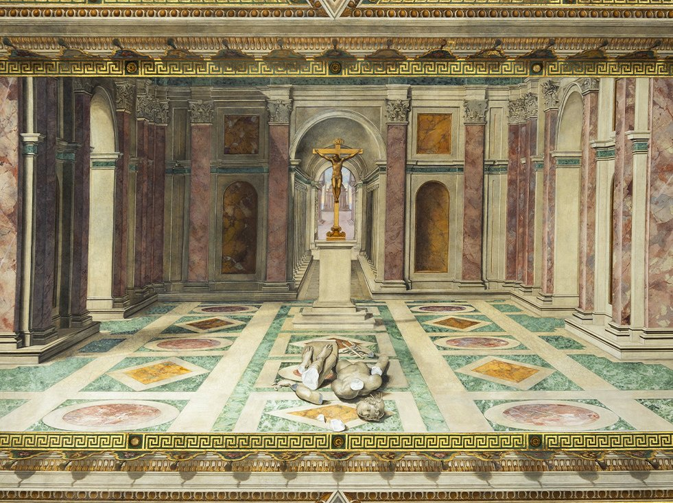

*图源：[梵蒂冈博物馆官网](https://www.museivaticani.va/content/museivaticani/en/collezioni/musei/stanze-di-raffaello/sala-di-costantino/trionfo-cristianesimo-sul-paganesimo.html)*

**现场站看**：**站到大厅正中再抬头**——劳雷蒂的透视只有在房间中心才完全"对位"，偏一点神像与十字架就斜了；认准中央两件道具（立着的十字架 vs 碎在地上的神像），全厅主题一眼读完。

#### 四角与檐壁——天顶上的"两位教皇接力"

中央那幅《基督教战胜异教》并非孤立——它外面一圈圈的装饰都在为出资重修天顶的教皇"署名"。这方天顶横跨两任：**格里高利十三世 1582 年开工、西斯都五世 1585 年完工**，所以四角与檐壁说到底是给这两位教皇表功。由内向外可分三块看。

##### 四角（angoli）——格里高利十三世的功绩

拱顶四角画的是**格里高利十三世（Gregory XIII，1572–1585 在位）的功业（imprese）**。他正是**下令拆掉旧木梁顶、把天顶交给劳雷蒂重画**的那位教皇——在自己出资的工程顶上给自己立碑，顺理成章。

他最为后世记得的功绩，是 **1582 年颁行"格里高利历"——今天全世界通用的公历就是他定的**（也正是开画这方天顶的同一年）；此外他大办学院、推动反宗教改革。

⚠️ 四角逐一对应哪几件功业，公开资料记载不详；现场抬头看到的是"四角各一组纪事/寓意画面"，不必逐块对号。

##### 檐壁（fregio）——四段君士坦丁生平

环绕中央画的带状檐壁上，嵌着**四段君士坦丁生平的小景**，与下方四面墙的"见异象 → 打胜仗 → 受洗 → 献土"四幕呼应——等于把墙上的大故事在天顶又压缩复述一遍，让"君士坦丁归信"的主题从墙面一路贯到头顶。

⚠️ 具体是哪四段、与四面墙如何一一对应，公开记载不详；看个"墙上故事在头顶回响"的关系即可。

##### 西斯都五世的纹章——1585 年完工的"落款"

檐壁上方还嵌着**西斯都五世（Sixtus V，1585–1590 在位）的纹章元素**——壁画收尾时刚即位的教皇。开工的格里高利十三世、完工的西斯都五世，两位教皇的徽记一前一后都按在天顶上，是这方天顶"跨两任完成"的时间戳。

西斯都五世是著名的"城建教皇"：在位仅五年，却给罗马竖起多座方尖碑、打通笔直大道、催成圣彼得大穹顶——你们这趟在罗马见到的不少城市骨架，就是他任内定下的。

#### 帆拱与三大洲——"基督之胜遍及天下"

中央画四周的**四个帆拱（pennacchi）** 各画一对**意大利地区**（共八个），外加**欧、亚、非三大洲**的拟人。意思很直白：基督战胜异教不只发生在罗马，而是**遍及意大利、遍及已知世界**——把君士坦丁的归信放大成一场普世胜利。**扫一眼即可**，重点仍是中央那座碎神像。

---

### 四面墙壁画——四幅"假挂毯"

四大场景都画成**仿佛挂在墙上的巨型挂毯**，大画之间立着**历代教皇的坐像**，两侧再配**美德寓意女像**（其中两尊是上面说的拉斐尔亲笔）。下面按故事线"见异象 → 打胜仗 → 受洗 → 献土"看。

#### ① 《十字架异象》_Visione della Croce_

> 🔗 官方：[Vision of the Cross · Musei Vaticani](https://www.museivaticani.va/content/museivaticani/en/collezioni/musei/stanze-di-raffaello/sala-di-costantino/visione-della-croce.html)

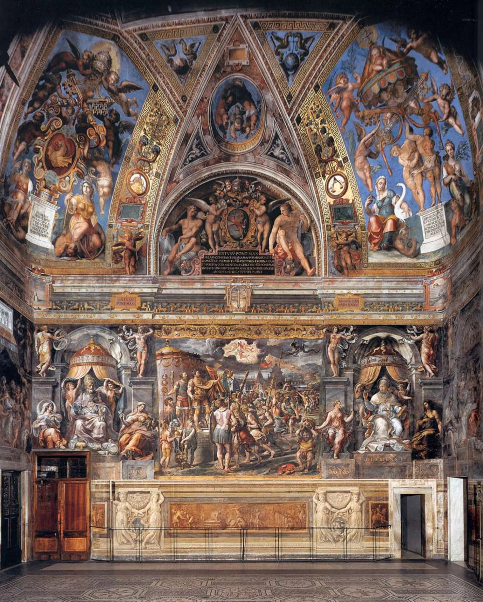
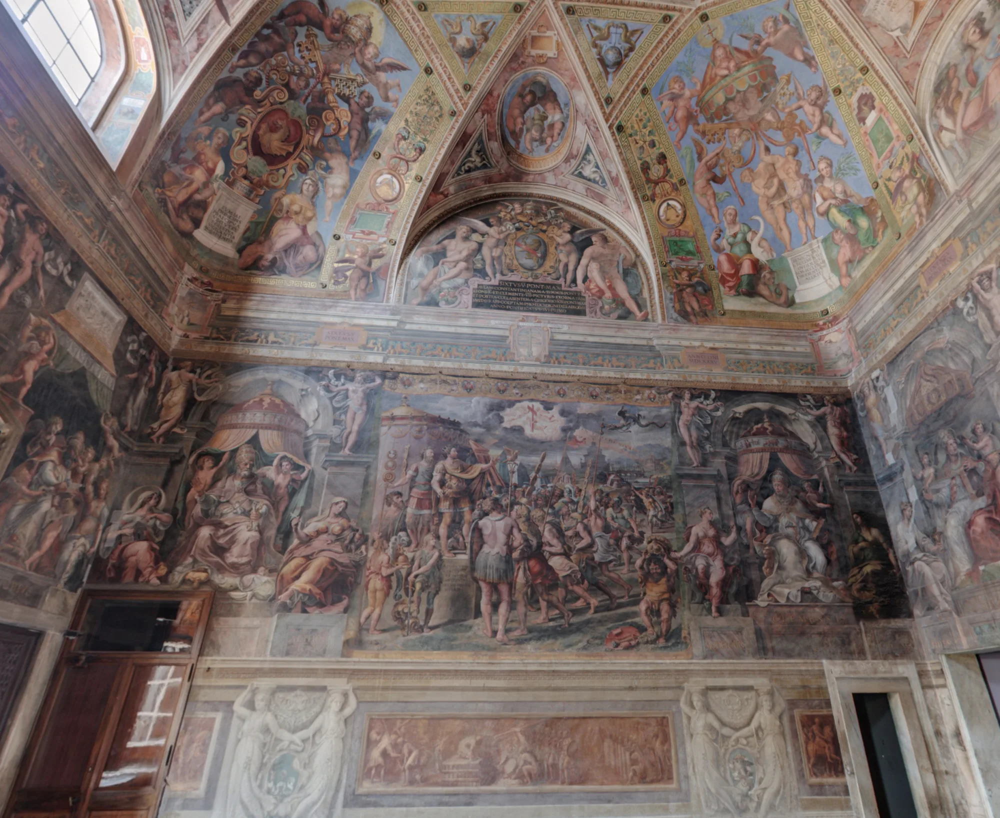

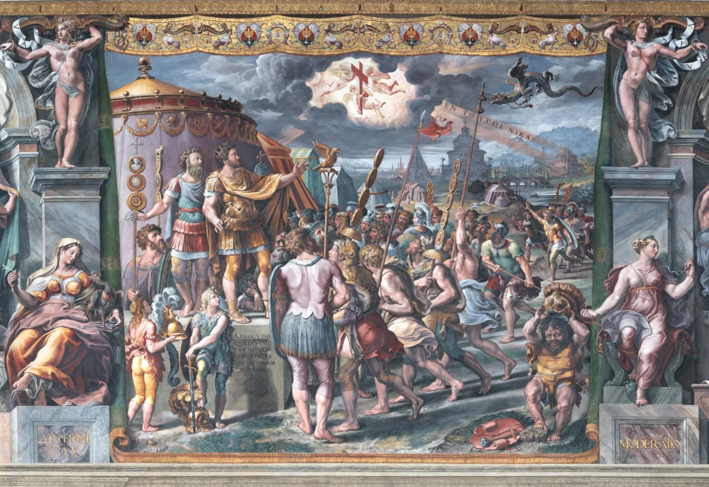

*图源：[梵蒂冈博物馆官网](https://www.museivaticani.va/content/museivaticani/en/collezioni/musei/stanze-di-raffaello/sala-di-costantino/visione-della-croce.html)*

**内容（这是什么）**：故事的第一幕。据君士坦丁的传记作者尤西比乌斯（Eusebius）记载，决战前夕皇帝看见天空出现光的十字，旁书希腊文"Εν τούτω νίκα"——拉丁文即"In hoc signo vinces（凭此记号，你将得胜）"，壁画天空里写的正是希腊文原句。画中君士坦丁站在高台上向全军训话，十字在天际炸开，士兵或惊愕或下拜；此后他把基督的"凯乐符号"（☧）画上军旗，带着它开赴米尔维奥桥。

**背景 / 看点**：朱利奥·罗马诺等按拉斐尔构图执笔（较弱的部分归拉法埃利诺·德尔·科莱）；训话的构图取自古罗马"皇帝对军队训话（Adlocutio）"的浮雕程式（图拉真柱、君士坦丁凯旋门上都有）。前景是扎营的大军与旗帜，右下角替主人捧着头盔的侏儒侍从是宫廷趣味的小彩蛋。

**两侧立像**：左为教皇**圣克雷芒**，立于 **《温顺》（Comitas/Mansuetudine，抱羔羊）** 与《节制》之间；右为**圣彼得**，立于《永恒》与《教会》之间。其中 **《温顺》是修复确认的拉斐尔油画亲笔**——看完天空别忘了瞟它一眼。
#####  圣克雷芒

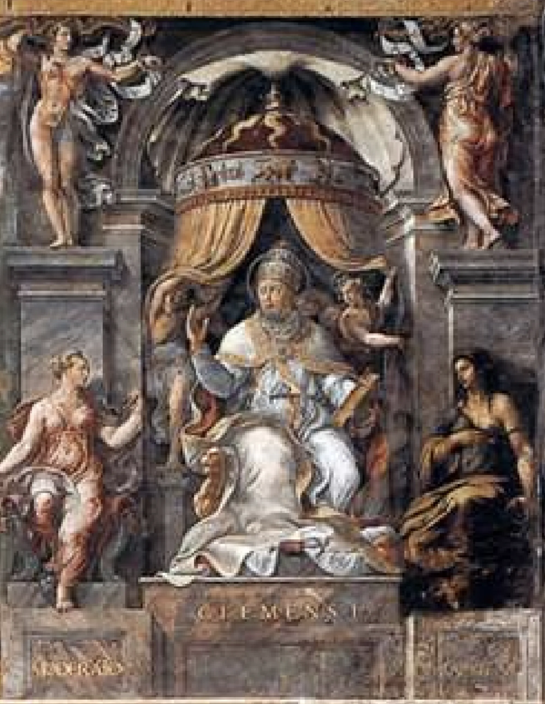

##### 温顺

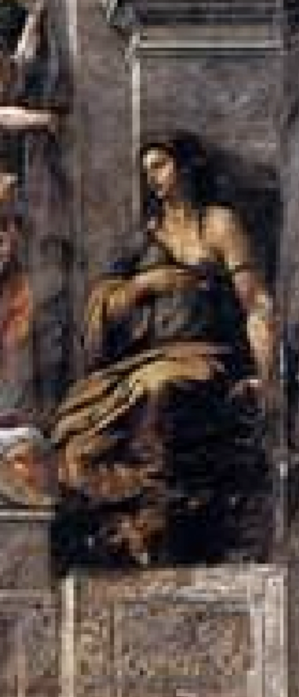

##### 圣彼得

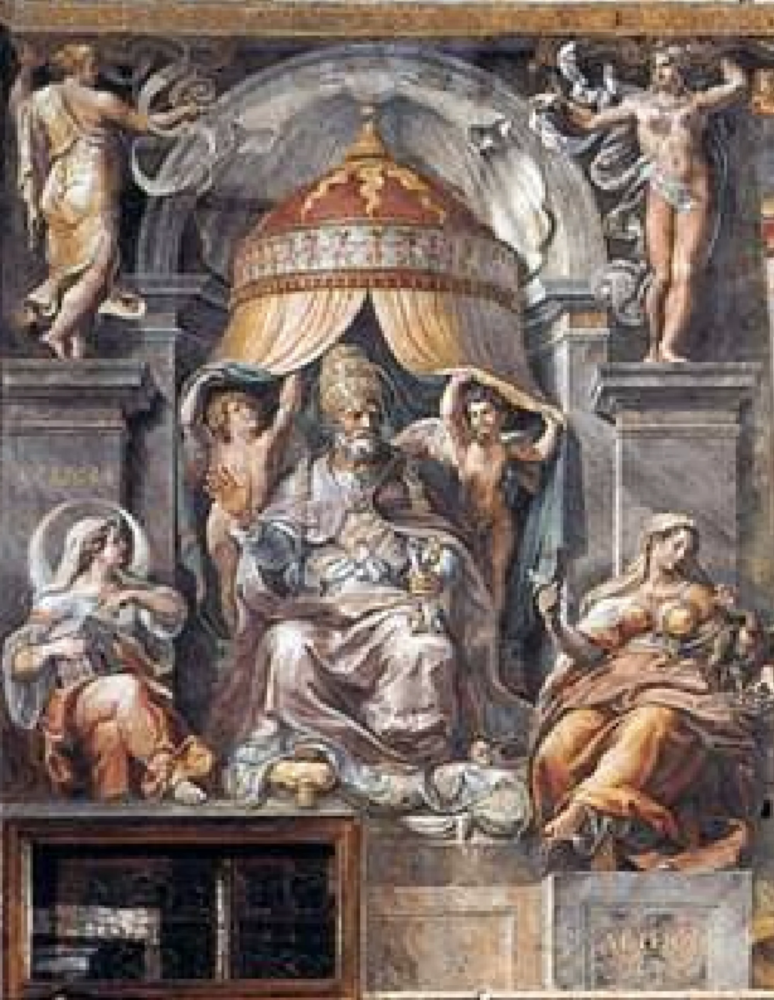

#### ② 《米尔维奥桥之战》_Battaglia di Ponte Milvio_ ⭐⭐

> 🔗 官方：[Battle of the Pons Milvius · Musei Vaticani](https://www.museivaticani.va/content/museivaticani/en/collezioni/musei/stanze-di-raffaello/sala-di-costantino/battaglia-di-costantino-contro-massenzio.html)

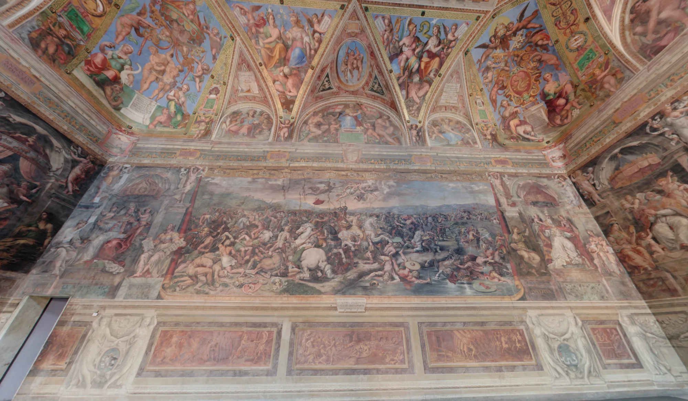

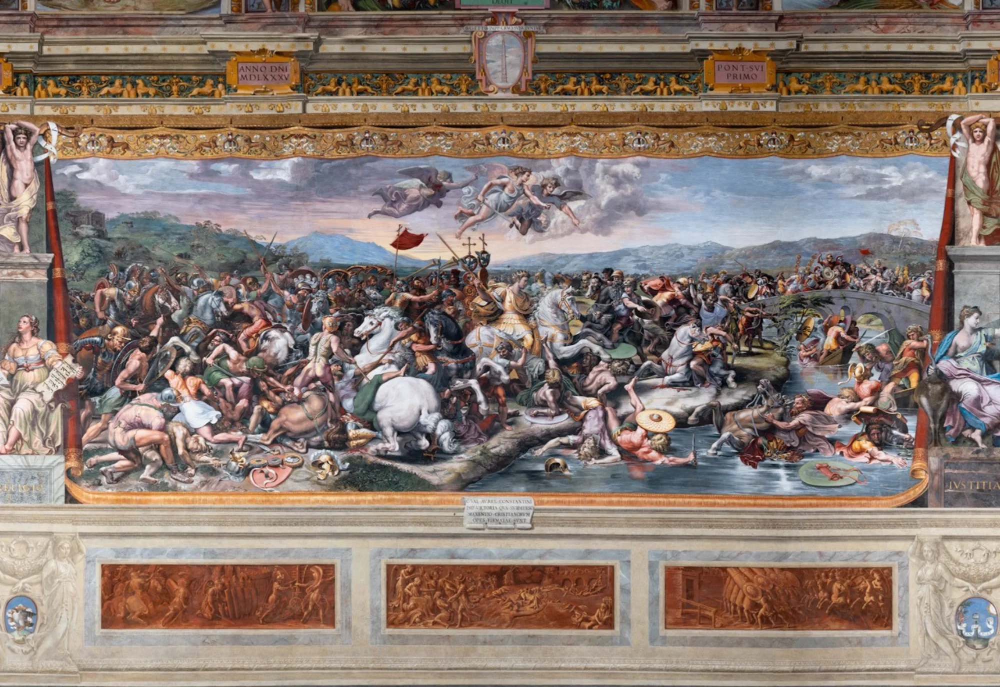

*图源：[梵蒂冈博物馆官网](https://www.museivaticani.va/content/museivaticani/en/collezioni/musei/stanze-di-raffaello/sala-di-costantino/battaglia-di-costantino-contro-massenzio.html)*

**内容（这是什么）**：公元 312 年 10 月 28 日，君士坦丁与争夺西部帝位的对手马克森提乌斯（Maxentius）决战于罗马城北台伯河上的米尔维奥桥（Ponte Milvio，这座桥今天还在用）。马克森提乌斯背水列阵，溃败时桥上挤作一团，他本人连人带马溺死在台伯河里；君士坦丁次日进城，成为西部唯一的皇帝。第二年（313）他颁布《米兰敕令》，基督教从被迫害的地下信仰一跃成为合法宗教——这面墙画的就是"基督教命运转折点"的那一天。

**背景 / 来历**：主要由朱利奥·罗马诺按拉斐尔遗稿执笔（约 1520–1524），是本厅最壮观的一面。满墙缠斗的人马是对古罗马战争浮雕（图拉真柱、君士坦丁凯旋门——凯旋门上正好留有这场战役的真·古代浮雕）的致敬，也是朱利奥日后在曼托瓦画《巨人厅》的预演。

**现场站看**：

1. **先找正中骑白马的君士坦丁**——长枪前指、头顶天光，整面墙的混乱都绕着他旋转；他上方有三个执花环俯冲的天使，点明"此胜出于天意"。
	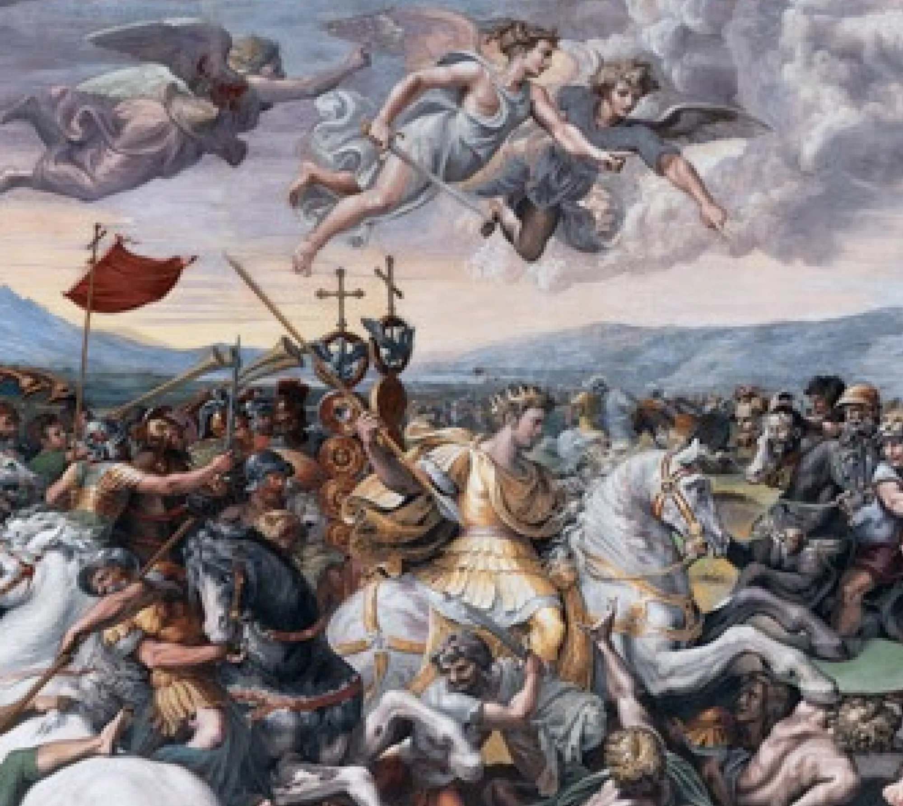

2. **右下角找溺水的马克森提乌斯**——连人带马栽进台伯河、仰面挣扎（戴着王冠可认），是全画戏剧性最强的一笔，"反派淹死在河里"正是史实结局。
	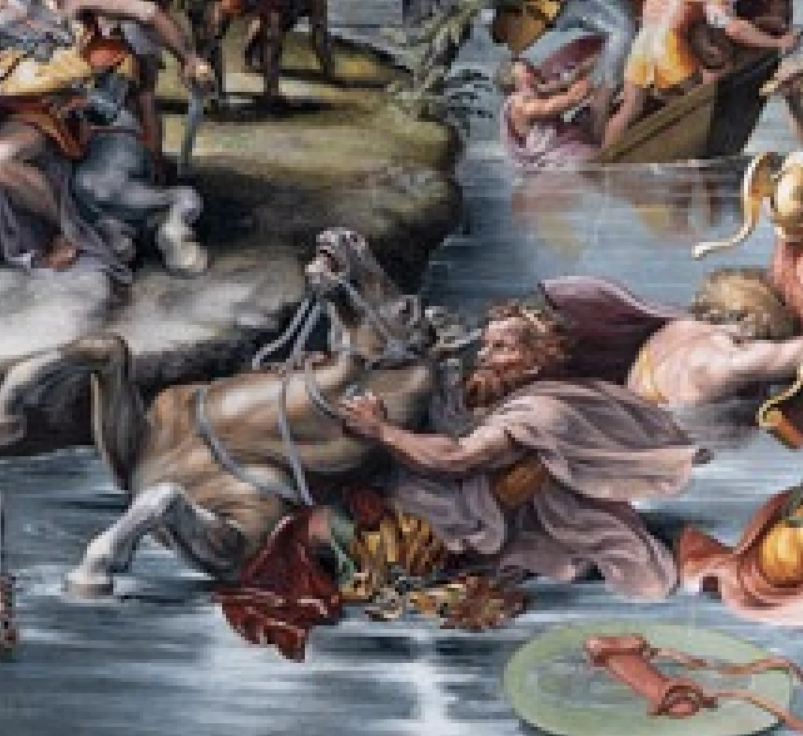

3. **退后看整体**——人马挤成一条横向饱和的"浮雕带"，几乎不留空，这是刻意模仿古罗马石棺与凯旋门浮雕的效果；可与斗兽场旁君士坦丁凯旋门上的同役古浮雕脑内对照。
	
4. **画面一侧找《正义》（Iustitia）坐像**——持双盘天平，修复确认这是拉斐尔**本人**以油画技法画的亲笔（全厅仅两处之一），质感比四周弟子的湿壁画明显更润。

##### 正义

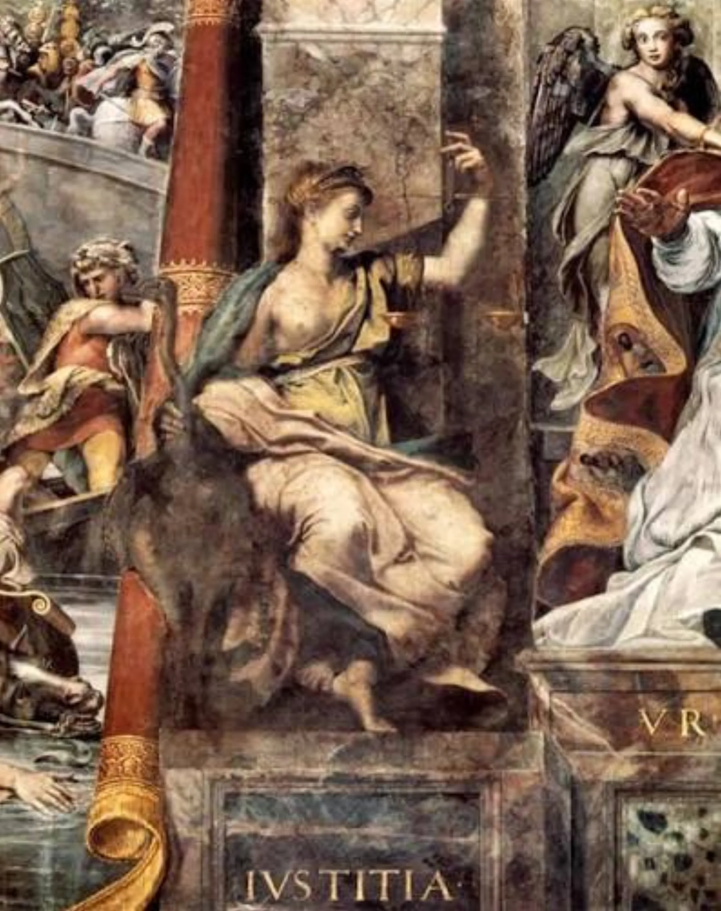
	

**两侧立像**：左为**圣西尔维斯特一世**（铭文可能有误，更可能是亚历山大一世），立于《信仰》与《宗教》之间；右为**乌尔班一世**，立于 **《正义》（Iustitia，持天平）** 与《仁爱》之间。

#### ③ 《君士坦丁受洗》_Battesimo di Costantino_

> 🔗 官方：[Baptism of Constantine · Musei Vaticani](https://www.museivaticani.va/content/museivaticani/en/collezioni/musei/stanze-di-raffaello/sala-di-costantino/battesimo-di-costantino.html)

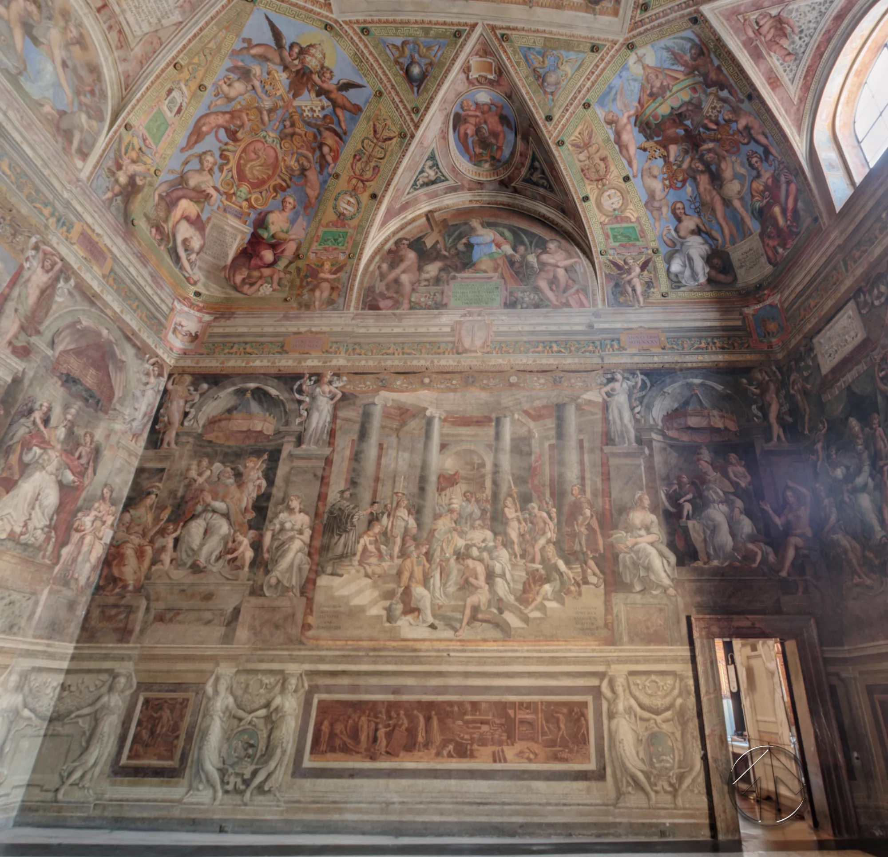

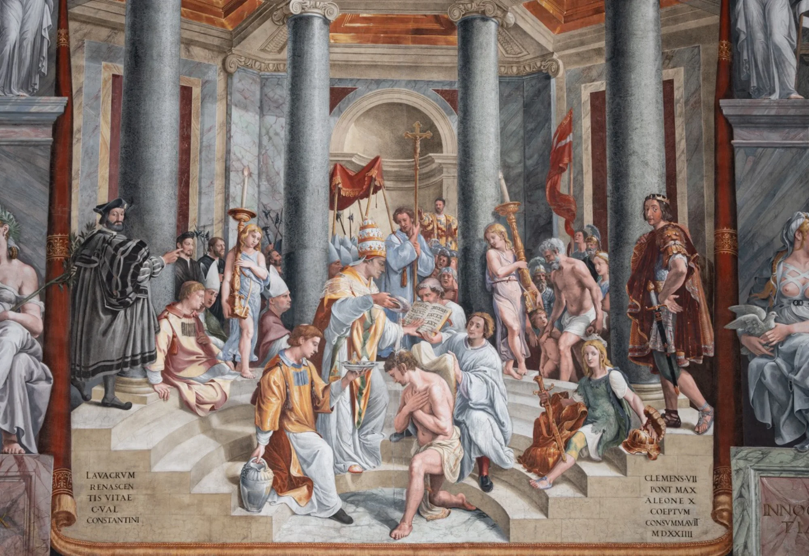

*图源：[梵蒂冈博物馆官网](https://www.museivaticani.va/content/museivaticani/en/collezioni/musei/stanze-di-raffaello/sala-di-costantino/battesimo-di-costantino.html)*

**内容（这是什么）**：按罗马教会的传说（《西尔维斯特行传》与《教皇名录》），君士坦丁皈依后由教皇西尔维斯特一世（Sylvester I）在罗马拉特朗洗礼堂亲自施洗——画里皇帝赤裸上身、谦卑地跪在洗礼池中，教皇执罐居高临下。**历史上**他其实迟至 337 年临终前才在小亚细亚受洗，施洗者还是位阿里乌派主教；但"教皇为皇帝施洗"的版本对教廷太有用了——皇帝跪着、教皇站着，权力高下一目了然。

**背景 / 看点**：一般认为主要由彭尼执笔（建筑部分或有朱利奥之手）。施洗的西尔维斯特长着**克雷芒七世的脸**（正是他下令完成此厅）；场景以真实的拉特朗洗礼堂为蓝本。**彩蛋**：两侧还混进了两位当代君主的肖像——**神圣罗马皇帝查理五世与法王弗朗索瓦一世**，把 16 世纪的两大对手请来给古代皇帝的受洗当见证。与《异象》《桥之战》的喧闹相比，这面安静肃穆——故事进入"皇权被驯服"的一幕。

**两侧立像**：左为教皇**圣达马苏一世**，立于《审慎》与《和平》之间；右为**大利奥（圣良一世）**，立于《纯真》与《刚毅》之间。

#### ④ 《罗马的捐赠》_Donazione di Roma_

> 🔗 官方：[Donation of Rome · Musei Vaticani](https://www.museivaticani.va/content/museivaticani/en/collezioni/musei/stanze-di-raffaello/sala-di-costantino/donazione-di-roma.html)

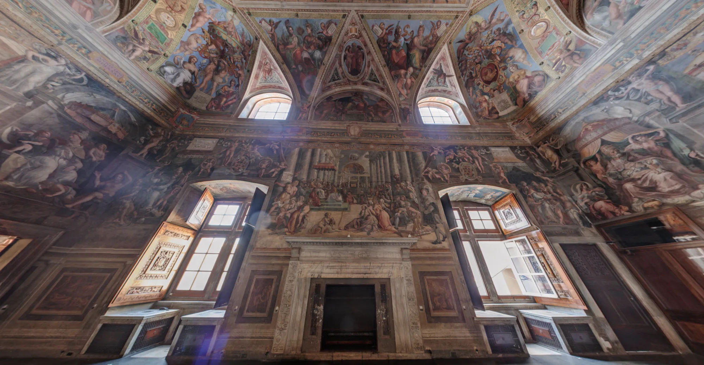

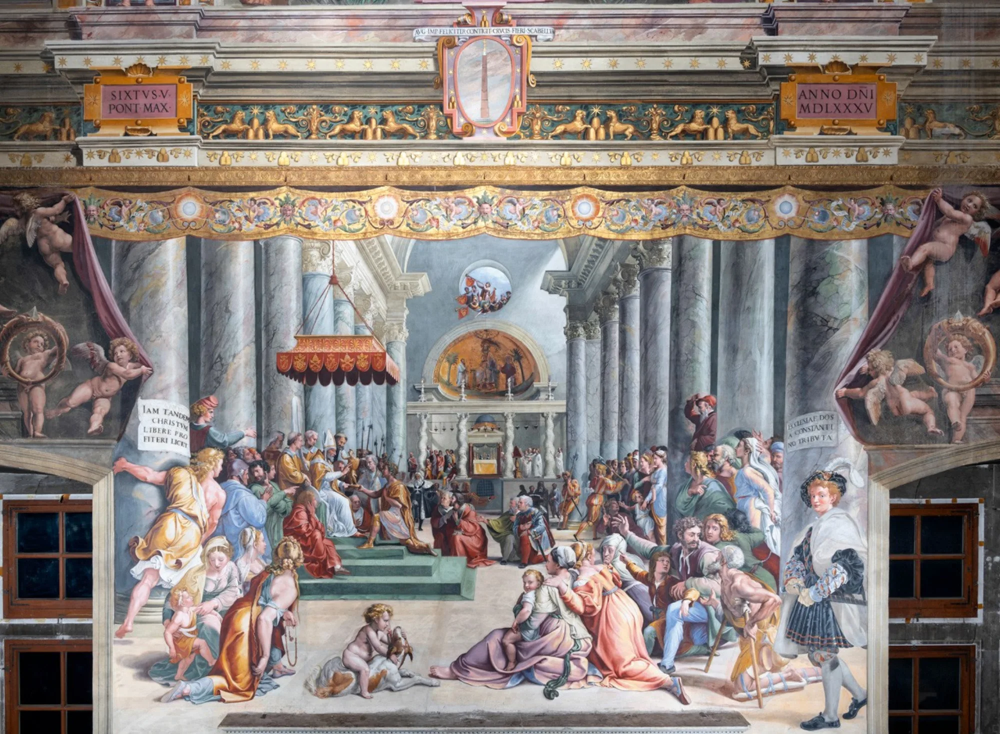

*图源：[梵蒂冈博物馆官网](https://www.museivaticani.va/content/museivaticani/en/collezioni/musei/stanze-di-raffaello/sala-di-costantino/donazione-di-roma.html)*

**内容（这是什么）**：故事的终点，也是全厅真正的政治落点：受洗后的君士坦丁单膝跪在老圣彼得大教堂的祭坛前，把一尊象征罗马城的金像献给西尔维斯特——意为**把罗马与西部帝国的世俗统治权让渡给教皇**。依据是中世纪文书《君士坦丁献土》（Donatio Constantini），它被编入教会法（格拉提安《教令集》），数百年间充当教皇国合法性的头号"历史文件"。

**背景 / 来历——一份被拆穿的伪造文书**：1440 年，人文学者洛伦佐·瓦拉（Lorenzo Valla）用纯语文学方法证明这份所谓"4 世纪文书"满纸 8 世纪才有的词汇与制度，是后世伪作；1517 年该论证印行传遍欧洲，成了宗教改革攻击教廷的弹药。讽刺的是，这面壁画恰恰画在瓦拉证伪之后约八十年（1520 年代）——美第奇教皇明知文书可疑，仍把它画进接见大厅、当作整组拉斐尔房间"颂扬教皇"的收尾。看这面墙时记住这一层：**"历史"在这里是定制品**。

**看点**：场景等于**老圣彼得大教堂中殿的"遗照"**——画它的年代旧堂正被逐段拆除、新堂在原址施工，画里那条带马赛克半圆室、尽头是圣彼得墓与螺旋柱的列柱中殿，是旧巴西利卡难得的视觉记录；接受献礼的西尔维斯特照例是克雷芒七世的脸。**两侧立像**：教皇**大额我略**与**西尔维斯特一世**；这面因窗户挤占空间没有寓意女像，窗上改由**小天使举着钻石指环**（美第奇家族的纹章徽记）。

---

### 墙脚单色画基座——君士坦丁生平连环画

四面墙脚那一圈基座（zoccolo）容易被整段跳过，其实是给楼上"四大胜景"配的**连环画脚注**：画成**假彩色大理石镶板 + 仿浮雕女像柱（cariatidi），板顶嵌美第奇纹章**，板与板之间嵌着一格格**君士坦丁生平的单色画**（弟子执笔）。看完大画低头扫一眼，能把故事补全。

#### 各面墙下的单色画

- **《十字架异象》下**：大格《君士坦丁的军队抵达罗马城下》，两小格《进入罗马》。
	
	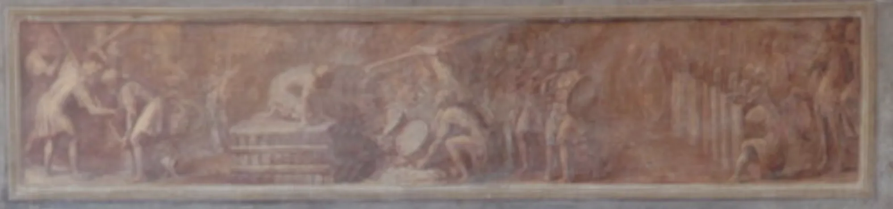
	
	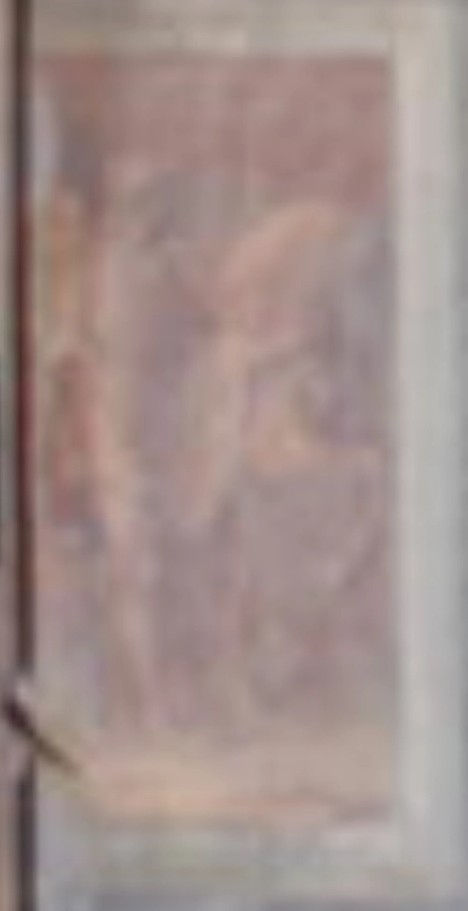
	
	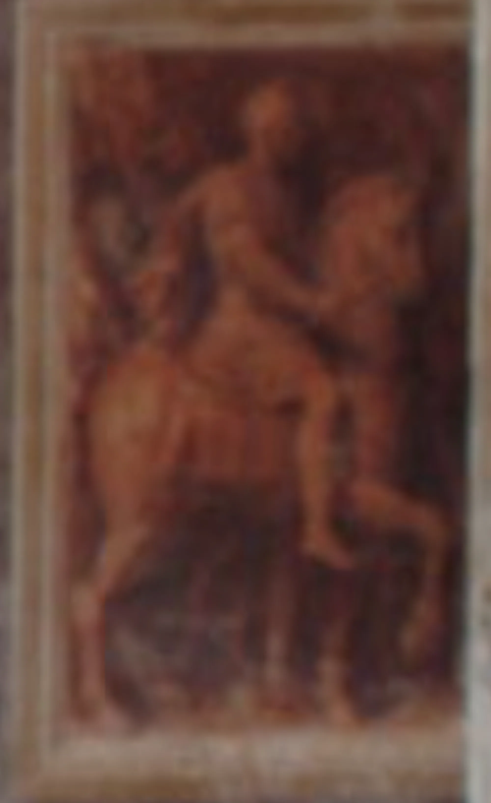
	
- **《米尔维奥桥之战》下**：大格《战前准备》《君士坦丁审问俘虏》《发现马克森提乌斯的尸体》；小格《拔营起行》《战船运送马克森提乌斯的首级》。
	
	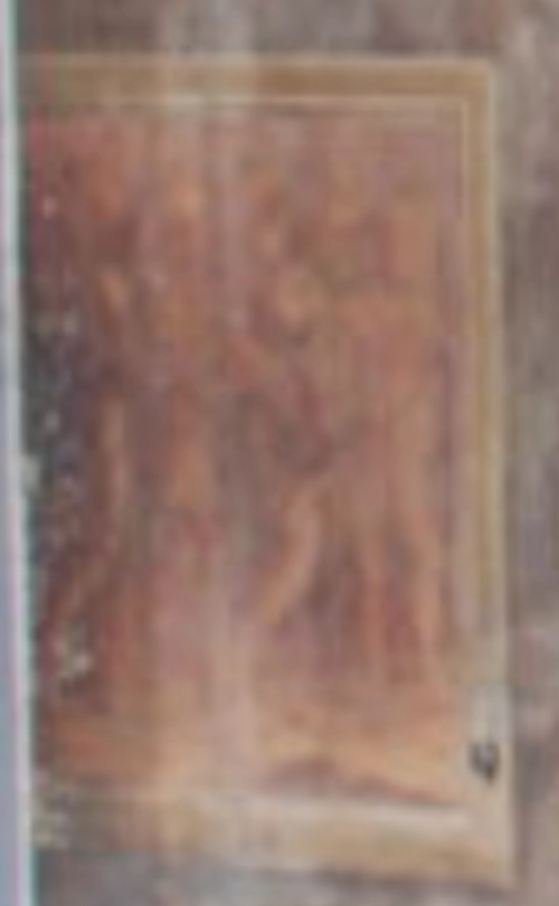
	
	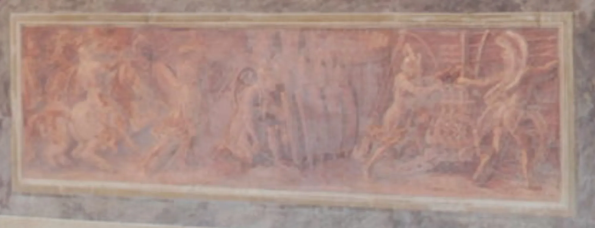
	
	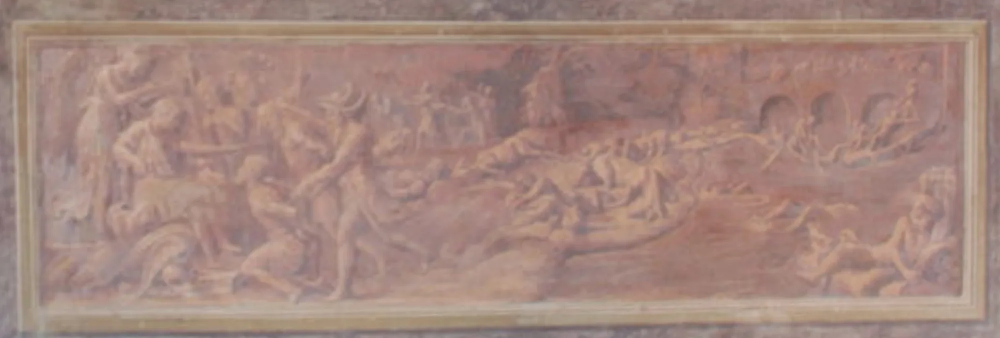
	
	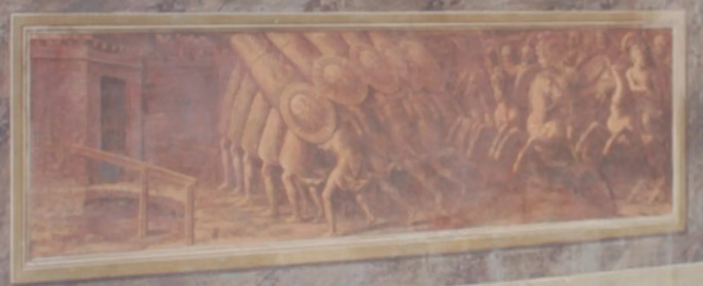
	
	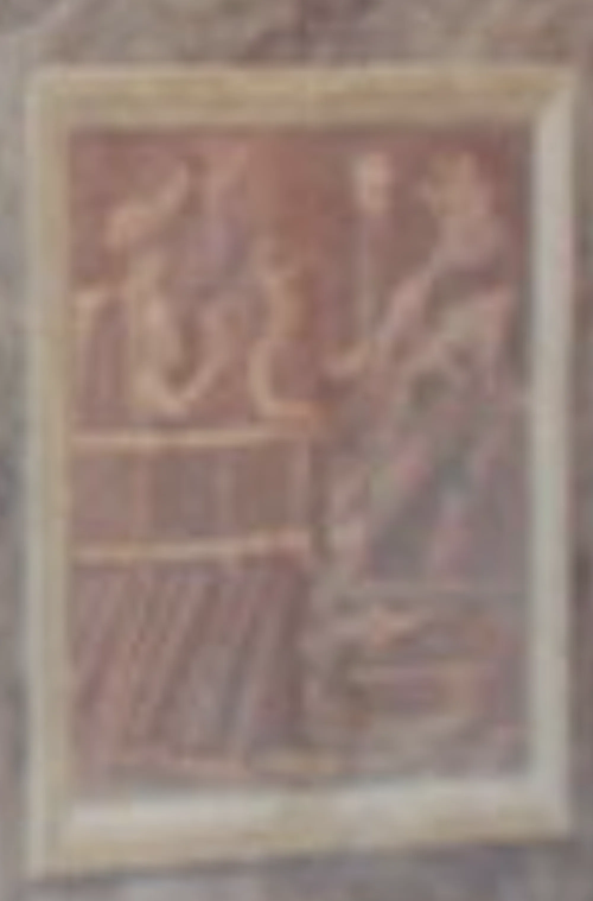
	
- **《君士坦丁受洗》下**：《下令焚毁迫害基督徒的敕令》《奠基梵蒂冈圣殿（老圣彼得）》。
	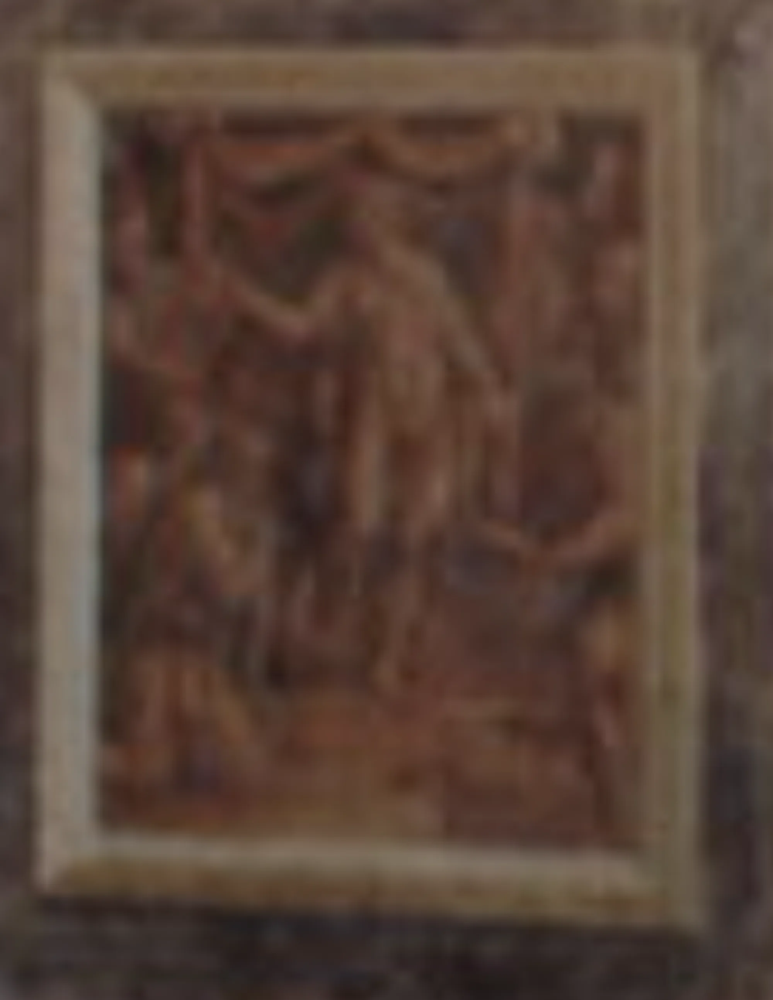
	
	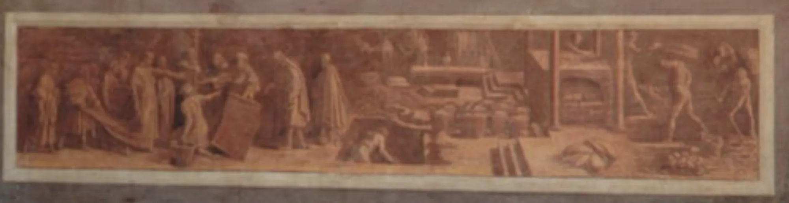
	
- **《罗马的捐赠》下**：《发现真十字架》《西尔维斯特治愈君士坦丁的麻风》《圣彼得圣保罗显现给患病的君士坦丁》。
	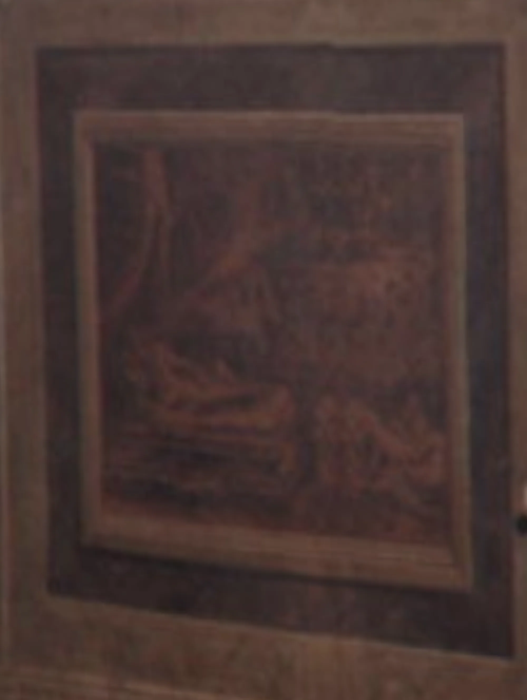
	
	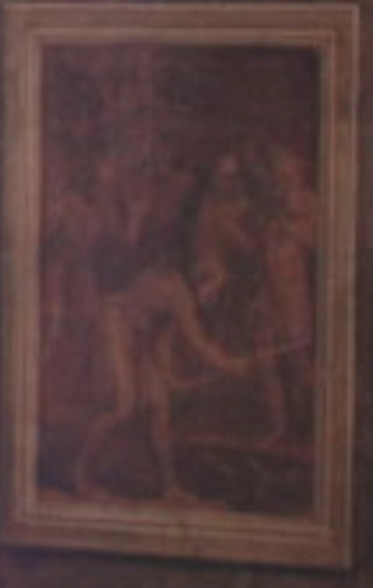
	
	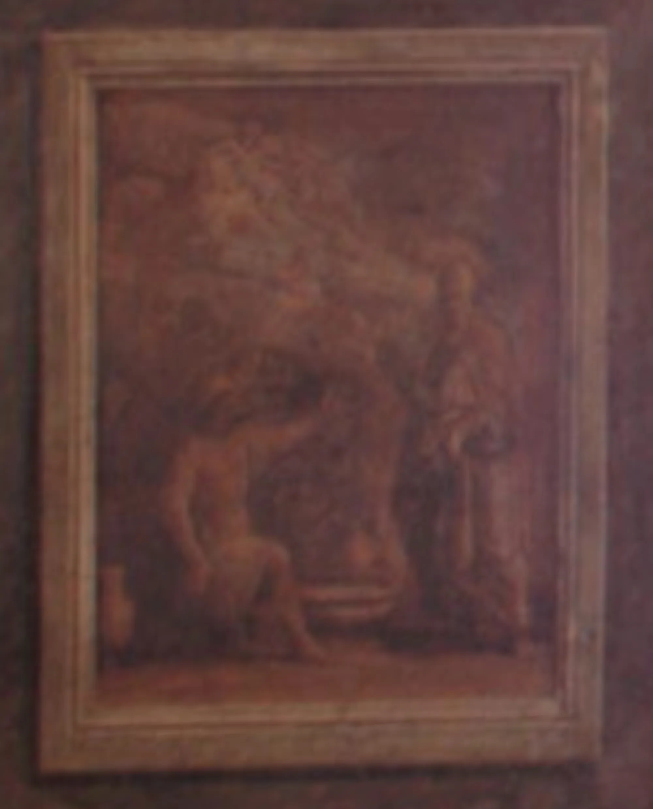
	

#### 窗间壁——佩林·德尔·瓦加的单色画

窗与窗之间的侧壁（sguanci）另有一组单色画，出自**佩林·德尔·瓦加（Perin del Vaga）** 之手（与签字厅、火灾厅墙脚同一位画家），题材延续君士坦丁与早期教会的传说：**《皈依的异教徒捣毁偶像》《圣西尔维斯特锁住巨龙》《君士坦丁与母亲海伦娜从耶路撒冷归来》《圣额我略撰写讲道》**。

---

### 地板

君士坦丁厅地面为彩色大理石铺装。与签字厅那种留下教皇纹章与名字的科斯马蒂式马赛克不同，**本厅地板在文献里着墨极少、没有公认的"看点"记载**——现场低头扫一眼即可，全厅的重头仍在四壁的"假挂毯"与劳雷蒂的天顶。

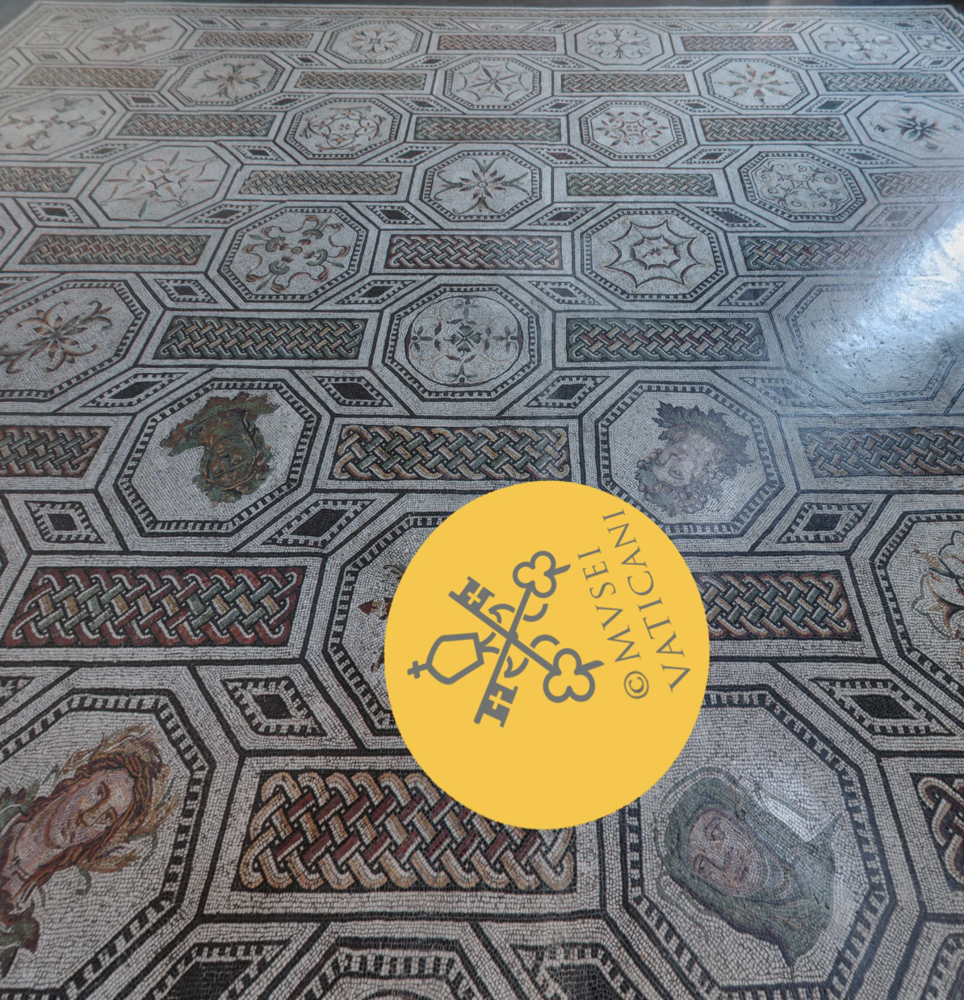
