进拉斐尔房间通常按 **君士坦丁厅 → 赫利奥多罗斯厅 → 签字厅 → 火灾厅** 的顺序走。本文是**第二间**（拉斐尔亲笔成分最高的一间）；上一间见 [R - 05 拉斐尔房间 · 君士坦丁厅](../r05-stanza-di-costantino/)，核心的签字厅见 [R - 07 拉斐尔房间 · 签字厅《雅典学院》《圣礼之争》](../r07-stanza-della-segnatura/)。**可拍照，禁闪光。**

🔗 官方：[梵蒂冈博物馆 · 拉斐尔房间](https://www.museivaticani.va/content/museivaticani/en/collezioni/musei/stanze-di-raffaello.html)

---

### 这间屋子是什么 / 为什么重要

赫利奥多罗斯厅（Stanza di Eliodoro，约 660×750 cm，四间里最小的一间）原是**教皇的私人接见室**，紧接签字厅之后绘制（约 1511–1514）——**拉斐尔亲笔成分最高、是他成熟期的杰作**（也是从这间起，工作室助手参与渐多）。厅名取自墙上的《赫利奥多罗斯被逐出神殿》。

**政治背景**：1511 年夏，尤利乌斯二世（Julius II）刚打完一场对法惨败、丢了博洛尼亚，外族军队压境、教皇国岌岌可危。正是在这种不确定里，定下了这套 **"上帝在历史关键时刻亲手庇护教会"** 的图像纲领——四面墙各画一桩"神迹击退内外之敌"，并紧扣教皇格外看重的圣体崇拜。他本人两次被画进神迹现场，给"驱逐法军、收复教皇国"的现实诉求做神学背书。

**风格的转折点**：拉斐尔从签字厅的明净静穆转向**大场面戏剧叙事**——人物更少更大、姿态出现受米开朗基罗启发的扭转与夸张（预告了样式主义），色彩在塞巴斯蒂亚诺·德尔·皮翁博、洛伦佐·洛托等威尼斯派影响下变浓变暖。《解救圣彼得》的夜景实验更比卡拉瓦乔早了将近一百年。**这间是看"拉斐尔如何升级"的最佳房间。**

### 主题线：上帝庇护教会的四幕

四面墙是一套精心设计的政治神学纲领——**上帝在四个层面庇护教会、击退内外之敌**：

| 庇护层面 | 壁画 | 击退的敌人 |
| --- | --- | --- |
| **教会的财产 / 圣物** | ⭐⭐《赫利奥多罗斯被逐》 | 内部僭夺者 |
| **圣体信仰** | ⭐⭐《博尔塞纳的弥撒》 | 教义怀疑 |
| **教皇本人** | ⭐⭐《解救圣彼得》 | 强权迫害 |
| **教廷所在之地** | 《利奥一世退阿提拉》 | 外族入侵 |

天顶的四块旧约神迹则把这套"神救教会"上推到更早——**上帝同样在旧约里一次次庇护以色列子民**，上下呼应。

---

### 天顶——拉斐尔的四块旧约神迹

> 🔗 官方：[Ceiling（Volta · Stanza di Eliodoro）· Musei Vaticani](https://www.museivaticani.va/content/museivaticani/en/collezioni/musei/stanze-di-raffaello/stanza-di-eliodoro/volta.html)

这间是**交叉拱顶（volta a crociera）**。**正中是尤利乌斯二世的纹章圆框**（和签字厅天顶一样），周围是金底上的单色阿拉伯纹饰与仿金钉装饰；四个三角面上斜分着**四块旧约场景**，画成**用假钉和环挂起来的"挂毯"**——和下方四面墙"假挂毯"的手法呼应。四块的主题都是**上帝出手庇护、拯救以色列子民**，各在一面墙的上方，与墙上"上帝庇护教会"的四幕上下相通。

天顶全貌（官网大图）：

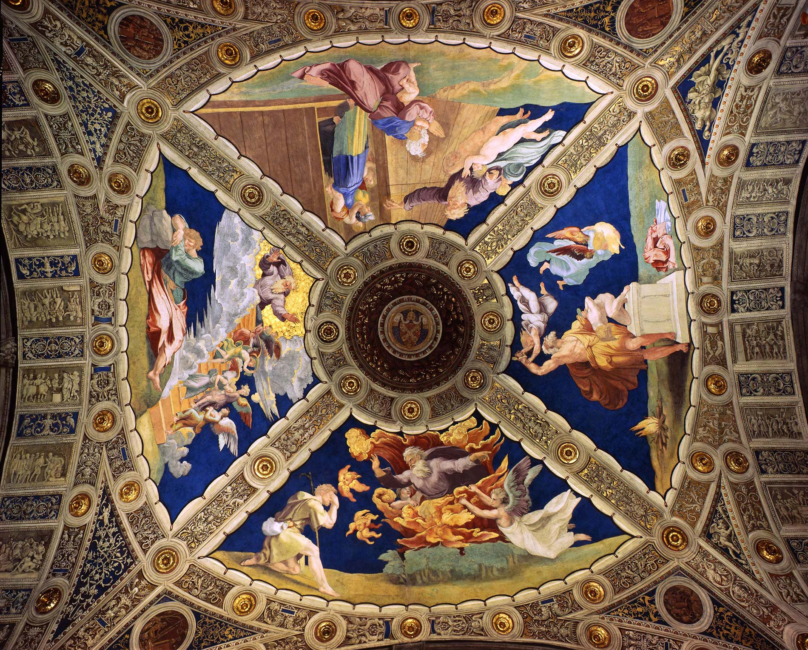

*图源：[梵蒂冈博物馆官网](https://www.museivaticani.va/content/museivaticani/en/collezioni/musei/stanze-di-raffaello/stanza-di-eliodoro/volta.html)*

> ⚠️ **归属有争议**：四块旧约场景瓦萨里全归拉斐尔，但后世学者各执一词（佩鲁齐 Baldassarre Peruzzi、Marcillat、彭尼、洛伦佐·洛托等都被提过）；加之保存欠佳，今天难下定论。框与框之间的别的装饰，一般认为是拉斐尔进场**之前**佩鲁齐留下的旧笔。

#### 四块旧约场景（逐块）

##### 上主向诺厄显现 _Apparizione di Dio a Noè_

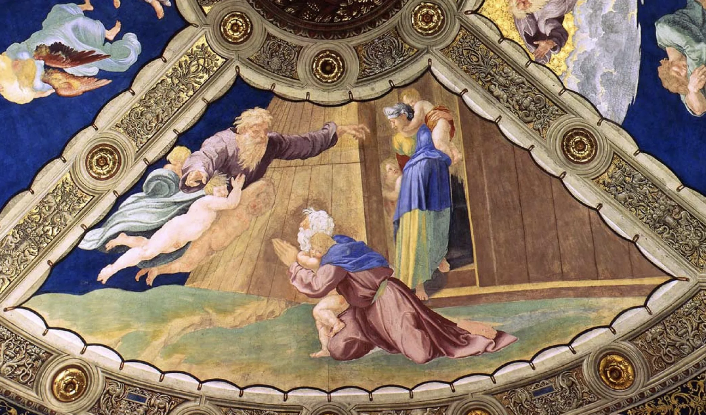

*图源：[梵蒂冈博物馆官网](https://www.museivaticani.va/content/museivaticani/en/collezioni/musei/stanze-di-raffaello/stanza-di-eliodoro/volta.html)*

洪水退后，上帝向诺亚显现、立下永约（以彩虹为记），应许不再以洪水毁灭世界——旧约里"神与人立约、许下庇护"的开端。

##### 亚巴郎献依撒格 _Sacrificio di Isacco_

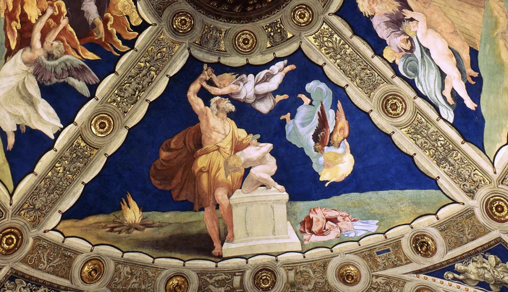

*图源：[梵蒂冈博物馆官网](https://www.museivaticani.va/content/museivaticani/en/collezioni/musei/stanze-di-raffaello/stanza-di-eliodoro/volta.html)*

上帝试探亚伯拉罕，命他献独子以撒；正举刀时天使止住、以公羊替代——信仰的极限考验与神的拯救。基督教传统把"以公羊替代献子"解读为基督自献、乃至圣体的**预表**，正好与下方《博尔塞纳弥撒》的圣体主题相扣。

##### 燃烧的荆棘 _Roveto ardente_

梅瑟（摩西）在何烈山见荆棘焚而不毁，上帝在火中向他显现、差他去带以色列人出埃及——神的显现、拣选与解救。

天顶此格细节（官网大图）：

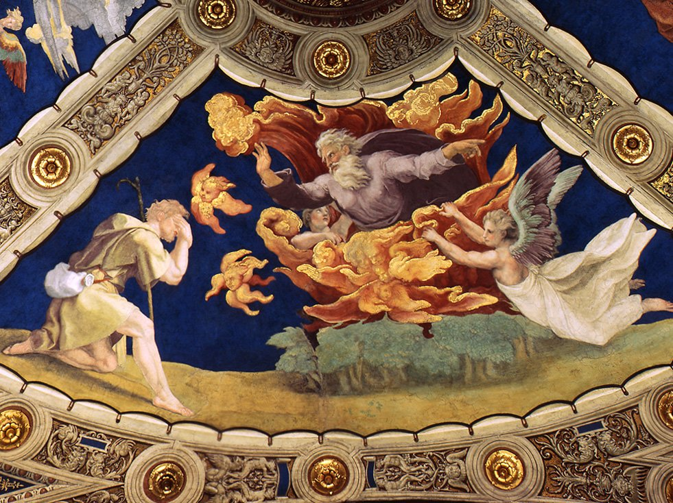

*图源：[梵蒂冈博物馆官网](https://www.museivaticani.va/content/museivaticani/en/collezioni/musei/stanze-di-raffaello/stanza-di-eliodoro/volta.html)*

##### 雅各伯的天梯 _Scala di Giacobbe_

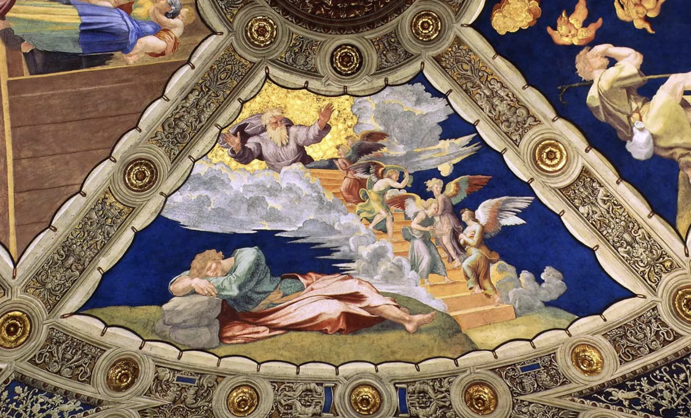

*图源：[梵蒂冈博物馆官网](https://www.museivaticani.va/content/museivaticani/en/collezioni/musei/stanze-di-raffaello/stanza-di-eliodoro/volta.html)*

雅各逃亡途中梦见一道天梯直通天界、天使在梯上上下往来，梯顶的上帝向他许诺看顾与赐福——天地之间的连接，神对漂泊者的庇护。

---

### 四面墙壁画

四大场景都画成**仿佛挂在墙上的巨型挂毯**。下面按"财产 → 信仰 → 教皇本人 → 教廷之地"的主题线看。

#### ① 《赫利奥多罗斯被逐出神殿》_Cacciata di Eliodoro_ ⭐⭐

> 🔗 官方：[Expulsion of Heliodorus from the temple · Musei Vaticani](https://www.museivaticani.va/content/museivaticani/en/collezioni/musei/stanze-di-raffaello/stanza-di-eliodoro/cacciata-di-eliodoro-dal-tempio.html)

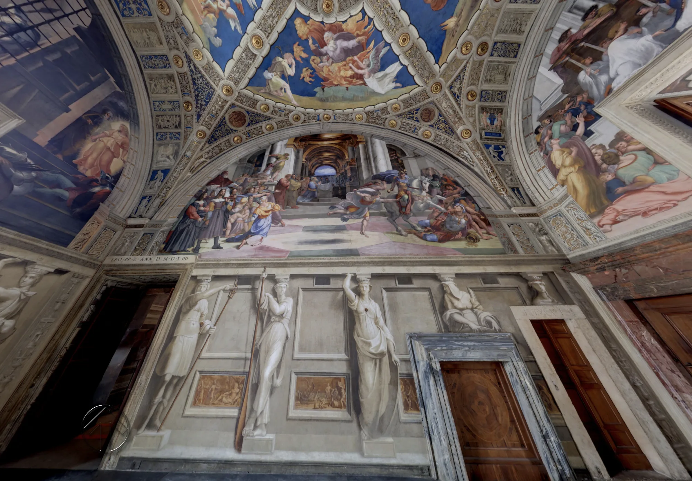

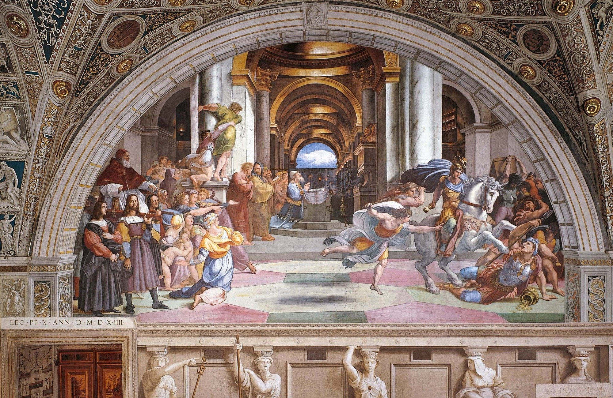

*图源：[梵蒂冈博物馆官网](https://www.museivaticani.va/content/museivaticani/en/collezioni/musei/stanze-di-raffaello/stanza-di-eliodoro/cacciata-di-eliodoro-dal-tempio.html)*

**内容（这是什么）**：本厅同名主画，故事出自《玛加伯下》第 3 章：犹太人西满（Simon）与大司祭翁尼雅三世（Onias III）结怨，向叙利亚王塞琉古四世（Seleucus IV Philopator）告密——耶路撒冷圣殿的库房里堆着数不清的金银。国王便派宰相赫利奥多罗斯（Heliodorus）去抄没。翁尼雅向他解释：那些钱是**寡妇和孤儿的存款**，圣殿不过代为保管；赫利奥多罗斯不为所动，定下日子带人闯进库房。全城恐慌、司祭俯伏祈祷之际，神迹降临——**一位身披金甲的骑士驭马冲出，前蹄直踏赫利奥多罗斯，两位俊美的青年凌空挥鞭抽打他**，把他打得不省人事抬出圣殿。后来翁尼雅为他献祭求情才救回性命，他回去对国王说：那地方确实有神看守。

**背景 / 来历**：1511–1512 年绘制，本厅最先完成的一面，拉斐尔亲笔为主。表面讲旧约，实指当下：谁敢染指教会的财产与领地（法军、各路僭主），就会被神打出去——这是尤利乌斯二世连年征战的"檄文"。

**现场站看**：

1. **先看正中远处的大司祭**——翁尼雅跪在祭坛前祈祷，坛上立着七枝灯台（点明耶路撒冷圣殿）；他是全画唯一静止的点，两侧的风暴都绕着这份"祈祷"旋转。
	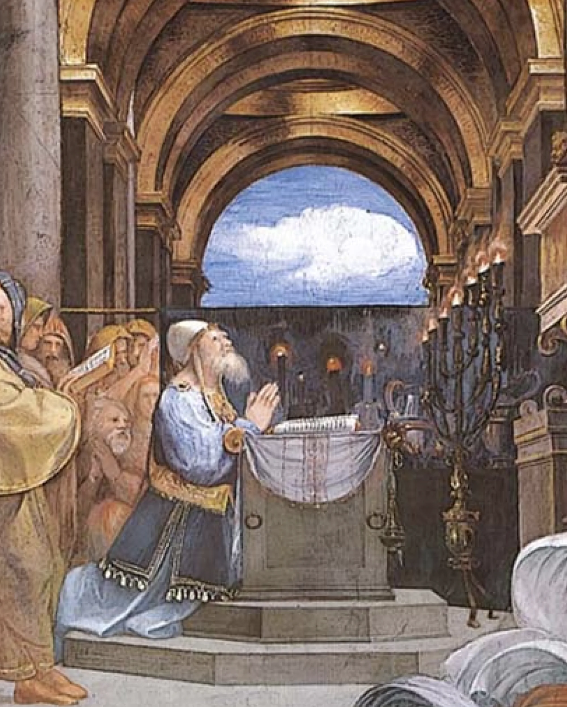

2. **右侧看神迹本身**——金甲骑士的马前蹄正踏向仰面摔倒的赫利奥多罗斯，他抄来的金银撒了一地；两个腾空的青年挥鞭扑下，动势像要冲出墙面。
	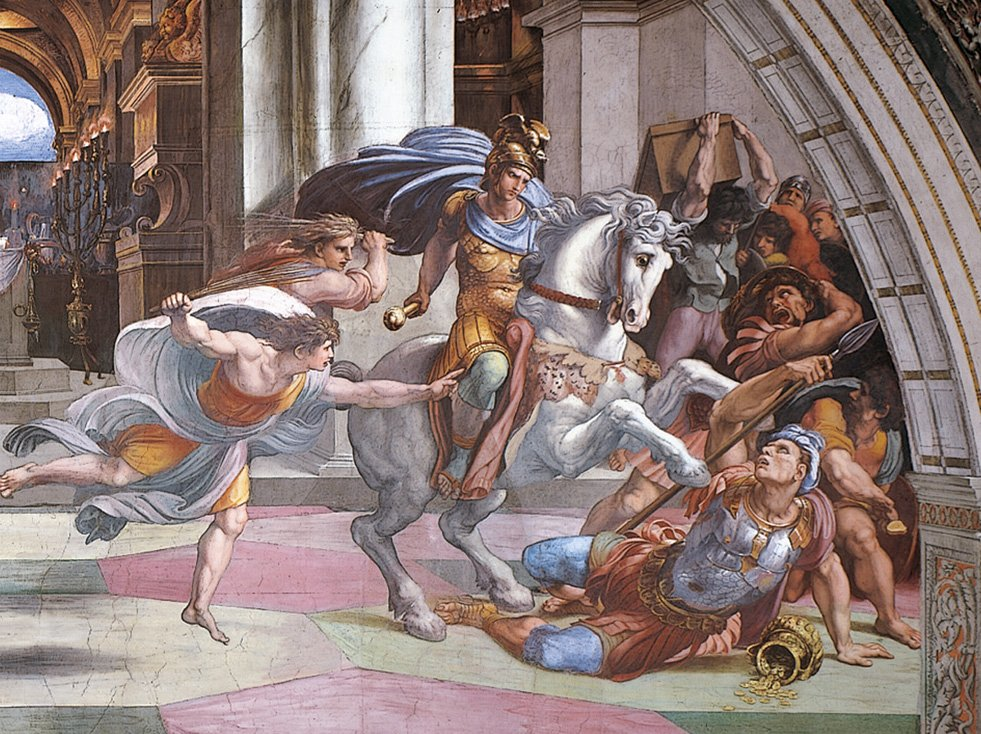

3. **左侧看坐轿的尤利乌斯二世**——教皇本人被原样画进旧约现场，由侍从抬着冷眼旁观："这个神迹是为我作证的"。轿夫与左缘人群里一般认为藏着拉斐尔的自画像（传统上还认出他的版画师马尔坎托尼奥·莱蒙迪 Marcantonio Raimondi）。
	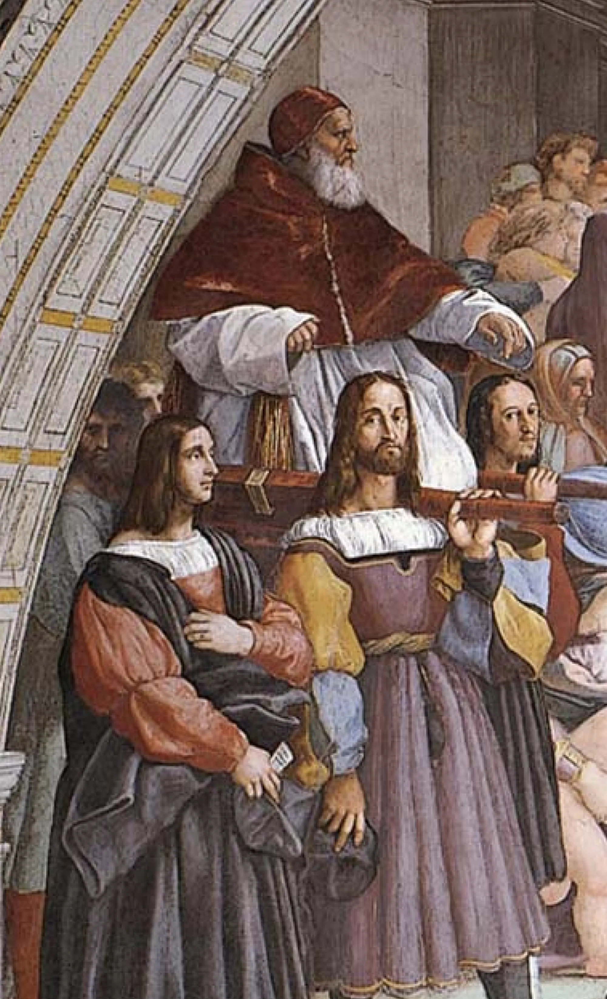
4. **左中那群俯身张望的妇女孩童**——正是经文里"存钱的寡妇与孤儿"，故事的利害关系人，惊惶地挤在台阶上。
	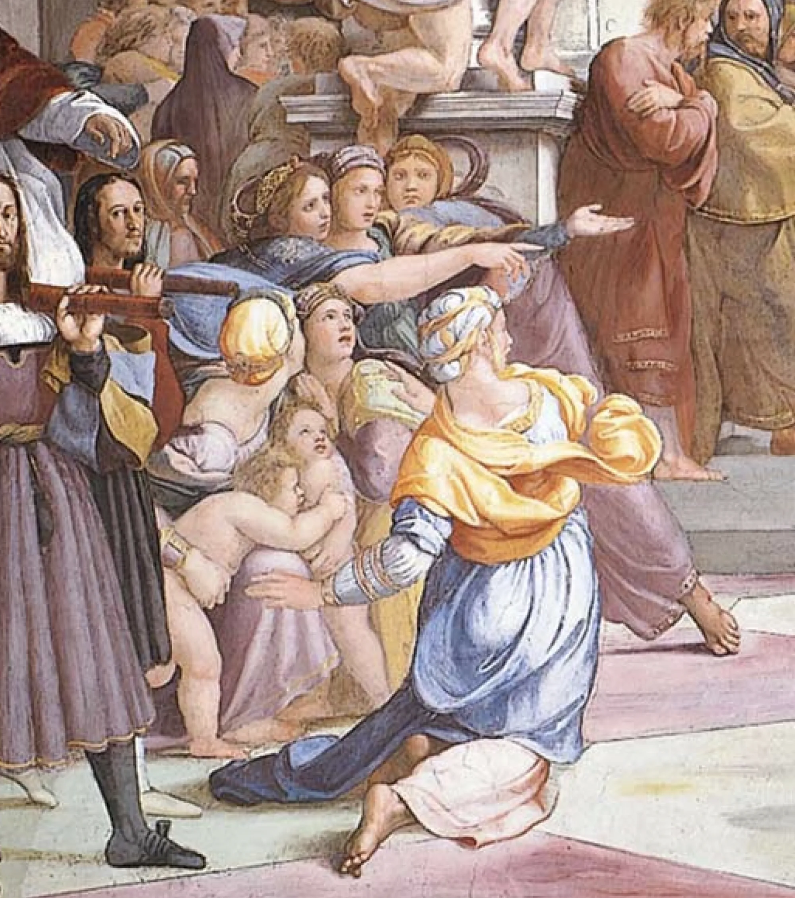
5. **拿签字厅对比着看**——同样的深景拱廊透视（金顶比《雅典学院》华丽得多），但人物从"安静站桩"变成两翼爆发、中心留空：拉斐尔的叙事方式在这面墙上完成升级。

#### ② 《博尔塞纳的弥撒》_Messa di Bolsena_ ⭐⭐

> 🔗 官方：[Mass of Bolsena · Musei Vaticani](https://www.museivaticani.va/content/museivaticani/en/collezioni/musei/stanze-di-raffaello/stanza-di-eliodoro/messa-di-bolsena.html)

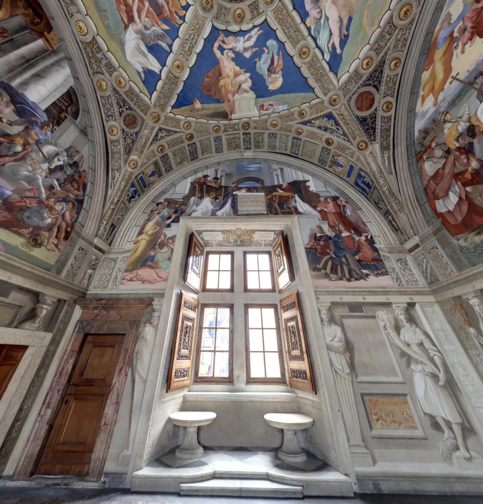

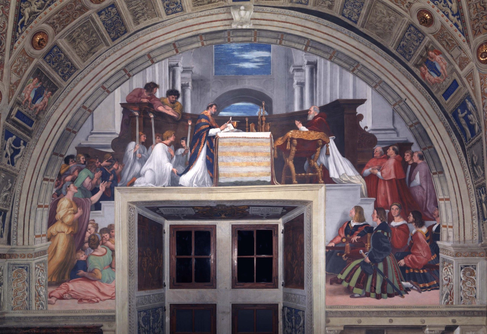

*图源：[梵蒂冈博物馆官网](https://www.museivaticani.va/content/museivaticani/en/collezioni/musei/stanze-di-raffaello/stanza-di-eliodoro/messa-di-bolsena.html)*

**内容（这是什么）**：1263 年，一位波希米亚司铎（后世传称"布拉格的彼得"）在赴罗马朝圣途中，始终怀疑"祝圣后的饼真会变成基督的身体"这条圣体教义。行至罗马以北的博尔塞纳（Bolsena），他在圣克里斯蒂娜教堂做弥撒，举扬圣体时**圣饼竟渗出血来，血在祭台布上印出十字形**——疑虑当场冰释。教皇乌尔班四世（Urban IV）当时正驻跸邻城奥尔维耶托，查验奇迹后于次年（1264）颁诏，为全教会设立 **"基督圣体节"（Corpus Christi）**——天主教至今最隆重的节日之一就源于这块染血的布；"博尔塞纳圣体布"如今仍供奉在奥尔维耶托主教座堂。

**背景 / 来历**：约 1512–1514 年，拉斐尔亲笔。尤利乌斯二世 1506 年北征途中曾专程在奥尔维耶托朝拜这块圣体布，于是把自己画成了奇迹的"在场者"。这面墙中间开着一扇不居中的真窗，拉斐尔把祭坛抬上半圆高台、让构图绕窗而建——把建筑缺陷变成了舞台。

**现场站看**：

1. **左侧举圣体的司铎**——他正盯着手中渗血的圣饼微微一震；他身后 13 世纪的围观人群骚动前倾，是活在"事件时间"里的人。
	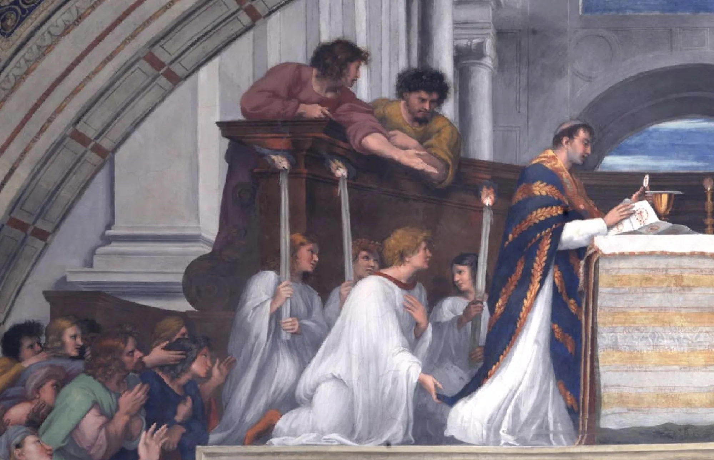

2. **右侧跪着的尤利乌斯二世**——与司铎隔祭坛相对，却毫不惊讶、平静下跪凝视：他不属于 1263 年，他是"永恒在场"的教会本身——一面墙画了两个时间层。
	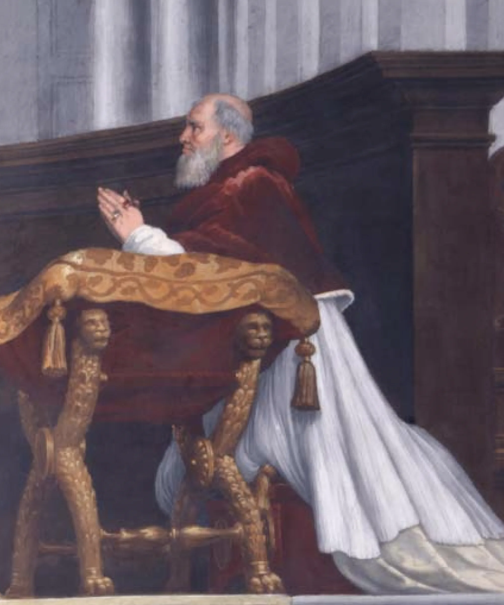

3. **教皇身后的四位红衣主教**——据考全是他的德拉·罗韦雷（della Rovere）亲族近臣（含拉法埃莱·里亚里奥等），一排肖像级头像。
	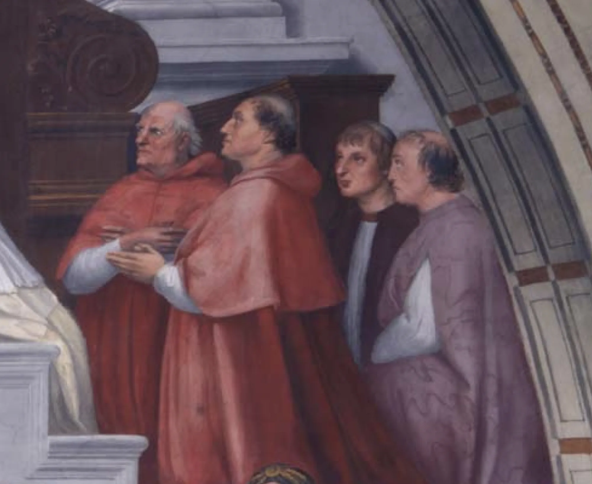

4. **右下角的瑞士卫队**——抬轿的卫士跪坐成一组，制服色块浓烈、笔触松动，是尤利乌斯二世 1506 年创立瑞士卫队后**最早的图像记录之一**——今天的瑞士卫队就是同一支。有研究者认为其中回头朝外看的那位是拉斐尔自画像。
	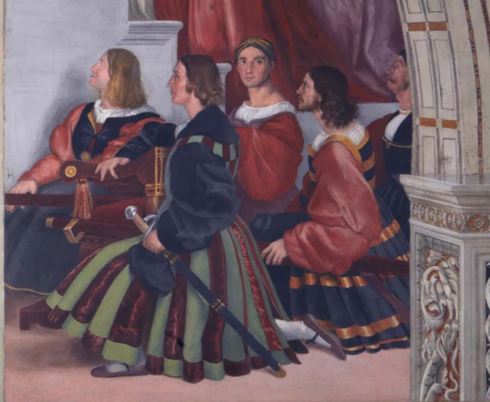

5. **左下台阶下穿深衣的侧脸女子**——一般认出是费利切·德拉·罗韦雷（Felice della Rovere），尤利乌斯二世的私生女、当时罗马最有权势的女性之一。
	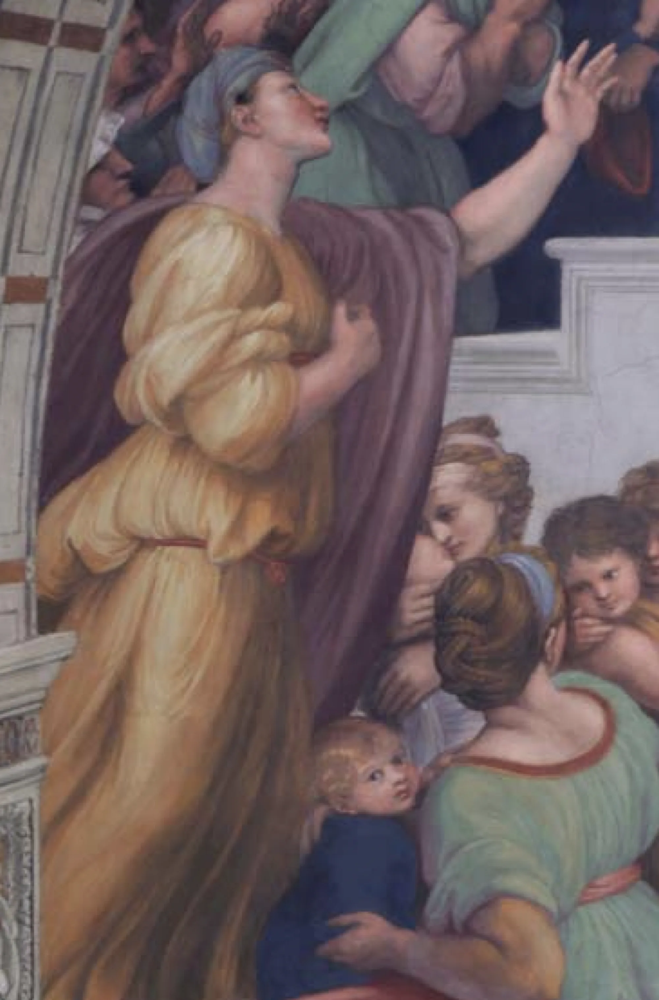
6. **退后看整体颜色**——金、橙、酒红、墨绿，浓得不像签字厅的拉斐尔：这是他吸收威尼斯派色彩后的"升级版"，**四间里色彩最丰富的一面墙**。

#### ③ 《解救圣彼得》_Liberazione di San Pietro_ ⭐⭐

> 🔗 官方：[Liberation of St Peter · Musei Vaticani](https://www.museivaticani.va/content/museivaticani/en/collezioni/musei/stanze-di-raffaello/stanza-di-eliodoro/liberazione-di-san-pietro.html)

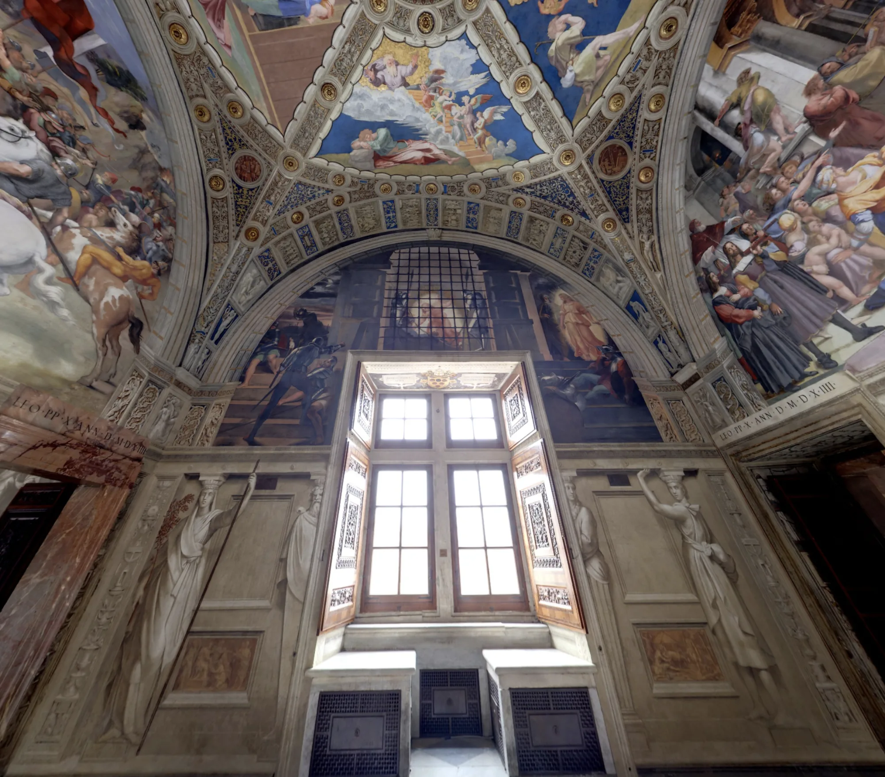

整面墙（官网大图）：

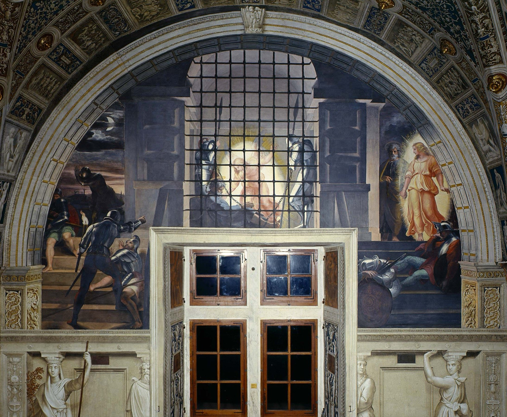

*图源：[梵蒂冈博物馆官网](https://www.museivaticani.va/content/museivaticani/en/collezioni/musei/stanze-di-raffaello/stanza-di-eliodoro/liberazione-di-san-pietro.html)*

细节——三种光：栅栏后的神光、火把、月光（官网大图）：

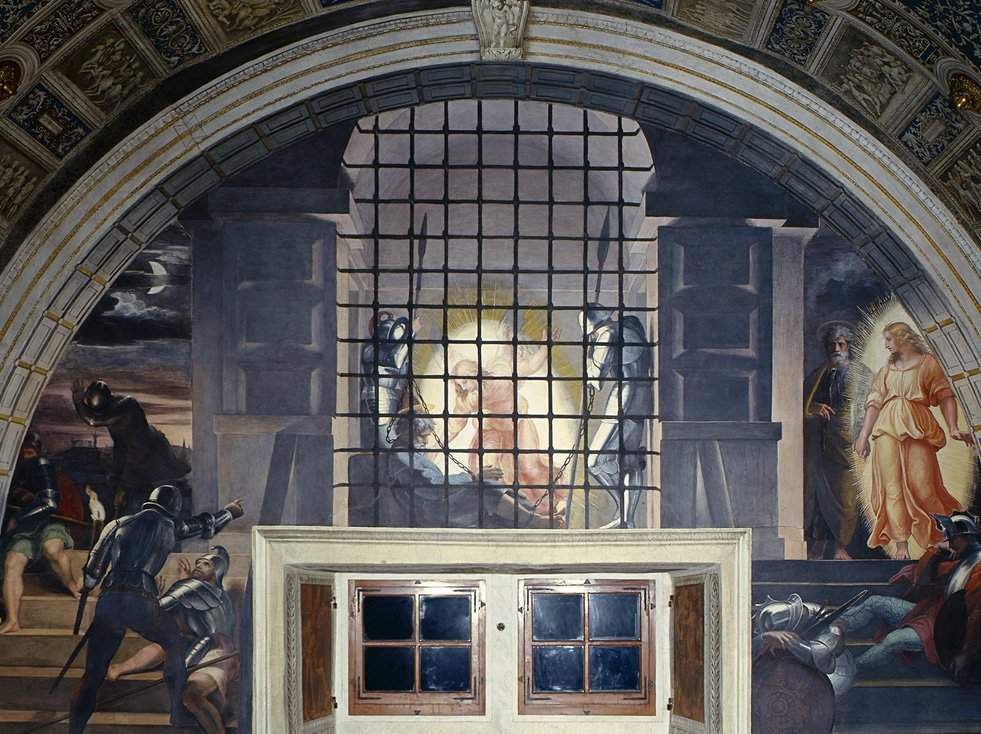

*图源：[梵蒂冈博物馆官网](https://www.museivaticani.va/content/museivaticani/en/collezioni/musei/stanze-di-raffaello/stanza-di-eliodoro/liberazione-di-san-pietro.html)*

**内容（这是什么）**：《宗徒大事录》第 12 章：黑落德王（Herod Agrippa I）迫害教会、杀了宗徒雅各伯后，又在逾越节前逮捕伯多禄（Peter，即彼得），交四班士兵看守，准备节后当众处决。受审前夜，伯多禄被**两条铁链锁着、睡在两个士兵中间**。忽然上主的天使站到他身旁，囚室充满光：天使拍醒他，**铁链自动从手上脱落**，又领他穿过第一道、第二道岗哨，临街的铁门"自己开了"。伯多禄一路恍惚以为在做梦，直到独自站在夜街上才醒悟：上主真的派天使把他从黑落德手里救了出来。

**背景 / 来历**：1513–1514 年完成，位于窗户上方。选题是给尤利乌斯二世的"私人定制"——他当红衣主教时的领衔教堂正是供奉这两条锁链的**圣伯多禄锁链堂（San Pietro in Vincoli）**；"上帝亲手解开教皇的锁链"既是普世宣言，也是他的个人徽记。这也是西方绘画里最早的大型夜景之一，**本厅技术第一名作**。

**现场站看**：

1. **中央铁栅栏后**——天使浑身白金色光焰，俯身唤醒锁在两个士兵之间的伯多禄；这是三种光里最亮的"神光"，隔着栅栏看反而更晃眼，是全画的光源心脏。
	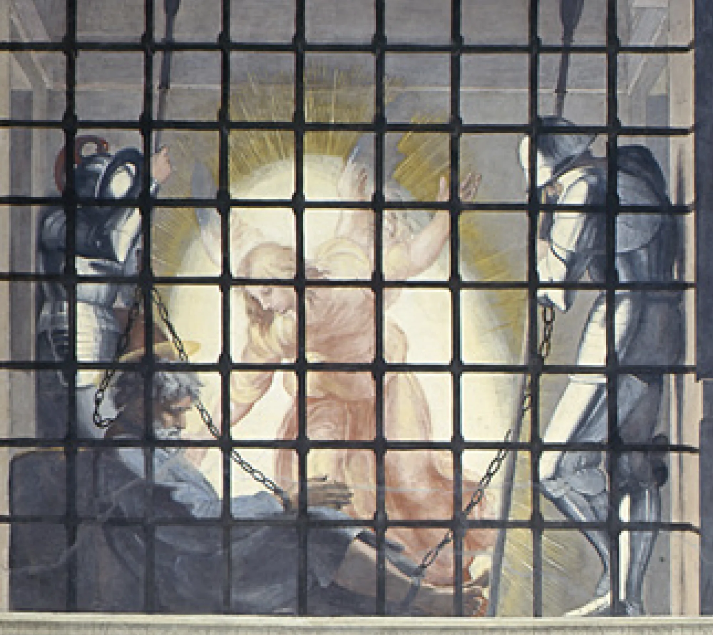

2. **右侧台阶**——同一位天使牵着半梦半醒的伯多禄，踮脚绕过熟睡的卫兵下楼：同一组人物在一面墙上出现第二次，**连环画式的时间叙事**。
	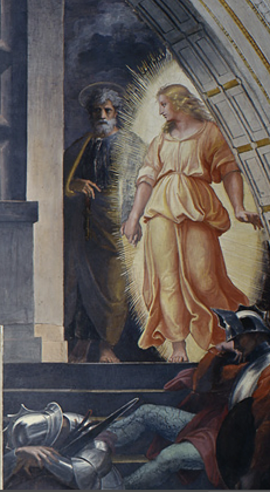

3. **左侧台阶**——第三幕：卫兵惊醒、有人举火把报警；火把是第二种光，人造的暖红光。
	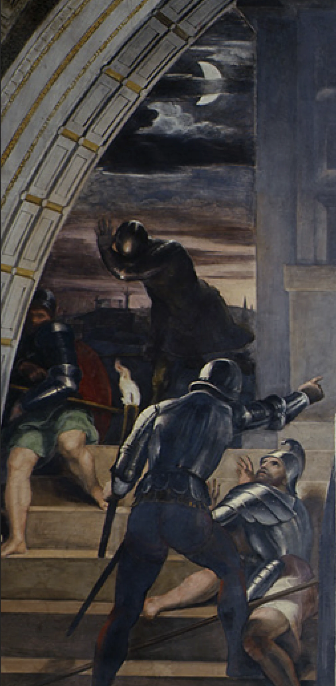

4. **数第三种光**——左上空中的冷月光从云缝漏下；盯着士兵的铠甲找三种光各自的反光色（金白 / 暖红 / 冷青），这就是"文艺复兴最早的灯光实验"的看法。
5. **退后把真窗算进去**——画在窗上方，白天真实天光从画面正下方涌入，成了第四种光；拉斐尔挑这面最难处理的墙画夜景，是有意的炫技。

#### ④ 《教皇利奥一世与阿提拉会面》_Incontro di Leone Magno e Attila_

> 🔗 官方：[Encounter of Leo the Great with Attila · Musei Vaticani](https://www.museivaticani.va/content/museivaticani/en/collezioni/musei/stanze-di-raffaello/stanza-di-eliodoro/incontro-di-leone-magno-con-attila.html)

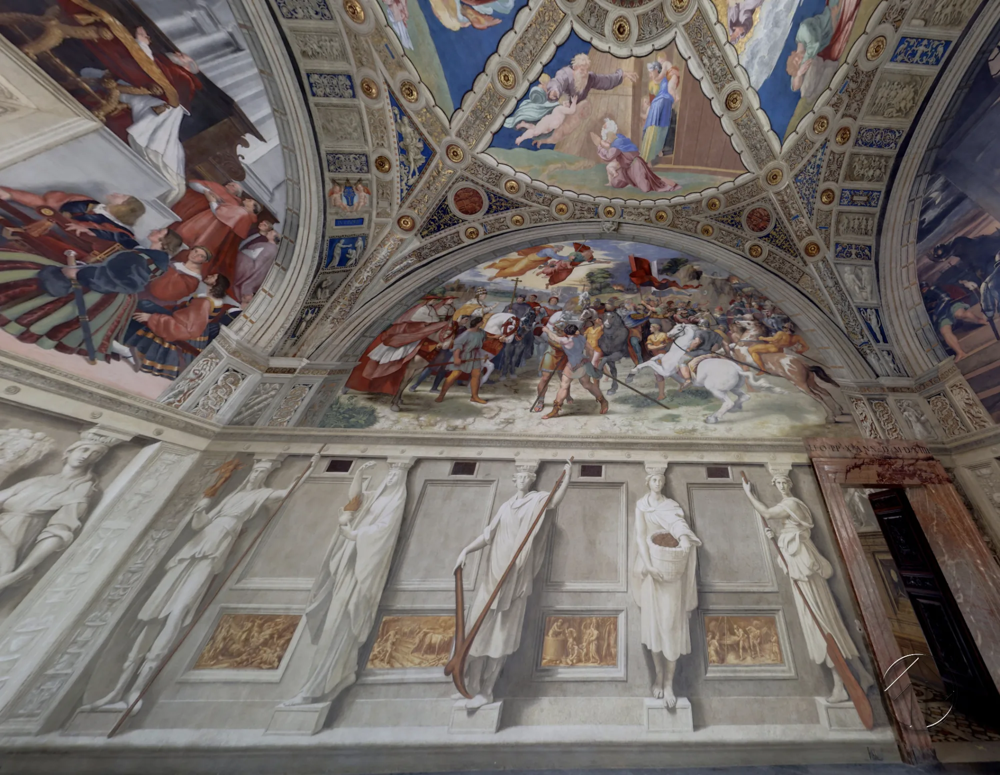

整面墙（官网大图）：

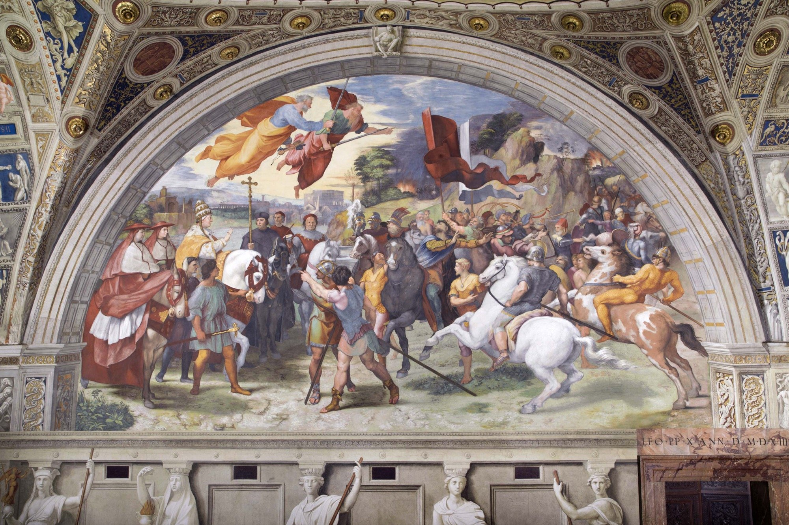

*图源：[梵蒂冈博物馆官网](https://www.museivaticani.va/content/museivaticani/en/collezioni/musei/stanze-di-raffaello/stanza-di-eliodoro/incontro-di-leone-magno-con-attila.html)*

细节——空中持剑的圣伯多禄与圣保禄、前景的利奥十世（官网大图）：

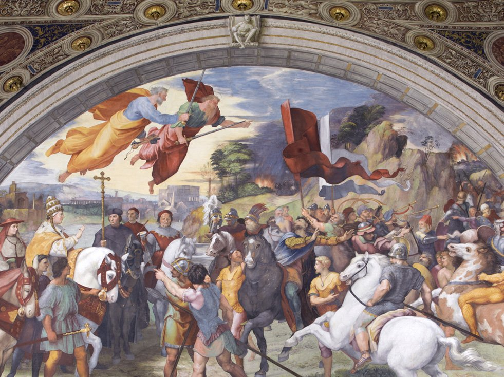

*图源：[梵蒂冈博物馆官网](https://www.museivaticani.va/content/museivaticani/en/collezioni/musei/stanze-di-raffaello/stanza-di-eliodoro/incontro-di-leone-magno-con-attila.html)*

**内容（这是什么）**：公元 452 年，"上帝之鞭"阿提拉（Attila）攻陷北意重镇阿奎莱亚后挥师南下，罗马危在旦夕。教皇利奥一世（Leo I，"大利奥"）亲自北上，在曼托瓦附近与他会面——谈了什么无人确知，但阿提拉真的掉头撤军了。教会的版本：**圣伯多禄与圣保禄持剑显现在教皇上空**，吓退了蛮王。拉斐尔还把会面地点搬到了罗马城下——背景能认出斗兽场与输水道残段，让"保卫罗马"更直观。

**背景 / 来历**：约 1513–1514 年，本厅最后一面。画到一半尤利乌斯二世去世，新教皇恰好叫"利奥"（美第奇家的利奥十世），拉斐尔顺势把原定放在背景、长着尤利乌斯脸的利奥一世，改成**前景正中、长着利奥十世的脸**——而且利奥十世在画里出现了**两次**：教皇身后那位红衣主教也是他（教皇换人前就画好了，索性保留）。左半（教皇一侧）多为拉斐尔亲笔，右半（匈人马队）工作室成分高。**彩蛋**：之后若进圣彼得大教堂，可找阿尔加迪（Alessandro Algardi）的巨型大理石浮雕《利奥一世退阿提拉》——同一故事的巴洛克版，正好前后对照。

---

### 墙脚单色画基座——十一尊寓意女像柱

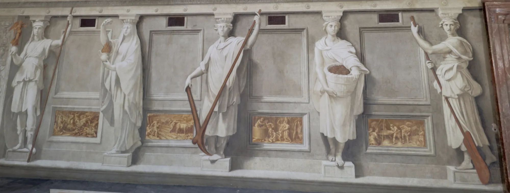

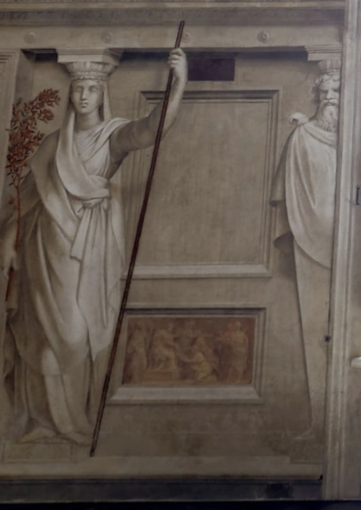

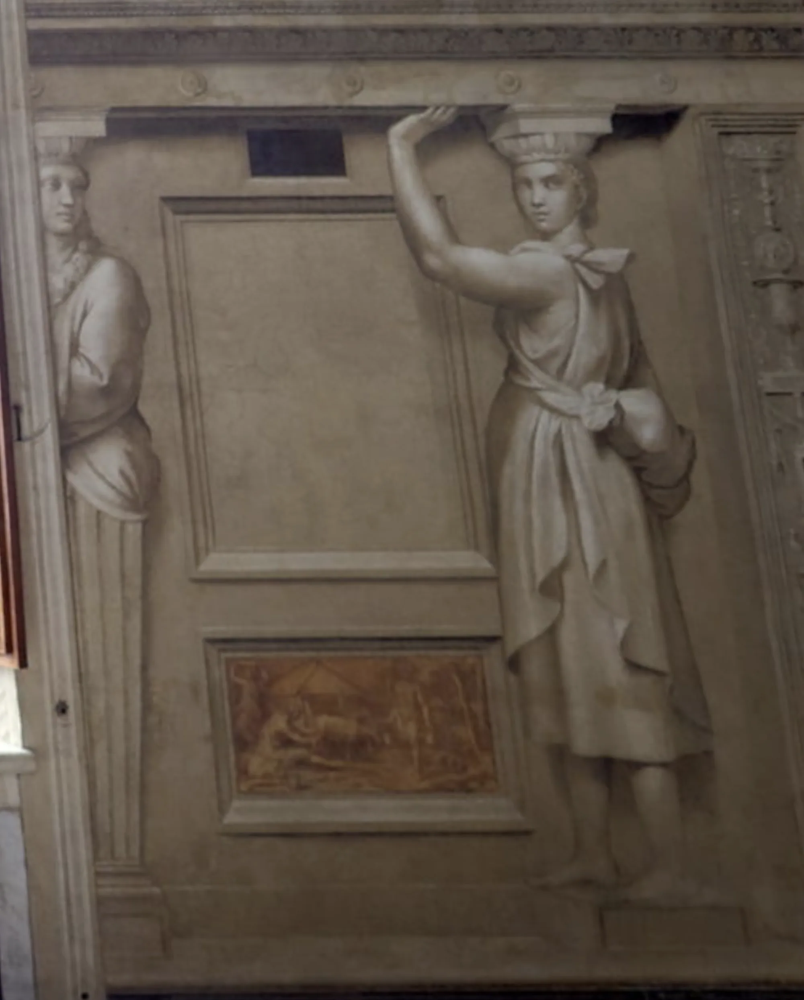

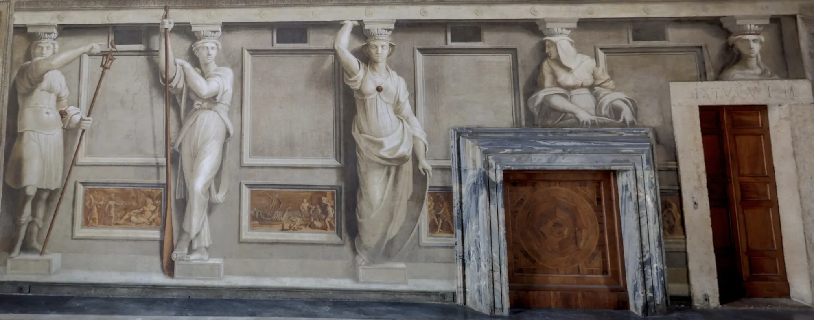

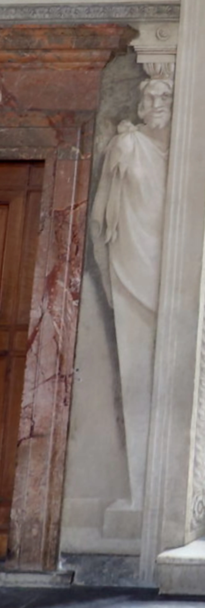

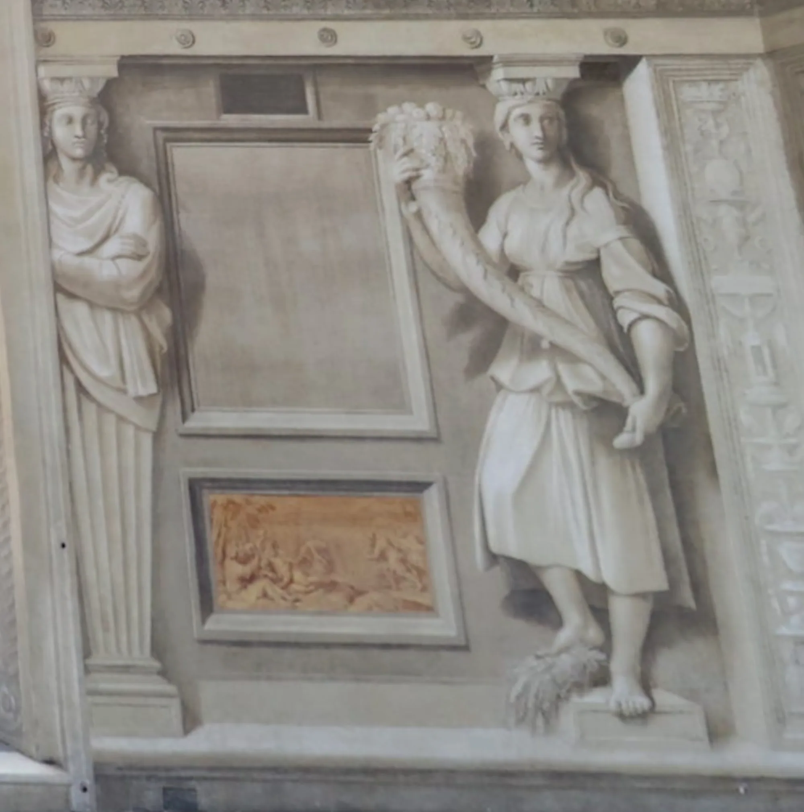

四面墙脚的基座（zoccolo）也是一套精心设计的单色画，一般归**佩林·德尔·瓦加（Perin del Vaga）**（也有归彭尼、甚至拉斐尔草图的说法）：

- **十一尊单色女像柱（cariatidi）**，各自代表一种寓意——**商业、宗教、法律、和平、保护、贵族、航海、丰饶、畜牧、农业、葡萄种植**；其间还立着**四根赫尔墨斯柱（erme）**，配仿大理石板。
- **更下方**是一排模仿**青铜浮雕**的小格，画着象征"**教会领地繁荣昌盛**"的场景。

这一整圈基座说的其实是同一件事：教会治下百业兴旺、海陆通达——把楼上"上帝庇护教会"的神迹，落到"于是天下太平富足"的现世图景上，处处透着教皇 **"帝国复兴"（renovatio imperiale）** 的雄心。看完四壁神迹，低头扫一眼这排寓意女像，纲领就闭环了。

---

### 地板

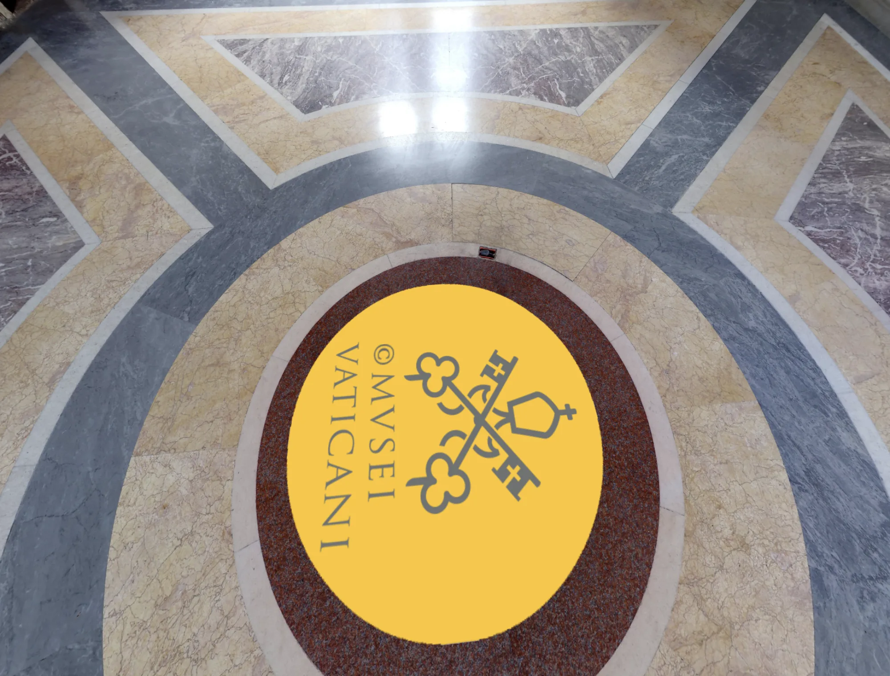

赫利奥多罗斯厅地面为彩色大理石铺装。与签字厅那种留下教皇纹章与名字的科斯马蒂式马赛克不同，**本厅地板在文献里着墨极少、没有公认的"看点"记载**——现场低头扫一眼即可，全厅的重头仍在四壁的神迹与拉斐尔的光影实验。
