拉斐尔房间的**核心一间**，盛期文艺复兴绘画的顶点之一。《雅典学院》《圣礼之争》《帕纳苏斯山》四面墙 + 天顶，是拉斐尔 25 岁起一鸣惊人的成名作。**可以拍照（禁闪光），但人多、移动慢**，进门前先认清四面墙各画什么。

🔗 官方：[梵蒂冈博物馆 · 拉斐尔房间](https://www.museivaticani.va/content/museivaticani/en/collezioni/musei/stanze-di-raffaello.html)

🔗 本厅官方页：[Stanza della Segnatura · Musei Vaticani](https://www.museivaticani.va/content/museivaticani/en/collezioni/musei/stanze-di-raffaello/stanza-della-segnatura.html)

### 这间屋子是什么 / 为什么重要

"签字厅"原是**教皇尤利乌斯二世（Julius II）的私人书房与图书室**，名字来自 16 世纪中叶起在此开庭的教廷最高法庭"恩典与正义签署院"（Segnatura Gratiae et Iustitiae）。1508 年教皇把整套房间交给当时籍籍无名的 25 岁拉斐尔（Raffaello Sanzio）——**同一时间，米开朗基罗（Michelangelo）正在隔壁西斯廷画天顶**。两位巨匠隔墙竞技，是艺术史上最著名的"神仙打架"。

整套壁画 1508–1511 年完成。图像方案不是拉斐尔独创——一般认为出自教廷里一圈**新柏拉图主义的神学家与人文学者**（被点名最多的有维泰博的埃吉迪奥 Egidio da Viterbo、英吉拉米 Fedra Inghirami 等），拉斐尔的本事是把这套抽象纲领画成人人看得懂的"戏"。代价也有：为给他腾地方，教皇下令铲掉的前人壁画里，**包括皮耶罗·德拉·弗朗切斯卡（Piero della Francesca）的作品**——文艺复兴就这样在墙上"覆盖安装"。四面墙的创作顺序：《圣礼之争》最先动笔（1509–1510），继之《帕纳苏斯山》，再《雅典学院》（约 1509–1511），《三德》收尾（1511）——边看边比对，能看出拉斐尔这三年里肉眼可见的成长。

---

### 总纲：真 · 善 · 美——一间屋子的知识宪法

这间作为图书室的屋子，把人类精神分成**三大范畴**：**真、善、美**。其中"真"一分为二——**理性之真**（哲学，靠思辨）与**启示之真**（神学，靠信仰）——所以三个范畴摊开成**四面墙、天顶四位女神**，一一对应：

| 范畴 | 天顶女神（铭文） | 对应墙面 |
| --- | --- | --- |
| **真 · 理性** | 哲学 _Causarum Cognitio_（认识因果） | ⭐⭐⭐《雅典学院》 |
| **真 · 启示** | 神学 _Divinarum Rerum Notitia_（知晓神事） | ⭐⭐⭐《圣礼之争》 |
| **美** | 诗 _Numine Afflatur_（为神灵所感） | ⭐⭐《帕纳苏斯山》 |
| **善** | 正义 _Ius Suum Unicuique Tribuit_（使各得其所） | ⭐⭐《三德》+《法学》窗景 |

**核心立意**：哲学（理性求真）与神学（信仰求真）隔屋相望、地位并尊——这是文艺复兴人文主义"古典智慧与基督教信仰可以和解"的视觉宣言。

**看屋顺序建议**：先抬头看**天顶**（它是全屋的"目录页"：哪位女神坐在哪面墙上方，那面墙就讲什么）→ 再按"真→真→美→善"看四面墙正文 → 出门前低头看**地板**、回头看**门**（两处藏着彩蛋，见文末）。

---

### 天顶——全屋的"目录页"，也是最先动工的部分 ⭐⭐

> 🔗 官方：[Ceiling · Musei Vaticani](https://www.museivaticani.va/content/museivaticani/en/collezioni/musei/stanze-di-raffaello/stanza-della-segnatura/volta.html)

怪诞纹饰（grottesche）的画框把整个拱顶分成 **13 格**：正中一个八角框，四周四个大圆框坐着四位女神，四角四块矩形画，其间再嵌一圈小画。大格的人物都画在**仿马赛克的金底**上，模拟浮雕效果——金光是这个天顶的底色。分工也有讲究：**四女神与四角画是拉斐尔亲笔**，中央八角与小画带多归他进场前已在此作业的**索多玛（Sodoma）**（中央一说布拉曼蒂诺），怪诞纹饰框架可能出自德国画家鲁伊施（Johannes Ruysch）——拉斐尔没有把前手的天顶全部铲掉，而是接着画完：**这方天顶是新旧交替的"考古层"**。

天顶全貌——四圆框女神各自俯瞰对应的墙（官网大图）：

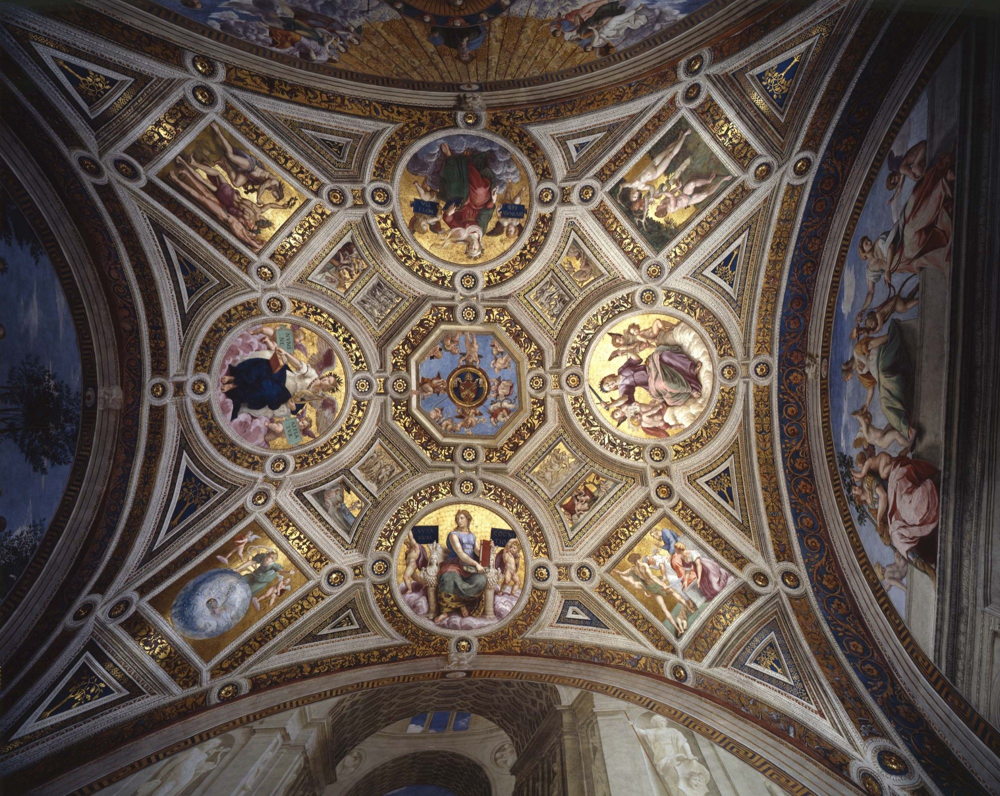

*图源：[梵蒂冈博物馆官网](https://www.museivaticani.va/content/museivaticani/en/collezioni/musei/stanze-di-raffaello/stanza-della-segnatura/volta.html)*

#### 中央八角框——小天使举着教皇纹章

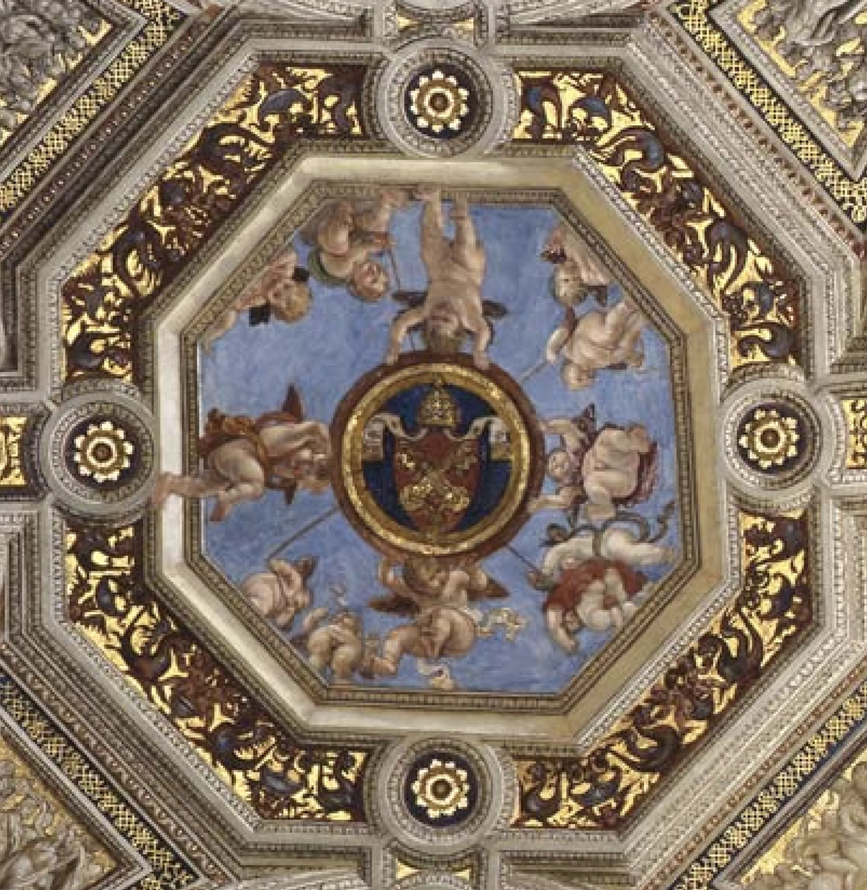

正中八角格里，一群小天使举着**德拉·罗韦雷家族的教皇纹章**（橡树）。整间屋子的知识体系以它为圆心铺开——等于给"人类全部学问"盖了一个所有权章：**这一切，归尤利乌斯二世**。执笔一般归索多玛（阿道夫·文图里认为是布拉曼蒂诺）。

#### 四位女神——每面墙的"标题"

四个直径 180 厘米的圆框（拉斐尔亲笔），各坐一位拟人女神、俯瞰自己负责的那面墙，两侧小天使举着铭文板点题。**"真"占了两位**——哲学与神学，正是总纲"双重之真"的体现：

##### 哲学（Philosophia）——俯瞰《雅典学院》

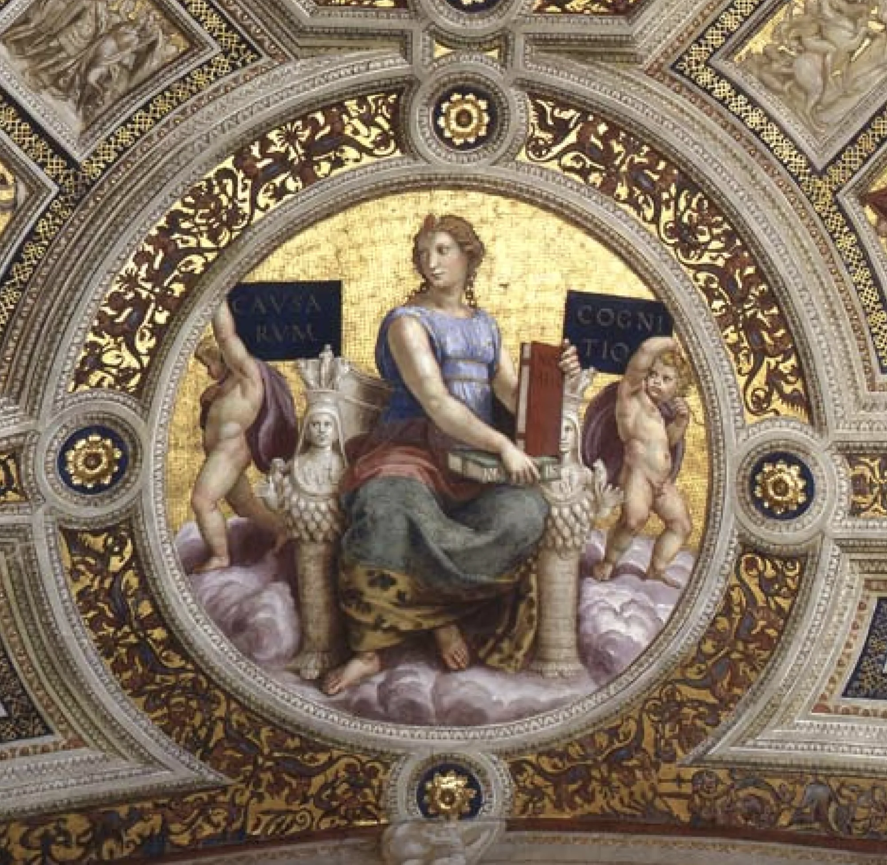

铭文 **CAUSARUM COGNITIO（认识因果）**，语出亚里士多德对智慧的定义。认人三件套：① 宝座两侧的扶手雕成**以弗所的狄安娜**（多乳的自然女神）——哲学坐在"自然"之上；② 手捧两册书，书脊分别写着 **MORALIS（道德哲学）与 NATURALIS（自然哲学）**——古典哲学的两大分支；③ 她的袍子**四色四纹**：缀星的蓝（天）、火焰纹的红（火）、水纹的绿（水）、草木纹的褐（土）——四元素从天到地穿成一身。

##### 神学（Theologia）——俯瞰《圣礼之争》

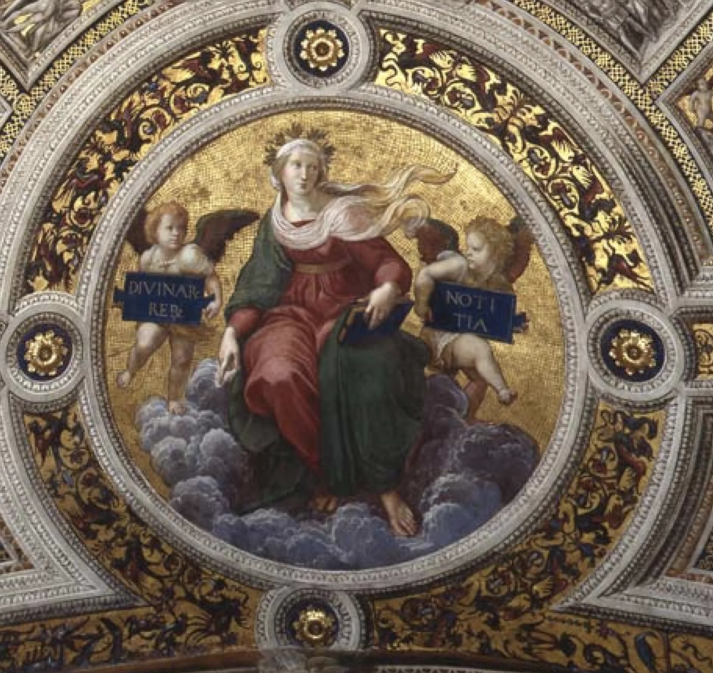

铭文 **DIVINARUM RERUM NOTITIA（知晓神事）**。她披白纱、着红衣绿袍——**白、红、绿正是信、望、爱三超德的颜色**，神学把三超德穿在身上；一手持书、一手指向下方的《圣礼之争》：神学的答案不在思辨里，在祭坛上那枚圣体里。

##### 诗（Poesia）——俯瞰《帕纳苏斯山》

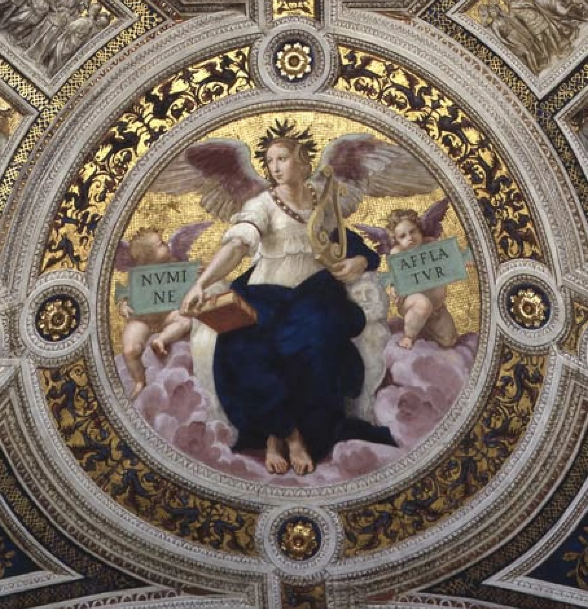

铭文 **NUMINE AFFLATUR（为神灵所感）**，语出维吉尔《埃涅阿斯纪》卷六写库迈女巫的句子——**用维吉尔的诗给"诗"作题词，而维吉尔本人就站在正下方的墙上**。她是四位女神里唯一**有翅膀**的（灵感会飞），戴桂冠、持里拉琴与书：诗＝音乐＋文字＋神授。

##### 正义（Iustitia）——俯瞰《三德 + 法学》

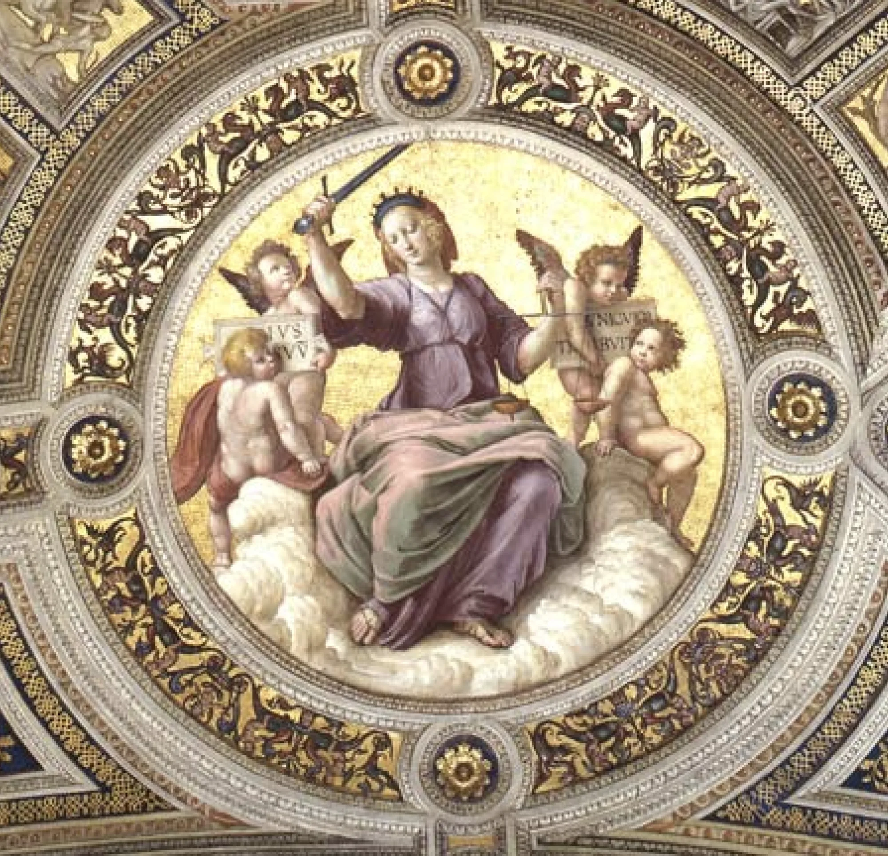

铭文 **IUS SUUM UNICUIQUE TRIBUIT（使各得其所）**，语出查士丁尼《法学阶梯》开篇对正义的定义——天顶直接引法典原文，正合下方的"法墙"。她持**剑与天平**（裁断＋公平）；下方墙上只画了刚毅、审慎、节制三枢德——**她本人就是缺席的第四枢德**，柏拉图视正义为统摄三德的总德，拉斐尔便给了她全屋最高的座位。

#### 四角四画——衔接两墙的"转场"

四角各一块 120×105 厘米的矩形画（拉斐尔亲笔，仿马赛克金底），每块都安在两面墙的交角上，**给相邻的两个学科"搭桥"**：

##### 《原罪》（亚当与夏娃）→ 引向神学

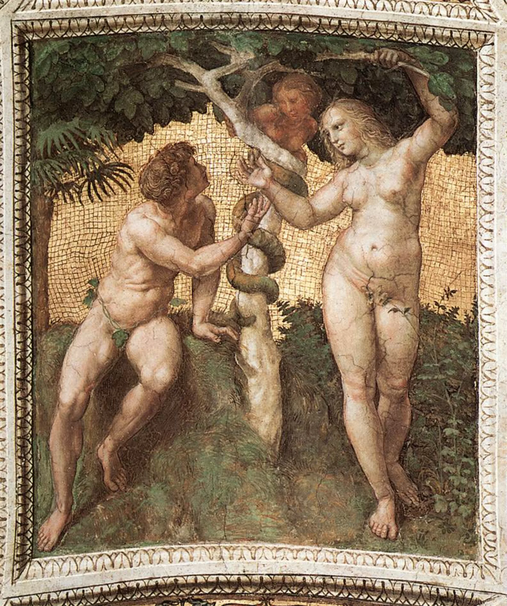
夏娃从蛇盘踞的树上接过果子——人类的堕落是神学的"问题"，下方《圣礼之争》祭坛上的圣体是"答案"：罪与救赎隔着一个屋角对望。

##### 《所罗门的审判》→ 引向正义

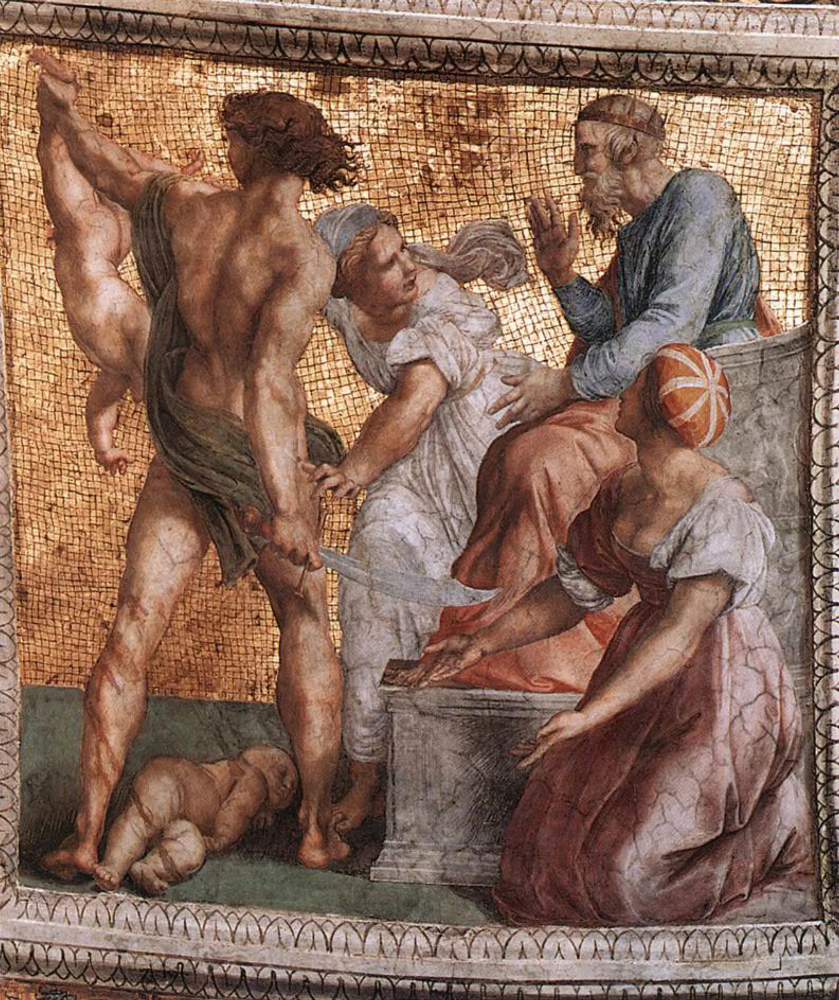
两妇争婴，所罗门命剑劈孩子、以真母不忍辨出真相——司法智慧的经典案例，给法墙开题：**法的最高境界不是条文，是明察**。

##### 《原动》（第一推动，一称《天文》）→ 引向哲学

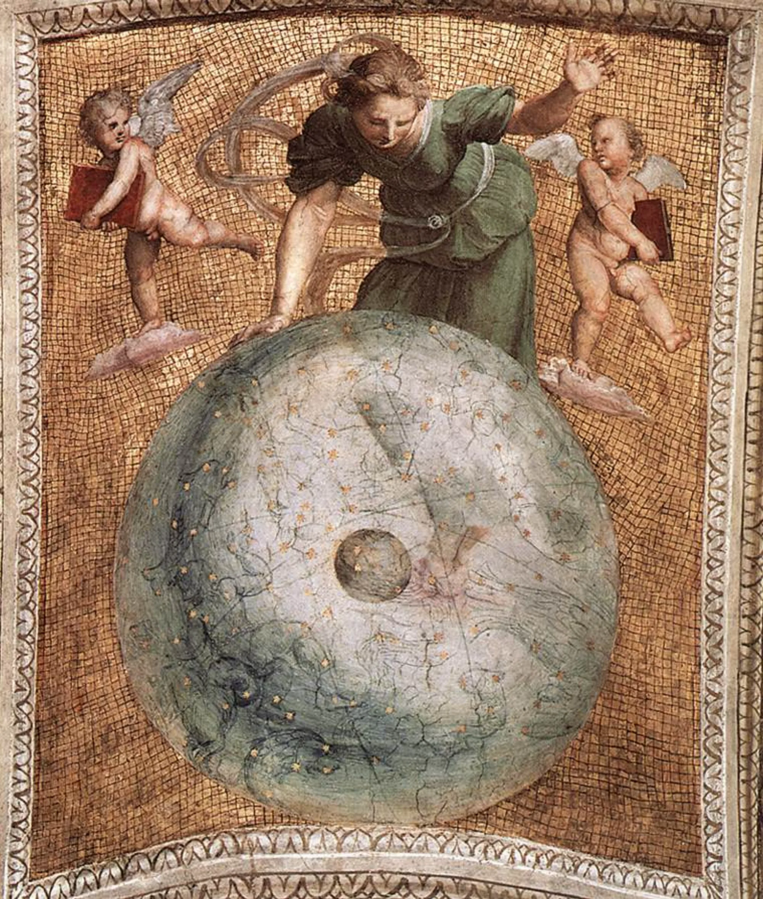
一位女子俯身拨动缀满星辰的透明天球——宇宙的"第一因"。哲学铭文"认识因果"的因果链，第一环就挂在这里：从星空之问开始。

##### 《阿波罗与玛息阿》→ 引向诗

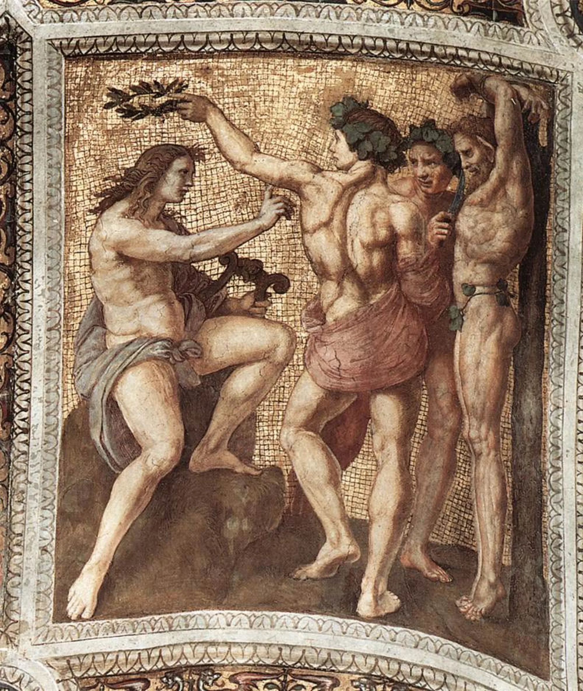
半羊人玛息阿吹笛挑战阿波罗的琴，败者被活剥皮——艺术的神圣与僭越的代价（诗墙人物小节里阿波罗那条讲过这个故事，抬头正好对上）。

#### 女神与四角之间——四块"元素梯形格"

八角框与四角大画之间，还嵌着**四块梯形小格**，每格上下叠两幅小画——**上幅单色仿浮雕（取材李维《罗马史》的历史场景），下幅彩色（取材许癸努斯 Hyginus 传统的神话场景）**，多归拉斐尔进场前在此作业的索多玛之手。

它们不是随手填空：艺术史家**埃德加·温德（Edgar Wind）1938 年的经典解读**指出，这四格各藏一种**古典四元素**——**水、土、火、气**，每格的"一段罗马史 + 一则神话"都在讲同一种元素；它们还与下方四面墙、与半月拱沿上执元素标志的小天使三者呼应成网。下面逐格看（这些小画**没有像《雅典学院》那样固定的通行中文译名**，故一律写"通常识别为……"）。

##### 水 Water

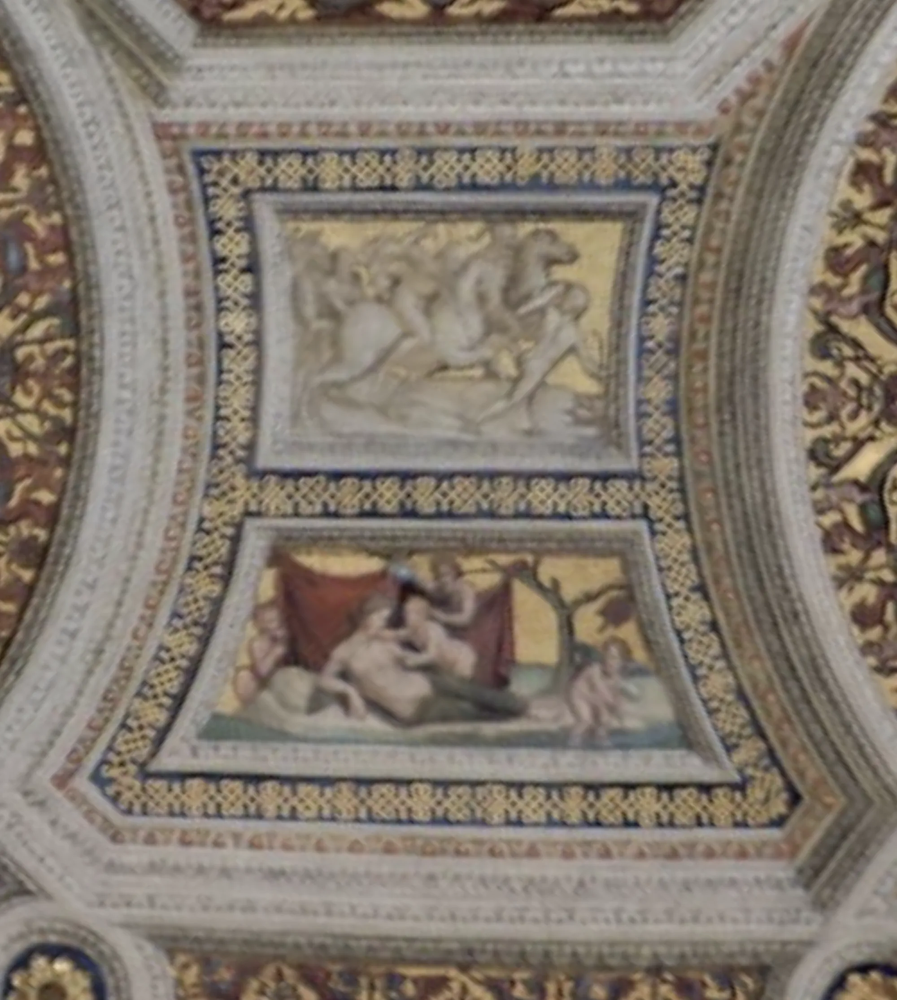

- **上幅（李维·历史）**：通常识别为 **《罗马人与萨宾人在沼泽边交战》**——罗马建城之初"劫掠萨宾妇女"引发的战争；萨宾将领梅提乌斯·库尔提乌斯（Mettius Curtius）在混战中**连人带马陷进广场上的沼泽**（罗马广场上的"库尔提乌斯湖" Lacus Curtius 即由此得名）。湿地、骑兵、混战，是这一格的"水"。
- **下幅（许癸努斯·神话）**：通常识别为 **《宁芙与小爱神被萨堤尔泼水》**——海边斜卧的宁芙、嬉闹的小爱神，被半羊人萨堤尔泼水。海、水、泼洒，把元素点得再明白不过。

##### 土 Earth

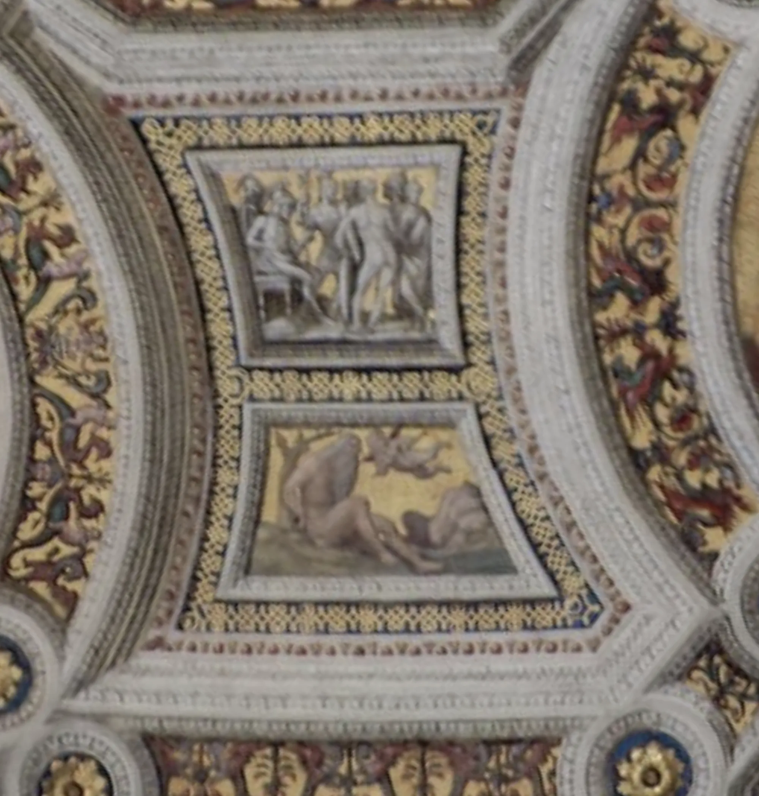

- **上幅（李维·历史）**：通常识别为 **《布鲁图斯裁断正义》**——罗马共和国奠基人卢基乌斯·尤尼乌斯·布鲁图斯（L. Junius Brutus）驱逐末代国王后任执政官；当他的两个亲生儿子卷入复辟王政的阴谋，他**亲自审判并下令处死他们**——"大义灭亲"的执法典范，恰好呼应下方的"法/正义"墙。
- **下幅（许癸努斯·神话）**：通常识别为 **《被制服束缚的巨人（盖亚之子）》**——诸神与巨人之战（Gigantomachy）里，大地女神盖亚（Gaia）所生的巨人被打败、压伏捆缚在岩地上。"大地之子伏于地"，直指"土"。

##### 火 Fire

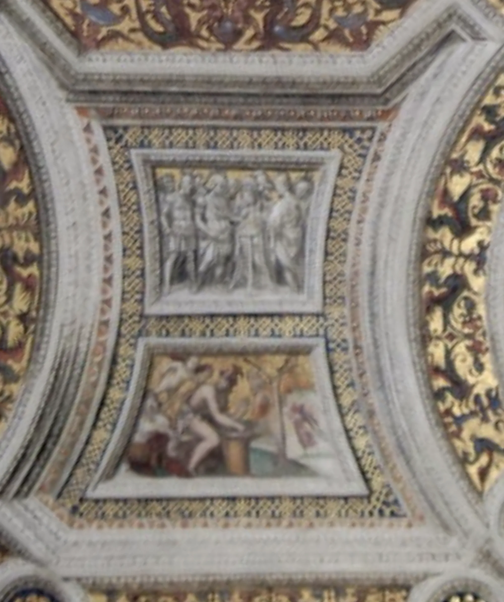

- **上幅（李维·历史）**：通常识别为 **《穆基乌斯·斯凯沃拉把手伸入火中》**——罗马青年盖乌斯·穆基乌斯潜入敌营行刺伊特鲁里亚王波尔塞纳失手被擒；为示罗马人不惧死，他**当众把右手伸进祭坛的火里烧掉、面不改色**，吓退了围城的国王。绰号"斯凯沃拉（Scaevola，左撇子）"正源于这只烧废的右手。
- **下幅（许癸努斯·神话）**：通常识别为 **《伏尔甘的锻炉》**——火神伏尔甘（Vulcan）在铁砧、炉火旁打铁。锻炉与忍火，两幅都是"火"。

##### 气 Air

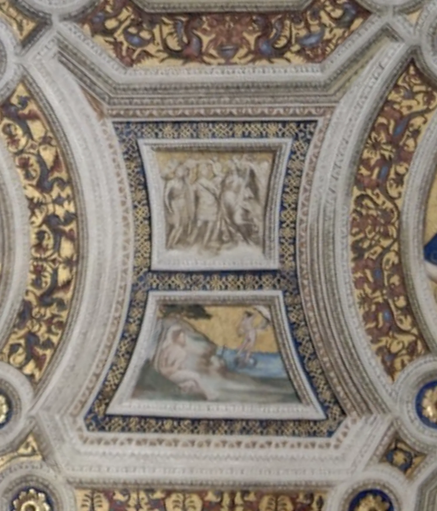

- **上幅（李维·历史）**：通常识别为 **《胜利女神为皇帝加冕》**——有翼的胜利女神（Victoria）为一位皇帝加冠，常解作奥古斯都与"奥古斯都和平"（Pax Augusta）。飞翔、加冕、神佑，归于"气/风"。
- **下幅（许癸努斯·神话）**：通常识别为 **《安菲特里忒乘风航行》**——海洋女神安菲特里忒（Amphitrite，波塞冬之妻）被强风推送、在海上行进。鼓起的帆与风，点明"气"。

> ⚠️ 温德的元素—墙精细对应（哪格元素配哪面墙）各家转述略有出入，现场记住"**四格＝四元素、每格上历史下神话**"这一层即可，不必纠结哪格对哪墙。

#### 橡叶小三角——天顶上的第三遍"金主签名"

圆框与方格的缝隙里填着**德拉·罗韦雷橡枝**的小三角——从中央八角的纹章、到四角缝隙的橡叶，金主尤利乌斯二世的家徽在天顶上盖了一圈又一圈。

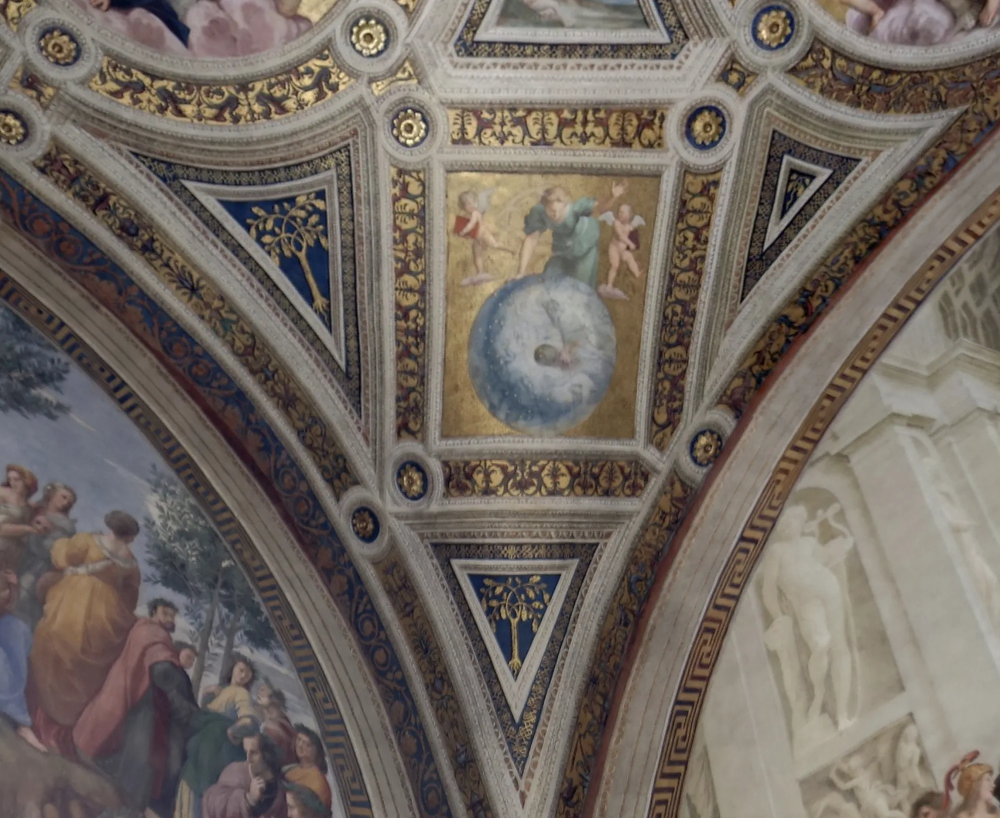

#### 拱沿小天使——被"放反"的气与火

四面半月拱的拱沿上各有小天使执**四元素**（土、水、气、火）的标志，与对应墙面、与上面四格梯形画呼应——但其中**"气"与"火"两位明显画反了位置**，学界视作壁画方案中途改动的物证：最完美的房间，也留着施工中途换图纸的痕迹。

---
### 真 · 理性 哲学 （Philosophia）

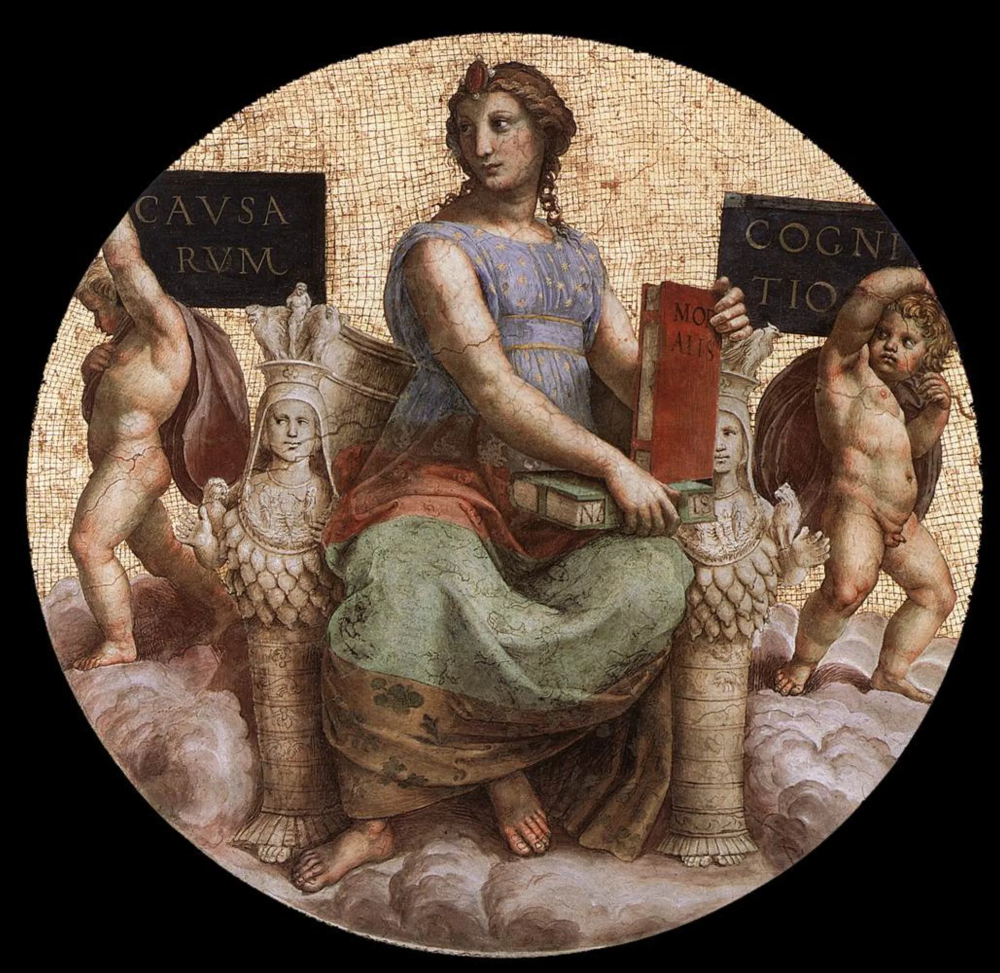
#### 拉斐尔《雅典学院》/ Raffaello, _Scuola di Atene_ ⭐⭐⭐

- **作者**：拉斐尔·圣齐奥（Raffaello Sanzio）
- **作品**：《雅典学院》/ _Scuola di Atene_
- **时间**：约 1509–1511
- **材质**：湿壁画
- **尺寸**：底宽约 770 cm（半圆拱墙）
- **位置**：签字厅"哲学"墙
- **官网介绍页**：[Wikipedia · The School of Athens](https://en.wikipedia.org/wiki/The_School_of_Athens)

> 🔗 官方：[School of Athens · Musei Vaticani](https://www.museivaticani.va/content/museivaticani/en/collezioni/musei/stanze-di-raffaello/stanza-della-segnatura/scuola-di-atene.html)

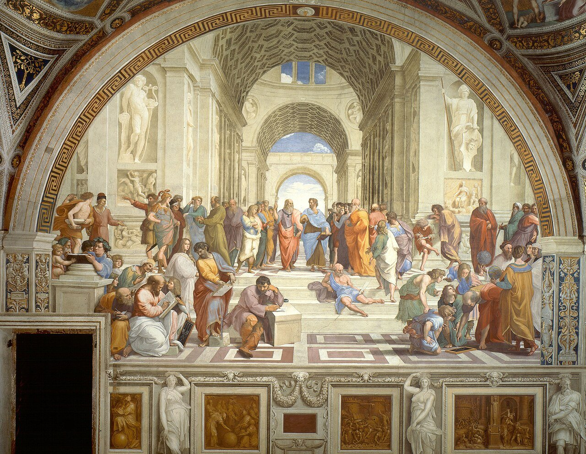

*图源：[Wikimedia Commons](https://commons.wikimedia.org/wiki/File:Sanzio_01.jpg)*

**内容（这是什么）**：画的是一场从未发生过的聚会——拉斐尔把从公元前 6 世纪到公元 2 世纪、跨越七百多年的古希腊罗马哲学家、数学家、天文学家五十余人，全部请进同一座宏伟的拱顶大殿。这不是任何历史场景，而是一幅 **"理性文明的全家福"** ：哲学这门学问的完整谱系，被画成了一个可以走进去的空间。"雅典学院"这个名字并非拉斐尔所起，是后世的俗称；它真正的"标题"写在正上方天顶的圆框里——拉丁文**Causarum Cognitio（"认识事物的原因"）**，呼应亚里士多德对智慧的定义：知其然，更知其所以然。

大殿本身也在说话：希腊十字平面、层层后退的筒形拱顶，灵感来自布拉曼特（Donato Bramante）当时正在重建的**新圣彼得大教堂**方案——瓦萨里（Giorgio Vasari）记载布拉曼特亲自帮拉斐尔设计了这套画中建筑。把异教哲学家放进一座"教堂形"的殿堂，本身就是人文主义的宣言：古典理性与基督教信仰共居一室。两侧壁龛立着理性殿堂的两位守护神——左边持里拉琴的光明之神阿波罗（Apollo），右边持盾的智慧女神雅典娜（Athena，罗马名弥涅尔瓦）。

**背景 / 来历**：1508 年，尤利乌斯二世不愿再住楼下满是前任博尔吉亚家族纹章的旧寓，决定把楼上四间房改成新居，召来佩鲁吉诺（Perugino）、索多玛（Sodoma）等一班画家。25 岁的拉斐尔经同乡布拉曼特引荐，从佛罗伦萨来罗马"试笔"——按瓦萨里的记载，教皇看过他的画后当即遣散全班人马，把四间房悉数交给这个年轻人，连已完成的旧壁画也下令铲除。这面"哲学墙"是签字厅第三面完成的（约 1509–1511，先有《圣礼之争》与《帕纳苏斯山》）。

画里许多哲学家**借用了同代人的脸**：柏拉图用达·芬奇（Leonardo da Vinci）、欧几里得用布拉曼特、赫拉克利特用米开朗基罗——它因此也是一封写给文艺复兴黄金一代的情书。其中米开朗基罗那笔最有故事：米兰昂布罗修图书馆藏有此画的等大底稿，**底稿上根本没有赫拉克利特**——他是壁画接近完成时才补进去的。通行的解释是：拉斐尔先睹了半成的西斯廷天顶、深受震撼，于是把这位"孤独的巨人"以忧郁哲人的形象添在全画最显眼的前景正中，向对手致敬。

**现场站看 · 谁是谁（逐点对照）**：

1. **正中两人，全画第一眼**——左边白须红袍、**手指向天**的是**柏拉图（Plato）**（普遍认为用了达·芬奇的脸），赤足老者，腋下夹着《蒂迈欧篇》（书脊上写着 Timeo）；右边壮年、着金边袍与凉鞋、**手掌向下平伸**（朝观众方向强烈前缩）的是**亚里士多德（Aristotle）**，手持《尼各马可伦理学》（Etica）。指天＝真理在永恒的理型世界；按地＝真理在眼前的经验世界。**西方哲学两千年的路线之争，被两个手势讲完了。**
2. **台阶前独自伏在大理石块上写字的**——**赫拉克利特（Heraclitus）**，"哭的哲学家"，用米开朗基罗的脸、穿着他干活穿的靴子，姿态与全场隔绝——就是上面说的后加的那笔致敬。趣味彩蛋：有医学研究者指出，拉斐尔连他**腿上的静脉曲张**都如实画了出来。
3. **台阶上横躺、衣衫半敞、身边放着一只碗的**——犬儒派的**第欧根尼（Diogenes）**。他住木桶、白天提灯"找一个真正的人"、让亚历山大大帝"别挡住我的阳光"；传说他见小孩用手捧水喝，连唯一的碗都扔了——画里那只碗就是他的全部家当。拉斐尔让他占着所有人必经的台阶正中、谁也不理：**用位置讲性格**。
4. **左下角伏案疾书、众人围观的**——**毕达哥拉斯（Pythagoras）**，面前少年举着一块小板，上面画着他的**和谐音程图（diatessaron）**：音乐与数学同源。**从他肩后裹白头巾、探身抄笔记的**，是 12 世纪科尔多瓦的伊斯兰哲学家**阿维罗伊（Averroes）**——亚里士多德最重要的注释家、画中唯一的穆斯林学者，哲学的谱系被拉斐尔延伸出了基督教世界。这一组旁边**一袭白衣、全画唯一直视你的人物**，常被认作亚历山大城的女数学家**希帕提娅（Hypatia）**（一说是乌尔比诺小公爵弗朗切斯科·玛丽亚·德拉·罗韦雷的肖像）。
5. **右下角弯腰持圆规、在石板上作图的**——**欧几里得（Euclid，一说阿基米德）**，用了布拉曼特的脸（瓦萨里的说法）；围观的四个学生姿态从俯身困惑到抬头恍然，把"听懂一道几何证明的全过程"画成了连环画。凑近看他的衣领：金边上绣着 **R.V.S.M.（Raphael Urbinas Sua Manu，"乌尔比诺的拉斐尔亲手所作"）**——全画唯一的签名。
6. **最右一组天文学家**——背对观众、手托**天球**的是**琐罗亚斯德（Zoroaster）**；与之相对、戴冠手托**地球仪**的是**托勒密（Ptolemy）**。他们旁边**戴黑帽、从人群里转头直望画外的年轻人，就是拉斐尔本人的自画像**——把自己悄悄签进哲人队列的角落；身侧白衣者一般认为是被他顶替的前任画家索多玛（一说其师佩鲁吉诺）。
7. **左侧橄榄绿袍、侧脸塌鼻、掰着手指数论点的**——**苏格拉底（Socrates）**，全画少数按古代胸像"标准长相"画的人；听他说话的披甲俊美青年，一般认作其弟子**亚西比德（Alcibiades）**（一说亚历山大大帝）。
8. **最后退到人群外看整体**——所有建筑透视线汇聚到柏拉图与亚里士多德两人头部之间的**灭点**，全场人物的目光与动势也都把你引向他们：拉斐尔用空间秩序为思想排座次。再扫一眼拱门上的**希腊回纹饰带**与层层缩进的藻井拱顶——这就是布拉曼特心中新圣彼得的模样。然后转身：对面《圣礼之争》构图垂直、真理自天而降；这边构图水平、真理在人与人的争辩中展开——**一间书房、两种求真**。

**人物逐个认**：下面按"先正中、再左翼、再前景、最后右翼"的看画顺序逐人展开。方位一律按**观者视角**（"左"＝你面对画时的左手边）。除柏拉图、亚里士多德等核心几位外，许多身份出自后世学者的传统认定，有争议的已注明——现场认人认个大概即可，认不出也不影响看懂"两种求真"的大局。

##### 柏拉图（Plato）——正中偏左，指天的红袍老者

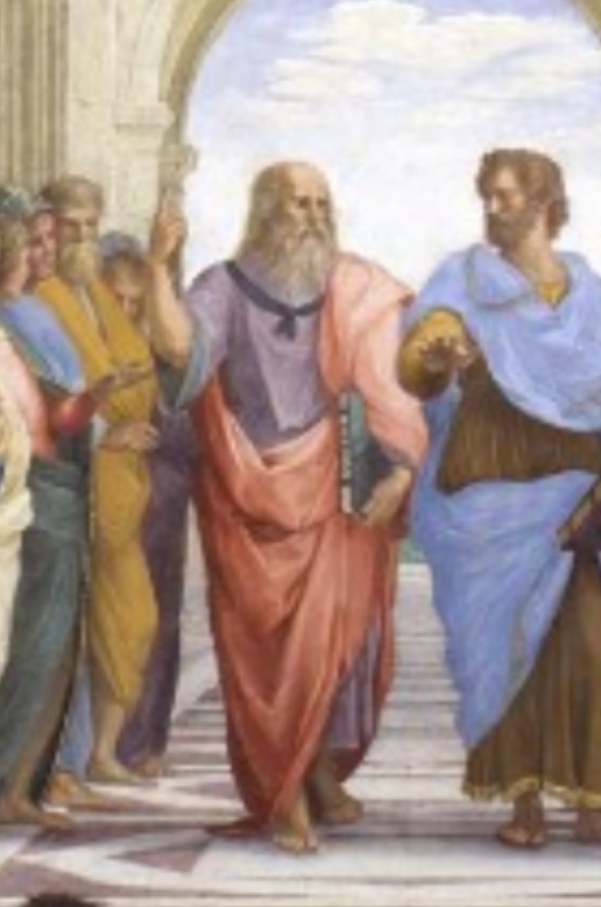

- **位置**：全画几何中心两人中**左边那位**，站在最高一级台阶上、大拱门正下方；整座建筑的透视线都汇向他与亚里士多德之间。
- **身份**：古希腊哲学家（约前 428–前 348），苏格拉底的学生、亚里士多德的老师，雅典城外"学园"（Academy）的创办人——这幅画俗称的"学院"，词源就是他的学园。核心主张"理型论"：眼前的世界只是永恒完美"理型"的影子，真知要向上去求。
- **故事**：出身雅典贵族，相传本名阿里斯托克勒斯，"柏拉图"（意为"宽肩膀"）是体育教练起的绰号。老师苏格拉底被城邦处死后，他心灰周游列国，归来创办学园讲学四十年；著作几乎全用对话体写成，主角永远是他死去的老师——用一辈子的书为老师翻案。
- **画中表现**：白须长发、赤足披红袍，左手竖夹一册《蒂迈欧篇》（书脊上可辨 Timeo——他唯一一部讲宇宙如何被造的对话录，中世纪以来最有名的一部），右手食指向天，点出"真理在上"的全部立场。通行的说法认为拉斐尔借了**达·芬奇（Leonardo da Vinci）**的脸——把当世公认最像"智者本人"的那张脸，放在了全画最高的位置。

##### 亚里士多德（Aristotle）——正中偏右，手掌按向大地的壮年人

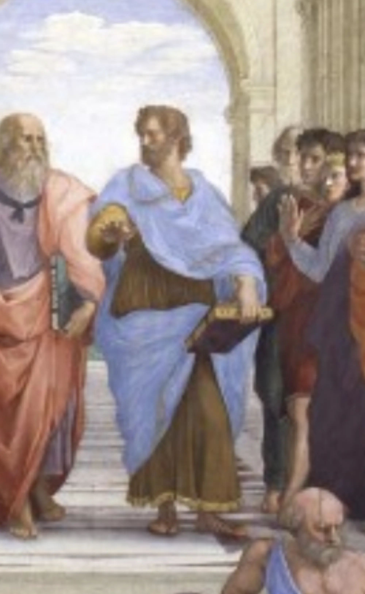

- **位置**：柏拉图右侧，与他并肩站在最高台阶上，两人构成全画的双中心。
- **身份**：古希腊哲学家（前 384–前 322），在柏拉图学园求学二十年，后自立门户创办吕克昂学园（Lyceum），是逻辑学、物理学、生物学、伦理学、诗学的奠基人——古代世界最接近"百科全书"的头脑。
- **故事**：马其顿宫廷御医之子，17 岁入学园；柏拉图死后离开雅典，被马其顿王腓力二世聘为王子的家庭教师——那个学生就是**亚历山大大帝**。后世归于他名下的那句"吾爱吾师，吾更爱真理"，正是他与柏拉图关系的写照：终生敬师，处处立异。
- **画中表现**：壮年短须、金边蓝袍、足登凉鞋（与赤足的老师相对），左手平托《尼各马可伦理学》（Etica）于腿侧，右手掌心向下、朝观众方向有力前伸（透视前缩极强）："真理不在天上，就在眼前可触的经验世界。"一指天、一按地，**西方哲学两千年的路线之争被两个手势讲完**——这两只手是全画真正的题眼。

##### 苏格拉底（Socrates）——左上层台阶，掰手指的橄榄绿袍侧脸

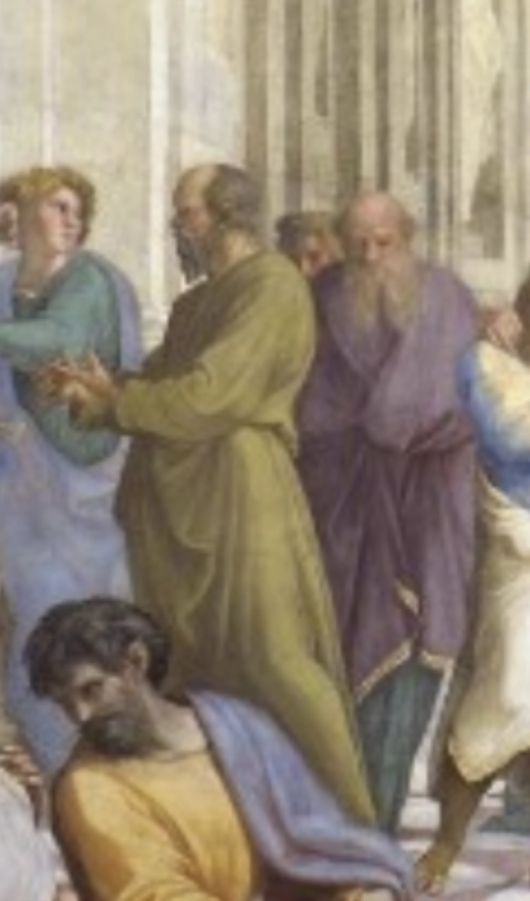

- **位置**：柏拉图左手边不远处的上层台阶（画面左半的上层），侧脸面向一小群听众。
- **身份**：古希腊哲学家（前 469–前 399），柏拉图的老师。一生不立文字、不收学费，在雅典街头市集用一问一答把人逼到自相矛盾，号称"我只知道我一无所知"。
- **故事**：石匠与产婆之子，自称继承了母亲的手艺——做思想的"接生婆"。70 岁时被雅典以"腐蚀青年、不敬城邦之神"判处死刑，拒绝越狱，从容饮下毒堇汁——哲学史的第一位殉道者。他的长相（塌鼻、秃顶、其貌不扬）因古代胸像传世而有"标准答案"，是全画少数照着古物画的脸。
- **画中表现**：橄榄绿袍、塌鼻秃顶的侧脸，正**掰着手指逐条数论点**——把"苏格拉底问答法"画成了一个手势。他身边围着一圈青年听众，姿态各异，正是他街头讲学的日常。

##### 亚西比德 / 亚历山大（Alcibiades / Alexander）——听苏格拉底说话的披甲青年

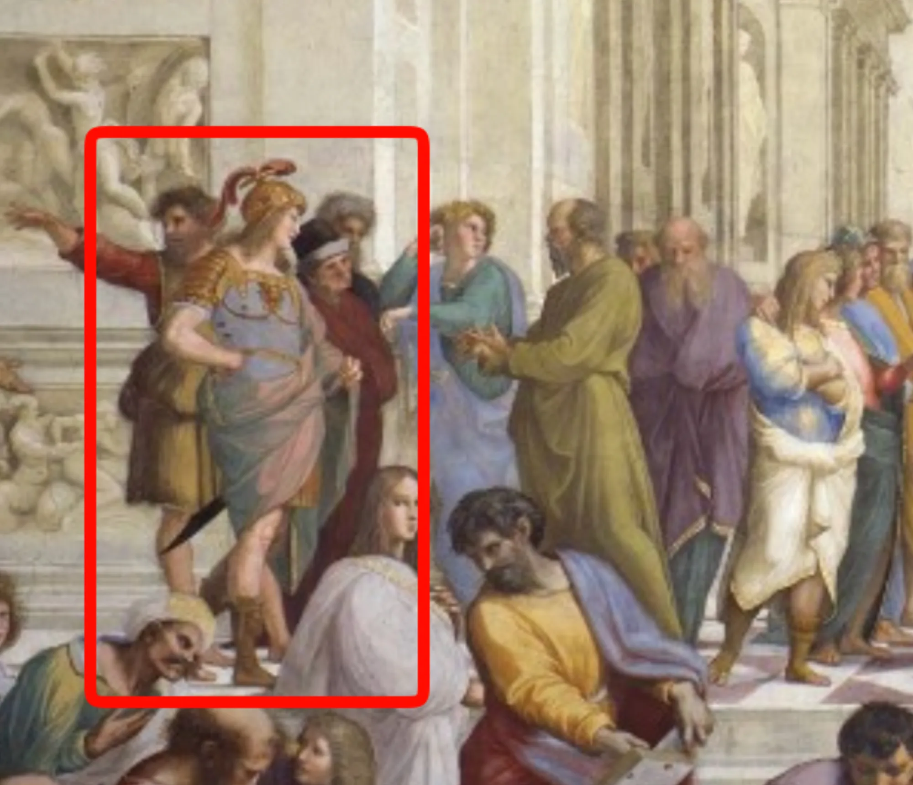

- **位置**：苏格拉底对面，那群听众里最显眼的一位——披甲束腰、容貌俊美的年轻军人。
- **身份**：传统上认作**亚西比德（Alcibiades）**——雅典最有才也最不省心的政治家、将军，苏格拉底最著名（也最让老师头疼）的弟子；另一说是亚里士多德的学生**亚历山大大帝**。
- **故事**：若按亚西比德解：他是雅典的"全民偶像"，相貌、口才、战功俱佳，却反复叛逃于雅典、斯巴达、波斯之间；苏格拉底曾在战场上救过他的命。《会饮篇》里他醉醺醺闯进宴会，当众表白对老师的仰慕——哲学史上最有名的一场"追星"。
- **画中表现**：盔甲与佩剑点明军人身份，姿态恭顺地侧耳听讲——莽将在哲人面前收起了锋芒，"武力听智慧说话"。

##### 色诺芬（Xenophon）——苏格拉底与披甲青年之间的听众（传统认定）

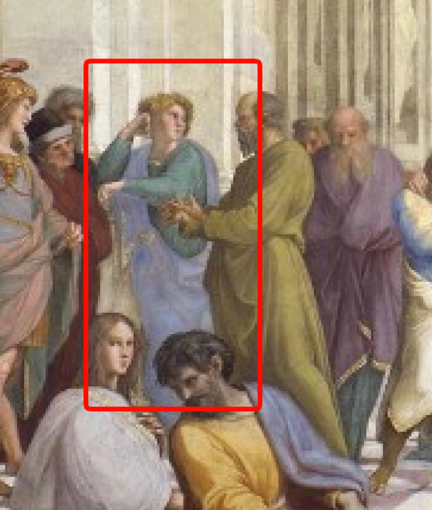

- **位置**：苏格拉底听众一组里、夹在苏格拉底与披甲青年之间的那位，正侧身倾听。
- **身份**：雅典军人、历史学家（约前 430–前 354），苏格拉底的另一位著名弟子——柏拉图笔下的苏格拉底是哲学家，**色诺芬笔下的苏格拉底是常识家**，两人的回忆录是后世认识苏格拉底仅有的两扇主窗。
- **故事**：他最传奇的一笔不在书房在战场：随希腊雇佣军深入波斯腹地，主帅阵亡后被推举带队，率一万人且战且退两千多公里返回黑海——士兵望见大海时齐喊"**Thalatta! Thalatta!（海！海！）**"，他把这段写成《长征记》（Anabasis），古代版的"绝地求生"实录。老师死后又著《回忆苏格拉底》为其辩诬。
- **画中表现**：被画在老师身侧最近处、文士装束——与披甲青年一武一文，把苏格拉底的"弟子圈"画全了。

##### 安提西尼（Antisthenes）——苏格拉底听众中的长须长者（传统认定）

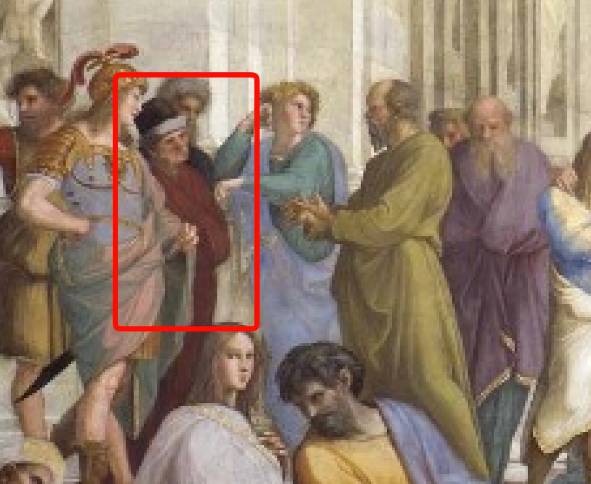

- **位置**：苏格拉底听众一组里年纪最长的胡须者，立于披甲青年近旁（不同对照图也有标作其他弟子的，此从常见中文标注图）。
- **身份**：雅典哲学家（约前 446–前 366），苏格拉底最刻苦的门徒，**犬儒学派的开山者**——台阶上躺着的第欧根尼，按传统正是他的学生。
- **故事**：他每天从比雷埃夫斯港步行十几里进城听苏格拉底讲学；老师死后在"白犬"运动场（Cynosarges，"犬儒"一词的可能词源之一）开课，主张德性即自足、外物皆可抛，名言狠到"**我宁可疯掉，也不要享乐**"。
- **画中表现**：若认定成立，拉斐尔把"苏格拉底 → 安提西尼 → 第欧根尼"这条**师承链**画成了空间关系：祖师在上层讲，大弟子在旁听，徒孙横躺在正下方台阶上身体力行。

##### 毕达哥拉斯（Pythagoras）——左前景伏案疾书的老者

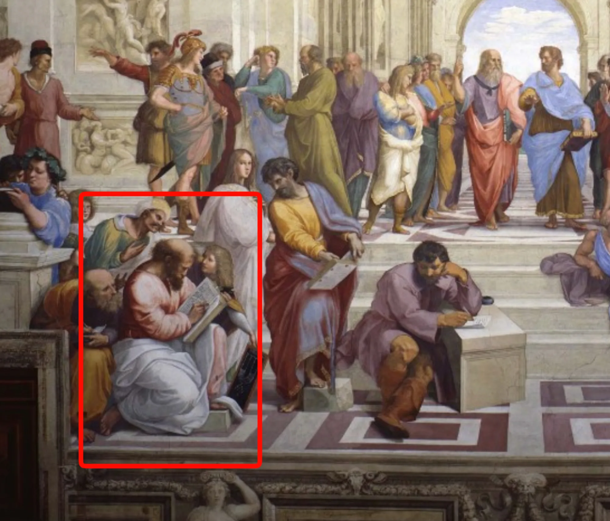

- **位置**：画面**左下角前景**，坐着俯身在一部大书上疾书，身边围了一圈抄笔记、探头看的人，是左半画最热闹的一组。
- **身份**：古希腊哲学家、数学家（约前 570–前 495），"万物皆数"的提出者，勾股定理（西方叫毕达哥拉斯定理）冠的就是他的名。
- **故事**：萨摩斯岛人，在南意大利克罗顿创立了半宗教半学术的秘密社团，社规森严（共财产、守缄默）。相传他路过铁匠铺，听出不同重量的锤子敲出的音程不同，由此发现**音乐和谐与数的比例同源**——人类第一次用数学解释美。
- **画中表现**：专注伏书，浑然不觉周围的围观；面前一名少年举着块小板，上面画着他的**和谐音程图（diatessaron）**与圣十结构（tetractys）——把他最著名的发现直接"展示"给观众。这一组与右下角欧几里得一组左右对称：**左边算术与音乐、右边几何与天文**，恰是中世纪"四艺"的完整一套。

##### 阿维罗伊（Averroes）——裹白头巾、从毕达哥拉斯肩后探身的人

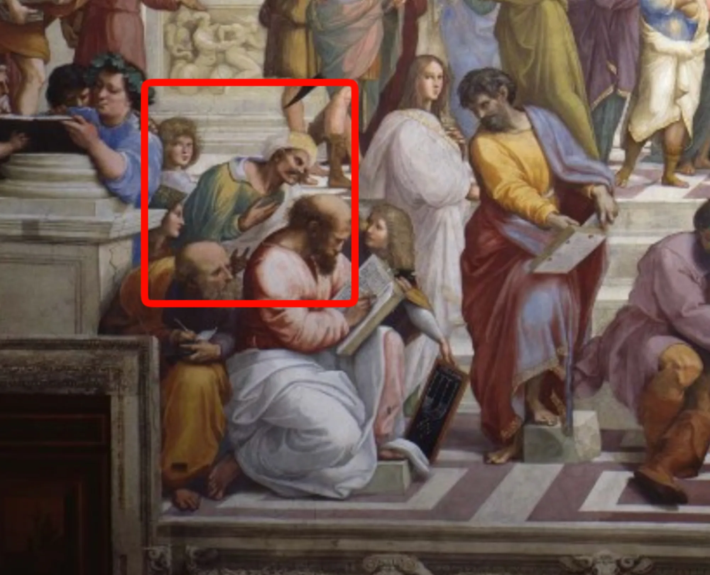

- **位置**：毕达哥拉斯左后方，裹白头巾、绿袍，探着身子看他写什么。
- **身份**：12 世纪西班牙科尔多瓦的伊斯兰哲学家、法官、医生（1126–1198），中世纪最伟大的亚里士多德注释家——拉丁西方直接尊称他"注释者"（the Commentator），但丁《神曲》也把他安排在贤者灵泊。**全画唯一的穆斯林学者**。
- **故事**：出身法官世家，一生为亚里士多德全集逐部作注；正是经他和阿拉伯学界的保存、翻译与注释，亚里士多德才在中世纪"回流"欧洲，点燃经院哲学。晚年因哲学观点获罪被短暂流放——为理性辩护付过代价的人。
- **画中表现**：拉斐尔让这位**晚生七百多年的注释家**探身在毕达哥拉斯肩后"抄笔记"——希腊智慧经伊斯兰世界传回欧洲的整条文明线路，被画成了一个探头的动作。

##### 阿那克西曼德（Anaximander）——毕达哥拉斯身旁俯身注视的人（传统认定）

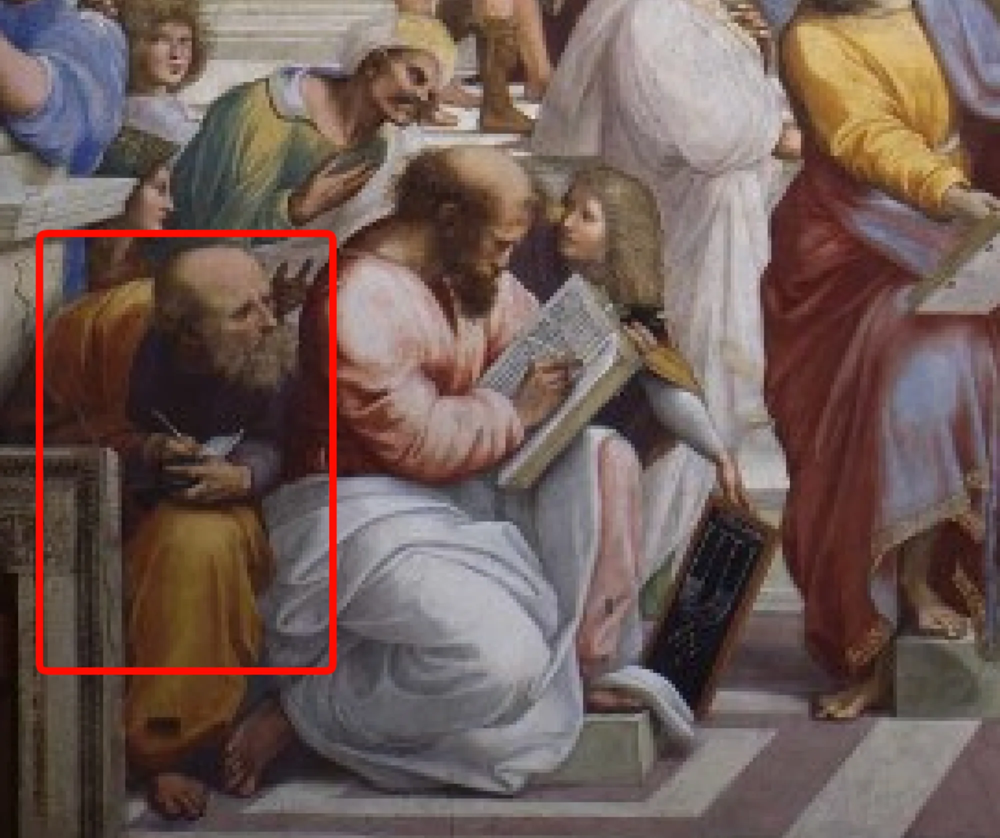

- **位置**：毕达哥拉斯近旁、俯身注视他书写的那位长者（与探头的阿维罗伊分列两侧）。
- **身份**：米利都的阿那克西曼德（约前 610–前 546），泰勒斯的学生——**西方第一代"科学家"**：第一个用散文写《论自然》、第一个画出已知世界地图、第一个把日晷指针（gnomon）引入希腊的人。
- **故事**：老师泰勒斯说万物本原是水，他更进一步：本原应是无形无界的"**无定**"（apeiron）——第一个抽象的哲学概念。他还猜想最早的生命生于湿泥、人由鱼形生物演化而来——比达尔文早两千四百年的"演化"直觉。
- **画中表现**：俯身盯着毕达哥拉斯笔下的数字——把"米利都的自然探究"与"毕达哥拉斯的数"这两条最古老的科学源流，画成了一个注视的动作。

##### 巴门尼德（Parmenides）——毕达哥拉斯与赫拉克利特之间的站立者（传统认定）

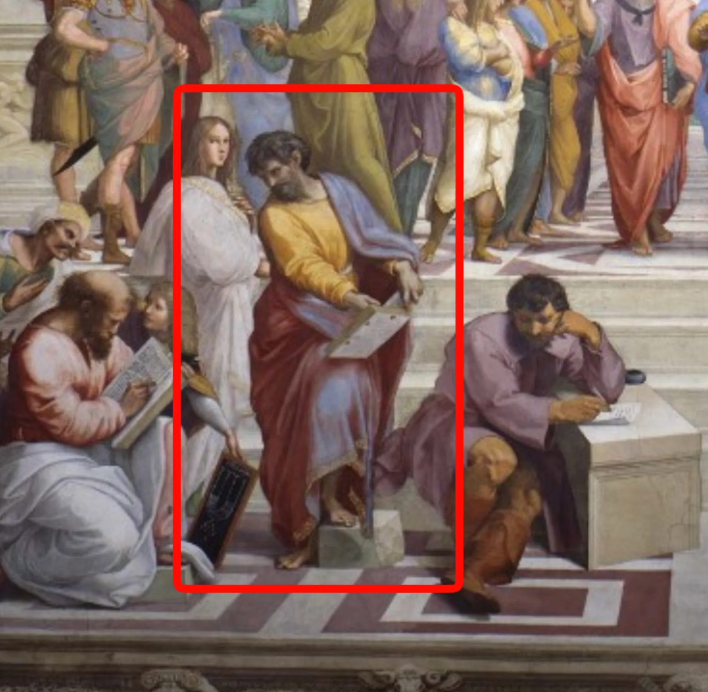

- **位置**：毕达哥拉斯一组与前景赫拉克利特之间，站姿前倾、低头指着手中书页的人。
- **身份**：传统标注为**巴门尼德（Parmenides）**，公元前 5 世纪埃利亚学派宗师（也有学者认作柏拉图弟子色诺克拉底）。主张"存在者存在，不存在者不存在"——变化只是感官的幻觉。
- **故事**：他用一首六音步长诗《论自然》讲形而上学，是西方第一个用纯逻辑推演世界本质的人；弟子芝诺为捍卫师说发明了"阿喀琉斯追不上乌龟"等悖论。他的"万物不变"与近旁赫拉克利特的"万物流转"是前苏格拉底哲学最著名的对立。
- **画中表现**：恰好被画在毕达哥拉斯（数）与赫拉克利特（变）之间——若认定成立，这是拉斐尔把哲学史的论战画成了**站位**。

##### 希帕提娅（Hypatia）——白衣、全画唯一直视你的人（有争议）

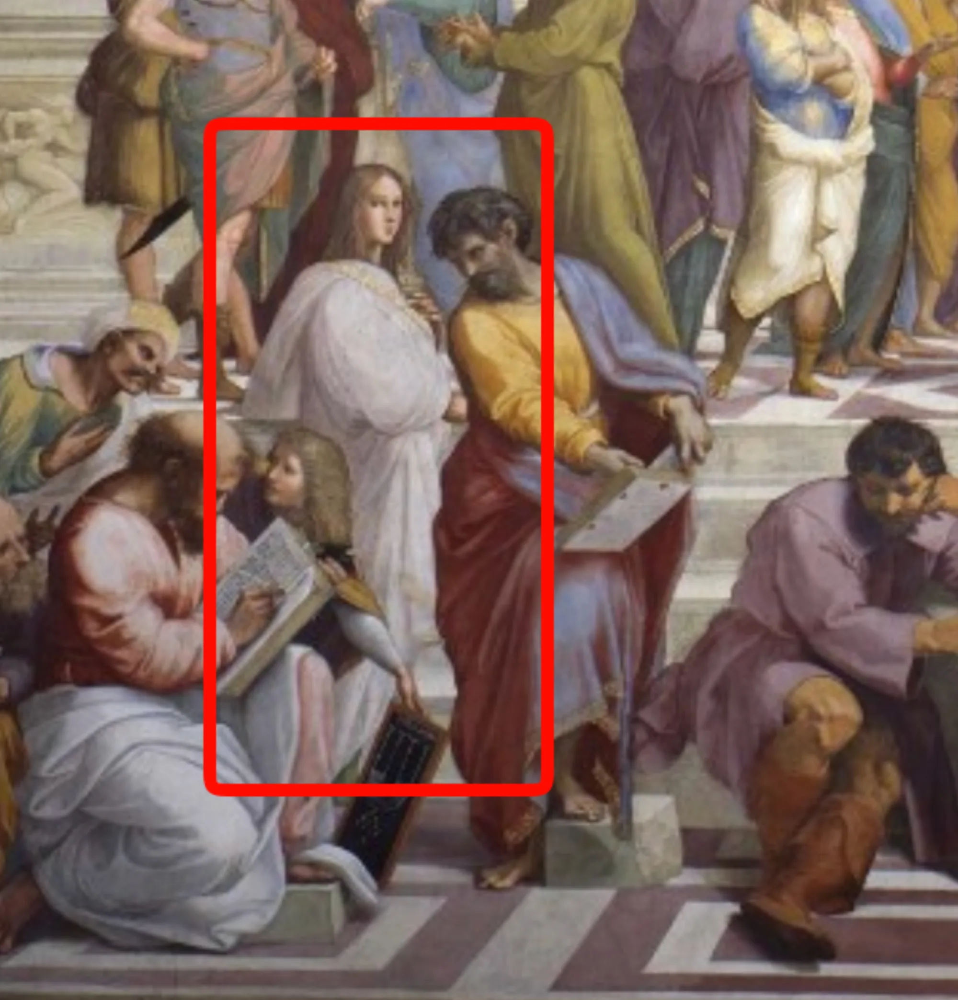

- **位置**：毕达哥拉斯一组旁边，一袭白衣、独自站立、目光越过所有哲学家**直望画外的你**。
- **身份**：流行的认定是**希帕提娅（Hypatia，约 360–415）**——罗马帝国晚期亚历山大城的数学家、天文学家、新柏拉图主义教师，古代最著名的女学者；若此说成立，她是全画唯一的女性。另一说认为这其实是教皇侄子、乌尔比诺小公爵**弗朗切斯科·玛丽亚·德拉·罗韦雷（Francesco Maria della Rovere）** 的肖像。
- **故事**：希帕提娅是亚历山大数学家席昂之女，主持城中的新柏拉图学园，注释过托勒密与丢番图；415 年死于基督徒暴民之手——后世把她视作"理性殉道"的象征。
- **画中表现**：全场五十余人都沉浸在各自的辩论里，唯独这张脸转出画面与你对视——无论身份是谁，构图功能都一样：**她是把观众接进画里的那个"接口"**。

##### 赫拉克利特（Heraclitus）——前景正中、独自伏在石块上的"哭的哲学家"

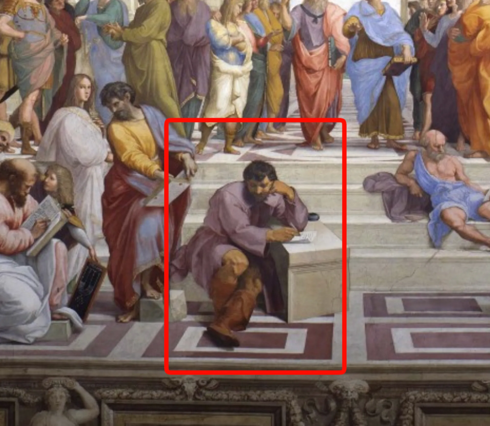

- **位置**：前景正中央台阶下，独自一人倚着一方大理石块，支颐执笔，与全场所有人隔绝。
- **身份**：以弗所的赫拉克利特（约前 535–前 475），"万物流转"与"人不能两次踏进同一条河"的提出者；因文风晦涩号称"晦涩者"，因悲观厌世被后世称作"哭的哲学家"（与"笑的哲学家"德谟克利特配对）。
- **故事**：出身以弗所王族却把王位让给弟弟，鄙夷众人、离群索居，把著作存进神庙不给人看。**画里这个人本来不存在**：米兰昂布罗修图书馆藏着此画的等大底稿，底稿上没有他——拉斐尔先睹了隔壁半成的西斯廷天顶，深受震撼，壁画收尾时才把他补画进最显眼的前景。
- **画中表现**：用的是**米开朗基罗的脸**，脚上是他干活穿的石匠靴，连**腿上的静脉曲张**都如实照画；孤僻、沉郁、自成一界的姿态，既是赫拉克利特的性格，也是米开朗基罗的性格——一笔双关的致敬，也是全画最有人情味的一处。

##### 第欧根尼（Diogenes）——台阶正中横躺的人

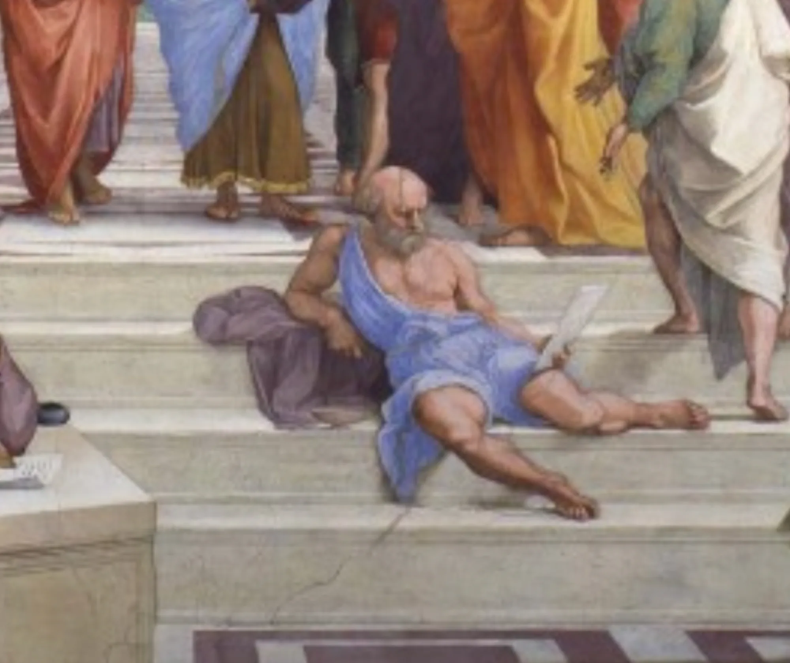

- **位置**：通往上层的大台阶**正中央**，所有人上下必经之处，半裸横躺，身边搁着一只碗。
- **身份**：锡诺普的第欧根尼（约前 412–前 323），犬儒学派的活招牌——主张人应像狗一样只按自然需要生活，文明的体面全是多余。
- **故事**：他住在木桶里，白天提着灯笼满城走，说在"找一个真正的人"；亚历山大大帝慕名来访，问能为他做什么，他答"**请别挡住我的阳光**"；见小孩用手捧水喝，把仅有的碗也扔了——画里那只碗，就是他的全部家当。
- **画中表现**：占着全画交通要道却谁也不理、衣衫半敞地读一页纸——拉斐尔**用位置讲性格**：对世俗秩序最不在乎的人，就让他躺在秩序的正中间碍事。

##### 伊壁鸠鲁（Epicurus）——左缘戴叶冠、倚柱础读书的人（传统认定）

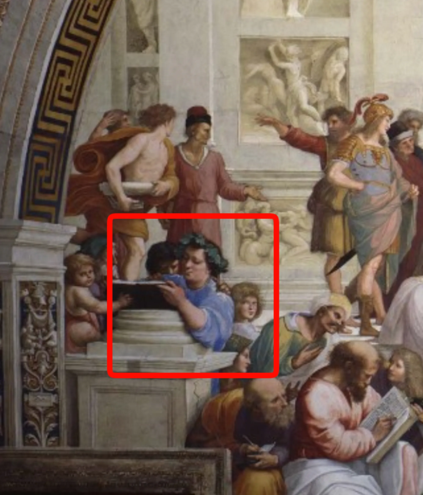

- **位置**：画面**最左缘**，一个头戴叶冠、面带笑意、把书架在柱础上读得入神的微胖男子，旁边还有孩童。
- **身份**：传统认定为**伊壁鸠鲁（Epicurus，前 341–前 270）**——"花园学派"创始人，主张人生目的是快乐；但他说的快乐不是纵欲，而是**身体无痛、灵魂无扰**的平静。
- **故事**：在雅典买下一座花园办学，门上题"客人，你在这里会过得很愉快：快乐是至善"；学园破天荒接收女性与奴隶。他教人别怕死："死亡与我们无关——我们在时它不在，它在时我们已不在。"
- **画中表现**：叶冠与满足的神情把"快乐哲学"直接写在脸上；读书读得高兴，是全画少数面带笑意的人。

##### 芝诺（Zeno）——最左缘半被遮住的老者

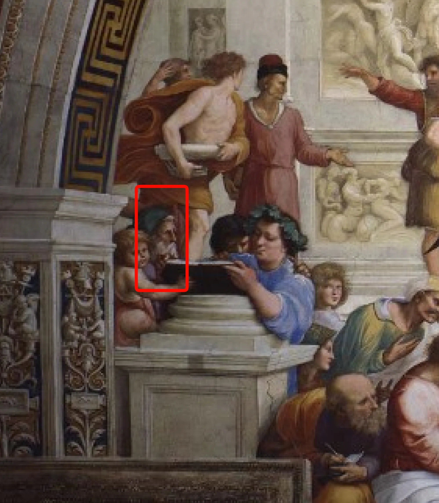

- **位置**：画面最左边缘，一位被人群半遮的老者，是观众最容易漏掉的一位。
- **身份**：传统标作**芝诺**，但埃利亚的芝诺（巴门尼德弟子、悖论发明人）与斯多亚学派创始人季蒂昂的芝诺两说并存。
- **故事**：若是前者——"阿喀琉斯永远追不上乌龟""飞矢不动"这些两千年后仍在折磨数学系新生的悖论都出自他；若是后者——他在雅典彩绘柱廊（Stoa）讲学，"斯多亚主义"由此得名。
- **画中表现**：立于画缘、若隐若现——身份成谜的人，恰好也被画得最不显眼。

##### 费德里科二世·贡扎加（Federico II Gonzaga）——左缘金发孩童（传统认定）

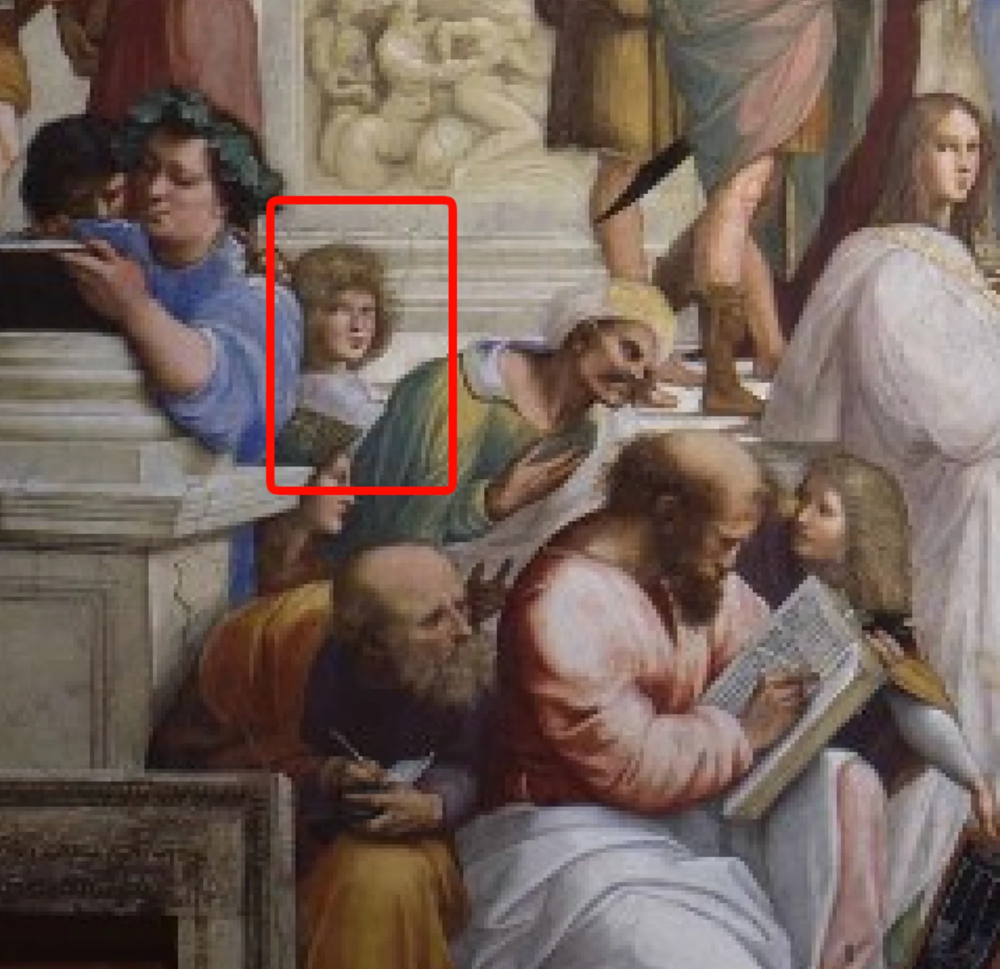

- **位置**：最左缘伊壁鸠鲁、芝诺那一组里探头张望的**金发孩童**——全画唯一的孩子。
- **身份**：曼托瓦侯爵之子费德里科二世·贡扎加（1500–1540），母亲是文艺复兴最有名的艺术赞助人伊莎贝拉·德斯特（Isabella d'Este）。画这面墙时他正以**人质身份住在尤利乌斯二世的宫廷里**（1510–1513，担保其父对教皇的忠诚），是教廷上下宠爱的小明星。
- **故事**：这孩子长大后成为曼托瓦公爵，把朱利奥·罗马诺（Giulio Romano）——拉斐尔的大弟子、君士坦丁厅的主笔——请去曼托瓦建德泰宫（Palazzo Te）。也就是说：**画里这个看热闹的孩子，日后成了拉斐尔画派最大的金主之一**，命运在画里画外打了个结。
- **画中表现**：在一群古代哲人中探出一张当代孩童的脸，好奇张望——拉斐尔把"知识殿堂里的下一代"画给了他的赞助人们看，也顺手讨好了教皇宫廷。

##### 普罗提诺（Plotinus）——右侧独自站立、无书无道具的长者（传统认定）

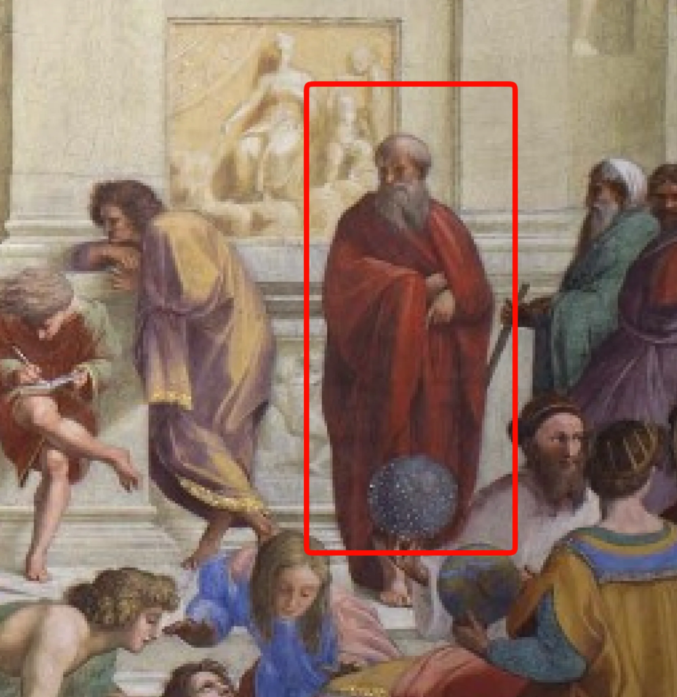

- **位置**：画面右半上层、亚里士多德一侧的人群外，独自站立的赤足长须者——不与任何人交谈，也不拿任何道具。
- **身份**：普罗提诺（Plotinus，204–270），**新柏拉图主义的开创者**，《九章集》（Enneads）的作者。古代哲学的最后一座高峰：万物自"太一"流溢而出，灵魂的目标是逆流而上与之合一——这套学说经奥古斯丁深刻影响了基督教神学，也是文艺复兴佛罗伦萨学园的精神源头。
- **故事**：生于埃及，在亚历山大城求学，后在罗马讲学，元老贵妇争相听课。他**终生拒绝画像**，理由是："背负自然给的这副形象已经够了，何必再留一个影子的影子？"——而拉斐尔偏偏把他画了进来：这是全画最俏皮的一处反讽。
- **画中表现**：无书、无球、无圆规，孤身静立、目光内收——拉斐尔用"什么都不拿"来画他：他的学问不在外物，在内观。

##### 欧几里得（Euclid）——右前景弯腰持圆规作图的人

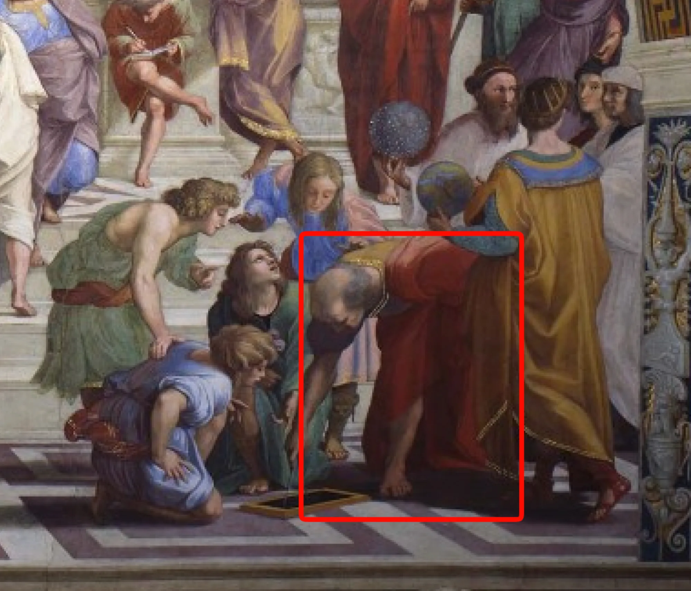

- **位置**：画面**右下角前景**，秃顶老者深深弯腰，用圆规在一块小石板上作图，四个学生围观——与左下角毕达哥拉斯一组对称。
- **身份**：亚历山大城的欧几里得（约活跃于前 300 年），《几何原本》的作者——用五条公设推出整座几何大厦，是此后两千年人类"何为严格证明"的范本（一说此人应为阿基米德）。
- **故事**：托勒密一世问他学几何有无捷径，他答"**几何学没有王者之路**"。《几何原本》是印刷术发明后版次仅次于《圣经》的书。
- **画中表现**：瓦萨里记载这张脸是**布拉曼特（Bramante）**——画中建筑的真实设计者来画中"亲自演示几何"。四个学生从俯身困惑到抬头恍然，把"听懂一道证明的全过程"画成连环画。**凑近看他的衣领**：金边上绣着 R.V.S.M.（Raphael Urbinas Sua Manu，"乌尔比诺的拉斐尔亲手所作"）——全画唯一的签名，藏在几何学家的领口。

##### 托勒密（Ptolemy）——右侧背对观众、戴王冠托地球仪的人

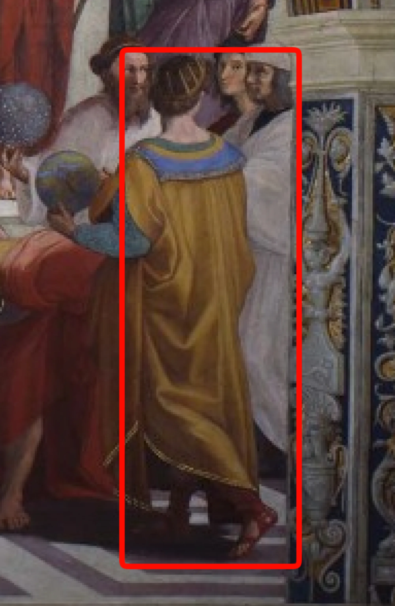

- **位置**：欧几里得一组右侧，**背对观众**站立，头戴王冠，手托一只**地球仪**。
- **身份**：克劳狄乌斯·托勒密（约 100–170），罗马时代亚历山大城的天文学家、地理学家。《天文学大成》构建的地心体系统治西方天文学一千四百年，《地理学》是大航海时代地图的起点。
- **故事**：他头上的王冠是个**美丽的误会**——文艺复兴时人们把这位天文学家与埃及托勒密王朝的国王们混为一谈，拉斐尔照着"国王"画了；将错就错，反倒成了认人的最好标志。
- **画中表现**：托**地球**与对面托天球的琐罗亚斯德相对，一地一天，合成"已知世界的全部"——放在全画收尾的位置，正是给"人类知识全家福"点题。

##### 琐罗亚斯德（Zoroaster）——与托勒密相对、托天球的白须老者

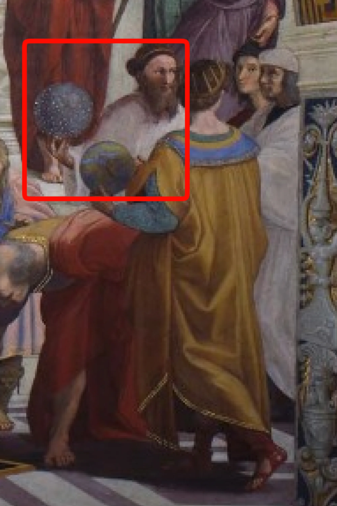

- **位置**：托勒密对面，白须长袍，手托一只缀满星辰的**天球仪**。
- **身份**：琐罗亚斯德（Zoroaster，即查拉图斯特拉），古波斯先知、祆教（拜火教）创始人；文艺复兴人文主义者把他视为**东方星辰智慧与古老神学的源头**，与希腊哲学同列。
- **故事**：希腊人相信"麦琪"（Magi，东方三博士的"博士"一词即源于此）的占星传统出自他门下——把他请进画里，等于承认理性的谱系不止于希腊。
- **画中表现**：天球上的星座清晰可辨，与托勒密的地球一仰一合；两人所在的右缘一组，刚好把画收在"仰观天文、俯察地理"上。

##### 拉斐尔自画像——最右缘戴黑帽、望向你的青年

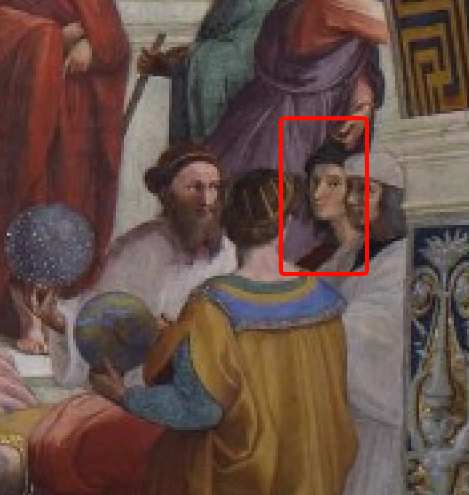

- **位置**：画面**最右边缘**，琐罗亚斯德与托勒密身后，一个戴黑色软帽的年轻人从人群缝隙里转头**直望画外**。
- **身份**：**拉斐尔本人**，画这面墙时约 26 岁。身旁白衣者一般认为是被他顶替的前任画家**索多玛（Sodoma）**，一说是他的老师佩鲁吉诺（Perugino）。
- **故事**：在群像角落签上自己的脸，是文艺复兴画家的"隐形签名"传统（波提切利、吉兰达约都干过）；但把自己画进**哲学家的行列**，还让前任/老师站在身边，是这个年轻人特有的自信与周到。
- **画中表现**：全画五十余人里只有他和"希帕提娅"直视观众——一个是把你接进画里的接口，一个是作者在跟你**打招呼**："这场千年聚会，是我安排的。"

##### 乌尔比诺公爵（Francesco Maria della Rovere）——拉斐尔近旁的白衣金发青年（认定有分歧）

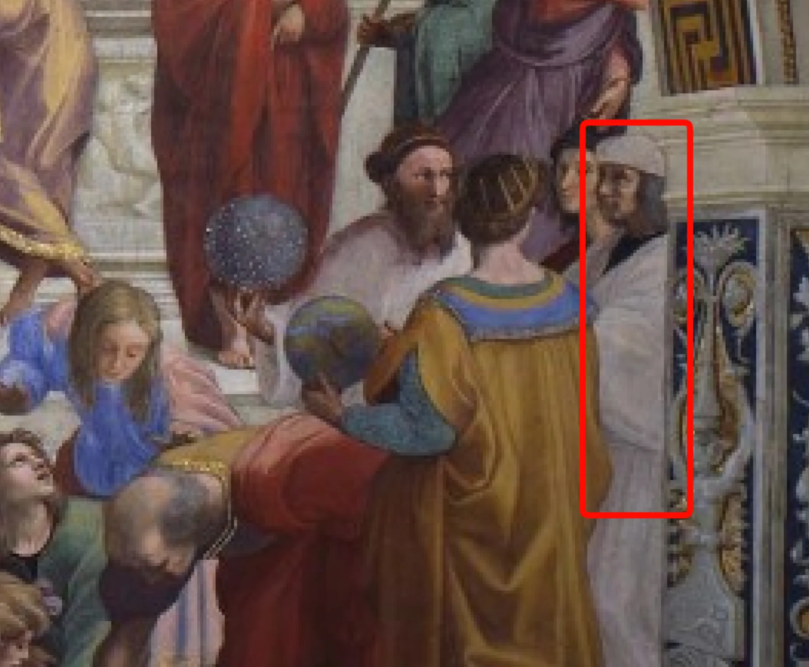

- **位置**：拉斐尔自画像近旁、托勒密琐罗亚斯德一组中的**白衣（白色斗篷）金发青年**。⚠️ 认定分歧较大：常见中文标注图把这位白衣者标作乌尔比诺公爵；西方更通行的说法把他认作索多玛或佩鲁吉诺，而把**左侧那位白衣直视者**（本笔记"希帕提娅"条）认作公爵——两位白衣人正好是两套说法互换的对象，现场看个乐即可。
- **身份**：弗朗切斯科·玛丽亚·德拉·罗韦雷（1490–1538），**尤利乌斯二世的亲侄子**，1508 年起的乌尔比诺公爵、教皇军总司令——也是拉斐尔的同乡（都来自乌尔比诺宫廷圈）。
- **故事**：他是这间屋子主人最亲的血脉，把他画进"知识全家福"是给金主家族留位置的惯常操作。此人生平远比画里张扬：1511 年当街刺杀红衣主教阿利多西而被教皇叔叔赦免；后来叔叔一死即被美第奇教皇利奥十世夺爵流放，再后来复位，晚年是提香名作《乌尔比诺公爵像》的主人公。
- **画中表现**：一身素白、面容清秀、年纪轻轻就站在哲人之列——无论这位白衣者最终是谁，"在大师群像里给年轻贵族留一个干净位置"的功能是一样的。

##### 壁龛双神像：阿波罗与雅典娜——理性殿堂的两位守护神

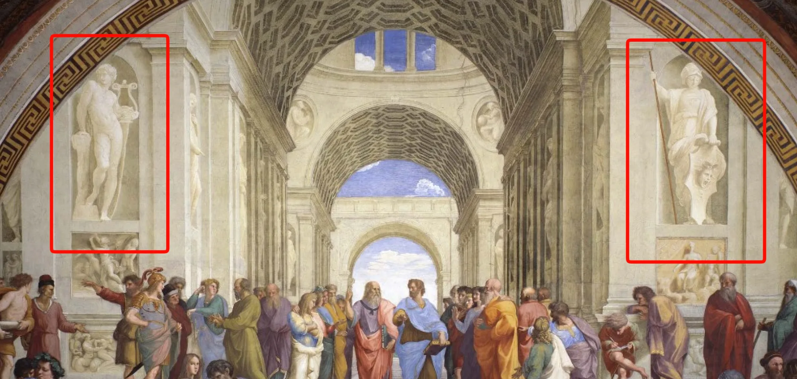

- **位置**：大殿两侧壁龛里的两尊灰白石像：**左**为持里拉琴的**阿波罗（Apollo）**，**右**为持矛戴盔的**雅典娜（Athena，罗马名弥涅尔瓦）**。
- **身份**：阿波罗——光明、音乐与诗的神，德尔斐神谕"认识你自己"的主人；雅典娜——智慧与正义之战的女神，雅典城的守护者。
- **故事**：把这两位安在"哲学殿堂"门柱位置是精确的图像学：哲学的两翼——灵感与诗性（阿波罗）、智慧与秩序（雅典娜）。阿波罗还与隔壁"诗墙"《帕纳苏斯山》的主角呼应，雅典娜俯瞰的方向正对"法墙"——四面墙借两尊雕像互相串联。
- **画中表现**：以仿大理石的灰色单色画（grisaille）画成"雕塑"，与真人哲学家区隔出**神与人的两个层次**：诸神退为背景，人占满舞台——这正是文艺复兴的人文主义宣言。

#### 墙脚单色画——理性的代价

关于墙脚基座：四面墙脚那圈与人同高的装饰带不是拉斐尔原装——原本是**木镶嵌护墙板**（1508 年起由维罗纳的乔瓦尼修士 Fra Giovanni da Verona 制作，与乌尔比诺公爵书房同一传统）。**1527 年罗马之劫**时，攻入的新教雇佣兵在这层墙脚生火熏画、刻字涂鸦，护墙板毁损；**保罗三世时期由佩林·德尔·瓦加（Perin del Vaga）重做成单色画带**：仿木纹画格、仿浮雕女像柱、仿红斑岩镶板相间排开。**每面墙下的小画都是楼上大画的"脚注"**，看完大画低头补一眼。其余三面墙下的题目见各墙节末。

哲学墙脚下共**四幅**（虚拟导览实拍确认）：端头一幅拟人立像 + 三幕叙事画，主题是**理性的形象、理性的课堂、理性的代价**：

##### 哲学拟人像（端头，被门遮去半幅）

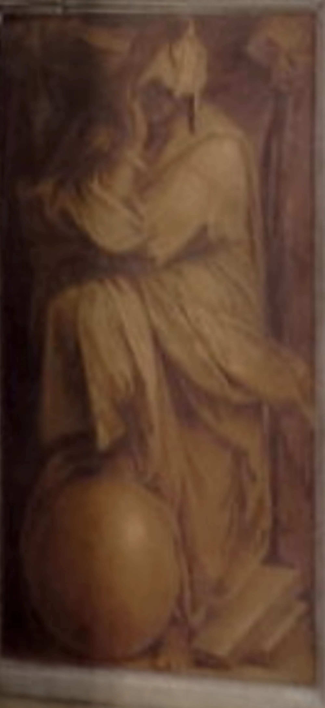

- **内容**：哲学的拟人坐像，单色仿浮雕——**脚边一具大圆球、身侧摞着书卷**，与天顶圆框里的哲学女神**同题异格**：天顶是金底彩绘的"正装版"，这里是灰调仿石刻的"素描版"。
- **看点**：同一间屋子给"哲学"画了两次像，中间夹着整面《雅典学院》——一门学科从天顶"目录"贯到墙脚"脚注"。这幅紧贴门边、**被门扇遮去半幅**，是全屋最容易被错过的画；门开着的时候探头看一眼球与书，就算找到了。

##### 贤士论天球

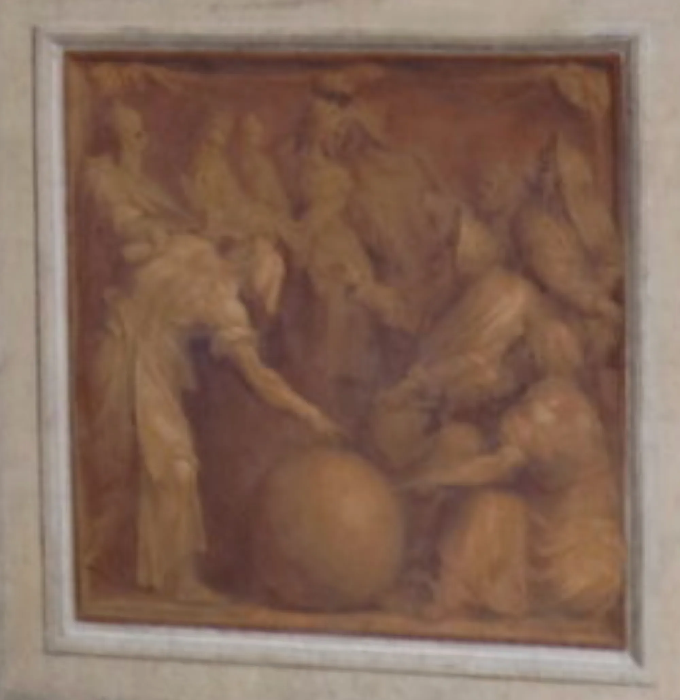

- **内容**：一群东方贤士（Magi）围着一具大天球仪俯身指点、激烈争论——"Magi" 本指波斯的祭司与占星学者，《圣经》里东方三博士的"博士"就是这个词。
- **故事 / 背景**：文艺复兴把天文归在"自然哲学"名下，星空是理性最古老的课堂；让异邦贤士来演示这一课，与楼上画中的琐罗亚斯德（波斯先知，托天球）一脉相承——智慧不止产自希腊。
- **看点**：认那具**天球**——楼上《雅典学院》右下角琐罗亚斯德手里也托着一具，上下两具天球正好对照：墙脚在"论"天，墙上在"持"天。

##### 叙拉古之围

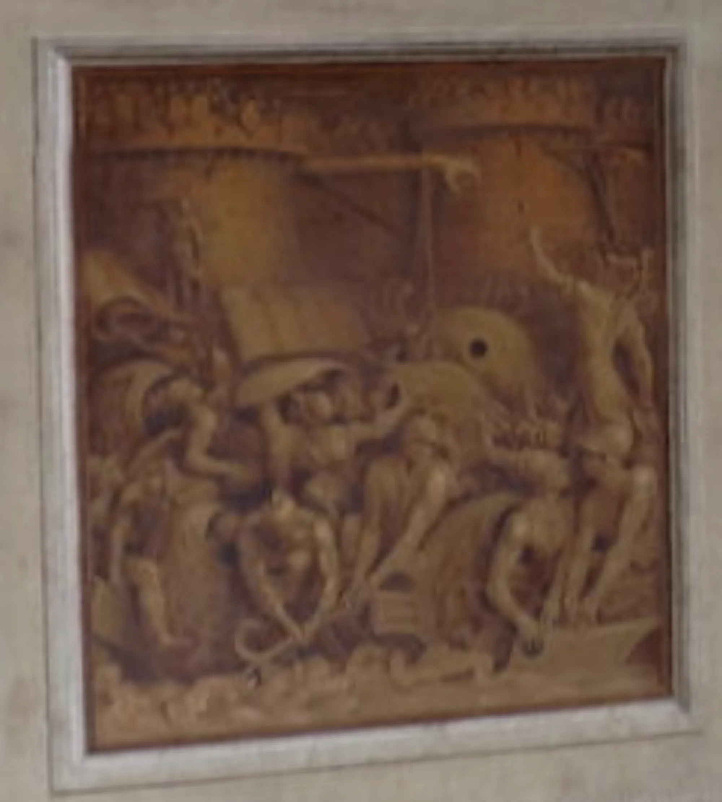

- **内容**：公元前 213–212 年罗马围攻西西里的叙拉古——画面是城下的海陆混战：战船、桅杆、攀城的士兵挤作一团。
- **故事 / 背景**：这场围城战是阿基米德的"个人秀"：他设计的投石机、弩炮把罗马舰队压在射程外，传说中的"铁爪"（起重吊臂）能把战船整个钩起掀翻——罗马军被一位七旬数学家挡了**近两年**，主帅马尔切卢斯自嘲是在"和一个几何学家打仗"。
- **看点**：单色画里的船桅与混乱人群，就是"科学守城"的现场——它与右边那幅《阿基米德之死》构成连环画的上下集：**这格他用智慧守住了城，下一格城破人亡**。

##### 阿基米德之死

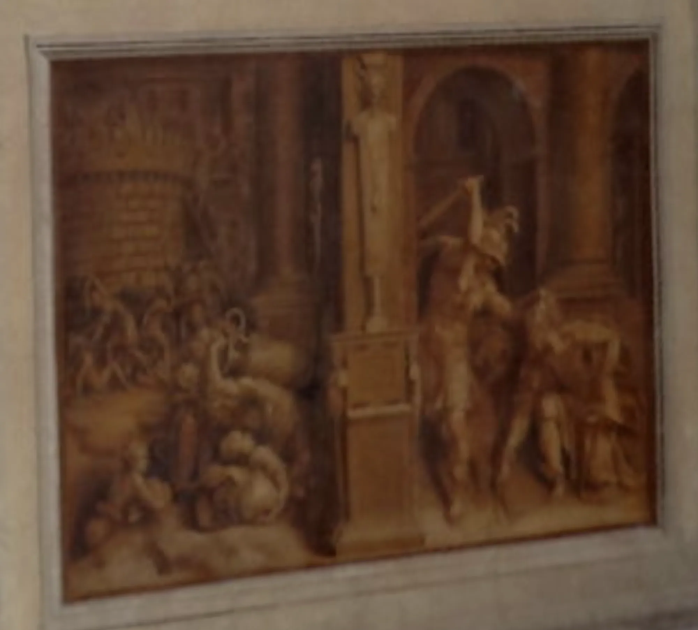

- **内容**：城破之日（前 212）。画面左侧城墙边士兵涌入，右侧建筑里年迈的阿基米德仍伏案于几何图前，浑然不觉死亡已到门口。
- **故事 / 背景**：马尔切卢斯下令务必活捉这位"一人抵一军"的老人，乱兵却没认出他；传说他临死前只说了一句"**别动我的圆**"。马尔切卢斯闻讯痛惜，厚葬了他，墓碑按其遗愿刻上"圆柱内切球"——他最得意的定理。另两件冷知识：杠杆（"给我一个支点，我能撬动地球"）与浮力（澡盆里喊着"尤里卡"裸奔上街）都是他。
- **看点**：**理性的殉道者**垫在画着苏格拉底（哲学史第一位殉道者，饮鸩而死）的墙下——一上一下两场殉道；"战争毁灭智慧"的这一幕，挂在一位连年亲征的教皇书房里，也算一记很轻的劝谏。

---
### 真 · 启示 神学（Theologia）

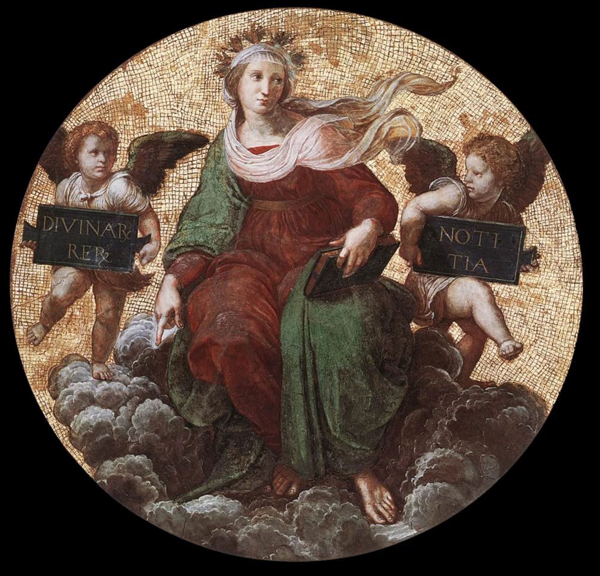
#### 拉斐尔《圣礼之争》/ Raffaello, _Disputa del Sacramento_ ⭐⭐⭐

- **作者**：拉斐尔·圣齐奥（Raffaello Sanzio）
- **作品**：《圣礼之争 / 圣体的争辩》/ _Disputa del Santissimo Sacramento_
- **时间**：约 1509–1510（签字厅最先动笔的一面）
- **材质**：湿壁画
- **位置**：签字厅"神学"墙，与《雅典学院》正对
- **官网介绍页**：[Wikipedia · La Disputa](https://en.wikipedia.org/wiki/Disputation_of_the_Holy_Sacrament)

> 🔗 官方：[Disputation over the Most Holy Sacrament · Musei Vaticani](https://www.museivaticani.va/content/museivaticani/en/collezioni/musei/stanze-di-raffaello/stanza-della-segnatura/disputa-del-ss--sacramento.html)

全墙（官网大图）：

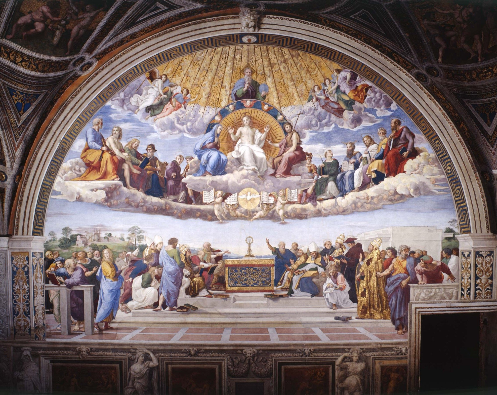

*图源：[梵蒂冈博物馆官网](https://www.museivaticani.va/content/museivaticani/en/collezioni/musei/stanze-di-raffaello/stanza-della-segnatura/disputa-del-ss--sacramento.html)*

上层"天上的教会"细节——圣父、基督、圣灵白鸽一线垂直（官网大图）：

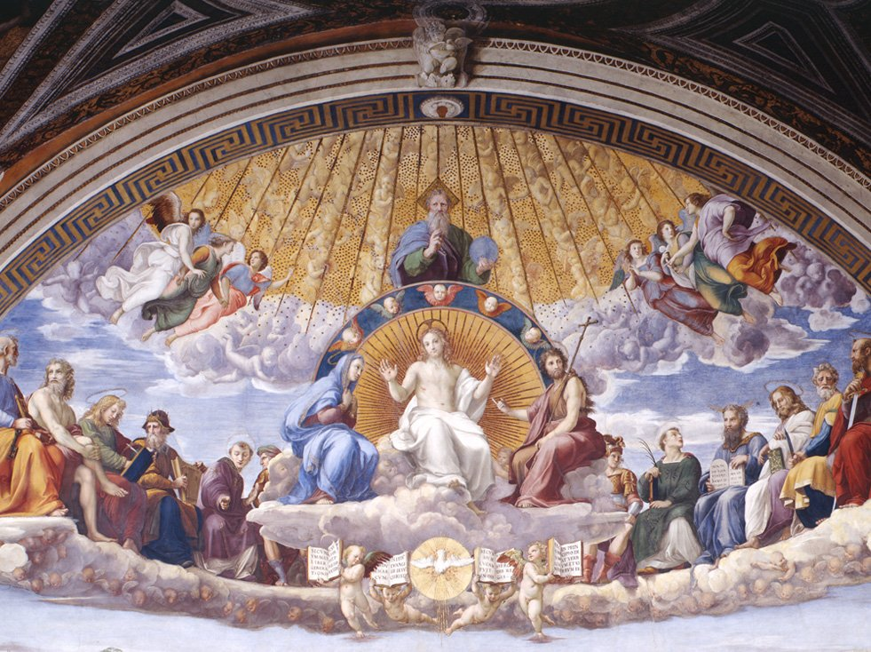

*图源：[梵蒂冈博物馆官网](https://www.museivaticani.va/content/museivaticani/en/collezioni/musei/stanze-di-raffaello/stanza-della-segnatura/disputa-del-ss--sacramento.html)*

**内容（这是什么）**：先把题目放下——画里其实没有"争吵"。要看懂它，得先知道 **"圣体圣事"（Eucharist）** 是什么：据《新约》记载，耶稣在受难前夜的最后晚餐上掰饼分给门徒，说"这是我的身体"。天主教由此确立弥撒的核心仪式——经神父祝圣的面饼**不再只是象征，而被信为真实地成为基督的身体**（即"圣餐变体"，transubstantiation），这块祝圣过的饼就叫**圣体**。画面下层祭坛正中那件太阳形的金器是**圣体光座（monstrance）**，里面供着一枚白色圆饼。**全画宽 770 厘米，真正的主角就是这枚几厘米的圣体**——天上地下数十位人物，全部围绕它展开。

画分上下两层。**上层是天上的教会**：金色半圆中**基督**居中、摊开双手展示钉痕，左右是**圣母**与**施洗约翰（John the Baptist）**（拜占庭以来的"祈祷"三联图式 Deesis）；基督上方**圣父**举手祝福、手托寰宇，基督脚下的白鸽即**圣灵**——圣父、圣子、圣灵排成的中轴，垂直落在祭坛圣体上。基督两侧云座上坐成半圆的，是旧约的族长先知与新约的使徒圣徒。**下层是地上的教会**：历代教父、神学家、教皇围在祭坛两侧，或翻书查证、或激烈指点、或凝望圣体——所谓"争辩"，其实是**古往今来整个教会围绕同一奥迹的共同探究与见证**。天上已享真福者与地上仍在求索者，被同一枚圣体串成一体：**神的真理如何降临人间**——这是"神学墙"要回答的问题，也是它与对面"哲学墙"对话的题眼。

**背景 / 来历**：这是签字厅**最先动笔的一面**（1509–1510），拉斐尔到罗马后交出的第一份答卷——正是它让尤利乌斯二世下决心把四间房全部交给他。祭坛桌围上绣着金主的名号 **IVLIVS II PONT MAX**（尤利乌斯二世·大祭司长）。下层人物里混进了大量"后世来宾"：四大教会博士、托马斯·阿奎那（Thomas Aquinas）、尤利乌斯二世的叔叔教皇西克斯图斯四世（Sixtus IV）、诗人但丁（Dante）、画僧安杰利科修士（Fra Angelico）、建筑师布拉曼特（Bramante）——甚至还有 1498 年才作为异端被处死的萨沃纳罗拉（Savonarola）。把古今圣贤与争议人物一并请进神学的圆桌，是极有胆识的安排。

**现场站看**：

1. **先找祭坛上的圣体光座**——再顺着它向上：圣体→圣灵白鸽→基督→圣父，**一条从地到天的垂直中轴**。整幅画的神学（真理自上而下、临在于圣体）就是这条线；祭坛桌围上可辨"IVLIVS II PONT MAX"。

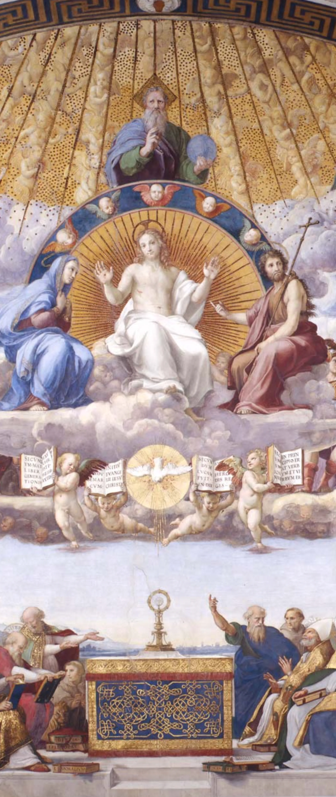
	
2. **圣灵白鸽两侧的四个小天使**——各捧一册摊开的**四福音书**：圣经为圣体作证，文字与圣事同源。
	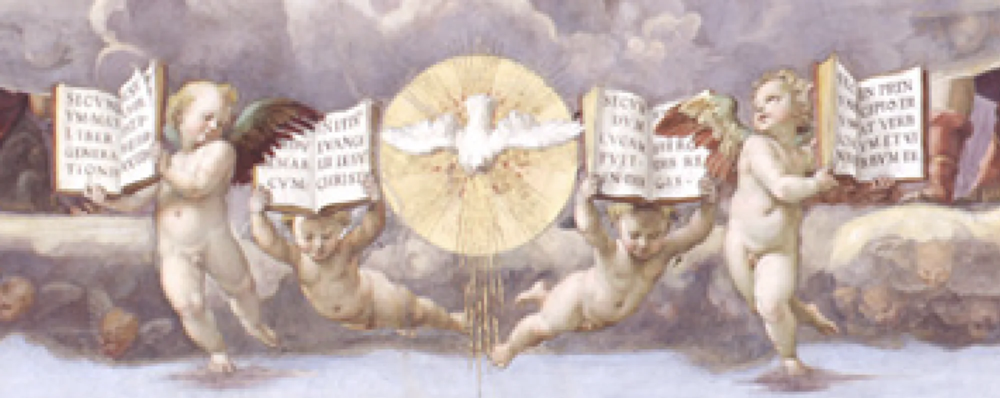

3. **上层半圆认人**——左端持**钥匙**的圣彼得（Peter）、他旁边袒胸的**亚当（Adam）**、伏案写作的福音约翰、抱**竖琴**的大卫王（David）；右侧头上射出两道光、捧十诫法板的**摩西（Moses）**，直到右端持**剑**与书的圣保罗（Paul）。每人都带着自己的"身份道具"，像一排可逐个核对的圣经人物图鉴。

	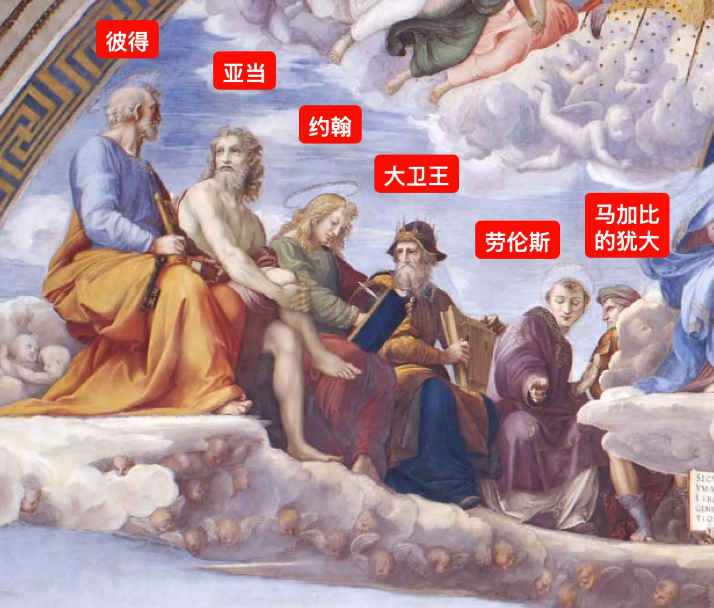

	

4. **下层祭坛两侧的四大教会博士**——**光环里写着各自的名字**：左侧教皇格力高一世（Gregory I）与圣哲罗姆（Jerome），右侧圣奥古斯丁（Augustine）与圣安布罗斯（Ambrose）。找光环上的铭文，是现场最有"解谜感"的一步。
	
	
5. **右侧人群**——金袍老教皇是**西克斯图斯四世**（西斯廷礼拜堂正以他命名）；他身后**戴桂冠、红衣鹰钩鼻的侧脸就是但丁**（他在这间房出现两次，另一次在诗墙）；但丁身后兜帽里的暗影面孔，传统上认作**萨沃纳罗拉**。
 
	

4. **左下角**——倚着栏杆探身、指向祭坛的光头者是**布拉曼特**；最左端的黑袍修士是**安杰利科修士**——拉斐尔把前辈建筑师与画僧也请进了神学家的行列。
5. **左后远景**——一座**正在施工的教堂**，隐喻"教会的大厦仍在建造中"，也暗合当时刚刚动工的新圣彼得大教堂。

	

6. **最后站到屋子正中，左右各看一眼**——《圣礼之争》的金色半圆像教堂的后殿，《雅典学院》的拱顶像教堂的中厅，**两面墙合起来才是一座完整的"知识的教堂"**：信仰求真自天而降，理性求真在人间展开。别只看一面就走。

#### 墙脚单色画——"信仰的预告片"

（基座来历见《雅典学院》节末的墙脚小节。）神学墙脚下共**四幅**（虚拟导览实拍确认）：三幕叙事画 + 端头一幅立像。三幕连读是一条时间线——**异教的祭献 → 异教对基督的预感 → 基督教神学的奥迹**：

##### 异教献祭

- **内容**：古代异教的献祭仪式——人群围着低矮的祭坛俯身操办，单色仿浮雕。
- **故事 / 背景**：在基督教图像学里，异教血祭是"启示之前的宗教"：人类向神献上牲畜赎罪，被视为日后"基督自献为祭"的朦胧预表；而弥撒中的圣体，正是这一祭献的完成形——从血祭到无血之祭。
- **看点**：它与楼上祭坛正中的**圣体光座**几乎垂直对位——墙脚的血祭与墙上的圣体，一根轴串起"祭献的进化史"，是这面墙上下呼应最精确的一处。

##### 圣奥古斯丁与海边孩童

- **内容**：奥古斯丁在海边遇见舀海水的孩童——西方艺术里最常画的神学寓言之一。这一版构图很特别：画面主体是**奥古斯丁的坐骑与随从**（主教在旅途中），空旷的背景就是海滩，**左下角小小的人影才是那个孩童**——别找错主角。
- **故事 / 背景**：奥古斯丁（Augustine，354–430），《忏悔录》《上帝之城》的作者、四大教会博士之一。传说他撰写《论三位一体》期间在海边散步，见一孩童用贝壳把海水一勺勺舀进沙坑；问他做什么，孩童答"我要把大海装进这个坑"；奥古斯丁笑这不可能，孩童回头说："**你想用头脑装下三位一体，正如我想用小坑装下大海。**"言毕消失——那是天使（一说基督）。
- **看点**：这幕"理性装不下奥迹"的寓言，恰好垫在讨论圣体奥迹的大画脚下；而**楼上《圣礼之争》下层右侧就坐着奥古斯丁本人**（光环里写着名字）——墙脚是他路上的顿悟，墙上是他位列教会博士的圆桌席位，一个人物上下两画。

##### 蒂布尔女巫向奥古斯都展示圣母

- **内容**：蒂布尔（今罗马近郊蒂沃利）的女巫指向空中，云端小天使簇拥着**圣母抱子**显现；皇帝奥古斯都俯身惊望——画面右上那团"雕像般"的母子就是异象本体。
- **故事 / 背景**：中世纪流传甚广的传说：元老院欲尊奥古斯都为神，皇帝拿不定主意，去问蒂布尔女巫；女巫指天，云中显现圣母与圣婴，并预言"**这孩子将比你更大**"——奥古斯都遂拒绝被神化，并在异象显现处筑坛敬拜。罗马卡庇托利欧山上的"天坛圣母堂"（Santa Maria in Ara Coeli），得名传说正源于此，今天还立在那里。
- **看点**：罗马最伟大的皇帝向尚未降生的基督低头——"异教世界也预感了基督"，给楼上"古典与基督教和解"的主旋律作注；这也是全屋反复出现的叙事策略：让古典世界自己开口为信仰作证。

##### 端头立像（被门遮去半幅）

- **内容**：墙脚尽头一尊单色仿浮雕的**女性立像**，与对面哲学墙端头的《哲学拟人像》位置对称——按这套图像逻辑常被解作**神学一侧的拟人像**，但文献对它没有明确命名（也可能只是基座装饰带的女像柱之一），存疑待考。
- **看点**：它和对面的《哲学拟人像》一样**紧贴门边、被门扇遮去半幅**——两面墙的端头各藏半个"门后人物"，是这间屋子最隐蔽的对称。

---

###  美 诗（Poesia）

#### 帕纳苏斯山 _Parnassus_（诗墙） ⭐⭐

> 🔗 官方：[Parnassus · Musei Vaticani](https://www.museivaticani.va/content/museivaticani/en/collezioni/musei/stanze-di-raffaello/stanza-della-segnatura/parnaso.html)

全墙——正中被真实窗户打断，诗人环窗而坐（官网大图）：

*图源：[梵蒂冈博物馆官网](https://www.museivaticani.va/content/museivaticani/en/collezioni/musei/stanze-di-raffaello/stanza-della-segnatura/parnaso.html)*

山顶细节——阿波罗拉"臂上里拉"、九缪斯环坐、左侧蓝袍盲诗人荷马（官网大图）：

*图源：[梵蒂冈博物馆官网](https://www.museivaticani.va/content/museivaticani/en/collezioni/musei/stanze-di-raffaello/stanza-della-segnatura/parnaso.html)*

**内容（这是什么）**：帕纳苏斯山（Parnassus）是德尔斐神谕所上方的圣山，神话中**太阳神阿波罗（Apollo）与九位缪斯（Muses）的居所**——缪斯是记忆女神谟涅摩叙涅（Mnemosyne）与宙斯的九个女儿，分掌史诗、历史、音乐、悲剧、舞蹈、颂歌等文艺门类；欧洲语言里"登上帕纳苏斯"至今仍是"跻身诗坛"的意思。画中阿波罗坐在月桂树荫下的山顶正中拉琴，九缪斯环坐，山坡上站满**九位古代诗人与九位当代诗人**——和《雅典学院》一样又是一场打破时间的"名人集会"，只是这次的门类是诗，对应馆方所说三大范畴里的"美"。

**背景 / 看点**：这是签字厅第二面动笔的墙（约 1510，居《圣礼之争》与《雅典学院》之间）。墙面正中被一扇真实的窗户打断——拉斐尔顺势把窗框画成山脚，让诗人们沿坡环窗而坐，**缺陷变成了构图**；而窗外正对的山坡是梵蒂冈山（Mons Vaticanus），文艺复兴的人文主义者相信那里古代正是阿波罗的圣地——窗里的圣山与窗外的真山连成一景。阿波罗拉的不是古希腊里拉琴，而是一把**文艺复兴当代的"臂上里拉"（lira da braccio）**——故意的时代错置，正合"古今诗人同登一山"的立意。

两条考据补充：① **窗洞侧壁上刻着题记 "IVLIVS II LIGVR PONT MAX ANN CHRIST MDXI PONTIFICAT SVI VIII"**（尤利乌斯二世，1511 年，在位第八年）——整间屋子的"竣工日期戳"就藏在这扇窗上，现场可找；② 版画家马尔坎托尼奥·拉伊蒙迪（Marcantonio Raimondi）留下了此画**初稿的版画**（瓦萨里提过）：最初设计里阿波罗与缪斯坐在浓密的月桂林中，一群小爱神飞舞着给诗人们送桂冠，人物面孔除但丁与荷马外都还是泛泛之相——对照定稿能看出拉斐尔砍掉了多少"甜美"，换来了多少"庄重"。

**现场站看**：

1. **左侧深蓝袍、仰头吟诵的盲诗人荷马（Homer）**——他的脸借自 1506 年刚出土、此刻就藏在本馆八角庭院的《拉奥孔》，拉斐尔把那张痛苦的脸改成了失明者的出神仰望；脚边的少年正提笔记录他的口述——史诗本就靠口传。
2. **荷马身旁的但丁（Dante）与维吉尔（Virgil）**——桂冠鹰钩鼻的侧脸是但丁，《神曲》里为他领路的维吉尔在此仍与他并肩；但丁在这间房出现两次（另一次在《圣礼之争》下层）。
3. **左下倚着窗框、手持卷轴的萨福（Sappho）**——卷轴上写着她的名字（免得与缪斯混淆），她是全画唯一的女诗人，也是定稿后才补进的；她斜倚的正是**真实的窗框**——画内空间就此接进了屋子。
4. **看阿波罗手里的琴**——当代乐器"臂上里拉"，琴弓还搭在弦上，**数一下弦：九根**（常制七根，暗合九缪斯）；坐在他两侧领唱的是左**卡利俄佩**（史诗）、右**厄拉托**（爱情诗），逐位区分见下文九缪斯小节的对照表。

**人物逐个认**：方位按**观者视角**。除荷马、但丁、萨福等几位有明确标志外，山坡上多数诗人的身份出自传统认定、各家说法不一，标注从宽。艺术史家夏斯泰尔（André Chastel）的提醒值得先记住：这面墙真正可靠的是**结构**——九缪斯、九位古代诗人、九位当代诗人按体裁互相对应；而且古代诗人的脸**很可能借了当代文人的相貌**（与《雅典学院》同一手法）——所以"认不全"不丢人，它本来就是半道谜题。

##### 阿波罗（Apollo）——山顶正中、月桂树下拉琴的神

- **位置**：全画正中最高处，月桂树荫下坐着拉琴，是整面墙的轴心。
- **身份**：光明、音乐与诗之神，缪斯的领队（别号 Musagetes，"缪斯引领者"）；他脚下的帕纳苏斯山正是德尔斐神谕所的靠山——诗与预言同出一源。
- **故事**：与他有关的"音乐故事"最有名的是和半羊人玛息阿（Marsyas）的吹拉比赛——胜者可任意处置败者，玛息阿输了被活剥皮。**这间屋子的天顶四角恰好画了这一幕**（"阿波罗与玛息阿"那块），抬头能接上。
- **画中表现**：双眼上翻、不看琴弦——"灵感附体"的标准画法；手里拉的是文艺复兴当代乐器**臂上里拉（lira da braccio）**而非古希腊里拉琴，故意的时代错置：诗的神力不分古今。还有一层彩蛋：研究者认为这张脸的模特是当时教廷红人、**文艺复兴音乐家贾科莫·达·圣塞孔多（Giacomo da San Secondo）**——拉斐尔让一位真实的演奏家来"扮演"音乐之神，而那把九弦琴据信也呼应尤利乌斯二世本人的音乐消遣。

##### 九缪斯（Muses）——环绕阿波罗的九位女神（可逐位区分）

- **位置布局**：阿波罗左右环坐环立，共九位，章法清晰——**两位"领唱"坐在阿波罗两侧**（左**卡利俄佩**、右**厄拉托**），其余七位分成**左三、右四**两组站在二人身后。
- **身份**：宙斯与记忆女神谟涅摩叙涅（Mnemosyne）的九个女儿，分掌九种文艺——"博物馆"（Museum）一词的本义就是"缪斯的居所"。
- **故事**：古希腊诗人开篇必先"请缪斯歌唱"（《伊利亚特》第一句即是）——诗被理解为神授而非己出，缪斯就是那个"授"的环节。

**速查表**（先扫一眼站位，再逐位细看）：

| 缪斯                  | 司掌    | 画中位置           | 对应天球* |
| ------------------- | ----- | -------------- | ----- |
| 欧忒耳佩（Euterpe）       | 抒情诗   | 阿波罗左侧坐者，手持长双管者 | 木星    |
| 忒耳普西科瑞（Terpsichore） | 舞蹈    | 阿波罗右侧坐者，持齐特拉琴  | 金星    |
| 塔利亚（Thalia）         | 喜剧    | 左排站一，手持面具      | 地球    |
| 卡利俄佩（Calliope）      | 史诗    | 左排站二           | 水星    |
| 厄拉托（Erato）          | 爱情诗   | 左排站三           | 火星    |
| 克利俄（Clio）           | 历史    | 右排站一，持书卷       | 月亮    |
| 墨尔波墨涅（Melpomene）    | 悲剧    | 右排站二，手持面具者     | 太阳    |
| 波吕许谟尼亚（Polyhymnia）  | 颂歌/默剧 | 右排站三，哲学家长袍     | 土星    |
| 乌拉尼亚（Urania）        | 天文    | 右排站四，背身手持星盘    | 恒星天   |

  *文艺复兴新柏拉图主义把九缪斯对应宇宙九重天球——阿波罗作为"缪斯引领者"（Musagetes）以琴音给宇宙立秩序：这面墙不只是诗人聚会，还是一幅**会发声的宇宙图**。

下面按"两位领唱 → 左三组 → 右四组"逐位展开。
###### 欧忒耳佩（Euterpe）—— 抒情诗与音乐

- **位置**：画面 阿波罗左侧 **手持长金色双管乐器（aulos/tibia）的白衣者** ——这件吹管正是她的千年标志。
- **司掌与标志**：抒情诗与音乐；名字意为"令人愉悦的"，标志即双管笛。
- **画中表现**：长管斜执在手、并不吹奏——缪斯们此刻都安静下来听阿波罗独奏。另注：英文维基把"姿态呼应米开朗基罗《创造亚当》"一说放在她（与萨福）名下——那一系认法把左侧斜倚的坐者读作欧忒耳佩；本笔记从意语主流（坐者＝卡利俄佩），故此说仅录备考。对应**木星天**。

###### 忒耳普西科瑞（Terpsichore）—— 舞蹈与合唱

- **位置**：画面阿波罗右侧坐者，蓝衣手持里拉琴
- **司掌与标志**：舞蹈与合唱；名字直译就是"乐于舞蹈"，传统持里拉为群舞伴奏。

###### 塔利亚（Thalia）—— 喜剧与牧歌

- **位置**：左排站一，淡紫色长裙，手持喜剧面具。
- **司掌与标志**：喜剧与田园牧歌；名字意为"欢愉、繁茂"，传统标志是喜剧面具与牧杖

###### 卡利俄佩（Calliope）—— 史诗

- **位置**：左排站二
- **司掌与标志**：史诗——荷马的《伊利亚特》、维吉尔的《埃涅阿斯纪》都归她管；名字意为"美妙的嗓音"，是九缪斯之长。手中弦琴是照古罗马"缪斯石棺"临摹的。

###### 厄拉托（Erato）—— 爱情诗

- **位置**：左排站三。
- **司掌与标志**：爱情诗与抒情诗；名字与爱神厄洛斯（Eros）同源，意为"唤起爱欲的"。手中齐特拉琴同样照缪斯石棺实物临摹。

###### 克利俄（Clio）—— 历史

- **位置**：右排站一 手持书卷
- **司掌与标志**：历史；名字意为"颂扬、使闻名"，传统标志是卷轴或书——历史就是"把值得记住的事写下来颂扬"（画中未出现）。

###### 墨尔波墨涅（Melpomene）—— 悲剧

*图源：[梵蒂冈博物馆官网](https://www.museivaticani.va/content/museivaticani/en/collezioni/musei/stanze-di-raffaello/stanza-della-segnatura/parnaso.html)（官网大图基础上加注）*

- **位置**：右排站二**手举一张苍白面具的金发缪斯**——面具是悲剧女神的铁标志，右四组里唯一能凭实物锚定的一位。
- **司掌与标志**：悲剧；名字意为"歌唱"，标志是悲剧面具与高底靴。
- **画中表现**：她把面具举在脸侧，像随时可以"戴上角色"——悲剧的本质（人扮演命运）被一个手势讲完。喜剧的塔利亚在左组、她在右组，戏剧的"哭"与"笑"被分置阿波罗两侧遥相对应。对应**太阳天**。

###### 波吕许谟尼亚（Polyhymnia）—— 颂歌，默剧与雄辩

- **位置**：右排站三，哲学家气质的长袍
- **司掌与标志**：庄严颂歌、默剧与雄辩；名字意为"多颂歌"，传统形象是蒙纱沉思、若有所思的一位——九缪斯里气质最内敛的。

###### 乌拉尼亚（Urania）——右四组，司天文

- **位置**：右排站四，金色长裙，背身手持星盘
- **司掌与标志**：天文；名字意为"天上的"，传统标志是天球与指示星辰的小棒，或者星盘。

##### 荷马（Homer）——左上、仰头吟诵的蓝袍盲诗人

- **位置**：窗户上方左侧（阿波罗左手边），深蓝袍、仰面朝天、张口吟诵。
- **身份**：《伊利亚特》《奥德赛》的传说作者，西方文学的源头；传统形象是盲眼的吟游歌者，"七城争说荷马是同乡"。
- **故事**：两大史诗靠歌者口传数百年才被写定——所以拉斐尔让他**张着嘴**：他不是在写诗，是在"唱"诗。
- **画中表现**：那张仰起的脸**借自 1506 年刚出土的《拉奥孔》**（此刻就藏在本馆八角庭院，当天可对照）——拉斐尔把雕像的剧痛改写成失明者的出神，是全画最高明的一处"引用"。

##### 记录荷马的少年——恩尼乌斯（Ennius，传统认定）

- **位置**：荷马脚边，一个边仰头听、边低头疾书的少年。
- **身份**：传统认定为**恩尼乌斯（Ennius，前 239–前 169）**，"罗马诗歌之父"，用拉丁文写罗马史诗《编年纪》的第一人。
- **故事**：恩尼乌斯在诗里言之凿凿：他梦见荷马显灵，告诉他**荷马的灵魂转世到了他身上**。明白这个梗，这组画面就活了——"转世的荷马"在记录荷马的吟唱，希腊史诗到罗马史诗的传递被画成了听写。
- **画中表现**：一手执笔一手按纸、抬眼望着荷马——全画唯一"正在工作"的人，口传时代与书写时代的交接点。

##### 但丁（Dante）——荷马身旁戴桂冠的鹰钩鼻侧脸

- **位置**：荷马右手边的诗人群里，桂冠、红衣、鹰钩鼻的严峻侧脸。
- **身份**：但丁·阿利吉耶里（Dante Alighieri，1265–1321），《神曲》作者，意大利语文学的奠基人。
- **故事**：佛罗伦萨政争中被终身流放，再没回过故乡，《神曲》全部写于流亡途中。**他是全屋唯一上了两面墙的诗人**——这里以诗人身份，对面《圣礼之争》里以神学家身份：拉斐尔（及背后的方案设计者）给了他文艺复兴所能给的最高规格。
- **画中表现**：在一群面容松弛的诗人里独他眉头紧锁、目光向前——流亡者的脸；桂冠与侧脸沿用他最经典的肖像图式。

##### 维吉尔（Virgil）——但丁身侧回头引路的桂冠诗人

 

- **位置**：但丁与荷马之间，回头与但丁对视、抬手指向阿波罗方向的桂冠者（传统认定）。
- **身份**：维吉尔（Virgil，前 70–前 19），奥古斯都时代的罗马"国民诗人"，《埃涅阿斯纪》作者——罗马帝国的建国神话由他写定。
- **故事**：临终遗命烧掉未改完的《埃涅阿斯纪》，奥古斯都下令保留——西方文学史最惊险的一次"抢救"。一千三百年后，但丁在《神曲》里选他当地狱与炼狱的向导："你是我的老师、我的作者。"
- **画中表现**：拉斐尔让他**做回《神曲》里的角色**——回头招呼但丁、为他指路，只是这次指向的不是地狱，是诗神阿波罗。意语维基的细读还指出一条**目光链**：但丁望着维吉尔，维吉尔又转向身旁的斯塔提乌斯（见下条）——三人正是《炼狱篇》里同行的三位诗人。

##### 萨福（Sappho）——左下倚着真窗框、持名字卷轴的女诗人

- **位置**：画面左下角，斜倚在**真实窗框**上，手持一卷写着 SAPPHO 的卷轴。
- **身份**：莱斯博斯岛的萨福（约前 630–前 570），古希腊最伟大的抒情诗人，托名柏拉图的警句称她为"第十位缪斯"；**全画唯一的女诗人**。
- **故事**：她的诗在古代有九卷之多，传到今天几乎只剩残篇与一首完整的《致阿芙洛狄忒颂》——"萨福残篇"本身成了西方文学里"失落之美"的代名词。
- **画中表现**：全画唯一**写出名字**的人物（免得被当成第十位缪斯）；底稿上原本没有她，是定稿后补进的；健硕的体格与扭转的坐姿明显比同墙人物"米开朗基罗"——有学者视作拉斐尔看过西斯廷天顶后的笔迹变化。她斜倚的窗框是真的：画中圣山从这里接进了教皇的书房。

##### 阿里奥斯托（Ariosto）——右坡下行队列打头、红衣桂冠转头的诗人（认定有分歧）

- **位置**：阿波罗右侧、沿山坡下行的那列诗人**打头的一位**——红披风、戴桂冠、转头回望。
- **身份**：阿里奥斯托（Ludovico Ariosto，1474–1533），文艺复兴叙事诗的巅峰《疯狂的奥兰多》（Orlando Furioso）的作者，费拉拉埃斯特宫廷的诗人，拉斐尔的同代人。⚠️ **这是全画身份最有争议的一个人物**：除阿里奥斯托外，还有特巴尔代奥（Tebaldeo）、《廷臣论》作者卡斯蒂利奥内、人文学者萨多莱托等说法，艺术史家托尔奈（Charles de Tolnay）甚至提出这是**米开朗基罗的隐藏肖像**——本笔记从你选定的"阿里奥斯托"一说，但记住它远未定论。
- **故事**：《疯狂的奥兰多》以查理曼骑士奥兰多因爱发狂为线，把骑士传奇、爱情、魔法熔成 4 万余行的巨制，是后世《堂吉诃德》以下整个欧洲幻想叙事的源头。阿里奥斯托一生为埃斯特家族当差、修订此诗四十年，临到拉斐尔画这面墙的年代（1510 前后）他正当盛年——**让一位在世诗人混进荷马、维吉尔的圣山**，是这面墙最大胆的地方。
- **画中表现**：他不在古人堆里安坐，而是**领着一队诗人朝观众这边走下山来**——古今诗脉"流向当下"的动势，由他这一回头带起。

##### 薄伽丘（Boccaccio）——阿里奥斯托身侧、深袍俯首的诗人（传统认定）

- **位置**：紧随阿里奥斯托之后、深色袍子俯首的一位，是右坡下行队列里认定度较高的成员。
- **身份**：薄伽丘（Giovanni Boccaccio，1313–1375），《十日谈》（Decameron）的作者；与但丁、彼特拉克并称意大利文学的"三顶皇冠"（tre corone）——这面墙把三冠凑齐了：但丁在荷马身旁、彼特拉克在萨福身旁、薄伽丘在这里。
- **故事**：《十日谈》写十名青年男女避黑死病躲进乡间别墅、十天讲一百个故事——把目光从天国（但丁《神曲》）拉回人间烟火，是欧洲散文叙事与短篇小说的开山之作。薄伽丘还是**但丁的头号"粉丝"与推手**：他抄录、注解、公开讲授《神曲》，"Divina（神圣的）"这个流传至今的定语正是他给但丁那部《喜剧》加上的。
- **画中表现**：他在阿里奥斯托身后俯首随行——若把这一列读作"诗的传承队列"，薄伽丘正是把但丁的火种递向后世的那一棒。

#### 墙脚单色画——权力守护诗的两个典故

（基座来历见《雅典学院》节末的墙脚小节。）诗墙的窗两侧两幅（拉斐尔设计、助手执笔，常归佩林·德尔·瓦加，约 1514），合讲一件事：**伟大的权力懂得护住伟大的诗**——这话当然也是说给楼上的金主尤利乌斯二世听的：

##### 亚历山大把荷马史诗藏进大流士的宝匣

- **内容**：窗**左侧**。亚历山大大帝击败波斯王大流士三世后，缴获其最华贵的香膏宝匣；众人议论该放什么宝物，他放进了随身的**《伊利亚特》抄本**——战利品里最贵的匣子，配世上最贵的诗。
- **故事 / 背景**：据普鲁塔克记载，亚历山大远征枕下常备两样东西：短剑，和老师**亚里士多德亲自校注的《伊利亚特》**（后世称"匣中本"）；他自视为阿喀琉斯的后继者，进军亚洲途中还专程到特洛伊凭吊阿喀琉斯墓——"有荷马为你立传，你才是真的不朽。"
- **看点**：司史诗的缪斯卡利俄佩、吟唱史诗的荷马都在楼上这面墙——这一幕正垫在他们脚下；而亚历山大本人（一说）也在隔壁《雅典学院》听苏格拉底讲课：同一个征服者，一面墙在听哲学，另一面墙脚在护史诗。

##### 奥古斯都阻止焚毁〈埃涅阿斯纪〉

- **内容**：窗**右侧**。维吉尔临终遗命焚毁未完成的《埃涅阿斯纪》手稿，皇帝奥古斯都伸手拦下——西方文学史最惊险的一次"抢救"。
- **故事 / 背景**：维吉尔写《埃涅阿斯纪》写了十一年，公元前 19 年随驾出行途中染病去世，自觉全诗未及最后润色，遗嘱要求烧掉手稿。奥古斯都下令违背遗嘱，命诗人瓦里乌斯与图卡整理出版、"几乎不增一字"——罗马的建国史诗就此传世，后来成了欧洲千年的教科书，也成了但丁的向导之书。
- **看点**：**楼上正站着维吉尔本人**（回头给但丁引路的那位）——他的诗稿死里逃生的一刻，就画在他脚下；与左侧亚历山大一幕合成"权力护诗"的上下联，悬在教皇的书房里，潜台词不言自明：赞助艺术者，与艺术同寿。

---

### 善 正义（Iustitia）

#### 三德 + 法学 _Le Virtù / Giurisprudenza_（法墙） ⭐⭐

> 🔗 官方：[Cardinal and Theological Virtues and the Law · Musei Vaticani](https://www.museivaticani.va/content/museivaticani/en/collezioni/musei/stanze-di-raffaello/stanza-della-segnatura/virtu-cardinali-e-teologali-e-la-legge.html)

法墙全景——窗上半圆《三德》＋窗两侧"颁民法/颁教会法"两幕（官网大图）：

*图源：[梵蒂冈博物馆官网](https://www.museivaticani.va/content/museivaticani/en/collezioni/musei/stanze-di-raffaello/stanza-della-segnatura/virtu-cardinali-e-teologali-e-la-legge.html)*

《三德》半月窗细节——左刚毅（橡枝抚狮）、中审慎（双面照镜）、右节制（缰辔）（官网大图）：

*图源：[梵蒂冈博物馆官网](https://www.museivaticani.va/content/museivaticani/en/collezioni/musei/stanze-di-raffaello/stanza-della-segnatura/virtu-cardinali-e-teologali-e-la-legge.html)*

**内容（这是什么）**：法墙的窗上半圆画**三位枢德**的拟人像：左边**刚毅（Fortitude）** 披甲抚狮、手握一枝橡树苗；中间**审慎（Prudence）** 有**两张脸**——年轻的脸照着镜子看向前方，脑后还藏着一张老者的脸回望过去；右边 **节制（Temperance）** 手持缰辔。穿插其间的小天使里有三位代表**三超德**：在橡枝上摘橡实的是爱德（Charity），举火炬的是望德（Hope），指天的是信德（Faith）。古典"四枢德"在这里只出现三位——**第四位"正义"不在墙上：抬头，她在正上方的天顶圆框里持剑与天平**。柏拉图视正义为统摄其余三德的总德，拉斐尔便给了她单独的最高席位。

**背景 / 看点**：1511 年完成，是四面墙的收官之作，对应馆方三大范畴里的"善"。**橡树是尤利乌斯二世家族德拉·罗韦雷（Della Rovere，字面意即"橡树"）的纹章**——刚毅手中的橡枝、天使采摘的橡实，都是写给金主的颂词；刚毅的坐姿与衣褶则取自拉斐尔见过的米开朗基罗《摩西》设计稿。窗两侧下方各一幕"颁法"：左边东罗马皇帝查士丁尼（Justinian）从特里波尼安手中接过《学说汇纂》（民法，世俗法统），右边教皇额我略九世（Gregory IX）颁布《教令集》（教会法统）——而这位额我略九世，**画的就是尤利乌斯二世本人的脸**（两幕由拉斐尔设计、工作室执行）。

**现场站看**：

1. **审慎的"双面头"**——正面少女照镜望向未来、脑后老者回望过去：审慎＝兼看前后；旁边望德的小天使举着火炬，恰好替那张回望的老脸照亮。
2. **刚毅的橡枝＋摘橡实的小天使**——德拉·罗韦雷家族的纹章彩蛋，这面墙最隐蔽的"金主签名"。
3. **窗右"颁布教令"一幕里教皇的脸**——就是尤利乌斯二世：委托人把自己直接写进了教会法统。
4. **抬头补齐第四德**——天顶圆框里持剑与天平的正义女神，与这面墙合成完整的"四枢德"。

**人物逐个认**：这面墙人物少、寓意密。半月窗里三位女神 + 一群小天使，窗两侧各一幕"颁法"历史剧。方位按**观者视角**。

##### 刚毅（Fortitude）——半月窗左、披甲抚狮的女神

- **位置**：窗上半圆的左侧，披甲坐着，一手抚着头盔下的狮子，一手握一枝橡树苗。
- **身份**：四枢德之一"刚毅/勇德"的拟人像——枢德（cardinal virtues）是柏拉图提出、经西塞罗与阿奎那写定的四种"做人地基"：刚毅、审慎、节制、正义。
- **故事**：她手里那枝橡树是写给金主的——**尤利乌斯二世的家族姓德拉·罗韦雷（Della Rovere），字面意思就是"橡树"**；连小天使都在枝头摘橡实。勇德握着教皇家的家徽，颂词不可能更直白了。
- **画中表现**：盔甲与狮子是勇德的传统标配；她扭转的坐姿与厚重衣褶，一般认为参考了米开朗基罗《摩西》的设计——这面 1511 年收官的墙，已经画在"看过西斯廷之后"。

##### 审慎（Prudence）——半月窗正中、有两张脸的女神

 

- **位置**：窗上半圆正中最高处，端坐照镜。
- **身份**：四枢德之首"审慎/智德"的拟人像——亚里士多德传统里它是"诸德的舵手"：没有审慎，勇敢沦为鲁莽、节制沦为麻木。
- **故事**：她的画法藏着两个典故：照镜不是臭美，是"认识你自己"（德尔斐神谕）的图像化；**脑后那张老人的脸**借自罗马双面神雅努斯（Janus）——一面朝前、一面朝后，同时看见过去与未来。
- **画中表现**：年轻的正脸望着镜中的前路，脑后老脸回望来路；旁边举火炬的小天使恰好替那张回望的老脸照明——构图把"前瞻后顾"做成了一个光学小机关。

##### 节制（Temperance）——半月窗右、手持缰辔的女神

- **位置**：窗上半圆右侧，手里提着一副马缰。
- **身份**：四枢德之三"节制"的拟人像——欲望不是敌人，失控才是；德性在于"勒得住"。
- **故事**：缰辔是节制延续千年的标志物（柏拉图《斐德罗篇》就把灵魂比作驭手驾驭两匹马）；第四位枢德"正义"不在墙上——**抬头，她在正上方天顶圆框里持剑与天平**，柏拉图视正义为统摄三德的总德，拉斐尔给了她单独的最高席位。
- **画中表现**：三位里姿态最松弛安静的一位——"节制"本身就该不动声色。

##### 三超德小天使（信、望、爱）——穿插三女神之间的孩童

- **位置**：半月窗里穿插在三位女神之间的几个小天使。
- **身份**：其中三位是**三超德**（theological virtues）的化身。枢德靠人修，超德靠神赐——中世纪伦理学的完整框架（4+3＝七德，对着七宗罪）在这扇窗上凑齐了。
- **画中表现**：把抽象神学画成爬树摘果、举火把玩耍的孩童——签字厅最轻盈的一角。三位逐个认：

###### 信德（Faith）——指天的小天使

手指向天——信仰的对象在上。位置在刚毅与审慎之间。

###### 望德（Hope）——举火炬的小天使

举着火炬——黑暗中给人盼望的光。它恰好替审慎脑后那张回望的老脸照明，一个天使同时服务两个寓意。

###### 爱德（Charity）——摘橡实的小天使

在橡枝上采摘橡实——爱是结果实的德性。摘的偏偏是德拉·罗韦雷家的橡实："神赐的爱"顺手又给金主家徽打了一次光。

##### 查士丁尼与特里波尼安——窗左《颁布民法》一幕

- **位置**：窗户**左侧**下方：东罗马皇帝端坐，一位法学家跪呈书卷。
- **身份**：**查士丁尼一世（Justinian I，527–565 在位）**，拜占庭皇帝；跪者是他的首席法学家**特里波尼安（Tribonian）**，呈上的是《学说汇纂》（Pandects）——《查士丁尼法典》体系的核心卷。
- **故事**：查士丁尼登基后下令把千年罗马法判例与学说整编成统一法典（《国法大全》Corpus Iuris Civilis）——这套文本 11 世纪在意大利被重新发现后，成了整个欧陆法系的地基，今天的大陆法（包括中国民法的学理传统）都是它的远房子孙。
- **画中表现**：皇帝侧坐受书，构图与对面那幕教皇颁法严格对称——**世俗法统与教会法统各占一边、平起平坐**，正是"法墙"的题旨。此幕由拉斐尔设计、工作室执笔。

##### 格里高利九世（＝尤利乌斯二世）颁《教令集》——窗右一幕，一画藏三教皇

 

- **位置**：窗户**右侧**下方：教皇端坐，接受跪呈的法典，红衣主教侍立两侧。
- **身份**：画的是**教皇格里高利九世（Gregory IX，1227–1241 在位）**批准《教令集》（Decretals）——教会法的奠基文献，跪呈者传统认作编纂人圣雷蒙多（Raymond of Penyafort）。但那张脸是**尤利乌斯二世本人**。
- **故事**：这一幕是全屋最密集的"政治彩蛋"：教皇蓄着胡子——尤利乌斯二世 1510–1511 年间为"博洛尼亚之失"立誓蓄须明志，等于给壁画盖了日期戳；更妙的是，传统认定侍立的红衣主教里有**乔瓦尼·德·美第奇（后来的利奥十世）**与**亚历山德罗·法尔内塞（后来的保罗三世）**——**一幕画里站着三位教皇**：在位的、和未来的两位。
- **画中表现**：委托人把自己画成教会法统的颁布者，把储君们画成见证人——"法"在这面墙上既是学问，也是权力的家谱。此幕同样由拉斐尔设计、工作室执笔。

#### 墙脚单色画——又一对"人法与神法"

（基座来历见《雅典学院》节末的墙脚小节。）法墙脚下两幕，与楼上窗两侧"查士丁尼颁民法 / 格里高利九世颁教会法"严格对仗——上下两层、四幕画，把"**法的两个来源**"讲了两遍：

##### 梭伦向雅典人演说

- **内容**：窗**左侧**。雅典立法者梭伦向公民演说，为自己的新法辩护——人间之法的诞生现场。**认画标志**：画面左上立着一尊**戴盔持矛的雅典娜雕像**（点明"这里是雅典"），像下的演说者就是梭伦，人群俯身跪听（与传统命名核对一致）。
- **故事 / 背景**：梭伦（Solon，约前 638–前 558），希腊七贤之一。公元前 594 年出任执政官，一举废除债务奴役（"解负令"，把因欠债沦为奴隶的公民全部赎回）、按财产而非血统分级参政——把雅典从贵族世袭拉向公民政治，是日后民主制的地基。立法完成后他自我放逐十年，理由是：**法律必须学会在没有立法者的情况下运转**。他还留下那句名言："未见其终，不谓其福。"
- **看点**：注意他的姿态是**演说**而非颁布——人间之法靠说服与同意立足；正上方的查士丁尼一幕是它的"续集"：从城邦的口头雄辩，到帝国的成文法典。

##### 摩西携十诫法板下山

- **内容**：窗**右侧**。摩西从西奈山下来，向以色列人展示神亲刻十诫的法板——神授之法的诞生现场。**认画标志**：右侧高处立着刚下山的摩西，下方人群（含左侧的妇女孩童）俯伏迎接（与传统命名核对一致）。
- **故事 / 背景**：《出埃及记》：摩西上西奈山四十昼夜，领受神亲手刻写的法板；下山见百姓正在拜金牛犊，怒而摔碎法板，再上山重领一副。十诫是犹太教与基督教全部律法的源头——**不经辩论、自上而下的法**。
- **看点**：与左侧的梭伦一静一动正好相反——神法"颁布"，人法"说服"；而**楼上《圣礼之争》上层右侧也坐着摩西**（头上两道光、捧着法板），同一位先知在这间屋里出现两次，神学墙上是"见证者"，法墙脚下是"立法者"。

### 地板与门——脚下与背后的彩蛋

#### 地板：科斯马蒂式马赛克里的三位教皇

地面是**科斯马蒂式（Cosmatesque）大理石马赛克**——中世纪罗马科斯马蒂家族匠作的招牌工艺：斑岩圆盘 + 几何回纹镶嵌，比墙上的壁画"老"了几百岁的传统。低头找三个名字：**尼各老五世（Nicholas V）与利奥十世（Leo X）的纹章、尤利乌斯二世的名字**——建起这翼宫殿的、主持装修的、后来续用的，三代教皇都"签"在地上。这间屋子从天顶（德拉·罗韦雷橡树）到地板，每一层都在署名。

#### 门：大象"安诺内"

房门门板（一般认为出自乌迪内的乔瓦尼 Giovanni da Udine 之手，晚些年补画）上画着大象**安诺内（Annone/Hanno）**——葡萄牙国王 1514 年送给利奥十世的白象，轰动罗马的"顶流动物"，教皇宠爱有加，象死后还亲撰墓志。看完满屋哲学家，回头在门上找一头大象——这间屋子最后留给你的是个微笑。
