⭐⭐ 拉斐尔房间的**第四间、也是最后一间**（离开西斯廷前的最后一段壁画）。原是教皇的餐厅，主题围绕历代叫"利奥"的教皇，为当朝教皇利奥十世（Leo X）造势。**可拍照，禁闪光。** 上一间见 [R - 07 拉斐尔房间 · 签字厅《雅典学院》《圣礼之争》](../r07-stanza-della-segnatura/)。

🔗 官方：[梵蒂冈博物馆 · 拉斐尔房间](https://www.museivaticani.va/content/museivaticani/en/collezioni/musei/stanze-di-raffaello.html)

🔗 本厅专页：[Room of the Fire in the Borgo · Musei Vaticani](https://www.museivaticani.va/content/museivaticani/en/collezioni/musei/stanze-di-raffaello/stanza-dell-incendio-di-borgo.html)

---

### 这间屋子是什么 / 为什么重要

波尔戈火灾厅（约 660×750 cm，位于建筑群的角落、签字厅与博尔吉亚塔之间）原名"博尔吉亚塔厅"，利奥十世把它**改作餐厅**。它是拉斐尔装饰的**第三间、也是他亲自参与的最后一间**（约 1514–1517 年 7 月）。

⚠️ **执笔提示**：1514 年起拉斐尔接替布拉曼特出任**圣彼得大教堂总建筑师**，又忙于西斯廷挂毯、祭坛画与古罗马研究，分身乏术——**本厅设计出自拉斐尔，执笔大多归弟子（朱利奥·罗马诺 Giulio Romano 等）**。历来有人据此说他这几年"想象力衰退"，但更深入的研究指出恰恰相反：那是他创意井喷、只是再没精力亲手画完每一笔的时期。**所以这间的看点是构图与古典人体，而非亲笔的细腻。**

**为什么满屋都是"利奥"**：利奥十世 1513 年即位，大概受了隔壁赫利奥多罗斯厅《利奥一世退阿提拉》的启发，定下一套歌颂同名前代教皇——**利奥三世（Leo III）与利奥四世（Leo IV）** ——的纲领（选题多取自《教皇名录》Liber Pontificalis，拉斐尔 1514 年致卡斯蒂利奥内的信暗示后者参与了构思）。**画里每一位"利奥"都长着当朝利奥十世的脸**：借 700 年前的同名前辈，给当下的政治诉求打广告。

### 主题线：四幅"利奥"的政治海报

四面墙各取一桩前代利奥的事迹，**用古事影射利奥十世的当下诉求**：

| 壁画 | 古事（前代利奥） | 影射的今事（利奥十世） |
| --- | --- | --- |
| ⭐⭐《波尔戈大火》 | 利奥四世画十字止住大火 | 教皇是平息基督教国家纷争的"和事佬" |
| 《奥斯提亚之战》 | 利奥四世大败撒拉森舰队 | 利奥十世鼓吹的反奥斯曼土耳其十字军 |
| 《查理曼加冕》 | 利奥三世为查理曼加冕 | 1515 年博洛尼亚政教协定（教皇 ✕ 法王结盟） |
| 《利奥三世的誓言》 | 教皇只受上帝审判 | 拉特朗第五次大公会议重申"教皇豁免" |

---

### 天顶——佩鲁吉诺的"三位一体"（拉斐尔留给老师的天花板）

> 🔗 官方：[Ceiling · Musei Vaticani](https://www.museivaticani.va/content/museivaticani/en/collezioni/musei/stanze-di-raffaello/stanza-dell-incendio-di-borgo/volta.html)

**抬头看的天顶比四壁早了好几年，而且不是拉斐尔画的。** 这方拱顶是拉斐尔的老师**佩鲁吉诺（Perugino）** 1507–1508 年为尤利乌斯二世画的（主题是**三位一体**）。拉斐尔后来重画全室时**唯独保留了老师的天花板**——瓦萨里说这是出于对恩师的敬意（也有人猜是赶工或人手不足）。

⚠️ 因为天顶（佩鲁吉诺）与四壁（拉斐尔）属于完全不同的装饰阶段，**这间的天顶与墙面没有主题上的对应关系**——这点恰好和签字厅"四女神精确俯瞰四面墙"相反，别去强行配对。

天顶全貌——佩鲁吉诺 1507–1508 年的四面圆形画（官网大图）：

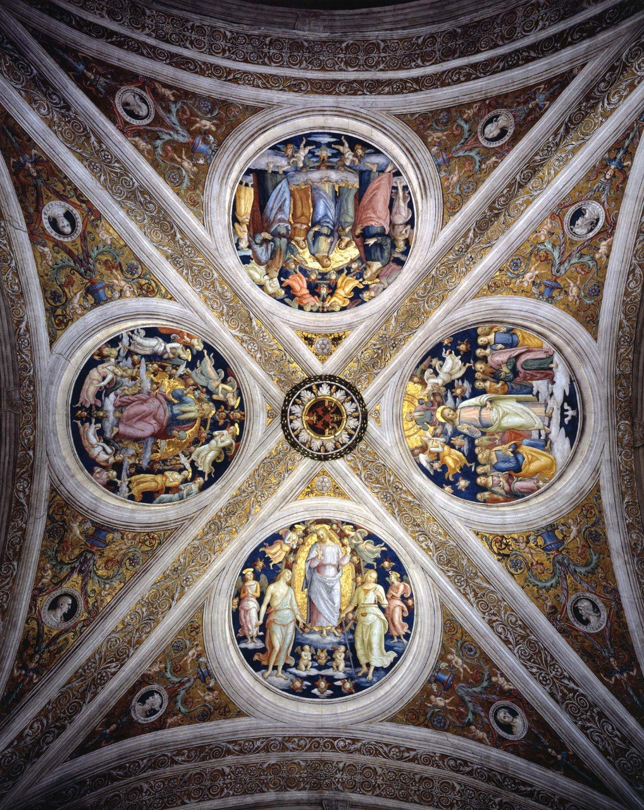

*图源：[梵蒂冈博物馆官网](https://www.museivaticani.va/content/museivaticani/en/collezioni/musei/stanze-di-raffaello/stanza-dell-incendio-di-borgo/volta.html)*

中央十字拱与圆形画细节（官网大图）：

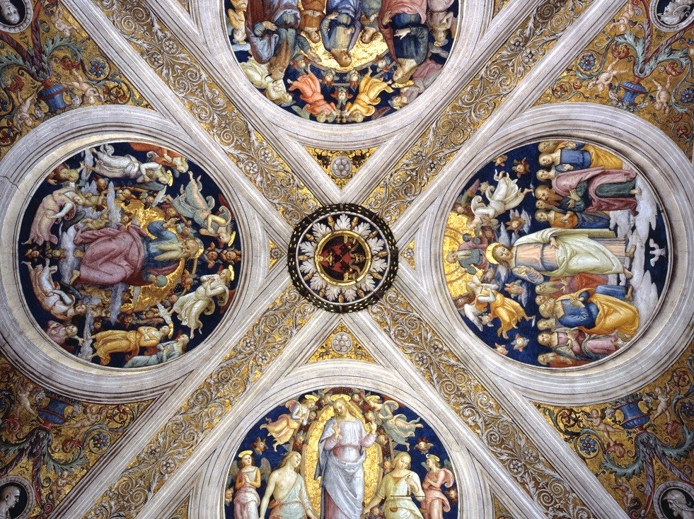

*图源：[梵蒂冈博物馆官网](https://www.museivaticani.va/content/museivaticani/en/collezioni/musei/stanze-di-raffaello/stanza-dell-incendio-di-borgo/volta.html)*

#### 四块圆形画——三位一体的四个面相

佩鲁吉诺把这方天顶的主题定为**三位一体**：金底华丽怪诞纹饰之间嵌着四个圆形画，自东侧起、从不同角度呈现"圣父—圣子—圣灵"。逐块认：

##### 圣父登宝座 _Padre in trono_

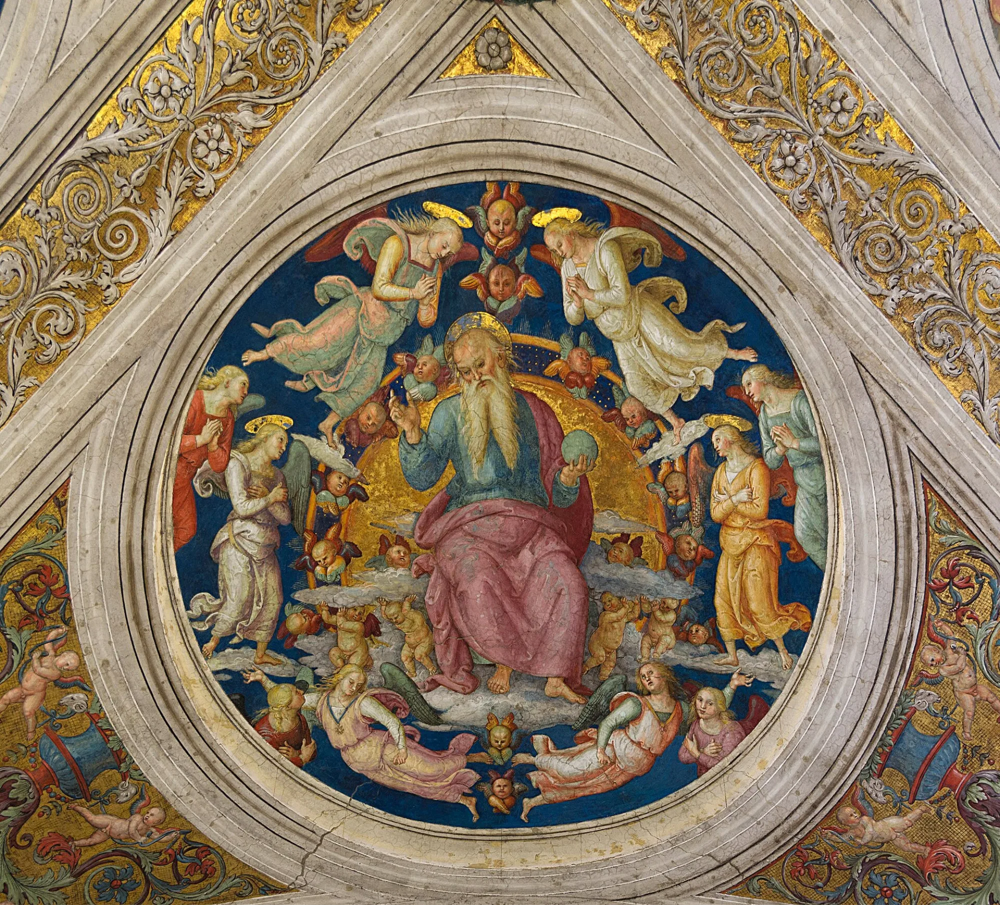

圣父端坐宝座，天使与基路伯（cherubini）层层环侍——三位一体里第一位格的形象，造物主的威严。这是四块的"起点"，对应天顶东侧。

##### 基督在慈悲与正义之间 _Cristo tra Misericordia e Giustizia_

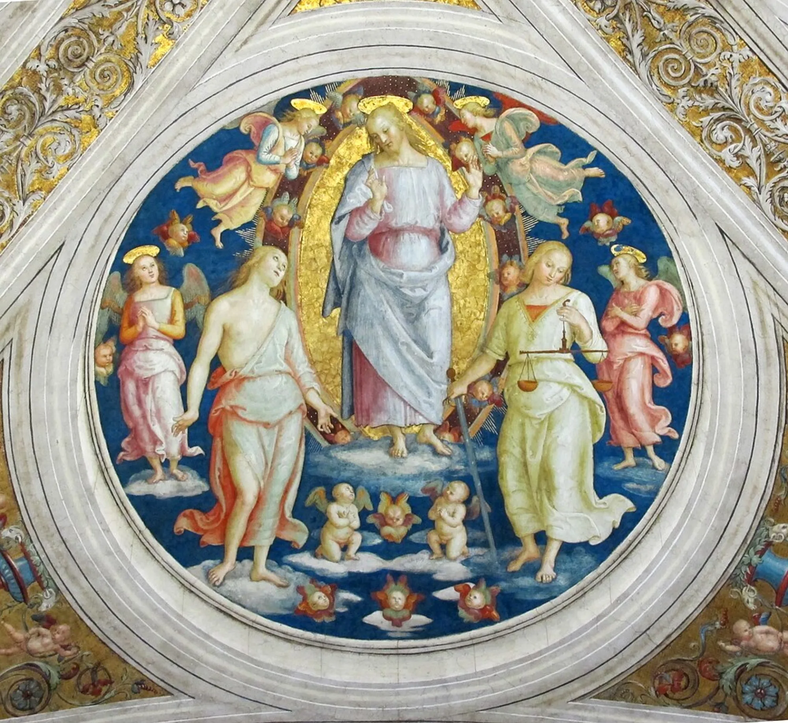

基督居中，左右是**慈悲（Misericordia）与正义（Giustizia）** 两位寓意女像。它点出基督教救赎论的核心张力——**神既慈悲又公义**，基督正是让二者在十字架上和解的那一位（呼应《诗篇》85"慈爱和诚实彼此相遇，公义和平安彼此相亲"）。

##### 三位一体在众使徒之间 _Trinità tra gli apostoli_

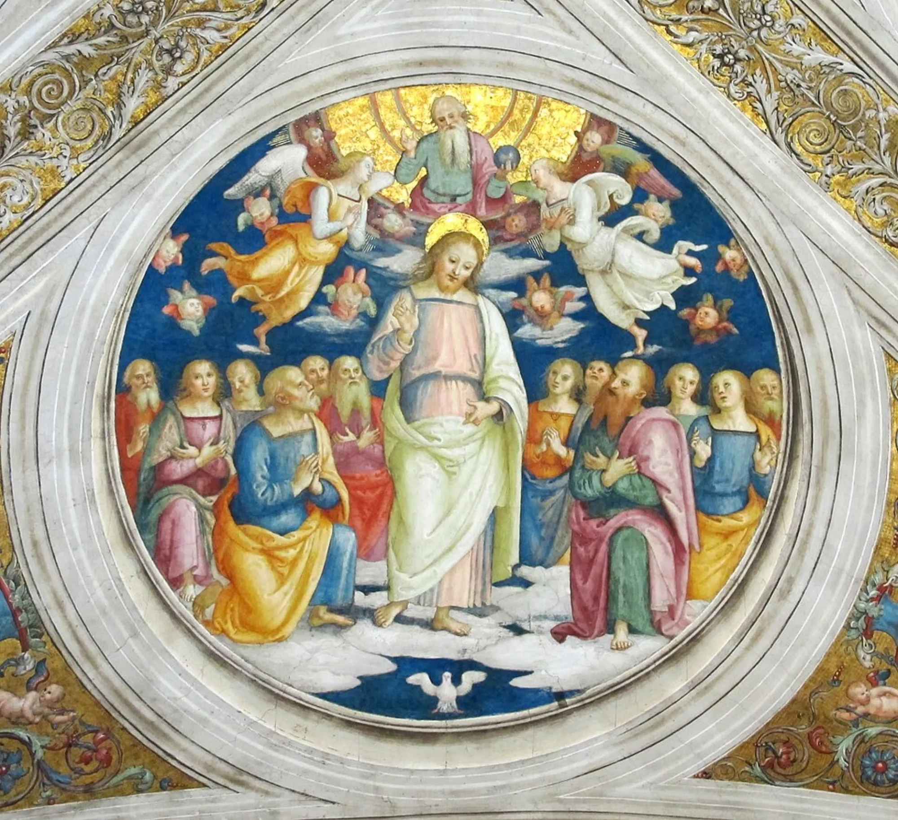

圣父、圣子、圣灵一同显现在众使徒中间——把抽象的三位一体降到"教会面前显现"的场景，等于宣告：三一真神是使徒教会信仰的根基。

##### 公义的太阳与旷野受试探 _Sol Iustitiae_

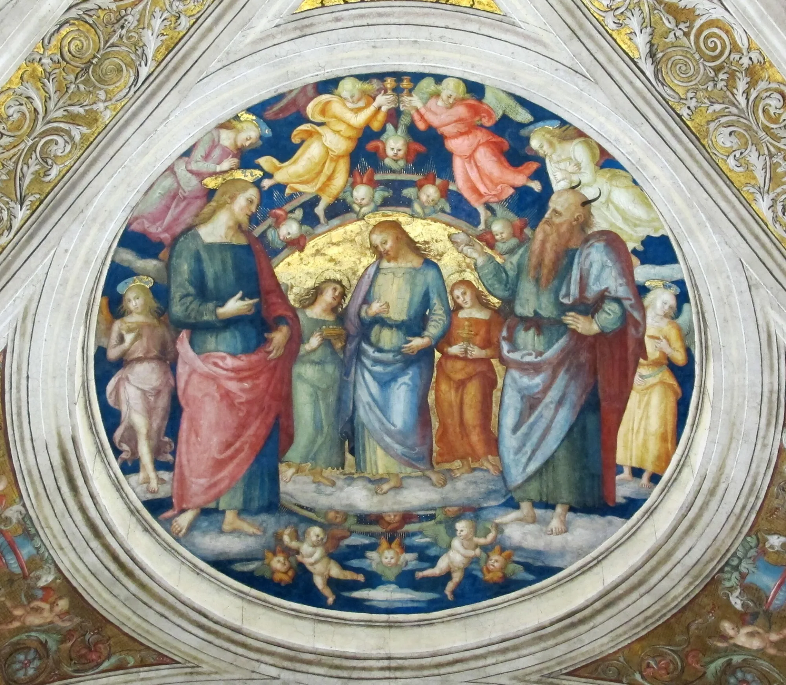

基督作为**"公义的太阳"（Sol Iustitiae）**——典出《玛拉基书》"公义的日头出现、其光线有医治之能"，把基督比作驱散黑暗的太阳；同格还带**基督在旷野受魔鬼试探**：光与暗对照，基督战胜试探，正是"公义之光胜过黑暗"的图解。

**风格一眼可辨**：典型的佩鲁吉诺晚期——对称、柔和的粉彩配深蓝底与满地金饰，空隙处填满天使、基路伯、撒拉弗（horror vacui，"恐惧空白"）。和楼下拉斐尔工作室的雄健人体气质截然不同，抬头一看就能分出"两代人、两种审美"。

---

### 四面墙壁画

四壁按"先看核心、再扫其余"的顺序看——真正值得停的是《波尔戈大火》一面。

#### ① 《波尔戈大火》_Incendio di Borgo_ ⭐⭐

> 🔗 官方：[Fire in the Borgo · Musei Vaticani](https://www.museivaticani.va/content/museivaticani/en/collezioni/musei/stanze-di-raffaello/stanza-dell-incendio-di-borgo/incendio-di-borgo.html)

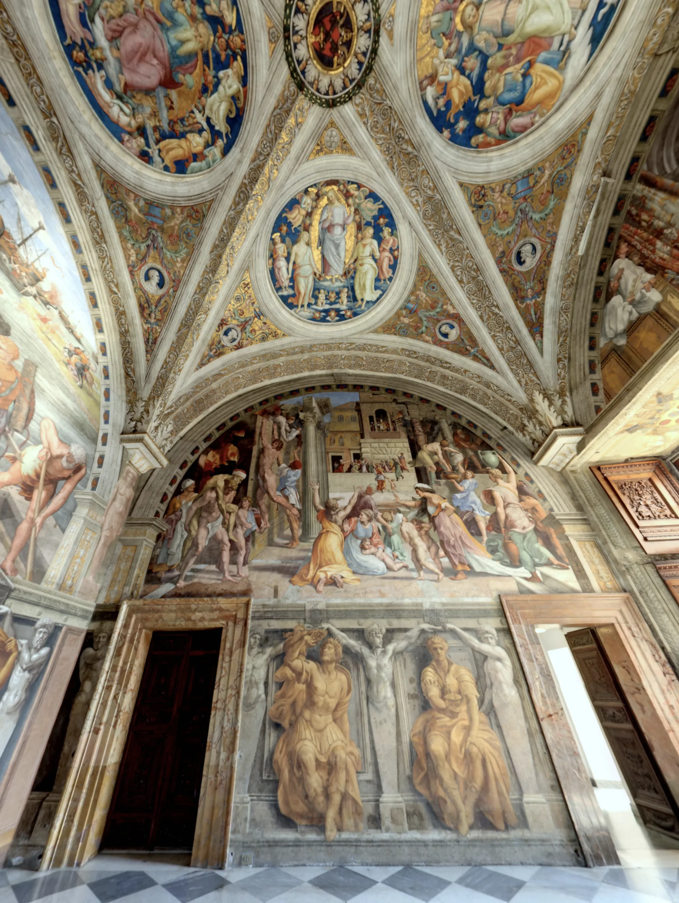

全画（官网大图）：

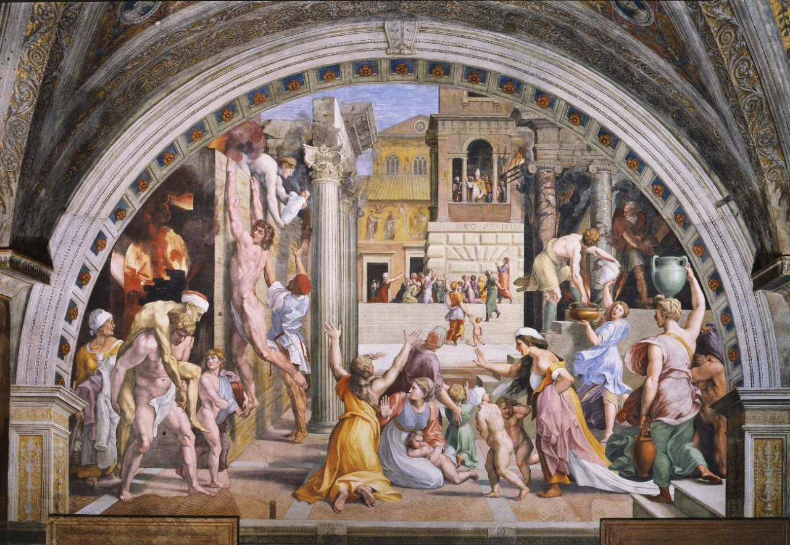

*图源：[梵蒂冈博物馆官网](https://www.museivaticani.va/content/museivaticani/en/collezioni/musei/stanze-di-raffaello/stanza-dell-incendio-di-borgo/incendio-di-borgo.html)*

##### 内容（这是什么）

《教皇名录》记载：公元 847 年，梵蒂冈门前的波尔戈区（Borgo，就是你们午餐可能去的那片老街）突发大火。木屋密集、火借风势直逼圣彼得大教堂，民众绝望之际，教皇利奥四世登上老圣彼得大教堂正面的祝福凉廊，**画十字降福，火势应声而止**。背景故事：这场火的前一年（846），撒拉森海盗刚把老圣彼得大教堂洗劫一空，利奥四世随后修筑了环抱波尔戈的"利奥城墙"——他是 9 世纪罗马的"守护者教皇"，正合利奥十世想借用的人设。画面上真正的"神迹主角"被推到远景：教皇小小一个站在凉廊里；近景让给熊熊大火中**逃命、救人、传水的凡人群像**。

##### 背景 / 来历

拉斐尔出构图，**这一面是本厅拉斐尔亲手成分最高的一幅**（动笔最早，1514 年，他还没被挂毯等差事缠住），执笔仍以朱利奥·罗马诺为主。最妙的一层：背景那座露出马赛克山墙的建筑就是**老圣彼得大教堂的正立面**——画它的同时，拉斐尔正以总建筑师身份主持拆旧堂、建新堂，等于亲手给将被自己拆掉的老圣彼得留了张"遗照"。

##### 看点 / 现场站看

###### 左侧"背老父逃生"组

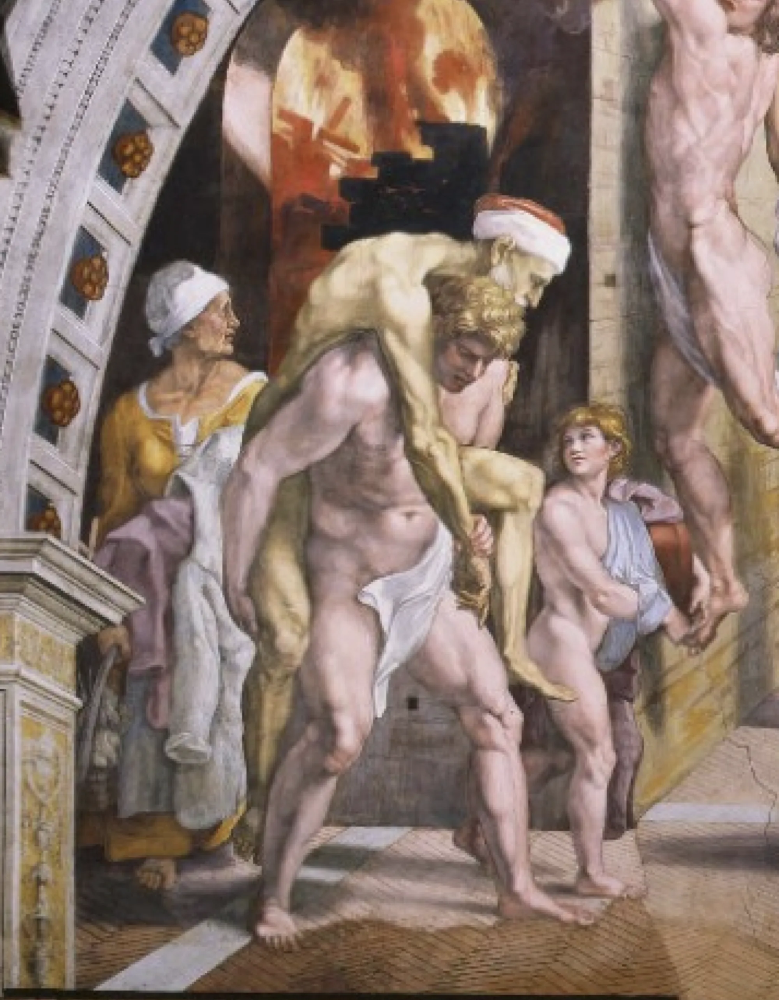

壮年男子背着白须老者跨出火场、身边跟着少年与妇人——这是逐字引用维吉尔史诗里**埃涅阿斯（Aeneas）背父亲安基塞斯（Anchises）逃出燃烧的特洛伊**的图式（一家四口：埃涅阿斯、父亲安基塞斯、幼子阿斯卡尼俄斯、妻子克瑞乌莎），点出利奥十世的人文趣味；正好和你们下午博尔盖塞要看的贝尼尼《埃涅阿斯背父》同一题材，可前后对照。拉斐尔把古典英雄主义嫁接进基督教神迹，是文艺复兴"古今合一"的典型。

###### 墙头吊挂的裸体青年

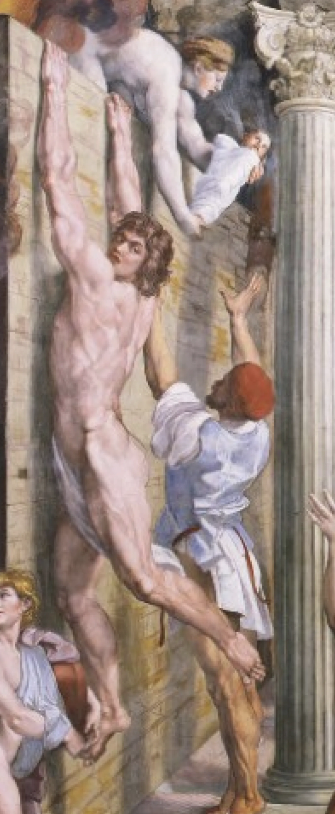

双臂悬垂、正要松手跳下，瓦萨里专门夸过这一笔；连同右侧攀墙、传水桶的各角度健美人体，是工作室在向隔壁西斯廷的米开朗基罗"秀肌肉"，肌肉感比签字厅强得多。

###### 右侧的"传水链"

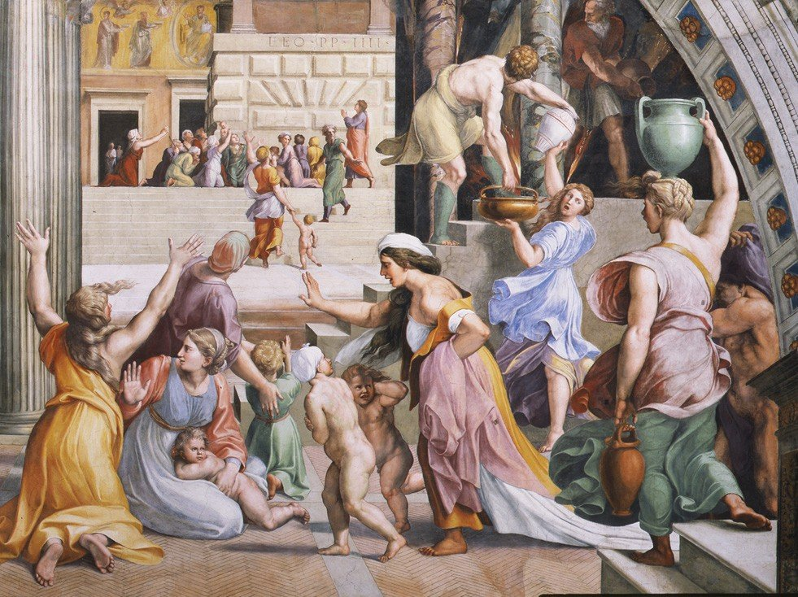

*图源：[梵蒂冈博物馆官网](https://www.museivaticani.va/content/museivaticani/en/collezioni/musei/stanze-di-raffaello/stanza-dell-incendio-di-borgo/incendio-di-borgo.html)*

顶罐疾走的妇女衣袂被热风掀起，像一尊会跑的古典女像柱；她身后的人龙把水一桶桶递向火场。注意两侧建筑像舞台布景一样向中间收拢——灾难被编排成一出古典戏剧。

###### 墙头递婴儿的母亲

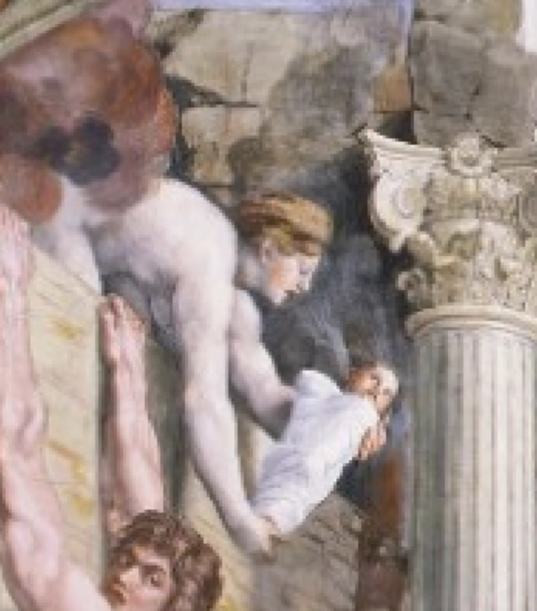

把襁褓越过墙头交给下面伸手的人，全画最催泪的细节。

###### 远景：神迹主角与老圣彼得山墙

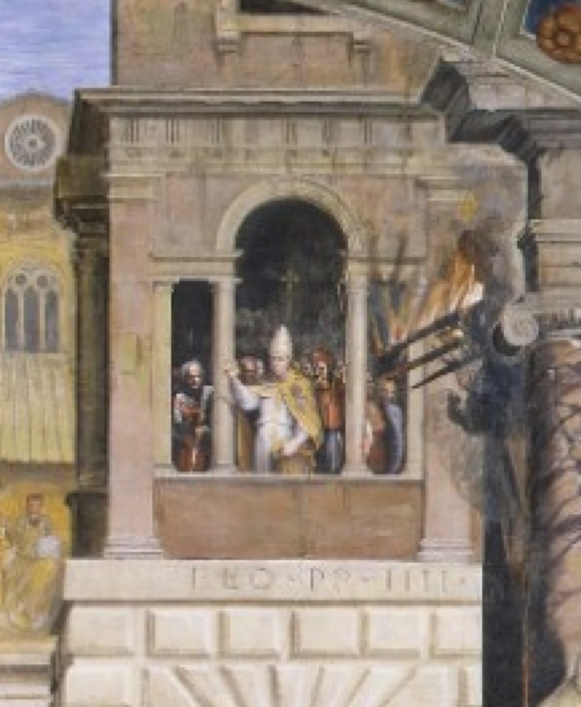

真正的"神迹主角"（教皇）被画得很小、退到最远，近景全是凡人的慌乱——**神力是背景，人的戏剧才是前景**，这种取舍很现代。顺便记住教皇身后那面马赛克山墙：这是老圣彼得大教堂被拆前的"正脸"，画完没多少年就永远消失了。

#### ② 《奥斯提亚之战》_Battaglia di Ostia_

> 🔗 官方：[Battle of Ostia · Musei Vaticani](https://www.museivaticani.va/content/museivaticani/en/collezioni/musei/stanze-di-raffaello/stanza-dell-incendio-di-borgo/battaglia-di-ostia.html)

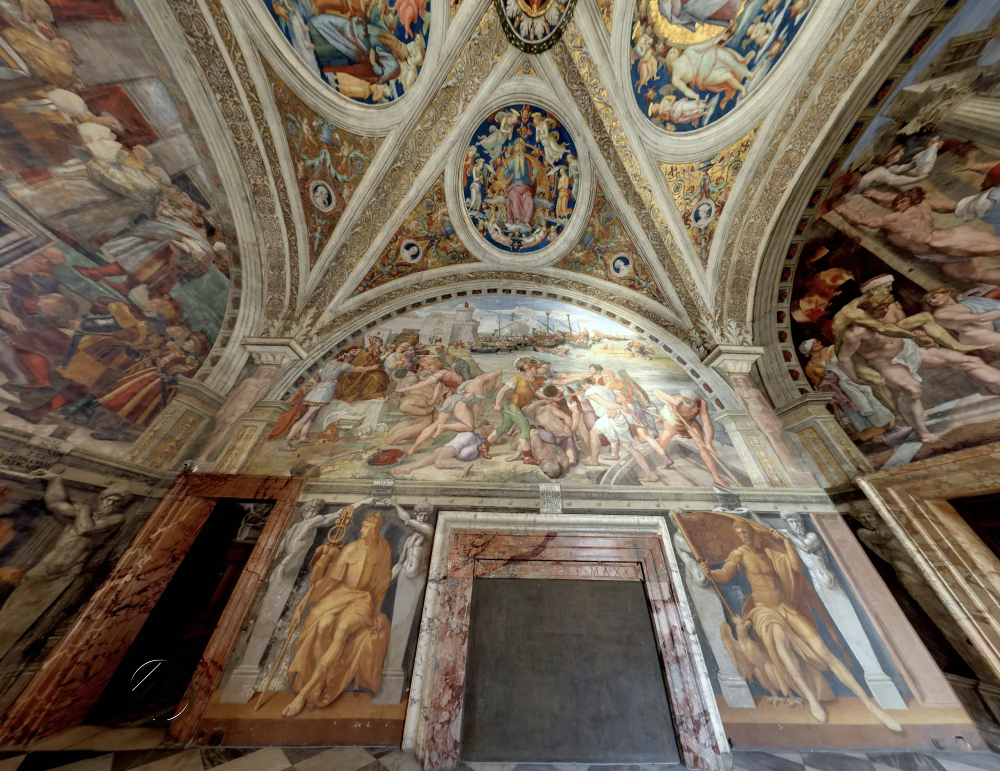

全画（官网大图）：

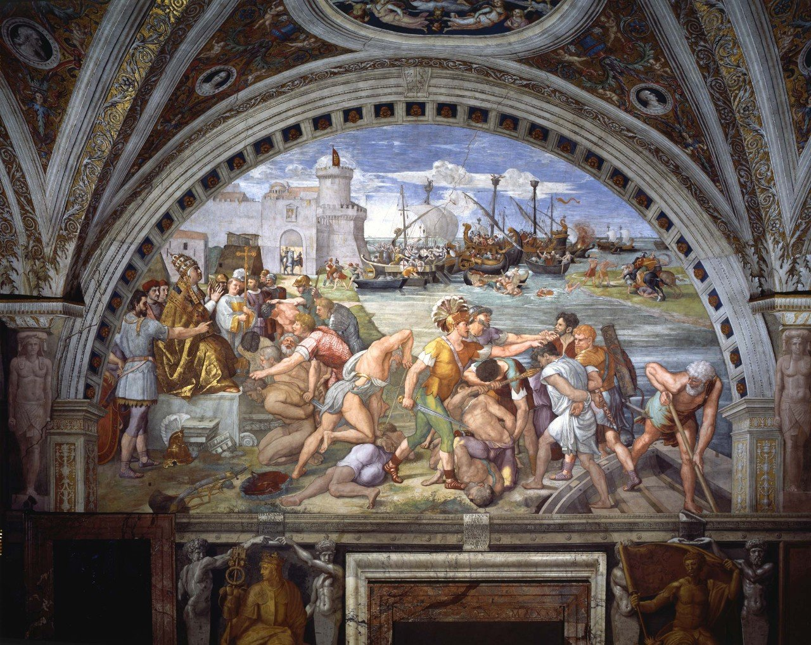

*图源：[梵蒂冈博物馆官网](https://www.museivaticani.va/content/museivaticani/en/collezioni/musei/stanze-di-raffaello/stanza-dell-incendio-di-borgo/battaglia-di-ostia.html)*

##### 内容（这是什么）

公元 849 年，撒拉森舰队再犯罗马外港奥斯提亚（Ostia），由"坎帕尼亚同盟"组成的基督教舰队迎战，风暴助阵、大获全胜——三年前撒拉森人可是把老圣彼得大教堂洗劫了一遍，这一仗算罗马的"复仇之战"。**现实指向**：利奥十世正鼓吹对奥斯曼土耳其的新十字军——借 9 世纪的旧胜仗给当下的十字军计划造势。

##### 看点 / 现场站看

###### 左岸仰天谢恩的利奥四世

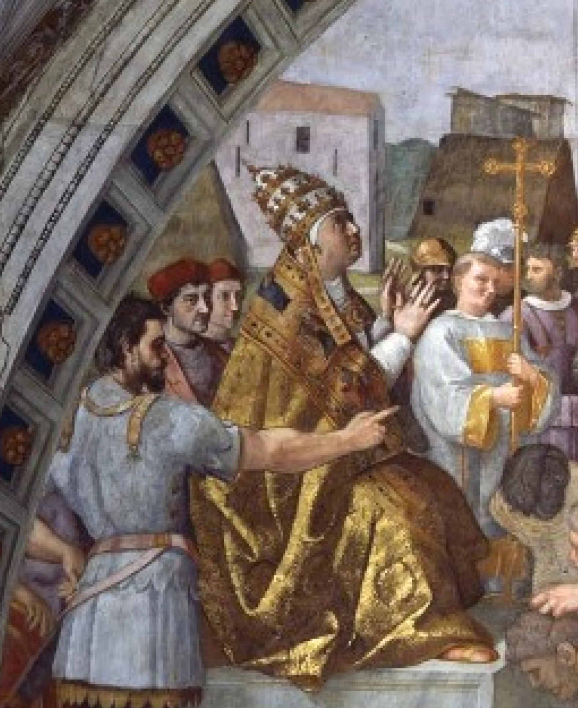

立于左侧岸上、仍长着利奥十世的脸。一般认为拉斐尔在这面只亲手画了教皇与红衣主教那几张脸，其余皆工作室之手。

###### 教皇身后的两位红衣主教

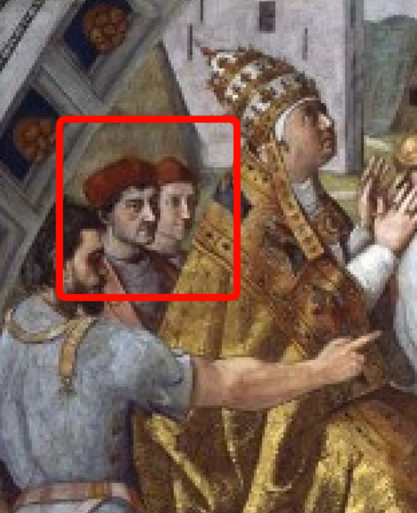

据考是比别纳（Bibbiena）与朱利奥·德·美第奇（Giulio de' Medici，即后来的克雷芒七世）——又一处"把当代人塞进历史现场"。

###### 右侧"献俘"——搬自古罗马的凯旋母题

岸边俘虏群与海上舰队细节（官网大图）：

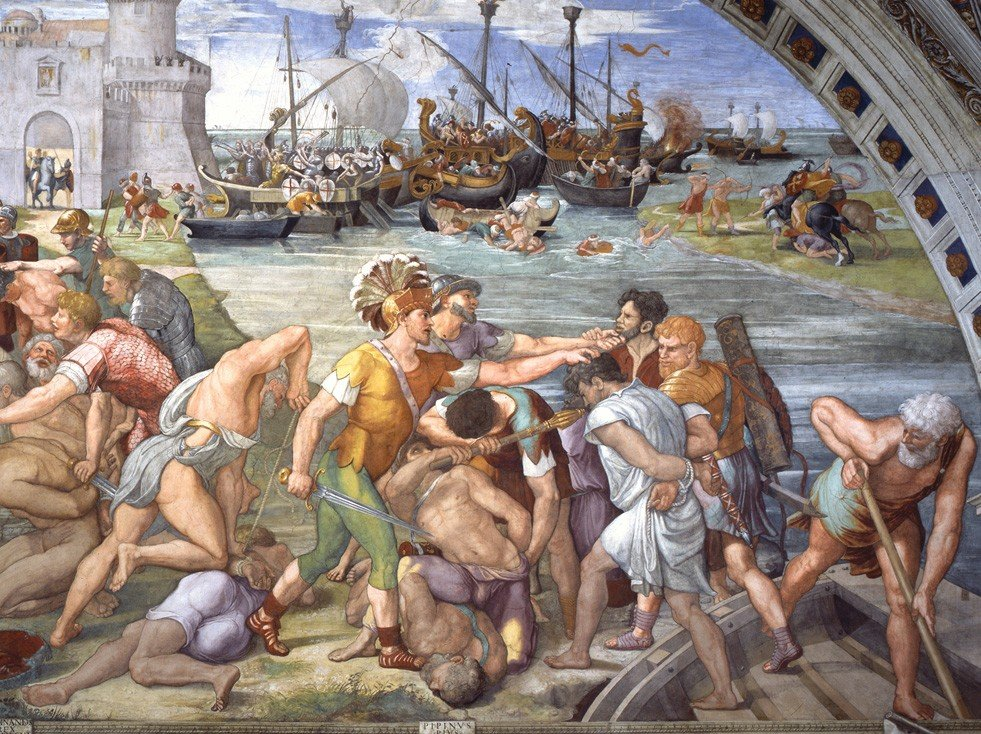

*图源：[梵蒂冈博物馆官网](https://www.museivaticani.va/content/museivaticani/en/collezioni/musei/stanze-di-raffaello/stanza-dell-incendio-di-borgo/battaglia-di-ostia.html)*

那波利的切萨里奥（Cesario di Napoli）押着穆斯林俘虏上岸、粗暴地推到教皇脚前跪降；这"献俘"母题（captivi）直接取自古罗马凯旋艺术。岸边俘虏群的扭转人体是全画主要看点。

#### ③ 《查理曼加冕》_Incoronazione di Carlo Magno_

> 🔗 官方：[Crowning of Charlemagne · Musei Vaticani](https://www.museivaticani.va/content/museivaticani/en/collezioni/musei/stanze-di-raffaello/stanza-dell-incendio-di-borgo/incoronazione-di-carlo-magno.html)

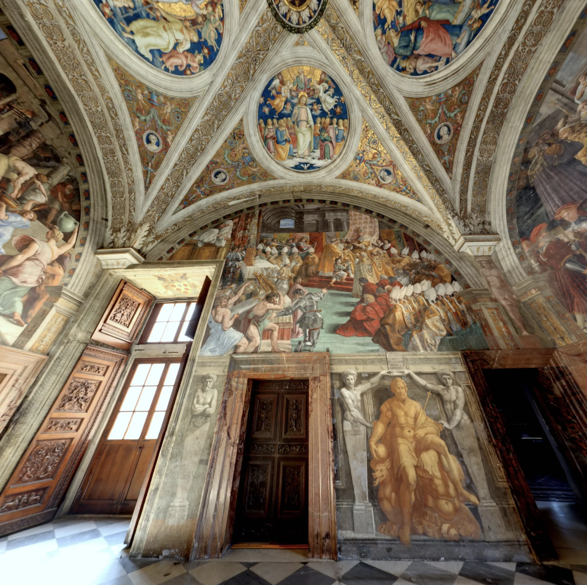

全画（官网大图）：

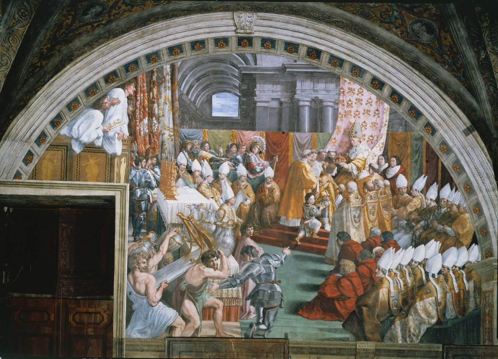

*图源：[梵蒂冈博物馆官网](https://www.museivaticani.va/content/museivaticani/en/collezioni/musei/stanze-di-raffaello/stanza-dell-incendio-di-borgo/incoronazione-di-carlo-magno.html)*

##### 内容（这是什么）

公元 800 年圣诞夜，老圣彼得大教堂内，教皇利奥三世为法兰克王查理曼（Charlemagne）加冕为"罗马人的皇帝"——西欧帝权由教皇之手"授予"的开端，也是日后神圣罗马帝国的起点。**此面几乎全由弟子执笔。**

##### 看点 / 现场站看

###### 两张"张冠李戴"的脸——影射当代结盟

中央加冕一幕细节——利奥三世（利奥十世的脸）为查理曼（弗朗索瓦一世的脸）戴冠（官网大图）：

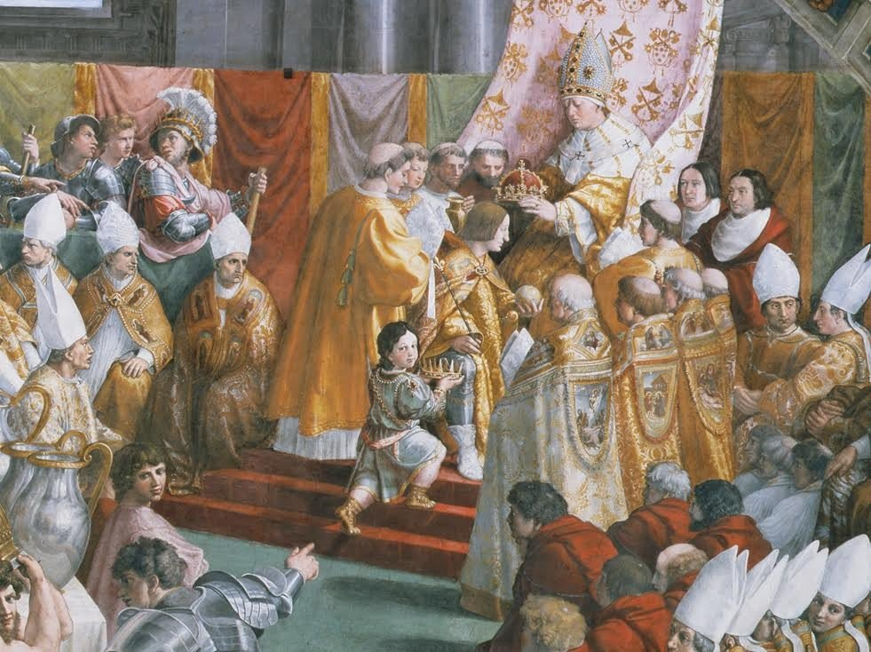

*图源：[梵蒂冈博物馆官网](https://www.museivaticani.va/content/museivaticani/en/collezioni/musei/stanze-di-raffaello/stanza-dell-incendio-di-borgo/incoronazione-di-carlo-magno.html)*

利奥三世照例是利奥十世的脸，**查理曼则画成法王弗朗索瓦一世（Francis I）的模样**——影射 1515 年利奥十世与弗朗索瓦在博洛尼亚签订的政教协定：800 年的"教皇加冕皇帝"被改装成 1516 年"教皇 ✕ 法王结盟"的宣传海报。

###### 对角线构图与华盖

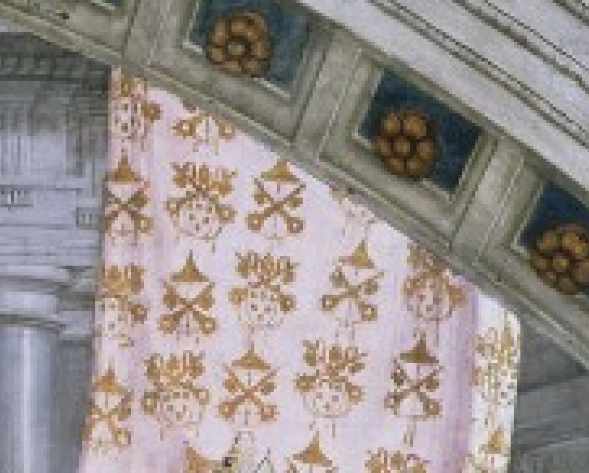

构图沿一条对角线把视线引向华盖下（华盖上饰圣彼得的钥匙）的加冕一刻——整个空间秩序都为"权力授予"那一瞬让路。

###### 左侧前景的"献礼"

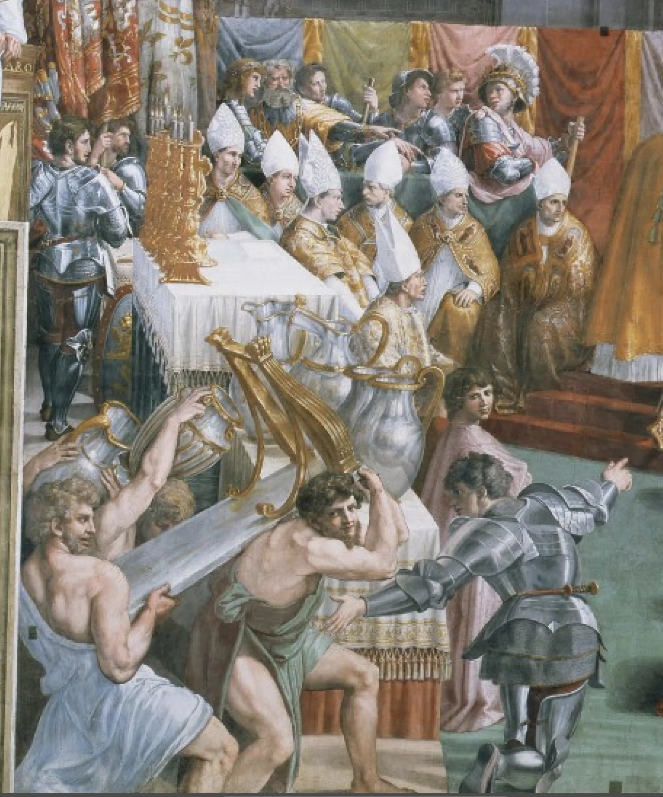

一组侍从正把大件金银器皿堆上供桌，搬演古罗马凯旋行列的"献礼"母题——把基督教加冕装点成一场古罗马式的凯旋。

#### ④ 《利奥三世的誓言》_Giuramento di Leone III_

> 🔗 官方：[Justification of Leo III · Musei Vaticani](https://www.museivaticani.va/content/museivaticani/en/collezioni/musei/stanze-di-raffaello/stanza-dell-incendio-di-borgo/giustificazione-di-leone-iii.html)

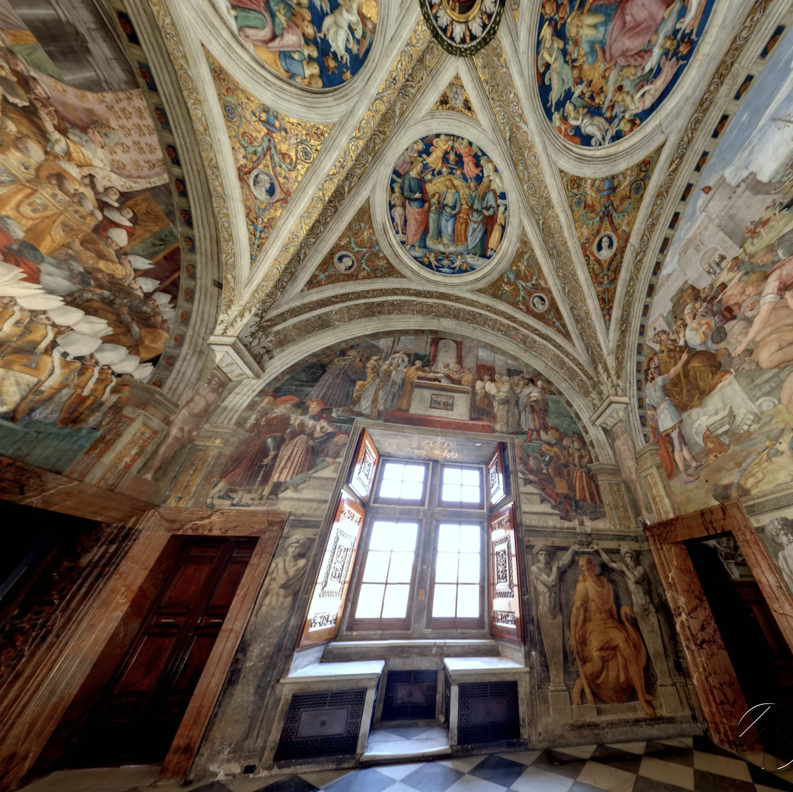

全画（官网大图）：

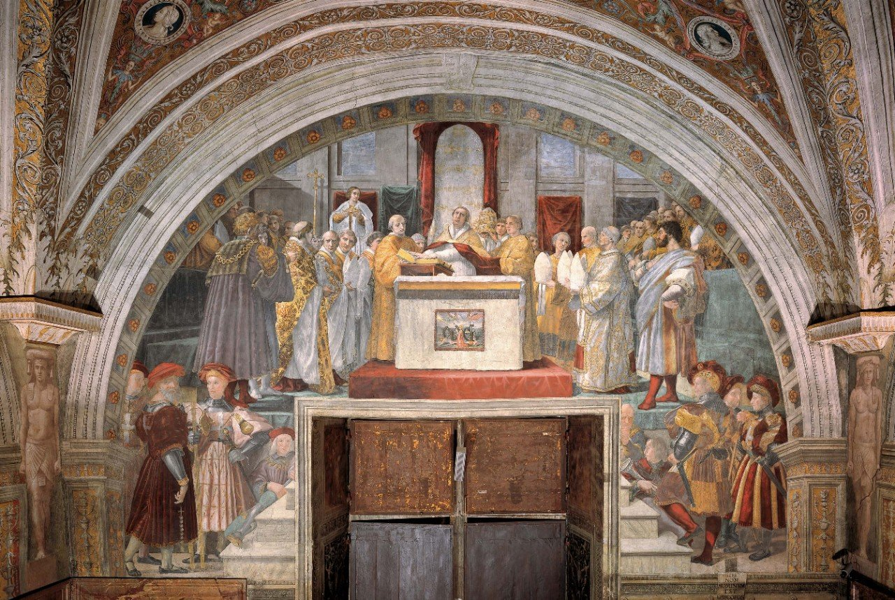

*图源：[梵蒂冈博物馆官网](https://www.museivaticani.va/content/museivaticani/en/collezioni/musei/stanze-di-raffaello/stanza-dell-incendio-di-borgo/giustificazione-di-leone-iii.html)*

祭坛前手按福音书起誓的利奥三世细节（官网大图）：

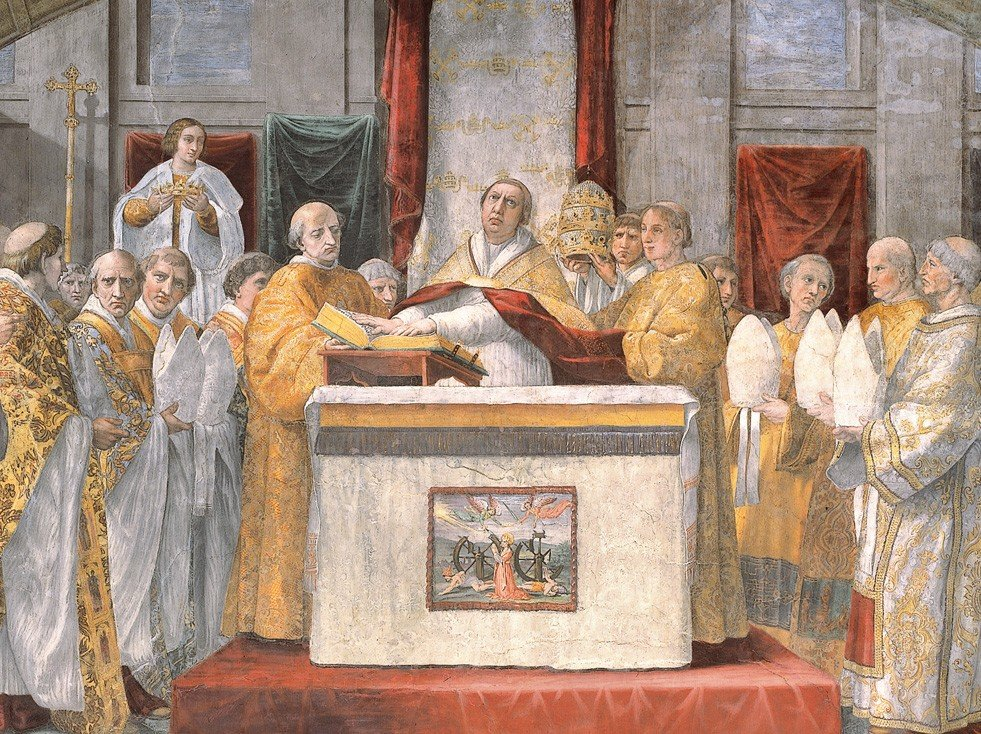

*图源：[梵蒂冈博物馆官网](https://www.museivaticani.va/content/museivaticani/en/collezioni/musei/stanze-di-raffaello/stanza-dell-incendio-di-borgo/giustificazione-di-leone-iii.html)*

##### 内容（这是什么）

加冕前两天（800 年 12 月 23 日），利奥三世被前任哈德良一世的侄子们指控，他在查理曼与全体教士面前手按福音书起誓自证清白——经文里说他"不受强迫、不受任何人审判"地洗清了罪名。**此面全部由弟子执笔。**

##### 看点 / 现场站看

###### 画上题词——"审判主教的是天主，不是人"

祭坛上方的题词 **"DEI NON HOMINUM EST EPISCOPOS IUDICARE"**——教皇只受上帝审判、不受任何世俗法庭管辖。这正是利奥十世刚在**拉特朗第五次大公会议（1516）** 上重申的原则（确认卜尼法八世《一圣教谕》Unam Sanctam），借 700 年前的同名前辈说给当下听。

###### 似曾相识的构图

整面沿用了隔壁《博尔塞纳的弥撒》的构图——同一套"祭坛 + 两侧人群"的舞台搬到了这里。

---

### 墙脚单色画基座——历代"护教君主"

四面墙脚的基座是一排**黄褐色单色画（chiaroscuro）**，朱利奥·罗马诺执笔：坐着的是历史上**六位**以武力护卫信仰、捍卫教会的世俗君主，**间以明暗对照的女像柱（cariatidi）**。每位君主头顶的楣带上都刻着名字/称号铭文。

> ⚠️ **辨认说明**：你这几张翻拍偏糊，我只**逐字读出了两位的名牌**（洛泰尔、斐迪南），其余按铭文残字与传统名单**推断**，**现场以名牌为准**。

##### 洛泰尔一世（Lotario I）✅ 已确认

加洛林皇帝。名牌铭文 **LOTHARIVS … LIBERTATIS ASSERTOR**（洛泰尔，教会自由的捍卫者）——就是这一位：

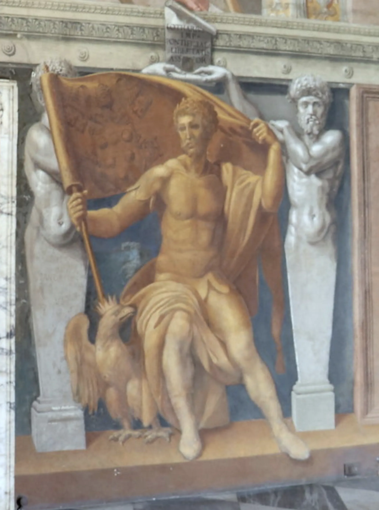

##### 斐迪南天主教王（Ferdinando il Cattolico）✅ 已确认

收复格拉纳达、完成西班牙"再征服"的天主教君主。名牌铭文 **FERDINANDVS REX CATHOLICVS, CHRISTIANI IMPERII PROPAGATOR**（斐迪南天主教王，基督教帝国的传播者）——就是这一位：

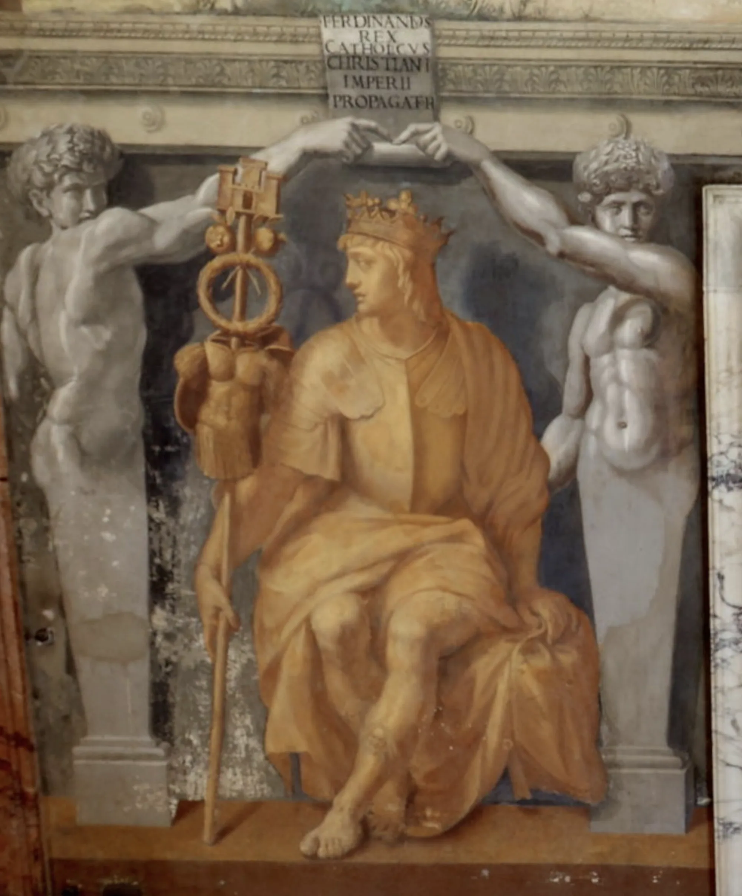

##### 含 BRITANNIAM 题铭的一张（两位君主）⚠️ 推断

这张是宽幅，**同时拍到左右两位君主**：右侧那位名牌带 **"…BRITANNIAM…"（不列颠）**，最可能是英格兰国王**埃塞尔伍尔夫（Æthelwulf）**——他 855 年赴罗马、确立"彼得献金"，把不列颠的奉献献给罗马教会，是典型的"护教君主"（六位之一，常不在精简名单里）；左侧一位铭文残存 …LPH…，**疑似阿斯托尔福（Astolfo，伦巴第国王）**。

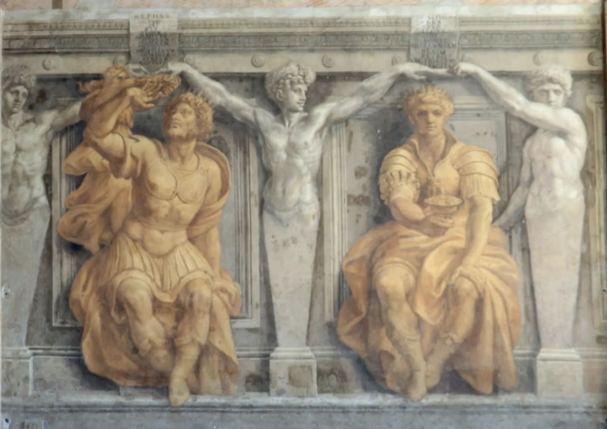

⚠️ 两个名牌都较糊，以上为推断；现场看清名牌即可定。

##### 待辨认的一张 ⚠️

这张坐像头顶的牌子写的是**《利奥三世的誓言》那面墙的题词**"…NON HOMINVM EST EPISCOPOS IVDICARE"（说明它就嵌在那面墙正下方），但君主**本人的名牌没拍进画面**，无法从铭文确认是谁（按名单，剩下未归位的是**查理曼**与**戈弗雷·德·布永**，二者之一）：

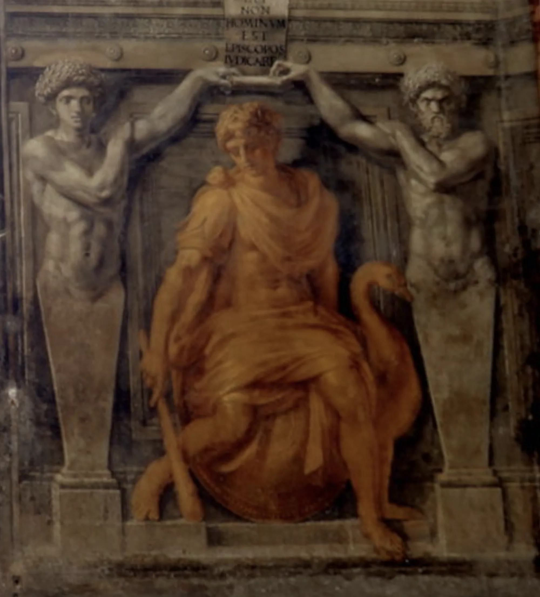

##### 另外两位（本批截图未拍到 / 未确认）

- **查理曼（Carlomagno）**——加冕称帝、与教皇结盟的"护教皇帝"原型；
- **戈弗雷·德·布永（Goffredo di Buglione）**——第一次十字军领袖、耶路撒冷的"圣墓守护者"。

这一排基座说的还是同一件事：**世俗君主以刀剑护卫教会**——正好给楼上四面墙"教皇借古利奥造势"的政治叙事垫了个底座：教皇主神圣、君主主武力，二者相辅。

### 地板

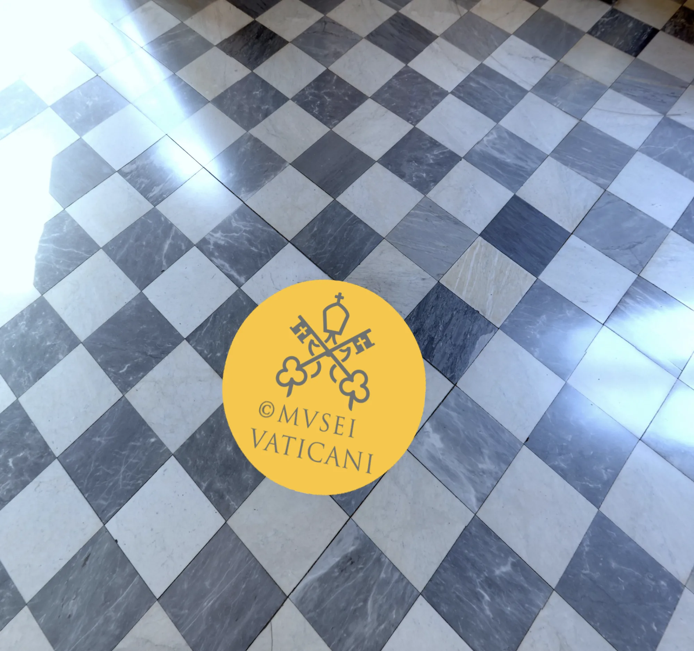

波尔戈火灾厅地面为彩色大理石铺装。与签字厅那种留下教皇纹章与名字的科斯马蒂式马赛克不同，**本厅地板在文献里着墨极少、没有公认的"看点"记载**——现场低头扫一眼即可，全厅的重头仍在《波尔戈大火》与佩鲁吉诺的天顶。
