## 这座礼拜堂是什么

🔗 官方：[梵蒂冈博物馆 · 西斯廷礼拜堂](https://www.museivaticani.va/content/museivaticani/en/collezioni/musei/cappella-sistina.html) ｜ 360° 高清可缩放官方虚拟游览（搜 "Vatican Sistine Chapel virtual tour"，进门前在手机上先认场景）

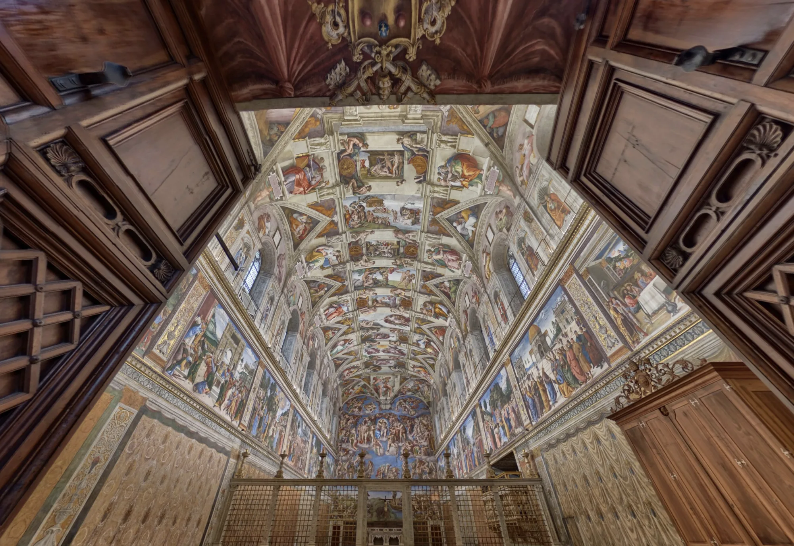

西斯廷礼拜堂（Cappella Sistina）得名于 15 世纪下令重建它的教皇西克斯图斯四世（Sixtus IV）。它是**教皇的私人礼拜堂**，也是**选举新教皇的秘密会议（Conclave）举行地**——你站的地方就是冒白烟、选出每一任教皇的房间。空间本身朴素：一个长方形盒子（约 40.9 × 13.4 m，高 ~21 m），尺寸刻意比照《圣经》里所罗门圣殿。真正让它封神的是墙与顶上的画。

整座礼拜堂的装饰分三层，**时间上分两次完成、出自两代人**：

- **两侧墙的 15 世纪壁画带**（1481–82）——波提切利、佩鲁吉诺、吉兰达约等一线大师画的《摩西生平》与《基督生平》，详见 [S - 10 西斯廷礼拜堂 · 两侧墙 + 入口墙壁画带](../s10-sistine-side-walls/)。
- **天顶**（1508–1512）——米开朗基罗为教皇尤利乌斯二世（Julius II）画的《创世纪》主线，**本文主角**。
- **祭坛墙《最后的审判》**（1536–1541）——米开朗基罗晚年回来又画的整面墙，见 [S - 09 西斯廷礼拜堂 · 祭坛墙《最后的审判》](../s09-sistine-last-judgment/)。

## 天顶

> ⭐⭐⭐ **全程头号高光**。米开朗基罗（Michelangelo）1508–1512 年独力画完的 ~520 ㎡ 天顶，340 余个人物，是西方艺术的绝对地标。**内部严禁拍照、严禁出声**，讲解必须在进门前讲透——本文就是给你"进门后举着脑子对照看"用的。
>
> 现场约 15–20 min。进门**先别急着找《创造亚当》**，先用 30 秒搞清整个天顶的"读法"（见下"先看懂结构"），否则你会在一片金碧辉煌里迷路。
> 
> 🔗 官方：[Ceiling · Musei Vaticani](https://www.museivaticani.va/content/museivaticani/en/collezioni/musei/cappella-sistina/volta.html)
> 

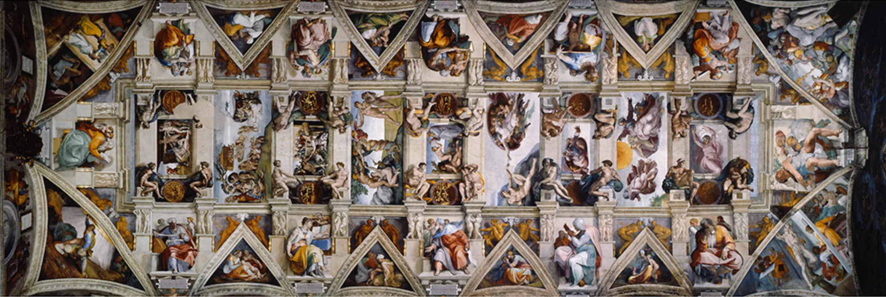

*图源：[梵蒂冈博物馆官网](https://www.museivaticani.va/content/museivaticani/en/collezioni/musei/cappella-sistina/volta.html)*

### 这顶是怎么来的（进门前 5 分钟版背景）

**委托始末：一道裂缝引出的工程**。西斯廷的天顶原本不是这样：15 世纪皮埃尔·马泰奥·达梅利亚（Pier Matteo d'Amelia）画的是一片缀满金星的蓝天。1504 年 5 月，因旁边博尔吉亚塔与新圣彼得大教堂的地基开挖，礼拜堂结构受损、天顶裂开一道长缝（梵蒂冈官网的说法），时任宫廷建筑师布拉曼特（Donato Bramante）装了拉杆补救，但旧画毁损严重，教皇尤利乌斯二世索性决定整顶重画。1508 年 5 月 8 日米开朗基罗签约，酬金 3,000 杜卡特金币。最初的方案很保守：十二个三角区画十二使徒、中央铺几何装饰——米开朗基罗嫌它是"寒酸货"（cosa povera，馆方原话），说服教皇放手让他自定方案。他晚年自称教皇"让我想画什么就画什么"，学者认为多半有夸张：主题大概率仍有教廷神学家参与拟定（常被点名的人选是奥古斯丁会学者维泰博的吉莱斯/Egidio da Viterbo），但把它变成 340 个人体的，确实只能是他。

**与布拉曼特的恩怨（传记里的传说，听个乐）**。米开朗基罗的两位传记作者孔迪维（Ascanio Condivi）与瓦萨里（Giorgio Vasari）都说：布拉曼特嫉妒他拿到教皇陵墓的大单，故意怂恿教皇把这个雕塑家按到他不熟的湿壁画上，盼他当众出丑。这是米开朗基罗阵营的一面之词，现代史家多当**传说**看。可落实的倒是一桩具体过节：布拉曼特先搭了一副从天顶穿洞、用绳索垂吊的脚手架，米开朗基罗嫌画到最后得补一堆绳洞，当场否决，自己设计了一套不碰天顶的独立式脚手架——日后四年他就站在这套自己发明的架子上。

**"我不是画家"**。米开朗基罗本不愿接单——他自认是雕塑家（签信都署"米开朗基罗，雕塑家"的脾气），甚至建议教皇把活儿交给年轻的拉斐尔（Raphael）。开工就遇挫：灰泥太湿长了霉，几乎让他撂挑子，教皇派来的建筑师朱利亚诺·达·桑加洛（Giuliano da Sangallo）教他除霉才救场；从佛罗伦萨招来的助手不合用，干脆遣散，绝大部分由他独力画完。他给友人乔瓦尼·达·皮斯托亚（Giovanni da Pistoia）写过一首著名的自嘲诗：仰画把他憋出了"甲状腺肿"，胡子朝天、后颈嵌进脊背、胸口鼓成鸟身女妖、颜料顺着笔杆滴成一张花脸——结尾一句是："我待的不是好地方，**我也不是画家**（né io pittore）。"另据瓦萨里与孔迪维记载，他是**站在脚手架上仰着头画**的（不是躺着，那是后人想象），完工后视力受损，有段时间读信都得举到头顶上看。

**湿壁画与 giornata（一日块）**。湿壁画（fresco）必须画在当天新抹的湿灰泥（intonaco）上，颜料随灰泥干燥被"锁"进墙体，干了就改不动、错了只能凿掉重来。所以每天清晨按当日工作量抹一块灰泥，日落前画完，没画到的边削掉、明天接着抹——这样一块叫一个 **giornata（"一日"）**。1980 年代修复时逐块清点接缝，整个天顶约 570 个一日块、分两大阶段完成。越画越快：最后一幕《分开光与暗》的上帝是**一天画完的**。还有个冷知识：按惯例湿壁画完工后要干壁补金、加深阴影（a secco），这顶揭幕时没来得及做、后来也没做——瓦萨里说教皇想补金，米开朗基罗回答："那个时代的人不穿金戴银，画上的都是轻视财富的圣人。"

**揭幕与 1980–94 大修复**。前半截 1511 年 8 月 15 日（圣母升天节，本堂主保节日）先行亮相；1512 年 10 月 31 日全部完成，次日万圣节教皇在堂内做弥撒。瓦萨里记载揭幕时"各地的人蜂拥而至，单是看上一眼就惊得说不出话"；37 岁的米开朗基罗从此被称为 **il divino（神人）**。尤利乌斯二世只多活了几个月，1513 年 2 月去世。此后近五百年，烛烟与历次保养涂上的动物胶让画面越来越暗，直到 1980–1994 年大修复（主持修复师吉安路易吉·科拉卢奇/Gianluigi Colalucci；天顶部分 1989 年完成）把覆层洗去，露出令人错愕的明亮色彩——艳粉、橙黄、苹果绿、紫罗兰，衣料上还有大量"闪色"（cangiante）撞色——"阴郁的米开朗基罗"一夜变成大色彩家。争议也随之而来：哥伦比亚大学的詹姆斯·贝克（James Beck）等人指责清洗连米开朗基罗自己干壁补画的阴影层一并洗掉了，梵蒂冈方面坚决否认。你今天看到的就是修复后的样子——颜色亮得"不像印象里的米开朗基罗"，是正常的。

### 先看懂结构（进门 30 秒做这件事）

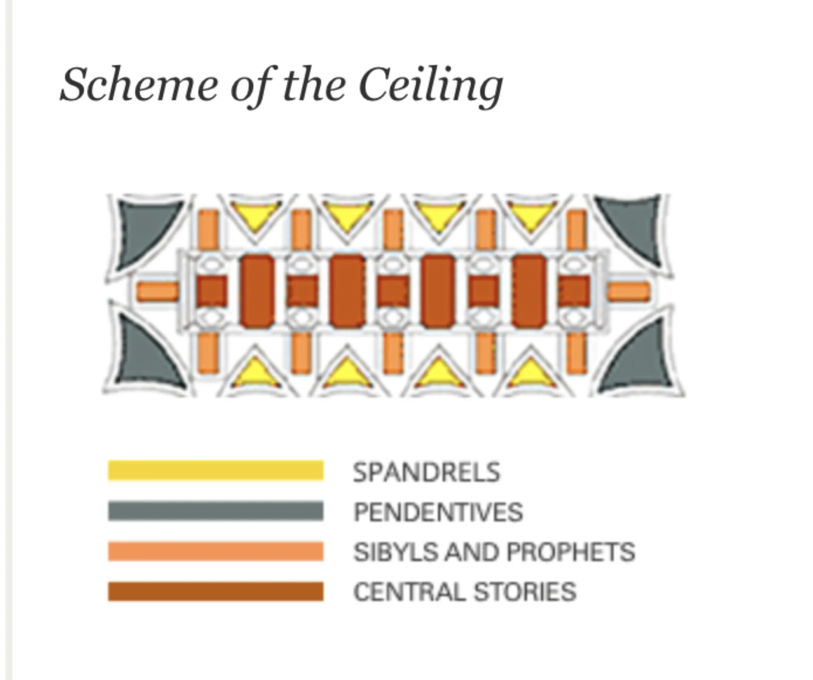

*图源：[梵蒂冈博物馆官网](https://www.museivaticani.va/content/museivaticani/en/collezioni/musei/cappella-sistina/volta.html)*

天顶不是一张画，是一套有阅读顺序的系统。抬头时这样定位：

1. 中央故事-红色
	1. 正中一条"画中画"：沿礼拜堂长轴，从祭坛墙到入口，是 9 块《创世纪》场景，大小相间（大画 5 块、小画 4 块，小画四角有裸体青年扛着）。
	2. 九场景的阅读方向是"倒着的"：故事从祭坛端（《最后的审判》那面墙）开始——第一幕是《分开光暗》，走到入口端是最后一幕《诺亚醉酒》。但米开朗基罗是从入口端往祭坛端画的，所以越靠祭坛、画得越放松大胆（《创造亚当》就在中段往祭坛走的位置）。
2. 拱肩-黄色：
	1. 窗户上方的弦月与三角区画基督的祖先（家谱）。
3. 帆拱-灰色
	1. 四个角的三角帆（pennacchi）画以色列得救的四个旧约故事
4. 两侧一圈"看台"-橙色
	1. 托着中央故事的，是 12 位巨人——7 位先知 + 5 位女先知（西比拉），各坐在自己的宝座上，预告基督降临。
5. 装饰人物：9 块小场景四角的 20 个裸体青年（ignudi）、仿青铜圆盾、仿大理石小天使——是把整套画"撑起来"的建筑级错视框架，全是平面画出来的假立体。

> 一句话记法：**中间一条线讲"创世到诺亚"，两边一圈巨人是"预言家在看戏"，四角讲"上帝救以色列"，窗上画"基督的家谱"。** 认准这个骨架，再去找具体场景就不会乱。

---

### 米开朗基罗《创造亚当》/ Michelangelo, _Creazione di Adamo_ ⭐⭐⭐

- **作者**：米开朗基罗·博那罗蒂（Michelangelo Buonarroti）
- **作品**：《创造亚当》/ _Creazione di Adamo_
- **时间**：约 1511–1512（九场景里的第 4 幕）
- **材质**：湿壁画（fresco）
- **尺寸**：约 280 × 570 cm
- **位置**：天顶中央偏祭坛一侧，第 4 块大场景
- **官网介绍页**：[Wikipedia · The Creation of Adam](https://en.wikipedia.org/wiki/The_Creation_of_Adam)（含高清官图与考据）

> 🔗 官方：[Creation of Adam · Musei Vaticani](https://www.museivaticani.va/content/museivaticani/en/collezioni/musei/cappella-sistina/volta/storie-centrali/creazione-di-adamo.html)

创造亚当（修复后）：

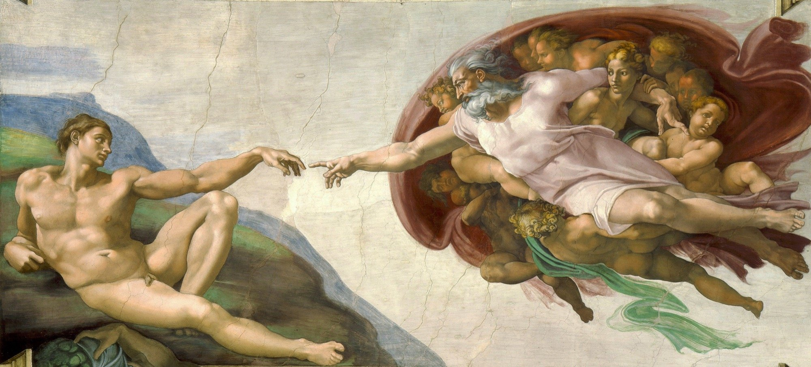

*图源：[Wikimedia Commons](https://commons.wikimedia.org/wiki/File:Michelangelo - Creation of Adam (cropped).jpg)*

**内容（这是什么）**：上帝（God the Father）裹在翻卷的紫红色斗篷里、由天使群托着从右侧飞来，伸出右手食指去点左侧斜倚在地的亚当（Adam）。对应《创世记》第六日造人：「神说，我们要照着我们的形象、按着我们的样式造人」（创 1:26），以及「耶和华神……将生气吹在他鼻孔里，他就成了有灵的活人」（创 2:7）。亚当已经被造出形体、却还"没通电"——他软软地抬起左臂，指尖即将与上帝相触。**画的就是"生命之火即将传递、但还差最后一毫米"的那一瞬。** 注意亚当抬起的左臂几乎是上帝右臂的镜像——"照着我们的形象"被直接画成了姿势对仗；学者还指出灵感可能来自中世纪圣咏《求造物主圣神降临》（Veni Creator Spiritus）里"父右手的手指"一句——用指尖传递灵，有出处。

**背景 / 来历**：这是九场景从祭坛数第 4 幕，画于 1511 年、整个工程的后段。此前米开朗基罗画完前半截、拆掉脚手架，**第一次从地面看到自己的画**——发现人物太小太挤，于是后半截人物越画越大、构图越来越简练。《创造亚当》正是"做减法"之后的产物：偌大画面只剩两个主角加一团天使，和入口端人挤人的《大洪水》判若两人。亚当的躯体经过严格的素描准备：大英博物馆藏有他的红粉笔人体习作（用真人男模摆姿），躯干姿态被认为参考了本馆的古代残件**观景楼躯干（Belvedere Torso）**（见 [V - 01 入口与松果院 + 八角庭院（拉奥孔 + 观景楼阿波罗）](../v01-pinecone-octagonal/)）；也有学者提出另一个来源——红衣主教格里马尼（Domenico Grimani）收藏的一枚奥古斯都侧卧宝石浮雕。

**上帝臂弯里的女性是谁**：自 19 世纪批评家沃尔特·佩特（Walter Pater）提出、如今被广泛接受的读法是：那是**尚未被造的夏娃（Eve）**，正从上帝臂弯里望向她未来的伴侣；身旁那群孩童便是亚当夏娃尚未出生的后代——整个人类已先在上帝怀中。也有学者反对（"灵魂先存"在天主教教义里算异端），改读为圣母玛利亚或"智慧"（Sophia）的化身——这桩公案至今未定，现场可以自己判断她的目光落在谁身上。

**两指之间那道缝**：上帝与亚当的手指**并没有接触**，相隔约 1.9 cm（约 3/4 英寸）。这道空隙是全画的灵魂：神的手指绷直、主动伸出，人的手指松软、被动等待，神性与人性永远差一线——"将触未触"的张力比"已经握住"强一百倍。这也是全世界被模仿、被恶搞最多的 2 厘米。

**红斗篷像什么**：1990 年美国医生弗兰克·梅什贝格（Frank Meshberger）在《美国医学会杂志》（JAMA）撰文指出，上帝身后翻卷的斗篷加人物群，**轮廓酷似人脑的解剖剖面**（大脑沟回、脑干、垂体、视交叉都能对上）——米开朗基罗解剖过大量尸体，是否有意"把智慧藏进造人这一刻"，是著名悬案。2015 年另一组研究者在《梅奥诊所学报》提出竞争解读：那是**子宫**的形状，垂下的绿巾像剪断的脐带——这倒顺手解释了一个神学小破绽：被造而非胎生的亚当，**为什么画了肚脐**。两说都只是假说，但现场对照着看非常好玩。

**现场站看**：

1. **先定位**——以祭坛墙为起点数第 4 块大画，夹在《创造夏娃》（整顶中点）与《分开海与陆》之间。九场景都是画给**面朝祭坛的人**看的正向：你顺着人流面向祭坛抬头，画就是正的。
2. **盯两指间的空隙**，别盯脸——亲眼确认"没接触"的 1.9 cm，比任何印刷品都强；顺便分辨上帝的手指绷直用力、亚当的手指松软下垂——主动与被动全在指尖上。
3. **比两具身体**：亚当慵懒、贴着大地；上帝紧绷、破空而来。一被造一造物，姿态语言完全相反。
4. **看姿势的镜像**——亚当的左臂和上帝的右臂几乎同一个动作："照我们的形象造人"被画成了视觉对仗。
5. **顺着红斗篷看一圈轮廓**，自己判断"像脑子还是像子宫"——看过这个梗再看，很难忘。
6. **找上帝臂弯里的那张女性面孔**——她不看观众也不看上帝，目光越过整个画面落在亚当身上（"夏娃说"的最大证据）。
7. **找亚当的肚脐**——一个"不该存在"的解剖细节，500 年来神学家与医生各有说法。
8. **退一步连着看左右两块**：靠祭坛一侧是《分开海与陆》（上帝同款飞翔姿态的"预演"），靠入口一侧是《创造夏娃》——九场景是连续剧，别只看这一块就走。

---

### 九场景全序（按故事顺序：祭坛端→入口端） ⭐⭐⭐

> 🔗 官方：[Central Stories · Musei Vaticani](https://www.museivaticani.va/content/museivaticani/en/collezioni/musei/cappella-sistina/volta/storie-centrali.html)

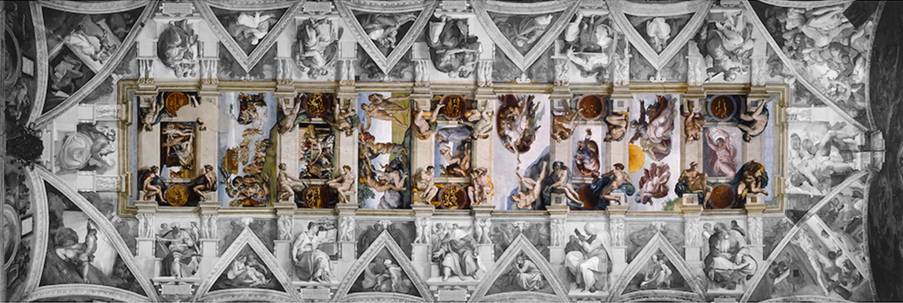

天顶中央这 9 块是主线。**故事从祭坛墙那端开始**，越往入口越"晚"。现场可以从《创造亚当》为锚点，往祭坛数三块是开天辟地，往入口数是堕落与诺亚。下面**一幕一格逐块认**（④《创造亚当》另见上方专条）。

> **看顺序建议**：九场景是画给**面朝祭坛的人**看的正向——进门顺着人流朝祭坛走，抬头画是正的，但故事对你是 9→1 倒放。建议：进门先顺向把画面认一遍、走到祭坛端（顺路抬头认约拿），然后在祭坛端回身，从第 1 幕《分开光暗》往入口方向把故事线捋一遍（光暗→日月→海陆→造亚当→造夏娃→原罪→献祭→洪水→醉酒）——这一遍画面对你是倒的，但你只需要串故事；《最后的审判》正好在你转身可见处。

#### ① 分开光与暗 _Separazione della luce dalle tenebre_

[图片来自wikipedia](https://af.wikipedia.org/wiki/Plafon_van_die_Sixtynse_kapel)

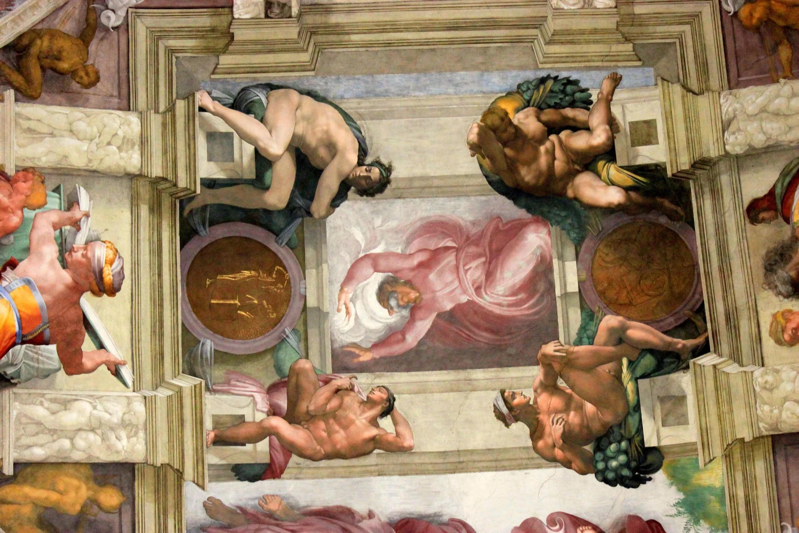

**内容**：创世第一日——神说"要有光"，把光暗分开（创 1:3–4）。**看点**：九场景最抽象、最晚画的一块，据载**一天画完**——几乎只剩一个旋转上升的躯体，米氏到此已敢把上帝画成一团纯粹的动势。瓦萨里赞这一幕："他独自张开双臂支撑自己，显出全部的威严——那是爱与创造之力的演示。"

#### ② 创造日月与草木 _Creazione degli astri e delle piante_

> 🔗 官方：[Creation of the sun, moon and plants · Musei Vaticani](https://www.museivaticani.va/content/museivaticani/en/collezioni/musei/cappella-sistina/volta/storie-centrali/creazione-degli-astri-e-delle-piante.html)

**内容**：第三、四日并作一画——正面的上帝指造太阳与月亮，左侧**同一个上帝**以背影掠过、造出草木。**看点**：罕见的"一画双身"；正面像极速冲向观众的极端透视，背影则连上帝的臀部都照画不误——当年颇为大胆。

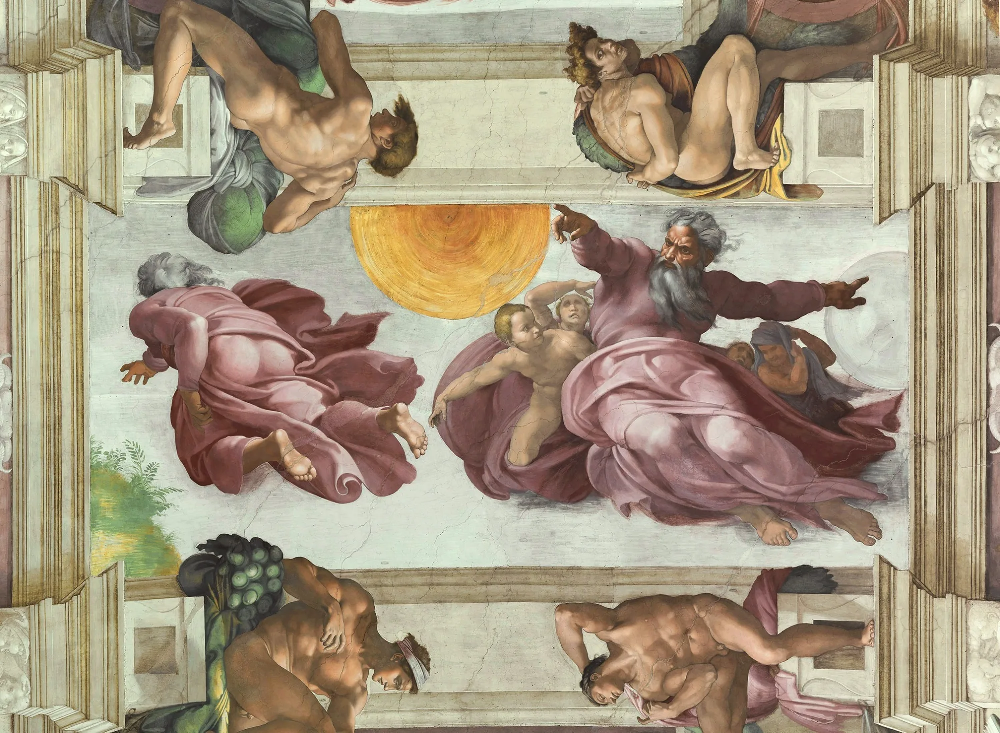

[图片来自wikipedia](https://af.wikipedia.org/wiki/Plafon_van_die_Sixtynse_kapel)

#### ③ 分开海与陆 _Separazione delle acque dalla terra_

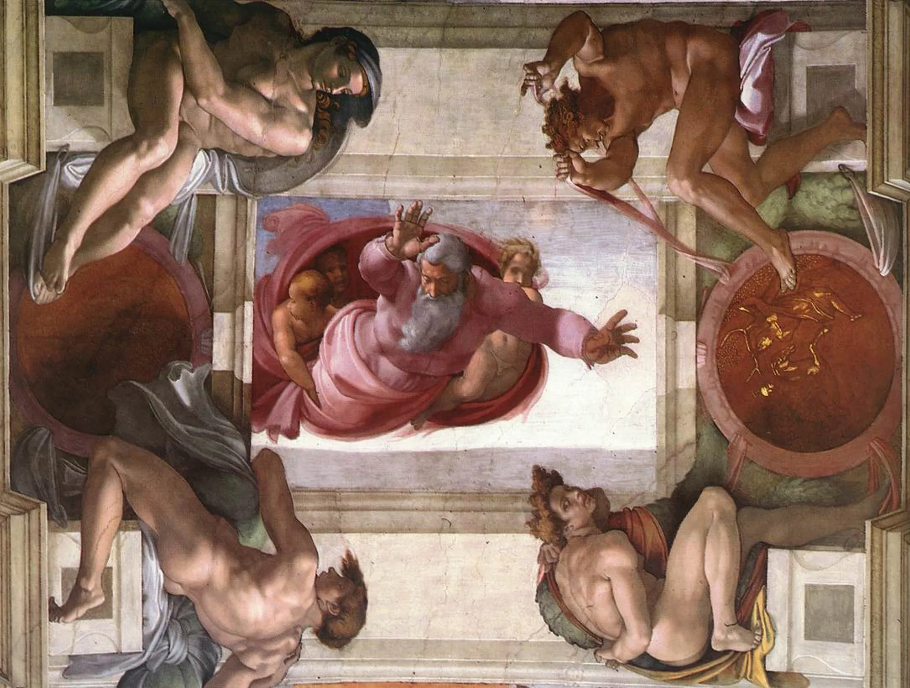

**内容**：第二日——神分开诸水（此幕与第②幕**顺序对调**，按经文它应在前）。**看点**：上帝张臂掠过水面的飞翔姿态，是《创造亚当》的"预演"；和第④幕连看最明显。

> 📖 **第①–③幕合读（创世记 1 章）**：开篇七日被压缩进三块——第一日造光分明（①）、第二日分诸水（③，多数学者的认定，所以②③与经文顺序对调）、第三日旱地植物＋第四日日月星辰（并入②，上帝一画两现）。第五、六日造鱼鸟走兽没单独成画，第六日高潮"造人"直接进第④幕。这三块是整个工程**最后画**的，也最奔放——上帝不再端坐，而是一团掠过天空的能量。

#### ④ 创造亚当 _Creazione di Adamo_ ⭐⭐⭐

**内容**：第六日造人——上帝飞来，指尖即将点活斜倚的亚当，"将触未触"的 1.9 cm 是全画的灵魂。**详见上方专条**（《创造亚当》⭐⭐⭐，含红斗篷"像脑还是像子宫"、夏娃之谜、现场站看 8 点）。全顶第一名作。

#### ⑤ 创造夏娃 _Creazione di Eva_

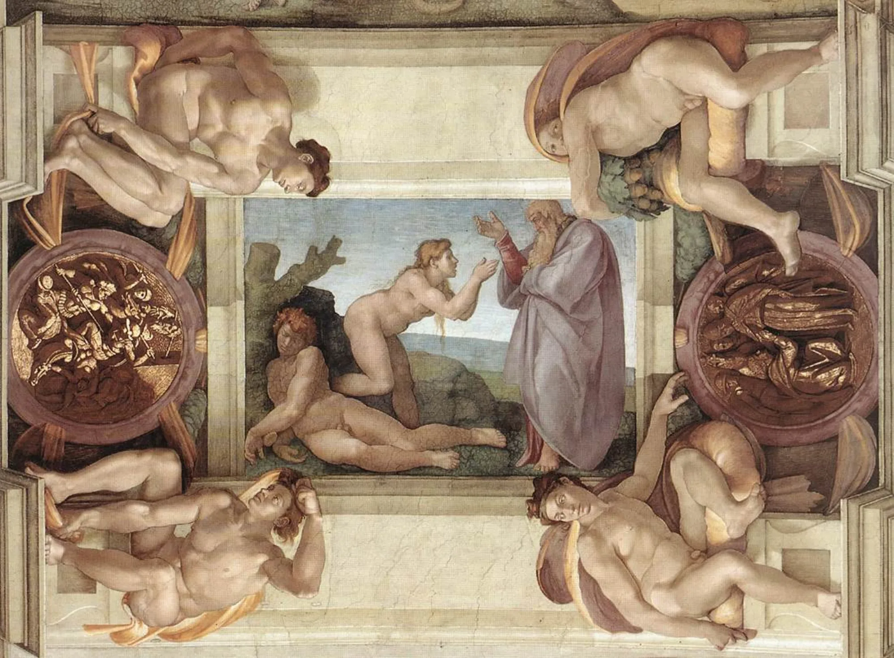

**内容**：神使亚当沉睡、取其肋骨造女人（创 2:21–22）；夏娃合掌走向神。**看点**：恰在整顶**几何中心**，也正对当年分隔圣俗两区的大理石屏栏——传统读法"教会自基督肋旁而生"被放在枢纽位；构图借自米氏年轻时临摹过的雅各布·德拉·奎尔恰（Jacopo della Quercia）博洛尼亚门浮雕。

#### ⑥ 原罪与逐出乐园 _Peccato originale e cacciata_

> 🔗 官方：[Original Sin and Banishment · Musei Vaticani](https://www.museivaticani.va/content/museivaticani/en/collezioni/musei/cappella-sistina/volta/storie-centrali/peccato-originale-e-cacciata-dal-paradiso-terrestre.html)

**内容**：创 3 章两个时刻并入一画——左侧摘禁果，右侧持剑天使驱逐。**看点**：树是**无花果**不是苹果；蛇的上半身是女人；亚当不是被动受骗、自己伸手抓果——左侧夫妇丰润年轻、右侧瞬间佝偻苍老，堕落的代价全写在身体上。中间只隔一棵树：树左是伊甸的丰润，树右是旷野的枯黄，同一对人瞬间老了十岁。

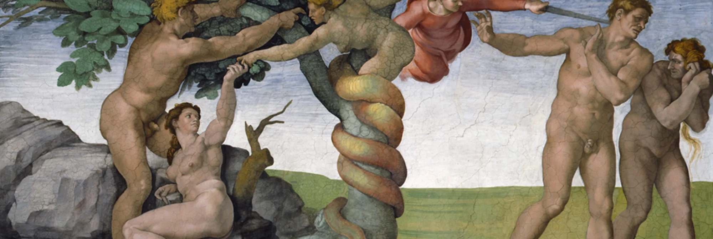

*图源：[梵蒂冈博物馆官网](https://www.museivaticani.va/content/museivaticani/en/collezioni/musei/cappella-sistina/volta/storie-centrali/peccato-originale-e-cacciata-dal-paradiso-terrestre.html)*

#### ⑦ 诺亚献祭 _Sacrificio di Noè_

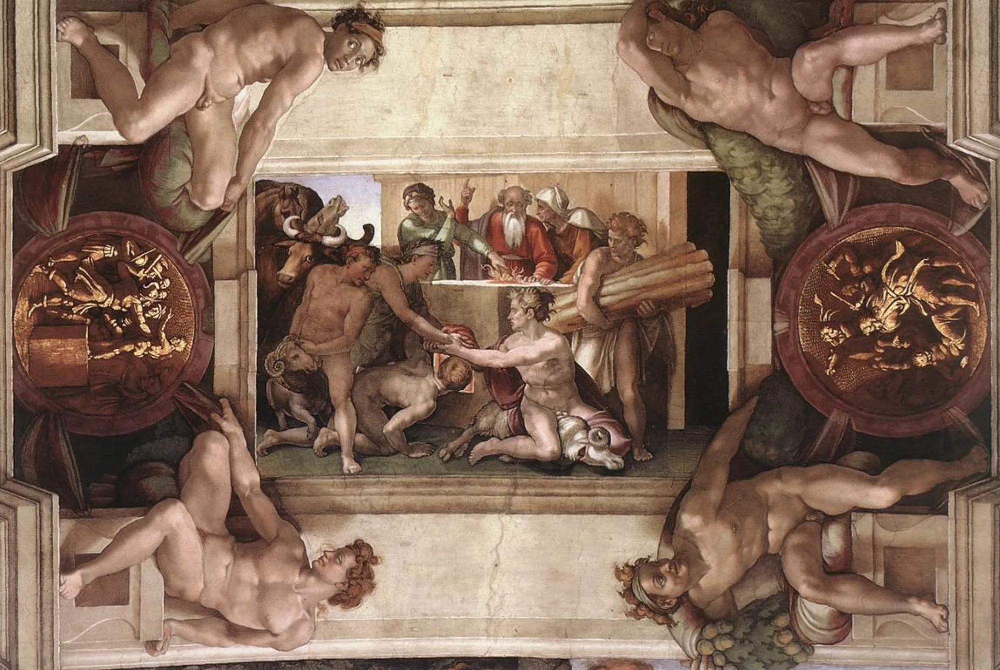

**内容**：洪水后诺亚全家筑坛献祭谢恩（创 8:20；与第⑧幕**顺序对调**）。**看点**：连瓦萨里都认错成"该隐与亚伯献祭"；人物密集、动作繁复，属早期"画得满"的风格。

#### ⑧ 大洪水 _Diluvio universale_

> 🔗 官方：[The Flood · Musei Vaticani](https://www.museivaticani.va/content/museivaticani/en/collezioni/musei/cappella-sistina/volta/storie-centrali/diluvio-universale.html)

**内容**：创 6–7 章——方舟浮在远处，灭顶的人类攀上孤丘、相互拖拽救援。**看点**：**米氏最早画的大场面**，人物最多最挤、最"费劲"——拿它和《分开光暗》对比，能看出他四年里如何"做减法"；右上角天空 1797 年被爆炸震落一块，原画的闪电（神怒）没了。

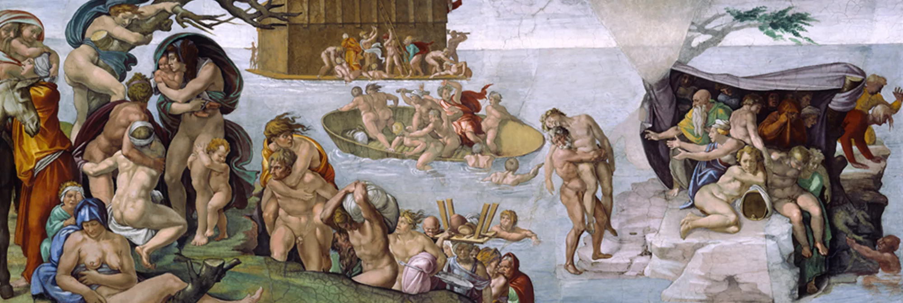

*图源：[梵蒂冈博物馆官网](https://www.museivaticani.va/content/museivaticani/en/collezioni/musei/cappella-sistina/volta/storie-centrali/diluvio-universale.html)*

#### ⑨ 诺亚醉酒 _Ebbrezza di Noè_

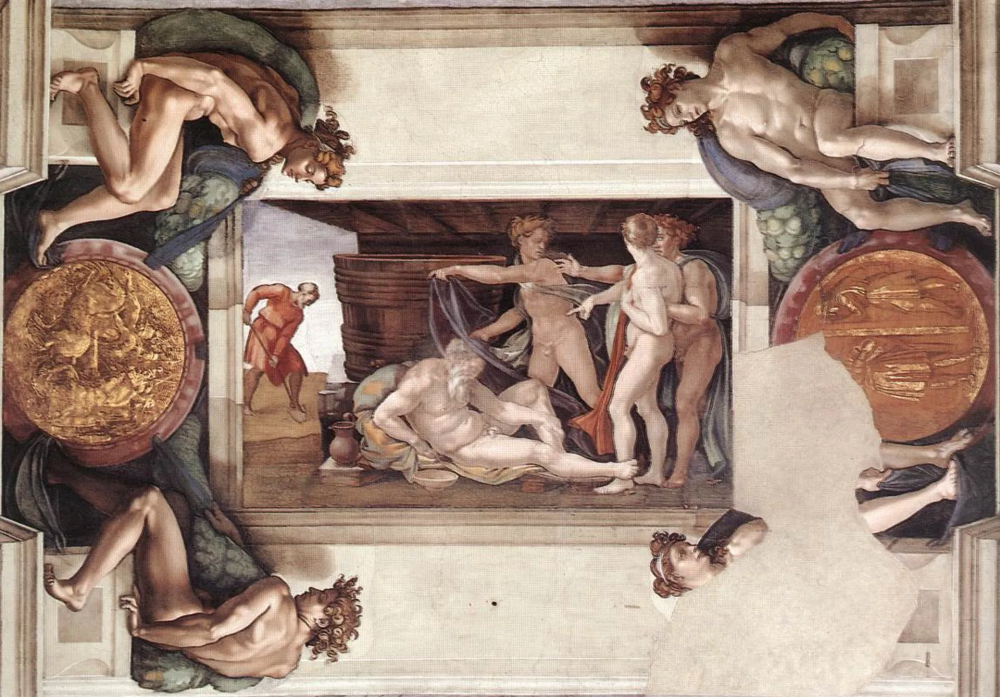

**内容**：创 9 章——诺亚种葡萄酿酒、醉倒裸卧；小儿子含张扬其丑，闪与雅弗倒退着以衣遮父。**看点**：最靠入口、画在**平信徒入口正上方**；背景还有诺亚锄地的小身影——义人也会跌倒，人类自救失败的句点。

> 📖 **第⑦–⑨幕诺亚三联（创世记 6–9 章）**：三段构成一个完整论证——**洪水**（⑧）人的恶贯满盈、神以洪水清洗只留方舟一家（审判与拯救同框）；**献祭**（⑦）水退后诺亚筑坛、神以彩虹立约不再灭世（感恩与新开始）；**醉酒**（⑨）可这位"全地仅存的义人"转头就醉倒受辱——新的开始立刻又跌倒，连最好的人也守不住。

#### 为什么以《诺亚醉酒》收尾（整条天顶的逻辑）

天顶的明线是创世，暗线是**人类需要救赎**：神造的世界完美无瑕，人却一路下坠——亚当堕落、世界败坏到被洪水重置、连义人诺亚也醉倒在地。故事停在入口端、平信徒进出的门正上方，绝非偶然：抬头是人类的最低点，答案在墙上——两侧 15 世纪壁画带的《摩西生平》（旧约之约）与《基督生平》（新约之约），加上窗上的基督家谱：神沿着血脉送来救主。中世纪以来的预表传统还给"醉酒"叠了一层更深的读法（奥古斯丁以降）：诺亚种葡萄、被酒所困、赤身受辱、被子女遮盖——预表基督被剥衣受辱的受难，葡萄酒预表圣餐；方舟预表教会，洪水预表洗礼（《彼得前书》3:20–21 已经这样连）。艺术史家托尔奈（Charles de Tolnay）的新柏拉图主义读法则干脆倒过来：从入口走向祭坛，是灵魂从沉沦的肉身（醉酒）一步步上升、回到纯粹的神（分开光暗）——你在堂内从入口走向祭坛的这段路，正好把这条"上升之路"亲脚走一遍。

### 弦月与三角区（基督的祖先）（顺路认一认） ⭐

> 🔗 官方：[Spandrels · Musei Vaticani](https://www.museivaticani.va/content/museivaticani/en/collezioni/musei/cappella-sistina/volta/vele.html)

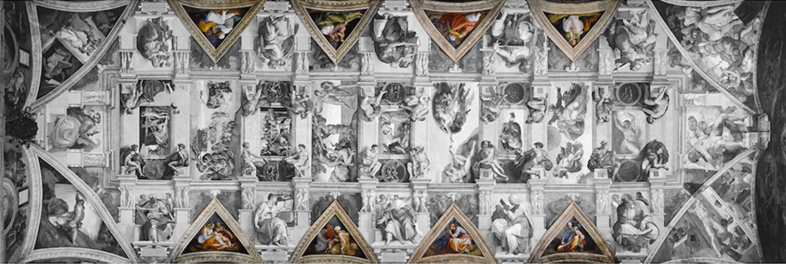

窗户上方一圈昏暗的家庭群像，是《马太福音》开篇的基督家谱——从亚伯拉罕到约瑟的列祖列宗，每格石牌上写着名字。米氏故意把他们画得疲惫、平凡、无所事事：在漫长等待中过日子的"纯粹的人"，色调也是全顶最暗——衬托中央创世的光辉，也接住"神沿着血脉送来救主"这条线（与四角、先知一起构成"应许—等待—应验"）。1980 年代修复后，这一圈是色彩翻新最戏剧性的部分（之前几乎看不清）。

天顶两条长边上方一共有 **8 个三角区（vele）**，各顶着一对仿铜裸像、沿用正下方弦月的名字牌（祭坛墙原有的弦月画《最后的审判》时被米氏自己铲掉了）。**三角区里的人物本身没有被认定为具体某人**，只借下方名字牌指代一段家谱。下面按**马太家谱顺序**把 8 个三角区逐一列出（每格配一张图；②⑦另附官网整格大图）：

#### ① 撒门 · 波阿斯 · 俄备得 _Salmon · Booz · Obed_

家谱里"士师时代"的一段：撒门娶了耶利哥的喇合，波阿斯娶了摩押女子路得，生俄备得——俄备得是大卫的祖父。两位外族媳妇进了弥赛亚的血脉。

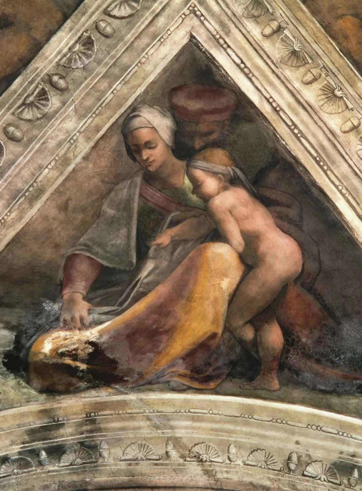

*图源：[图片来源](http://www.artpi.cn/?list_6/30.html)（据来源标注为撒门）*

#### ② 耶西 · 大卫 · 所罗门 _Iesse · David · Salomon_

> 🔗 官方：[Spandrel of the lunette Jesse, David, Solomon · Musei Vaticani](https://www.museivaticani.va/content/museivaticani/en/collezioni/musei/cappella-sistina/volta/vele/vela-della-lunetta-iesse--david--salomon.html)

家谱里最显赫的一段：耶西（大卫之父，弥赛亚要从"耶西的本"长出，赛 11:1）、大卫王、所罗门王——犹大王统的开端。

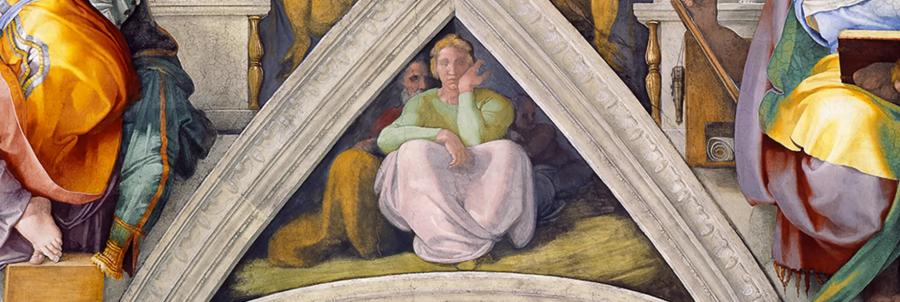

*图源：[梵蒂冈博物馆官网](https://www.museivaticani.va/content/museivaticani/en/collezioni/musei/cappella-sistina/volta/vele/vela-della-lunetta-iesse--david--salomon.html)*

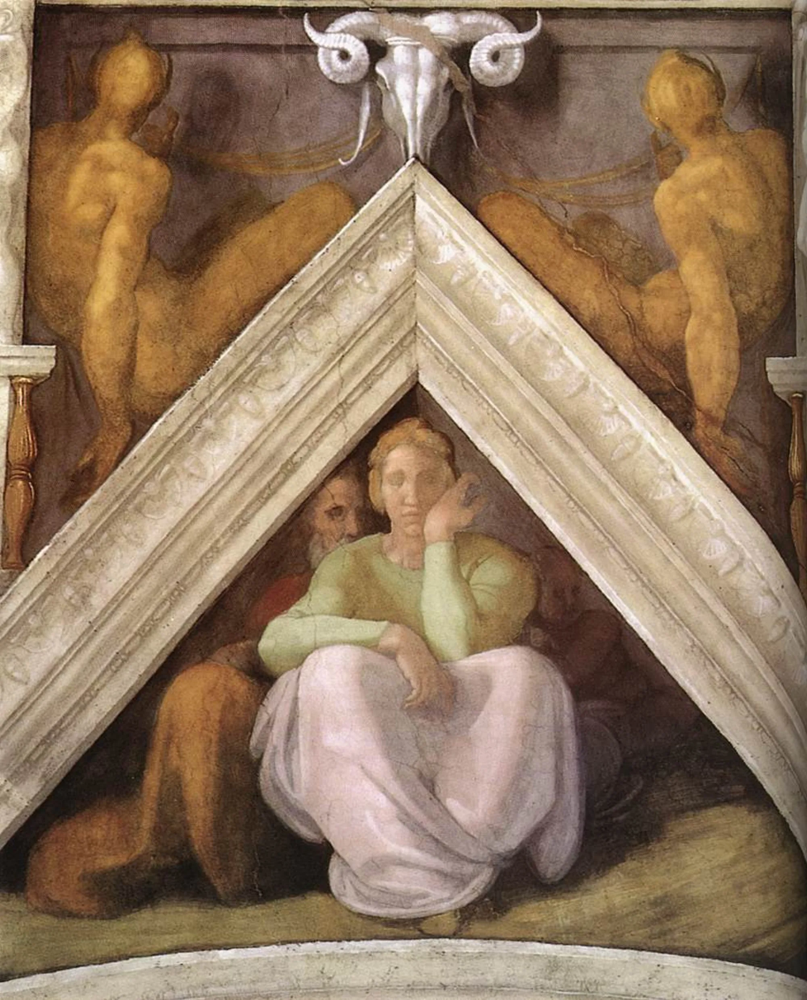

*图源：[Wikimedia Commons](https://commons.wikimedia.org/wiki/File:Michelangelo_jesse.jpg)（✓ 即官方所述「手背贴脸颊的谜样女子」）*

#### ③ 罗波安 · 亚比雅 _Roboam · Abia_

所罗门之子罗波安在位时王国分裂（南犹大、北以色列），亚比雅继位——王统由盛转乱的起点。

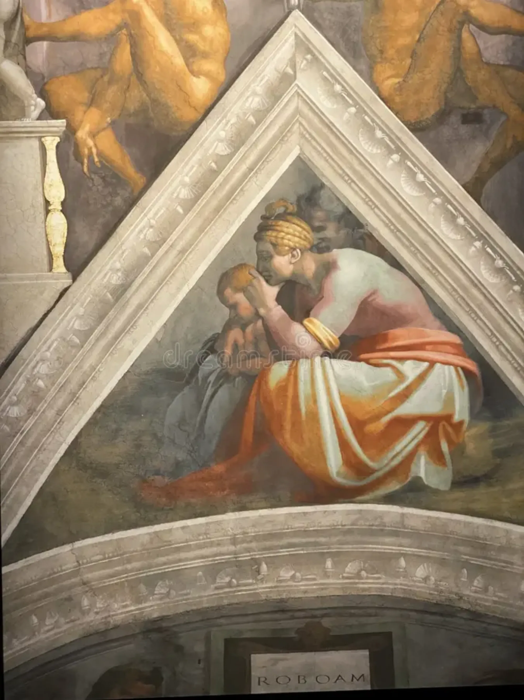

*图源：[图片来源](https://www.dreamstime.com/jan-auckland-new-zealand-close-up-photo-ancestors-christ-solomon-father-rehoboam-ceiling-fresco-painting-image239464255)（据来源标注为「所罗门·罗波安之父」，对应罗波安格）*

#### ④ 亚撒 · 约沙法 · 约兰 _Asa · Iosafat · Ioram_

亚撒、约沙法是犹大有名的改革之王（除偶像、行公义），约兰则娶了亚哈之女、王室再度堕落——一段"贤君与昏君交替"的家谱。

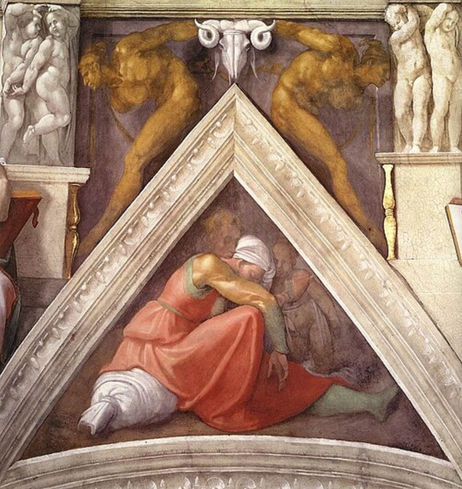

*图源：[Wikimedia Commons](https://commons.wikimedia.org/wiki/File:Michelangelo,_antenati_di_cristo,_06.jpg)（✓ 亚撒一家：背景父亲着朝圣袍、前景母亲沉睡）*

#### ⑤ 乌西雅 · 约坦 · 亚哈斯 _Ozia · Ioatam · Acaz_

乌西雅（亚撒利雅）国势强盛却因擅入圣殿献香而长大麻风、被隔离至死；约坦守正；亚哈斯则拜偶像、引亚述入侵——以赛亚正是在这几位王治下作先知。

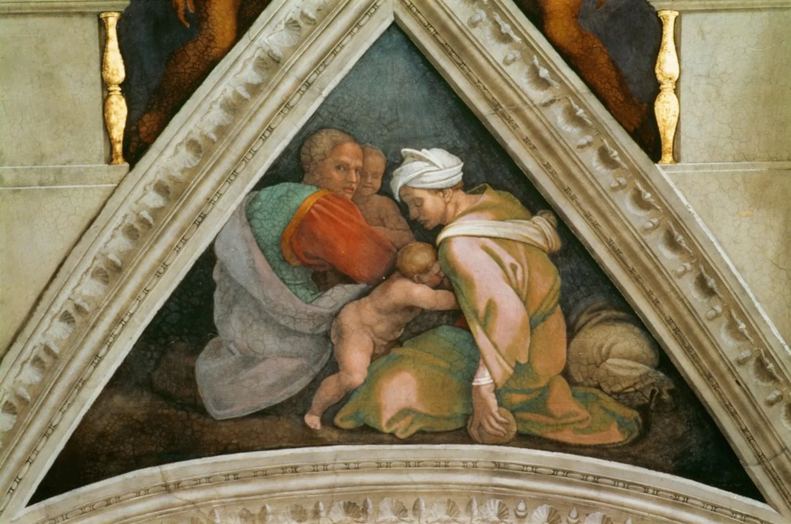

*图源：[图片来源](https://www.meisterdrucke.ie/fine-art-prints/Michelangelo-Buonarroti/1138910/The-Ancestors-of-Christ:-Ozias-Sistine-Chapel-ceiling-in-the-Vatican.html)（据来源标注为 Ozias 乌西雅）*

#### ⑥ 希西家 · 玛拿西 · 亚们 _Ezechia · Manasse · Amon_

希西家是犹大头号贤王（抵御亚述、重修圣殿）；其子玛拿西在位最长、也最恶，晚年却悔改；亚们短暂在位被弑——大起大落的一段。

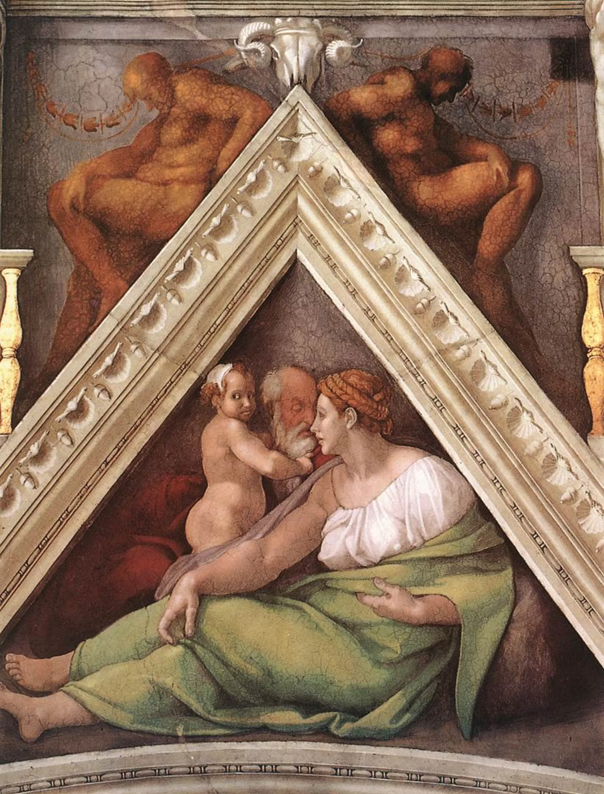

*图源：[Wikimedia Commons](https://commons.wikimedia.org/wiki/File:Michelangelo,_antenati_di_cristo,_04.jpg)（据来源标注为希西家与父亲亚哈斯）*

#### ⑦ 约西亚 · 耶哥尼雅 · 撒拉铁 _Iosias · Iechonias · Salathiel_

> 🔗 官方：[Spandrel of the lunette Josiah, Jechoniah, Shealtiel · Musei Vaticani](https://www.museivaticani.va/content/museivaticani/en/collezioni/musei/cappella-sistina/volta/vele/vela-della-lunetta-iosias--iechonias--salathiel.html)

约西亚是末代贤王（重新发现律法书、大行改革）；耶哥尼雅被掳巴比伦、王朝倾覆；撒拉铁生于囚中——血脉跌入最低谷却仍延续。

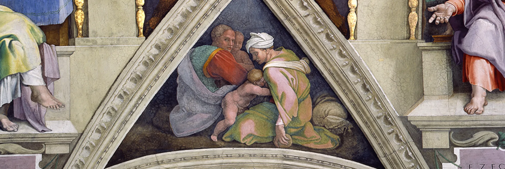

*图源：[梵蒂冈博物馆官网](https://www.museivaticani.va/content/museivaticani/en/collezioni/musei/cappella-sistina/volta/vele/vela-della-lunetta-iosias--iechonias--salathiel.html)*

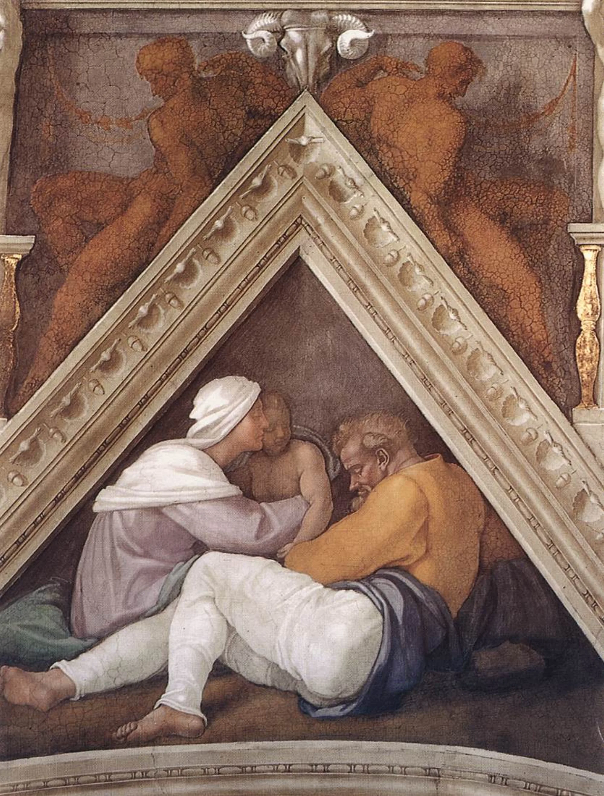

*图源：[Wikimedia Commons](https://commons.wikimedia.org/wiki/File:Michelangelo,_antenati_di_cristo,_02.jpg)（✓ 耶哥尼雅一家：母亲抱子撒拉铁、脸贴脸）*

#### ⑧ 所罗巴伯 · 亚比玉 · 以利亚敬 _Zorobabele · Abiud · Eliachim_

所罗巴伯率被掳者归回耶路撒冷、主持重建第二圣殿；亚比玉、以利亚敬续接血脉，一路通向约瑟与基督——家谱的"归回与盼望"段，正好收在离基督最近处。

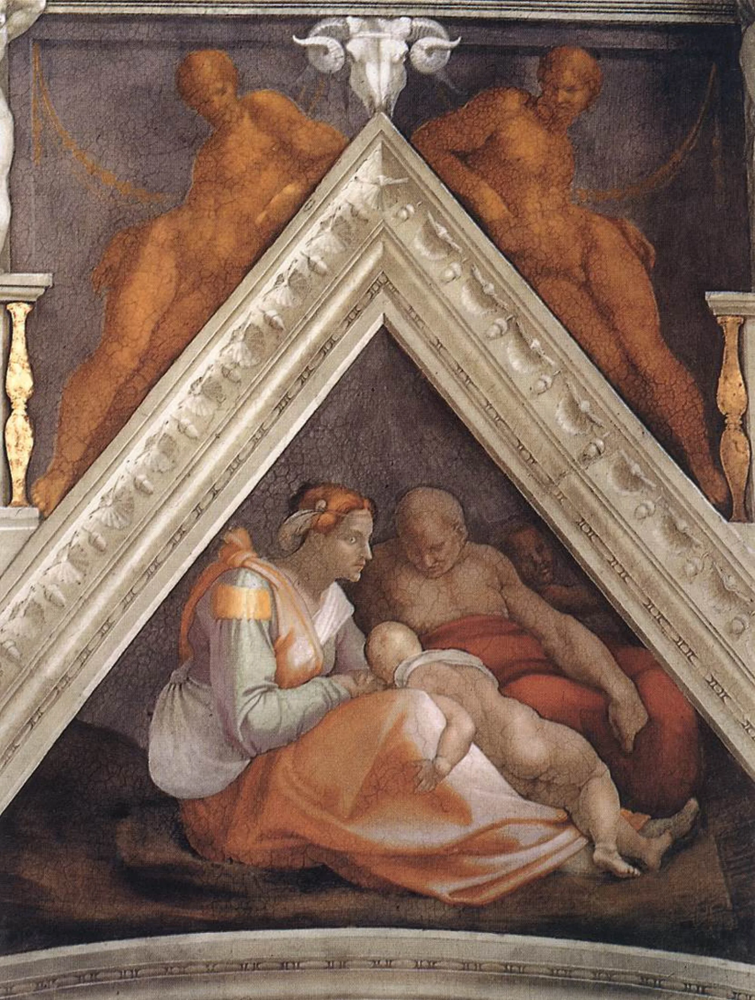

*图源：[Wikimedia Commons](https://commons.wikimedia.org/wiki/File:Michelangelo,_antenati_di_cristo,_01.jpg)（据来源标注为所罗巴伯一家）*

### 四角三角帆 （顺路认一认） ⭐

> 🔗 官方：[Pendentives · Musei Vaticani](https://www.museivaticani.va/content/museivaticani/en/collezioni/musei/cappella-sistina/volta/pennacchi.html)

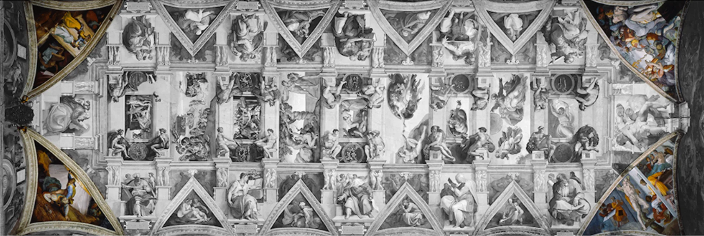

四个角的弧面三角区画**以色列四次"绝处得救"**——天顶主线说"人无法自救"，四角则补上"神一次次出手相救"，并预指最终的拯救者基督。

#### 大卫战歌利亚（入口端·面朝入口时的右侧）

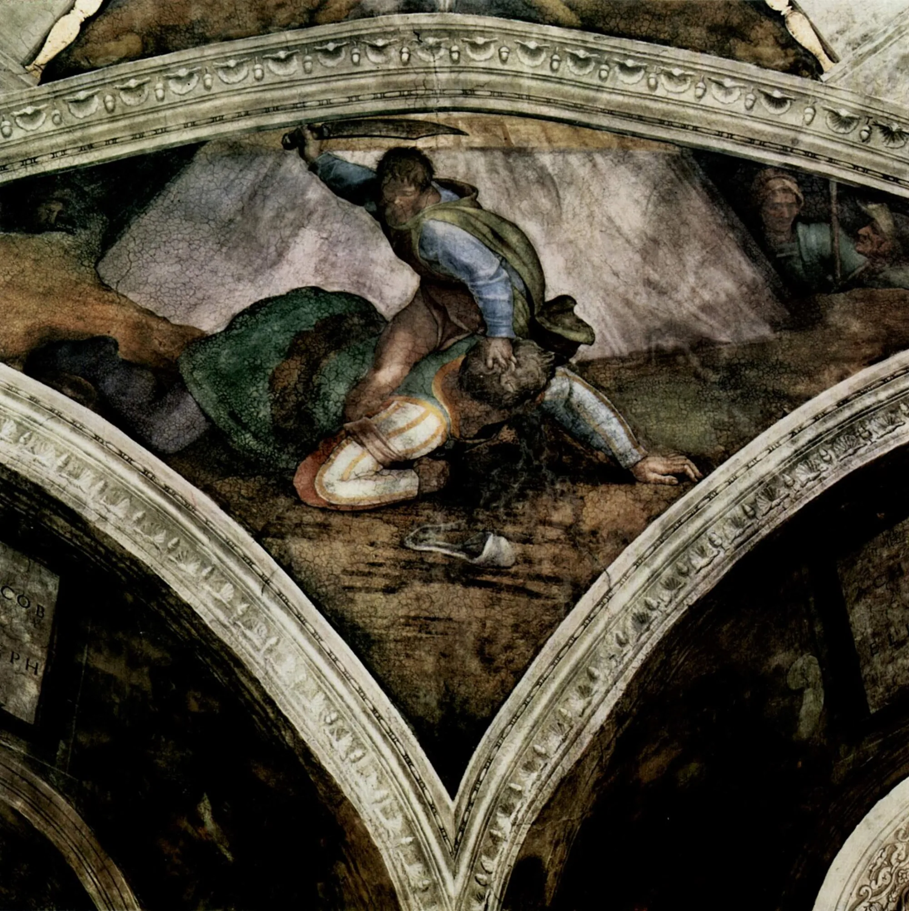

*图源：[Wikimedia Commons](https://commons.wikimedia.org/wiki/File:Michelangelo_Buonarroti_025.jpg)*

非利士巨人歌利亚（Goliath）骂阵四十天无人敢应，牧童大卫（David）不穿铠甲，用机弦甩石击中巨人额头、再拔下对方的刀斩首（撒上 17）。米氏选**斩首前一瞬**：大卫骑在扑倒的巨人背上抡刀，歌利亚还在挣扎撑起——胜负已定但刀还没落。

#### 友弟德斩荷罗孚尼（入口端·左侧）

> 🔗 官方：[Judith and Holofernes · Musei Vaticani](https://www.museivaticani.va/content/museivaticani/en/collezioni/musei/cappella-sistina/volta/pennacchi/giuditta-e-oloferne.html)

次经《友弟德传》——亚述大军围城，寡妇友弟德（Judith）盛装入敌营，趁主帅荷罗孚尼（Holofernes）醉卧帐中斩其首级，敌军随即溃散。画面定格在**得手之后**：友弟德把人头放进侍女顶着的盘里、用布盖住，还回头瞟一眼帐中无头的躯体——紧张感全在"逃离现场"这一刻。大卫与友弟德在佛罗伦萨艺术里是一对"诛暴君"图腾（多纳泰罗给两人都做过像），放在共和国艺术家手里再顺手不过。

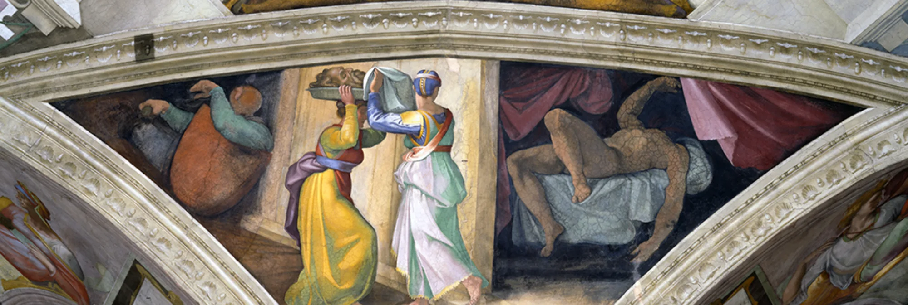

*图源：[梵蒂冈博物馆官网](https://www.museivaticani.va/content/museivaticani/en/collezioni/musei/cappella-sistina/volta/pennacchi/giuditta-e-oloferne.html)*

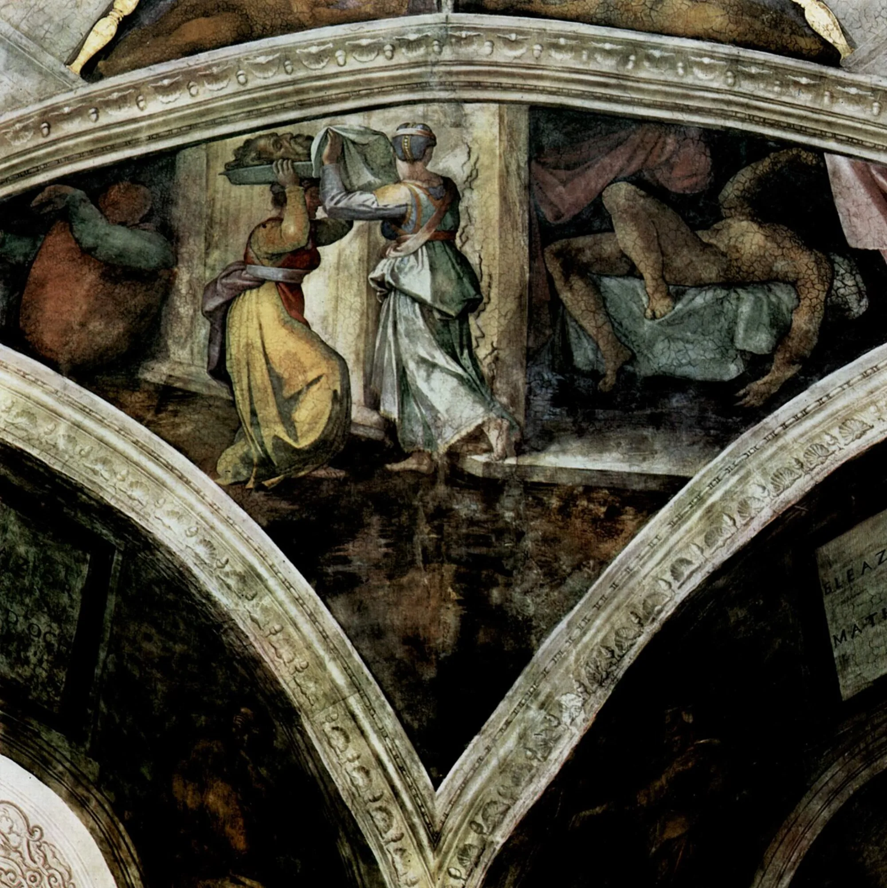

*图源：[Wikimedia Commons](https://commons.wikimedia.org/wiki/File:Michelangelo_Buonarroti_038.jpg)*

#### 铜蛇（祭坛端·面朝祭坛时的右侧）

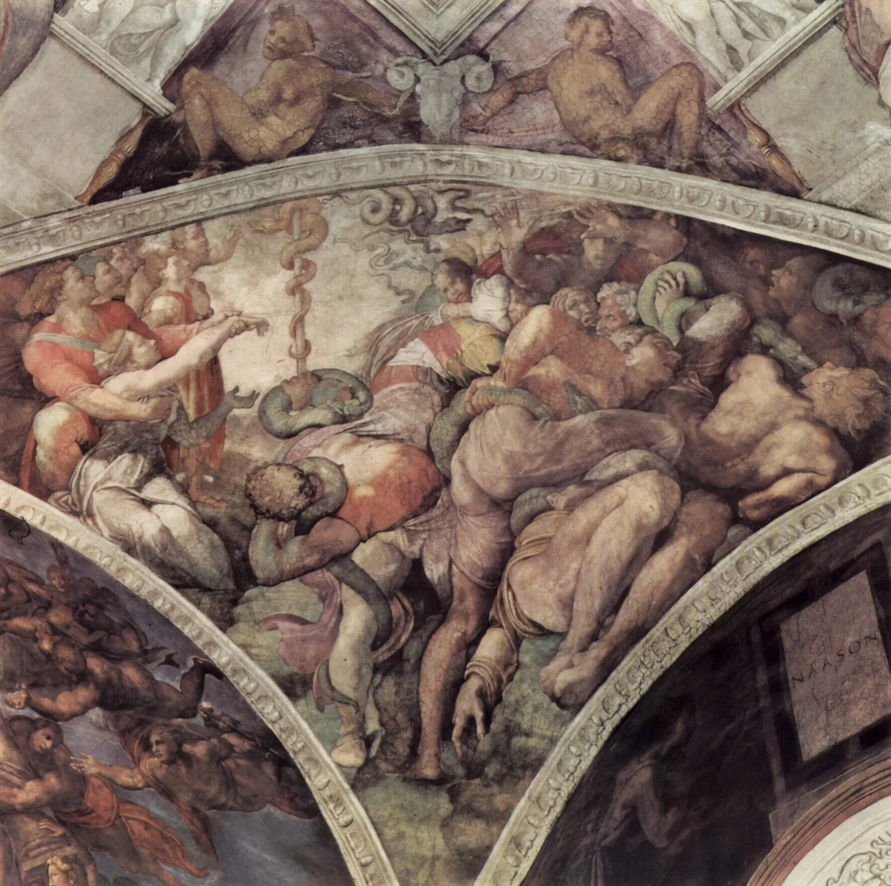

*图源：[中文维基百科](https://zh.wikipedia.org/wiki/File:Michelangelo_Buonarroti_024.jpg)*

旷野中以色列人抱怨神，火蛇成灾；神命摩西（Moses）造一条铜蛇挂在杆子上，「凡被咬的，一望这蛇，就活了」（民 21）。耶稣亲自引为预表：「摩西在旷野怎样举蛇，人子也必照样被举起来」（约 3:14）——挂在杆上的救赎之物，就是十字架。画面挤满纠缠扭曲的中毒者：一侧望蛇得救、一侧背蛇而亡，被认为直接致敬刚出土不久的《拉奥孔》（就在本馆八角庭院）；19 世纪批评家罗斯金（John Ruskin）甚至认为这块画的"群体之痛"胜过拉奥孔本尊。

#### 哈曼受刑（祭坛端·左侧）

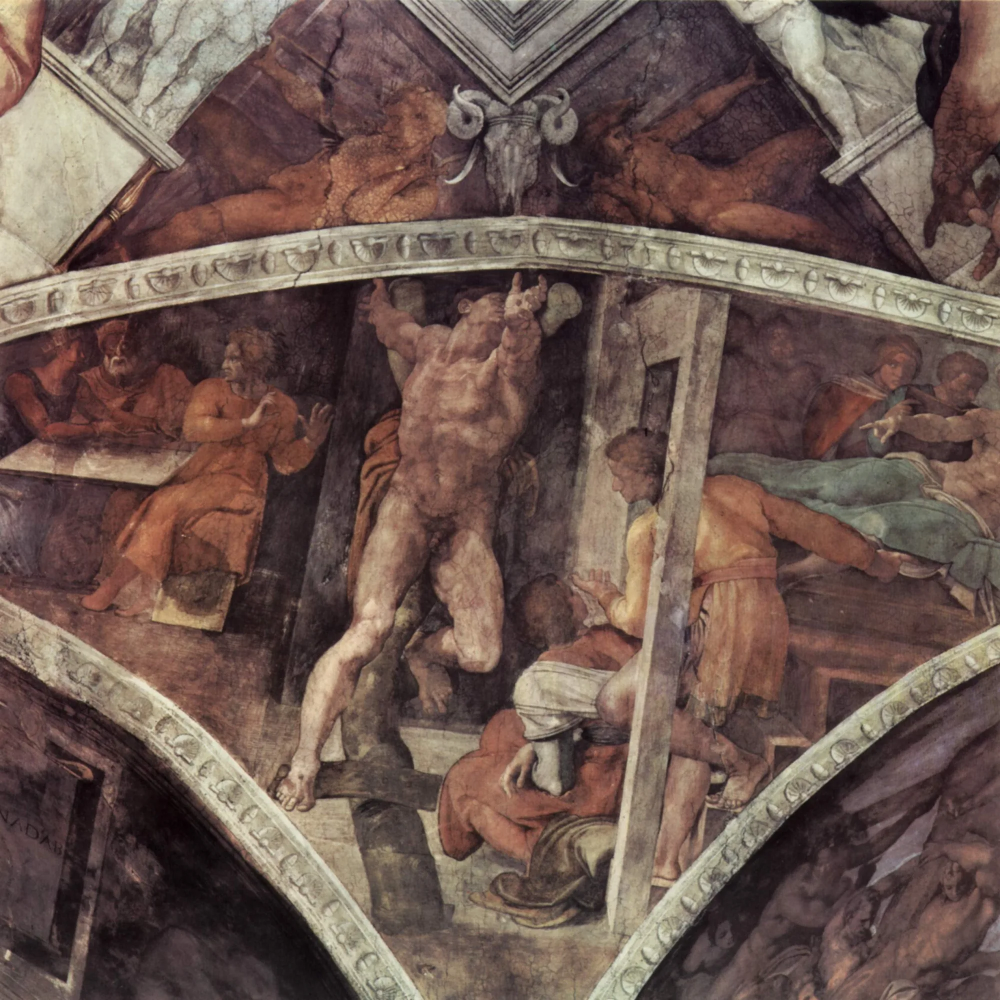

*图源：[Wikimedia Commons](https://commons.wikimedia.org/wiki/File:Michelangelo_Buonarroti_034.jpg)*

《以斯帖记》——波斯权臣哈曼（Haman）设计要灭绝国内全部犹太人，王后以斯帖（Esther）冒死揭发，哈曼最终被挂在他为政敌末底改（Mordecai）预备的木架上。米氏不画绞刑，**把哈曼画成钉在十字架式木架上的人体**——全顶透视短缩最猛的一具身体，把"恶人之死"明写成受难的反像。铜蛇与哈曼这一对都是中世纪神学钦定的**十字架预表**，所以放在祭坛端、紧邻日后的《最后的审判》。

#### 现场站看

先看祭坛端两块（哈曼的短缩人体＋铜蛇的人堆），入口端两块就在你进门处头顶，出门前补看即可。

### 12 位先知与女先知（两侧的巨人） ⭐⭐

> 🔗 官方：[Sibyls and Prophets · Musei Vaticani](https://www.museivaticani.va/content/museivaticani/en/collezioni/musei/cappella-sistina/volta/sibille-e-profeti.html)

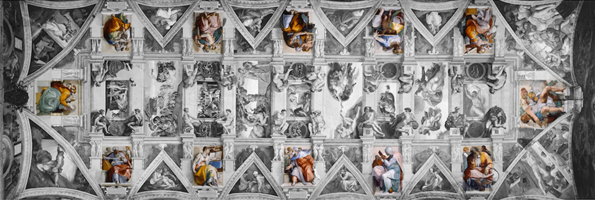

托着中央故事的 12 个宝座巨人，是天顶上**最大的人物**：旧约的 7 位**先知**与古典异教世界的 5 位**女先知（Sibyls，西比拉）**交替而坐，脚下各有小天使举着刻名的石牌。把异教的女祭司请进教皇的礼拜堂，是文艺复兴人文主义的宣言：**不只犹太先知，连希腊罗马世界也在等候基督**。这套读法古已有之——4 世纪护教士拉克坦提乌斯（Lactantius）就引西比拉神谕来证明独一神；维吉尔（Virgil）《牧歌》第四首借库迈女先知之口预言"上天新的后裔"将带回黄金时代，文艺复兴普遍把它读作预言基督降生；中世纪安魂曲唱词《震怒之日》（Dies irae）里也是"大卫与西比拉同作见证"。五位女先知的"产地"横跨北非、波斯、希腊、小亚细亚——**整个已知世界都在预言同一件事**。下面**逐位认、每位配一张图**（标 ⭐ 的是最值得停的；图片身份据来源标注，未必全准）。

#### 约拿 _Jonah / Giona_ ⭐

**故事**：《约拿书》主角。奉命去亚述大城尼尼微宣告审判，却乘船往反方向逃；途中遇大风暴，被水手抽签认定是祸首、扔下海，随即被一条大鱼吞下，在鱼腹里待了**三日三夜**，痛悔祷告后被吐上岸，终于去尼尼微传道、全城悔改得赦。耶稣亲口把他当作自己的预表：「约拿三日三夜在大鱼肚腹中，人子也要这样三日三夜在地里头」（太 12:40）——**死亡三日而复活**。他向异邦尼尼微传道，也预示救恩临到外邦人。

**怎么看**：因此他被放在**祭坛正上方**、全堂最高荣誉位，身边就画着那条大鱼。这是**全顶技术最难的一块**——人物画在向前凸出的拱面上，却被画成身体向后大幅仰倾、几乎要跌出墙面的极端仰视透视（di sotto in sù），孔迪维专门夸过这一手。看天顶**先找他**，定位整个方向。

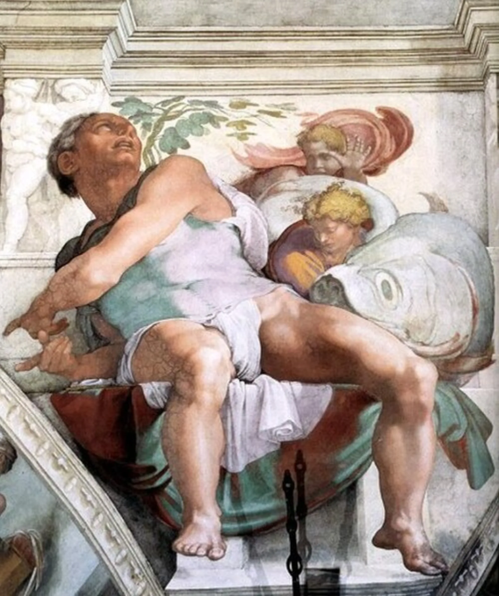

*图源：[中文维基百科](https://zh.wikipedia.org/zh-cn/%E7%BA%A6%E7%BA%B3_%28%E7%B1%B3%E5%BC%80%E6%9C%97%E5%9F%BA%E7%BD%97%29)*

#### 利比亚女先知 _Libyan Sibyl / Sibilla Libica_ ⭐

> 🔗 官方：[Libyan Sibyl · Musei Vaticani](https://www.museivaticani.va/content/museivaticani/en/collezioni/musei/cappella-sistina/volta/sibille-e-profeti/sibilla-libica.html)

**是谁**：古典名录里来自北非利比亚（阿蒙神谕一带）的女先知，在瓦罗（Varro）传下的古代西比拉名单里排第一位——代表非洲大陆也在预言基督的降临。

**怎么看**：她回身去合上（或捧起）一部巨册，全身拧成一道优雅的螺旋，全部重量压在**一只翘起的脚趾**上——是米氏"把人体当雕塑画"的代表作。为她画的红粉笔素描（用男模写生，现藏纽约大都会博物馆）本身就是素描史名作：连女先知都是按男性肌肉画的，这是米开朗基罗的一贯做法。

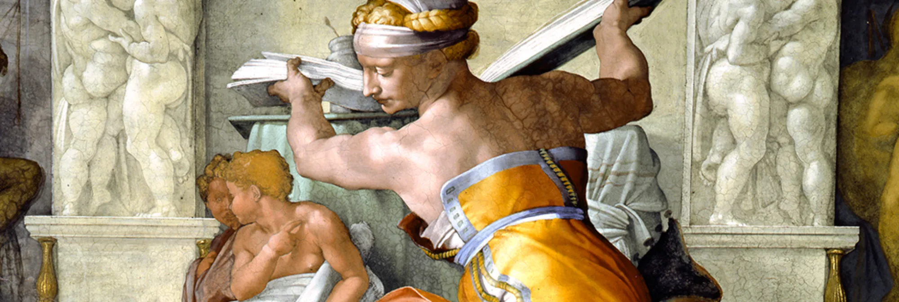

*图源：[梵蒂冈博物馆官网](https://www.museivaticani.va/content/museivaticani/en/collezioni/musei/cappella-sistina/volta/sibille-e-profeti/sibilla-libica.html)*

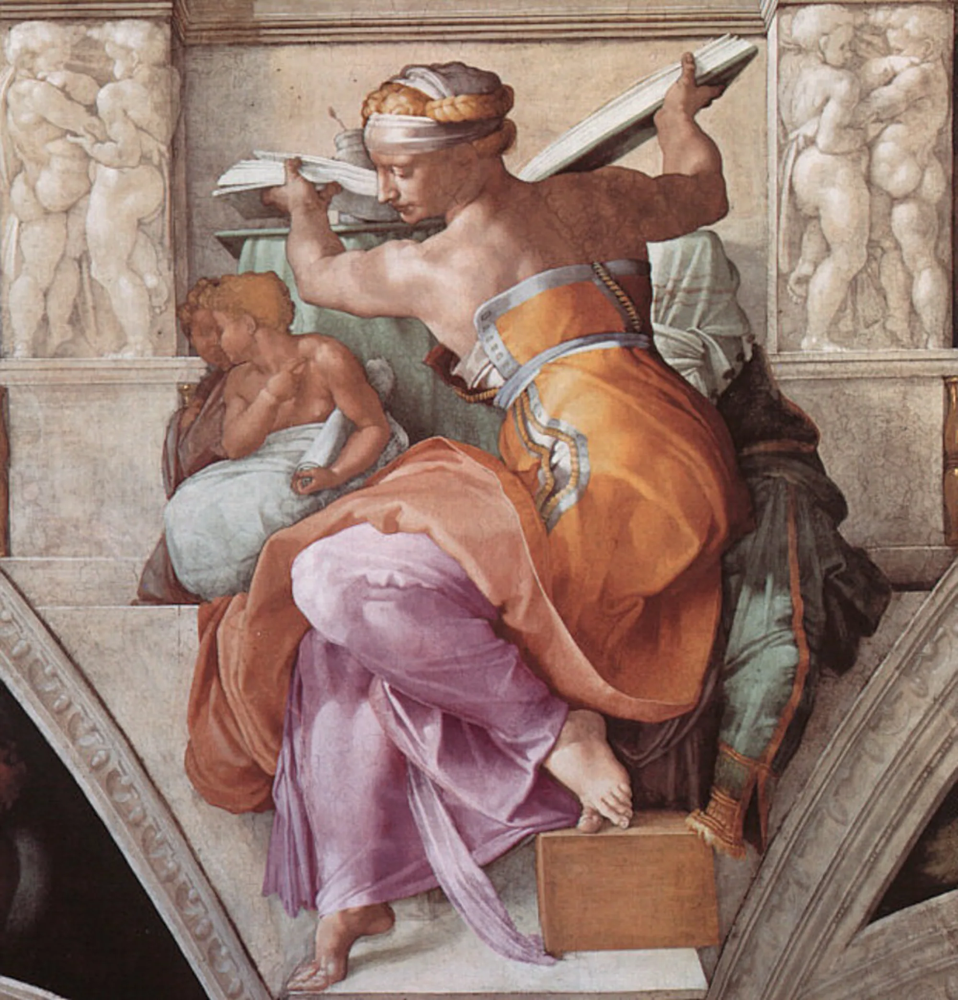

*图源：[中文维基百科](https://zh.wikipedia.org/zh-cn/%E5%88%A9%E6%AF%94%E5%8D%A1_%28%E7%B1%B3%E5%BC%80%E6%9C%97%E5%9F%BA%E7%BD%97%29)*

#### 以赛亚 _Isaiah_

**故事**：公元前 8 世纪犹大的大先知，弥赛亚预言最密集的一位——「必有童女怀孕生子，给他起名叫以马内利」（赛 7:14）、和平之君的预言（赛 9）、以及第二部分的"受苦仆人之歌"（赛 53，被基督徒读作基督受难的字面预告）都出自他书。传统说他殉道时被锯成两半。

**怎么看**：画中他正被身旁的小天使唤醒、回头去看那孩子，手指还夹在刚合上的书页里——"预言被打断、又被召唤"的一瞬。瓦萨里说："细看这个人物，能学到绘画艺术的全部要诀。"

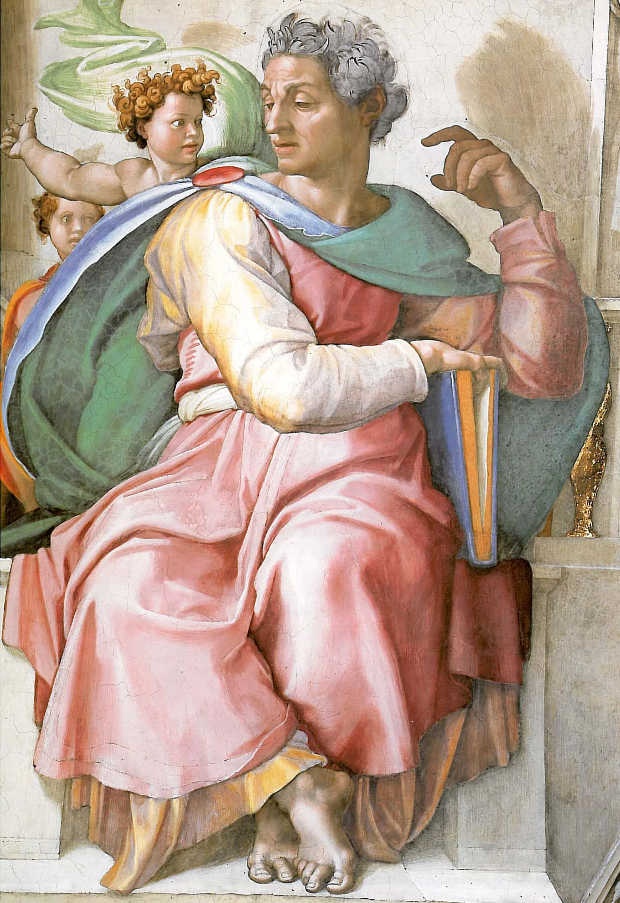

*图源：[中文维基百科](https://zh.wikipedia.org/zh-cn/%E4%BE%9D%E6%92%92%E6%84%8F%E4%BA%9A_%28%E7%B1%B3%E5%BC%80%E6%9C%97%E5%9F%BA%E7%BD%97%29)*

#### 耶利米 _Jeremiah_

**故事**：「哀哭的先知」，公元前 7–6 世纪亲历耶路撒冷陷落、圣殿被毁、犹大被掳巴比伦的全过程；他一生苦劝同胞悔改无人听、屡遭迫害下狱，《耶利米哀歌》传统归在他名下。

**怎么看**：米氏画他托腮垂目、双腿交叠、整个人塌进沉思与哀伤，是全顶最沉默内省的一位——常被认为是画家本人的**自我投射**（他后来在《最后的审判》里把自己画成一张剥下的人皮，自嘲一脉相承）。

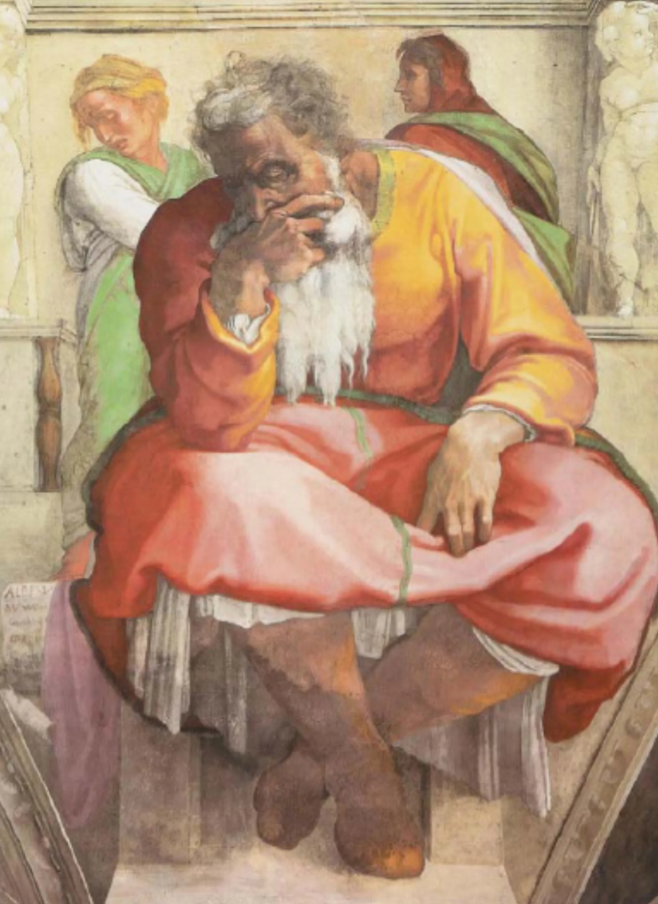

*图源：[中文维基百科](https://zh.wikipedia.org/zh-cn/%E8%80%B6%E8%82%8B%E7%B1%B3%E4%BA%9A%E5%85%88%E7%9F%A5_%28%E7%B1%B3%E5%BC%80%E6%9C%97%E5%9F%BA%E7%BD%97%29)*

#### 库迈女先知 _Cumaean Sibyl_

**故事**：意大利本土的神谕——那不勒斯湾库迈洞穴的女先知。维吉尔《埃涅阿斯纪》里她引埃涅阿斯（Aeneas）下冥府；罗马传说她向末代王塔克文兜售九卷《西比拉神谕书》，嫌贵被拒后当面烧掉六卷、剩三卷仍原价成交，那三卷成了罗马的国家圣典。奥维德笔下她向阿波罗求得"如沙粒之数的岁月"却忘了求青春，于是越活越老缩成一团。对教廷她分量最重：《牧歌》第四首里"预言基督降生"的正是她。

**怎么看**：米氏照"长寿而枯老"把她画成肌肉虬结的巨臂老妪，**上臂粗过头颅**，眯眼凑近一部大书——力量感全堂第一。

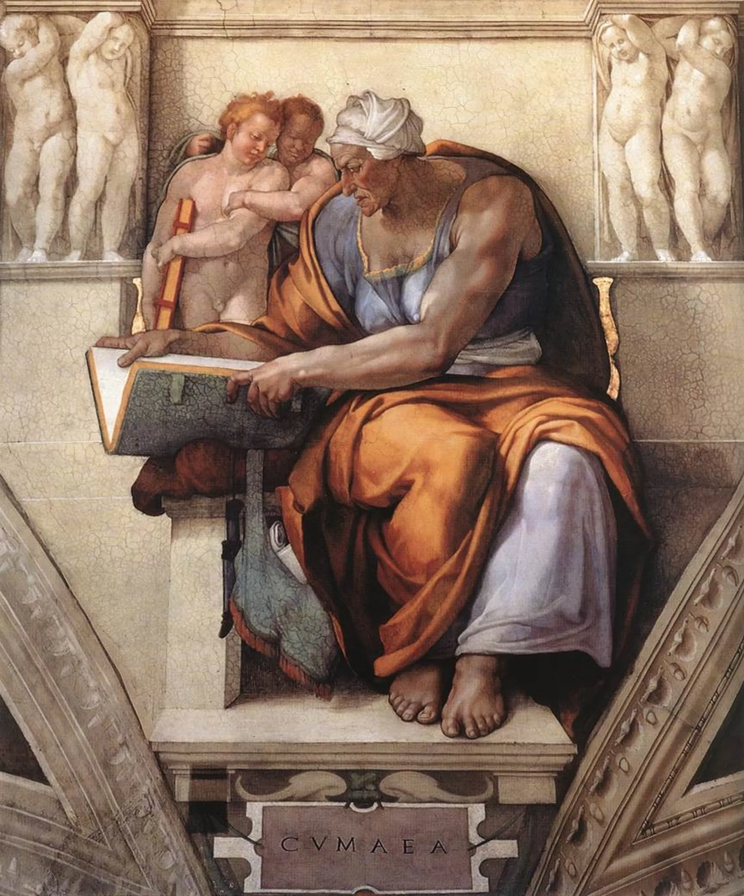

*图源：[中文维基百科](https://zh.wikipedia.org/zh-cn/%E5%BA%93%E7%8E%9B%E5%A8%9C_(%E7%B1%B3%E5%BC%80%E6%9C%97%E5%9F%BA%E7%BD%97))*

#### 德尔斐女先知 _Delphic Sibyl_ ⭐

> 🔗 官方：[Delphic Sibyl · Musei Vaticani](https://www.museivaticani.va/content/museivaticani/en/collezioni/musei/cappella-sistina/volta/sibille-e-profeti/sibilla-delfica.html)

**是谁**：希腊德尔斐——阿波罗神谕的所在地、古典世界最高神谕的化身（"认识你自己"就刻在那座神庙上）。

**怎么看**：米氏给了她全顶**最美的一张脸**：年轻、睁大眼睛蓦然回望，一手展开卷轴，仿佛神谕刚刚降临；蓝袍配橙黄披巾是修复后"闪色"（cangiante）效果最惊艳的样本，也是最常被印成明信片的一位。

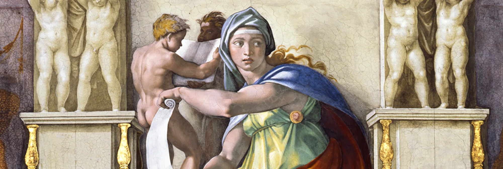

*图源：[梵蒂冈博物馆官网](https://www.museivaticani.va/content/museivaticani/en/collezioni/musei/cappella-sistina/volta/sibille-e-profeti/sibilla-delfica.html)*

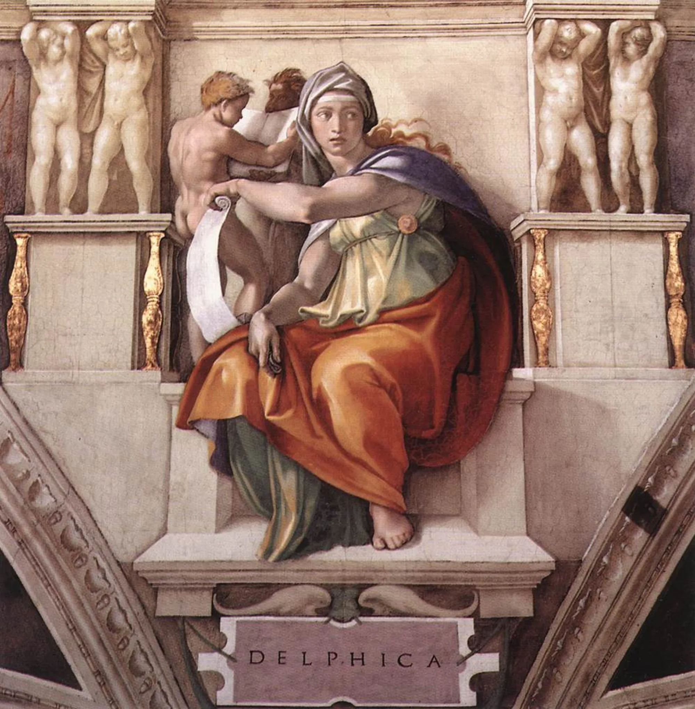

*图源：[中文维基百科](https://zh.wikipedia.org/zh-cn/File:Michelangelo,_sibille,_delfica_01.jpg)*

#### 撒迦利亚 _Zechariah_

> 🔗 官方：[Prophet Zechariah · Musei Vaticani](https://www.museivaticani.va/content/museivaticani/en/collezioni/musei/cappella-sistina/volta/sibille-e-profeti/profeta-zaccaria.html)

**故事**：被掳归回时期的祭司兼先知（约公元前 520 年），与哈该一同鼓励所罗巴伯重建第二圣殿。书中预言弥赛亚「谦谦和和地骑着驴」进城（亚 9:9）——正是耶稣棕枝主日进耶路撒冷所应验的那一幕。

**怎么看**：因此他被放在**入口大门正上方**——教皇棕枝主日的游行队伍正从他脚下进堂，与"骑驴进城"的预言一一对应。他是全顶第一个画的先知，风格还安静收敛，和最后画的约拿恰成首尾对照。

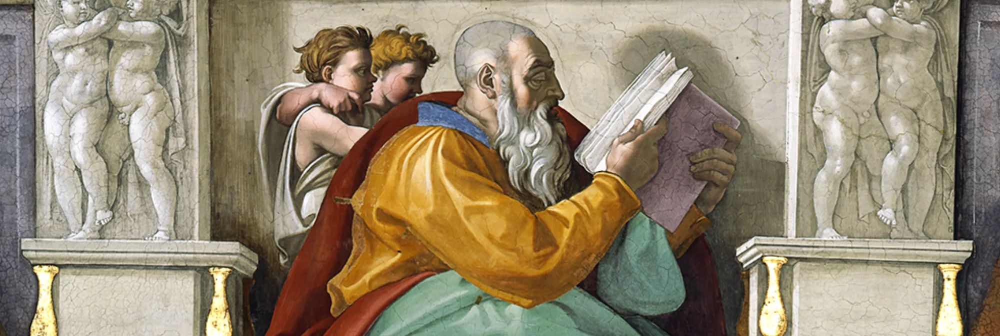

*图源：[梵蒂冈博物馆官网](https://www.museivaticani.va/content/museivaticani/en/collezioni/musei/cappella-sistina/volta/sibille-e-profeti/profeta-zaccaria.html)*

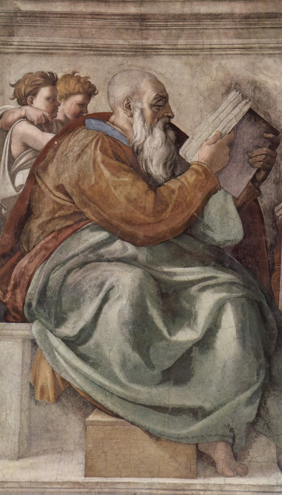

*图源：[中文维基百科](https://zh.wikipedia.org/w/index.php?title=%E6%92%92%E8%BF%A6%E5%88%A9%E4%BA%9A&oldformat=true)*

#### 约珥 _Joel_

**故事**：旧约小先知之一。书中以一场毁灭性的蝗灾为引，宣告"耶和华的日子"将临；最著名的是那句「我要将我的灵浇灌凡有血气的，你们的儿女要说预言，老年人要做异梦，少年人要见异象」（珥 2:28）——**五旬节圣灵降临时，使徒彼得正是引这段宣告它应验**（徒 2:16）。所以约珥在天顶预表"圣灵时代"的开启。

**怎么看**：米氏画他较年长、展开一卷书凝神细读，身旁两个小天使探头同看——一个专注的学者形象。

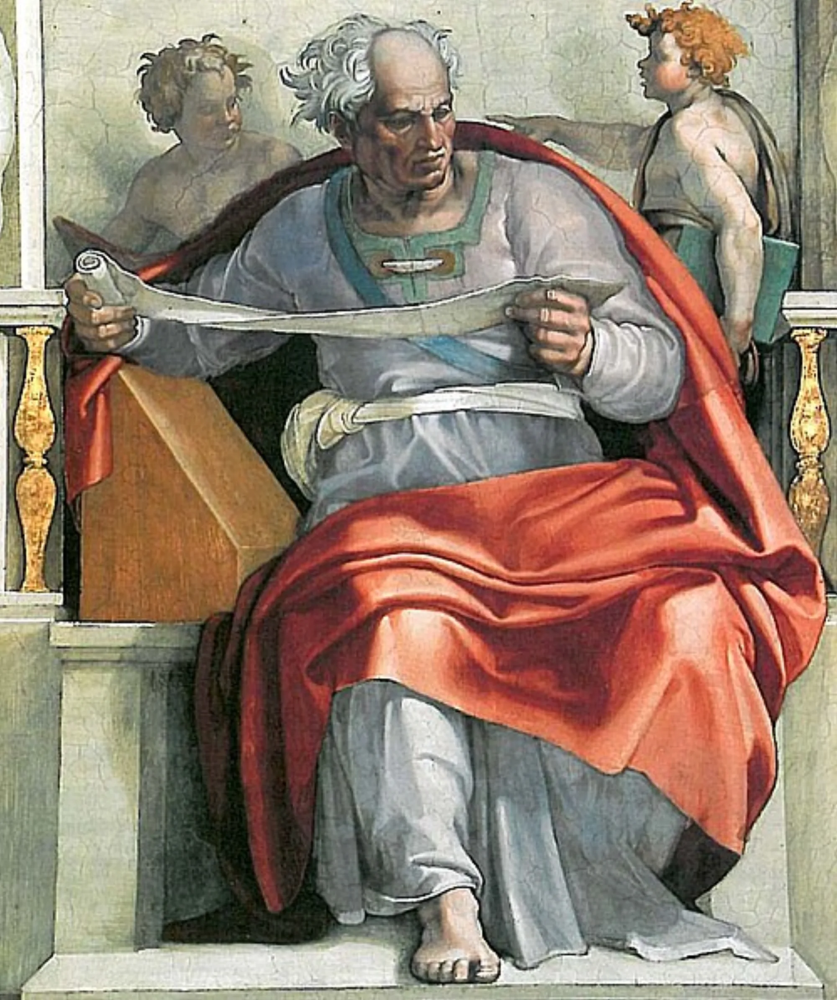

*图源：[中文维基百科](https://zh.wikipedia.org/zh-cn/%E5%B2%B3%E5%8E%84%E5%B0%94_%28%E7%B1%B3%E5%BC%80%E6%9C%97%E5%9F%BA%E7%BD%97%29)*

#### 以西结 _Ezekiel_

**故事**：被掳巴比伦时期的先知、祭司出身。以**异象瑰丽**著称——神的荣耀战车（四活物 / 基路伯，结 1）、以及著名的**枯骨复活**异象（结 37：满谷枯骨重新长肉、得气复活，预表以色列的复兴，也被基督教读作"死人复活"的预告）。

**怎么看**：米氏画他戴头巾、攥着卷轴猛然侧身回头、一手张开像在激烈论辩——是十二巨人里**动势最大、最激动**的一位，和对面沉静的先知形成强烈反差。

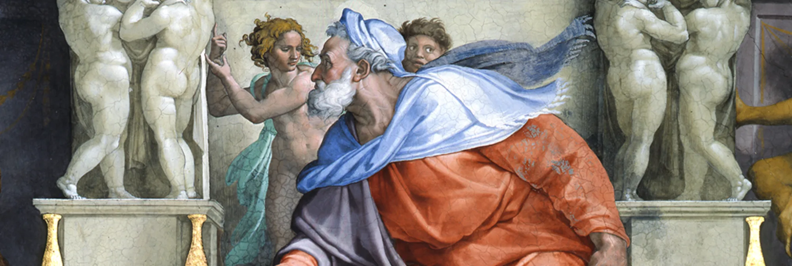

*图源：[梵蒂冈博物馆官网](https://www.museivaticani.va/content/museivaticani/en/collezioni/musei/cappella-sistina/volta/sibille-e-profeti/profeta-ezechiele.html)*

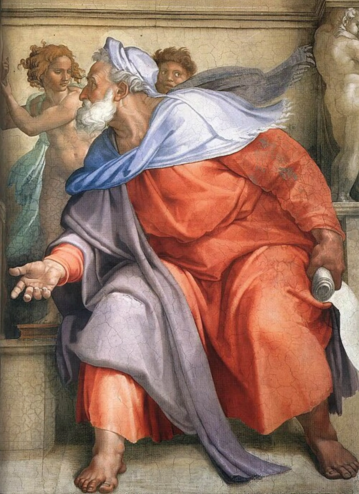

*图源：[中文维基百科](https://zh.wikipedia.org/wiki/File:Ezekiel.jpg)*

#### 但以理 _Daniel_

**故事**：被掳巴比伦的少年贵族，以**解梦与释异象**闻名——解尼布甲尼撒的金像梦、墙上"弥尼提客勒"的神秘字、在狮子坑里安然获救；他书中"一位像人子的，驾着天云而来"（但 7:13）被耶稣引用自指，"七十个七"的预言更被基督徒读作弥赛亚降临的时间表。

**怎么看**：米氏把他画成**最年轻**的一位，膝上摊开一部巨册、一手翻大书一手往小本上抄录，脚边的小天使奋力顶着那部沉重的书——"边读边写"的勤奋形象。

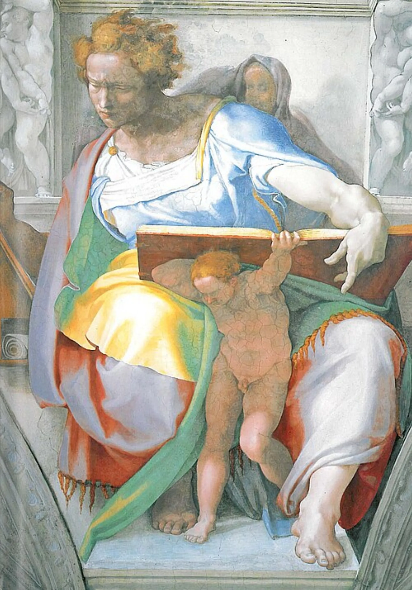

*图源：[中文维基百科](https://zh.wikipedia.org/zh-cn/%E8%BE%BE%E5%B0%BC%E5%B0%94_%28%E7%B1%B3%E5%BC%80%E6%9C%97%E5%9F%BA%E7%BD%97%29)*

#### 波斯女先知 _Persian Sibyl_

**是谁**：古典五女先知里来自波斯（一说迦勒底）的一位，传统中**最年迈**。归于她名下的神谕被后世读作预言基督与末日。

**怎么看**：米氏画她老态龙钟、裹着厚重头巾、把书几乎贴到鼻尖、眯眼细看——一个**"老花眼"**的神谕者，几乎背对观众、姿态内收，幽默里透着苍凉。

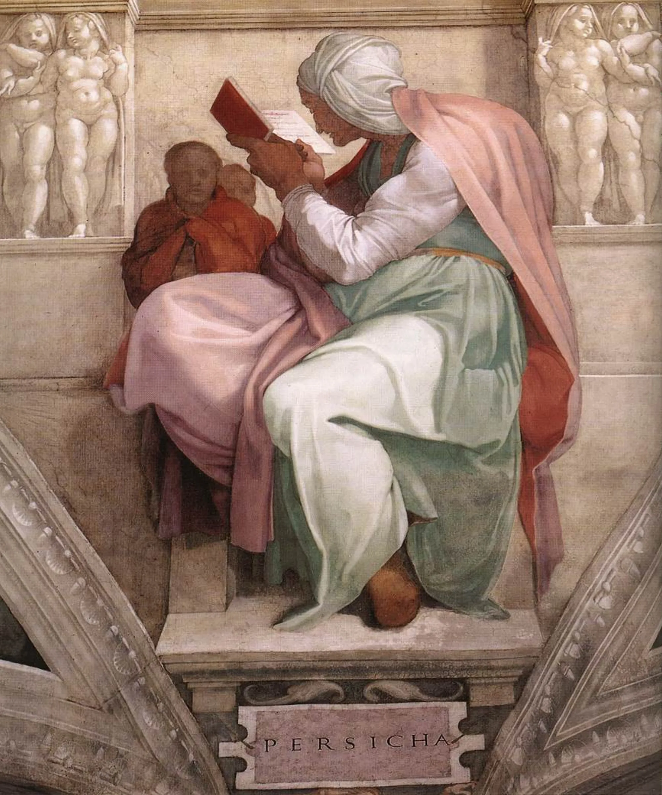

*图源：[中文维基百科](https://zh.wikipedia.org/zh-cn/%E6%B3%A2%E6%96%AF%E5%A5%B3%E9%A2%84%E8%A8%80%E5%AE%B6_%28%E7%B1%B3%E5%BC%80%E6%9C%97%E5%9F%BA%E7%BD%97%29)*

#### 厄里特里亚女先知 _Erythraean Sibyl_

**是谁**：来自小亚细亚的厄里特里亚。奥古斯丁《上帝之城》记下一首归于她的**离合诗（acrostic）**——各行首字母连起来拼成"耶稣基督，神子，救主"（希腊文 ΙΧΘΥΣ "鱼"的来历之一）；这是西方传统里"异教也预言了基督"最有名的证据。

**怎么看**：米氏画她年轻健美、翘腿翻开一部大书，**头顶的小天使正举火把点灯**——"点亮预言"被画成了实景。

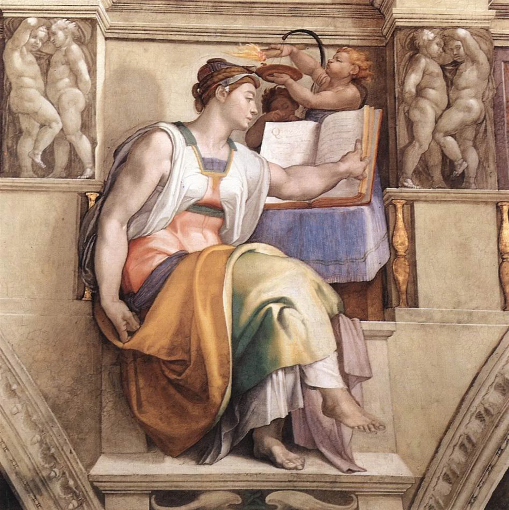

*图源：[中文维基百科](https://zh.wikipedia.org/wiki/File:Erythraean.jpg)*

#### 现场站看

1. **祭坛端最高处找约拿**——大鱼在他身侧、身体后仰像要跌出墙面；认准他＝认准"故事从这端开始"。
2. **转身在入口门上方找撒迦利亚**——他与约拿一头一尾镇住整条轴线：骑驴的预言迎着进门的人，复活的预表压着祭坛。
3. **任选一位女先知看"假建筑"**——宝座、立柱、托名牌的小天使全是平面画出的错视：德尔斐看脸、库迈看胳膊、利比亚看脚尖、波斯看"老花眼"。
4. **比体量**——十二巨人越靠祭坛越大（约拿明显大过撒迦利亚），四年间手越放越开的直接证据。

### 20 个裸体青年（ignudi）

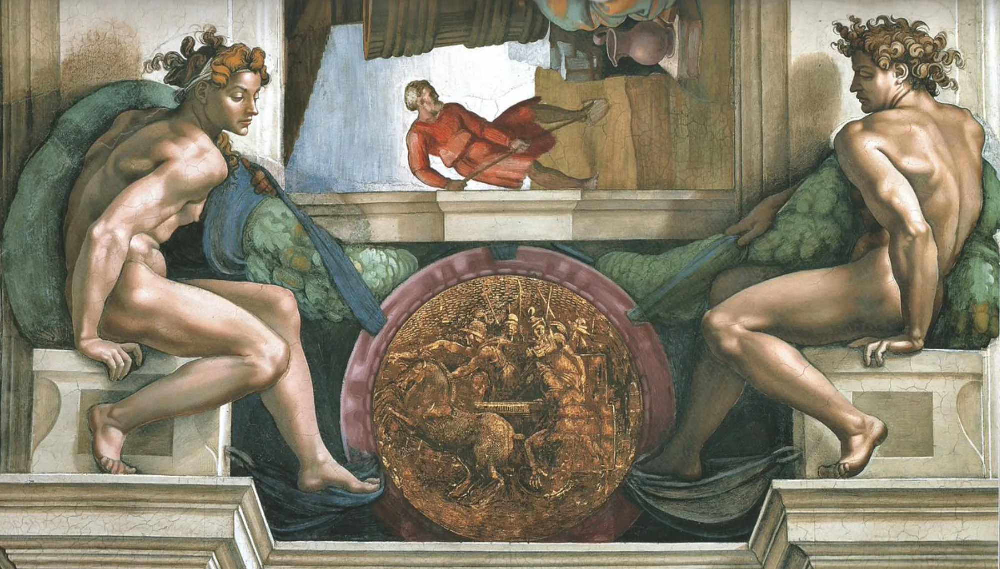

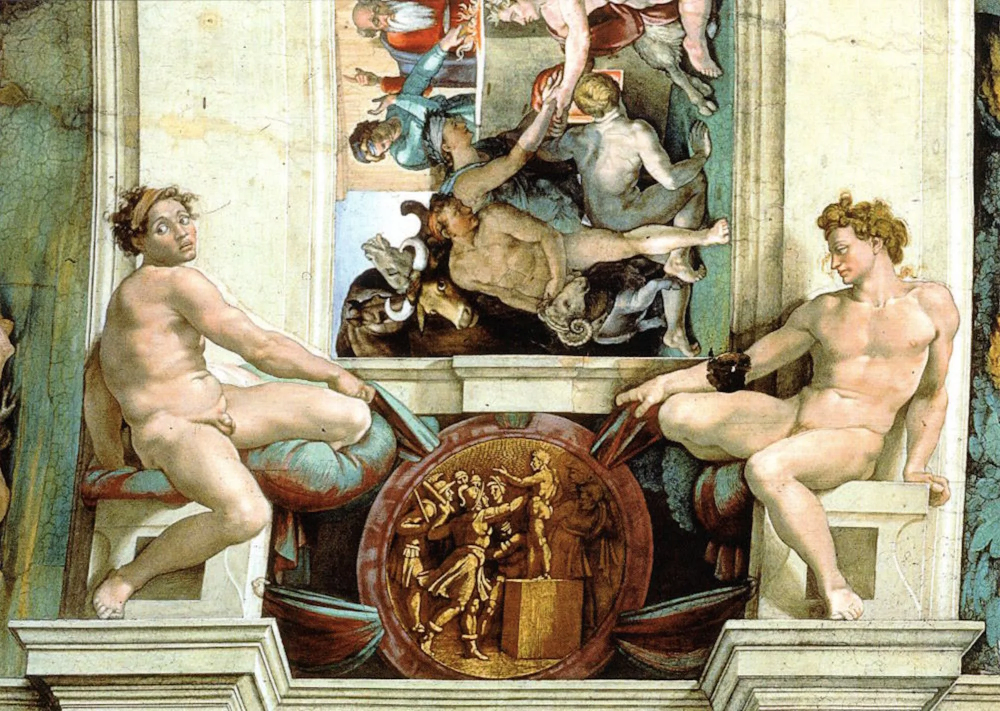

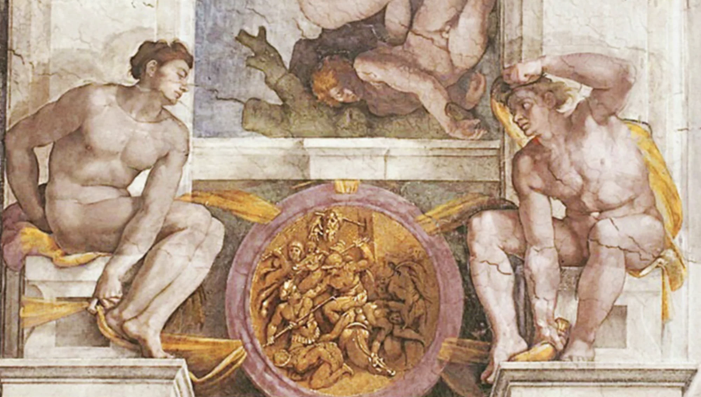

每块小场景四角扛着圆盾绶带的青年裸体，共 20 个。他们不属任何圣经情节，含义至今没有定论——主流读法是佛罗伦萨新柏拉图主义的"理想人形"：未被原罪沾染的完美人体（艺术史家肯尼斯·克拉克/Kenneth Clark：「他们的体魄之美是神性完美的影像」）。20 个姿态无一重复，全是米氏拿人体当雕塑炫技。
两个实用细节：
1. 他们扛的**橡树叶与巨型橡果**花环不是随手装饰——橡树（rovere）正是西克斯图斯四世与尤利乌斯二世叔侄的家族姓氏**德拉·罗韦雷（della Rovere）** 的纹章，等于在天顶各处盖"甲方印章"；
2. 他们之间夹着 10 面仿青铜圆盾，画着旧约的暴力小场景（亚伯拉罕献以撒、押沙龙之死等，瓦萨里笼统说取自《列王纪》），构图取自 1490 年第一部意大利语印刷圣经的木刻插图。**看一对就够**——体会"青年、铜盾、大理石框全是平面画出来的"。

### 怎么逛 · 现场须知

- **严禁拍照、严禁摄像、禁用手机拍**（守卫会喝止"No photo!"）；**保持安静**，广播会反复用多语言喊 "Silenzio!"。想要图，靠官方虚拟游览和本文。
- **脖子会很酸**：仰头久了不适，可**靠墙站、或低头用手机里存的天顶图对照**（别举着拍），看完再走到中间仰望。
- 礼拜堂**两端各有一道门**：进门来自博物馆方向，出门若持 Hosted Entry（你们是），走**祭坛右侧的专用门直通圣彼得大教堂**，省掉重新排队——这是你们票种的核心福利，**别跟大流走错门**。
- 这里是宗教场所与选举地，**着装强制遮肩盖膝**（全梵蒂冈通用）。
