进门正对的**整面祭坛墙**，就是米开朗基罗 1536–1541 年画的《最后的审判》。**严禁拍照、保持安静**。配合 [S - 08 西斯廷礼拜堂 · 天顶《创世纪》九场景 + 先知女巫](../s08-sistine-ceiling/)（天顶讲"创世"，这面墙讲"终末"）与 [S - 10 西斯廷礼拜堂 · 两侧墙 + 入口墙壁画带](../s10-sistine-side-walls/)（15 世纪的《摩西生平》《基督生平》）一起看。

---

### 米开朗基罗《最后的审判》/ Michelangelo, _Giudizio Universale_ ⭐⭐⭐

> 🔗 官方：[Giudizio Universale · Musei Vaticani](https://www.museivaticani.va/content/museivaticani/en/collezioni/musei/cappella-sistina/giudizio-universale.html)

- **作者**：米开朗基罗·博那罗蒂（Michelangelo Buonarroti），时年 60 余岁
- **作品**：《最后的审判》/ _Giudizio Universale_
- **时间**：1536–1541（比天顶晚约 25 年）
- **材质**：湿壁画
- **尺寸**：整面祭坛墙，约 13.7 × 12 m，约 400 个人物
- **委托人**：教皇克雷芒七世发起、保罗三世（Paul III）完成
- **官网介绍页**：[Wikipedia · The Last Judgment (Michelangelo)](https://en.wikipedia.org/wiki/The_Last_Judgment_(Michelangelo))

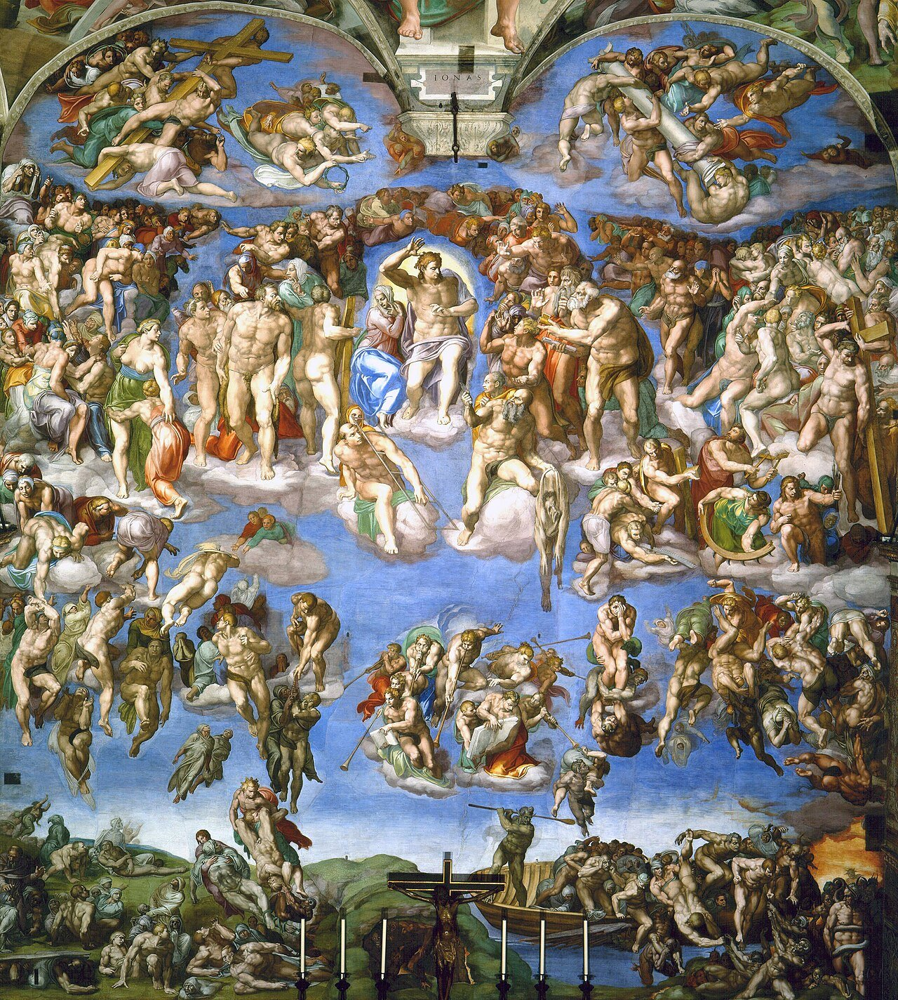

*图源：[Wikimedia Commons](https://commons.wikimedia.org/wiki/File:Last_Judgement_by_Michelangelo.jpg)*

局部细节（官网大图）——右下方被恶魔拽向地狱、单手捂住半边脸的"绝望者"，即下文"现场站看"第 7 条要找的那张脸：

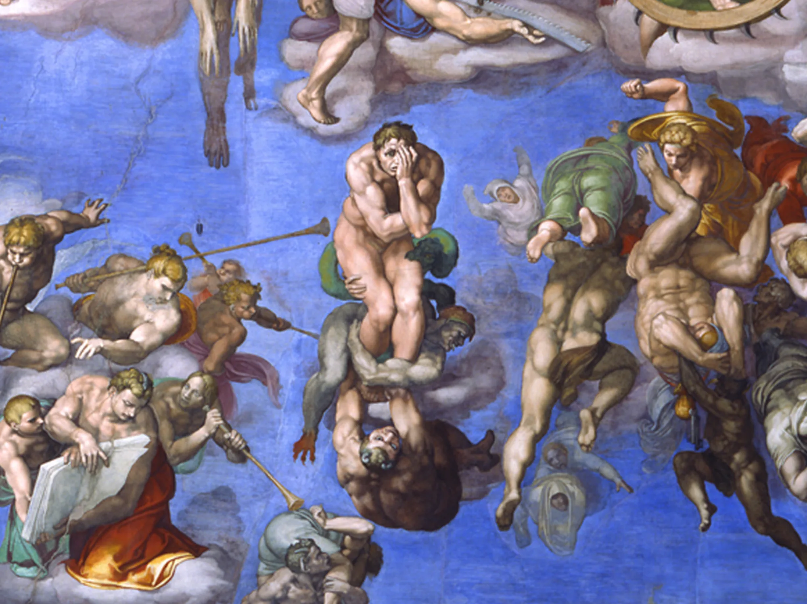

*图源：[梵蒂冈博物馆官网](https://www.museivaticani.va/content/museivaticani/en/collezioni/musei/cappella-sistina/giudizio-universale.html)*

**内容（这是什么）**：世界末日、基督再临、对古往今来全人类作最终审判的一刻。梵蒂冈官方导览特别指出：米开朗基罗（Michelangelo Buonarroti）画的是**判决出口前的那一瞬**——基督刚刚抬起右臂，整面墙三四百个人物全都悬在"将判未判"的紧张里。没有建筑、没有风景、甚至没有画框收边，只有肉身在虚空中翻腾：左侧死者披回血肉升向天国，右侧被罚者被拽入地狱——这是西方艺术里规模最大的人体群像之一。

**先读懂"末日审判"这门教义，整面墙就不再是一团乱**：基督教信经的原话是，基督"将来必从那里降临，审判生者死者"。这套终末图景有四个要点，全画在墙上。其一，**基督再临**——历史在此刻终结；神学上说再临意味着时间与空间一并结束，所以画里没有地平线、没有统一的空间，每群人各自悬在自己的虚空里。其二，**死者复活**——不是灵魂受审，而是**带着身体**复活受审（《哥林多前书》15:52"号筒末次吹响……死人要复活成为不朽坏的"），画面左下角能找到骷髅正在重新披上肌肉；天主教坚持"肉身复活"的教义，这正是满墙肌肉裸体的神学依据。其三，**善恶两分**——《玛窦福音》25:31-46：人子坐在荣耀宝座上，"把绵羊安置在右边，山羊在左边"，右边的承受永生、左边的进入永罚。**左右以基督为准**：他的右手边即观者的左侧，于是整面墙**左升右降**，像一架巨大的天平。其四，**生死册**——《启示录》20:12"案卷展开了，并且另有一卷展开，就是生命册"，画面中央吹号天使手里那一小一大两本册子就是这两卷。

**背景 / 来历**：天顶画完 25 年后，米开朗基罗带着完全不同的心境回到这里——动笔时年过六旬，画完已近 67 岁。委托最初由克雷芒七世（Clement VII）在 1533 年前后提出（早期文件里题材还叫"复活"），他死后保罗三世 1534 年一即位就把它列为头号工程。其间发生了两件把天主教世界打懵的大事：**1527 年罗马之劫**——神圣罗马帝国的雇佣军洗劫罗马、教皇困守圣天使堡，"罗马受上帝护佑"的信念当场破产；以及**宗教改革**——路德质疑教皇权柄，半个欧洲脱离罗马。保罗三世接手的是一个危机中的教会，他要用这面墙向自己的核心圈子（这里正是教皇宫廷的私家礼拜堂）宣示：审判是真的，教会的权柄也是真的。

为给它腾地方，代价惊人：砌死两扇窗，铲掉佩鲁吉诺（Perugino）的祭坛画《圣母升天》（这座礼拜堂本来就是献给圣母升天的）、两侧 15 世纪壁画带起首的两格、最早的几幅教皇像，连米开朗基罗**自己天顶画的两面弦月窗**（基督祖先系列的开头）也一并毁掉。墙体重砌成**上缘外倾约 28 厘米**，一说为防积灰，也让画面微微"俯压"向观者。老友塞巴斯蒂亚诺·德尔·皮翁博（Sebastiano del Piombo）劝教皇改用油画并抢先做好了光滑底子，米开朗基罗大怒，扔下名言"油画是给女人和懒汉干的"，把墙皮铲掉重抹成湿壁画粗底——二十多年的交情就此终结。1541 年 10 月 31 日（诸圣节前夜）揭幕。

**为什么说它"滑向风格主义"**：把它和头顶的天顶放在一起看，落差肉眼可见——天顶（1508–12）还是盛期文艺复兴的世界：建筑框架清晰、人物雄健自信、色彩明朗；这面墙（1536–41）则**取消了一切框架与空间秩序**，过载的肌肉躯体相互堆叠扭曲，连众圣人也（用艺术史家西德尼·弗里德伯格（Sydney J. Freedberg）的话说）"巨人之力在此全然无力，被灵魂的焦虑捆住"——求情的时代结束了，圣人们自己也在等判决。基调近乎单色：肉色，加一整片昂贵的青金石蓝天空。这种弃和谐而取紧张、弃理性空间而取情绪压迫的画法，正是艺术史所称"风格主义（Mannerism）"的标志；而它的土壤，就是罗马之劫与宗教改革之后那个惊魂未定、转向自省与纪律的教会。瓦萨里（Giorgio Vasari）发明了一个词形容米开朗基罗这种慑人的力量：terribilità（"令人生畏的崇高"）。

### 画里的人 · 进门后按这个顺序找（禁声禁拍，进门前读熟）

> 下面按**进门后建议的观看顺序**排，从基督往下、由中心向四周。每个角色先讲"是谁"，再用 **▸ 现场站看** 给一句"看哪里、为什么"。

#### ① 基督与圣母（正中偏上） ⭐

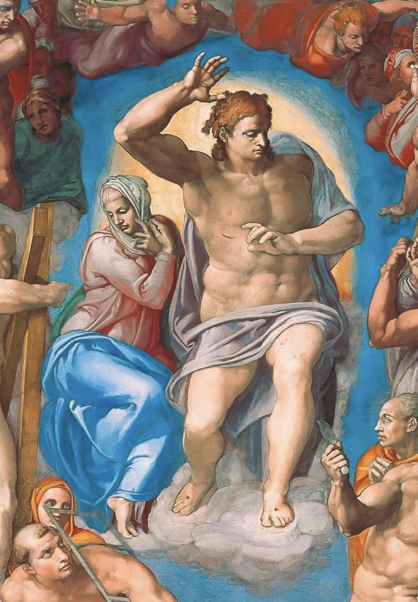

正中偏上。基督不是温柔的救主，而是无须、卷发、肌肉贲张的青年，形象糅合了赫拉克勒斯（Hercules）、朱庇特（Jupiter）与阿波罗（Apollo）——艺术史家普遍认为他直接参照了你刚在八角庭院看过的《观景楼的阿波罗》（见 [V - 01 入口与松果院 + 八角庭院（拉奥孔 + 观景楼阿波罗）](../v01-pinecone-octagonal/)）。他抬起的右臂既是判决，也是"展示伤痕"（ostentatio vulnerum）的传统手势——手、脚、肋旁都画着受难的钉痕。身旁蜷缩的是圣母玛利亚：草图里她原本张开双臂、还在为人类求情，定稿里米开朗基罗让她**别过脸去、双手收拢**——代祷的时刻已经过去，连圣母也无能为力，只能等待结果。这一改，是全画神学上最狠的一笔。

**▸ 现场站看**：先找正中抬臂的无须青年，看三件事——他像不像希腊太阳神（对照上午看的观景楼阿波罗）；手、脚上的钉痕（他是带着伤来审判的）；以及缩在他臂弯下、别过脸去的圣母（代祷结束了，审判已无可挽回）。

#### ② 圣巴尔多禄茂（St. Bartholomew）与人皮自画像 ⭐ 除基督外第一要找

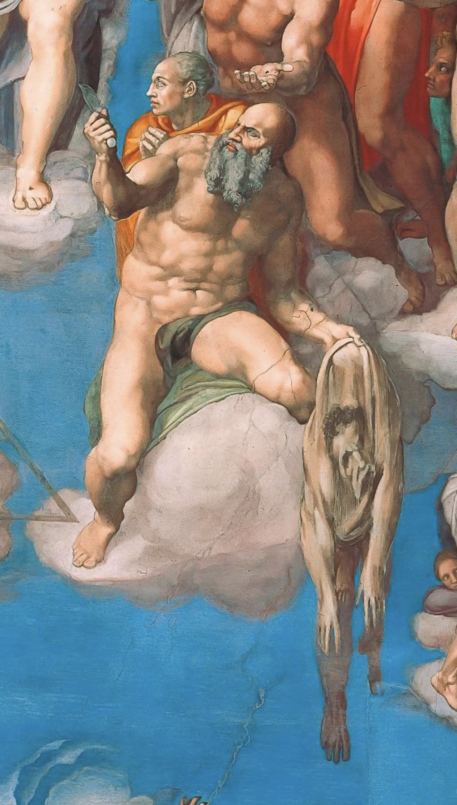

基督右下方（彼得下方）坐在云上的秃顶大胡子，一手提剥皮刀、一手拎着一张**空瘪的人皮**：他是被活活剥皮殉道的使徒。人皮上那张耷拉的脸，自 1925 年医生弗朗切斯科·拉·卡瓦（Francesco La Cava）撰文指出后已成公论——是**米开朗基罗本人的自画像**（圣人本尊秃顶灰须，人皮却是短黑发，两张脸根本不是同一人）。他把自己画成一具被剥空的皮囊，悬在天堂与地狱正中间、去向未定。学者们还指出这里叠着双重典故：剥皮既是圣人的殉道，也是阿波罗剥玛尔叙阿斯（Marsyas）之刑——那个自负到向神挑战的乐手；被同代人称为"神圣的"米开朗基罗，晚年常忏悔自己把艺术之美看得比灵魂得救更重，他的诗里写过：盼望像蛇蜕皮一样蜕掉旧我。

**▸ 现场站看**：彼得下方坐云上的老者手里那张空人皮，皮上的脸就是米开朗基罗本人；注意人皮恰好悬在天堂与地狱之间、去向未定——全画最私密沉痛的一笔，**除基督外第一要找**。

#### ③ 基督两侧的两个巨人：施洗约翰 + 圣彼得（St. Peter）

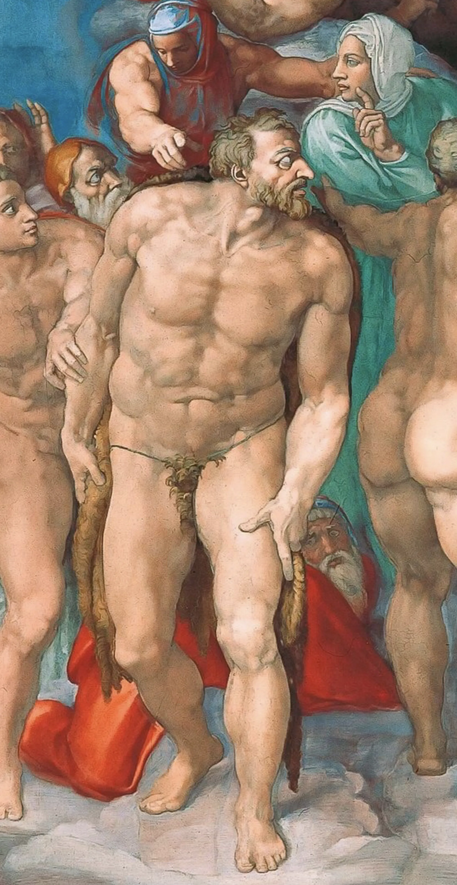
圣约翰

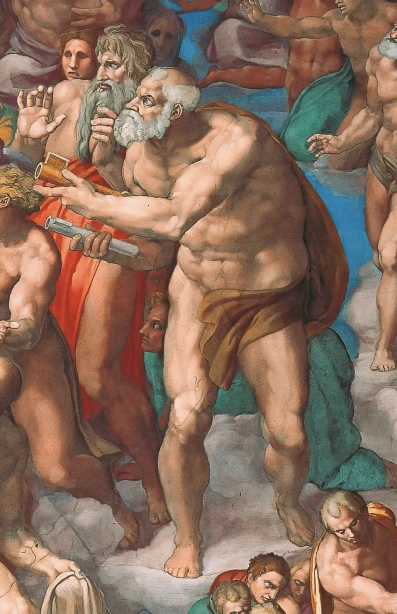
圣彼得

基督左侧（观者左）裹着**驼毛皮**、与他体量相当的巨人，是施洗约翰（John the Baptist）。基督右侧（观者右）同等体量的巨人则是圣彼得，手里一金一银两把大钥匙，正**往回递给基督**。钥匙是《玛窦福音》16:19 里基督亲手交给他的"天国的钥匙"、教皇权柄的凭据；审判既至，钥匙用不着了，物归原主。在教皇自家礼拜堂里画"彼得还钥匙"，等于天天提醒在场的教皇：你的职位也有到期日，最终你也要站到这面墙前。

**▸ 现场站看**：基督两侧两个同等体量的巨人——左边裹驼毛皮的是施洗约翰，右边攥金银双钥匙**往回递**的是彼得；钥匙归还＝连教皇的权柄也有到期日。

#### ④ 殉道者群——"认刑具"游戏（每件刑具都是一份呈给法官的证物）

> 基督脚下与右下一圈殉道圣人，各举着自己受刑的器械向基督"出示证物"。按刑具认人最快：

##### 圣劳伦斯（St. Lawrence）· 烤架

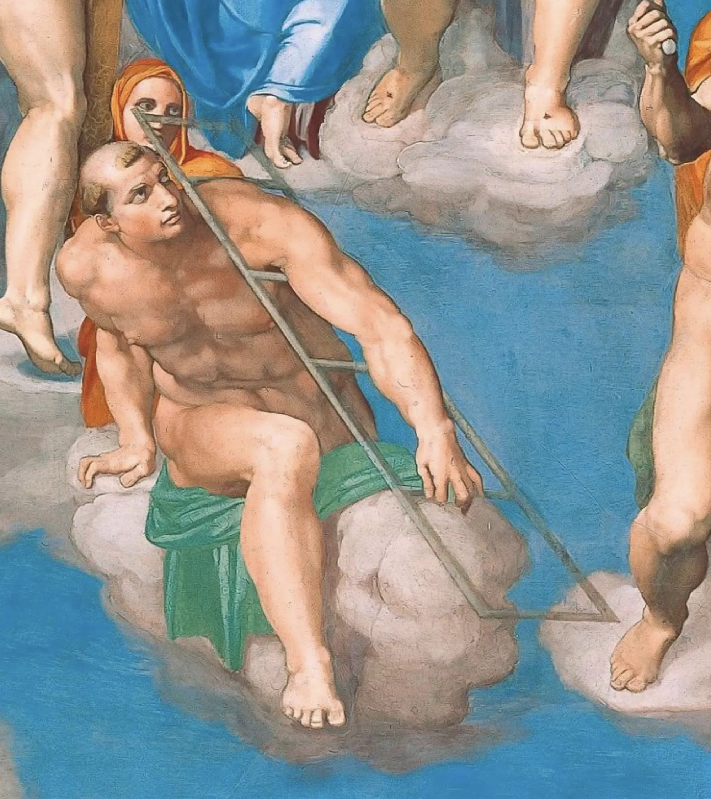

基督脚下偏左、抱着一具像小梯子的铁架。那是**烤架**：他是公元 258 年罗马教会的执事，被瓦勒良（Valerian）皇帝下令放在烤架上活活烤死，传说他还对刽子手说"这面熟了，翻过来吧"。烤架从此是他的身份证。

##### 圣塞巴斯蒂安（St. Sebastian）· 一把箭

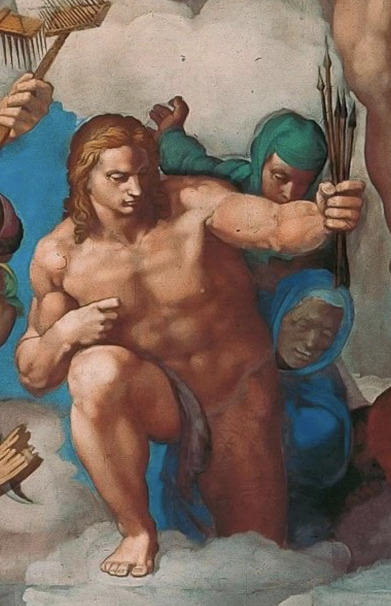

右下方单膝跪地、左手攥着**一把箭**的健美裸男。他是戴克里先（Diocletian）时代的禁卫军军官，因信教被绑住乱箭射成"刺猬"，奇迹生还后再度直谏，被乱棍打死。别处他总被画成中箭的样子，这里米开朗基罗让他反过来**手握箭支当呈堂证物**——殉道者们正纷纷向基督出示自己的刑具，像在最后一刻提醒法官：我们为你受过这些。

##### 圣加大肋纳（St. Catherine of Alexandria）与圣布莱斯（St. Blaise）· 断轮与铁梳

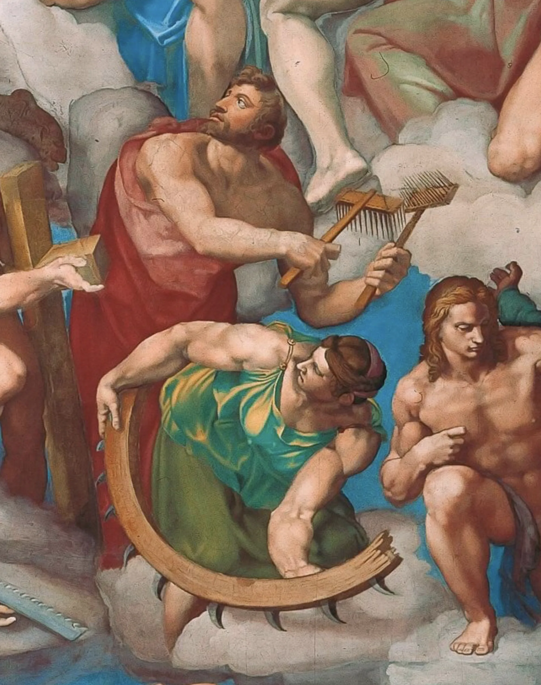

右下方人群里，攥着一段**带齿轮盘**的女子是亚历山大的公主学者加大肋纳：传说她驳倒五十位异教哲学家，皇帝下令用钉满尖刺的刑轮处死她，轮子却当场崩碎，最后改为斩首——崩掉的轮子成了她的标志。她身后举着铁梳的是圣布莱斯。这两人是全画唯一被**整块铲掉重画**的部分：原作里两人全裸、姿态被时人指为有伤风化，重画时加大肋纳穿上了绿袍、布莱斯的头被扭向基督（详见下文"风波"）。

##### 圣安德烈（St. Andrew）· X 形斜十字架：左侧扶着一具 X 形斜十字架的，是被钉死在这种十字架上的使徒安德烈（无单独配图，认"叉形十字"即是）。

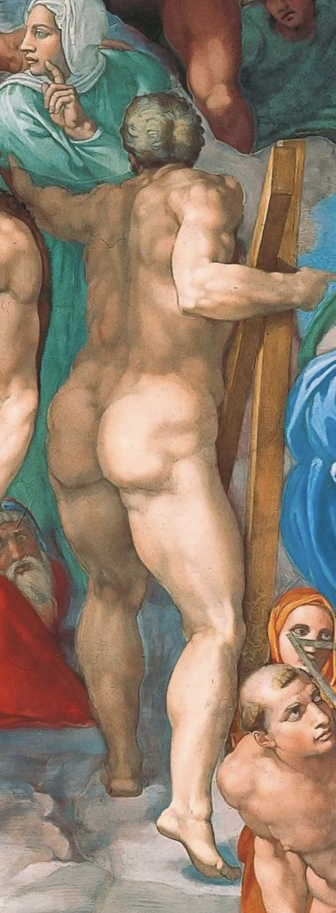

**▸ 现场站看**：玩"认殉道者"游戏——脚下偏左扛烤架的＝劳伦斯；右下持一把箭跪着的＝塞巴斯蒂安；近旁攥断轮、穿绿袍的女子＝加大肋纳（全画唯一整块重画处）；左侧扶 X 形斜十字架的＝安德烈。

#### ⑤ 吹号天使与两本生死册（中下）

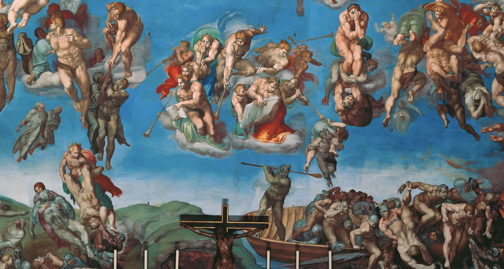

画面中部正下方一团云上，**无翼天使**们鼓着腮帮吹响长号唤醒死者（《启示录》的末日号角）。其中两位举着册子：**朝向左侧得救者的那本小，朝向右侧亡者的那本大得多**——举大册的天使还故意把它向下翻开、摊给被罚者看：你们的下场有据可查。小册是生命册、大册是罪录，体量差本身就是判词——得救的永远是少数。

**▸ 现场站看**：鼓腮吹长号的无翼天使群；比一比两本册子的大小——小的生命册朝向得救者，大得多的罪录被故意向下摊给亡者看。

#### ⑥ 左下角：复活与念珠天使

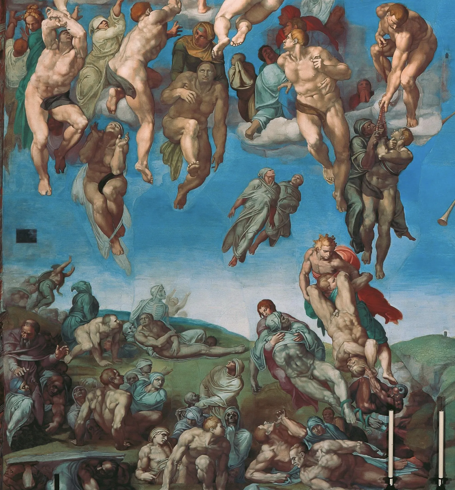

死者从坟里爬出，有的还是骷髅、有的正披回血肉（"肉身复活"的直译）；往上一点找**用一串念珠把两个人拽上天的天使**——念珠＝祈祷与善功有效，这是冲着新教"唯独信心"打的一枚反宗教改革楔子。（此处无单独配图，在画面左下、升天一侧找。）

**▸ 现场站看**：左下角死者出坟、骷髅披回血肉；往上找那个用念珠把两人拽上天的天使。

#### ⑦ 右下：地狱——卡戎（Charon）与米诺斯（Minos），从但丁《神曲》借来的地狱班底

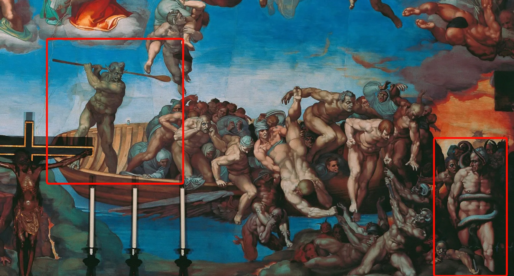

最底部右侧：渡船上挥桨驱赶亡魂的船夫卡戎、岸上被巨蛇缠身的驴耳判官米诺斯，都不是圣经人物，而是希腊神话经由但丁（Dante）《神曲·地狱篇》进入基督教想象的角色。卡戎"用桨拍打每个磨蹭的灵魂"几乎是《地狱篇》第三歌的逐句图解；米诺斯在但丁笔下用尾巴在身上缠几圈、就判你下第几层地狱。米开朗基罗是出了名的但丁迷——他把教皇礼拜堂的祭坛墙，画成了一部视觉版《神曲》。

**▸ 现场站看**：被恶魔拖拽下坠的人群里，找那个**单手捂住半边脸**、刚意识到自己完了的"绝望者"——全画最摄人的一张脸，即本页开头那张局部大图；再到最右下角认驴耳、被蛇咬住下体的米诺斯（被报复的礼仪官，见下文"风波"），和挥桨赶人的卡戎。

#### ⑧ 最上方两个弦月窗 · 受难刑具 + 退到中段看整体

##### 左窗：无翼天使们奋力扛着十字架、钉子与荆棘冠。

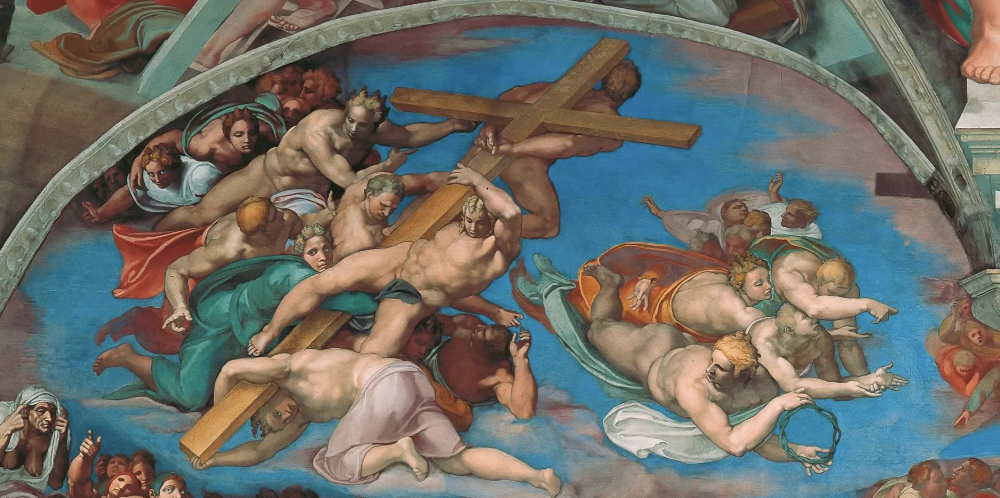

##### 右窗：鞭刑柱、蘸醋海绵的长矛与梯子。它们点明全画的法理依据：基督凭什么审判？凭他先替人类受了刑。

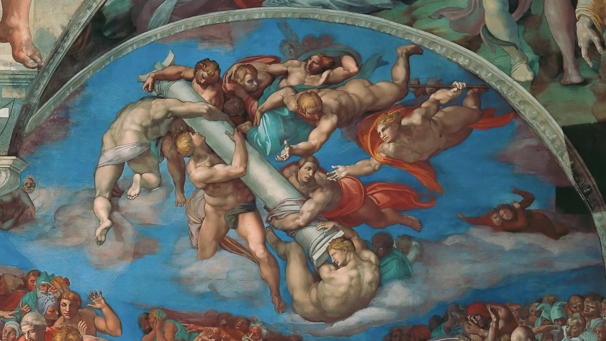

**▸ 现场站看（收尾一步）**：退到礼拜堂中段看整体——整面墙以基督为轴顺时针旋转，左升右降，**没有一条水平线让眼睛休息**；最上两弦月窗的十字架与鞭刑柱压住全局。最后转身抬头：身后天顶是创世的第一天，眼前是历史的最后一天——**一间屋子装下了从创世到末日的全部叙事**，这是西斯廷最震撼的设计。

#### 这面墙的著名风波（"澡堂"与遮羞布）

画中人物**几乎全裸**，在反宗教改革日益收紧的气氛里炸了锅。还没画完，教廷礼仪官比亚乔·达·切塞纳（Biagio da Cesena）陪保罗三世预览时就当场抨击：在如此神圣之地画这么多不知羞耻的裸体，"配的不是教皇礼拜堂，而是澡堂和酒馆"。米开朗基罗凭记忆把他的脸画成了米诺斯——驴耳朵（蠢的标记）、下体被蛇咬住。切塞纳向教皇告状，保罗三世答（传为笑谈）："我的权柄管不到地狱，他只能待在那儿了。"1545 年文人彼得罗·阿雷蒂诺（Pietro Aretino）又发表公开信抨击此画有伤风化——他本人写色情文学出身，且压根没见过原作、只看了版画。1563 年**特伦托公会议**最后一期通过圣像法令，要求宗教图像剔除"挑动情欲之美"；1564 年 1 月教廷专门决议"使徒礼拜堂内的画必须遮盖"——**几周后米开朗基罗去世**（1564 年 2 月），人没了，画保住了，但遮布开工：他的崇拜者达尼埃莱·达·沃尔泰拉（Daniele da Volterra）领命给约 40 个人物**添上遮羞布**，能少遮就少遮、还被勒令回去补遮，因此得了绰号"穿裤匠（Il Braghettone）"；圣加大肋纳与圣布莱斯两人则被整块铲掉重画。其后几代教皇陆续加遮，甚至几度议过把整面墙铲掉——埃尔·格列柯（El Greco）还毛遂自荐，愿重画一幅"端庄体面、画得不比它差"的。1990–94 年大修复揭掉了 1600 年以后追加的约 15 处遮布，16 世纪达尼埃莱那一批作为历史的一部分保留：你眼前这面墙，是 **"原作＋第一代审查"的叠加态**。修复时还顺带确认：蛇确实咬在米诺斯的下体上。

（另：底部约 45 厘米高的一条画面，16 世纪改建祭坛时已经损失。）
