⭐⭐ 西斯廷最早（1481–82）的装饰：南墙、北墙、入口墙三面墙，从上到下都分**同样的四条横带**——月楣（基督的祖先）、教皇肖像带、故事壁画带（南墙《摩西生平》／北墙《基督生平》／两端的"大结局"在入口墙）、底层仿帷幔。**严禁拍照、保持安静**。重头在天顶 [S - 08 西斯廷礼拜堂 · 天顶《创世纪》九场景 + 先知女巫](../s08-sistine-ceiling/) 与祭坛墙 [S - 09 西斯廷礼拜堂 · 祭坛墙《最后的审判》](../s09-sistine-last-judgment/)，这一篇是"顺路认一认"。

🔗 官方：[Parete sud（南墙）· Musei Vaticani](https://www.museivaticani.va/content/museivaticani/en/collezioni/musei/cappella-sistina/parete-sud.html) · [Parete nord（北墙）· Musei Vaticani](https://www.museivaticani.va/content/museivaticani/en/collezioni/musei/cappella-sistina/parete-nord.html) · [Parete di ingresso（入口墙）· Musei Vaticani](https://www.museivaticani.va/content/museivaticani/en/collezioni/musei/cappella-sistina/parete-di-ingresso.html)

---

### 先看懂"四条横带"（导览总纲） ⭐⭐

抬头看天顶之余，**别忽略侧墙下半**——这是西斯廷最初（1481–82）的装饰，由教皇西克斯图斯四世（Sixtus IV，礼拜堂即以他命名）召集当时**佛罗伦萨与翁布里亚的顶级画家**集体完成：佩鲁吉诺（Perugino）、波提切利（Botticelli）、吉兰达约（Ghirlandaio）、罗塞利（Cosimo Rosselli）、西尼奥雷利（Signorelli）。这支"全明星队"本身就是一份外交文件：1478 年帕齐阴谋后教皇与佛罗伦萨刚打完仗，洛伦佐·德·美第奇（Lorenzo de' Medici）放出佛罗伦萨最好的画家进京效力，通常被解读为双方和解的礼物。

**三面墙的读法是一致的——同一面墙从上到下分四条横带，本篇就按这四带组织：**

1. **月楣（Lunettes）** —— 最上方，米开朗基罗的《基督的祖先》。
2. **教皇肖像带（Pontiffs）** —— 窗间成对的历代教皇像。
3. **故事壁画带（Stories）** —— 礼拜堂的主角：南墙《摩西生平》（旧约预表）、北墙《基督生平》（新约应验），两条故事的"大结局"画在入口墙。
4. **仿帷幔（Drapes）** —— 最下方，绘西克斯图斯四世纹章的仿挂毯。

故事带左右对称讲述（面向《最后的审判》时）：**左墙（南）《摩西生平》↔ 右墙（北）《基督生平》**。这是中世纪"预表论（typology）"的标准操作：旧约的人与事被读作新约的"预告片"，摩西的一生处处预演基督。两墙每格一一对位，举三组：**摩西之子受割礼 ↔ 基督受洗**（旧约入约的记号对新约入约的记号）；**西奈山领受律法 ↔ 登山宝训**（旧律法与新律法都颁布于山上）；**惩罚可拉党 ↔ 交钥匙**（僭越神立权柄者遭天谴 ↔ 权柄正式授予彼得）。

两条壁画带在墙面上的位置（官网示意图，彩色段即壁画带；上为南墙《摩西生平》，下为北墙《基督生平》）：

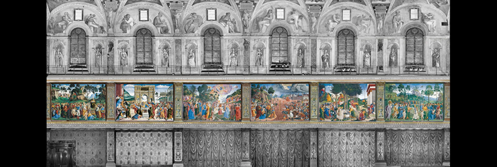

*图源：[梵蒂冈博物馆官网](https://www.museivaticani.va/content/museivaticani/en/collezioni/musei/cappella-sistina/parete-sud/storie-di-mose.html)*

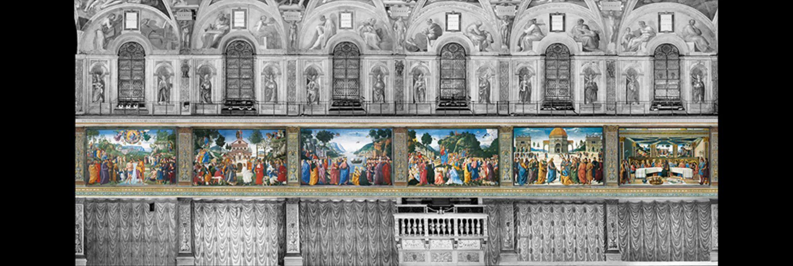

*图源：[梵蒂冈博物馆官网](https://www.museivaticani.va/content/museivaticani/en/collezioni/musei/cappella-sistina/parete-nord/storie-di-cristo.html)*

---

### Lunettes（月楣 · 基督的祖先）

三面墙最上方的月楣与拱肩（vele），是米开朗基罗画的 **《基督的祖先》（Forefathers of Christ）**——《玛窦福音》1:1-17 从亚伯拉罕起列出的基督先祖四十代，预告救赎的来临。官方说明特意点出：这些人物**与其说是历史肖像，不如说是人类的象征性形象**，被画成一个个家庭单元里各种姿态的普通人：哺乳的母亲、沉思发呆的男子、打盹的老人——一群在黑暗里**等待救赎的人类**。

这一带共 16 面月楣，靠祭坛上方的 2 面（"亚伯拉罕—以撒—雅各—犹大"与"法勒斯—以斯仑—亚兰"）1536 年为《最后的审判》铲掉，**现存 14 面**。每面月楣横跨一扇窗，中央立一块**名牌（tabella）**，用拉丁文写着该组祖先的名字（多按《玛窦福音》家谱两三人一组）；名字与画中具体人物至今无法一一对应。它们是天顶工程**最晚画的一批（约 1511–1512）**，笔触更自由、阴影更重、情绪更阴郁。

⚠️ 月楣属于**天顶工程（1508–1512）**，与下方 1480 年代的壁画带不是一个时期、不是一拨人。整体讲解详见天顶篇 [S - 08 西斯廷礼拜堂 · 天顶《创世纪》九场景 + 先知女巫](../s08-sistine-ceiling/)；以下按**家谱顺序（从亚伯拉罕一端向基督一端）**逐面认名。

#### ① 亚米拿达 _Aminadab_

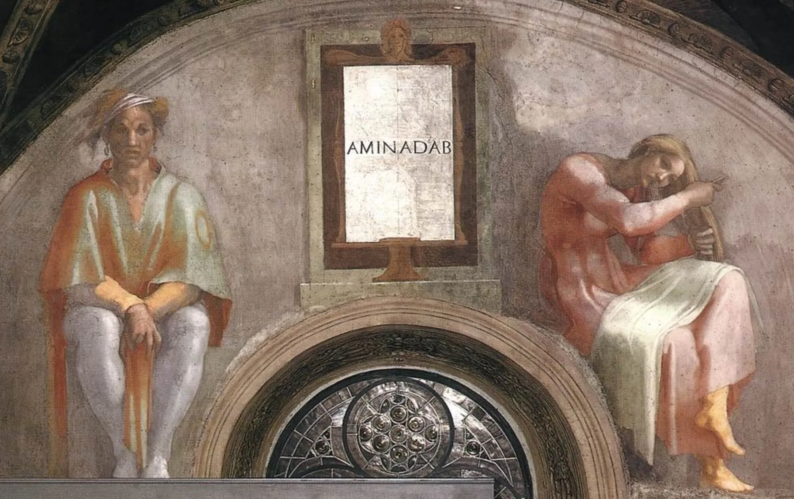
[图片来源](https://wo.wikipedia.org/wiki/Aminadab)

名牌作「AMINADAB」。亚米拿达是犹大支派的族长、拿顺之父、亚伦的岳父（《出埃及记》6:23），属出埃及世代。这是现存最靠祭坛端的一面月楣——再往祭坛去的"亚伯拉罕组"与"法勒斯组"两面，已为《最后的审判》铲毁。

#### ② 拿顺 _Naasson_

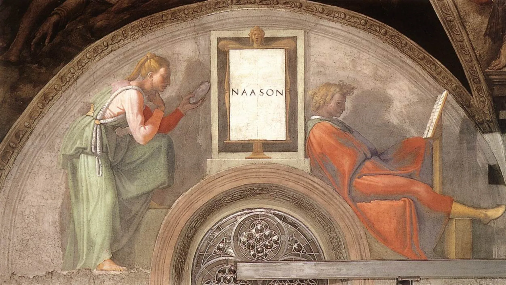
[图片来源](https://en.wikipedia.org/wiki/Nahshon)

名牌作「NAASSON」。拿顺是亚米拿达之子，出埃及、旷野扎营时**犹大支派的首领**（《民数记》1:7、2:3），队伍最前列的那一支。

#### ③ 撒门 · 波阿斯 · 俄备得 _Salmon · Booz · Obeth_

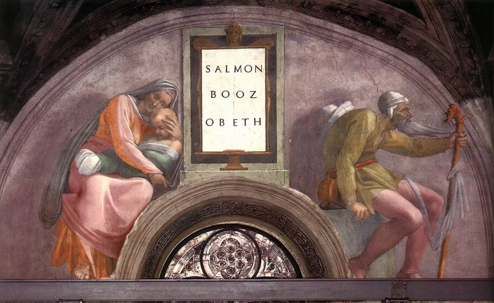
[图片来源](https://en.wikipedia.org/wiki/Matthew_1:5)

这一组牵出旧约最著名的两段"外族归化"姻缘：撒门娶了耶利哥的妓女**喇合**，波阿斯娶了摩押女子**路得**（《路得记》整卷的男主角），其子俄备得即大卫王的祖父。基督的血脉里因此有外邦人。

#### ④ 耶西 · 大卫 · 所罗门 _Jesse · David · Salomon_

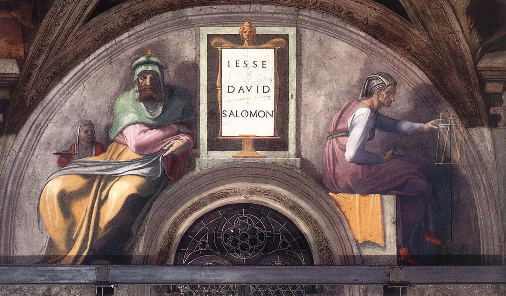
[图片来源](https://commons.wikimedia.org/wiki/File:Jesse_-_David_-_Solomon.jpg)

王朝核心的一面——耶西之子**大卫王**、大卫之子**所罗门王**。基督被称"大卫之子"，这是整条祖先线最显赫的一格。

#### ⑤ 罗波安 · 亚比雅 _Roboam · Abias_

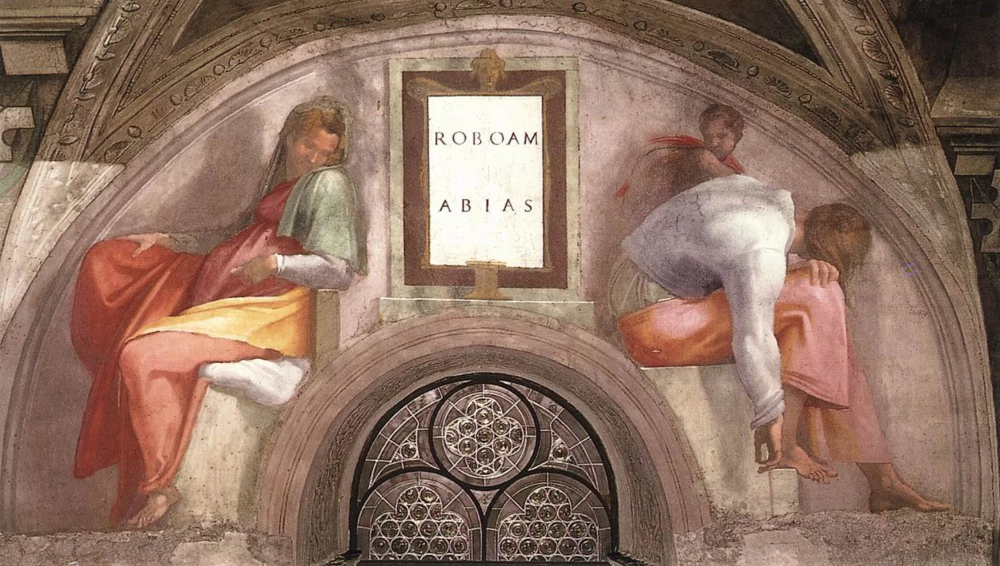
[图片来源](https://en.wikipedia.org/wiki/Matthew_1:7#/media/File:Rehoboam_-_Abijah.jpg)

名牌作「ROBOAM · ABIAS」。所罗门之子罗波安在位时，王国**分裂为南北两国**；其子亚比雅为南国犹大之王。

#### ⑥ 亚撒 · 约沙法 · 约兰 _Asa · Josaphat · Joram_

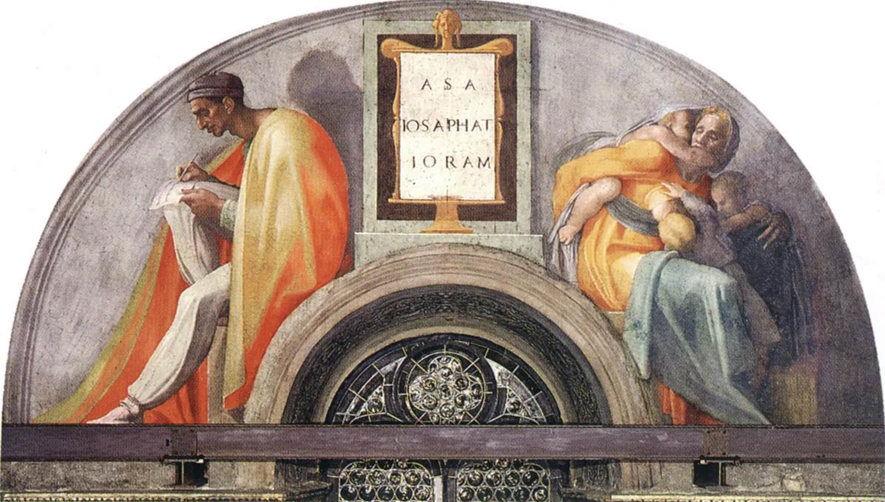
[图片来源](https://en.wikipedia.org/wiki/Matthew_1:8)

三位犹大王，前两位（亚撒、约沙法）以敬虔、行神眼中看为正的事著称。

#### ⑦ 乌西雅 · 约坦 · 亚哈斯 _Ozias · Joatham · Achaz_

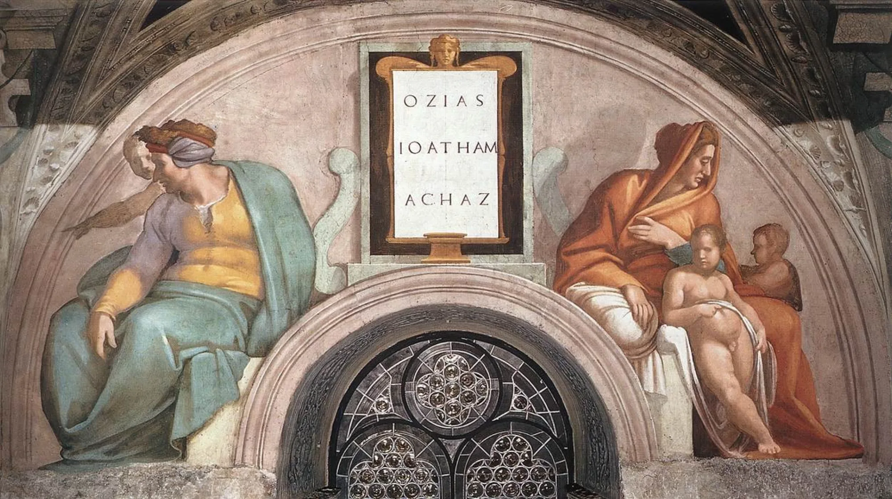
[图片来源](https://it.wikipedia.org/wiki/Ozia,_Ioatam_e_Acaz)

三位犹大王。乌西雅（又名亚撒利雅）国势鼎盛，却因擅入圣殿献香被神击打、长大麻风而终（《历代志下》26）。

#### ⑧ 希西家 · 玛拿西 · 亚们 _Ezechias · Manasses · Amon_

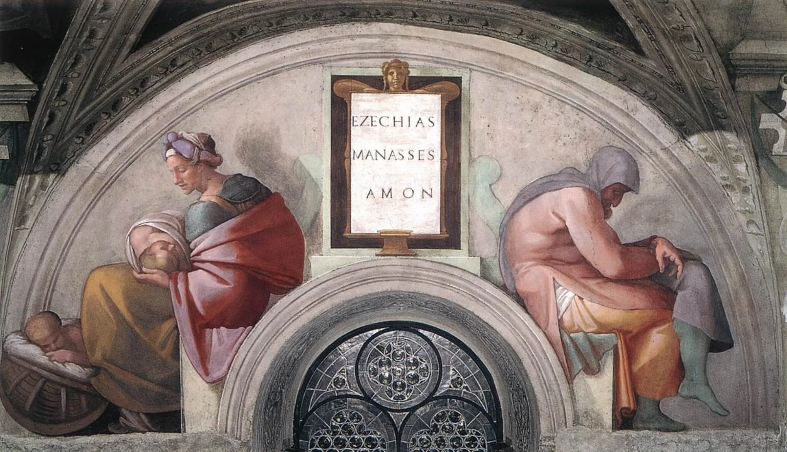
[图片来源](https://commons.wikimedia.org/wiki/File:Michelangelo_-_Sistine_Chapel_ceiling_-_Lunette_%22Hezekiah_-_Manasseh_-_Amon%22.jpg)

希西家是力行宗教改革的明君；其子玛拿西却带头拜偶像、行恶最久；孙亚们短命遇弑。一面里装下了犹大王朝由盛转衰的拐点。

#### ⑨ 约西亚 · 耶哥尼雅 · 撒拉铁 _Josias · Jechonias · Salathiel_

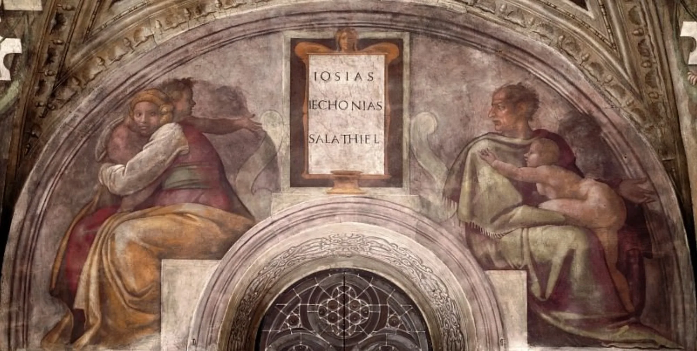

名牌作「IOSIAS · IECHONIAS · SALATHIEL」（无外部出处，按名牌与家谱顺序定）。约西亚是又一位改革之王；耶哥尼雅在位时**被掳往巴比伦**，是王朝中断的转折点；撒拉铁生于流放之中。

#### ⑩ 所罗巴伯 · 亚比玉 · 以利亚敬 _Zorobabel · Abiud · Eliachim_

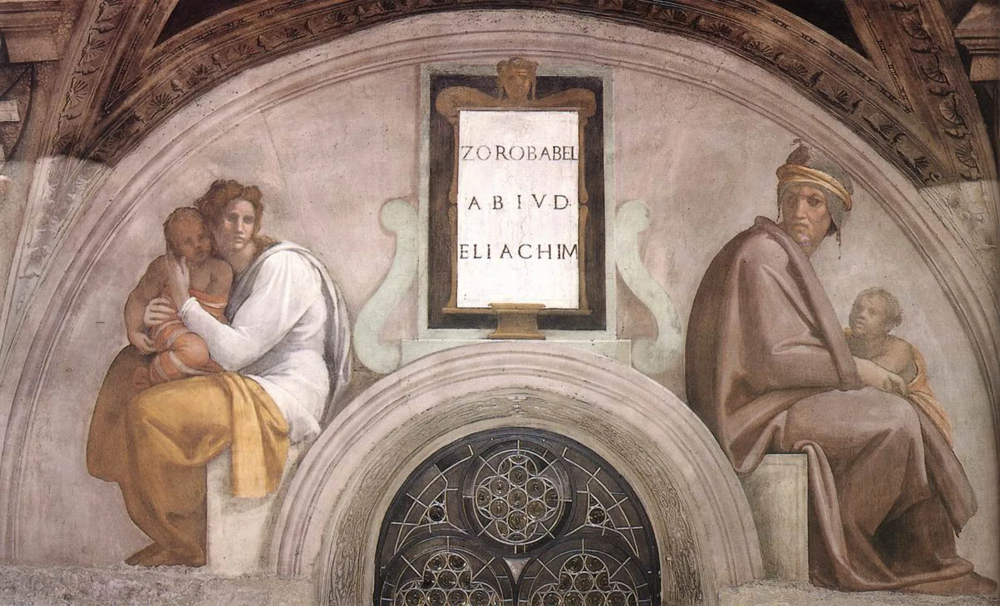
[图片来源](https://en.wikipedia.org/wiki/Matthew_1:13)

所罗巴伯**率被掳者从巴比伦归回**、主持重建第二圣殿，是"被掳—归回"这条线上的关键人物。

#### ⑪ 亚所 · 撒督 _Azor · Sadoch_

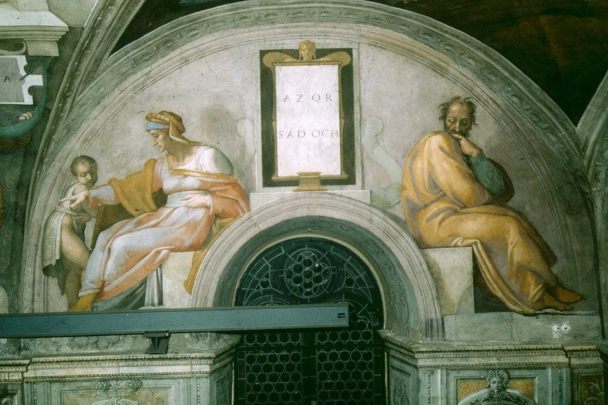
[图片来源](https://www.flickr.com/photos/ellisarthistory/7414287606)

名牌作「AZOR · SADOCH」。被掳归回之后、圣经记载寥寥的两代祖先，纯靠家谱留名（图中可清楚看到中央名牌与左侧抱婴的母亲、右侧托腮沉思的男子）。

#### ⑫ 亚金 · 以律 _Achim · Eliud_

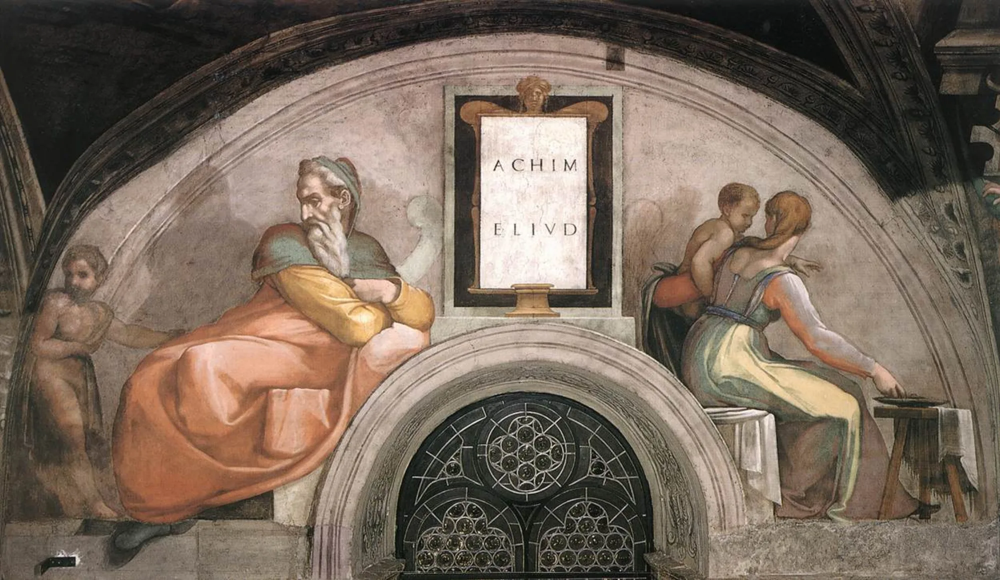
[图片来源](https://commons.wikimedia.org/wiki/File:Michelangelo,_lunetta,_Achim_-_Eliud_01.jpg)

同属归回后世代，圣经只在家谱里出现两个名字，生平不详。

#### ⑬ 以利亚撒 · 马但 _Eleazar · Mathan_

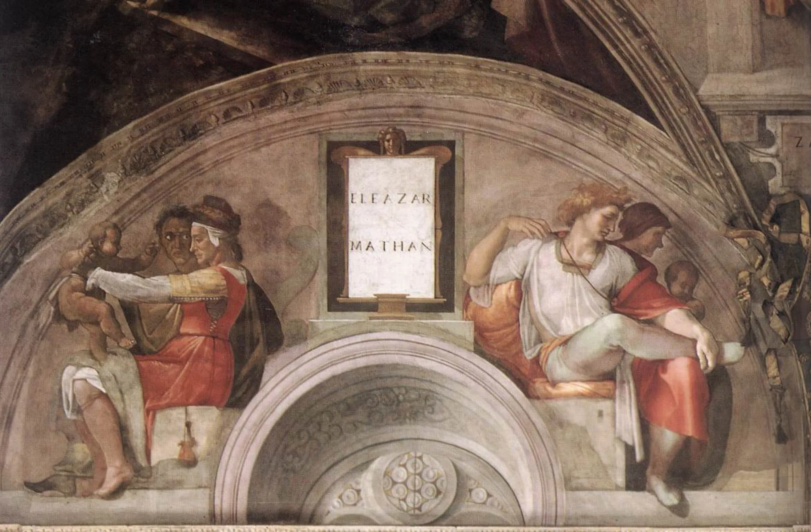
[图片来源](https://en.wikipedia.org/wiki/Matthew_1:15)

接近家谱末端的两代，马但是雅各（约瑟之父）的祖父。

#### ⑭ 雅各 · 约瑟 _Jacob · Joseph_

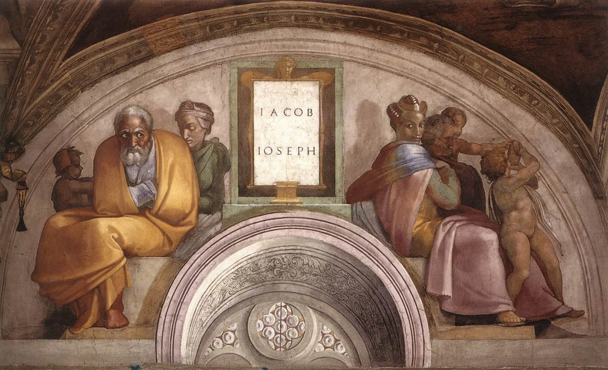
[图片来源](https://commons.wikimedia.org/wiki/File:Jacob_-_Joseph.jpg)

家谱的最后一环——雅各生约瑟，"就是马利亚的丈夫"（《玛窦福音》1:16），再下一代即基督。这是**离基督最近、最靠入口端**的一面月楣。

### Pontiffs（教皇肖像带）

窗间一带是**历代教皇肖像**，每位独立立在一个**贝壳顶壁龛（nicchia a conchiglia）**里、夹在窗与窗之间，沿三面墙连续排开。画的是**从彼得起最早的约三十位教皇**——他们几乎个个是圣人、多数是殉道者；人物头戴**三重冕（tiara）**、身披华丽圣袍（cope），手持书卷或作祝福状，龛上/下各有一块拉丁文**名牌（tabella）**写着名号。这条带的用意很明确：在《摩西生平》《基督生平》两条故事带之上，**用一长串"彼得的继承人"宣告教权的使徒统绪（apostolic succession）**——权柄从彼得一脉相传、从未中断，正是教皇合法性的根基（与对墙《交钥匙》《惩罚可拉党》的"权柄"主题一气呵成）。

原本这条带从**祭坛墙**起算，祭坛墙正中本是**基督与首任教皇彼得，以及利诺（Linus）、克莱图斯（Cletus）** 等像——1536 年米开朗基罗奉保罗三世之命在祭坛墙画《最后的审判》时，这几像一并被毁，故今天**现存约 24 位**。作者与故事带相同（波提切利画得最多，另有吉兰达约、罗塞利、佩鲁吉诺、迪亚曼特修士 Fra Diamante 等及其助手），人物姿态、龛式高度雷同，**彼此差别很小**——所以现场**路过即可、不必逐一细抠**。

> ⚠️ 与月楣不同，**这条带没有一份干净、人人公认的"一龛一名"清单**：名牌部分残损，把现存某一龛对应到具体某位教皇，学界至今多有出入；Wikimedia Commons 的收录也只覆盖其中一部分。下面先放两张**窗间龛连排的群像**看整体阵势，再挑 **Commons 有清晰大图、辨识较有把握的 10 位**逐一认（名号从 Commons／佩鲁吉诺全集等标注，仅供现场对个大概）。

#### 群像带一览（窗间龛连排）

每段五位、立于贝壳顶龛中——这就是抬头看到的"教皇墙"的样子（同一套构图反复，正是它"路过即可"的原因）：

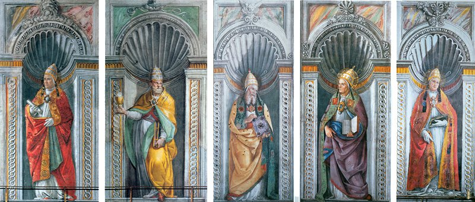

*图源：[Wikimedia Commons](https://commons.wikimedia.org/wiki/File%3ABotticelli%2C_papi_01.jpg)*

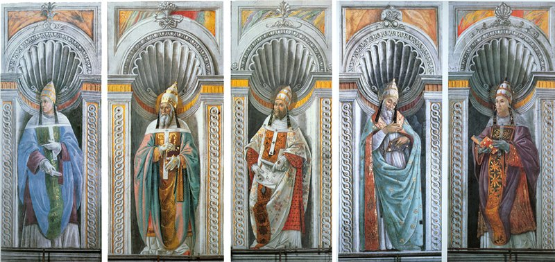

*图源：[Wikimedia Commons](https://commons.wikimedia.org/wiki/File%3ABotticelli%2C_papi_02.jpg)*

#### 圣埃瓦里斯托 _Evaristus_（波提切利）

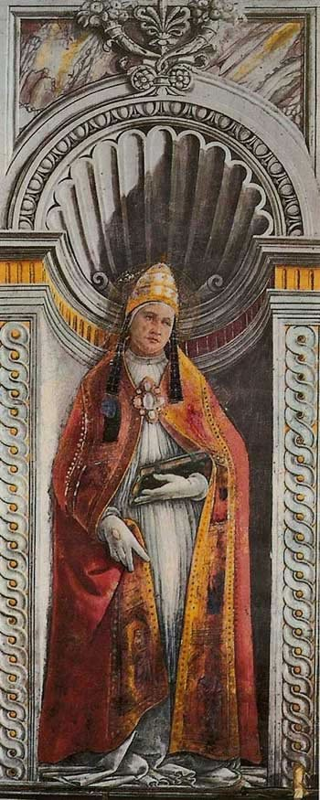

*图源：[Wikimedia Commons](https://commons.wikimedia.org/wiki/File%3APope_Saint_Evaristus_%28by_Sandro_Botticelli%29_%E2%80%93_Sistine_Chapel.jpg)*

第 5 任教皇（约 99–107 在位），传统列为殉道者。波提切利所画，是全带保存最好、最精致的一幅之一——三重冕、织金圣袍、捧书的双手都画得一丝不苟。把它当这条带的"标准像"来记最合适。

#### 圣阿纳克莱托 _Anacletus_（波提切利）

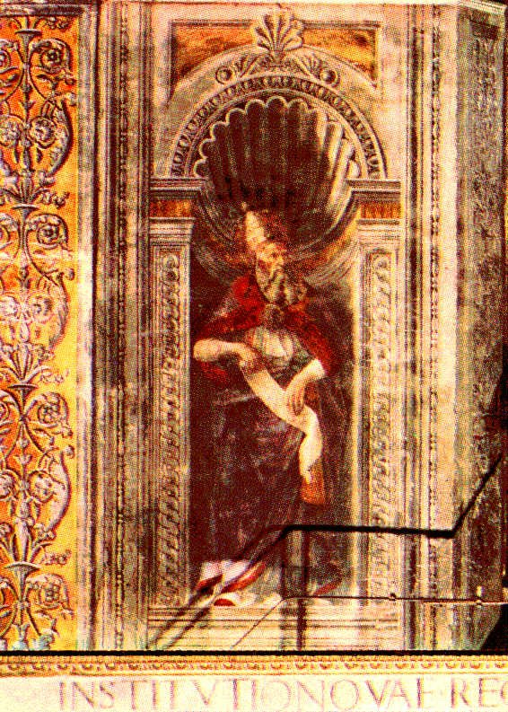

*图源：[Wikimedia Commons](https://commons.wikimedia.org/wiki/File%3AAnacletus.jpg)*

彼得之后第 3 任教皇（约 79–92，即克莱图斯 Cletus，两名同指一人）。波提切利所画；龛下方那条饰带正是故事带顶端的题字（这里露出「INSTITVTIO NOVAE RE[ligionis]…」），说明教皇带就紧压在故事壁画之上。

#### 圣亚历山大一世 _Alexander I_（波提切利）

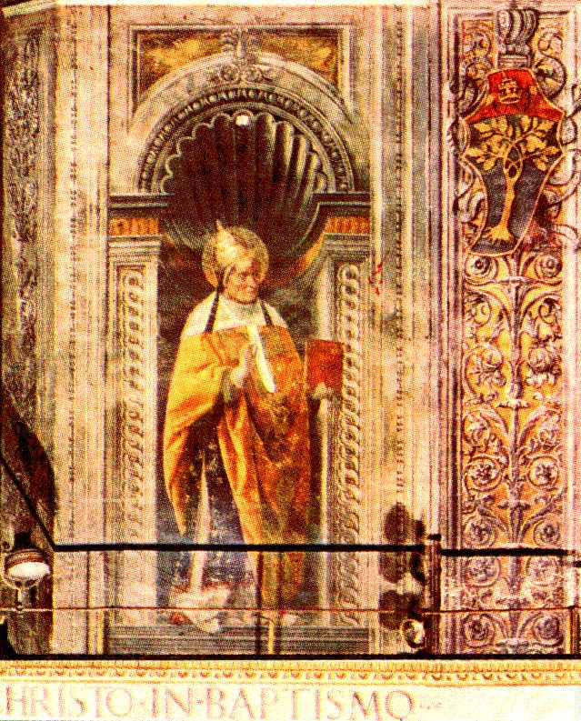

*图源：[Wikimedia Commons](https://commons.wikimedia.org/wiki/File%3APope_Alexander_I%2C_Sistine_Chapel.jpg)*

第 6 任教皇（约 107–115），传统列为殉道者。波提切利所画，作祝福手势、捧红色书册。龛下的题字「…HRISTO IN BAPTISMO」属于其下方北墙《基督受洗》一格——又一处"教皇压故事"的接缝。

#### 圣西斯笃二世 _Sixtus II_（波提切利）⭐ 名牌可辨

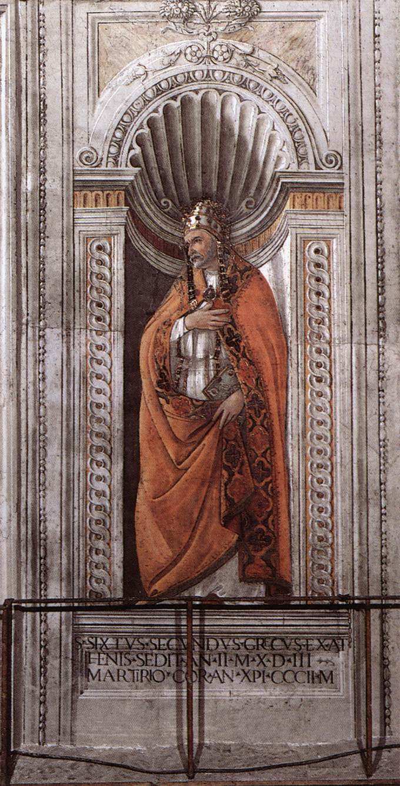

*图源：[Wikimedia Commons](https://commons.wikimedia.org/wiki/File%3ABotticelli%2C_Sixtus_II.jpg)*

第 24 任教皇（257–258），瓦勒良迫害中**在墓窟讲道时被捕斩首殉道**，是早期教会最著名的殉道教皇之一（与执事圣老楞佐 Lawrence 的故事相连）。这一龛难得**名牌清晰**：底部拉丁文写着「SIXTVS SECVNDVS GRECVS（希腊人西斯笃二世）… MARTIRIO COR[onatus]（以殉道加冕）」——是全带少数能直接读出名号与"殉道"字样的一幅，值得现场低头找一眼。

#### 圣安特罗 _Anterus_（佩鲁吉诺）

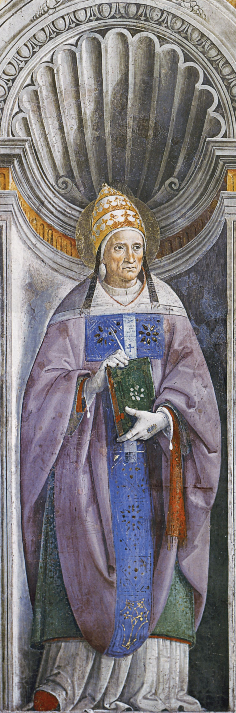

*图源：[Wikimedia Commons](https://commons.wikimedia.org/wiki/File%3APietro_Perugino_cat13b.jpg)*

第 19 任教皇（235–236），**在位仅约 43 天**便去世（传统亦列殉道）。佩鲁吉诺（Perugino，就是对墙《交钥匙》的作者）所画，蓝金两色圣袍、面容刻画极细——这一幅常被单独裁出脸部当"佩鲁吉诺式肖像"的范例。

#### 圣法比亚诺 _Fabian_（佩鲁吉诺）

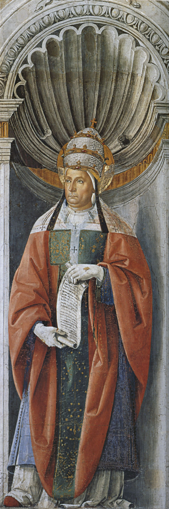

*图源：[Wikimedia Commons](https://commons.wikimedia.org/wiki/File%3APietro_Perugino_cat13c.jpg)*

第 20 任教皇（236–250），传说选举时**一只鸽子飞落他头顶**、众人遂认定他是天选而推举之；后在德西乌斯迫害中殉道。佩鲁吉诺所画，手持长长的文书卷轴、红袍宽展，是全带气度最从容的一幅。

#### 圣狄约尼削 _Dionysius_

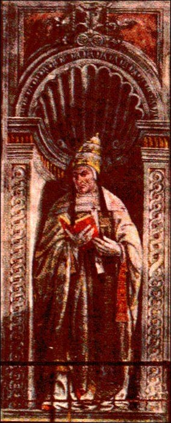

*图源：[Wikimedia Commons](https://commons.wikimedia.org/wiki/File%3APope_Dionysius.jpg)*

第 25 任教皇（259–268）。在瓦勒良大迫害刚过、教会一片狼藉时接任，**重新整顿罗马教会的组织与堂区**，是"乱后重建"的一位教皇。画中低头专注读一册红边书。

#### 圣庇护一世 _Pius I_

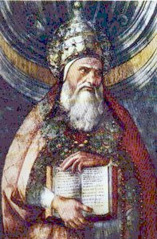

*图源：[Wikimedia Commons](https://commons.wikimedia.org/wiki/File%3APope_Pius_I.jpg)*

第 10 任教皇（约 140–155）。传统说他是《赫尔马斯的牧人》（早期教会名著）作者赫尔马斯的兄弟。此处仅存较小的彩色胸像图——长须老者捧书、三重冕带光环，可与上面波提切利那几幅对比着看面容刻画的差异。

#### 圣斐理斯一世 _Felix I_（旧档黑白）

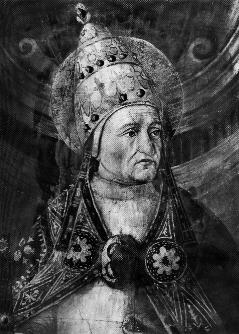

*图源：[Wikimedia Commons](https://commons.wikimedia.org/wiki/File%3APopeFelixI.jpg)*

第 26 任教皇（269–274）。Commons 仅存一张**早年黑白档案照**的胸像（彩色大图暂缺），仍能看清三重冕与圣袍纹样——聊作认人参考。

#### 圣则斐林 _Zephyrinus_（旧档黑白）

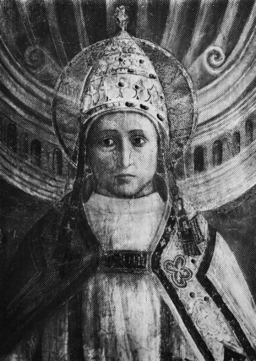

*图源：[Wikimedia Commons](https://commons.wikimedia.org/wiki/File%3AZephyrinus.jpg)*

第 15 任教皇（约 199–217），在位近二十年、经历早期教会多场神学争论。同样仅存**黑白档案胸像**，与斐理斯一世一并作"名单补全"，现场不必专门找。

> 📌 其余十余位（如西斯笃一世、特勒斯福鲁、希吉努、阿尼切图、索特尔、维克托一世、加里斯都一世、乌尔班一世、彭谦、高尔乃略、路爵一世、斯德望一世、欧迪基盎、卡尤、玛策林、玛策禄、欧瑟伯、弥尔弟亚得等）目前 Commons 没有清晰可靠、可一一对名的单幅大图；现场认到上面这些有把握的即可，整条带的看点本就是"阵势"而非"逐位"。

### Stories of Moses（摩西生平 · 南墙 + 入口墙）

> 🔗 官方：[Storie di Mosè · Musei Vaticani](https://www.museivaticani.va/content/museivaticani/en/collezioni/musei/cappella-sistina/parete-sud/storie-di-mose.html)

《摩西生平》原为八格，每格上方饰带题字标明主题。开头那格《摩西的诞生与发现》由佩鲁吉诺画在祭坛墙上，后为《最后的审判》所毁。故而今天旧约这条线从下面第一格《摩西的旅程》读起，止于祭坛对面，最后一幕《为摩西遗体的争夺》落在入口墙。以下按从祭坛向入口的顺序排列。**每格都把一段经文里的好几幕'连环画'式压在同一画面里，下面逐格说清画的是什么故事。**

#### ① 摩西在埃及的旅程 _Viaggio di Mosè in Egitto_（佩鲁吉诺）

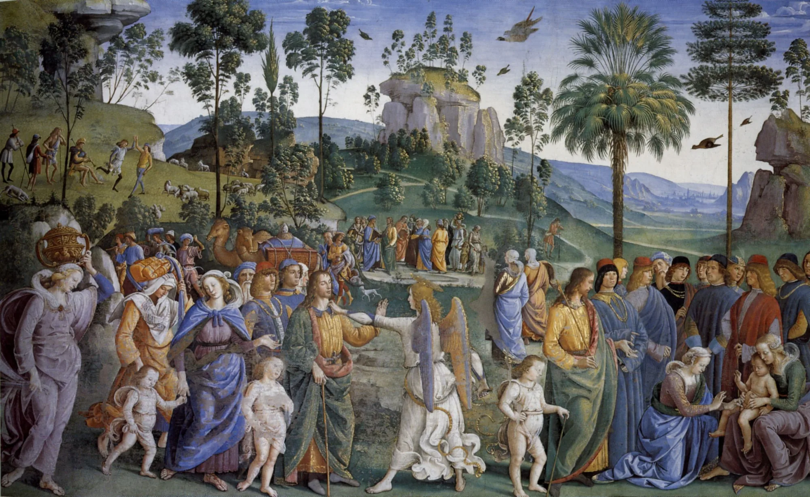
[图片来源](https://en.wikipedia.org/wiki/Moses_Leaving_for_Egypt)

南墙现存第一格，由佩鲁吉诺与平图里基奥（Pinturicchio）合作。**故事**：摩西在米甸牧羊、于燃烧荆棘前蒙召之后，奉神命带妻子西坡拉（Zipporah）和两个儿子返回埃及去解救以色列人。画面把《出埃及记》4 章一路上的几幕拼在一格里（大致**自右向左**读）：右端，摩西向岳父**叶忒罗（Jethro）躬身告别**；一家人骑驴启程上路；途中天使拦路、神因孩子未受割礼而要击杀摩西，**西坡拉急用石刀给次子行割礼**化解危机（4:24-26，画中持刀俯身的妇人即西坡拉）；左侧一组人物呼应着即将展开的出埃及。**预表**：这格的割礼正对北墙首格《基督受洗》——旧约"入约的记号"对新约"入约的记号"，是两墙逐格对位的开篇。

#### ② 摩西的考验 _Prove di Mosè_（波提切利） ⭐

> 🔗 官方：[Prove di Mosè · Musei Vaticani](https://www.museivaticani.va/content/museivaticani/en/collezioni/musei/cappella-sistina/parete-sud/storie-di-mose/fatti-della-vita-di-mose.html)

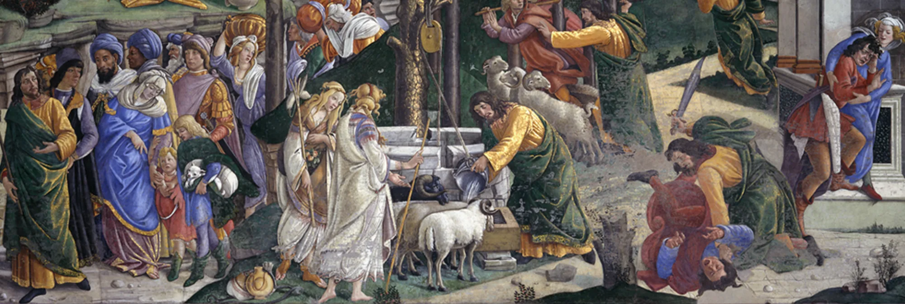

*图源：[梵蒂冈博物馆官网](https://www.museivaticani.va/content/museivaticani/en/collezioni/musei/cappella-sistina/parete-sud/storie-di-mose/fatti-della-vita-di-mose.html)*

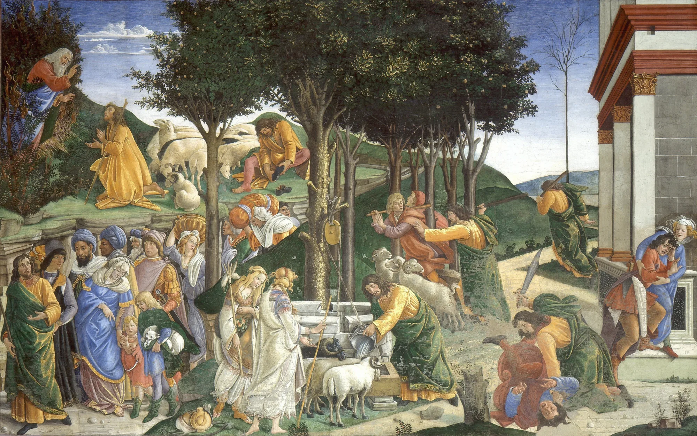

[图片来源](https://zh.wikipedia.org/zh-cn/%E6%A2%85%E7%91%9F%E7%9A%84%E7%94%9F%E5%B9%B3_%28%E6%B3%A2%E6%8F%90%E5%88%87%E5%88%A9%29)

波提切利（Sandro Botticelli）——《春》《维纳斯的诞生》的作者——把摩西**前半生七个片段**塞进同一格，时间顺序**自右向左**读：①最右，摩西**怒杀一名鞭打希伯来奴工的埃及监工**（《出埃及记》2:11-12）；②事发后**逃亡**、离开埃及去米甸；③井边，他替叶忒罗（Jethro）的女儿们**赶走抢水的牧人、帮她们打水饮羊**（这桩善举让他得娶西坡拉）；④画面左上，他**脱下鞋、跪在燃烧而不毁的荆棘前**，神在火中向他显现、呼召他回埃及救民（3:1-12）；⑤左下，他**率以色列人浩荡踏上出埃及之路**。**认人诀窍：穿黄衣绿袍的都是摩西**，他在同一格里反复出现（公认七次）；波提切利用同一套衣色，把"同一个人、不同时刻"串成一条可读的动线。

#### ③ 渡红海 _Passaggio del Mar Rosso_（罗塞利）

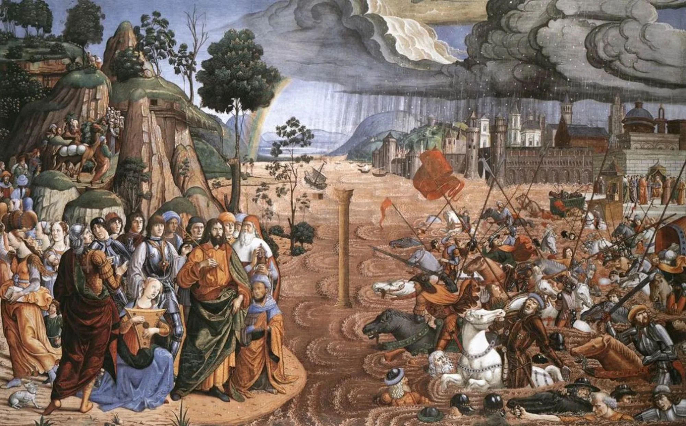
[图片来源](https://en.wikipedia.org/wiki/The_Crossing_of_the_Red_Sea_%28Sistine_Chapel%29)

由罗塞利（Cosimo Rosselli）主持、一般认为比亚乔·迪安东尼奥（Biagio d'Antonio）参与。**故事**（《出埃及记》14 章）：以色列人被法老大军追到红海边，摩西按神命**向海伸杖、海水分开**，众人踏干地而过；待埃及战车追入海床，摩西再次伸杖，**海水合拢、法老的人马连车带甲尽数覆没**。画面一边是安然登岸、举手向神祷告的以色列人（前景执杖白衣者即摩西，旁边一说是女先知米利暗 Miriam 正要带妇女歌舞谢恩，《出埃及记》15 章），另一边是溺水挣扎的埃及兵与漂浮的尸甲；天上以云柱/火柱标明神的同在。**预表**：穿水而得救，被读作洗礼的旧约预表，呼应对墙的《基督受洗》。

#### ④ 西奈山领受律法 _Consegna delle Tavole della Legge_（罗塞利）

> 🔗 官方：[Consegna delle Tavole della Legge · Musei Vaticani](https://www.museivaticani.va/content/museivaticani/en/collezioni/musei/cappella-sistina/parete-sud/storie-di-mose/consegna-delle-tavole-della-legge.html)

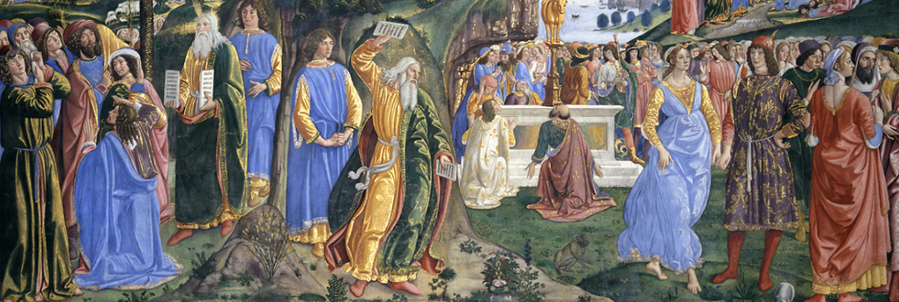

*图源：[梵蒂冈博物馆官网](https://www.museivaticani.va/content/museivaticani/en/collezioni/musei/cappella-sistina/parete-sud/storie-di-mose/consegna-delle-tavole-della-legge.html)*

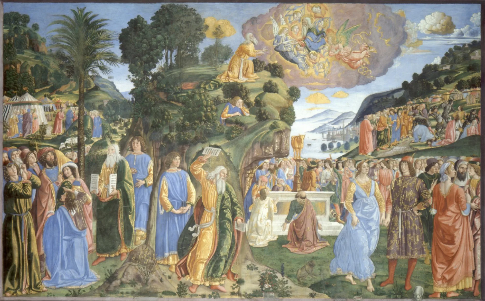
[图片来源](https://zh.wikipedia.org/zh-cn/%E6%8E%88%E4%BA%88%E7%BA%A6%E7%89%88_%28%E8%A5%BF%E6%96%AF%E6%B1%80%E5%B0%8F%E5%A0%82%29)

**故事**（《出埃及记》24、32、34 章）：一格里同时铺开好几幕——**右上**，摩西独自登上西奈山，在云与火中从神手里领受刻着十诫的**两块法版**；**山下**，久候不耐的百姓让亚伦铸了一头**金牛犊**，围着它又拜又舞作乐；摩西下山见状大怒，把第一对法版**当场摔碎**（中景），下令利未人**惩罚拜偶像的人**；**左侧**，摩西**再次上山、携神重新写就的新法版下山归来**，脸上因见过神而发光。**预表**：这格"在山上颁布律法"正对北墙的《登山宝训》——旧律法与新律法都自山上颁下；金牛犊一幕则是"背约—审判—再立约"的缩影。

#### ⑤ 惩罚可拉党 _Punizione di Core_（波提切利） ⭐

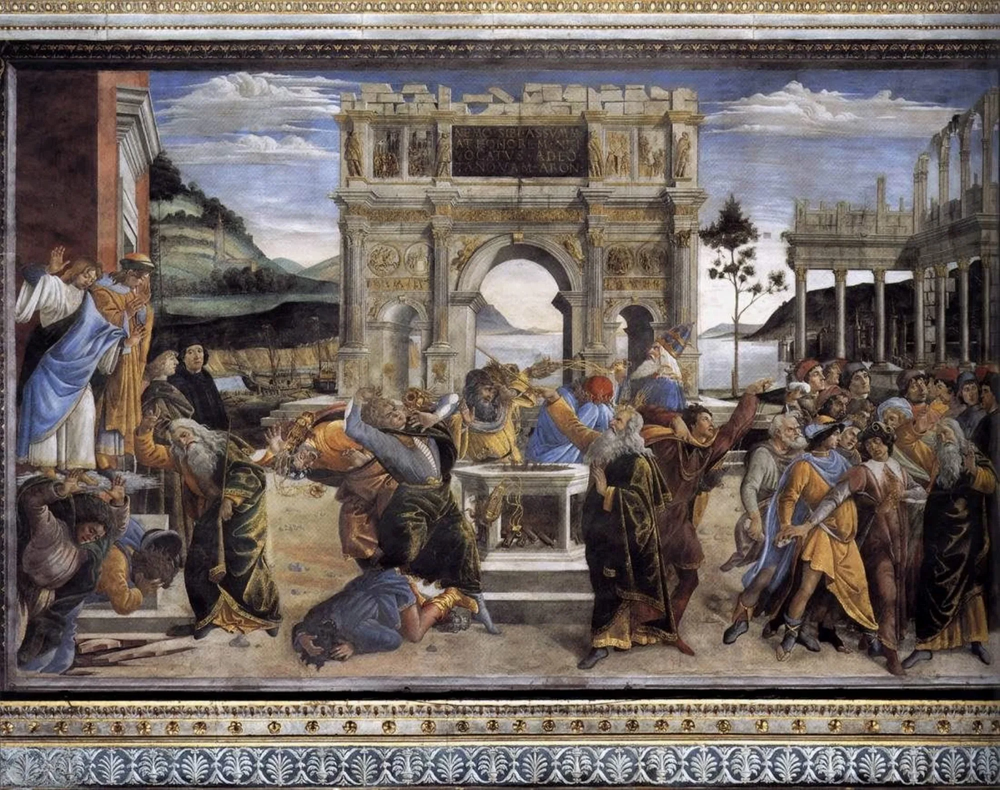
[图片来源](https://en.wikipedia.org/wiki/Punishment_of_the_Sons_of_Korah)

**故事**（《民数记》16 章）：利未人可拉（Korah）联合大坍（Dathan）、亚比兰（Abiram）共二百五十人，质问摩西与亚伦凭什么独揽祭司与领袖的权柄。画面分三幕（**右→左**）：**右端**，叛众捡石头要砸摩西，被摩西举手喝止；**中央**，在凯旋门前，亚伦着祭司袍持香炉献香、叛党也擅自上前献香争权，神迹立判——**擅自献香者被天火烧灭**；**左端**，**大地裂开、把为首的可拉一党连人带物吞了下去**，众人惊逃。这是全套壁画里政治火力最猛的一格——**画中亚伦头戴的正是教皇的三重冕**，中央凯旋门照着君士坦丁凯旋门画、铭文引《希伯来书》5:4"这大祭司的尊荣没有人可自取，惟有蒙神所召的"。（细节：地裂上方有两名飘浮、安然无恙的青年——《民数记》26:11"可拉的众子却没有死亡"。）它正对着对墙的《交钥匙》：一格讲僭越权柄者的下场，一格讲权柄的合法授予——一根大棒、一颗甜枣。

#### ⑥ 摩西的遗嘱与死亡 _Testamento e morte di Mosè_（西尼奥雷利）

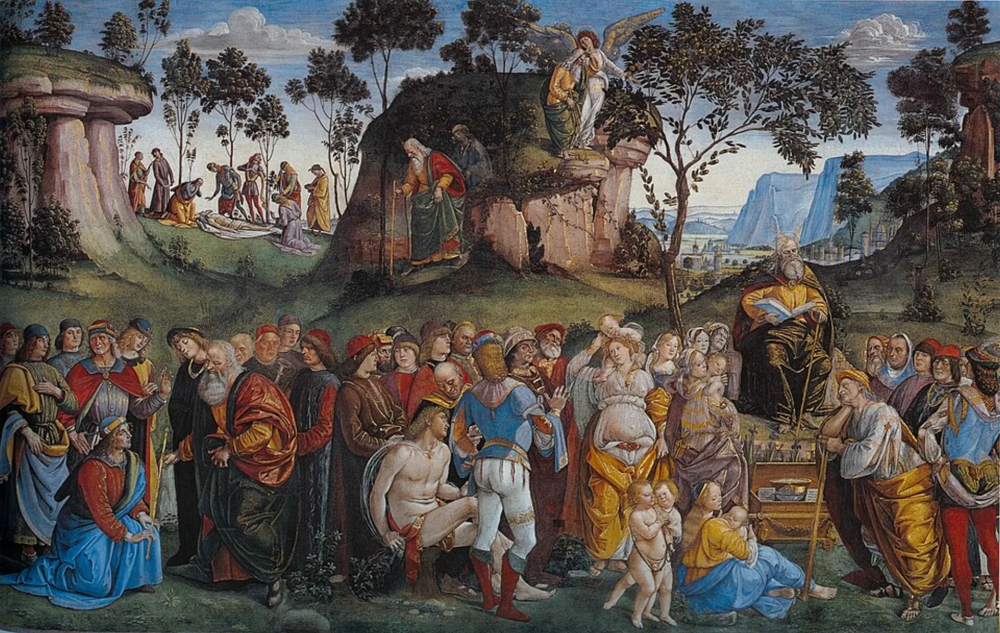
[图片来源](https://zh.wikipedia.org/wiki/%E6%A2%85%E7%91%9F%E7%9A%84%E9%81%97%E5%98%B1%E5%8F%8A%E6%A2%85%E7%91%9F%E4%B9%8B%E6%AD%BB)

由西尼奥雷利（Luca Signorelli）与巴尔托洛梅奥·德拉·加塔（Bartolomeo della Gatta）合作。**故事**（《申命记》31–34 章）：已一百二十岁、获准远望却不得踏入应许之地的摩西，在生命终点处理身后事——画中可辨几幕：他向跪在面前的**约书亚（Joshua）交付权杖**、立其为继任者；向聚集的以色列会众**宣读律法**（前景手持法版、坐着的长须者即摩西，旁边那个**坐姿裸体青年**最受瞩目，常被看作天顶 ignudi 的前奏）；一名天使引他登高、**遥指脚下的应许之地**；最后摩西辞世、众人哀悼。**预表**：摩西把民众带到应许之地门口、却由约书亚（与"耶稣"同名）领进去，被读作旧约领袖向基督的交棒。

#### ⑦ 为摩西遗体的争夺 _Disputa sul corpo di Mosè_（入口墙 · 马泰奥·达·莱切 重画）

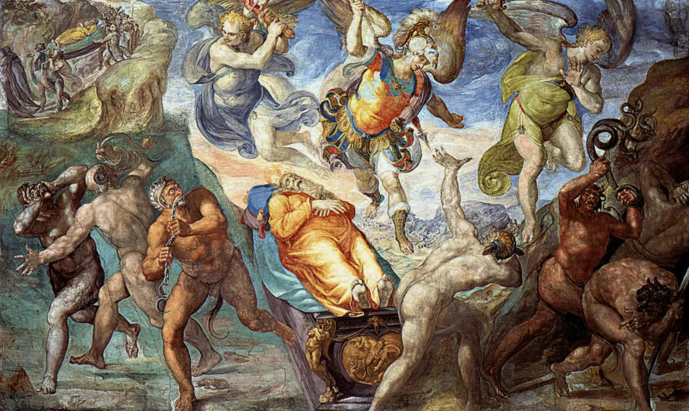
[图片来源](https://commons.wikimedia.org/wiki/File:Matteo_da_Lecce_-_Disputa_junto_al_cuerpo_de_Mois%C3%A9s_%28Capilla_Sixtina,_Roma,_1572-85%29.jpg)

摩西这条线的"大结局"，画在入口墙（与《最后的审判》正相对）。**故事**（《犹达书》9）：摩西死后，天使长**弥额尔（米迦勒）与魔鬼争夺摩西的尸身**——魔鬼想借摩西的坟做偶像崇拜的由头，米迦勒不与它争辩咒骂，只说"愿主责备你"。**这幅不是 1480 年代的原作**：原作由**西尼奥雷利**所画，1522 年门楣坍塌时毁掉，现存为格里高利十三世（1572–1585 在位）时**马泰奥·达·莱切（Matteo da Lecce）**重画的同题之作——晚了近百年、已是矫饰主义的扭曲人体，水准明显不及，路过扫一眼即可。

### Stories of Christ（基督生平 · 北墙 + 入口墙）

> 🔗 官方：[Storie di Cristo · Musei Vaticani](https://www.museivaticani.va/content/museivaticani/en/collezioni/musei/cappella-sistina/parete-nord/storie-di-cristo.html)

《基督生平》同样原为八格、上方题字。开头那格《基督诞生》由佩鲁吉诺画在祭坛墙上，后为《最后的审判》所毁。故今天新约这条线从《基督受洗》读起，止于入口墙的《基督复活》。以下按从祭坛向入口的顺序排列，与对面《摩西生平》逐格呼应。

#### ① 基督受洗 _Battesimo di Cristo_（佩鲁吉诺）

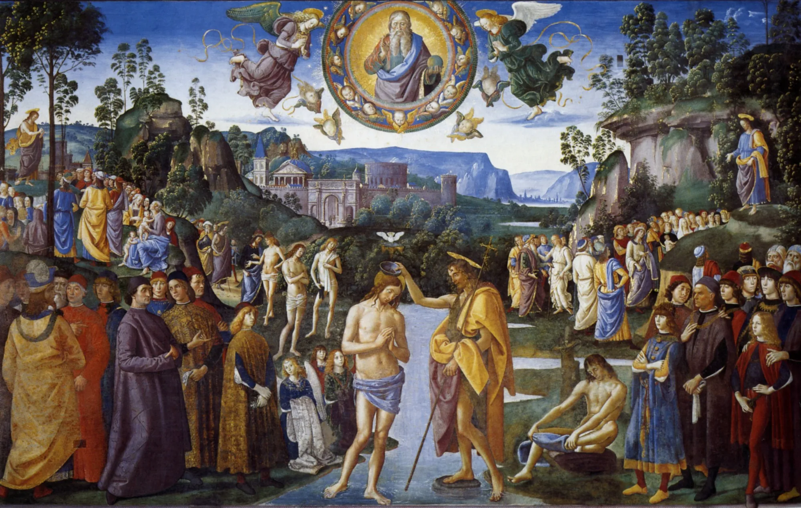
[图片来源](https://zh.wikipedia.org/wiki/%E5%9F%BA%E7%9D%A3%E5%8F%97%E6%B4%97_%28%E4%BD%A9%E9%B2%81%E5%90%89%E8%AF%BA%29)

北墙现存第一格：约旦河边，施洗约翰为基督施洗，圣灵如鸽降下。它正对南墙首格摩西次子的**割礼**——新约"入约的记号"对旧约"入约的记号"。

#### ② 基督受试探 _Tentazioni di Cristo_（波提切利） ⭐

> 🔗 官方：[Tentazioni di Cristo · Musei Vaticani](https://www.museivaticani.va/content/museivaticani/en/collezioni/musei/cappella-sistina/parete-nord/storie-di-cristo/tentazioni-di-cristo.html)

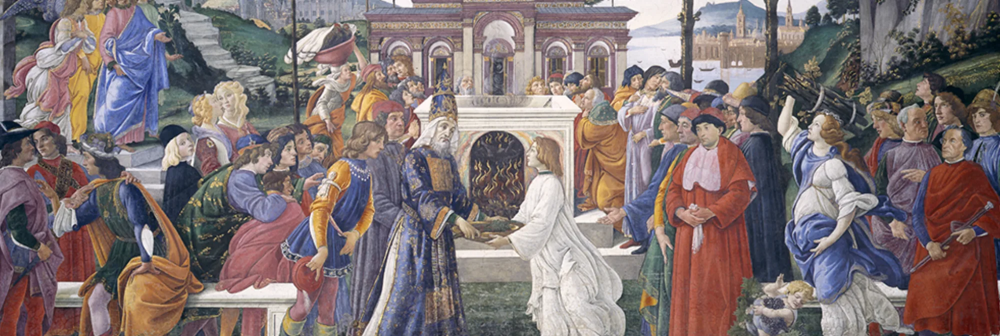

*图源：[梵蒂冈博物馆官网](https://www.museivaticani.va/content/museivaticani/en/collezioni/musei/cappella-sistina/parete-nord/storie-di-cristo/tentazioni-di-cristo.html)*

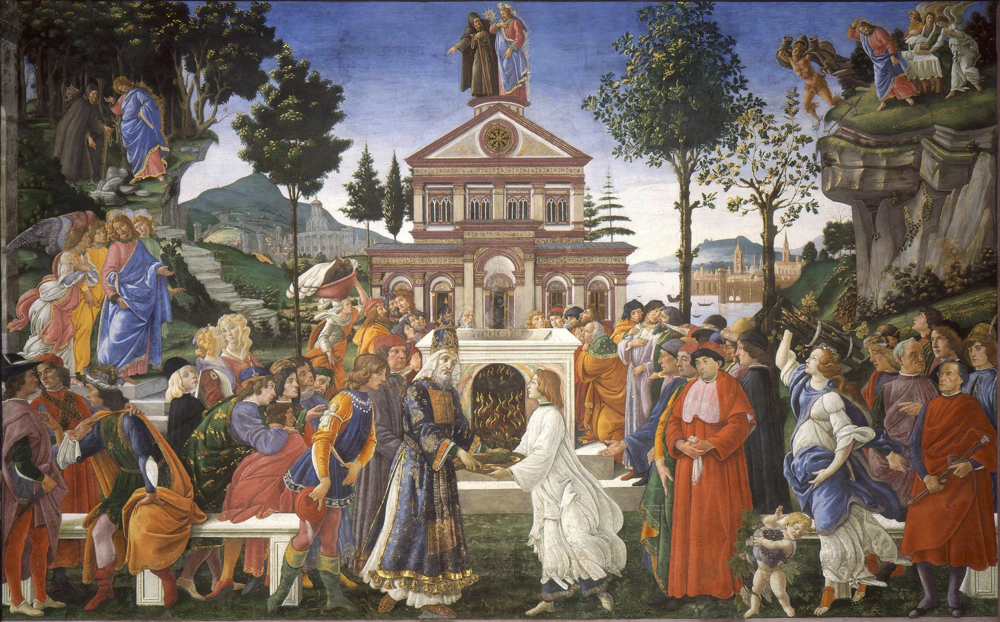
[图片来源](https://zh.wikipedia.org/zh-cn/%E5%9F%BA%E7%9D%A3%E5%9C%A8%E6%97%B7%E9%87%8E%E5%8F%97%E8%AF%95%E6%8E%A2%E5%92%8C%E6%B4%81%E5%87%80%E7%99%9E%E7%97%85%E4%BA%BA_(%E6%B3%A2%E6%8F%90%E5%88%87%E5%88%A9))

波提切利在北墙的一格：把魔鬼三试基督（变石为饼、圣殿顶跳下、以万国权柄相诱）排在背景，前景画治愈的麻风病人献祭——旧约的洁净祭预表基督的自我献祭。背景那座"圣殿"，一般认为照着西克斯图斯四世刚重建的圣灵医院立面画的，顺手给金主点了个赞。

#### ③ 召唤首批门徒 _Vocazione degli Apostoli_（吉兰达约）

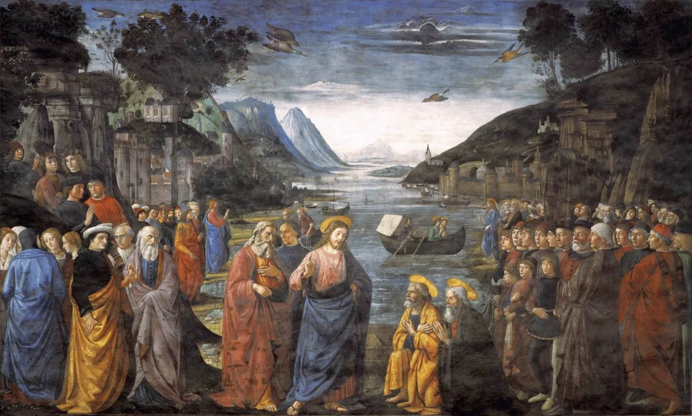
[图片来源](https://zh.wikipedia.org/zh-cn/%E9%A6%96%E6%89%B9%E5%AE%97%E5%BE%92%E7%9A%84%E5%9C%A3%E5%8F%AC)

吉兰达约（Domenico Ghirlandaio）所作：加利利湖边，前景彼得与安德烈兄弟扔下渔网跪在基督面前——"来跟从我，我要叫你们得人如得鱼"，背景则是雅各与约翰的蒙召。两岸围观人群里挤满**当时旅居罗马的佛罗伦萨侨民肖像**，是吉兰达约的拿手好戏（他后来在佛罗伦萨的群像壁画把这套玩到登峰造极）。记住这个名字还有一个理由：**少年米开朗基罗正是吉兰达约的学徒**——天顶与祭坛墙的作者，师承就挂在侧墙上。

#### ④ 登山宝训与治愈麻风病人 _Discorso della Montagna_（罗塞利）

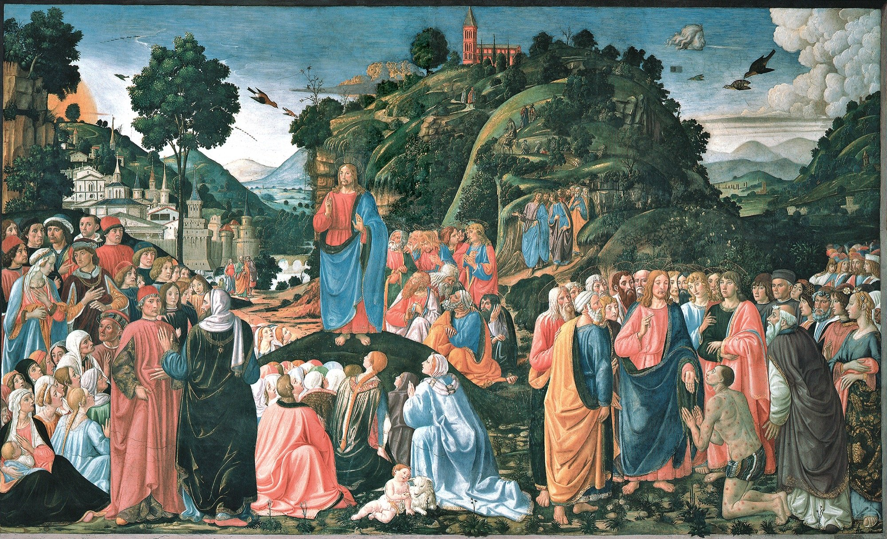
[图片来源](https://www.flickr.com/photos/28433765@N07/52812209489)

罗塞利所作，与对面《西奈山领受律法》对位：基督在山上向门徒讲道（《玛窦福音》5–7 章），前景另画基督治愈麻风病人。山上的新律法，呼应摩西山上的旧律法。

#### ⑤ 交钥匙 _Consegna delle chiavi_（佩鲁吉诺） ⭐ —— 侧墙第一名作

> 🔗 官方：[Consegna delle chiavi · Musei Vaticani](https://www.museivaticani.va/content/museivaticani/en/collezioni/musei/cappella-sistina/parete-nord/storie-di-cristo/consegna-delle-chiavi.html)

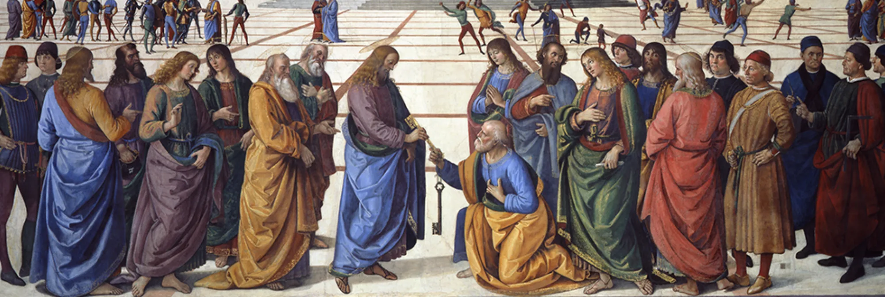

*图源：[梵蒂冈博物馆官网](https://www.museivaticani.va/content/museivaticani/en/collezioni/musei/cappella-sistina/parete-nord/storie-di-cristo/consegna-delle-chiavi.html)*

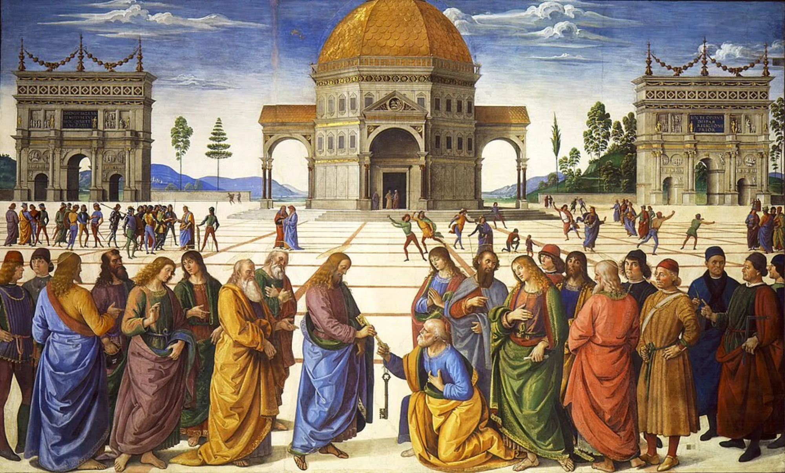
[图片来源](https://en.wikipedia.org/wiki/Delivery_of_the_Keys)

**内容（这是什么）**：《玛窦福音》16:18-19 的"立宪时刻"：基督对彼得说，"你是彼得（磐石），我要把我的教会建造在这磐石上……我要把天国的钥匙交给你；凡你在地上所束缚的，在天上也要被束缚。"画面正中，彼得单膝跪地，接过**一金一银两把钥匙**——后世解作金钥匙司天上赦罪之权、银钥匙司地上治理之权（至今仍交叉在教皇纹章上）。两侧横排站着众使徒和多位 15 世纪当代人肖像（基督左手边第五人是犹大；右数第五个人头，通常认作佩鲁吉诺自画像）。

**为什么在这间屋里它分量最重**：教皇的全部合法性都从这节经文来——历代教皇自称彼得的继承人，"钥匙的权柄"代代相传；在教皇自家礼拜堂里把这一幕画在墙上，等于把政权的法理文件挂出来。背景两侧那对凯旋门照着君士坦丁凯旋门画，门上的拉丁铭文把西克斯图斯四世比作建圣殿的所罗门王（Solomon）——罗马帝国的武功纪念碑，被"接收"来给教会盖章。中央那座圆顶八角神殿，是阿尔伯蒂（Leon Battista Alberti）式"理想教堂"的样板间：人间的完美秩序，呼应钥匙代表的天上秩序。广场中景还藏着两小幕：左边"纳税银"（凯撒的归凯撒）、右边众人举石头要打基督——都是基督权柄受质疑的时刻，反衬前景里权柄的正式授予。

**看点（早期文艺复兴的空间课代表）**：整幅画就是一堂一点透视示范课——广场地砖的格线笔直收向中央神殿大门，人物像浮雕一样横列前景，中景空旷、远景羽状树与青灰群山。这套"对称大集会＋灭点压在中轴"的构图被佩鲁吉诺的学生拉斐尔（Raphael）整个继承：先在《圣母的婚礼》里几乎原样翻用，再到签字厅的《圣礼之争》《雅典学院》推到极致——今天稍早看过的那两面墙（[R - 07 拉斐尔房间 · 签字厅《雅典学院》《圣礼之争》](../r07-stanza-della-segnatura/)），构图血缘就从这一格来。附赠一个冷知识：历次教皇选举会议（conclave）在堂内抽签分配枢机的隔间，**抽到这格壁画下方铺位的人当选率出奇地高**——克雷芒七世、尤利乌斯二世（Julius II）、保罗三世都是睡在《交钥匙》底下被选上的，成了选举会议里公开的吉利铺位。

#### ⑥ 最后的晚餐 _Ultima Cena_（罗塞利）

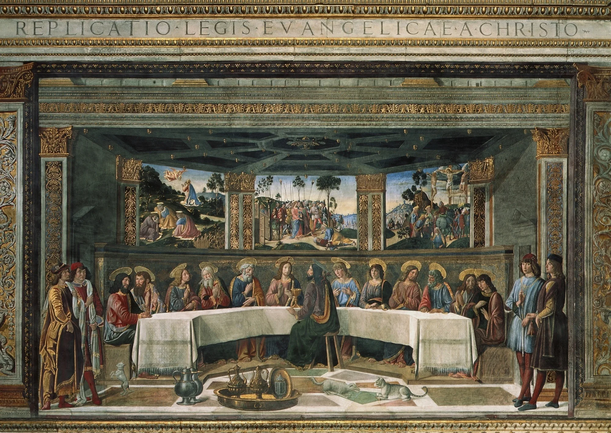
[图片来源](https://en.wikipedia.org/wiki/Last_Supper_%28Rosselli%29)

罗塞利所作，北墙靠祭坛对侧的末格：基督与门徒共进逾越节晚餐、预言被卖。餐厅背景的窗外另画着受难三幕——客西马尼园祷告、基督被捕、十字架受难。

#### ⑦ 基督复活 _Resurrezione di Cristo_（入口墙 · 范登布鲁克 重画）

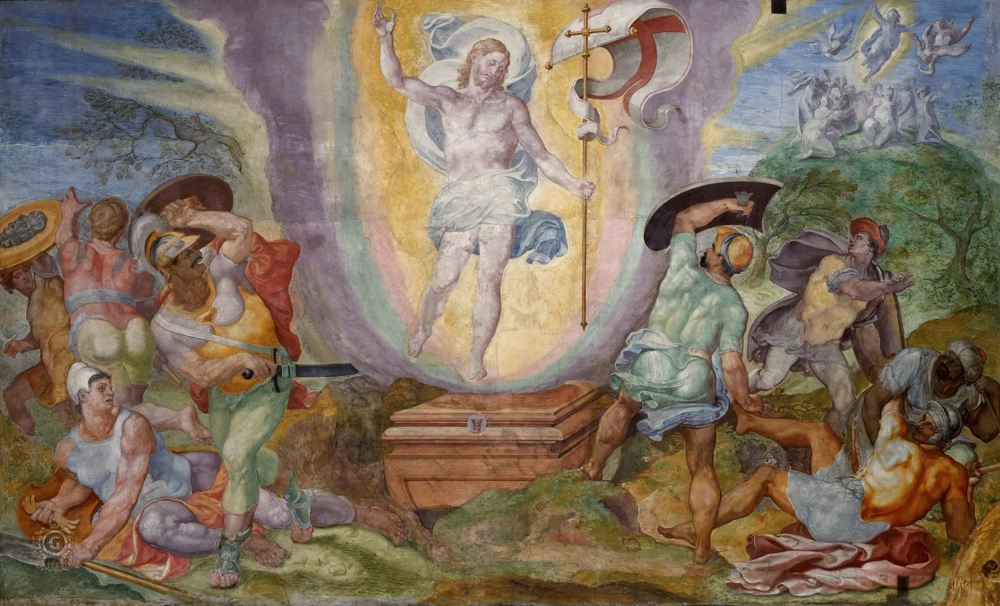
[图片来源](https://en.wikipedia.org/wiki/Hendrick_van_den_Broeck)

基督这条线的"大结局"，与《为摩西遗体的争夺》并列在入口墙。《玛窦福音》28:1-8。**亦非原作**：原作由**吉兰达约**所画，1522 年门楣坍塌时同毁，现存为**亨德里克·范登布鲁克（Hendrik van den Broeck）**重画——同样路过一眼即可。

### Drapes（仿帷幔带）

三面墙最下层是一圈**仿挂毯／仿帷幔**：官方说明指出，故事带每一格下方都对应一幅仿帷幔，上绘**西克斯图斯四世的纹章与功业（imprese）**。这层是金主在自家礼拜堂里的署名与排场，**看一眼即可**。（重大典礼时，这一层下方原本会挂上拉斐尔设计、布鲁塞尔织造的真挂毯《使徒行传》系列，今藏梵蒂冈绘画馆。）

---

### 现场站看（时间紧按这个优先级）

1. **只有一分钟：右墙（北）《交钥匙》**——面向《最后的审判》时的右手墙、靠入口那端数第二格（认"背景圆顶八角神殿＋左右两座凯旋门"即是）。看三处：正中金银两把钥匙的交接；地砖透视线笔直收进神殿大门；右数第五个人头（据传佩鲁吉诺自画像）。
2. **再加一分钟：转身看正对面的《惩罚可拉党》**——找头戴教皇三重冕的亚伦、脚下裂开的大地、同款凯旋门。与《交钥匙》一对照，西克斯图斯四世的"权柄宣言"才算读完整。
3. **还有余裕**：左墙（南）《摩西的考验》，数数穿黄衣绿袍的摩西出现几次；右墙《召唤首批门徒》看两岸的佛罗伦萨侨民群像。
4. **收尾一眼，串起 60 年**：佩鲁吉诺的秩序（1482）→ 头顶天顶的雄强（1512）→ 祭坛墙的不安漩涡（1541）——早期文艺复兴、盛期、风格主义三段风格史，在同一间屋里看完。

### 怎么逛 · 现场须知（与天顶一致）

- 严禁拍照摄像、保持安静；着装遮肩盖膝。
- 祭坛墙前常最拥挤，**往两侧或中段退一点反而看得全**。
