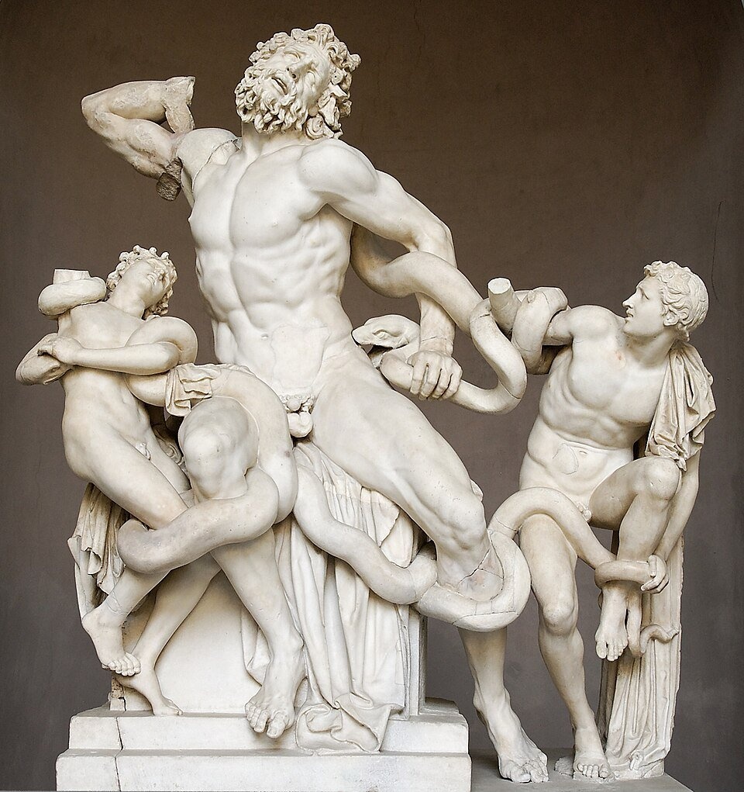
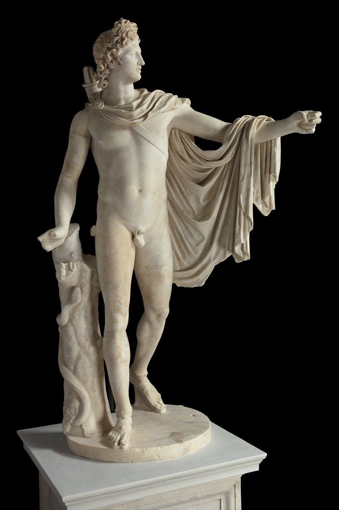
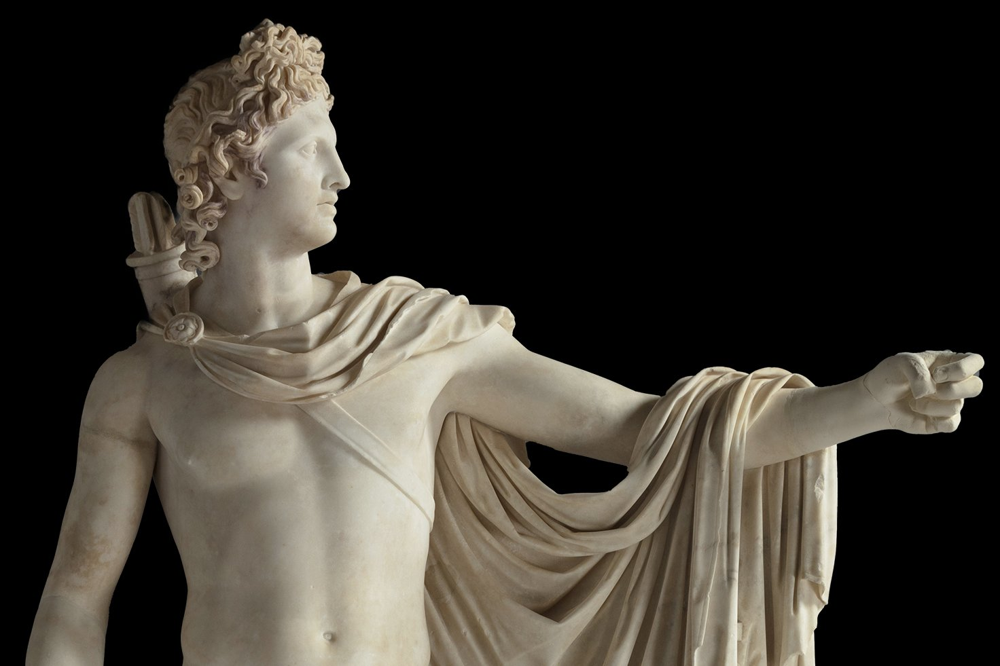
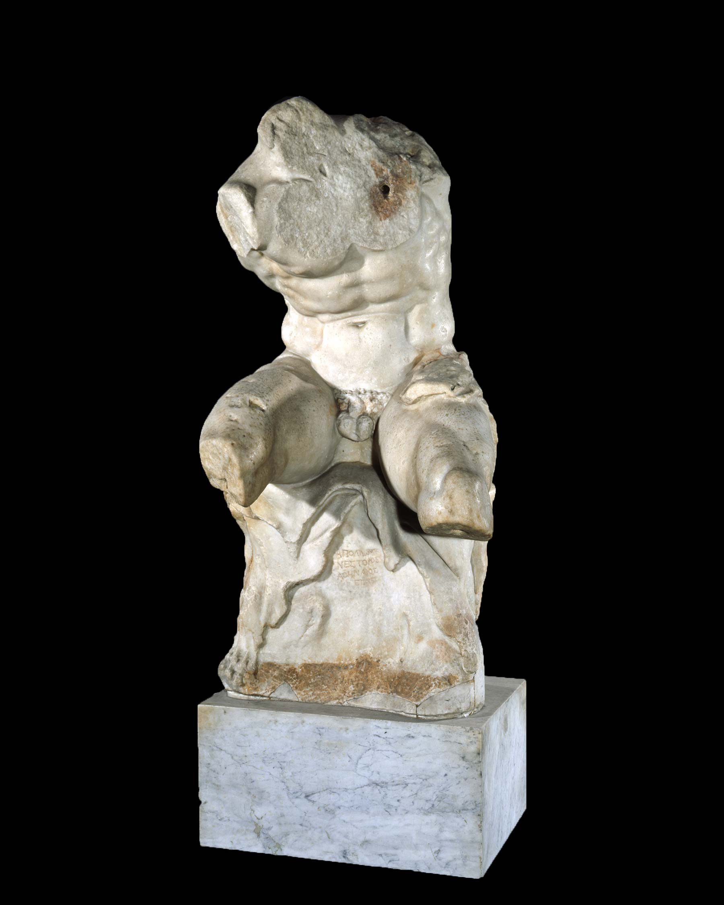
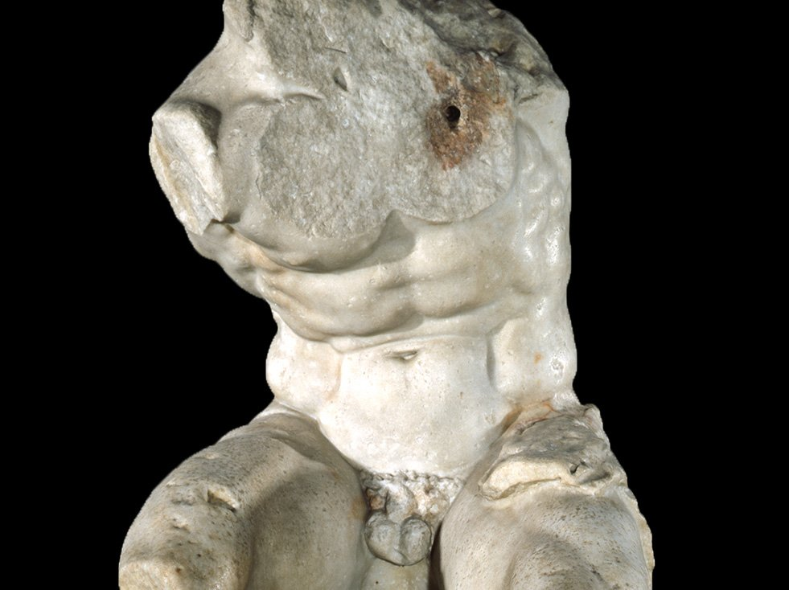

⭐⭐ 进梵蒂冈博物馆后最先经过的几个庭院。**八角庭院（Cortile Ottagono）藏着两件西方雕塑史的"圣物"**——《拉奥孔》与《观景楼的阿波罗》，是去拉斐尔房间/西斯廷路上不可错过的一段。**可拍照，禁闪光。**

🔗 官方：[梵蒂冈博物馆 · 庇护-克莱门特博物馆](https://www.museivaticani.va/content/museivaticani/en/collezioni/musei/museo-pio-clementino.html)

### 松果院（Cortile della Pigna）

进馆后的大庭院，得名于尽头壁龛里那座**古罗马巨型青铜松果（Pigna）**——近 4 m 高、公元 1–2 世纪铸造，原本是一座喷泉，水从松果顶端的孔眼里渗出。它最初立在战神广场的伊西斯（Isis）神庙一带、万神殿附近，那片街区至今还叫"松果区（Rione Pigna）"；中世纪被移到老圣彼得大教堂的前庭，但丁（Dante）在《神曲·地狱篇》里形容巨人宁录（Nimrod）的脸"像罗马圣彼得的松果那样又长又大"，写的就是它；1608 年才搬进现在这个由皮罗·利戈里奥（Pirro Ligorio）设计的大壁龛。两侧的青铜孔雀是复制品，原件传为哈德良（Hadrian）陵墓（今圣天使堡）的装饰，现藏新翼馆。

院中央的**金色破碎地球**是当代雕塑家阿纳尔多·波莫多罗（Arnaldo Pomodoro）的《球中球》（_Sfera con Sfera_，1990 年安放）：光洁的外壳裂开，露出里面齿轮般咬合的内球——常被解读为"看似完美的世界，内部复杂而脆弱"。同型铸件立在联合国总部、都柏林三一学院等地，这里是"正版"之一。

**顺路看点**：① 一眼看尽两千年——古罗马青铜松果、文艺复兴庭院、当代金球同框；② 松果在古代是丰饶与永生的符号，正好给后面圣彼得大教堂的"永恒"主题开个头；③ 这里常是大团队整队点，人多就拍完即走。

### 《拉奥孔群像》/ _Gruppo del Laocoonte_ ⭐⭐⭐

> 🔗 官方：[Laocoön · Musei Vaticani](https://www.museivaticani.va/content/museivaticani/en/collezioni/musei/museo-pio-clementino/Cortile-Ottagono/laocoonte.html)

- **作者**：罗得岛雕刻家阿格桑德罗斯、波吕多罗斯、阿塔诺多罗斯（古希腊化时期）
- **作品**：《拉奥孔与儿子们》/ _Laocoonte e i suoi figli_
- **时间**：约公元前 1 世纪—公元 1 世纪（希腊化原作或罗马复制）
- **材质**：大理石
- **位置**：八角庭院（Cortile Ottagono）
- **官网介绍页**：[Wikipedia · Laocoön and His Sons](https://en.wikipedia.org/wiki/Laoco%C3%B6n_and_His_Sons)

*图源：[Wikimedia Commons](https://commons.wikimedia.org/wiki/File:Laocoon_Pio-Clementino_Inv1059-1064-1067.jpg)*

**内容（这是什么）**：希腊人围攻特洛伊十年不下，佯装撤军、留下一匹巨大的木马。特洛伊祭司拉奥孔（Laocoön）冲下来警告同胞："不要相信这匹马！**我怕希腊人，即使他们送礼**（Timeo Danaos et dona ferentes）"——这句西方名言出自维吉尔（Virgil）《埃涅阿斯纪》卷二；他还把长矛掷进了木马的腹侧。随后他在海边献祭时，两条巨蛇破浪而来，把他和两个儿子活活绞死。特洛伊人把这看成神罚——"他亵渎了献给神的木马"，于是拆开城墙把马拉进城，当夜特洛伊陷落。雕像定格的就是父子三人被蛇缠绞的最后一刻：拉奥孔坐在祭坛上向后弓起，左侧的小儿子已被缠到垂死，右侧的大儿子还在试图从蛇环里抽出手臂。

**谁派的蛇**：维吉尔一系说是助希腊一方的密涅瓦（Minerva，即雅典娜）；索福克勒斯（Sophocles）失传的悲剧则说他是阿波罗（Apollo）的祭司、违誓娶妻生子，蛇只杀两个儿子、留他活着受罪。两种版本道德完全相反：**他要么因为说对了被灭口，要么因为犯戒受罚**——这件作品因此被读了两千年。

**背景 / 来历**：罗马作家老普林尼（Pliny the Elder）在《自然史》里写过：提图斯（Titus）皇帝宫中有一件"胜过一切绘画与青铜"的拉奥孔，出自罗得岛三位雕刻家阿格桑德罗斯（Agesander）、阿塔诺多罗斯（Athenodoros）、波吕多罗斯（Polydorus）之手。1506 年初，罗马市民费利切·德·弗雷迪斯（Felice de Fredis）在自家葡萄园里挖出了它——地点在埃斯奎利诺山南坡，2010 年的档案研究把位置精确到"七厅"蓄水池旁，正是尼禄金宫一带。教皇尤利乌斯二世（Julius II）闻讯派建筑师朱利亚诺·达·桑迦洛（Giuliano da Sangallo）赶赴现场，**米开朗基罗（Michelangelo）当时常驻桑迦洛家，被一并带去**——桑迦洛的儿子六十多年后回忆，父亲朝坑里一看就喊："这就是普林尼写的那件拉奥孔！"教皇当年 3 月买下（给了德·弗雷迪斯一份文书职位外加一座罗马城门的关税），8 月便立进观景楼雕像庭院——**梵蒂冈博物馆把这次购藏当作自己馆史的起点**。

**原作还是复制品**：风格上它属于"佩加蒙巴洛克"——公元前 200 年前后小亚细亚佩加蒙一派翻腾的肌肉与痛苦（柏林佩加蒙祭坛上的巨人阿尔库俄纽斯几乎是同一姿势）。但它究竟是希腊化原作，还是三位罗得岛人对一件青铜原作的罗马时代再创作，学界争了几百年；同样三个名字又出现在斯佩隆加（Sperlonga）提比略皇帝洞窟雕群的签名上，目前主流倾向**公元前后儒略-克劳狄时期**。普林尼说它"一整块石头雕成"，实测至少七块拼接——甚至有学者据此提出过"米开朗基罗伪造说"，属少数派趣谈。

**右臂的四百年悬案**：出土时拉奥孔右臂缺失。米开朗基罗判断原臂应是**弯曲回折向脑后**的；1510 年前后布拉曼特（Bramante）组织补臂竞赛、拉斐尔（Raphael）当评委，胜出方案却是伸直的——1532 年蒙托尔索利（Montorsoli）给装上直臂，一伸就是四百年。1906 年，考古学家路德维希·波拉克（Ludwig Pollak）在出土点附近一处石匠院里发现一截弯曲的大理石右臂，捐给梵蒂冈后在库房躺了半个世纪；1957–1960 年大修时装回原位——**断面上的古代销孔与躯干上的完全对位，证明确属原件，米开朗基罗当年猜对了**。此外它 1798 年被拿破仑掠去巴黎卢浮宫，1816 年才回到罗马。

**接受史**：1755 年温克尔曼（Winckelmann）以它为核心例证写下"高贵的单纯与静穆的伟大"；1766 年莱辛（Lessing）干脆以《拉奥孔》为书名讨论"诗与画的界限"——为什么维吉尔笔下的拉奥孔仰天嚎叫、雕像里的他却只是呻吟。一件雕塑撑起了两部美学经典。

**现场站看**：

1. **先认构图**——父亲居中坐在祭坛上、小儿子在左、大儿子在右；顺着两条蛇的走向看一遍：一条正咬向拉奥孔的左髋，蛇身把三个人捆成一个翻腾的三角，**没有一处是平静的**。
2. **看拉奥孔的脸**——眉头拧起、嘴张开却没有嚎叫。温克尔曼的"静穆的伟大"、莱辛整本《拉奥孔》追问的"他为什么不尖叫"，全在这张脸上。
3. **看那条弯曲的右臂**——盯住右肩与上臂的接缝：这截就是 1906 年波拉克找回的原件，1957 年才装回。弯臂让全身的力收成一团，比旧复原的直臂"更痛"。
4. **看腹部**——被蛇咬中瞬间全身痉挛，腹肌与肋间肌拧成结。米开朗基罗反复研究的就是这一段，西斯廷天顶的人体从这里来。
5. **看右侧的大儿子**——他缠得最松、正回头看父亲：古代一支传说里他逃生了，活下来把这场死讲给特洛伊人听。构图刻意留着"也许能逃"的悬念。
6. **找拼接缝**——普林尼说"一块石头"，实际至少七块；侧光下沿手臂、蛇身找接缝，顺便想想五百年来它被拆装过多少回。
7. **留个对照**——下午博尔盖塞的贝尼尼《阿波罗与达芙妮》《冥王劫掠》就是它的"巴洛克后代"：同样把雕塑定格在最高潮的一瞬，可前后串看。

### 《观景楼的阿波罗》/ _Apollo del Belvedere_ ⭐⭐⭐

> 🔗 官方：[Apollo Belvedere · Musei Vaticani](https://www.museivaticani.va/content/museivaticani/en/collezioni/musei/museo-pio-clementino/Cortile-Ottagono/apollo-del-belvedere.html)

- **作品**：《观景楼的阿波罗》/ _Apollo del Belvedere_
- **时间**：罗马帝国时期（约公元 2 世纪）大理石复制，仿公元前 4 世纪希腊青铜原作
- **位置**：八角庭院
- **官网介绍页**：[Wikipedia · Apollo Belvedere](https://en.wikipedia.org/wiki/Apollo_Belvedere)

全身像（官网大图）：

*图源：[梵蒂冈博物馆官网](https://www.museivaticani.va/content/museivaticani/en/collezioni/musei/museo-pio-clementino/Cortile-Ottagono/apollo-del-belvedere.html)*

细节——头部与前伸的左臂（官网大图）：

*图源：[梵蒂冈博物馆官网](https://www.museivaticani.va/content/museivaticani/en/collezioni/musei/museo-pio-clementino/Cortile-Ottagono/apollo-del-belvedere.html)*

**内容（这是什么）**：太阳神阿波罗（Apollo）刚放出一箭：左臂前伸（原本握着弓）、目光追着箭的方向，杀戮完成的瞬间，脸上却毫无用力的痕迹。**他射的是谁，至今争论未决**，主要三说：一是德尔斐的巨蟒皮同（Python）——阿波罗射杀这条守护德尔斐的地蛇后接管了神谕所，这一型因此也叫"皮提亚的阿波罗"；二是巨人提堤俄斯（Tityos），因侮辱阿波罗之母勒托（Leto）被射杀；三是尼俄柏（Niobe）的儿女——尼俄柏夸口自己子女比勒托多，阿波罗与阿尔忒弥斯（Artemis）把她的孩子尽数射死。无论哪一说，主题都一样：**神的惩罚，从容得近乎冷漠**。

**背景 / 来历**：约公元 120–140 年（哈德良时期）的大理石复制品，仿希腊雕刻家莱奥卡雷斯（Leochares）约公元前 330–320 年的青铜原作，高 2.24 m。15 世纪末出土（1489 年已有记录，地点一说安齐奥、一说格罗塔费拉塔），归红衣主教朱利亚诺·德拉·罗韦雷（Giuliano della Rovere）——也就是后来的尤利乌斯二世；他登基后于 1511 年把它移入观景楼雕像庭院，"观景楼的阿波罗"由此得名。缺失的右前臂与左手由米开朗基罗的学生蒙托尔索利（Montorsoli）在 16 世纪补刻；**2024 年刚结束的五年大修中，左手按"巴亚之手"重新配过**——那是在巴亚（Baia）出土的一件翻自青铜原作的古代石膏模残件，比蒙托尔索利的想象更接近原状。你们看到的是它修复后的最新状态。

**接受史的过山车**：丢勒（Dürer）1504 年把它反转成《亚当与夏娃》版画里的亚当；1755 年温克尔曼（Winckelmann）推它为"古代艺术的最高理想"，歌德、席勒、拜伦都背书，18–19 世纪它是**全世界最有名的一尊雕像**，石膏翻模摆满欧美的美术学院；拿破仑 1798 年把它掠到巴黎当镇馆之宝，1816 年归还。浪漫派之后名声急转直下，20 世纪几乎被艺术史"除名"——雕像没变，变的是每个时代的眼睛。

**现场站看**：

1. **正面看对立式平衡（contrapposto）**——重心在右腿、左腿向后点地、髋与肩反向微转：身体像同时呈现正面与侧面，希腊人体美学的教科书一页。
2. **顺着目光与左臂的方向想象那张弓**——箭刚离弦。猜猜他射的是皮同、提堤俄斯还是尼俄柏的孩子——这是看懂这尊像的入口。
3. **看脸**——平静、疏离，杀戮不带一丝表情：与几步外《拉奥孔》的极致痛苦正好是两极，**八角庭院把"神性"与"人性"摆成了对望**。
4. **认道具**——右肩的箭袋背带、束发的王者发带（strophium）、左臂搭着的披风（chlamys）：靠它们认出"弓箭之神"。
5. **看左手**——2024 年按古代翻模"巴亚之手"新配的，色泽比周身略新，是全场最新鲜的一处修复。
6. **绕到侧面**——看迈步的轻盈与披风的后扬，"刚落地的神"；腿边的树干支撑也提醒你：青铜原作不需要它，这是大理石复制的"翻译痕迹"。

### 《观景楼的躯干》/ _Torso del Belvedere_ ⭐⭐

> 🔗 官方：[The Belvedere Torso · Musei Vaticani](https://www.museivaticani.va/content/museivaticani/en/collezioni/musei/museo-pio-clementino/sala-delle-muse/torso-del-belvedere.html)

- **作者**：雅典的阿波罗尼奥斯（Apollonios）署名
- **时间**：公元前 1 世纪
- **位置**：庇护-克莱门特博物馆（缪斯厅附近）
- **官网介绍页**：[Wikipedia · Belvedere Torso](https://en.wikipedia.org/wiki/Belvedere_Torso)

躯干正面全貌，基座可见希腊文署名（官网大图）：

*图源：[梵蒂冈博物馆官网](https://www.museivaticani.va/content/museivaticani/en/collezioni/musei/museo-pio-clementino/sala-delle-muse/torso-del-belvedere.html)*

细节——腹肌与躯干的扭转（官网大图）：

*图源：[梵蒂冈博物馆官网](https://www.museivaticani.va/content/museivaticani/en/collezioni/musei/museo-pio-clementino/sala-delle-muse/torso-del-belvedere.html)*

**内容（这是什么）**：一具只剩躯干和大腿的男性大理石坐像，高 1.59 m，坐在一张兽皮上；基座正面有清晰的希腊文署名——"雅典人、涅斯托尔之子阿波罗尼奥斯作"。**他是谁，全凭那张兽皮断案**：传统看法是赫拉克勒斯（Heracles）坐在尼米亚狮皮上小憩；近年研究认为兽皮更像豹一类猫科，候选名单随之大开——梵蒂冈馆方目前最倾向**埃阿斯（Ajax）凝视自杀前的一刻**（特洛伊战争中阿喀琉斯的铠甲判给了奥德修斯，这位最强壮的英雄羞愤难当），另有波吕斐摩斯（Polyphemus）、玛尔绪阿斯（Marsyas）等说法。身体前倾、深扭——无论他是谁，都是一个"心事重得压弯了脊柱"的人。

**背景 / 来历**：署名年代约公元前 1 世纪，现多认为复制自公元前 2 世纪初的一件原作。它 1430 年代就见于罗马科隆纳（Colonna）家族的收藏记录——比拉奥孔早面世 70 年，却"红"得极慢：学者巴尔坎（Leonard Barkan）说，"拉奥孔从出土到封圣用了两个月，躯干用了一百年"。1527 年罗马之劫中受损，1530 年代进入教皇收藏。米开朗基罗对它的痴迷尽人皆知，它因此得了个绰号——**"米开朗基罗的学校"**；传说尤利乌斯二世请他补全四肢，他答"它太完美，不敢动"，转身把它化进了西斯廷：天顶的先知与女巫、《最后的审判》里的基督与圣巴多罗买，都坐着这具躯干（见 [S - 08 西斯廷礼拜堂 · 天顶《创世纪》九场景 + 先知女巫](../s08-sistine-ceiling/)）。它如今陈列在缪斯厅正中（见 [V - 02 缪斯厅 + 圆形厅 + 希腊十字厅（古典雕塑精选）](../v02-muses-rotunda-greek-cross/)）。

**现场站看**：

1. **绕到背后**——看背肌与脊柱沟随扭转隆起的走势：这是它最被临摹的角度，米开朗基罗的人体从这里"借走"了最多。
2. **正面基座找希腊文签名**——古代雕塑家署名存世极少，这是最著名的一例。
3. **低头看兽皮**——狮皮还是豹皮？这一眼决定他是赫拉克勒斯还是埃阿斯。
4. **记住它**——几小时后进西斯廷，在先知、女巫和《最后的审判》的基督身上找这具躯干的回声："残缺也能是完美"在那里有了答案。

### 怎么逛

- 八角庭院是单向动线上的重点段，**裴导通常会在拉奥孔前讲**（见 2026-06-30 周二 罗马 D3 详情）。
- 优先级：**拉奥孔 = 阿波罗 > 躯干**；时间紧也要在拉奥孔前停一停，它是理解后面米开朗基罗与贝尼尼的钥匙。
- 这一区属"庇护-克莱门特博物馆"，再往前就接 [V - 02 缪斯厅 + 圆形厅 + 希腊十字厅（古典雕塑精选）](../v02-muses-rotunda-greek-cross/)。
