> ⭐⭐ 八角庭院之后、地图廊之前的几间古典雕塑大厅（庇护-克莱门特博物馆核心）。**可拍照，禁闪光。** 上一段见 [V - 01 入口与松果院 + 八角庭院（拉奥孔 + 观景楼阿波罗）](../v01-pinecone-octagonal/)。
>
> 🔗 官方：[梵蒂冈博物馆 · 庇护-克莱门特博物馆](https://www.museivaticani.va/content/museivaticani/en/collezioni/musei/museo-pio-clementino.html)

### 缪斯厅（Sala delle Muse） ⭐⭐

> 🔗 官方：[Hall of the Muses · Musei Vaticani](https://www.museivaticani.va/content/museivaticani/en/collezioni/musei/museo-pio-clementino/sala-delle-muse/sala-delle-muse.html) · [The Belvedere Torso · Musei Vaticani](https://www.museivaticani.va/content/museivaticani/en/collezioni/musei/museo-pio-clementino/sala-delle-muse/torso-del-belvedere.html)

八角形的穹顶大厅，1780 年代由米开朗杰洛·西蒙内蒂（Michelangelo Simonetti）为教皇庇护六世（Pius VI）所建。陈列主题是"阿波罗与九缪斯"——这批雕像 1774 年出土于蒂沃利（Tivoli）附近的一座罗马别墅，天顶壁画（汤玛索·孔卡 Tommaso Conca 绘）也是同一主题，**展品与天花板互相注解**；厅里还散布着希腊诗人与哲学家的胸像——缪斯（文艺女神）与文人同处一室，正是 18 世纪人心中"古典文教圣殿"的布展逻辑。**但真正的主角是正中的《观景楼的躯干》**（_Torso del Belvedere_，详条见 [V - 01 入口与松果院 + 八角庭院（拉奥孔 + 观景楼阿波罗）](../v01-pinecone-octagonal/)）——米开朗基罗最崇拜、被称为"米开朗基罗的学校"的那具残躯。

缪斯厅全景——红墙下的缪斯群像与马赛克地板（官网图）：

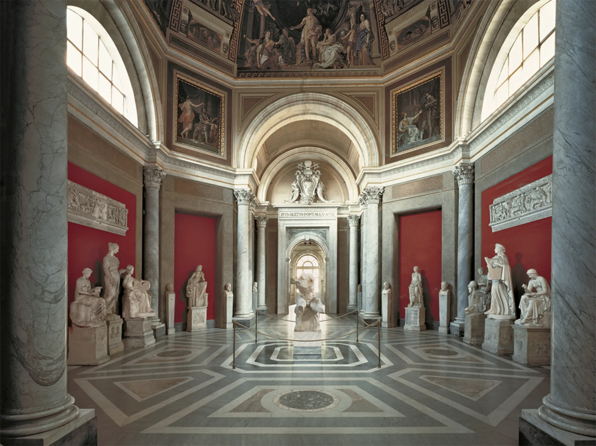

*图源：[梵蒂冈博物馆官网](https://www.museivaticani.va/content/museivaticani/en/collezioni/musei/museo-pio-clementino/sala-delle-muse/sala-delle-muse.html)*

《观景楼的躯干》全貌——基座正面可见希腊文署名（官网大图）：

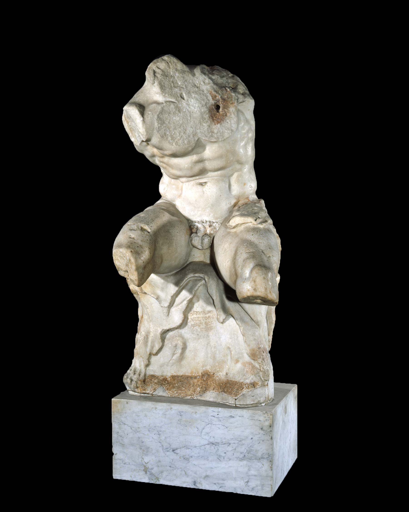

*图源：[梵蒂冈博物馆官网](https://www.museivaticani.va/content/museivaticani/en/collezioni/musei/museo-pio-clementino/sala-delle-muse/torso-del-belvedere.html)*

细节——扭转中隆起的腹肌与胸廓（官网大图）：

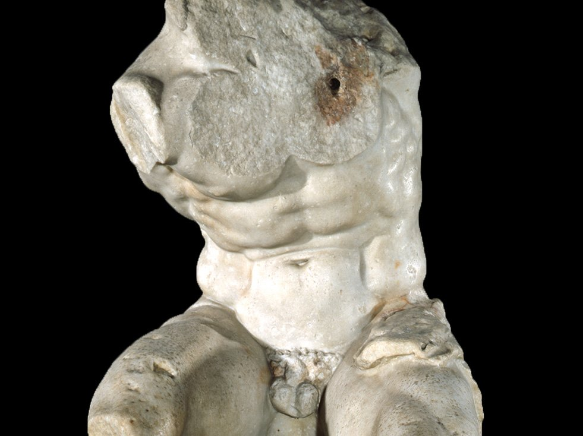

*图源：[梵蒂冈博物馆官网](https://www.museivaticani.va/content/museivaticani/en/collezioni/musei/museo-pio-clementino/sala-delle-muse/torso-del-belvedere.html)*

**现场站看**：

1. **绕躯干一圈，重点在背面**——扭转中隆起的背肌与脊柱沟，是米开朗基罗"借"得最多的角度。
2. **看基座**——正面的希腊文署名"雅典人、涅斯托尔之子阿波罗尼奥斯作"，存世极少的古代雕塑家签名。
3. **认一两位缪斯**——靠标志物：悲剧面具（墨尔波墨涅）、喜剧面具（塔利亚）、天球（乌拉尼亚）、里拉琴。
4. **抬头**——天顶的阿波罗与缪斯和脚下的雕像同题，看一眼布展用意即可，别久留。

### 圆形厅（Sala Rotonda） ⭐⭐

> 🔗 官方：[Round Hall · Musei Vaticani](https://www.museivaticani.va/content/museivaticani/en/collezioni/musei/museo-pio-clementino/sala-rotonda/sala-rotonda.html) · [Hercules Mastai · Musei Vaticani](https://www.museivaticani.va/content/museivaticani/en/collezioni/musei/museo-pio-clementino/sala-rotonda/eracle.html) · [The Braschi Antinous · Musei Vaticani](https://www.museivaticani.va/content/museivaticani/en/collezioni/musei/museo-pio-clementino/sala-rotonda/antinoo-braschi.html)

仿万神殿的圆形大厅——西蒙内蒂设计、1779 年完工，半球穹顶带藻井、顶部开圆窗采光，是博物馆里最"古罗马"的空间。正中是**周长 13 m 的整块紫红斑岩大盆**：斑岩（porphyry）只产自埃及东部沙漠的一处矿山，紫色即帝王色，质地极硬、极难雕琢，4 世纪后矿坑废弃，后世再也造不出这样的东西。馆方说它原本装点帝国罗马某处大型公共空间，传统说法把它与尼禄（Nero）的金宫相联。脚下是 18 世纪重新拼装的**公元 3 世纪初马赛克地板**，来自奥特里科利（Otricoli）与萨克罗法诺（Sacrofano），有希腊人与半人马之战、海神巡游等场面。四周壁龛立巨像、龛间半柱顶着超尺度胸像：**镀金青铜的赫拉克勒斯（Hercules Mastai）**、奥特里科利出土的朱庇特（Jupiter）巨型胸像、被塑成酒神的**布拉斯基安提诺乌斯（Antinous Braschi）**——哈德良（Hadrian）皇帝溺亡于尼罗河后被神化的宠臣美少年。

圆形厅全景——穹顶藻井、斑岩盆与马赛克地板（官网图）：

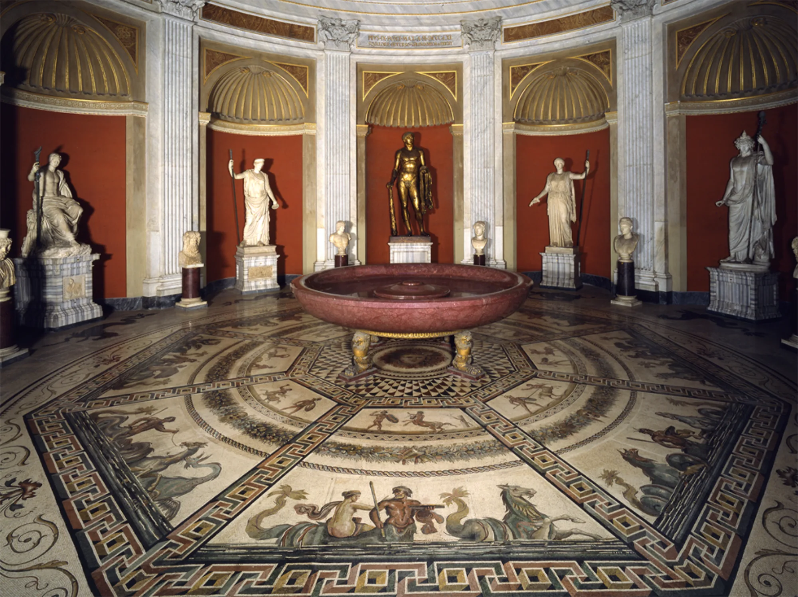

*图源：[梵蒂冈博物馆官网](https://www.museivaticani.va/content/museivaticani/en/collezioni/musei/museo-pio-clementino/sala-rotonda/sala-rotonda.html)*

紫红斑岩大盆近看——后方红墙前即镀金赫拉克勒斯（Wikimedia Commons，CC BY 3.0）：

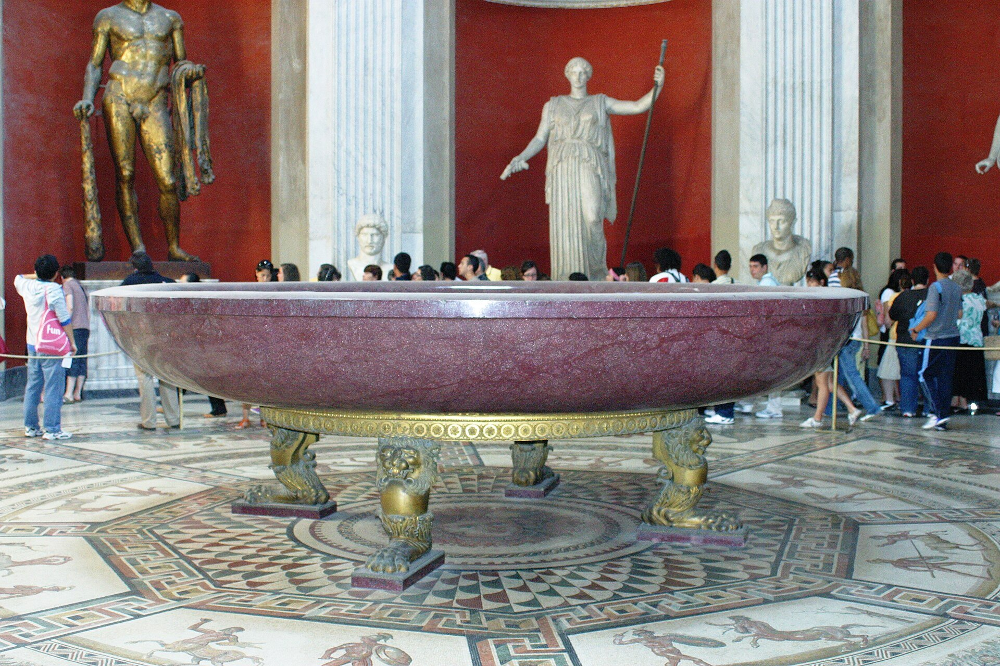

*图源：[Wikimedia Commons](https://commons.wikimedia.org/wiki/File:Catino_in_porfido_rosso,_Sala_Rotonda,_Musei_Vaticani_-_panoramio.jpg)*

镀金青铜赫拉克勒斯（Hercules Mastai）全身——右手拄棒、左手托狮皮（官网大图）：

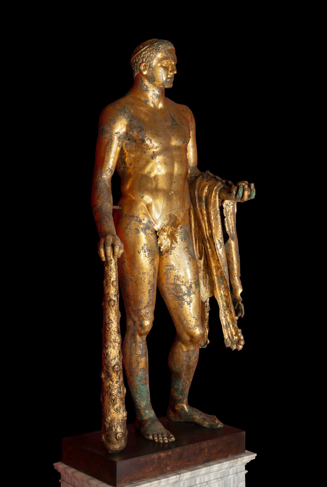

*图源：[梵蒂冈博物馆官网](https://www.museivaticani.va/content/museivaticani/en/collezioni/musei/museo-pio-clementino/sala-rotonda/eracle.html)*

细节——遭雷击下葬千年仍存的鎏金头部（官网大图）：

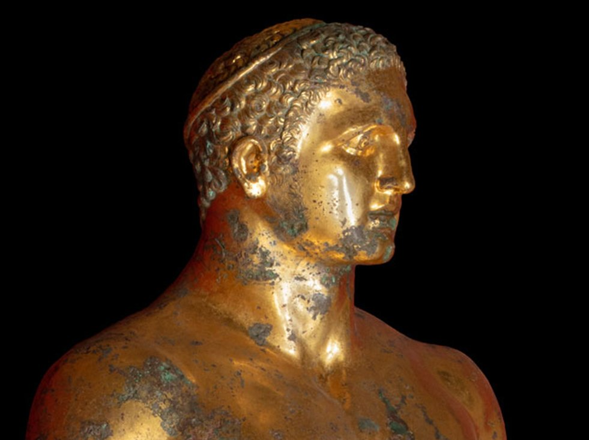

*图源：[梵蒂冈博物馆官网](https://www.museivaticani.va/content/museivaticani/en/collezioni/musei/museo-pio-clementino/sala-rotonda/eracle.html)*

奥特里科利的朱庇特巨型胸像——基座刻 GIOVE 与庇护六世铭文（Wikimedia Commons，CC BY-SA 2.0）：

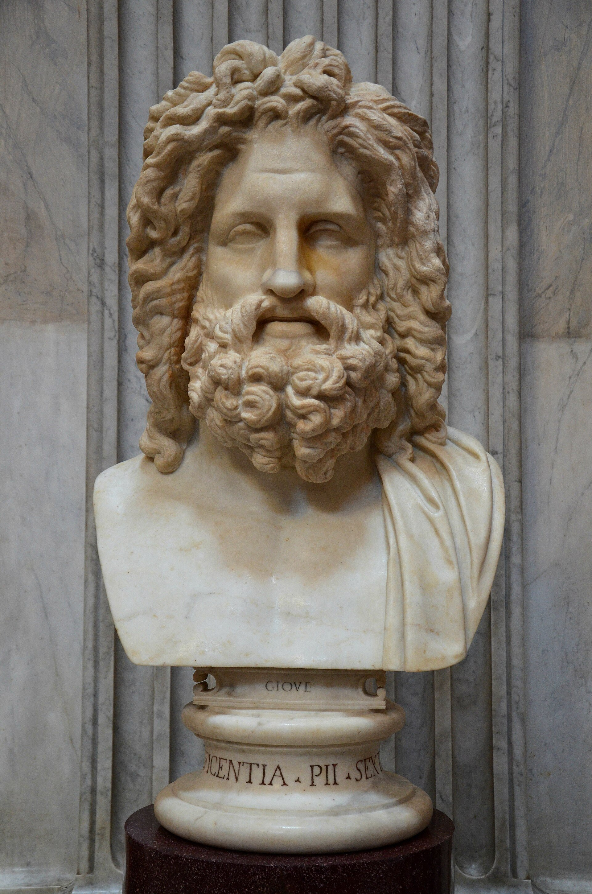

*图源：[Wikimedia Commons](https://commons.wikimedia.org/wiki/File:Jupiter_of_Otricoli,_found_in_Ocriculum_during_excavations_made_under_Pius_VI_in_the_last_decade_of_the_18th_century,_1st_half_of_1st_century_BC_%28with_18th_restorations%29,_Vatican_Museums,_Rome_%2844122231525%29.jpg)*

布拉斯基安提诺乌斯全身——头戴酒神冠、手执酒神杖（官网大图）：

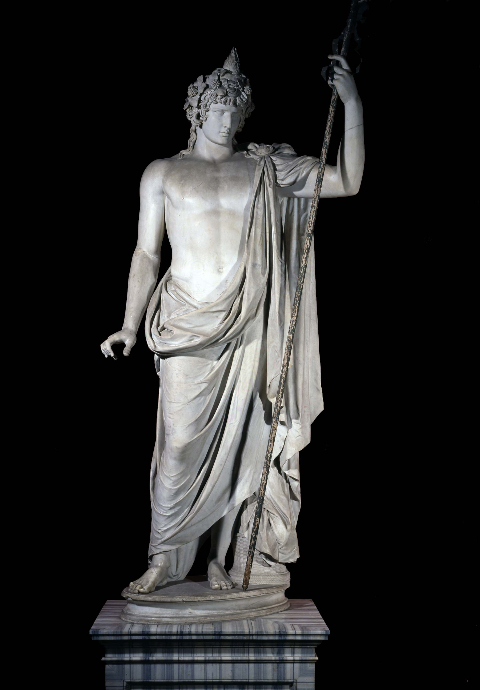

*图源：[梵蒂冈博物馆官网](https://www.museivaticani.va/content/museivaticani/en/collezioni/musei/museo-pio-clementino/sala-rotonda/antinoo-braschi.html)*

细节——葡萄藤冠下的安提诺乌斯面容（官网大图）：

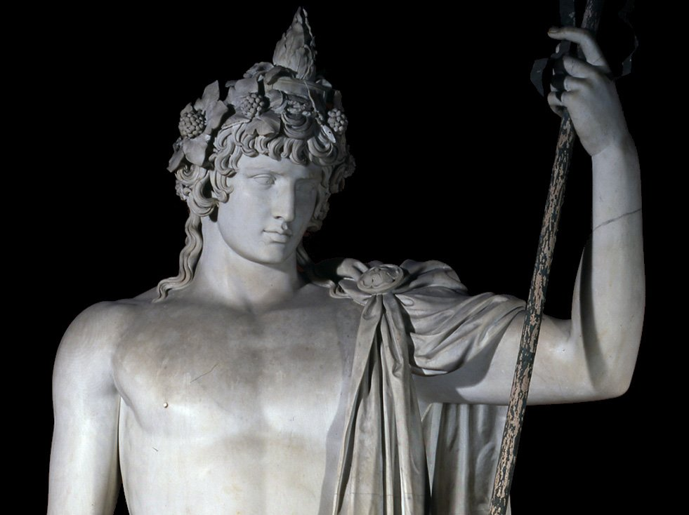

*图源：[梵蒂冈博物馆官网](https://www.museivaticani.va/content/museivaticani/en/collezioni/musei/museo-pio-clementino/sala-rotonda/antinoo-braschi.html)*

**现场站看**：

1. **站到斑岩盆边**——先感受体量与"帝王紫"的抛光：一整块石头雕成，是全馆最大的单体石材之一。
2. **看镀金的赫拉克勒斯**——古代大型青铜像绝大多数被后世熔毁，这尊连金层一起存世，是因为它在古代遭雷击后被按宗教仪轨郑重埋葬（出土时带有"雷击物在此安葬"的铭文），一埋一千多年，反而躲过了熔炉。
3. **认朱庇特胸像**——奥特里科利的朱庇特，长期被当作"众神之父"的标准形象广为翻制。
4. **沿盆绕一圈看脚下**——半人马之战与海神世界的特里同、海仙女，顺路就把马赛克看全了。
5. **抬头**——穹顶藻井 + 圆窗，对照真正的万神殿想一想：这间 18 世纪的厅就是在向它致敬。

### 希腊十字厅（Sala a Croce Greca） ⭐

> 🔗 官方：[Greek Cross Hall · Musei Vaticani](https://www.museivaticani.va/content/museivaticani/en/collezioni/musei/museo-pio-clementino/sala-a-croce-greca/sala-a-croce-greca.html) · [Sarcophagus St Helena · Musei Vaticani](https://www.museivaticani.va/content/museivaticani/en/collezioni/musei/museo-pio-clementino/sala-a-croce-greca/sarcofago-di-s--elena.html) · [Sarcophagus of Costantia · Musei Vaticani](https://www.museivaticani.va/content/museivaticani/en/collezioni/musei/museo-pio-clementino/sala-a-croce-greca/sarcofago-di-costanza.html)

十字形平面的厅（"希腊十字"即四臂等长），同为西蒙内蒂手笔，门口一对埃及风的"telamon"人形柱。重点是两口**整块紫斑岩雕成的巨型石棺**——只有皇室才配享的"帝王紫"。

希腊十字厅全景（官网图）：

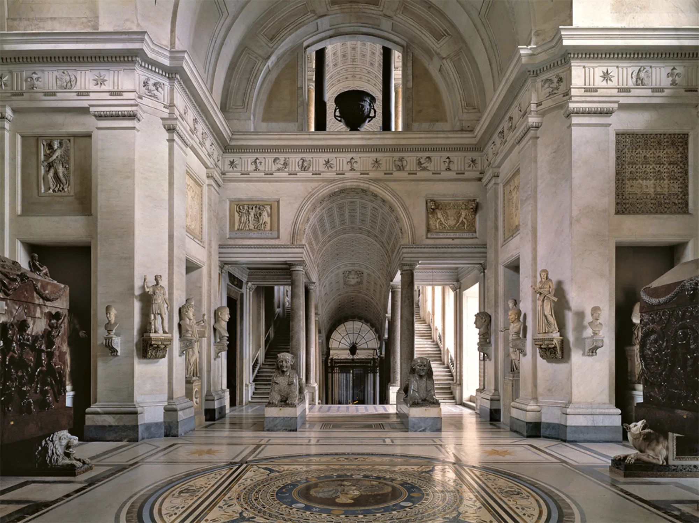

*图源：[梵蒂冈博物馆官网](https://www.museivaticani.va/content/museivaticani/en/collezioni/musei/museo-pio-clementino/sala-a-croce-greca/sala-a-croce-greca.html)*

**圣海伦娜石棺**：君士坦丁大帝（Constantine）之母海伦娜（Helena，约 329 年卒，传说中寻获真十字架的太后）的棺，原置于罗马城外托尔皮尼亚塔拉（Tor Pignattara）的陵庙，12 世纪一度被搬进拉特朗大殿给教皇阿纳斯塔修斯四世（Anastasius IV）再利用，1778 年由庇护六世运来梵蒂冈。浮雕是**罗马骑兵凯旋、马下是被缚的蛮族俘虏**——纯军事的胜利题材配一位虔诚老太后颇不相称：一种流行解释是石棺原为君士坦丁本人或其父预备；也有学者认为"皇权战胜蛮族"本就是帝室通用的颂辞，对太后同样适用。

圣海伦娜石棺全貌——狮足底座上的紫斑岩巨棺（官网大图）：

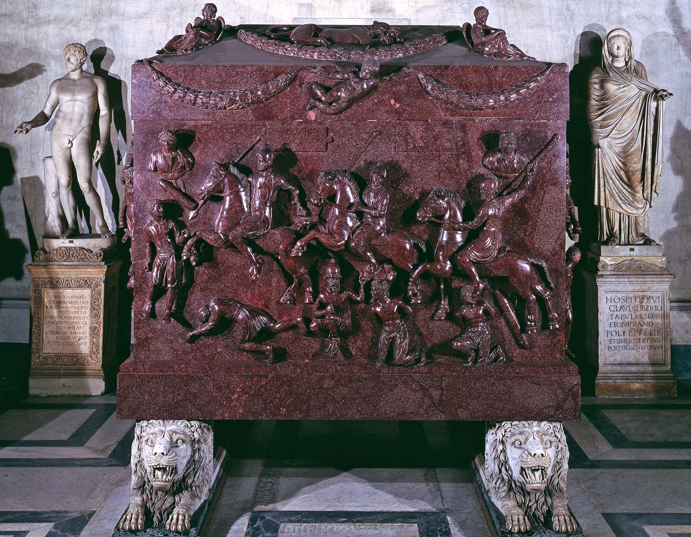

*图源：[梵蒂冈博物馆官网](https://www.museivaticani.va/content/museivaticani/en/collezioni/musei/museo-pio-clementino/sala-a-croce-greca/sarcofago-di-s--elena.html)*

细节——罗马骑兵凯旋、马下被缚的蛮族俘虏（官网大图）：

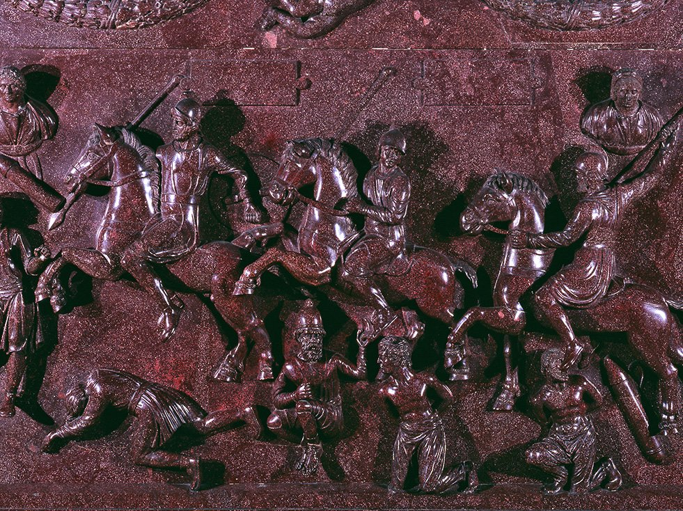

*图源：[梵蒂冈博物馆官网](https://www.museivaticani.va/content/museivaticani/en/collezioni/musei/museo-pio-clementino/sala-a-croce-greca/sarcofago-di-s--elena.html)*

**康斯坦提娅石棺**：君士坦丁之女康斯坦提娅（Constantina，354 年卒）的棺，来自诺门塔纳大道上的家族陵庙——即今天的圣科斯坦察教堂（Santa Costanza）。浮雕是**小天使采葡萄、踩葡萄酿酒**，配孔雀与羔羊：表面是酒神式的丰收图，在基督教语境里却读作**圣餐与永生**——葡萄酒指向基督的血，丰收指向天国的丰饶；同样的葡萄藤图案至今铺在圣科斯坦察教堂的天顶马赛克上。一对石棺正好演示了 4 世纪罗马"异教图式如何被基督教接管"。

康斯坦提娅石棺全貌——卧狮底座上的紫斑岩棺（官网大图）：

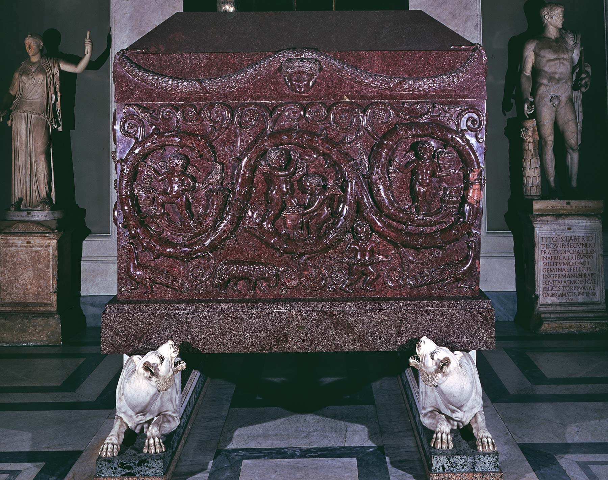

*图源：[梵蒂冈博物馆官网](https://www.museivaticani.va/content/museivaticani/en/collezioni/musei/museo-pio-clementino/sala-a-croce-greca/sarcofago-di-costanza.html)*

细节——葡萄藤涡卷中采葡萄、踩葡萄的小天使（官网大图）：

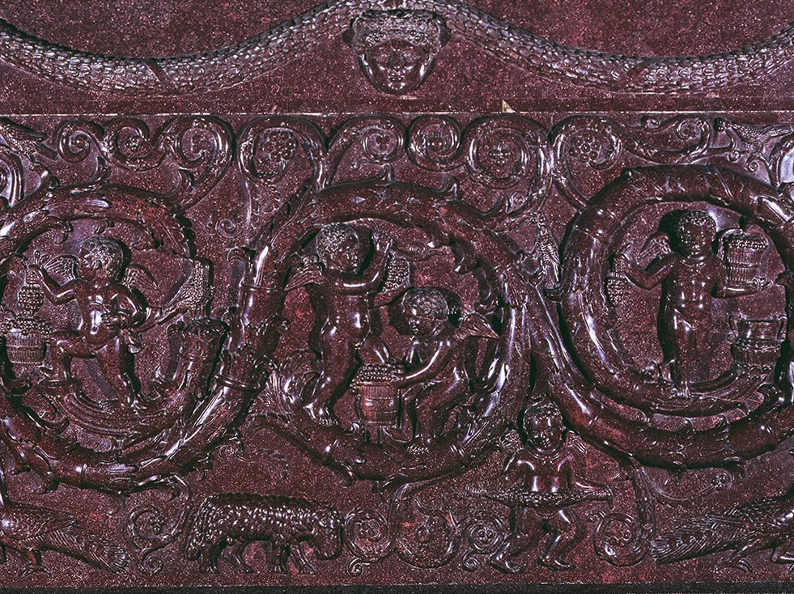

*图源：[梵蒂冈博物馆官网](https://www.museivaticani.va/content/museivaticani/en/collezioni/musei/museo-pio-clementino/sala-a-croce-greca/sarcofago-di-costanza.html)*

**顺路看点**：① 海伦娜棺找**马蹄下的俘虏**（战争胜利=皇权）；② 康斯坦提娅棺找**踩葡萄的小天使**与孔雀（丰收=永生，孔雀=不朽）；③ 看浮雕转角的钻孔与抛光——斑岩硬得近乎宝石，这两口棺是古代晚期斑岩雕刻的体量之最。看完这厅，动线接 **地图廊/挂毯廊**（[V - 03 地图廊 + 挂毯廊 + 烛台廊（穿行段挑看）](../v03-three-galleries/)）。

### 怎么逛

- 这几间在去拉斐尔房间/西斯廷的主动线上顺次经过，**节奏跟裴导**（见 2026-06-30 周二 罗马 D3 详情）。
- 优先级：**缪斯厅的躯干 > 圆形厅斑岩盆 > 希腊十字厅石棺**；都属"路过认一认"级别，别在这里耗掉看西斯廷的时间。
