> ⭐⭐ 从古典雕塑区走向拉斐尔房间/西斯廷，要穿过**三条长廊**。它们本身是"赶路段"，人流密集、单向缓行，**目标是边走边抬头看天顶**，不要停下细抠每一件。**可拍照，禁闪光。** 上一段见 [V - 02 缪斯厅 + 圆形厅 + 希腊十字厅（古典雕塑精选）](../v02-muses-rotunda-greek-cross/)。
>
> 🔗 官方：[梵蒂冈博物馆官网](https://www.museivaticani.va/content/museivaticani/en/collezioni.html)

### 地图廊（Galleria delle Carte Geografiche） ⭐⭐⭐

> 📚 **全部 40 幅地图逐幅大图 + 说明** → [V - 03A 地图廊全图集（40 幅地图）](../v03a-gallery-of-maps/)（出发前预习用，现场不必逐幅看）
>
> 🔗 官方：[Gallery of the Geographical Maps · Musei Vaticani](https://www.museivaticani.va/content/museivaticani/en/collezioni/musei/galleria-carte-geografiche.html)

- **时间**：1580–1583，教皇格里高利十三世委托，地理学家伊尼亚齐奥·丹蒂（Ignazio Danti）设计
- **官网介绍页**：[Wikipedia · Gallery of Maps](https://en.wikipedia.org/wiki/Gallery_of_Maps)

地图廊（Commons 公有领域）：

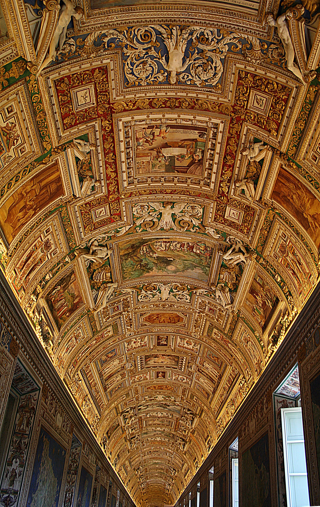

*图源：[Wikimedia Commons](https://commons.wikimedia.org/wiki/File:0_Galleria_delle_carte_geografiche_%281%29.JPG)*

空廊纵深——金顶与两壁蓝色地图（官网大图）：

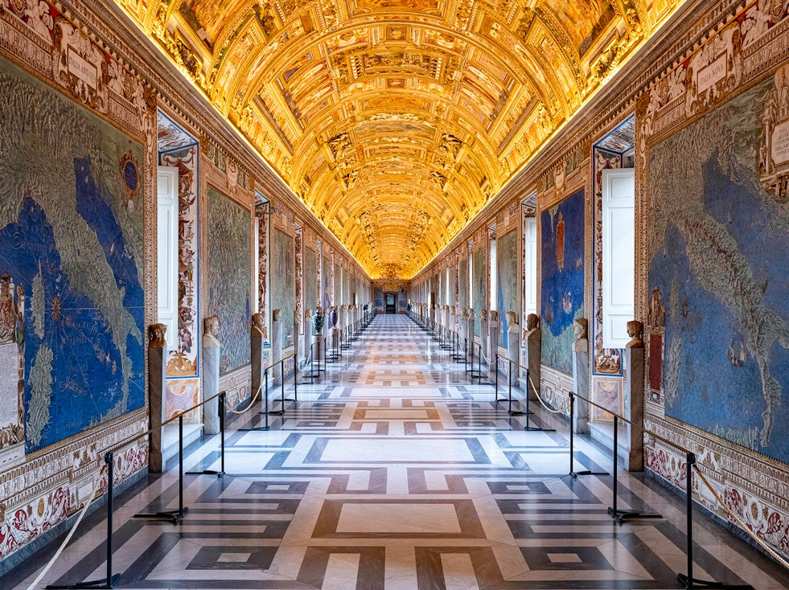

*图源：[梵蒂冈博物馆官网](https://www.museivaticani.va/content/museivaticani/en/collezioni/musei/galleria-carte-geografiche.html)*

**内容（这是什么）**：一条 120 m 长的走廊，两壁是 **40 幅意大利地区地图壁画**——1580 年教皇格里高利十三世（Gregory XIII，就是颁布"格里高利历"的那位）委托，多明我会修士、地理学家伊尼亚齐奥·丹蒂（Ignazio Danti）设计底图，三年画成（1580–1583）。**绘制逻辑是把走廊本身当成亚平宁山脊**：沿廊行走，就像沿着意大利的"脊柱"飞行——一侧墙排第勒尼安/利古里亚海一面的地区（利古里亚、托斯卡纳、拉齐奥、坎帕尼亚……），另一侧排亚得里亚海一面（威尼托、马尔凯、普利亚……）。每幅图＝一个地区的鸟瞰，角上再嵌首要城市的透视小景；两端另有"古意大利/新意大利"两幅总图、四大港城（威尼斯、安科纳、热那亚、奇维塔韦基亚）景观图与厄尔巴、马耳他、科孚等岛图，甚至有一幅法国的阿维尼翁（Avignon）——因为它当时仍是教皇领地。现代测算这些地图准确率约八成，整组被称为**世界上最大的绘画地理图集**；把整个意大利"挂"进教皇宫，本身就是一句政治宣言——这是教会眼中的意大利。

端墙门两侧的热那亚与威尼斯港城景观图（官网大图）：

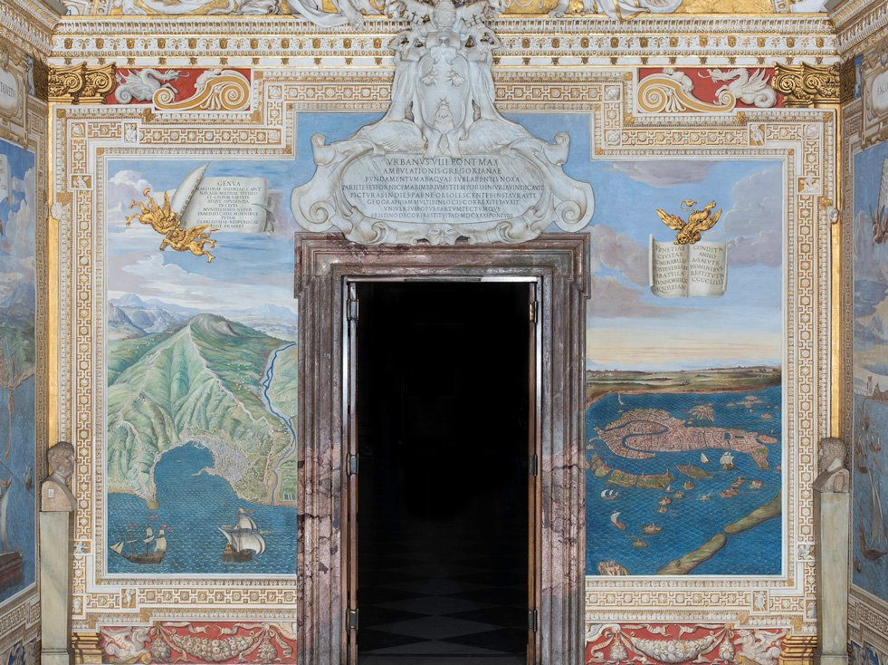

*图源：[梵蒂冈博物馆官网](https://www.museivaticani.va/content/museivaticani/en/collezioni/musei/galleria-carte-geografiche.html)*

**拱顶**：真正让所有人抬头惊叹的是金碧辉煌的拱顶——切萨雷·内比亚（Cesare Nebbia）与吉罗拉莫·穆齐亚诺（Girolamo Muziano）领衔的风格主义团队所作，满顶镀金灰泥框嵌着圣徒事迹场景，**与下方地图一一对应：事迹发生在哪个地区，就画在那幅地图上方**。2016 年完成整体大修，如今的金顶正处在它四百年来最亮的状态。**这是三条廊里最震撼的一条，常被评为整个博物馆"最出片"的空间。**

拱顶圣徒事迹一例——卡诺莎的玛蒂尔达向罗马教会捐献（官网大图）：

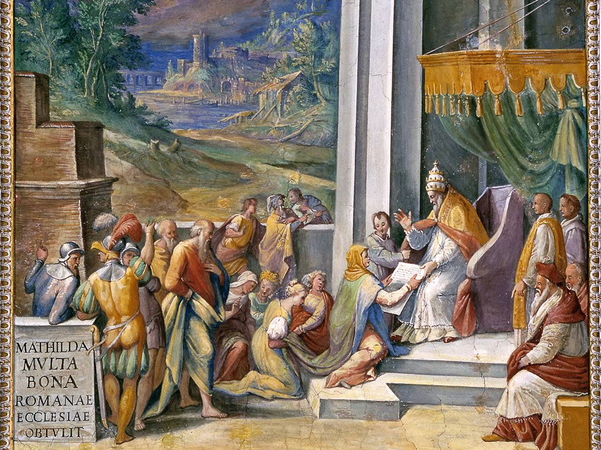

*图源：[梵蒂冈博物馆官网](https://www.museivaticani.va/content/museivaticani/en/collezioni/musei/galleria-carte-geografiche.html)*

**现场站看**：

1. **进廊先停三秒**——抬头看金顶的纵深，一眼望不到头：先把整体收进眼里再开始走，这条镀金天顶是地图廊的灵魂。
2. **找罗马**——标着 Latium et Sabina 的那幅，角上嵌着罗马城平面图，认台伯河的 S 弯。
3. **找托斯卡纳（Etruria）**——佛罗伦萨在图上，正是你们 D6 起的下一站。
4. **找坎帕尼亚（Campania）**——那不勒斯湾与维苏威火山，行程后段的目的地：在 16 世纪的地图上预习自己的旅行路线。
5. **挑一幅看细节**——海面上画着帆船与海怪、山脉有立体晕染、城市小景里是 16 世纪的天际线：这不是示意图，是巨幅风景画。
6. **拍照技巧**——想拍空廊纵深几乎不可能（永远是人海），**侧身贴墙、镜头朝天顶斜上方拍**最稳。

### 挂毯廊（Galleria degli Arazzi） ⭐⭐

> 📚 **两套挂毯系列逐幅大图 + 说明** → [V - 03B 挂毯廊全图集（基督生平 + 乌尔班八世）](../v03b-gallery-of-tapestries/)（基督生平"新学派" + 乌尔班八世生平全收录）
>
> 🔗 官方：[Gallery of the Tapestries · Musei Vaticani](https://www.museivaticani.va/content/museivaticani/en/collezioni/musei/galleria-arazzi.html)

**内容（这是什么）**：一条刻意调暗灯光的长廊（织物怕光），最著名的一组是 **"新学派"（Scuola Nuova）基督生平挂毯**：拉斐尔（Raphael）1520 年去世后，由他的学生们（朱利奥·罗马诺 Giulio Romano 等）绘制底稿，布鲁塞尔的彼得·范·阿尔斯特（Pieter van Aelst）工坊织造，1531 年首次挂进西斯廷礼拜堂，1838 年起陈列于此。题材从基督童年到复活——《牧人来拜》《三王来拜》《无辜婴孩被屠》《复活的基督》等。所谓"新学派"，是相对拉斐尔生前亲自画稿的"老学派"《使徒行传》挂毯而言。对面墙上则是 17 世纪罗马巴贝里尼（Barberini）工坊织的教皇乌尔班八世（Urban VIII）生平。要知道：在 16 世纪，**一套御用挂毯比一面湿壁画贵得多**——这条廊挂的是教廷的"硬通货"。

挂毯廊内景——两壁巨幅挂毯与灰泥拱顶（官网大图）：

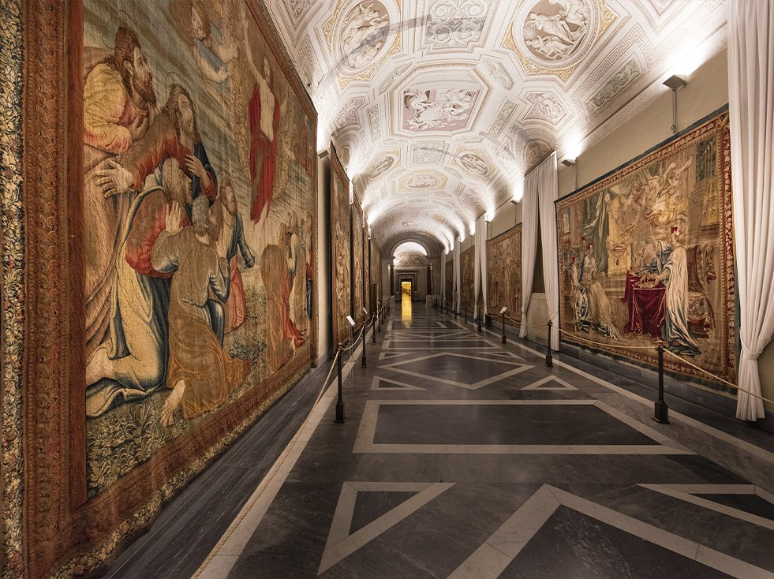

*图源：[梵蒂冈博物馆官网](https://www.museivaticani.va/content/museivaticani/en/collezioni/musei/galleria-arazzi.html)*

挂毯廊拱顶的单色灰泥装饰（官网大图）：

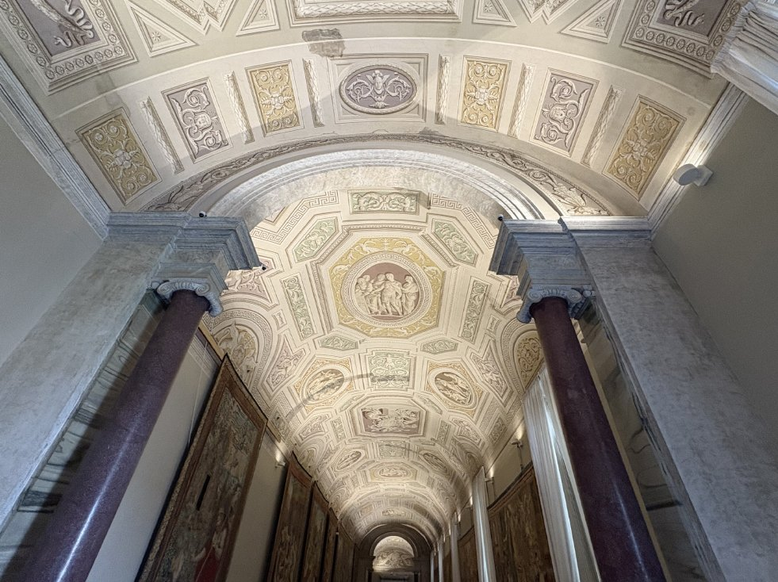

*图源：[梵蒂冈博物馆官网](https://www.museivaticani.va/content/museivaticani/en/collezioni/musei/galleria-arazzi.html)*

> 🔗 官方：[Series of the Life of Christ (New School) · Musei Vaticani](https://www.museivaticani.va/content/museivaticani/en/collezioni/musei/galleria-arazzi/serie-vita-cristo.html)

"新学派"基督生平系列——《复活的基督》全幅（官网大图）：

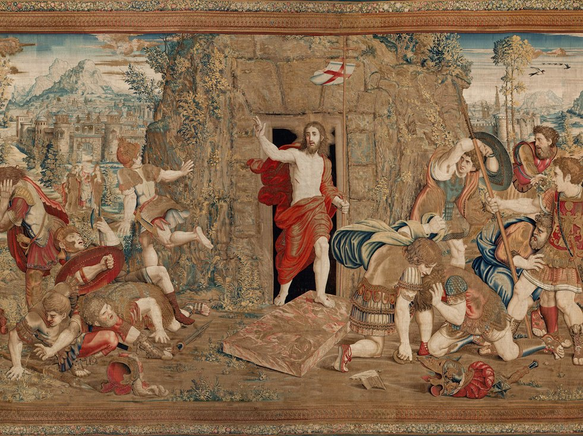

*图源：[梵蒂冈博物馆官网](https://www.museivaticani.va/content/museivaticani/en/collezioni/musei/galleria-arazzi/serie-vita-cristo.html)*

《复活的基督》细节——会"跟着你走"的眼睛与迈出的脚（官网大图）：

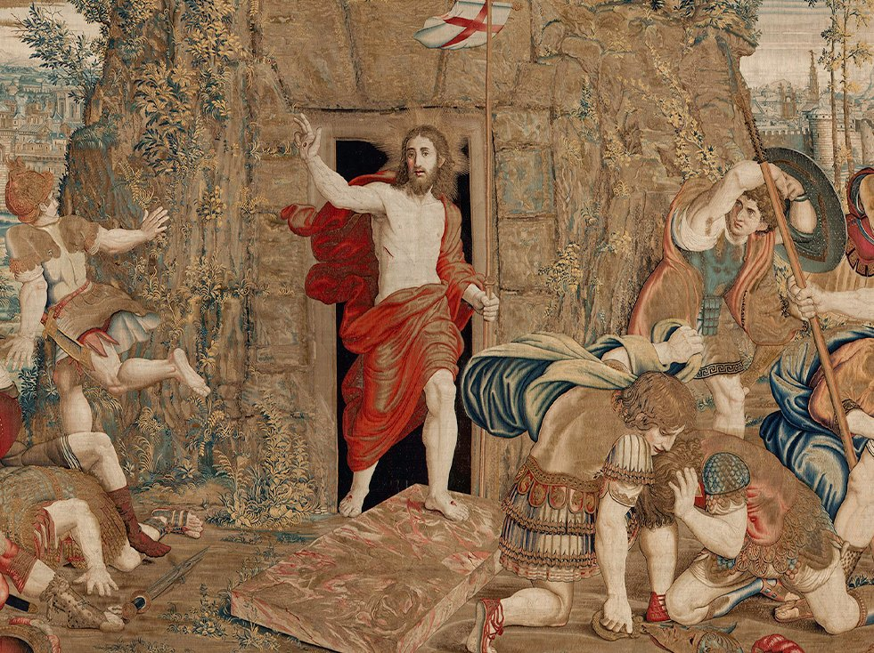

*图源：[梵蒂冈博物馆官网](https://www.museivaticani.va/content/museivaticani/en/collezioni/musei/galleria-arazzi/serie-vita-cristo.html)*

> 🔗 官方：[Series of the Life of Urban VIII Barberini · Musei Vaticani](https://www.museivaticani.va/content/museivaticani/en/collezioni/musei/galleria-arazzi/serie-vita-urbanoVIII.html)

对面墙的乌尔班八世生平系列——《巴贝里尼当选教皇》（官网大图）：

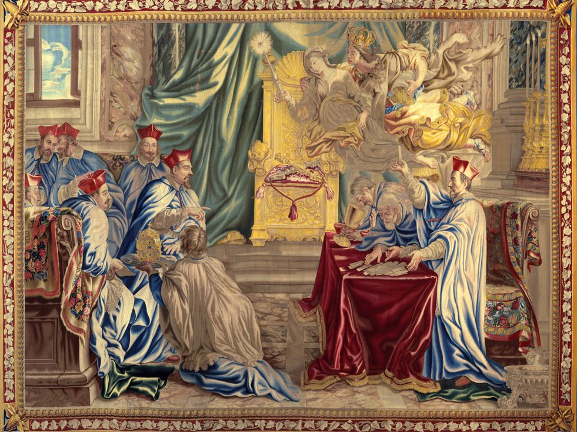

*图源：[梵蒂冈博物馆官网](https://www.museivaticani.va/content/museivaticani/en/collezioni/musei/galleria-arazzi/serie-vita-urbanoVIII.html)*

《巴贝里尼当选教皇》细节——红衣主教群像（官网大图）：

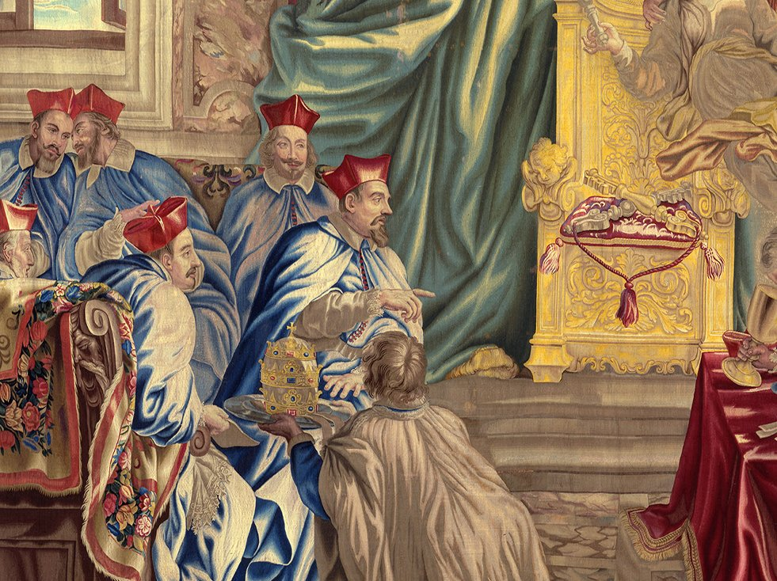

*图源：[梵蒂冈博物馆官网](https://www.museivaticani.va/content/museivaticani/en/collezioni/musei/galleria-arazzi/serie-vita-urbanoVIII.html)*

**现场站看**：

1. **盯《复活的基督》**——边走边看：基督的眼睛、连同他迈出的脚，似乎一直跟着你转。这是底稿透视处理留下的错觉，挂毯廊唯一值得专门停的互动点。
2. **找《无辜婴孩被屠》**——希律王（Herod）下令屠杀伯利恒男婴的场面，全廊最暴烈、人物动态最"拉斐尔式"的一组。
3. **分清两边**——一侧是基督生平（16 世纪布鲁塞尔织），对面是乌尔班八世生平（17 世纪罗马织）：同一条廊隔着一百年的两种"权力叙事"。
4. **凑近看一眼织线**——丝与羊毛的细密层次（这一档御用挂毯常夹金银线），想象它们崭新时的色彩，也就明白灯光为什么这么暗。

### 烛台廊（Galleria dei Candelabri） ⭐

> 🔗 官方：[Gallery of the Candelabra · Musei Vaticani](https://www.museivaticani.va/content/museivaticani/en/collezioni/musei/museo-pio-clementino/Galleria-dei-Candelabri.html)

**内容（这是什么）**：三条廊里最"过渡"的一条，得名于每段拱门下**成对的古罗马大理石烛台**（公元 2 世纪的巨型雕花灯架）。这里原是面向庭院的敞廊，18 世纪 80 年代庇护六世时封窗成廊；两侧密排古典雕塑——神像、萨提尔、动物、葬礼浮雕，天顶是 19 世纪末利奥十三世（Leo XIII）时期的壁画。

烛台廊内景——拱门下成对的大理石烛台与两侧雕塑（官网大图）：

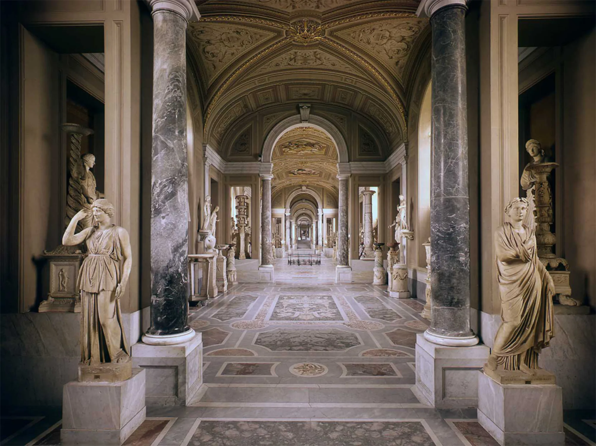

*图源：[梵蒂冈博物馆官网](https://www.museivaticani.va/content/museivaticani/en/collezioni/musei/museo-pio-clementino/Galleria-dei-Candelabri.html)*

**顺路看点**：① 挑一对烛台看雕工——叶饰与小神话浮雕，古罗马豪宅的"高定灯具"；② 找**《掐鹅的男孩》**——胖小孩与大鹅搏斗，希腊化时期著名风俗小品的罗马复制，全廊最讨喜的一件；③ 找**以弗所的阿尔忒弥斯（Artemis of Ephesus）**——胸前挂满一排排"乳房"（一说是祭牲的牛睾）的小亚细亚丰产女神，全廊最奇特的一尊。**走马观花即可**，走完它就接近**拉斐尔房间**（[R - 05 拉斐尔房间 · 君士坦丁厅](../r05-stanza-di-costantino/)）了。

### 怎么逛 · 现场须知

- 三条廊**人最多、最堵**，是博物馆的"主动脉"，基本只能随人流缓行——**心态上当作"移动观景"，把注意力放在天顶**。
- 优先级：**地图廊（抬头看金顶）> 挂毯廊（找会跟人的基督）> 烛台廊（路过）**。
- 别在长廊耗太久，**后面的拉斐尔房间与西斯廷才是重头**
