> ⭐⭐⭐ 这是 [V - 03 地图廊 + 挂毯廊 + 烛台廊（穿行段挑看）](../v03-three-galleries/) 地图廊一节的**全图册**——把 120 米长廊两壁的 **40 幅地区地图壁画**逐幅拆开、配 Wikimedia Commons 公有领域大图与说明，供出发前预习、现场对照。**现场是赶路段、单向缓行**，不可能逐幅细看；这份册子的用法是**先在这里认全、记住几幅要找的**（罗马、托斯卡纳、坎帕尼亚——正好串起你们的行程），到现场抬头扫一眼天顶、低头找那几幅即可。
>
> 🔗 官方：[Gallery of the Geographical Maps · Musei Vaticani](https://www.museivaticani.va/content/museivaticani/en/collezioni/musei/galleria-carte-geografiche.html) ｜ [Wikipedia · Gallery of Maps](https://en.wikipedia.org/wiki/Gallery_of_Maps) ｜ [Commons 全部 40 幅分类](https://commons.wikimedia.org/wiki/Category:Painted_Maps_of_the_Gallery_of_Geographical_Maps_(Vatican_Museums))

### 这条廊怎么读

1580 年教皇格里高利十三世（Gregory XIII）委托多明我会修士、地理学家**伊尼亚齐奥·丹蒂（Ignazio Danti）**设计底图，三年画成（1580–1583）。绘制逻辑是**把走廊本身当成亚平宁山脊**：沿廊行走就像沿意大利的"脊柱"飞行——

- **一侧墙**排**第勒尼安/利古里亚海一面**的地区（利古里亚、托斯卡纳、拉齐奥、坎帕尼亚……）；
- **另一侧墙**排**亚得里亚海一面**（威尼托、马尔凯、普利亚……）；
- **两端**各有一幅总图（《古意大利》《新意大利》）；
- 另嵌四大港城（热那亚、威尼斯、安科纳、奇维塔韦基亚）景观图、若干海岛（科西嘉、撒丁、西西里、马耳他、厄尔巴、科孚、特雷米蒂）和一幅法国的**阿维尼翁**——因为它当时仍是教皇领地。

每幅图＝一个地区的鸟瞰，角上嵌首要城市的透视小景，海面画着帆船与海怪、山脉有立体晕染。现代测算准确率约八成，整组被称为**世界上最大的绘画地理图集**。把整个意大利"挂"进教皇宫，本身就是政治宣言：这是教会眼中的意大利。**拱顶**金碧辉煌的圣徒事迹场景与下方地图一一对应（事迹发生在哪个地区，就画在那幅地图上方），2016 年完成大修，是它四百年来最亮的状态。

> 下面 40 幅按"两端总图 → 第勒尼安西侧（北→南）→ 中部内陆 → 亚得里亚东侧 → 北方公国 → 港城 → 海岛 → 阿维尼翁"排列。每幅标题括号里是壁画上的**拉丁文原名**（现场墙楣上就写着它，用来认图最准）。

---

### 两端总图

#### 01 古意大利总图（Italia antiqua）

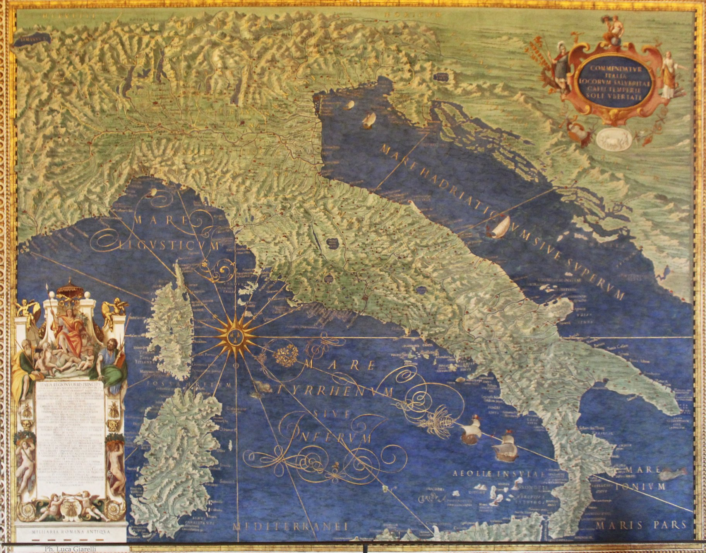

*图源：[Wikimedia Commons](https://commons.wikimedia.org/wiki/File%3AItalia_antiqua_-_Galleria_delle_carte_geografiche_-_Musei_vaticani_-_Roma_%28ph_Luca_Giarelli%29.jpg)*

廊一端的两幅意大利全图之一，画**古罗马时代的意大利**：标注的是古地名、古行省。整支系列的"封面"——先用一幅"古"、一幅"新"把整个半岛收进眼里，再分省细看。墙楣拉丁铭文夸耀意大利"地利之美、气候之宜、土壤之沃"。

#### 02 新意大利总图（Italia nova）

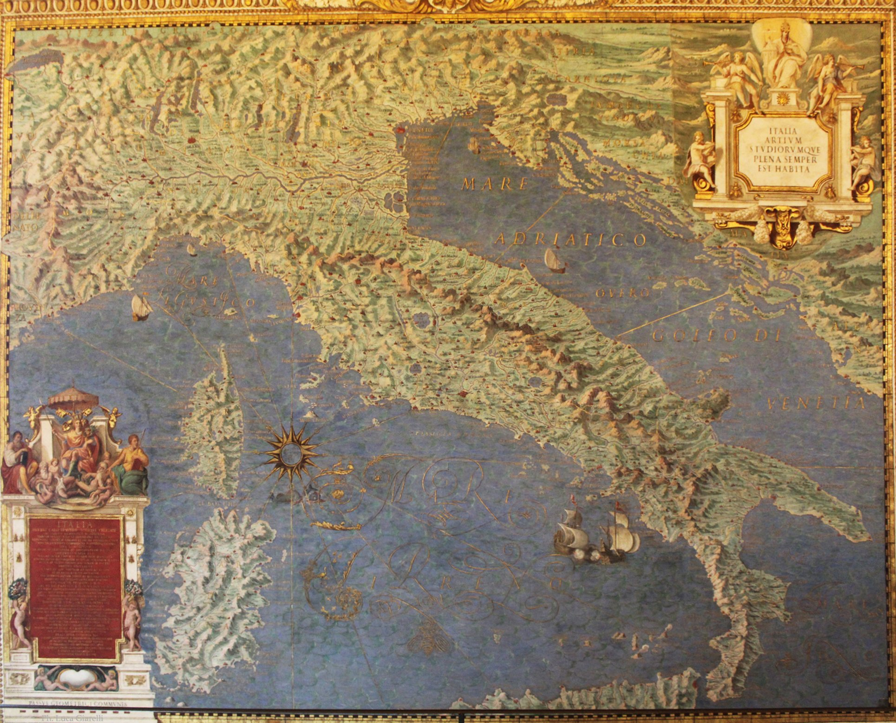

*图源：[Wikimedia Commons](https://commons.wikimedia.org/wiki/File%3AItalia_nova_-_Galleria_delle_carte_geografiche_-_Musei_vaticani_-_Roma_%28ph_Luca_Giarelli%29.jpg)*

另一端的"今"意大利全图，用 16 世纪当代的地名与疆界。与《古意大利》一古一今对照，点出整条廊的主题：意大利的"过去与现在"。铭文称意大利"自古充满学术与才智"。

---

### 第勒尼安/西海岸（北 → 南）

#### 03 利古里亚（Liguria）

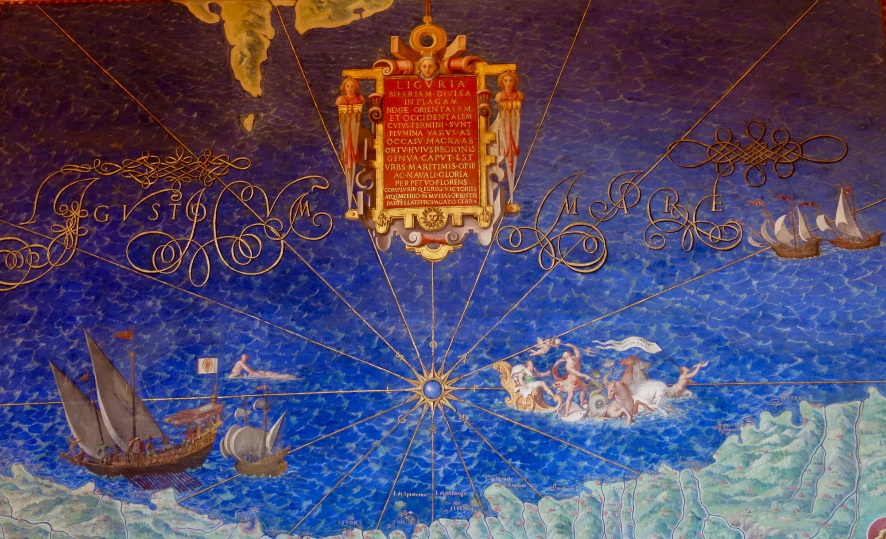

*图源：[Wikimedia Commons](https://commons.wikimedia.org/wiki/File%3AGallery_of_Maps_%E2%80%A2_Galleria_delle_carte_geografiche%2C_Vatican_Museums_%E2%80%A2_Musei_Vaticani_%2846747326922%29.jpg)*

意大利西北的狭长海岸，热那亚共和国的本土。这幅**大半是海**——金色放射线、满海帆船与海怪，墙楣红底金框写着 LIGVRIA。海上还藏着一组**哥伦布乘海神战车**的寓言（哥伦布是热那亚人）。本地区的首府热那亚另有专门的港城景观图（见 #29 热那亚港（Genua））。

#### 04 托斯卡纳（Etruria）⭐ 你们的下一站

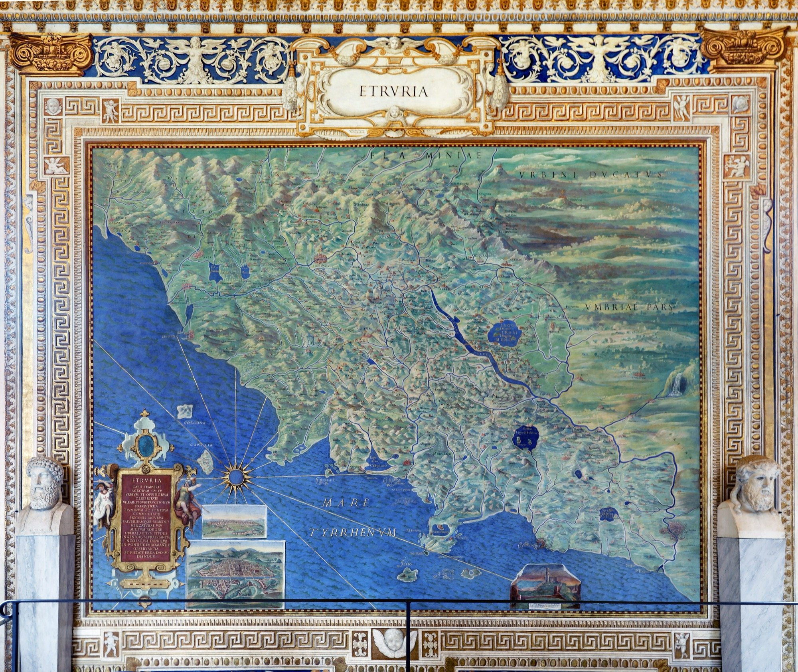

*图源：[Wikimedia Commons](https://commons.wikimedia.org/wiki/File%3AEtruria_-_Galleria_delle_Carte_Geografiche_-FG.jpg)*

用古名"埃特鲁里亚"标注的**托斯卡纳大公国**：佛罗伦萨、锡耶纳、利沃诺、阿尔诺河谷都在图上。**这正是你们 D6 起的目的地**——在 16 世纪的地图上先飞一遍佛罗伦萨周边。角落嵌着佛罗伦萨与锡耶纳的城市小景，可凑近找。

#### 05 圣彼得遗产地（Patrimonium Sancti Petri）

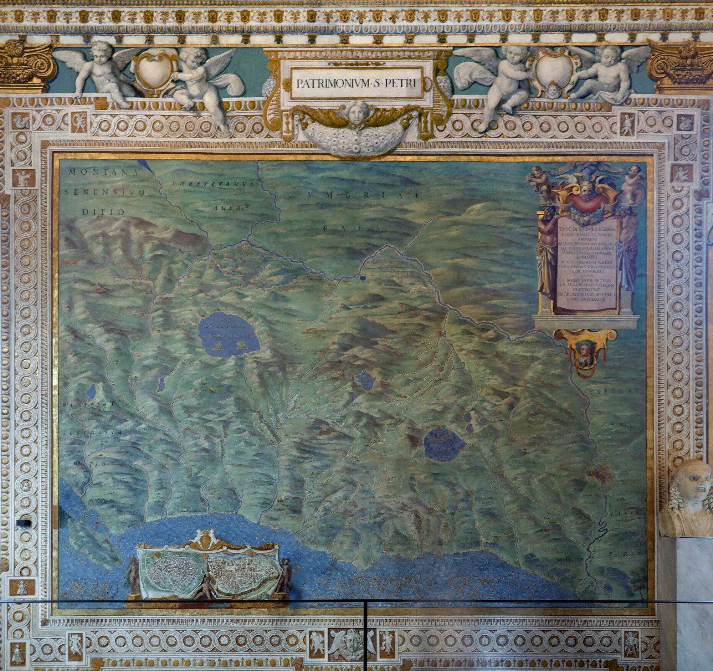

*图源：[Wikimedia Commons](https://commons.wikimedia.org/wiki/File%3APatrimonium_Sancti_Petri_-_Galleria_delle_Carte_Geografiche_-FG.jpg)*

教皇国的核心老地盘——**北拉齐奥**（维泰博、奥尔维耶托、博尔塞纳湖一带）。"圣彼得遗产"是教皇国最古老的称呼，画在教皇宫里份量最重：这是教会的"自留地"。注意图中蓝色的火山口湖。

#### 06 拉齐奥与萨宾·罗马（Latium et Sabina）⭐ 找罗马

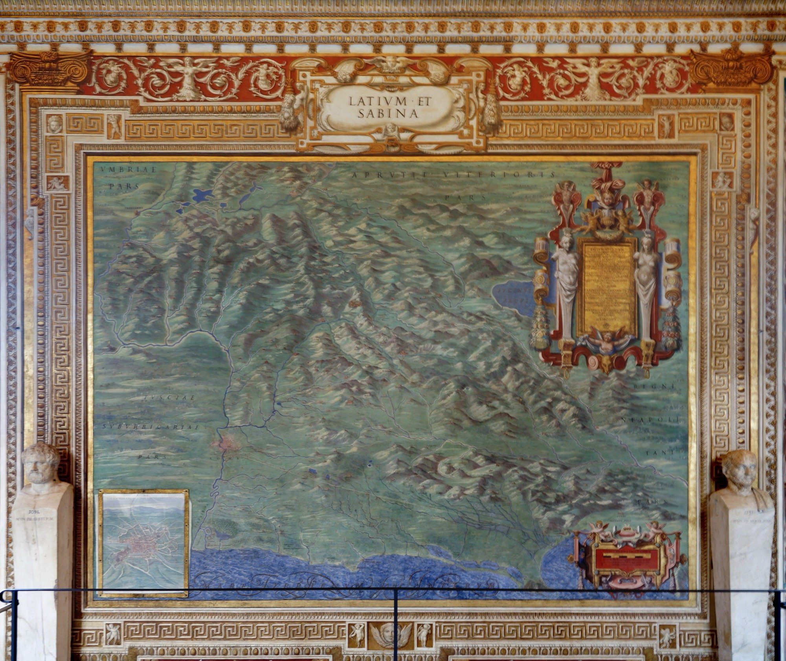

*图源：[Wikimedia Commons](https://commons.wikimedia.org/wiki/File%3ALatium_et_Sabina%2C_Galleria_delle_Carte_Geografiche%2C_-FG.jpg)*

**罗马所在的一幅**——罗马campagna（罗马平原）与萨宾山区。原版角上嵌着**罗马城平面图**，认台伯河的 S 弯。你们这几天就住在这片地图里：现场值得专门找出来对一眼"我在哪"。

#### 07 坎帕尼亚·那不勒斯（Campania）⭐ 行程后段

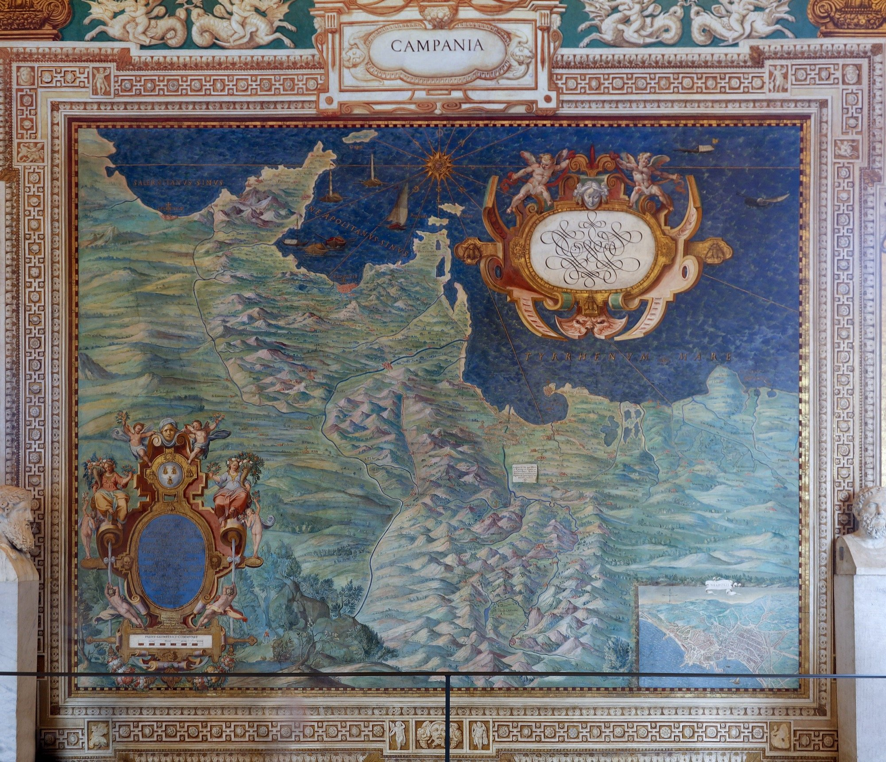

*图源：[Wikimedia Commons](https://commons.wikimedia.org/wiki/File%3ACampania%2C_Galleria_delle_Carte_Geografiche_-FG.jpg)*

**那不勒斯湾与维苏威火山**——你们行程后段（索伦托/阿马尔菲方向）的大区。图上能找到那不勒斯城、维苏威、卡普里岛。坎帕尼亚是当时那不勒斯王国最富的省，海岸线画得格外用心。

#### 08 萨莱诺公国（Principatus Salerni）

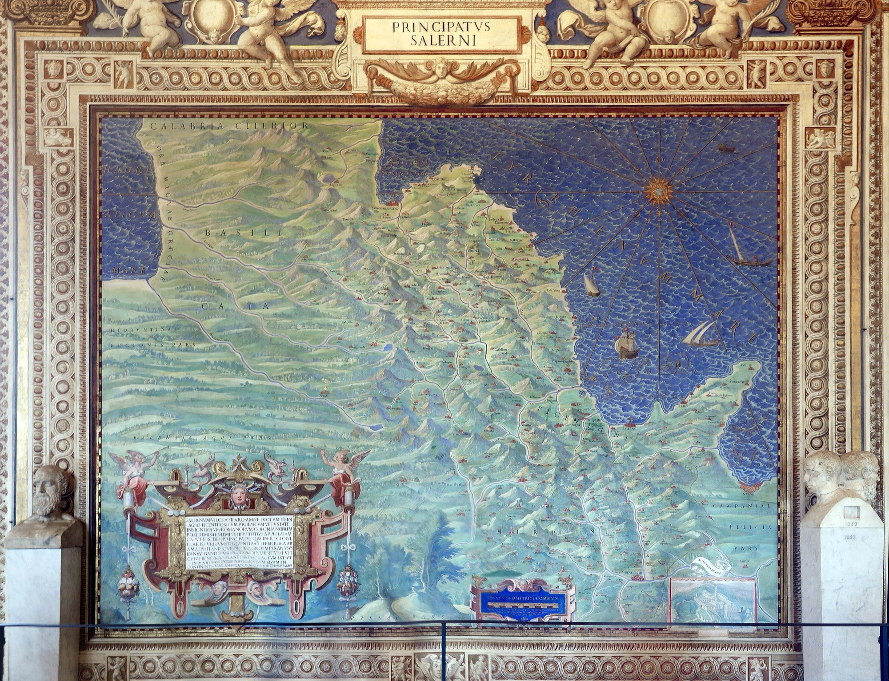

*图源：[Wikimedia Commons](https://commons.wikimedia.org/wiki/File%3APrincipatus_Salerni%2C_Galleria_delle_Carte_Geografiche_-FG.jpg)*

坎帕尼亚以南的**萨莱诺亲王领**——阿马尔菲海岸、帕埃斯图姆希腊神庙、奇伦托一带就在这片。中世纪萨莱诺以欧洲最早的医学院闻名。

#### 09 卢卡尼亚（Lucania）

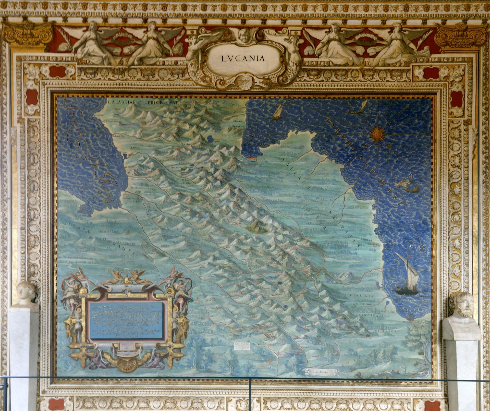

*图源：[Wikimedia Commons](https://commons.wikimedia.org/wiki/File%3ALucania%2C_Galleria_delle_Carte_Geografiche_-FG.jpg)*

古名"卢卡尼亚"的**巴西利卡塔**——意大利"脚弓"内侧的山区内陆，夹在两海之间。马泰拉（石窟城）就在这一带。是全图里最荒僻、城市最少的几幅之一。

#### 10 近卡拉布里亚（Calabria citerior）

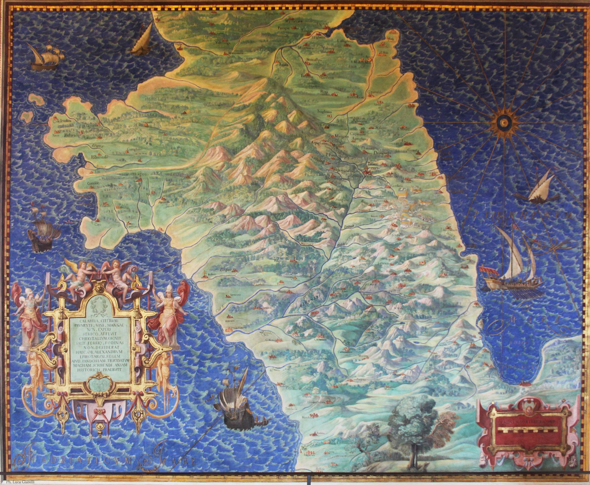

*图源：[Wikimedia Commons](https://commons.wikimedia.org/wiki/File%3ACalabria_citerior_-_Galleria_delle_carte_geografiche_-_Musei_vaticani_-_Roma_%28ph_Luca_Giarelli%29.jpg)*

意大利"脚尖"的**北半截卡拉布里亚**（靠第勒尼安海一侧）。"citerior（近）"是从罗马看的相对位置——离罗马近的那半。海上帆船与红框铭文卡片是丹蒂的标准配置。

#### 11 远卡拉布里亚（Calabria ulterior）

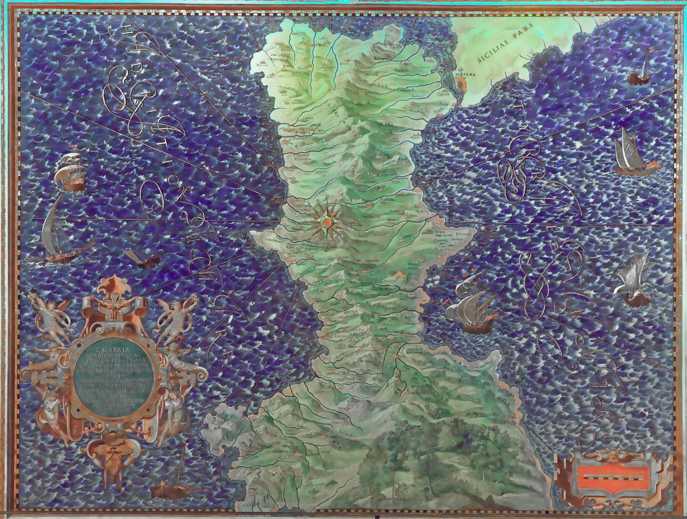

*图源：[Wikimedia Commons](https://commons.wikimedia.org/wiki/File%3AVatikanische_Museen_59_%28perspective_correction_and_improved_colour_rendering%29.jpg)*

意大利"脚尖"的**最南端**，雷焦·卡拉布里亚正对西西里的墨西拿海峡——图上方那道窄海峡对岸就标着 SICILIAE（西西里）。"ulterior（远）"＝离罗马更远的那半。深蓝海面的纹理是这幅的看点。

---

### 中部内陆

#### 12 佩鲁贾地区（Perusinus ac Tifernas）

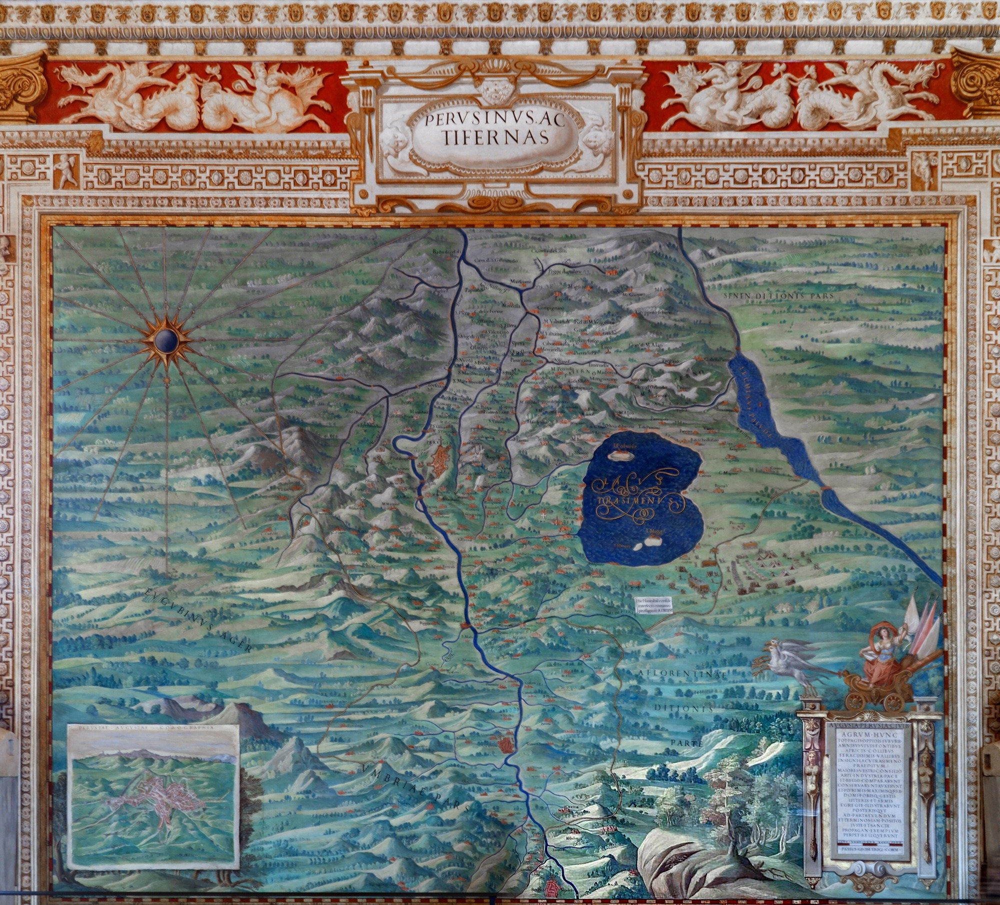

*图源：[Wikimedia Commons](https://commons.wikimedia.org/wiki/File%3APerusinus_ac_Tifernas_-_Galleria_delle_Carte_Geografiche_-FG.jpg)*

**佩鲁贾**及其周边（Tifernas 指今 Città di Castello 一带）、特拉西梅诺湖。翁布里亚北部，山城密布。蓝色的特拉西梅诺湖是公元前 217 年汉尼拔伏击罗马军的古战场。

#### 13 翁布里亚·斯波莱托（Umbria）

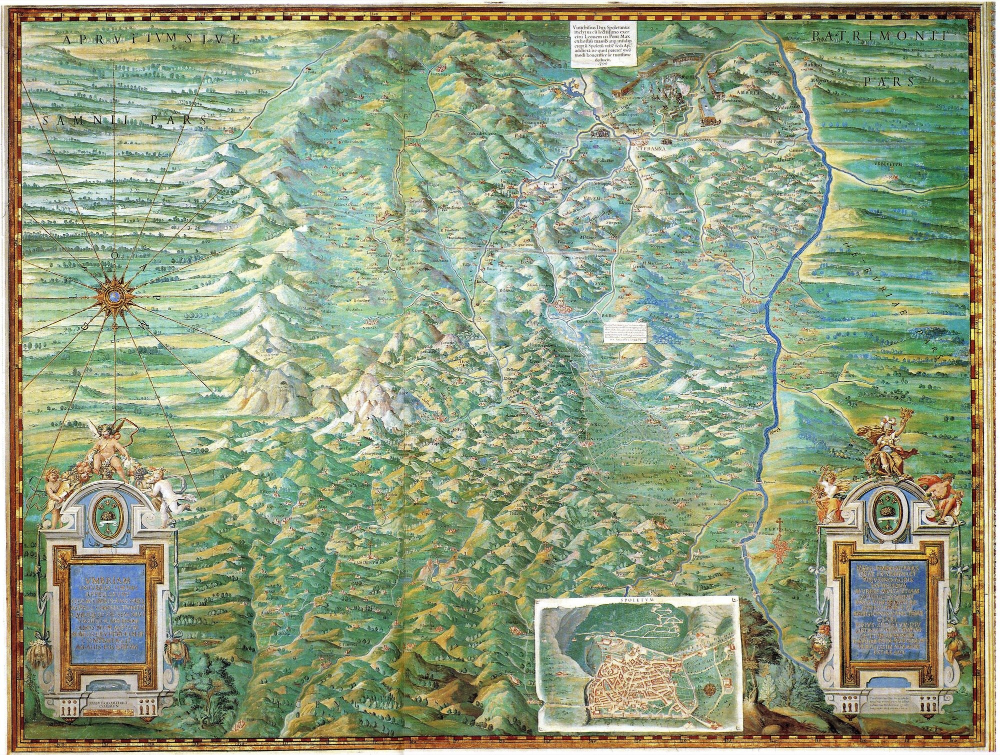

*图源：[Wikimedia Commons](https://commons.wikimedia.org/wiki/File%3A05_Egnazio_Danti_Umbria_1580-81.jpg)*

翁布里亚南部，以**斯波莱托**为中心——绿意盎然的山地是这幅的底色（"意大利绿心"翁布里亚名副其实）。阿西西（圣方济各故乡）也在这片。丹蒂本人是佩鲁贾人，画家乡格外细。

---

### 亚得里亚/东海岸（北 → 南）

#### 14 弗拉米尼亚·罗马涅（Flaminia）

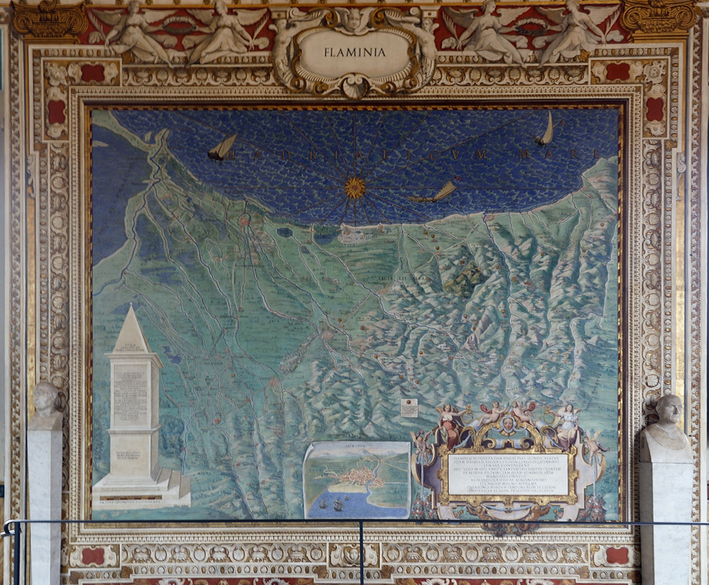

*图源：[Wikimedia Commons](https://commons.wikimedia.org/wiki/File%3AFlaminia%2C_Galleria_delle_Carte_Geografiche_-FG.jpg)*

得名于古罗马**弗拉米尼亚大道**的罗马涅一带（里米尼、拉文纳、福利方向）。这条古道从罗马通向亚得里亚海岸，是这幅图的脊梁。

#### 15 博洛尼亚地区（Bononiensis ditio）

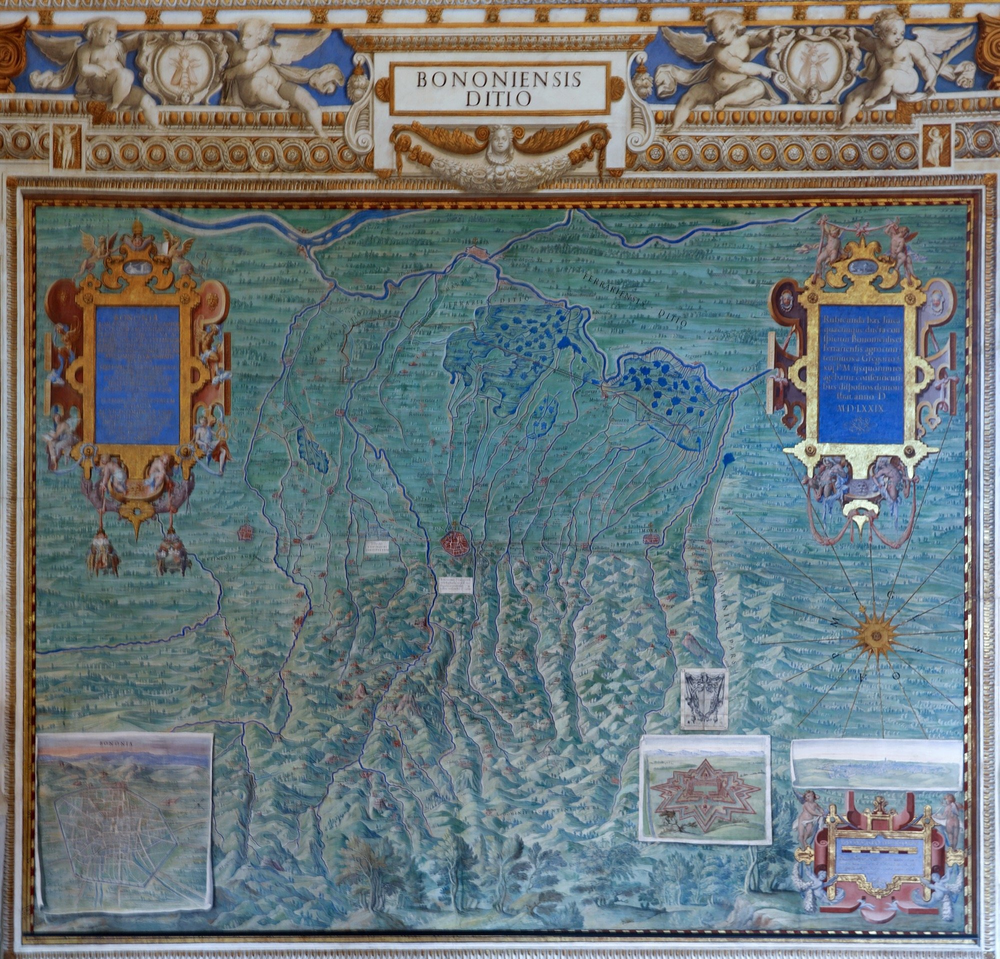

*图源：[Wikimedia Commons](https://commons.wikimedia.org/wiki/File%3ABononiensis_Ditio%2C_Galleria_dele_Carte_Geografiche%2C_Musei_Vaticani_-FG.jpg)*

**博洛尼亚**及其领地——教皇国第二大城。角上嵌博洛尼亚城景与著名的**乌尔巴诺要塞（Forte Urbano）**星形棱堡。两枚大盾形铭文框是这幅的装饰重点。

#### 16 皮切诺·马尔凯（Picenum）

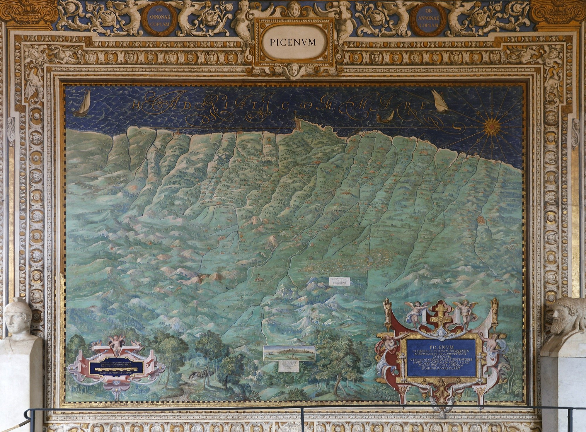

*图源：[Wikimedia Commons](https://commons.wikimedia.org/wiki/File%3APicenum_%28Marche%29%2C_Galleria_delle_Carte_Geografiche_-FG.jpg)*

古名"皮切诺"的**马尔凯**地区南半（马切拉塔、费尔莫、阿斯科利一带），亚得里亚海岸丘陵。

#### 17 安科纳地区（Anconitanus ager）

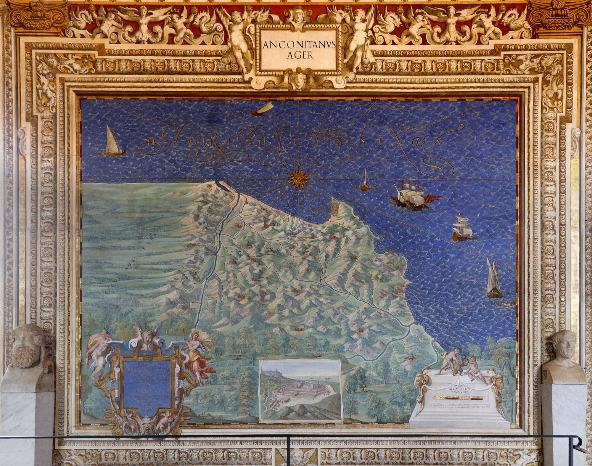

*图源：[Wikimedia Commons](https://commons.wikimedia.org/wiki/File%3AAnconitanus_Ager_-_Galleria_delle_Carte_Geografiche_-FG.jpg)*

**安科纳周边的海岸地带**——科内罗山（Monte Conero）那段陡崖海岸画得很醒目。安科纳是教皇国在亚得里亚海的主港，城市本身另有港城景观图（见 #31 安科纳港（Ancona））。

#### 18 阿布鲁佐（Aprutium）

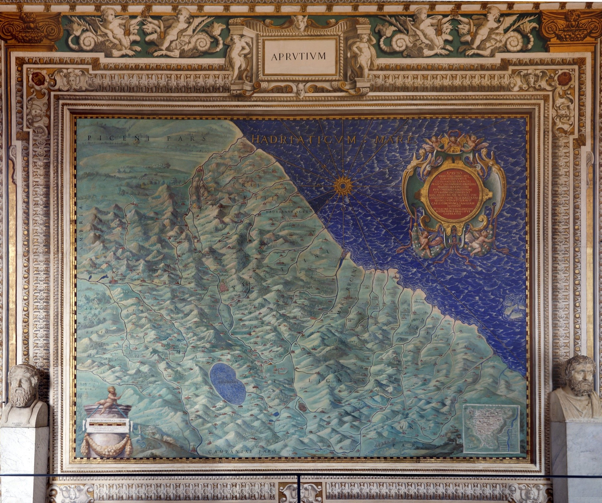

*图源：[Wikimedia Commons](https://commons.wikimedia.org/wiki/File%3AAprutium_-_Galleria_delle_carte_geografiche_-FG.jpg)*

**阿布鲁佐**——亚平宁最高峰大萨索山（Gran Sasso）所在，拉奎拉（L'Aquila）是中心。当时属那不勒斯王国最北省。多山，画面满是立体晕染的峰峦。

#### 19 普利亚（Apulia）

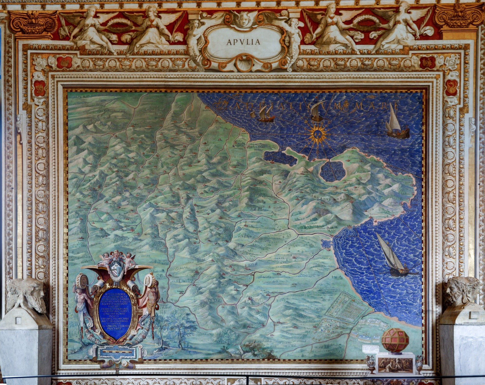

*图源：[Wikimedia Commons](https://commons.wikimedia.org/wiki/File%3AApulia_-_Galleria_delle_Carte_Geografiche_-FG.jpg)*

意大利"鞋跟"上方的**普利亚**——加尔加诺半岛（"马刺"）、福贾平原。亚得里亚海岸线漫长平直，是南意的大粮仓。

#### 20 萨伦托·奥特朗托（Salentina Hydrunti terra）

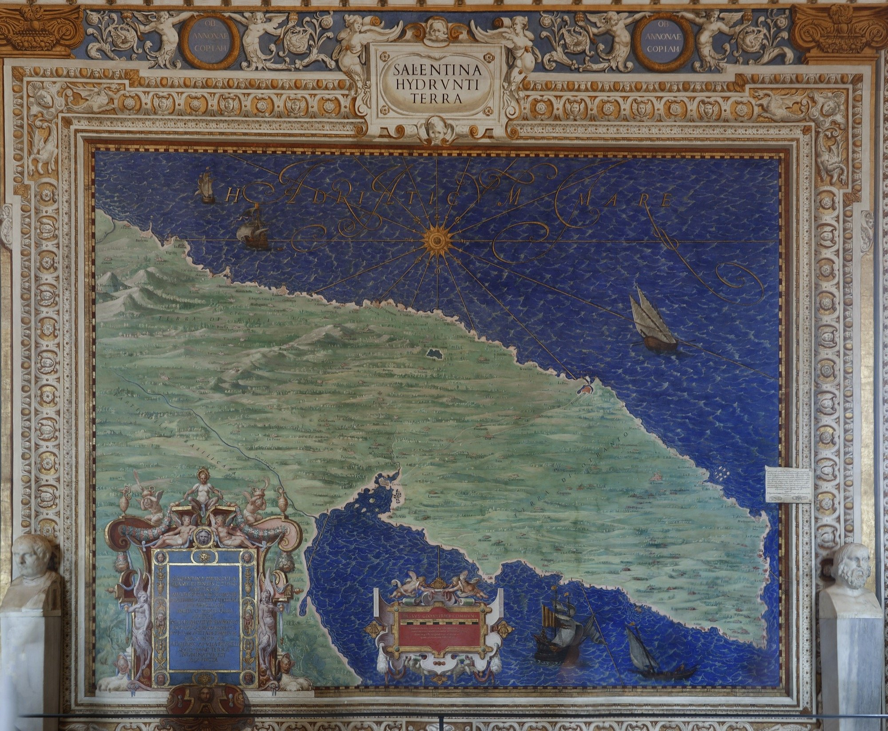

*图源：[Wikimedia Commons](https://commons.wikimedia.org/wiki/File%3ASallentina_Hydrunti_Terra_-_Galleria_delle_Carte_Geografiche_-FG.jpg)*

意大利的**"鞋跟"尖**——萨伦托半岛，莱切、奥特朗托（Hydruntum）、加里波利。这里是半岛最东端，1480 年奥斯曼曾在奥特朗托登陆屠城，离巴尔干最近。

#### 21 弗留利（Forum Iulii）

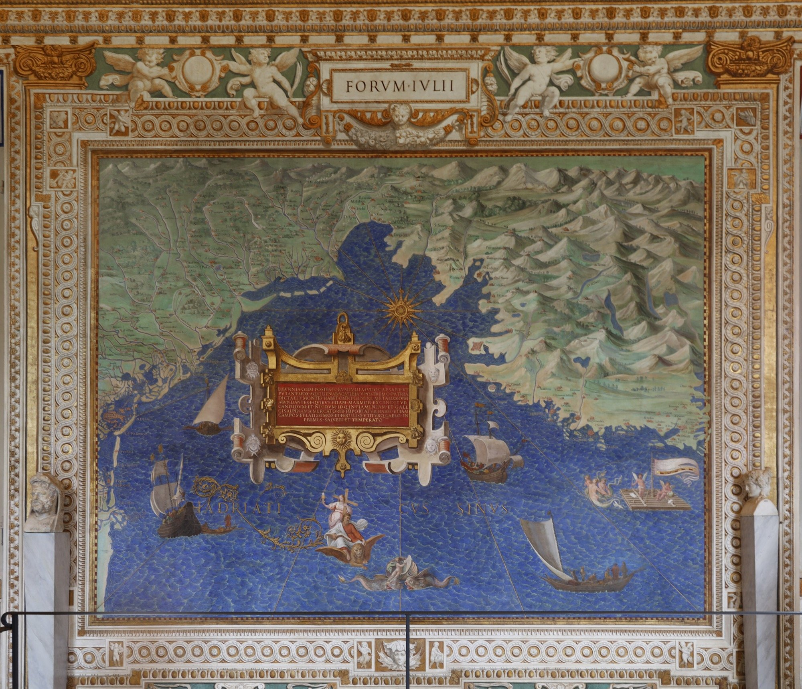

*图源：[Wikimedia Commons](https://commons.wikimedia.org/wiki/File%3AForum_Iulii%2C_Galleria_delle_carte_geografiche_-FG.jpg)*

意大利**东北角的弗留利**（乌迪内、阿奎莱亚一带），名字来自凯撒建的"尤利乌斯集市"（Forum Iulii，今 Cividale）。当时威尼斯共和国的陆上前哨，紧邻哈布斯堡边境。

#### 22 威尼托内陆（Transpadana venetorum ditio）

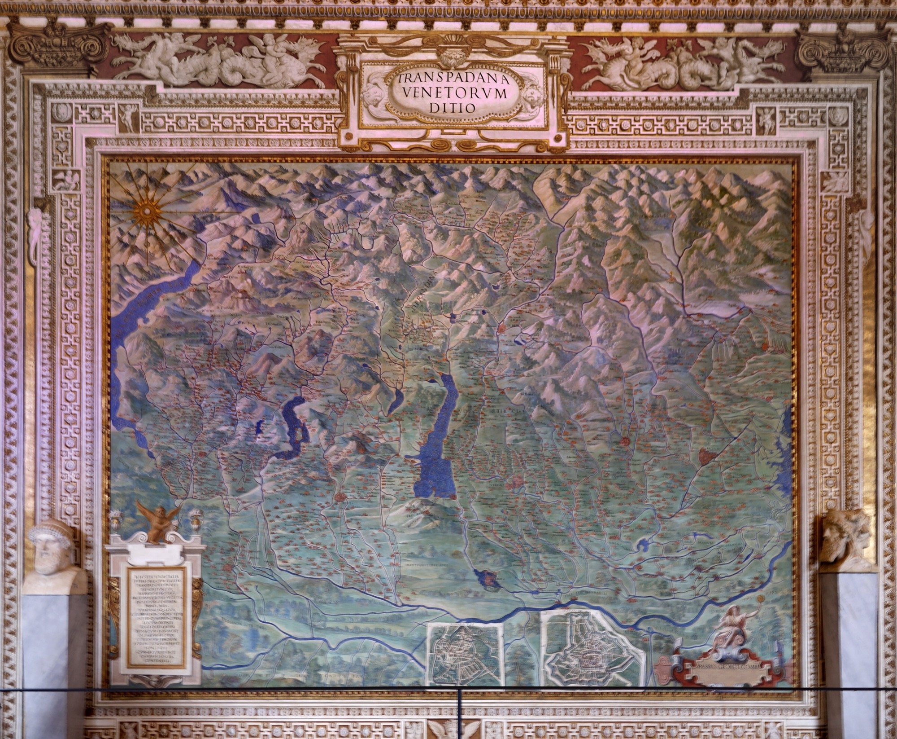

*图源：[Wikimedia Commons](https://commons.wikimedia.org/wiki/File%3ATranspadana_Venetorum_Ditio_-_Galleria_delle_Carte_Geografiche_-FG.jpg)*

"波河对岸的威尼斯领地"——**威尼托与上伦巴第内陆**（维罗纳、维琴察、帕多瓦、布雷西亚、加尔达湖）。威尼斯共和国的"陆地领"（Terraferma），城市密集、富庶。威尼斯城本身另有专图（见 #30 威尼斯城（Venetiae civitas））。

---

### 北方公国

#### 23 皮埃蒙特与蒙费拉托（Pedemontium et Monsferratus）

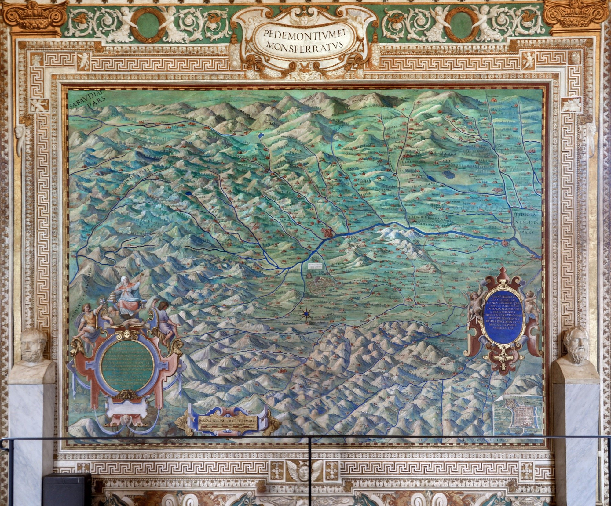

*图源：[Wikimedia Commons](https://commons.wikimedia.org/wiki/File%3APedemontium_et_Monsferratus_-_Galleria_delle_Carte_Geografiche_-FG.jpg)*

意大利西北角的**皮埃蒙特**（萨伏依公爵领，都灵）与蒙费拉托侯爵领。"Pedemontium＝山脚下"，正是阿尔卑斯脚下之意。背靠雪山，是通往法国的门户。

#### 24 米兰公国（Mediolanensis ducatus）

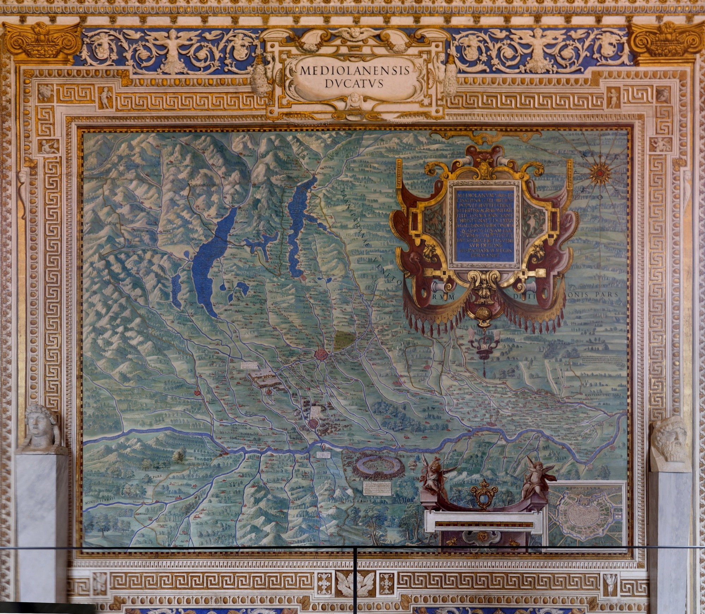

*图源：[Wikimedia Commons](https://commons.wikimedia.org/wiki/File%3AMediolanensis_Ducatus_-_Galleria_delle_Carte_Geografiche_-FG.jpg)*

**米兰公国**——伦巴第平原与北部大湖区（科莫湖、马焦雷湖）。1580 年正处西班牙统治下。富庶的波河平原与雪山倒影是看点。

#### 25 曼托瓦公国（Mantuae ducatus）

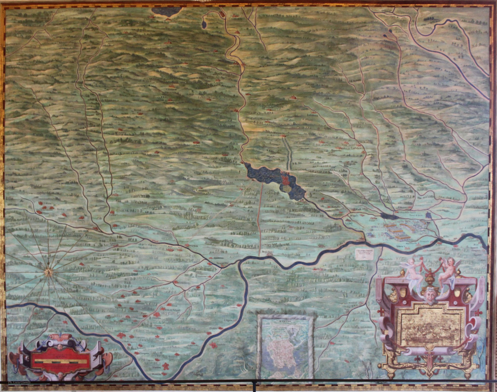

*图源：[Wikimedia Commons](https://commons.wikimedia.org/wiki/File%3AMantuae_ducatus_%28Ducato_di_Mantova%29_-_Galleria_delle_carte_geografiche_-_Musei_vaticani_-_Roma_%28ph_Luca_Giarelli%29.jpg)*

贡扎加家族的**曼托瓦公国**——被三面人工湖环抱的水城（图中那片深色水域）。文艺复兴名城，朱利奥·罗马诺（拉斐尔大弟子，君士坦丁厅主笔）的德泰宫就在此。

#### 26 帕尔马与皮亚琴察公国（Placentiae et Parmae ducatus）

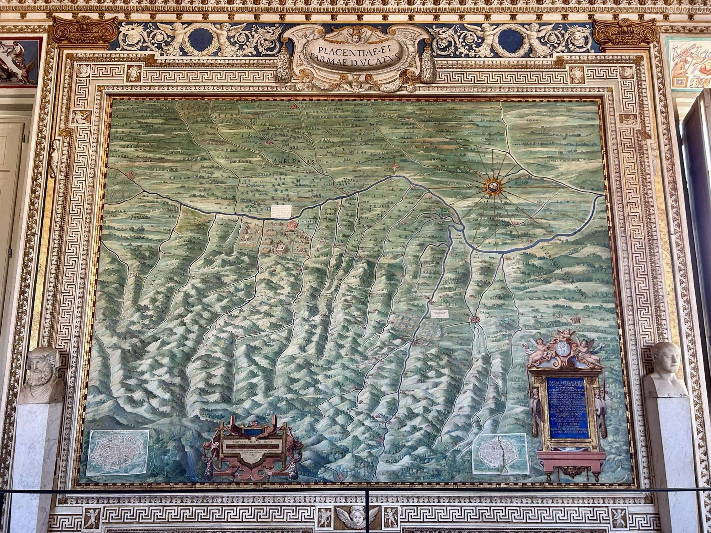

*图源：[Wikimedia Commons](https://commons.wikimedia.org/wiki/File%3APlacentiae_et_Parmae_ducatus_%28Galleria_delle_carte_geografiche%29.jpg)*

**法尔内塞家族的帕尔马—皮亚琴察公国**。法尔内塞正是建造梵蒂冈这些工程的教皇保禄三世的家族——把自家公国画进教皇宫，是显赫的家族广告。墙楣写 PLACENTIAE ET PARMAE DVCATVS。

#### 27 费拉拉公国（Ferrariae Ducatus）

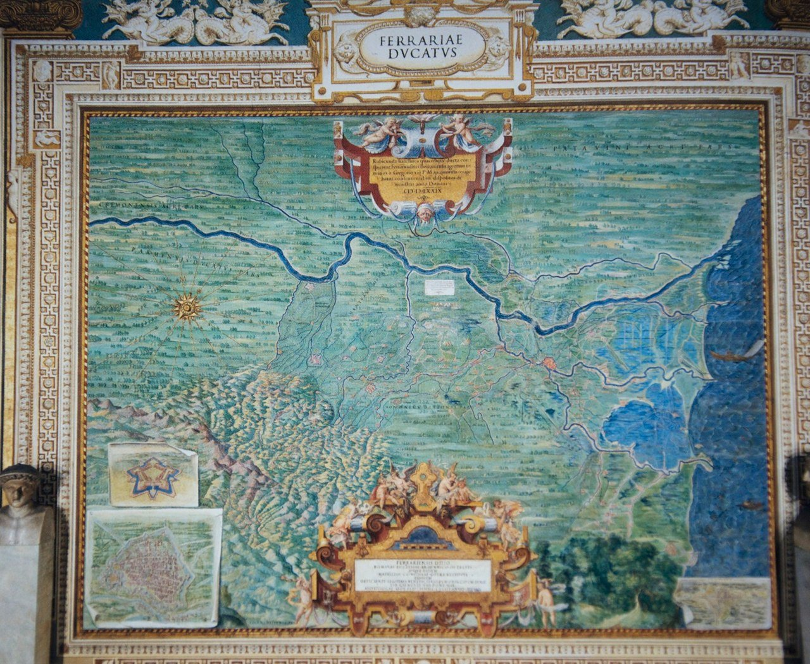

*图源：[Wikimedia Commons](https://commons.wikimedia.org/wiki/File%3AFerrariae_Ducatus.jpg)*

埃斯特家族的**费拉拉公国**与波河三角洲。角上嵌费拉拉城平面图。**画这幅时正逢敏感时刻**：埃斯特绝嗣，1598 年费拉拉即将被并入教皇国——这幅地图几乎是教廷"提前挂上墙"的领土声索。

#### 28 乌尔比诺公国（Urbini ducatus）

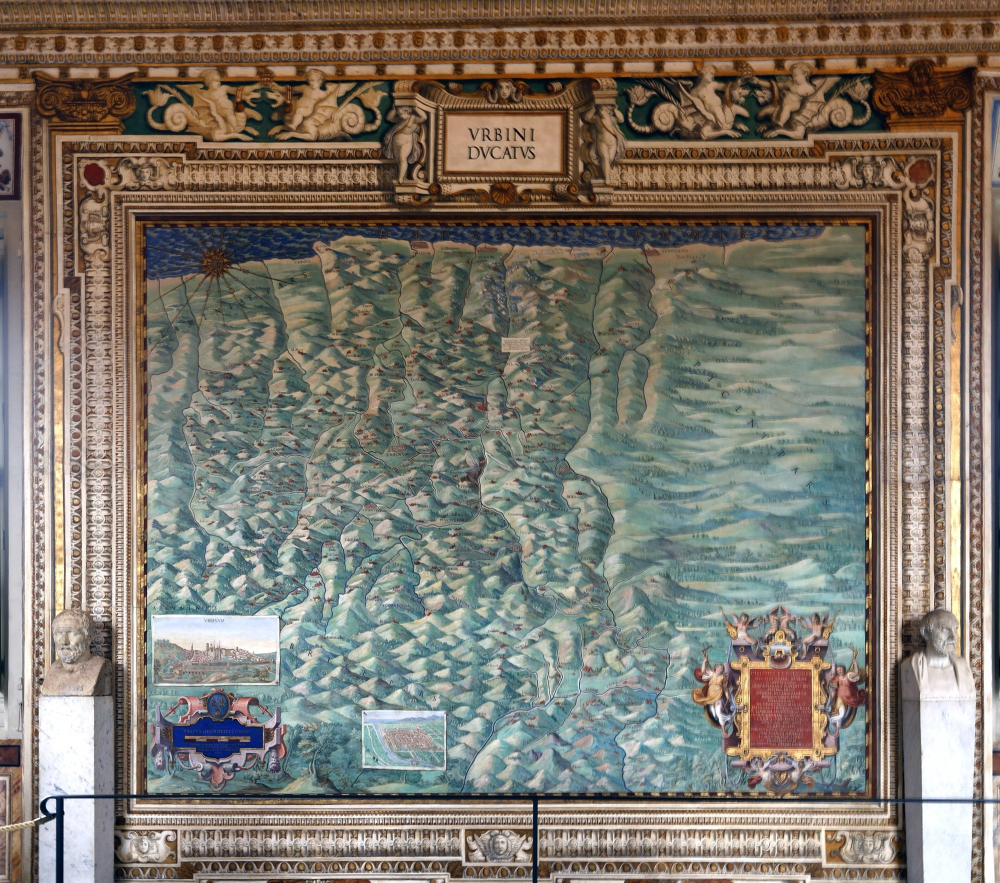

*图源：[Wikimedia Commons](https://commons.wikimedia.org/wiki/File%3AUrbini_Ducatus%2C_Galleria_delle_Carte_Geografiche_-FG.jpg)*

德拉·罗韦雷家族的**乌尔比诺公国**——文艺复兴最精致的宫廷之一，也是**拉斐尔的故乡**（你们刚看完的拉斐尔房间就是他画的）。山城乌尔比诺的公爵宫是建筑史名作。

---

### 港城景观（四大港）

#### 29 热那亚港（Genua）

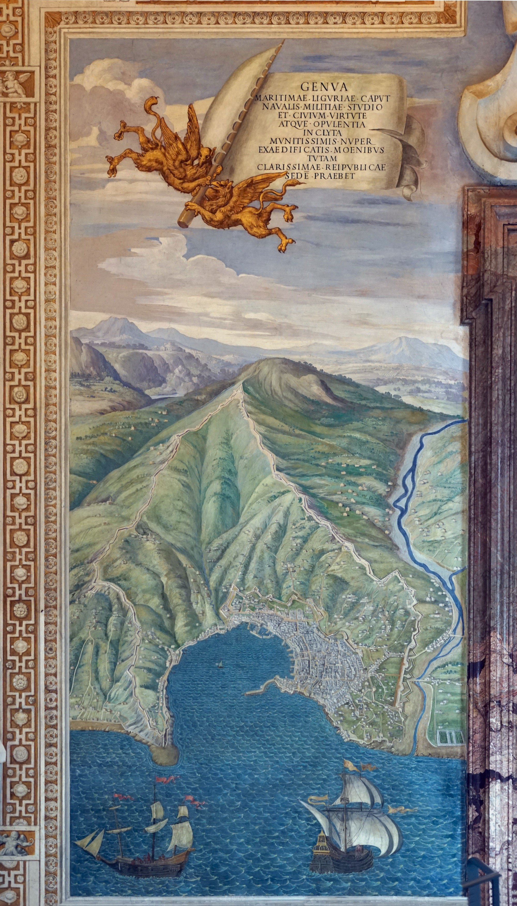

*图源：[Wikimedia Commons](https://commons.wikimedia.org/wiki/File%3AGenua%2C_Galleria_delle_Carte_Geografiche%2C_Musei_Vaticani_-FG.jpg)*

第勒尼安海一侧的海上共和国之都——**热那亚港**的鸟瞰透视景：半圆形港湾、背靠陡山、海上帆船。顶上一位拉着横幅的飞天小天使报城名 GENVA。与对面的威尼斯港遥相对峙：两大海上共和国，一西一东。

#### 30 威尼斯城（Venetiae civitas）

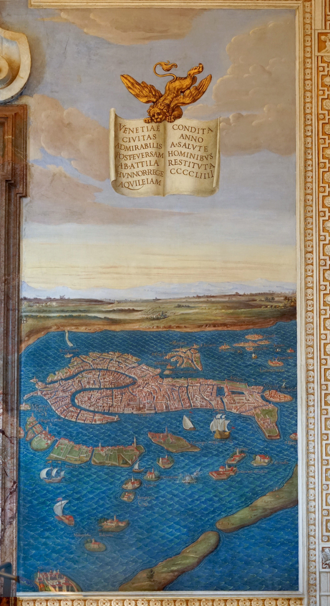

*图源：[Wikimedia Commons](https://commons.wikimedia.org/wiki/File%3AVenetiae_civitas._Galleria_delle_Carte_Geografiche_-FG.jpg)*

亚得里亚海一侧的海上共和国之都——**威尼斯**潟湖鸟瞰。整座城与周围星罗的潟湖小岛画成"圣马可之狮"般卧在水面的形状。16 世纪威尼斯正盛，这幅是全廊最"水"的一幅。

#### 31 安科纳港（Ancona）

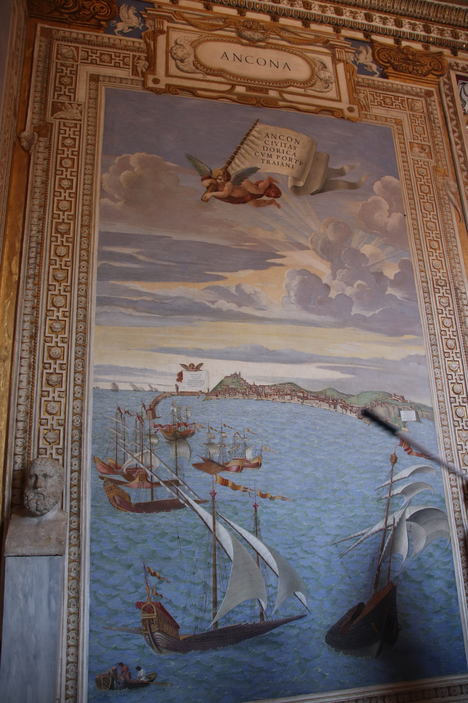

*图源：[Wikimedia Commons](https://commons.wikimedia.org/wiki/File%3AVatican_Museums_Gallery_of_Maps_View_of_Ancona_by_Ignazio_Danti_%2848466214701%29.jpg)*

**教皇国在亚得里亚海的主港**安科纳的港景：弯月形港湾（"Ancona"本就源自希腊语"肘弯"）、图拉真凯旋门、海上商船。上方天使举铭文板。竖幅构图，下方满是帆船。

#### 32 奇维塔韦基亚港（Civitas Vetus）

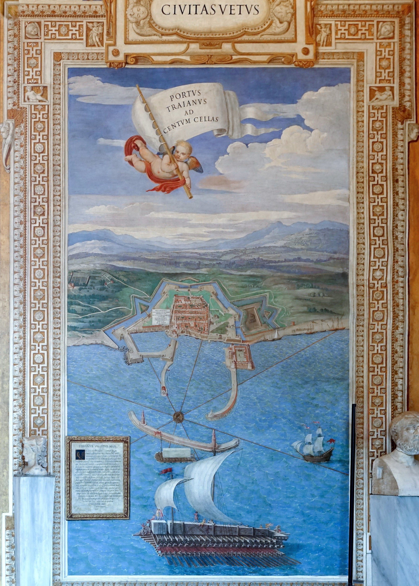

*图源：[Wikimedia Commons](https://commons.wikimedia.org/wiki/File%3ACivitas_Vetus%2C_Galleria_delle_Carte_Geografiche%2C_Musei_Vaticani_-FG.jpg)*

**教皇国在第勒尼安海的主港**奇维塔韦基亚（罗马的外港，今天去撒丁/邮轮还从这里走）。图中能看到米开朗基罗参与设计的星形要塞港口。与安科纳一西一东，是教皇国的两扇"海门"。

---

### 海岛

#### 33 科西嘉（Corsica）

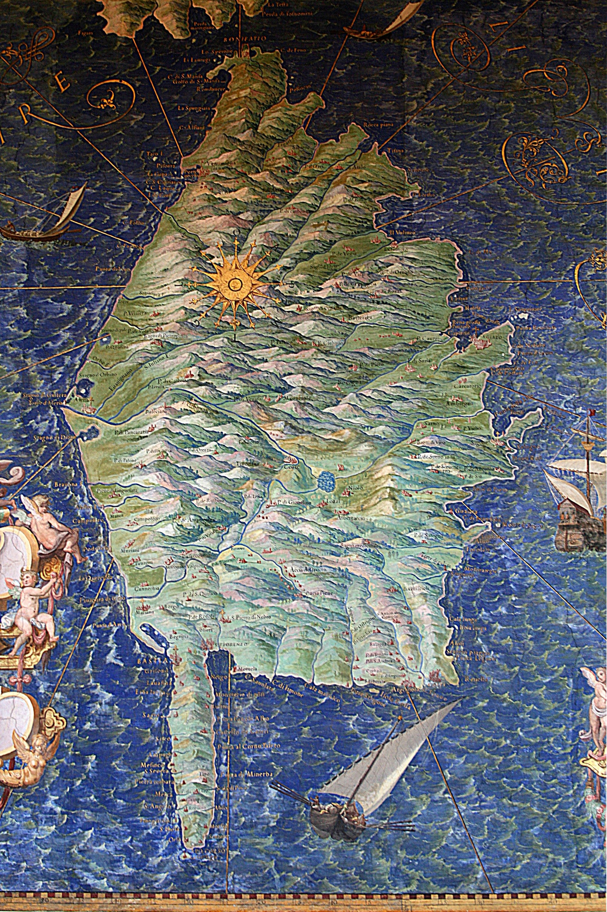

*图源：[Wikimedia Commons](https://commons.wikimedia.org/wiki/File%3A0_Corse_-_Galleria_delle_carte_geografiche.JPG)*

热那亚共和国治下的**科西嘉岛**——一整座多山的绿岛立在深蓝海面，四周点缀帆船、海怪与铭文框。拿破仑要再过两百年才在这里出生。

#### 34 撒丁岛（Sardinia）

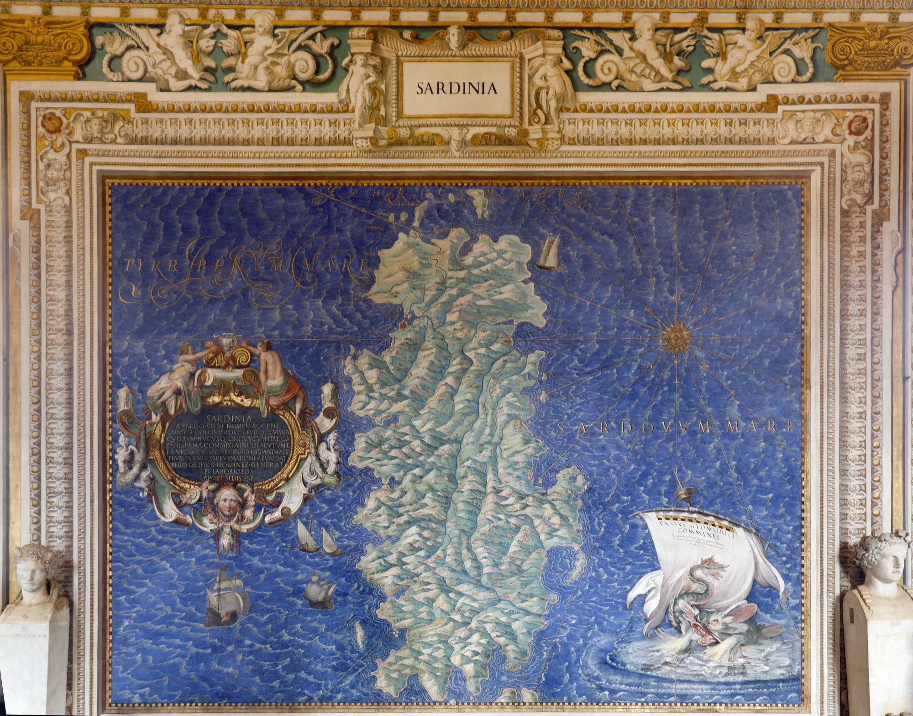

*图源：[Wikimedia Commons](https://commons.wikimedia.org/wiki/File%3ASardinia_-FG.jpg)*

**撒丁岛**全岛图，当时属西班牙。卡利亚里、萨萨里标在岛上；海面帆船、晕染山脉是丹蒂海岛图的标配。

#### 35 西西里（Sicilia）

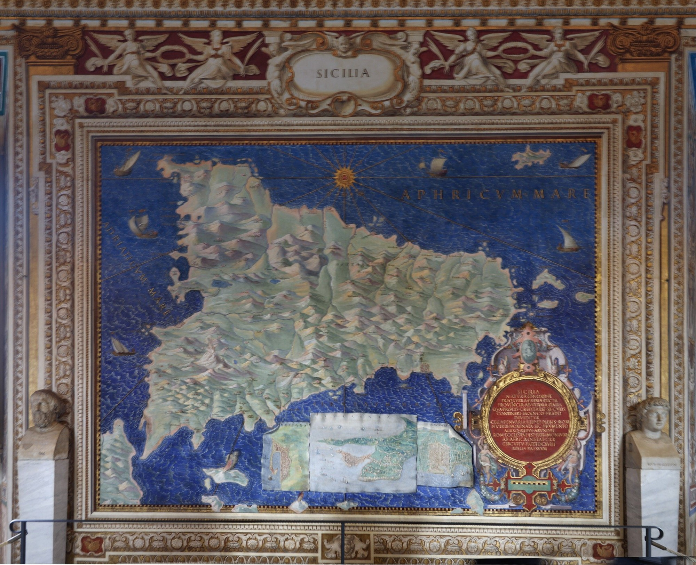

*图源：[Wikimedia Commons](https://commons.wikimedia.org/wiki/File%3ASicilia_-_Galleria_delle_Carte_Geografiche_-FG.jpg)*

地中海最大岛**西西里**的三角形全岛——巴勒莫、墨西拿、锡拉库萨、埃特纳火山都在图上。当时是西班牙的粮仓与海军基地。原版角上还嵌三座城市的小景。

#### 36 马耳他（Malta）

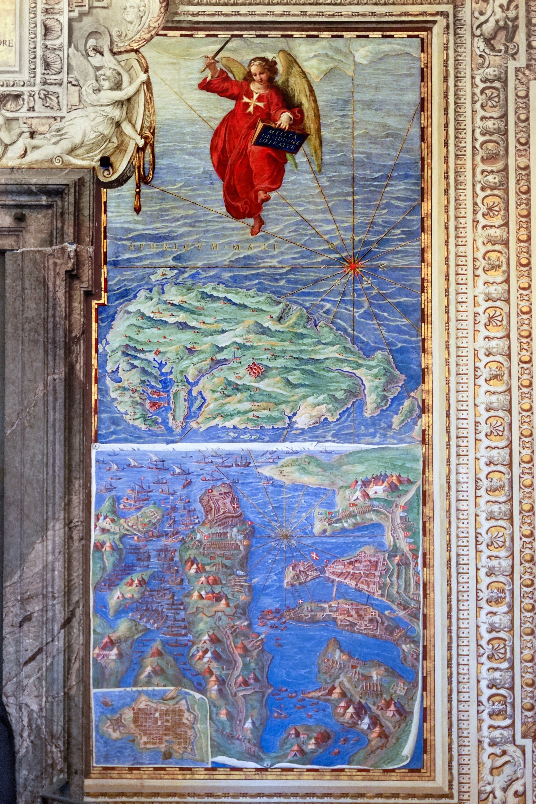

*图源：[Wikimedia Commons](https://commons.wikimedia.org/wiki/File%3AMalta._Galleria_delle_Carte_Geografiche%2C_Musei_Vaticani_-FG1.jpg)*

医院骑士团的**马耳他岛**。这幅特别有**时事意义**：画面纪念 **1565 年马耳他大围攻**——骑士团以寡敌众挡住奥斯曼大军，是基督教世界的标志性胜利。顶上飞天天使、岛上标注瓦莱塔要塞。

#### 37 厄尔巴与奥斯提亚古港（Ilva）

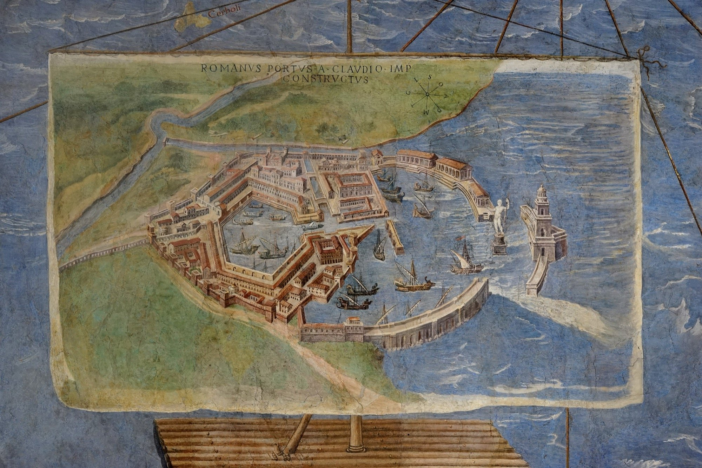

*图源：[Wikimedia Commons](https://commons.wikimedia.org/wiki/File%3ARicostruzione_del_porto_di_Ostia_ai_tempi_dell%27imperatore_Claudio%2C_Galleria_delle_carte_geografiche_-FG.jpg)*

> ⚠️ 这幅图：壁画上的 **Ilva 即厄尔巴岛**（主城 Portoferraio），但 Commons 此面板下唯一的官方扫描是同区段的**《克劳狄乌斯时代奥斯提亚古港复原图》**——即罗马的人工六边形外港 Portus 的鸟瞰复原。两者都属地图廊；这里先用这张古港复原代为示意，厄尔巴岛全图待补。

这幅复原图本身极有看头：罗马帝国为首都修的巨型人工港，六边形船坞、灯塔、仓库一应俱全——是古代港口工程的"工程图"，与四周的实测地图形成有趣对照（一边测今、一边复古）。

#### 38 科孚岛与勒班陀海战（Corcyra insula）

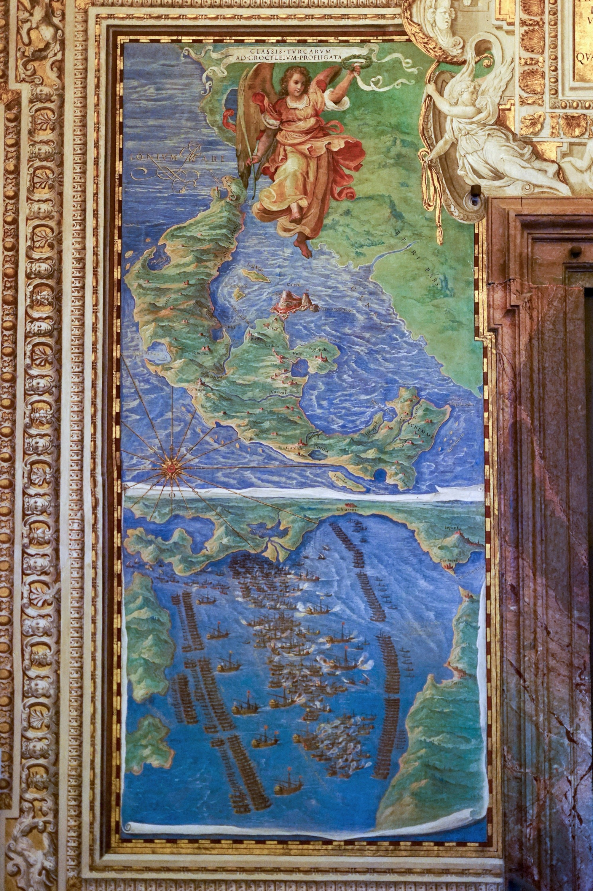

*图源：[Wikimedia Commons](https://commons.wikimedia.org/wiki/File%3ACorf%C3%B9_e_la_battaglia_di_Lepanto%2C_Galleria_delle_Carte_Geografiche_-FG.jpg)*

**上半是科孚岛（Corcyra）**，威尼斯在爱奥尼亚海的前哨；**下半是 1571 年勒班陀海战**——基督教神圣同盟舰队大破奥斯曼海军的决定性一役。把当代大捷画进地理图集，是整条廊"以图叙史"的最直接一例：地图也是宣传画。

#### 39 特雷米蒂群岛（Tremitae insulae）

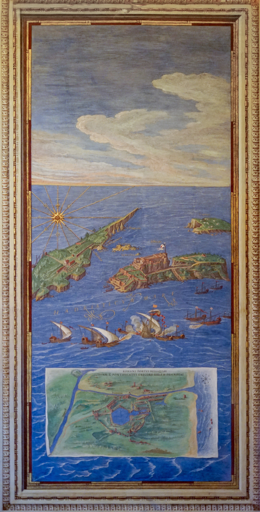

*图源：[Wikimedia Commons](https://commons.wikimedia.org/wiki/File%3ATremitae_insulae._Galleria_delle_carte_geografiche%2C_Musei_Vaticani_-FG.jpg)*

亚得里亚海上普利亚外海的**特雷米蒂小群岛**——上方一位飞天天使举着铭文卷轴，下方几座小岛散在海中。全廊最小、最不起眼的海岛之一，却也单独画了一幅，可见这套图集"地无遗漏"的野心。

---

### 特例

#### 40 阿维尼翁与韦内森（Avenionensis ditio et Venaisinus comitatus）

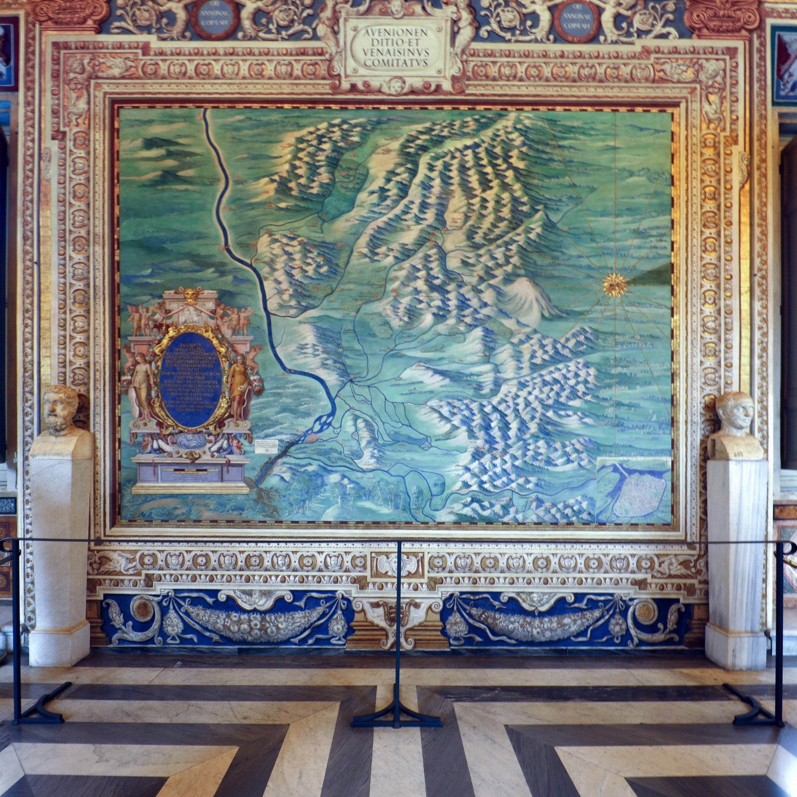

*图源：[Wikimedia Commons](https://commons.wikimedia.org/wiki/File%3AAvenionensis_ditio_et_Venaisinus_comitatus_-_Galleria_delle_carte_geografiche_-FG1.jpg)*

全廊**唯一一幅不在意大利的地图**——法国南部的**阿维尼翁城与韦内森伯爵领**（罗讷河畔）。为什么画它？因为 1309–1377 年教廷曾迁居阿维尼翁（"阿维尼翁之囚"），此地直到 1791 年都是教皇的飞地。把这块海外领土也挂上墙，正点出整条廊的真正主题：**这画的不是"意大利"，是"教皇的领土版图"**。

---

### 图源与版权说明

- 全部 40 幅均取自 **Wikimedia Commons 公有领域**（壁画 1583 年完成，原作已过版权期；多数为 Sailko 等用户的 `-FG` 全墙高清扫描）。下载为 2000px 适配图存于本区 `attachments/`，每幅源链已附在图下。
- 个别幅（利古里亚、远卡拉布里亚、科西嘉、帕尔马、费拉拉、安科纳、曼托瓦、近卡拉布里亚、翁布里亚、两张总图）官网与 Commons 没有理想的"正面全墙"扫描，已挑选**能完整识别该地区/能看清墙楣拉丁名**的最佳现存图替代，识别无误。
- 厄尔巴（Ilva）面板缺岛屿全图，暂用同区段的奥斯提亚古港复原图示意，已在该条注明。
- 官方介绍只有地图廊整体页（无单幅子页），故各幅未附"官方介绍页"链接，统一以 Commons 文件页为准。
