这是 [V - 03 地图廊 + 挂毯廊 + 烛台廊（穿行段挑看）](../v03-three-galleries/) 挂毯廊一节的**全图册**——把廊里两套主要挂毯系列逐幅拆开、配大图与说明。挂毯廊**刻意调暗灯光**（织物怕光），现场很难看清细节；这份册子的用法是**出发前先在亮处把每幅看清、记住故事**，到现场只需边走边认、专门停在"会跟人的复活基督"前即可。

🔗 官方：[Gallery of the Tapestries · Musei Vaticani](https://www.museivaticani.va/content/museivaticani/en/collezioni/musei/galleria-arazzi.html)
🔗 [基督生平系列（新学派）](https://www.museivaticani.va/content/museivaticani/en/collezioni/musei/galleria-arazzi/serie-vita-cristo.html) ｜ [乌尔班八世生平系列](https://www.museivaticani.va/content/museivaticani/en/collezioni/musei/galleria-arazzi/serie-vita-urbanoVIII.html)

### 这条廊是什么

一条刻意调暗的长廊，两壁挂着巨幅织毯。在 16 世纪，**一套御用挂毯比一面湿壁画贵得多**（丝、羊毛常夹金银线，由顶级工坊耗年织造）——这条廊挂的是教廷的"硬通货"。廊里两壁分属相隔一百年的两套系列，一条廊里上演两种"权力叙事"：

- **南壁：基督生平（"新学派" Scuola Nuova）** —— 拉斐尔（Raphael）1520 年去世后，由他的学生们（朱利奥·罗马诺 Giulio Romano 等）绘制底稿，布鲁塞尔的**彼得·范·阿尔斯特（Pieter van Aelst）工坊**织造（1524–1531），1531 年首次挂进西斯廷礼拜堂，1838 年起陈列于此。"新学派"是相对拉斐尔生前亲自画稿的"老学派"《使徒行传》挂毯而言。
- **对壁：乌尔班八世生平** —— 17 世纪罗马**巴贝里尼（Barberini）工坊**织造（1663–1695），讲教皇乌尔班八世（Urban VIII，本名马费奥·巴贝里尼）从求学到登基、治世的一生。

挂毯廊内景——两壁巨幅挂毯与灰泥拱顶（官网大图）：

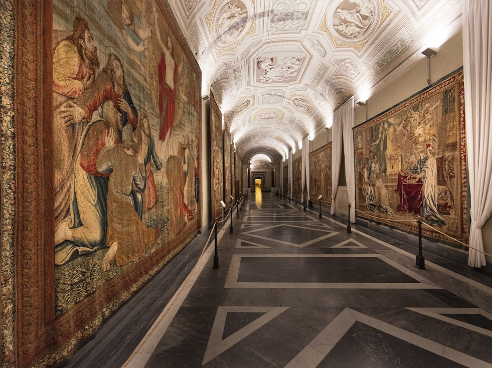

*图源：[梵蒂冈博物馆官网](https://www.museivaticani.va/content/museivaticani/en/collezioni/musei/galleria-arazzi.html)*

挂毯廊拱顶的单色灰泥装饰（官网大图）：

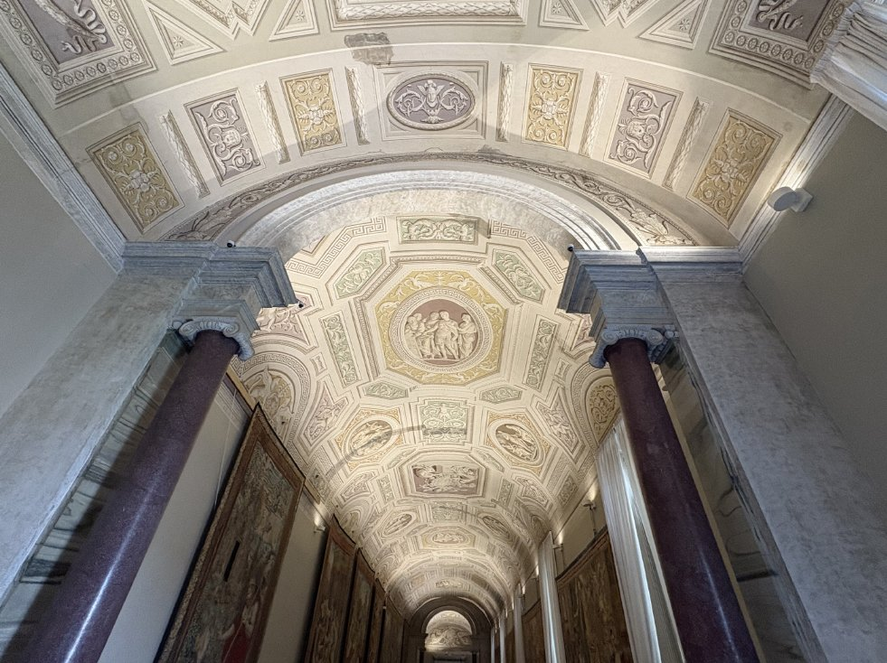

*图源：[梵蒂冈博物馆官网](https://www.museivaticani.va/content/museivaticani/en/collezioni/musei/galleria-arazzi.html)*

---

### 一、基督生平 · "新学派"（Scuola Nuova，1524–31 布鲁塞尔织）

> 题材按基督一生排列：诞生 → 童年 → 受难后。织自拉斐尔学派的底稿，所以人物动态、构图都带浓重的"拉斐尔式"古典味。

#### 01 牧人来拜（Adorazione dei Pastori）

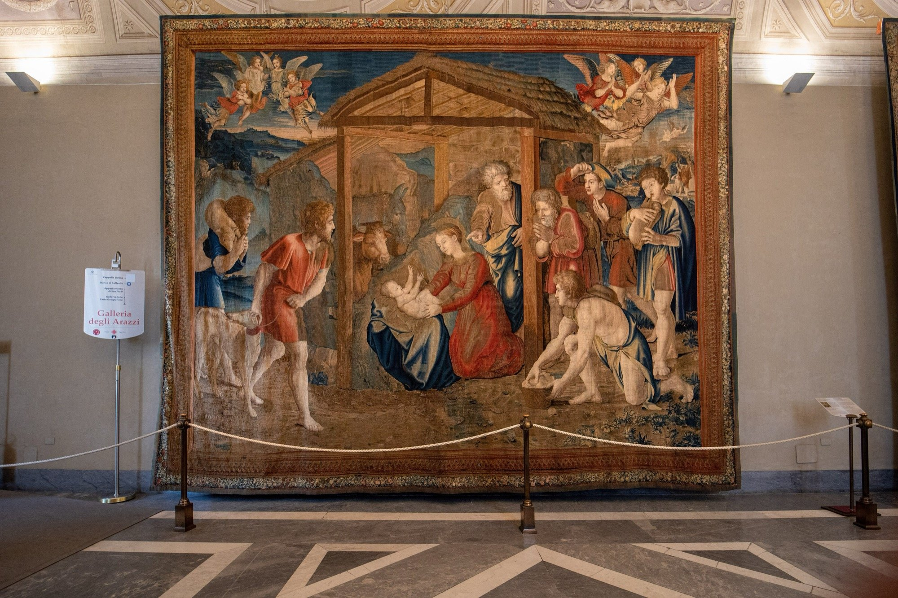

*图源：[Wikimedia Commons](https://commons.wikimedia.org/wiki/File%3A25-_Adorazione_dei_Pastori._Serie_della_Scuola_Nuova._1524-31_-FG.jpg)*

基督诞生当夜，牧人闻天使报信前来朝拜马槽里的圣婴。系列的开篇——破败马厩、跪拜的牧人、圣母与约瑟。注意织毯四周的**装饰边框（bordura）**：花果、人物、纹章一圈，是这套御用挂毯身价的一部分。

#### 02 三王来拜（Adorazione dei Magi）

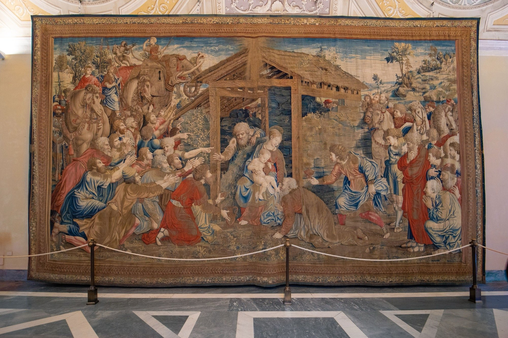

*图源：[Wikimedia Commons](https://commons.wikimedia.org/wiki/File%3A26-_Adorazione_dei_Magi%2C_1524-31_-_Serie_della_Scuola_Nuova_-FG.jpg)*

东方三博士（Magi）随星而来，向圣婴献上黄金、乳香、没药。比牧人来拜更华丽——异邦君王的锦袍、随从、骆驼，给织工炫技的空间。三博士的"博士"一词即源自波斯祆教的"麦琪"（与地图廊/雅典学院见到的琐罗亚斯德同源）。

#### 03 无辜婴孩被屠（Strage degli Innocenti）—— 三个版本

> 这是全系列最暴烈、人物动态最"拉斐尔式"的一组。希律王（Herod）听闻"犹太人的王"诞生，下令屠杀伯利恒所有两岁以下男婴。**新学派为这一题材织了三个不同背景的版本**，三幅并挂，是挂毯廊一大看点——同一场屠杀，三种舞台。

##### 03a 罗马建筑版

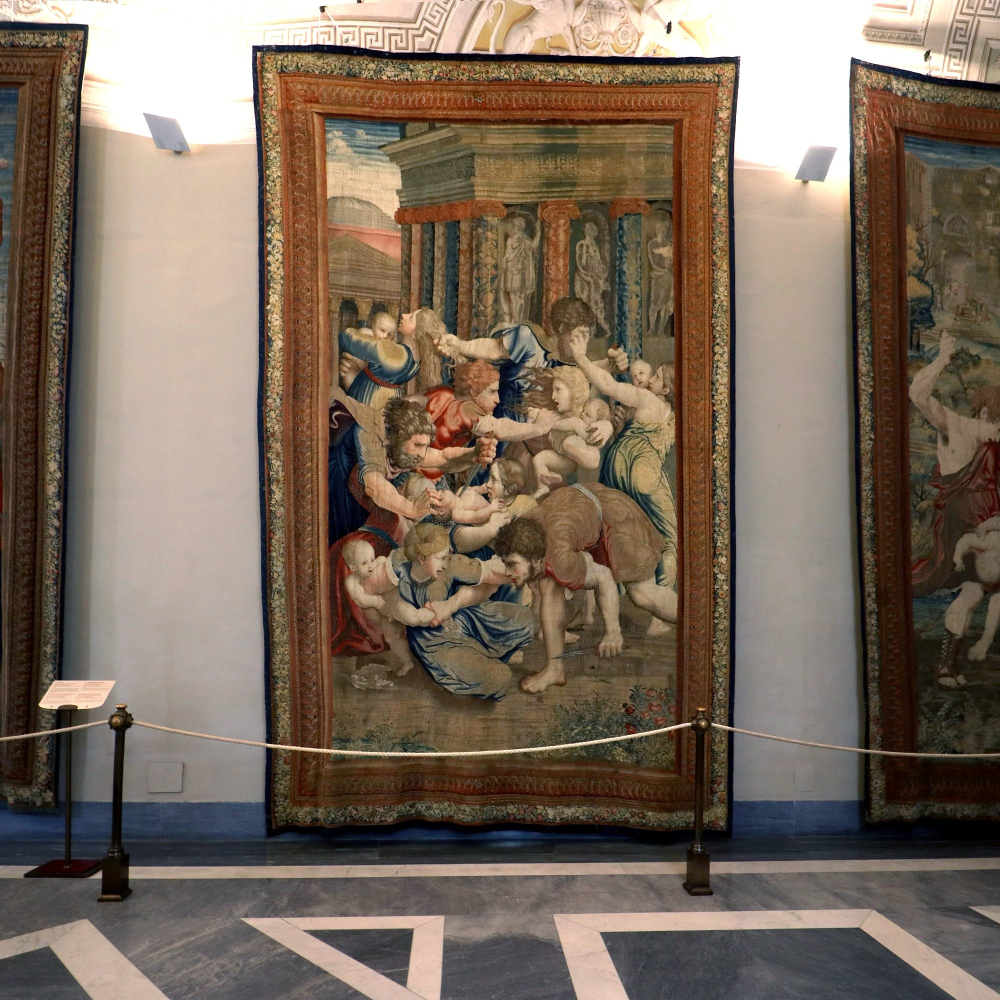

*图源：[Wikimedia Commons](https://commons.wikimedia.org/wiki/File%3A19m-_Strage_degli_innocenti_%28versione_con_monumenti_romani%29%2C_Serie_della_Scuola_Nuova%2C_1524-31_FG.jpg)*

把屠杀放进**古罗马建筑（纪念柱、神庙）**的背景里——文艺复兴惯用的"借古罗马舞台演圣经"。

##### 03b 城外版

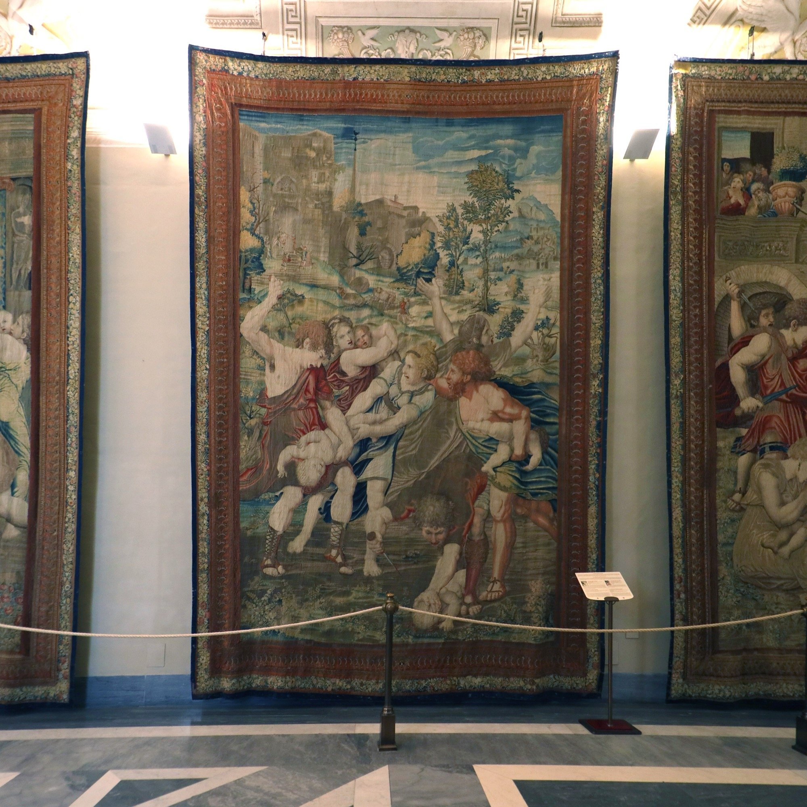

*图源：[Wikimedia Commons](https://commons.wikimedia.org/wiki/File%3A19o-_Strage_degli_innocenti_%28versione_ambientata_fuori_citt%C3%A0%29%2C_1524-31_FG_03.jpg)*

把场面挪到**城门外的开阔地**，背景是城墙与远景。

##### 03c 城内版

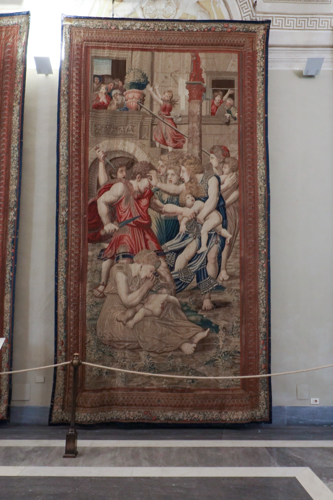

*图源：[Wikimedia Commons](https://commons.wikimedia.org/wiki/File%3A19r-_Strage_degli_innocenti_%28versione_ambientata_in_citt%C3%A0%29%2C_Serie_della_Scuola_Nuova%2C_1524-31_FG_04.jpg)*

把屠杀设在**城内街巷**，建筑挤压出更逼仄、更绝望的空间。三幅对比着看，能体会底稿画家如何用"换布景"调节同一悲剧的情绪强度。

#### 04 复活的基督（Resurrezione di Cristo）⭐ 全廊唯一值得专门停的互动点

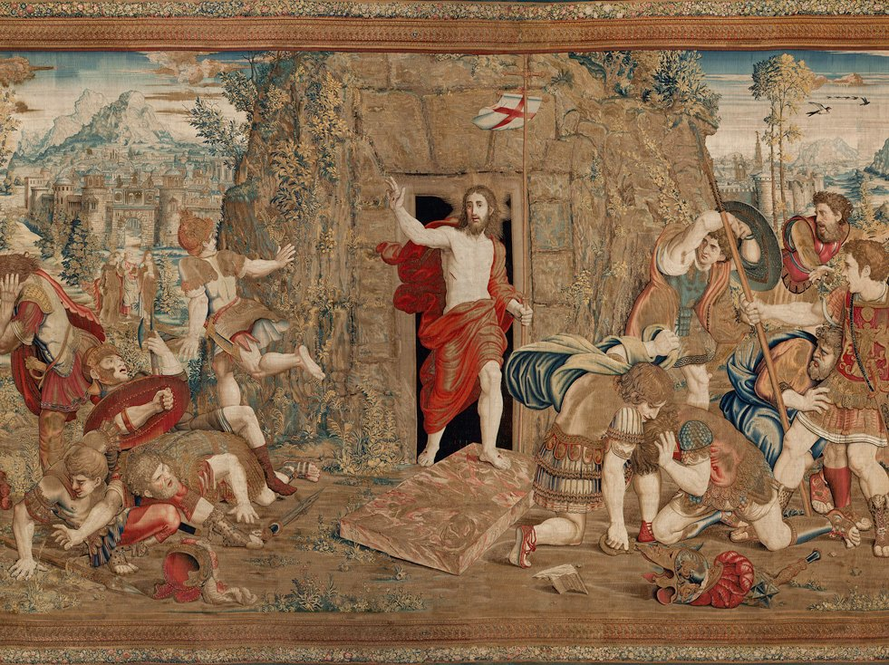

*图源：[梵蒂冈博物馆官网](https://www.museivaticani.va/content/museivaticani/en/collezioni/musei/galleria-arazzi/serie-vita-cristo.html)*

复活的基督踏出石棺、守兵惊倒。这幅最有名是因为一个**错觉**：边走边看，基督的眼睛、连同他迈出的脚，似乎一直**跟着你转**。这是底稿透视处理（视点设计）留下的效果，是挂毯廊唯一值得专门停步左右走动体验的一幅。

《复活的基督》细节——会"跟着你走"的眼睛与迈出的脚（官网大图）：

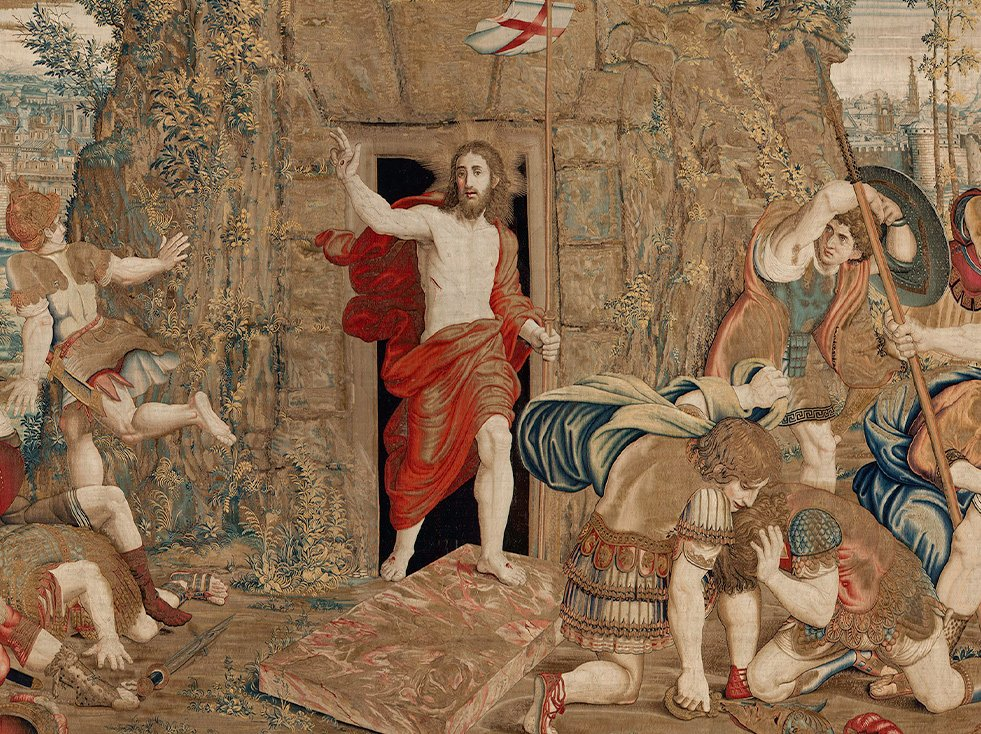

*图源：[梵蒂冈博物馆官网](https://www.museivaticani.va/content/museivaticani/en/collezioni/musei/galleria-arazzi/serie-vita-cristo.html)*

#### 05 以马忤斯晚餐（Cena in Emmaus）

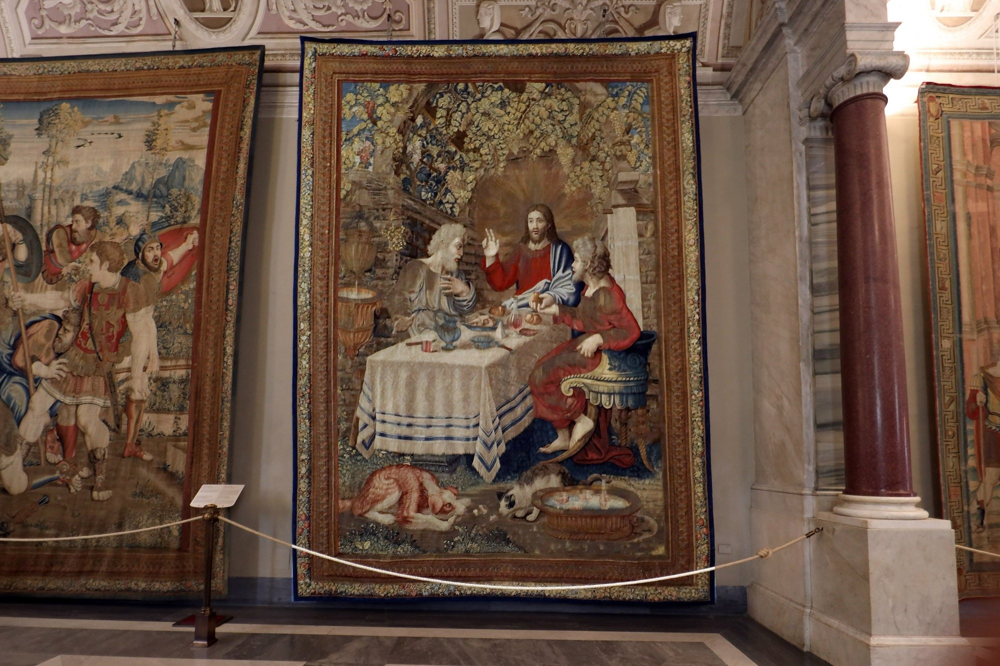

*图源：[Wikimedia Commons](https://commons.wikimedia.org/wiki/File%3A45-_Cena_in_Emmaus%2C_1524-31._Serie_della_Scuola_Nuova_-FG.jpg)*

复活后，基督与两名没认出他的门徒同行到以马忤斯，在席间**擘饼的一刻门徒认出了他**。画的正是擘饼那一瞬——基督举手祝福、门徒恍然。这是"圣体"主题的经典图像，与刚在签字厅看的《圣礼之争》一脉相承。

#### 06 升天（Ascensione）

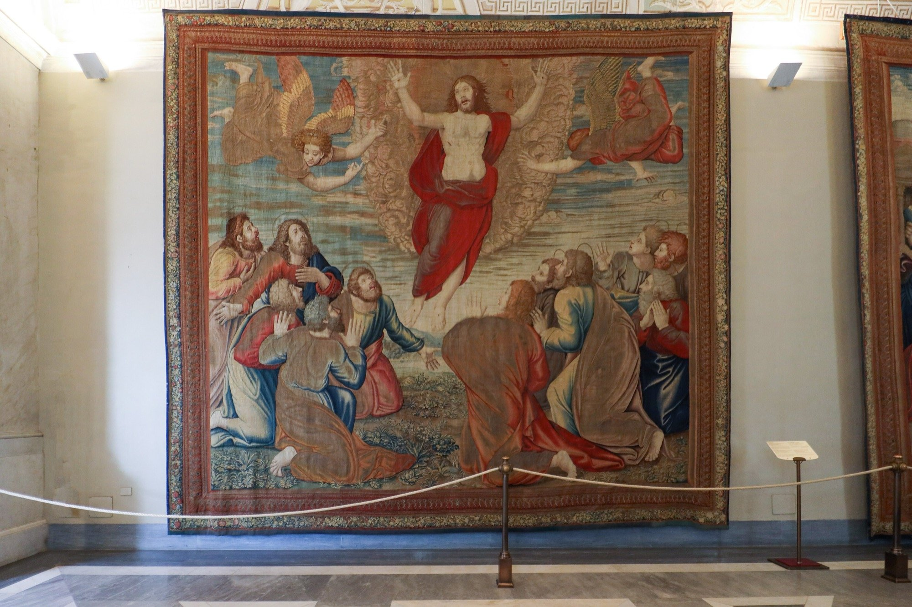

*图源：[Wikimedia Commons](https://commons.wikimedia.org/wiki/File%3A17-_Ascensione%2C_serie_della_Scuola_Nuova%2C_1525-31_-FG.jpg)*

基督在门徒注视下升天——系列的终章。地上一圈使徒仰望，基督在云光中上升。构图垂直、向上牵引，正是"基督生平"叙事的收束。

---

### 二、乌尔班八世生平（Barberini 工坊，1663–95 罗马织）

> 对壁这套晚一百年，由教廷自办的巴贝里尼工坊在罗马织成，讲教皇**乌尔班八世（Urban VIII，本名马费奥·巴贝里尼 Maffeo Barberini，1568–1644，在位 1623–1644）**的一生。他是贝尼尼最大的赞助人——圣彼得大教堂里的**贝尼尼青铜华盖**就是他下令建的，到处可见的**三只蜜蜂纹章**就是巴贝里尼家徽。这套挂毯是巴贝里尼家族给自家教皇立的"织成的传记"。

#### 01 在比萨大学受学位（Maffeo Barberini si addottora）

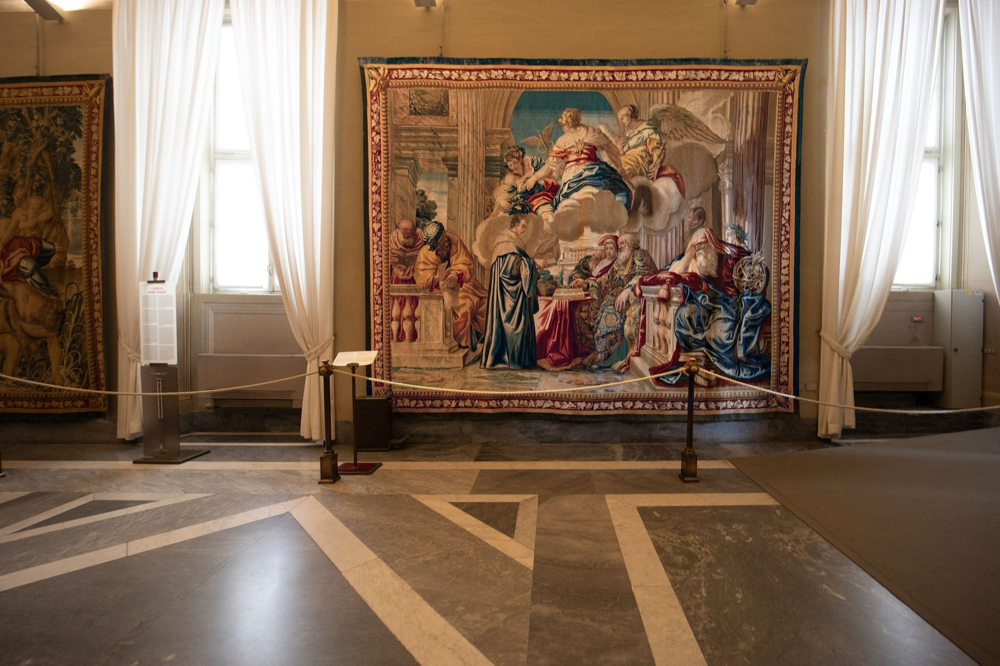

*图源：[Wikimedia Commons](https://commons.wikimedia.org/wiki/File%3A50-_Maffeo_Barberini_si_addottora_all%27Universit%C3%A0_di_Pisa%2C_1663-95_-FG.jpg)*

系列开篇：年轻的马费奥·巴贝里尼在**比萨大学获法学博士学位**。从一个佛罗伦萨家族的青年学子讲起，为后面的步步高升铺陈。

#### 02 治理特拉西梅诺湖（regola il deflusso del lago Trasimeno）

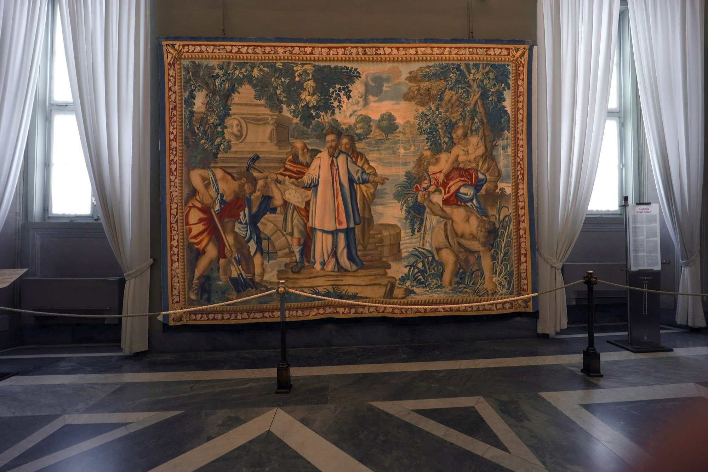

*图源：[Wikimedia Commons](https://commons.wikimedia.org/wiki/File%3A55-_Maffeo_Barberini_regola_il_deflusso_del_lago_Trasimeno%2C_1665-66_-FG.jpg)*

马费奥任翁布里亚地方长官时**主持治理特拉西梅诺湖的排水工程**。把一桩水利政绩织进传记——展示他不只是教士，也是能臣。（特拉西梅诺湖在地图廊"佩鲁贾地区"那幅里也出现过。）

#### 03 保禄五世封他为枢机（nominato cardinale da Paolo V）

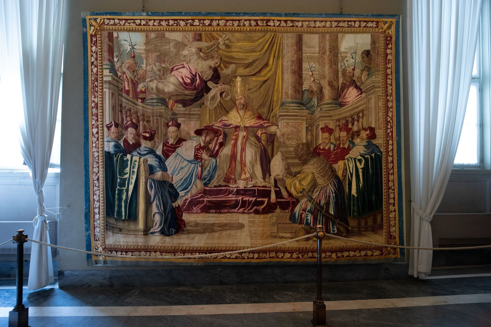

*图源：[Wikimedia Commons](https://commons.wikimedia.org/wiki/File%3A60-_Maffeo_Barberini_nominato_cardinale_da_Paolo_V%2C_1666-67_-FG.jpg)*

1606 年，教皇**保禄五世（Paul V）擢升马费奥为枢机主教**——登顶前的关键一步。隆重的封授仪式、红衣群像，是织工铺陈宫廷盛况的好题材。

#### 04 当选教皇乌尔班八世（Maffeo Barberini eletto papa Urbano VIII）⭐

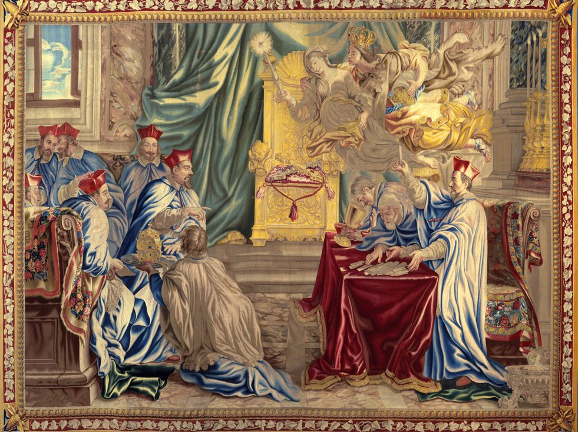

*图源：[梵蒂冈博物馆官网](https://www.museivaticani.va/content/museivaticani/en/collezioni/musei/galleria-arazzi/serie-vita-urbanoVIII.html)*

1623 年**秘密会议（Conclave）选举马费奥为教皇，取名乌尔班八世**——整套传记的高潮。这是这套系列的"主图"，也是廊里官方主推的一幅。

《巴贝里尼当选教皇》细节——红衣主教群像（官网大图）：

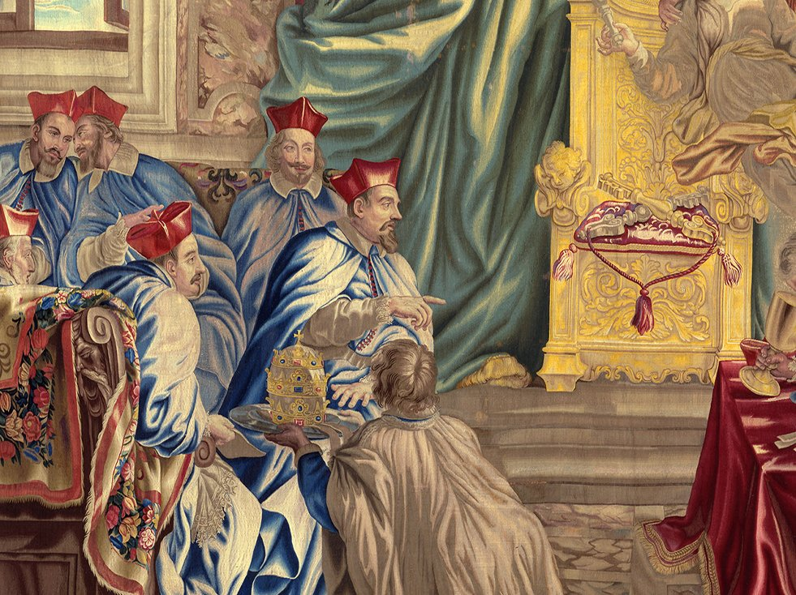

*图源：[梵蒂冈博物馆官网](https://www.museivaticani.va/content/museivaticani/en/collezioni/musei/galleria-arazzi/serie-vita-urbanoVIII.html)*

#### 05 推动教廷国和平（promuove la pace nello Stato Ecclesiastico）

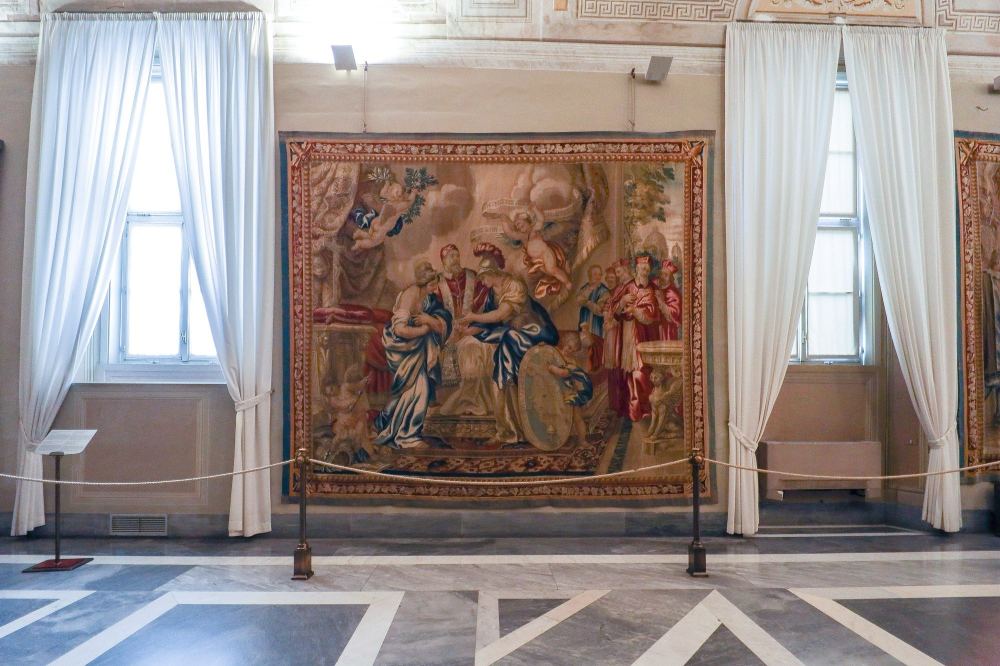

*图源：[Wikimedia Commons](https://commons.wikimedia.org/wiki/File%3A80-_Urbano_VIII_promuove_la_pace_nello_Stato_Ecclesiastico%2C_1675-77%2C_Serie_della_vita_di_Urbano_VIII_-FG.jpg)*

登基后的治世篇之一：乌尔班八世**在教皇国境内促成和平**。把"和平缔造者"的形象织进传记，是教廷自我塑造的标准笔法。

#### 06 修筑罗马城墙（fa fabbricare le mura di Roma）

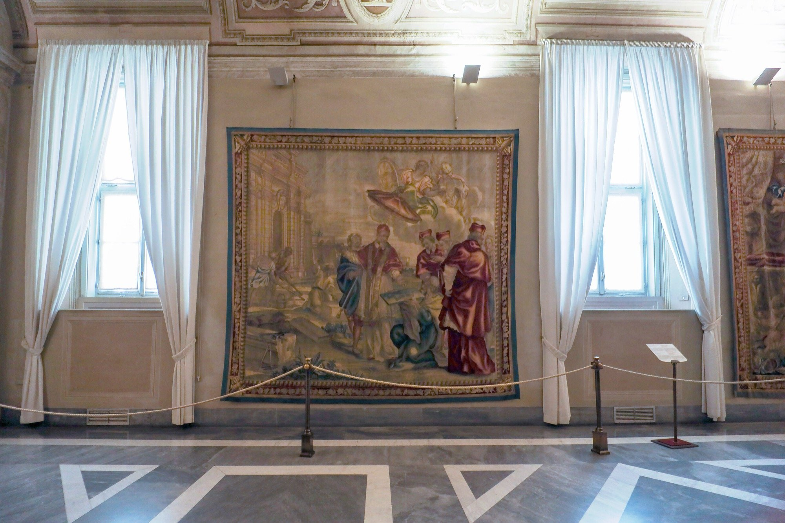

*图源：[Wikimedia Commons](https://commons.wikimedia.org/wiki/File%3A85-_Urbano_VIII_fa_fabbricare_le_mura_di_Roma%2C_1679%2C_Serie_della_vita_di_Urbano_VIII_-FG.jpg)*

乌尔班八世**加固罗马的城防**（贾尼科洛山一线的"乌尔班城墙"至今仍在）。把军事工程织进传记——一位既保境又安民的教皇。

#### 07 祝圣圣彼得大教堂（consacra la basilica di San Pietro）⭐ 与圣彼得大教堂直接相关

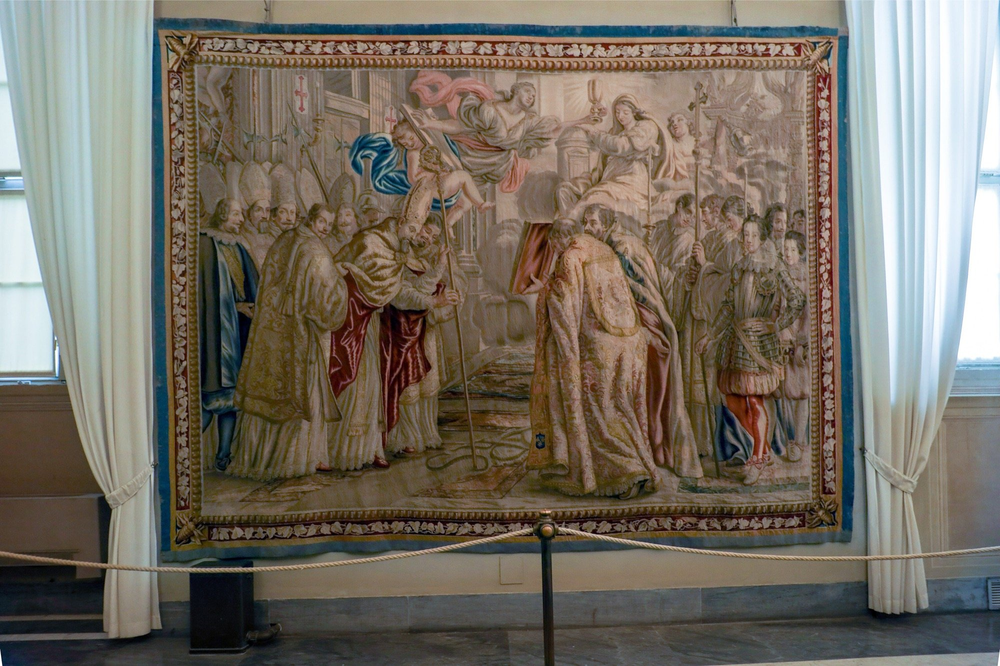

*图源：[Wikimedia Commons](https://commons.wikimedia.org/wiki/File%3A90-_Il_18_novembre_1656_Urbano_VIII_consacra_la_basilica_di_San_Pietro%2C_1671-73_-FG.jpg)*

**1626 年 11 月 18 日，乌尔班八世正式祝圣（祝献）新圣彼得大教堂**——历时一百多年重建的新圣彼得终于落成启用，由他主持祝圣大典。**这正是稍后会走进的那座教堂**：在挂毯里先看一眼它"剪彩"的那一刻，再走进去看实物，特别应景。（注：Commons 文件名把年份误写成 1656，实际史实是 1626 年。）

---

### 现场怎么看（速记）

1. **盯《复活的基督》**——边走边看，基督的眼睛和脚一直跟着你转，挂毯廊唯一值得专门停的互动点。
2. **找三幅《无辜婴孩被屠》**——同一场屠杀的罗马/城外/城内三版本，全廊最暴烈、最"拉斐尔式"的一组。
3. **分清两壁**——一壁基督生平（16 世纪布鲁塞尔织），对壁乌尔班八世生平（17 世纪罗马织）：一条廊隔着一百年的两种叙事。
4. **凑近看织线**——丝与羊毛的细密层次、夹的金银线，想象崭新时的色彩，也就明白灯光为什么这么暗。
5. **接力到圣彼得**——记住《祝圣圣彼得大教堂》这幅，待会儿走进那座教堂时回想一下它落成那天。
