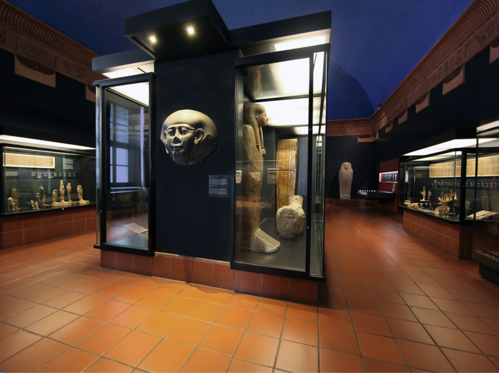
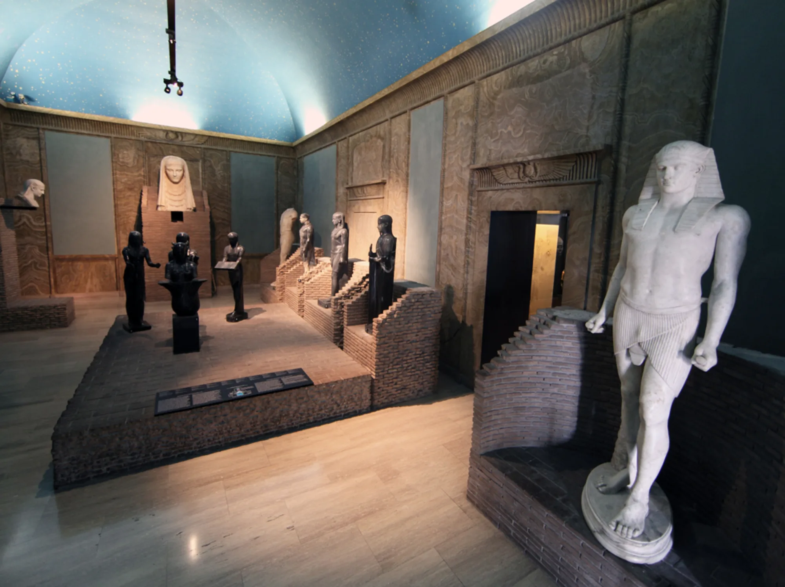
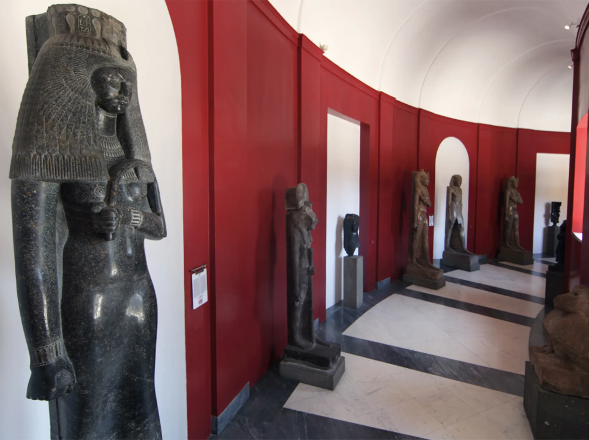
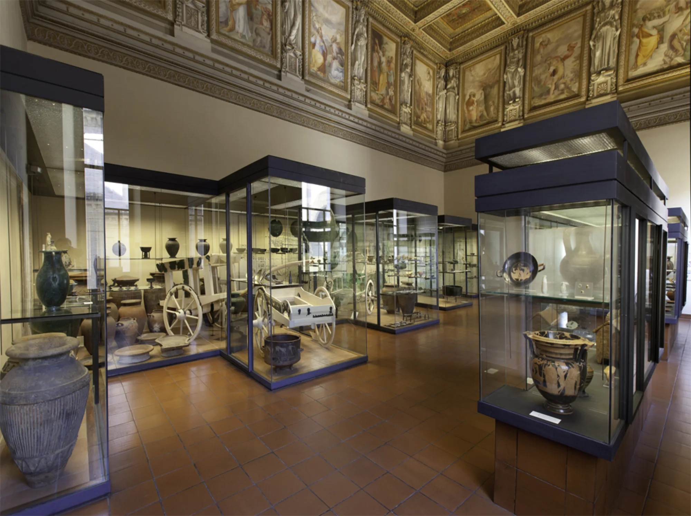
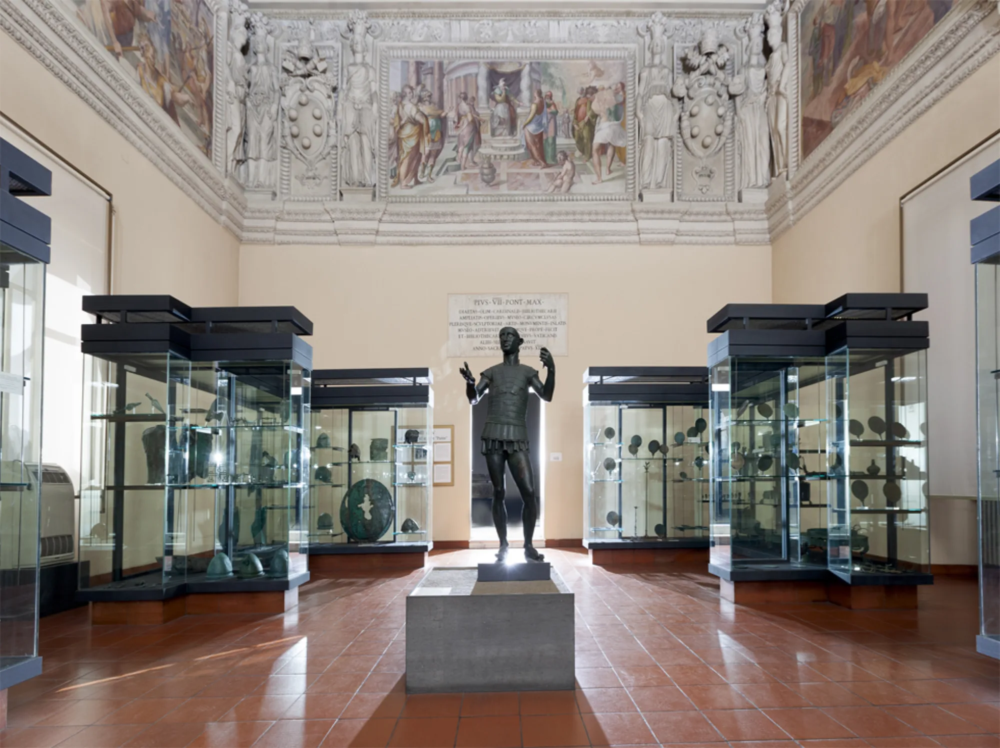
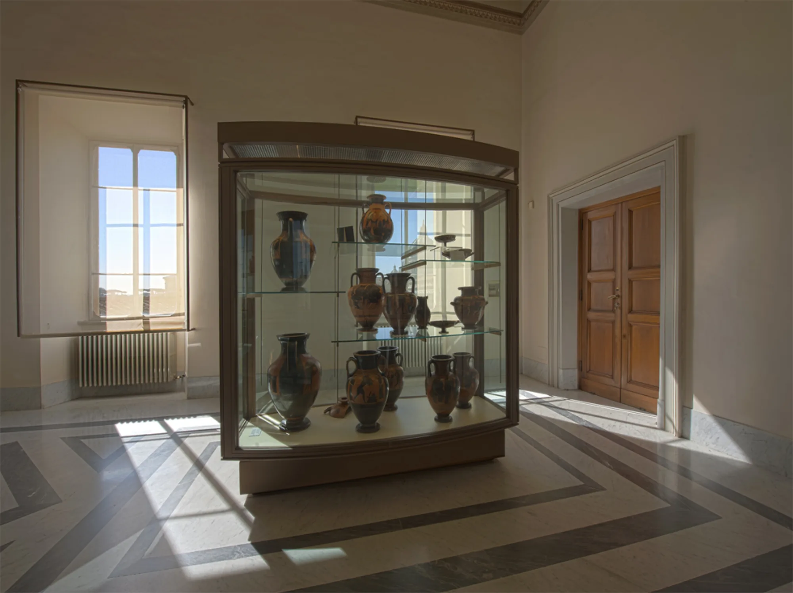
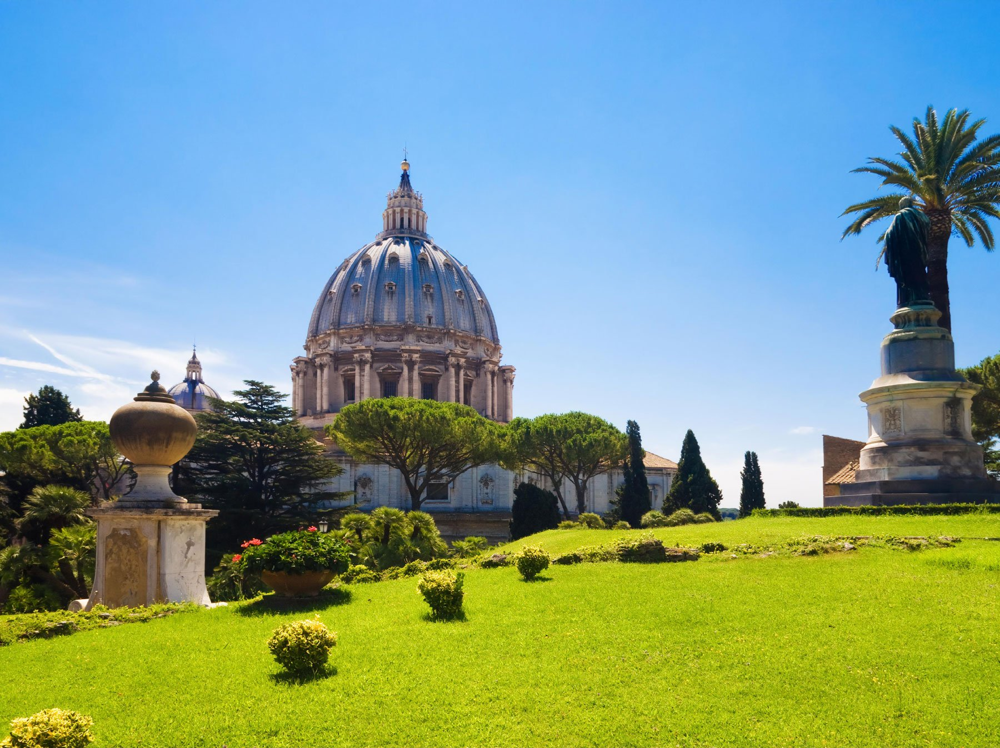
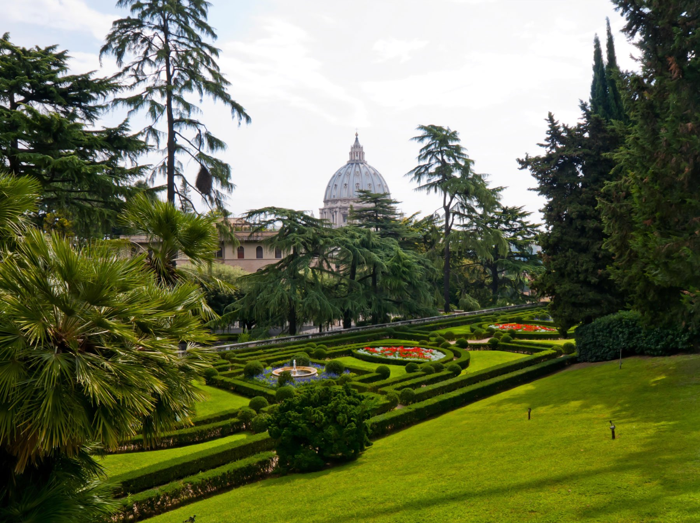

> ⭐ **调研备查，D3 默认不去**。梵蒂冈博物馆体量巨大，下面几处都不在"博物馆→西斯廷→圣彼得"的主动线高潮上；D3 上午只有 2.5–3 h，**优先保证拉斐尔房间 + 西斯廷 + 大教堂**。这里留作"万一时间富余/特别感兴趣"时的备选，或未来再访参考。
>
> 🔗 官方：[梵蒂冈博物馆 · 各馆](https://www.museivaticani.va/content/museivaticani/en/collezioni.html)

### 埃及博物馆（Museo Gregoriano Egizio）

- **官网介绍页**：[Wikipedia · Gregorian Egyptian Museum](https://en.wikipedia.org/wiki/Gregorian_Egyptian_Museum)

> 🔗 官方：[Gregorian Egyptian Museum · Musei Vaticani](https://www.museivaticani.va/content/museivaticani/en/collezioni/musei/museo-gregoriano-egizio.html)

教皇格里高利十六世 1839 年创立，9 个展厅，藏**真品埃及木乃伊、彩绘棺、纸莎草、神像**，以及罗马帝国时期"埃及风（Egyptomania）"的仿制品（多来自哈德良别墅）。**要不要去**：对古埃及特别感兴趣再去；它在松果院附近、动线偏离主线，**普通行程跳过不可惜**。若去，重点看木乃伊与彩绘棺、以及那批"罗马人仿埃及"的混血雕塑。

Sala II 葬仪厅——真品木乃伊与彩绘棺所在（官网大图）：

*图源：[梵蒂冈博物馆官网](https://www.museivaticani.va/content/museivaticani/en/collezioni/musei/museo-gregoriano-egizio/sala-ii--costumi-funerari-dellantico-egitto.html)*

Sala III 哈德良别墅"卡诺普斯塞拉佩雍"复原厅——"罗马人仿埃及"混血雕塑（官网大图）：

*图源：[梵蒂冈博物馆官网](https://www.museivaticani.va/content/museivaticani/en/collezioni/musei/museo-gregoriano-egizio/sala-iii--ricostruzione-del-serapeo-del-canopo-di-villa-adriana.html)*

Sala V 神像雕像厅（官网大图）：

*图源：[梵蒂冈博物馆官网](https://www.museivaticani.va/content/museivaticani/en/collezioni/musei/museo-gregoriano-egizio/sala-v--statuario.html)*

### 伊特鲁里亚博物馆（Museo Gregoriano Etrusco）

- **官网介绍页**：[Wikipedia · Gregorian Etruscan Museum](https://en.wikipedia.org/wiki/Gregorian_Etruscan_Museum)

> 🔗 官方：[Gregorian Etruscan Museum · Musei Vaticani](https://www.museivaticani.va/content/museivaticani/en/collezioni/musei/museo-gregoriano-etrusco.html)

藏**意大利本土先于罗马的伊特鲁里亚文明**文物——金饰、青铜、陶器，镇馆之宝是 **Regolini-Galassi 墓**出土的公元前 7 世纪**黄金扣饰与陪葬品**，金工之精令人咋舌；还有著名的**马尔斯青铜像（Mars of Todi）**与大量希腊进口彩绘陶瓶。**要不要去**：对前罗马古意大利文明感兴趣再去；位置在博物馆上层、偏离主线，**普通行程跳过**。

Sala II Regolini-Galassi 墓陪葬品厅——黄金扣饰与青铜陪葬品（官网大图）：

*图源：[梵蒂冈博物馆官网](https://www.museivaticani.va/content/museivaticani/en/collezioni/musei/museo-gregoriano-etrusco/sala-ii--tomba-regolini-galassi.html)*

Sala III 青铜厅——厅中央即马尔斯青铜像（Mars of Todi，官网大图）：

*图源：[梵蒂冈博物馆官网](https://www.museivaticani.va/content/museivaticani/en/collezioni/musei/museo-gregoriano-etrusco/sala-iii--bronzi.html)*

陶瓶收藏厅——希腊进口与伊特鲁里亚彩绘陶瓶（官网大图）：

*图源：[梵蒂冈博物馆官网](https://www.museivaticani.va/content/museivaticani/en/collezioni/musei/museo-gregoriano-etrusco/sala-xviii-collezione-vasi.html)*

### 梵蒂冈花园（Giardini Vaticani）

- **官网介绍页**：[Wikipedia · Gardens of Vatican City](https://en.wikipedia.org/wiki/Gardens_of_Vatican_City)

> 🔗 官方：[Vatican Gardens · Musei Vaticani](https://www.museivaticani.va/content/museivaticani/en/patrimonio-naturale-archeologico/giardini.html)

占梵蒂冈城近一半面积的私家园林（文艺复兴喷泉、法式/英式/意式园景、教皇官邸），**只能预约专门的"花园导览/小火车（open-bus）"团进入，不能自由步行**，且是**独立票种、需另约**。**要不要去**：D3 上午绝无时间；想去需**专门安排半天 + 单独预约**。**结论：本次行程不考虑**，仅留档。

从花园草坪望圣彼得大教堂穹顶（官网大图）：

*图源：[梵蒂冈博物馆官网](https://www.museivaticani.va/content/museivaticani/en/patrimonio-naturale-archeologico/giardini.html)*

意式园景花坛与远处穹顶（官网大图）：

*图源：[梵蒂冈博物馆官网](https://www.museivaticani.va/content/museivaticani/en/patrimonio-naturale-archeologico/giardini/presentazione-giardini.html)*

### 其他没单列、但路过会瞥见的

- **庇护-克莱门特博物馆**的其余厅（动物厅、半身像厅等）——已在 [V - 01 入口与松果院 + 八角庭院（拉奥孔 + 观景楼阿波罗）](../v01-pinecone-octagonal/) / [V - 02 缪斯厅 + 圆形厅 + 希腊十字厅（古典雕塑精选）](../v02-muses-rotunda-greek-cross/) 覆盖主线部分。
- **梵蒂冈绘画馆（Pinacoteca Vaticana）**——藏拉斐尔《基督显容》、卡拉瓦乔《基督下葬》、达·芬奇《圣杰罗姆》等顶级油画，但它在**入口附近、是一条独立支线**，和"博物馆→西斯廷"主动线方向相反。⚠️ **如果三人对绘画极感兴趣，这其实比埃及/伊特鲁里亚馆更值得挤时间**——可视上午进度临时决定是否回头看一眼（尤其拉斐尔《显容》《卡拉瓦乔》）。本次默认不安排，列此备查。

### 怎么取舍（一句话）

D3 上午时间刚够主线，**这些支线一律默认不去**；唯一"如果真有富余且爱画"的备选是**绘画馆（Pinacoteca）**而非埃及/伊特鲁里亚馆。把体力和时间留给拉斐尔房间、西斯廷和大教堂（见 2026-06-30 周二 罗马 D3 详情）。

---

← 返回 2026-06-30 周二 罗马 D3 详情 · 主线：[V - 01 入口与松果院 + 八角庭院（拉奥孔 + 观景楼阿波罗）](../v01-pinecone-octagonal/) · 总览：[00 总览](../overview/)
